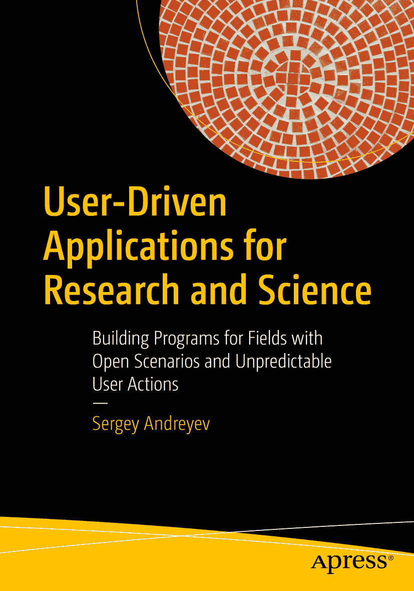

ISBN `978-1-4842-6487-4`

电子书 ISBN `978-1-4842-6488-1`

<https://doi.org/10.1007/978-1-4842-6488-1>

© 谢尔盖·安德烈耶夫 2020

本作品受版权保护。出版商保留所有权利，无论涉及全部或部分材料，特别是翻译权、重印权、插图复用权、朗诵权、广播权、微缩胶片复制权或任何其他物理形式的复制权、信息存储与检索传输权、电子改编权、计算机软件权，以及目前已知或今后开发的类似或不同方法的应用权。

本书中通用描述性名称、注册商标、商标、服务标志等的使用，即使未作明确声明，也不意味着这些名称不受相关保护性法律和法规的约束，因此可被自由使用。

出版商、作者及编辑假定，本书中的建议和信息在出版之日均属真实准确。出版商、作者及编辑均不对本书所含材料或可能存在的任何错误或遗漏提供明示或暗示的担保。

对于已出版地图中的管辖权主张及机构隶属关系，出版商保持中立立场。

本书全球图书贸易发行方为 Springer Science+Business Media LLC，地址：1 New York Plaza, Suite 4600, New York, NY 10004。电话：1-800-SPRINGER，传真：(201) 348-4505，电子邮件：`orders-ny@springer-sbm.com`，或访问 `www.springeronline.com`。Apress Media, LLC 是一家加利福尼亚有限责任公司，其唯一成员（所有者）是 Springer Science + Business Media Finance Inc（SSBM Finance Inc）。SSBM Finance Inc 是一家特拉华州公司。

*献给我的父母*