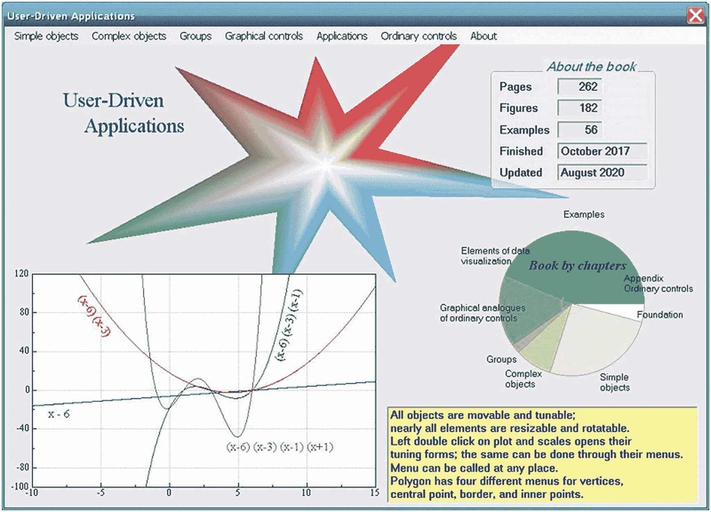

# 引言

我们生活在固体物体之中，而每件物体都有其特定用途。衣服、汽车和房屋都有尺寸，我们使用这些东西时都会考虑到它们的尺寸。有些衣物（例如，毛衣）具有一定的弹性，在多年间穿着它们十分轻松，而在此期间穿着者的体型可能会发生变化。房屋及其部件通常是固定的，但即使它们也有可移动的部分，这些部分可能很有用（例如，滑动面板、活动隔断、可变换的桌子）。

半个世纪前，计算机扮演着大型、强大计算器的角色，因此计算机程序中的几乎所有东西都是固定的。随着第一批编程语言的问世，带有参数的数学函数的经典思想被转化为程序，使得计算机的用途大大增加。然而，那时还没有现代意义上的界面；所有的灵活性仅限于输入不同的数字，并接收由固定程序代码计算出的结果。

*   计算机体积庞大且造价昂贵，因此只能由公司、大学或政府机构使用。因此，计算机的数量很少。
*   计算机被用于解决数量有限的任务，这些任务纯粹是工程和科学领域的，或者是国家防御所需的。
*   每个程序的核心都是某种数学工具，要么是多年来众所周知的，要么是为解决特定任务而设计的。能理解每个数学问题的人数有限。
*   用于解决问题的数学方程必须被翻译成机器代码，或者稍晚一些，翻译成计算机语言的语句；那时，`FORTRAN` 是最流行的语言。能够编写程序的人数也有限。因为成为一名优秀的数学家比学习一门编程语言要困难得多，所以那些处理方程并希望从计算机获得结果的人中，有相当一部分也变成了程序员。

即使当处理方程并等待计算结果的人（他们是第一批用户）与将这些方程转化为代码的人（第一批程序员）是不同的群体时，这些人的数量也是相当且很少的，因此所有问题通常都是通过个人对话来讨论和解决的。这个链条——方程、编码、结果讨论、方程和代码的修改——被组织成一个无止境的循环。程序的输入和输出都是数字；方程的编码是整个过程中的主要部分，而且在现代意义上根本没有界面。过程的关键部分是编码，因此程序员控制着整个过程。

在个人电脑问世之后，尤其是在它们切换到图形模式之后，情况开始迅速变化。（起初它们以文本模式运行，但这个过程并不长，现在很少有人记得了。）如今，计算机和程序的世界几乎在每一个方面都与之前描述的情形截然不同。

*   计算机变得个人化；它们价格低廉且数量庞大。
*   计算机被用于解决各种各样的任务。工程和科学程序仍在被使用，并且极其重要，但它们在数量上被其他应用远远超过。更重要的是工程和科学程序的用户数量。这个数量与其他应用的用户相比微不足道，因此编程发展的方向是由其他数量更多的应用所决定的。
*   每个程序都基于编码后的想法，但这些隐藏的算法和方程已不再是其最重要的部分。现在，核心是界面。
*   数量庞大的不同程序需要数量庞大的程序员，他们在专业水平、技能和成果方面差异巨大。

只有一件事情仍然相同——程序员对自己工作成果的控制权。所有提到的变化都是由技术和编程科学的成就所推动的，而对应用的控制权则更多地基于哲学和心理学。你可能会读到一些新思想，它们听起来很吸引人，但如果它们与你多年的实践相悖，那么就很难被接受。我将在几页之后讨论这种新思想的心理层面。

最有用和最流行的程序是由少数人为成千上万或数百万用户开发的。几十年前就已显而易见，当开发者与用户的比例如此悬殊时，固定的界面会导致许多用户失望。因此，在过去 30 多年里，提出了许多解决方案；整个这类想法的领域被称为*自适应界面*。其中一些解决方案很有趣且实现得也很完美，但所有这些都是纯粹技术性的，并且错过了关键：问题在于哲学层面，而仅凭更精确地调整当前使用的工具是无法解决此类问题的。这类问题需要更全局性的变革。

很多年前，我为了自己语音分析领域的研究工作开发了复杂的系统。这些程序也被其他语音识别领域的研究者和从业者使用。后来，我应用所开发的编程技术，为热力学、电信以及大型电网分析领域的专家设计应用程序。来自不同领域的工程与科学程序有许多共同特征，因此一个领域的最佳方案可以很容易地应用于其他领域。我曾在不同领域工作，熟悉所有这些领域中的优秀程序，并且越来越强烈地感觉到，在最佳应用程序的开发上存在停滞。这种停滞并非存在于某一个特定领域，而是存在于整个工程与科学程序领域，因此整个重要程序领域的停滞必然有着相同的原因。

最终，我找到了问题的核心，并且知道了应该做什么。我花了一些时间来构思一个算法并产出最初的结果；这发生在 2006 年。由于我的主要兴趣在工程与科学程序领域，因此我在屏幕对象可移动性方面的首批实验也在这个领域。我想从一开始就强调，可移动性并非根据某种预设脚本来改变对象的位置。可移动性意味着用户可以在任意时刻抓取任意屏幕对象，并对其做任何想做的事情。在开发出第一批可移动/可调整大小的绘图区域后，后续改进进展迅速，因为事实证明`用户驱动型应用程序`包含着严格且可以说是铁一般的逻辑。此后不久，我为新应用程序制定了几个简单的规则。

*   `规则 1`：所有元素都是可移动的。
*   `规则 2`：所有可见性参数都必须易于用户控制。
*   `规则 3`：用户关于移动、调整对象大小或改变可视化参数的指令必须完全按其原意实现；不允许开发者进行任何添加或扩展解释。
*   `规则 4`：所有参数都必须保存并恢复。
*   `规则 5`：前述规则必须在所有层级上实现，从应用程序的主窗体一直到其最细微的角落。

这些规则是在我主要致力于不同科学程序工作时制定的。此后，我为其他完全不同的领域开发了用户驱动型应用程序，但这些规则在所有这些应用中无需任何改动即可生效。这些规则完全独立于它们所应用的领域，也不依赖于底层的编程技术。如果你愿意，可以开发自己的可移动性算法并在程序中使用。无论底层算法如何，尝试设计任何包含可移动元素的东西都需要实现相同的规则，并将产生用户驱动型应用程序。

可移动性并不会改变程序的外观。任何特定程序的目的与其元素是否可移动无关。如果某个应用的旧版（不可移动）版本外观良好，那么完全相同的界面可以作为同类用户驱动型应用的默认界面。¹ 可移动性改变了代码，但更重要的是，它改变我们处理应用程序的方式。几十年前，在大型计算机时代，程序从不交付给用户。用户提出任务并获得结果，但从设计到从计算机获取结果的整个过程都由开发者完成。后来，个人电脑成为盈利产品，程序也随之转变为产品。尽管程序像其他产品一样被销售，但用户对它们的控制有限。用户对程序的控制仅仅局限于开发者同意给予他们的程度。对于 PC 上使用的程序而言，这种控制程度是微不足道的。这种旧时代的残余基于两个相互关联的因素：旧的开发者-用户关系哲学，以及缺乏能够改变这种哲学的工具（算法）。

用户驱动型应用程序并非由开发者统治，而是由用户统治！这意味着用户的权限不受开发者关于“能做什么或不能做什么”的想法所限制。用户可以对自己设定的所有元素做任何事。开发者必须提供一个美观的默认界面（尽可能做到最好），并防止程序因用户对程序元素的任何操作而崩溃。

我理解，在开发者对 PC 程序长达数十年的绝对统治之后，我提出的将完全控制权交给用户的想法听起来有些奇怪（至少可以说），但请看看当前手机和智能手机上程序运行所遵循的主要理念。只有三个简单的动作（点击、移动和缩放）可用，但这些动作没有限制。你在屏幕上看到什么，完全取决于你的技能以及使用这些命令的能力。

我们电脑上的程序能做许多令人惊叹的事情，但命令大多相同：按下、移动、缩放，或许还有重新配置。屏幕对象的大小和形状各异；有些对象需要精确操作其部件，因此我使用鼠标作为控制元件。键盘从不用于控制我的程序，除非用户需要输入某些内容。

我想从一开始就强调，提议的开发者-用户关系改变并不会改变任何应用程序的任务，也不会改变应用的默认界面（如果该默认界面良好）。如果用户不喜欢默认界面但喜欢这个应用，那么用户可以快速将界面改为自己喜欢的样式，并继续使用该应用。更重要的是：是程序的外观，还是所需且获得的结果？为了证明切换到用户控制并不会毁掉应用，我选取了一个广为人知的程序——Windows 系统中的计算器——并制作了一个它的精确副本，但该副本在用户的完全控制下运行。你将亲自评估其中的差异，因为这个程序作为书中的一个示例被包含在内。

---

¹ 原文此处为脚注标记 `^(²)`，排版时按 Markdown 上标处理。

假设你正在与某个数据库打交道。你需要获取数据，有时还要更改数据。每个人都会不时地处理一些数据，所以这项任务对大家来说都很熟悉。你通过某个程序来查看数据；这个程序是由那些为寻找、展示和更改所需数据的最佳方式而深思熟虑的人所开发的。程序通过屏幕上的某些字段来显示数据。这些字段在屏幕上的摆放位置，是从开发者的角度认为最佳的方式。也许有一些改变这种视图的选项，但这些选项仍然是开发者认为对用户有益的视图。这个界面及其所有变体完全由开发者控制。

以你偏好的方式处理数据并非纯理论上的例子。多年前，我设计了一个名为`Personal Data`的程序，你将在本书的示例中找到它。这个示例展示了界面不仅能适应各种任务，更重要的是，能适应无限多的、不可预测的任务。在我看来，这是一个有趣但并非最令人印象深刻的例子。用户驱动型应用能给用户带来更多好处，尤其是在那些结果不可预测或可能变体数量无限的应用中。在用户通常比他们必须使用的应用程序的开发者在其特定领域更为专业的领域里，这类程序需求量很大。这一论断适用于所有科学和工程领域，因此，如果旧式程序转变为用户驱动型程序，所有领域的研究人员都能获得最大收益。

```

这不是第一本关于我理念的书，我先前写的书与这本书之间存在一些传承关系。我的主要著作《可移动对象的世界》[2]的第一个版本写于 2010 年；在随后的几年里，它被多次修改。每个新版本都包含了新的成果和新的示例，因此篇幅不断增长；最新的版本有近 1000 页，包含来自许多不同领域的 200 个示例。2016 年，一本篇幅小得多的书《完全可移动性要素》问世了。在撰写这本书的过程中，我意识到那本主要著作必须重写，但我也意识到这将需要付出太多努力。于是，我决定写一本新书，也就是你现在正在读的这本。我使用了上述两本书中的一些示例，但几乎所有的示例都经过了修改。2019 年，我写了《几何光学图解》[3]一书。该书中的几个示例对当前这本书很有用，因此它们出现在本书的后面部分。

用户驱动型应用的开发离不开所有屏幕元素的完全可移动性。本书的主要目的是解释新型应用的工作原理，但如果不解释最常用基本对象的可移动性，这就无法做到，因此本书从讨论新型设计的构建元素开始，而真正的应用则在本书的后半部分进行讨论。

## 第1章：基础

本章包含主要定义，并让你熟悉用于实现屏幕元素可移动性的基础类。

## 第2章：简单对象

本章解释最流行形状的图形对象的可移动性：直线、矩形、正多边形和任意多边形、圆形、圆环等。

## 第3章：复杂对象

本章解释由参与同步、关联和独立移动的不同元素组成的对象的可移动性。

## 第4章：组

本章演示屏幕元素在用于某个子任务时如何组合在一起。组可以基于不同的原则，这增加了它们的多样性。这种多样性在我的书[2]中得到了体现，其中关于组的那一章几乎是篇幅最大的。在当前这本书中，我只讨论我最喜欢的一类组，因此这是本书最短的一章。

## 第5章：普通控件的图形化替代

本章演示用具有相同功能但能消除操作系统对重要屏幕对象组控制的图形元素来替换流行的普通控件。

## 第6章：数据可视化元素

数据可以通过多种不同的方式进行可视化，应用程序设计者无法为每个特定用户预测程序的最佳视图。对数据的理解及其分析高度依赖于用户可用的数据可视化可能性。数据可视化对象在我的书[2]中讨论过，而在当前这本书中，仅演示了柱状图和饼图的变体。

## 第7章：示例

当所有屏幕元素都是可移动的，程序就可以被开发成用户驱动型应用，因此讨论的重点从可移动性算法的细节切换到了整体设计。本章只有少数几个示例，并且特意选择了彼此尽可能不同的示例。

*   `Calculator`是一个众所周知的程序的版本。

*   `Family Tree`在世界范围内引起了高度关注，因为它是那种开发者无法预测所有用户可能需求的任务之一。它正是一项任务，用户需要的不是一组选择，而是一个能做任何他们需要事情的工具。

*   `Function Viewer`是另一个具有无限且不可预测用户请求的任务示例。这个示例表明，应用程序可以设计成不是一组预定义的变体，而是解决复杂任务的工具。`Function Viewer`不是一个真正的科学应用，但它作为一个示范示例，尽可能地接近这种类型，并且必须能被任何读者理解。

*   几个关于几何光学主题的示例表明，用户驱动型应用允许其用户处理程序开发者无法预测的情况。这些程序并非用作专门的科学计算器，而是更像研究和分析未知事物的工具。

## 附录 A：普通控件

我试图在程序中尽量减少普通控件的使用。多年前当我刚开始研究屏幕对象的可移动性时，根本无法想象完全不使用控件来设计复杂的程序。基于可移动和不可移动对象的混合体来设计程序是不可能的（即使单个不可移动元素也会造成一片混乱），因此控件的可移动性成为所开发算法的重要部分。后来，我用图形化替代品替换了最流行的控件，现在普通控件在我的程序中已是罕见元素。这一部分中的示例演示了独立控件、带有不同类型注释的控件以及基于控件的内部元素组成的特殊组的可移动性。

通常，任何程序的第一个打开的窗体都会通过展示将要使用的元素来说明该应用的整体思路。当应用程序处理一个或另一个特定对象时，这不成问题。本书将演示许多不同的对象；试图在一个窗体中展示所有对象会使它过于拥挤，因此我只挑选了其中一些。

当你启动本书附带的程序，并首次看到这些对象时（图 I-1 ），你对它们的特殊功能一无所知。你需要了解的是，所有对象都是`可移动的`。稍后，我们会详细讨论每个类别，并以各种方式对相同的对象进行修改。



图 I-1

配套程序的主界面

20 年前，当我还是高级程序开发人员，按照自适应界面规则设计那些应用程序时，我也是这样做的。那些老程序大多基于普通控件。每台计算机都有操作系统提供的字体。有些用户会更改字体，但并非所有控件都使用这种字体。一些控件会忽略用户的更改；另一些则会进行调整。整个系统简直一团糟。我会花几天时间，力求将所有屏幕元素放置在最佳位置。我会不断优化视图效果，并为之自豪。然后，我会在另一台默认字体不同的计算机上测试准备好的程序，并惊讶地看着结果。精心准备的优秀视图被破坏得令人难以置信，而且无法补救，因为这是自适应界面的结果。用户无能为力；一切都由开发者的良好意愿和那些用户无法控制的系统设置预先决定。

在用户驱动型应用程序中，出现糟糕视图而非优秀视图的可能性是存在的，但这种情况的概率很低。首先，在本书的主要部分，几乎完全没有普通控件。附录专门讨论这类元素，但在那之前，只存在少量普通控件。其次，也是最重要的一点是，任何对视图的破坏都不是致命的，因为用户可以更改一切。

用户的无限操作会破坏应用程序的视图吗？当然会。这可能是意外，也可能是故意的。如果用户对某个元素或整个视图造成了真正的混乱，那么可以通过菜单命令重新安装特定元素或整个表单的默认视图。作为程序员，我提供了一个易于使用的工具来进行更改和恢复，但如何使用这个工具，由用户决定。

几乎所有操作都是被允许的。没有“这是好的，所以允许；这是坏的，所以禁止”这类限制。作为开发者，我不会从好与坏的角度来评估用户所做的更改。我唯一关心的是元素的存在性，因此所有元素都有最小尺寸限制，以防止它们因挤压而消失。除此之外，用户可以随心所欲。正如我所说，有菜单命令可以重新安装默认视图，因此不需要对用户的操作施加限制。从一开始，我就表明应用程序的完全控制权交给了用户，并且我不打算收回这个权利。我会时不时地在简短信息中提及那些没有菜单的元素。如果没有此类信息，那么任何地方都可以调出菜单，并且在空白区域的菜单总是包含重新安装默认视图的命令。不要害怕做任何你想做的事！

## 这本书是为谁写的？

为开发者、为用户、也为管理者。

在本书的大部分篇幅中，我讨论了组织所有相关元素可移动性的各个方面，以及编写用户驱动型应用程序的主要理念。从编程的角度来看，总有一些可讨论之处。所有代码都是可用的，但为了更好地理解所描述的理念，文本中包含了代码的重要部分，并附有额外的注释。

本书的开篇部分主要面向开发者，因为这部分侧重于算法和代码。在后续章节中，我更多地会写到整体设计及其为用户带来的改变。

本书的第二部分也面向用户。他们需要知道有些事情可以安装到所有程序中，并且这样的补充有益于用户。用户评估这些新特性的唯一方法就是试用实现了这些特性的程序。在准备本书的演示程序时，我已尽力做到最好。

用户不会阅读所有新程序的说明书，但如果新程序存在不同之处，那么用户就必须被告知这一新特性。当有人谈论控制程序的“自然”方式时，这纯属无稽之谈。饥饿和口渴是自然的，但通过标题栏移动屏幕窗口（现在称为`表单`）的行为则不是。一旦知道了，操作起来很容易，但每当有人初次接触 Windows 或类似操作系统时，都必须告知他们这种可能性；如果能够演示一下这种可能性，那就更好了。在屏幕上移动图标并将其放置到所需位置很容易，但没有人天生就具备这种知识。智能手机上信息挤压的操作也是如此：用两根手指移动来调整大小并非自然行为，但演示之后，操作起来就很容易。

## 可移动性与可调整大小性

我程序中的所有对象都是可移动且可调整大小的（除非特意声明为不可移动和/或不可调整大小）。对象的任何边界点都可以用于调整大小。在某些情况下，需要的不是调整对象的大小（缩放），而是重新配置对象。这通常通过某些边界点来完成，由开发者来决定如何通过这些最可能让用户想到要开始此类更改的点来组织重新配置。对象的前向移动是通过任何内部点来完成的。这三种操作——前向移动、调整大小和重新配置——都由鼠标左键触发。对象的旋转则由鼠标右键在任何内部点触发。左键和右键的用法在算法中并未固定，但这是一种广泛使用的实践。每当在其他程序中组织相同类型的操作时，它们通常会用相同的按键来触发，因此我沿用相同的命令，许多用户也期望通过这些命令来完成上述操作。

# 用户驱动型应用程序中的可移动性

## 可移动性的普遍性与用户调节

在用户驱动型应用程序中，可移动性是普遍存在的。它是所有元素的默认特性。然而，新应用程序的规则宣称一切由用户控制，因此用户也可以调节可移动性。（例如，用户组织好偏好的视图后，希望避免意外改动所有或部分元素。在这种情况下，用户可以声明所有元素不可移动，直到他决定改回来为止。）这种调节是必要的，并且在像复杂科学程序这样元素密集的应用程序中经常被使用。

## 不可移动状态的表现

默认情况下，在用户驱动型应用程序中，所有元素都是可移动的。如果某个对象被声明为不可移动，不会有视觉指示表明这一变化。但当按下不可移动的对象时，可能会有两种反应类型。

- 按下鼠标按钮后，鼠标可以在屏幕上自由移动，而对象没有任何反应。

- 鼠标在被按下的点上固定，在松开之前无法移动到任何地方。

# Foundation

这个章节定义了相关术语，并介绍了用于实现可移动性的基础类。它还解释了主要（强制性）方法及其参数。

多年来，我一直使用第一种场景，我的著作[2]中的许多示例（尤其是那些多年前编写的示例）都遵循这一场景。后来，我开始认为，从告知用户可能性和限制的角度来看，第二种具有固定光标的场景要好得多。在本书的示例中，我使用了第二种场景。基于移动限制的场景选择主要取决于您对问题的个人看法：如果您认为在某些特殊情况下光标移动与对象移动之间的不一致是可以接受的，那么您可以使用第一种场景。

用户需要知道一件事：`一切皆可移动、调整大小和调节`。

任何对象都通过内部点移动，通过边框调整大小。调节通过菜单命令启动，因此要开始调节一个对象，您需要在该对象上调用一个菜单。通常，可以在对象的任何点调用相同的菜单，但在那些对象的不同部分具有不同功能的罕见情况下，这些部分的菜单可能不同。通常，可以在任何点调用一个或另一个菜单。如果某些元素没有菜单，则会在信息中说明。

本书附带一个演示程序。该程序的源代码可通过本书的产品页面在 GitHub 上获取，网址为[`www.apress.com/9781484264874`](http://www.apress.com/9781484264874)。所有源文件均使用`C#`编写。我的可移动性算法使用了一些来自`MoveGraphLibrary.dll`的基础类，该库已包含在项目中。该库的所有类都在文件`MoveGraphLibrary_Classes.doc`（以及`PDF`格式）中进行了描述，该文件位于[`https://sourceforge.net/projects/movegraph/files/`](https://sourceforge.net/projects/movegraph/files/)。

附属程序的几个示例使用了放置在项目`Resources`子目录中的`JPG`文件。

---

关于作者

关于技术审校者

```
脚注 [1] [2]
```
