# 1. 基础

本章定义了术语并介绍了用于实现可移动性的基本类。它还解释了主要（强制性）方法及其参数。

曾几何时，计算机还未问世，但仙女却很多。有证据表明，那时一些人已经理解将不可移动物体转变为可移动物体的重要性，例如，借助魔法棒将一个大南瓜变成一辆华丽的马车 [4]。当我得出所有屏幕对象都必须可移动的结论时，我很快发现了两件事。第一，那些魔法棒已经不复存在了。第二，没有公开的可移动性算法可供任何程序员使用，因此我不得不依靠思考和编程——这两个过程我比魔法更熟悉。我开始制定此类算法必须被发明和使用的基本原则：

- 每个屏幕对象都必须可移动，因此提出的算法必须能够处理任意形状的元素。
- 我不需要仅供我自己使用的算法。屏幕对象的可移动性极大地改善了程序，惠及所有用户，因此算法必须易于任何程序员使用。
- 用户不会阅读说明来理解每个程序中每个新对象的可移动性规则。这些规则必须是通用的并且极其易于使用。

时不时地（我认为太频繁了），你会看到某种声明，称某个界面是以自然的方式组织的。我强烈反对这类声明，因为在计算机和程序的世界里，绝对没有任何东西是自然的。有许多复杂的事物，是由技术娴熟的人们在花费无数小时、数月或数年的思考和实验后，凭借聪明才智创造出来的。如果在这个过程结束时，一些复杂的东西看起来很简单，那更是对它们作者的褒奖。

用户不会阅读说明，但他们必须被告知，在新程序中，**所有对象都通过内部点移动，通过边框调整大小**。我想将说明限制在这一句话，但还需要一个简短的补充（尽管对于新旧程序都是一样的）。屏幕对象可能有许多可调节参数，因此，如果用户需要调节某个对象，则在该对象上调用菜单，而在任何空白处调用的菜单则允许用户处理通用参数。

从一开始，我不仅为自己开发算法，而且希望它能被任何程序员使用。可移动性必须由设计者实现。无论以何种方式，它都必须被整合到程序的代码中，因此可移动性算法必须易于任何开发人员理解和使用。我已经尽力了，每当我看到简化现有算法的机会时，我都会进行必要的更改，发布新的库版本，并撰写关于新功能或更改功能的必要注释。我是否成功地构思出一个强大且易于使用的算法，这需要由开发人员来判断。对于一些提议可能存在不同意见，因此，每当我对其优势有所疑虑时，我都会尝试以这样的方式进行更改：即新的替代方案不会阻止旧版本的使用。

屏幕对象是开发人员技能和想象力的产物，我不想干涉他人工作的成果。程序员对屏幕对象的外观考虑很多，因此可移动性作为一个不可见的功能被添加，并且没有视觉标记。在视觉上展示这一新特性的存在是可能的；在某些情况下，这种展示甚至可能是有帮助的，但这种情况很少见。在我的著作 [2] 中，有几个示例展示了向用户告知可移动性的不同方法，但在本书及其示例中，我将尽量减少此类展示。

## 可移动性的核心理念

我的可移动性算法的核心理念十分简单。每个对象都被一层不可见层所覆盖；当鼠标按下某个对象时，该层用于判断被按下的对象、被按下的对象部位以及按下所产生的后果。对象的某些部位可用于整个对象的前向移动，而其他部位则可用于调整大小或重新配置，因此这个不可见层包含了在鼠标按下点处将要启动的移动信息。

我的算法所使用的唯一工具就是普通的鼠标。它使用方便且定位精准，因此甚至能够处理单一屏幕点。（虽然通常不需要如此精确，但确实具备这种能力。）所有移动都采用“按下-移动-释放”的方式进行组织。

屏幕上有很多对象。这些对象可能相互重叠，并且对象的各个部位可以用于启动不同的移动，因此，给用户提供一些关于当前光标位置可启动何种移动的提示会很有帮助。这些信息也存储在上述的不可见层中，而鼠标指针形状的改变则被用作提示。

### 四种移动类型

可以为屏幕对象及其部位组织四种类型的移动，如下所示：

| **前向移动** | 对象大小不变，对象移动时其各个部位的相对位置保持不变，且不发生旋转。 |
| :--- | :--- |
| **调整大小** | 对象的所有部位均按相同比例放大或缩小，但整体形状不变。 |
| **重新配置** | 仅移动对象的某一部分，从而改变其与其他部位的相对位置以及对象的整体外观。 |
| **旋转** | 对象的整体形状和大小不变，但整个对象围绕作为旋转中心的某一点从原始位置转动。 |

作为所有这些移动工具的鼠标，允许我们使用其左键和右键，并且可以通过单击或双击来启动某些操作。这些细节在算法本身中并未规定，但在我的应用程序中，我尝试使用其他程序中已用于类似操作的命令。当你在以下文字中看到“此类移动通过按下左键启动”时，需要理解这并非算法要求只能以这种方式启动，而是描述该操作在我的程序中是如何组织的。

三种移动——前向移动、调整大小和重新配置——通过按下左键启动；具体选择这三种移动中的哪一种，由按下点决定。通常，所有边界点用于调整大小，但其中一些点（偶尔也包括一些内部点）可用于重新配置。要求用户恰好点击边界点才能启动调整大小，这对用户来说太难了，因此沿着边界组织了一个敏感带。该敏感带与对象大小相比很窄，但宽度足够（默认为六个像素，但可以更改）以使启动调整大小变得容易。同样的想法也用于重新配置：每个特殊点周围都有一个敏感圆区，在该圆区内可以启动重新配置。此敏感圆区的默认半径为三个像素，但可以更改；为了使重新配置更容易，我常将半径增加到四个或五个像素。

旋转的启动通过使用不同的鼠标按钮（即右键）来区别于其他三种移动。对象的旋转通常在任何内部点处启动。

### 移动管理者

屏幕上可能有很多对象。这些对象及其各个部位可能参与不同的独立、同步以及关联移动，因此需要有人来组织和监督所有这些移动。我称这个角色为`移动管理者`；这是一个`Mover`类的对象。

移动过程涉及两个参与者：可移动对象和移动管理者。不可能先单独解释一方的相互关系，然后再解释另一方。无论我从哪一方开始讲解，在解释过程中总会有需要切换到另一方的时候，而且这种情况会发生多次。让我们先从移动管理者说起。

移动管理者维护一个它需要监督的对象队列。无论有多少对象参与移动，为每个窗体以及`TabControl`的每个页面配备一个移动管理者就足够了。（如果你想在`panel`上组织对象的移动，那么需要为此面板提供一个移动管理者。我的书[2]中演示了这样一个例子。）

移动被组织为一个“按下-移动-释放”的过程，该过程通过在需要的点上按下需要的对象来启动。对象可能相互重叠，如果用户在重叠区域的某一点按下鼠标，用户期望抓取并移动该点的顶层对象。移动管理者不知道屏幕上对象的顺序以及它们的绘制顺序，但移动管理者知道其队列中所有对象的信息，严格按照它们在队列中的顺序进行分析，并抓取按下点处第一个可用的对象进行移动。因此，如果你想在对象重叠处抓取顶层的对象进行移动，那么屏幕对象的绘制顺序必须与移动管理者队列中的顺序相反。当应用程序的逻辑需要改变视图中对象的顺序时，移动管理者队列中对象的顺序也会随之改变，并且视图会被刷新。

通常，屏幕对象在其移动过程中不会发生碰撞，因此你可以将整个情况视为每个对象都位于自己的层级上，并且只能沿着自己的平面移动。偶尔也会有一些任务，对象的移动受到其他对象存在的限制；我的书[2]中演示了这种类型的几个例子，例如，穿越迷宫。

### 实现步骤

所有移动均由鼠标完成，并且整个过程仅使用三个鼠标事件——`MouseDown`、`MouseMove`和`MouseUp`。为每个事件编写了各自的方法，这些就是`Mover`工作且必须被提及的方法。为了在窗体中组织对象的移动，需要执行几个步骤。

1.  声明并初始化一个`Mover`对象。

    ```
    Mover mover;
    mover = new Mover (...);
    ```

2.  向移动管理者注册所有屏幕对象；有几种方法允许你设置移动管理者队列中对象初始所需的顺序。

    ```
    mover.Add (...);
    mover.Insert (...);
    ```

3.  编写三个鼠标事件的代码。

    ```
    private void OnMouseDown (object sender, MouseEventArgs e)
    {
        if (mover.Catch (...))
        {
            ... ...
        }
    }
    private void OnMouseMove (object sender, MouseEventArgs e)
    {
        if (mover.Move (e.Location))
        {
            Invalidate ();
        }
    }
    private void OnMouseUp (object sender, MouseEventArgs e)
    {
        if (mover.Release (...)
        {
            ... ...
        }
    }
    ```

调用这三个移动管理者的方法（每个鼠标事件调用一次）是这些方法中唯一强制性的调用。`MouseDown`、`MouseMove`和`MouseUp`这三个鼠标事件是使用移动管理者的标准和常见位置。还有另外两个事件——`MouseDoubleClick`和`Paint`——可以提及并使用移动管理者，但这仅在特殊情况下发生。

# 覆盖层与节点系统

在我之前的程序中，双击被更广泛地使用，但现在其使用已降到最低。首先，并非所有用户都喜欢使用双击来启动某些操作。其次，双击也可能意外发生，如果单次和双击用于不同的操作，那么就可能启动一个意外的操作。由于这两点原因，在附带的程序中对`MouseDoubleClick`事件的使用是有限的。

*   在包含许多不同颜色图形的示例中，在某个元素上**双击鼠标左键**会将其置于所有其他元素之上。
*   在我为科学家开发程序时，他们要求将双击鼠标左键作为启动图形和坐标轴调节的另一种方式；这种双击用法在几个示例中有所展示。

在上述所有情形中，相同的操作（改变顺序；启动调节）也可以通过菜单命令完成，因此双击操作并非强制要求。

在没有移动器（实现可移动对象之前）的情况下，判断点击了哪个对象总是通过比较鼠标位置与对象的边界来完成。移动器能更好地完成这种对象检测；移动器不仅会告知是否捕捉到了对象，还会告知被捕捉对象的类别、其在队列中的顺序以及其他有用信息。在初始化时，每个可移动对象都会获得一个唯一的标识号码；当存在多个或大量相同类别的对象时，此 ID 有助于识别对象。

我认为这对于移动器的简要介绍已经足够，现在我们来看看可移动对象。

一个被添加到任何屏幕元素并赋予其可移动性的不可见层，是 `Cover` 类的一个对象，因此我常说一个对象获得了一个“覆盖层”。通常，`Cover` 的形状与对象相同，但略大一些；这种微小的、几个像素的放大是为了满足沿边界区域拥有敏感区域的需要。存在许多不同形状的对象，并且针对所有这些对象都有相应的覆盖层。为了提供这种无限的多样性，覆盖层由称为 *节点* 的简单元素构建而成，这些节点属于 `CoverNode` 类。虽然通常覆盖层的区域仅比关联对象的区域宽几个像素，但在特殊情况下，覆盖层的区域可能远大于对象区域；这些特殊且有趣的情况将在后面讨论。

我常写道，移动器捕捉对象、移动对象、释放对象等等。必须绝对清楚的是，移动器处理的并不是我们看到的那个对象，而仅仅是它的覆盖层。`Mover` 对对象本身一无所知，但对它的覆盖层却了如指掌。`Mover` 只能看到覆盖层节点。如果对象的某些部分没有被节点覆盖，那么在这些地方，移动器就认为没有对象；这也是对象必须被节点无间隙覆盖的原因之一。^(³)

屏幕对象可以是任意形状，因此可用于设计的节点必须能够毫无问题地覆盖任意区域。三件事使得这项任务相当容易。

*   任意数量的节点都可以构成一个覆盖层；每个覆盖层中至少有一个节点，但节点数量没有上限。
*   这些节点的定位没有规则或限制：它们可以彼此远离、并排排列或相互重叠。唯一的建议是覆盖整个对象区域，不留任何缝隙，因为用户期望在任意点按下鼠标时都能有反应。
*   可以使用三种形状的节点：圆形、凸多边形和圆角条带。

```
enum NodeShape { Circle, Polygon, Strip };
```

用户知道所有屏幕对象现在都是可移动和可调整大小的。用户知道这对任何对象是如何工作的（通过边框调整大小，通过任何内部点移动），并且用户知道这一切都可以通过鼠标在按压-移动-释放的过程中轻松完成。用户对不可见的节点和覆盖层一无所知，但一切都是通过光标和覆盖层之间的接触来组织的，因此覆盖层节点拥有一些参数，这些参数决定了当特定节点被按下时将启动哪个过程。

*   每个节点都有自己的编号。如果一个覆盖层中有 N 个节点，那么它们的编号范围是 `[0, N-1]`，并且每个节点都有自己唯一的编号。当移动器分析对象的覆盖层以判断移动可能性时，这种分析是按照节点编号的顺序逐个节点进行的。
*   每个节点都有决定其几何形状的参数。
*   每个节点都保存着当鼠标光标移过该节点时应显示的形状信息。节点可能会重叠，因此在任何时候，光标形状都由最上层的节点决定。
*   每个节点都有一个决定其对鼠标按压反应的参数。可能的行为由 `Behaviour` 枚举的值决定。

```
enum Behaviour { Nonmoveable, Moveable, Transparent = 4, Frozen };
```

屏幕对象会注册到移动器的队列中。在决定捕捉任何对象的可能性时，移动器会按照对象在队列中的顺序检查覆盖层，并且每个覆盖层都根据其在覆盖层中的顺序逐个节点进行分析。当找到包含鼠标点的第一个节点时，反应取决于该节点的 `Behaviour` 参数，如下所示：

| `Behaviour.Nonmoveable` | 对象无法通过此点移动。同时，这样的节点不允许移动器继续向前查找；此点的所有其他节点和对象都会被移动器屏蔽。在此点的分析结束；如果你想移动任何东西，请尝试其他点。 |
| :--- | :--- |
| `Behaviour.Frozen` | 鼠标下的对象无法通过此点移动，但移动器会像识别其他对象一样识别它，因此，例如，可以轻松为其调用上下文菜单。 |
| `Behaviour.Moveable` | 这是最常用的情况，也是任何节点的默认行为。对于此类节点，移动的可能性由该对象的 `MoveNode()` 方法根据节点的编号或形状以及移动限制（如果有）来描述。 |
| `Behaviour.Transparent` | 移动器会跳过此节点以及同一覆盖层的所有后续节点，并继续从其队列中的下一个对象开始分析情况。 |

根据所需的节点形状和属性，节点构造时会使用不同的参数集。

## 节点类型

*圆形节点* 由其中心点和半径定义。圆形节点的经典构造函数有五个参数，如下所示：

| `CoverNode (int iNode,` | 覆盖层节点中的顺序编号 |
| :--- | :--- |
| `PointF pt,` | 圆心 |
| `float radius,` | 圆半径 |
| `Behaviour behaviour,` | 节点行为 |
| `Cursor cursor)` | 节点上的光标形状 |

只有前两个参数是必需的，而其他参数可以任意组合使用或省略。这些参数的默认值由圆形节点的最常见用法决定。在大多数情况下，一个小型圆形节点被放置在对象的某个特殊点上；移动此点会导致配置发生变化。以下是圆形节点的默认值：

```
radius    = 3
behaviour = Behaviour.Moveable
cursor    = Cursors.Hand
```

覆盖层（Cover）是不可见的，因此用户并不知道覆盖层和节点的存在，但用户知道可以通过移动一些特殊点来改变对象的配置。例如，矩形可以通过移动其角点来重新配置，而多边形则可以通过移动其顶点来重新配置。要移动任何顶点，用户必须用鼠标按下它，但期望此时鼠标光标恰好落在所需点上是不现实的。光标是在顶点附近某处按下的，因此在所需点周围有一个小的敏感区域；圆形节点正是这个敏感区域。我的经验表明，半径为三个像素的圆可以轻松捕获，尽管我偶尔会将该半径增加到四或五个像素。在我的书[2]的开头，有一个简单的示例，允许读者尝试不同的节点大小并选择最优值。

*多边形节点* 由一个表示其顶点的点数组来描述。多边形必须是凸的！节点构造函数内部没有凸性检查，因此，如果需要，必须在调用构造函数之前进行凸性检查。^(⁴)

```
CoverNode (int iNode,
PointF [] pts,
Behaviour behaviour,
Cursor cursor)
```

最后两个参数可以任意组合省略，或者全部省略。它们的默认值如下：

```
behaviour = Behaviour.Moveable
cursor    = Cursors.SizeAll
```

多边形节点通常以大尺寸使用，主要目的是覆盖对象的整个区域。这种形状的节点主要用于在屏幕上移动对象，因此其默认光标形状指示了向任何方向移动的可能性。在许多情况下，多边形节点覆盖对象的主体，而圆形节点和条形节点覆盖其边界。在内部或边界上按下通常会启动不同的移动，因此我决定在内部和边界上组织不同的光标形状。毕竟，前面提到的光标形状只是可以在构造时更改的默认值；你将在一些示例中看到这一点。

一个*条形节点* 由两个点和一个半径定义。一个两端为圆角的条形也可以看作是一个矩形，并在两个相对侧附有半圆。提到的这两个点是两个相对边的中点以及两个半圆的圆心；这些半圆的直径等于条形的宽度。条形节点经典的 `CoverNode` 构造函数有六个参数：

| `CoverNode (int iNode,` |                               |
| :---------------------- | :---------------------------- |
| `PointF pt0,`           | 一个半圆的圆心点                |
| `PointF pt1,`           | 另一个半圆的圆心点              |
| `float radius,`         | 半圆的半径                     |
| `Behaviour behaviour,` |                               |
| `Cursor cursor)`        |                               |

# 覆盖层与移动控制

最后三个参数可以任意组合省略，或者全部省略。默认值与圆形节点相同。

```
radius    = 3
behaviour = Behaviour.Moveable
cursor    = Cursors.Hand
```

通常情况下，一个细长的条形节点沿着对象的边界线段拉伸，并用于调整该对象的大小。

覆盖层中节点的数量、形状、大小和位置没有任何规定，而是由开发者决定。通常，覆盖层中较少的节点数量更可取，因为描述每个节点移动的 `MoveNode()` 方法所需的代码更少。然而，对于具有弯曲边界的对象，其覆盖设计可能需要包含大量的小节点（通常是圆形节点）。这样的覆盖层中可能有几十甚至几百个节点，但由于这些节点的行为相同，代码通常很简单。这种特殊类型的覆盖层被称为 `N 节点覆盖层`。多年前，这种 `N 节点覆盖层`是调整圆形和环形大小的完美解决方案。后来，这些对象有了更简单的覆盖层，因此本书不讨论 `N 节点覆盖层`，但在我的书[2]中可以找到很好的解释。

通过鼠标左键可以启动三种不同的移动：前进移动、调整大小和重新配置。按下每个节点时启动的移动类型在设计阶段构建覆盖层时确定。当覆盖层中只有一个某种形状的节点时，可以根据节点形状来决定移动类型。当有多个相同形状的节点时，可以根据节点编号来决定。在某些情况下，会同时考虑这两个参数。

## GraphicalObject 类

每个可移动对象类都继承自抽象类 `GraphicalObject`。这个类包含了三个抽象方法，必须在派生类中重写。

```
public abstract class GraphicalObject
{
public abstract void DefineCover ();
public abstract void Move (int dx, int dy);
public abstract bool MoveNode (int iNode, int dx, int dy, Point ptMouse,
MouseButtons catcher);
```

`DefineCover()` 方法描述覆盖层的构造。对象的相同移动可以通过不同的覆盖层来组织，因此覆盖层中节点的确切数量、形状和大小仅取决于开发者的想法。最佳方案是通过任何内部点来移动对象，并在需要时通过边界来调整大小。因此，整个对象区域必须被节点无间隙地覆盖。节点重叠是不禁止的。

`Move (dx, dy)` 是用于*整体对象的前进移动*的方法，移动的像素数作为参数传递。正值表示从左到右、从上到下的移动。任何屏幕对象的绘制，无论其复杂程度如何，通常都基于一个或几个简单元素（`Point` 和 `Rectangle`）以及一些附加参数（尺寸）。当对象移动时，尺寸不会改变，因此此方法中只需改变锚点的位置。

`MoveNode (iNode, dx, dy, ptMouse, catcher)` 是用于*单独移动节点*的方法。每个节点要么用于移动对象、调整大小，要么用于重新配置；此方法描述了移动每个节点所需的反应。

| `MoveNode` `(int iNode,`  | 节点编号                      |
| :------------------------ | :------------------------------ |
| `int dx,`                 | 水平移动（像素）                |
| `int dy,`                 | 垂直移动（像素）                |
| `Point ptMouse,`         | 鼠标位置                       |
| `MouseButtons catcher);`  | 负责移动的鼠标按键               |

参数对 `(dx, dy)` 描述了导致节点移动的光标移动。在描述前进移动时，经常使用这对参数。参数 `ptMouse` 提供当前光标位置的信息；该参数在旋转过程中始终使用。随着粘连鼠标技术的广泛使用（其特点是鼠标和被抓取元素同步移动），这个 `ptMouse` 参数对于各种调整大小和重新配置操作也变得非常有用。参数 `catcher` 提供关于按下的鼠标按键的信息。

## Mover 类

所有屏幕对象都派生自 `GraphicalObject` 类，获取其覆盖区域，并提供了定义整个对象向前移动以及每个节点从其覆盖区域进行个人移动的方法。对象在 `mover` 中注册，然后 `mover` 负责它们的全部移动，因此让我们将注意力转向 `mover`。

在标准类型的应用程序中，不可移动的对象始终停留在设计者放置它们的位置，很难想象某个元素会从视图中消失。当所有对象都可移动时，对象被移过表单边框并释放的情况变得完全真实。这可能有意识或偶然发生，因此存在是否允许此类跨边框移动的问题。将对象移出视图的后果取决于它被留在哪个表单边框之外，因此不同情况可能需要不同的解决方案。

假设一个对象被移过右边框或下边框。如果表单可调整大小，则这根本不是问题，因为可以放大表单，从而将对象重新纳入视野。如果一个对象被移过表单的上边框或左边框，则无法通过调整表单大小将其重新移入视野。`mover` 可以处理这种情况并防止对象消失，但前提是要求 `mover` 监控并控制此过程。为此，必须使用一个额外的参数（即表单本身）来初始化 `mover`。（如果 `mover` 在 `TabControl` 的页面或面板上工作，则使用该页面或面板作为参数。）

```
mover = new Mover (this);
```

您可以在配套应用程序的代码中看到，这种类型的 `mover` 初始化在大多数示例中都有使用。在这种情况下，当用户抓取任何对象进行移动或调整大小时，会在客户区域边界内进行裁剪。如果任何对象被捕捉，并且鼠标试图将此对象移过边框，则鼠标会在距离边框几个像素处停止。这样做是为了即使在最糟糕的情况下也能让对象的一部分保持可见。即使对象的边缘被捕捉并沿某个方向移动，导致该对象的几乎整个主体消失在表单边框后面，光标也会在距离边框几个像素处停止，并且对象剩余的部分（尽管很小）仍然可见。

当表单中存在菜单时，此菜单会覆盖上边框的一条带状区域，使用上述构造函数将无法防止对象剩余的小部分消失在菜单下方。为了避免这种情况，还有另一个带附加参数的构造函数，允许您指定表单上边框附近的更大限制区域。

```
mover = new Mover (this, SystemInformation .MenuHeight);
```

### 裁剪级别

存在不同情况，允许或禁止跨边框移动对象。裁剪级别可以通过 `Mover` 类的一个属性进行更改；实现了三个不同的裁剪级别。

|     • `Visual` | 在任何移动过程中，对象的某一部分始终在客户区域内可见。 |
| :--- | :--- |
|     • `Safe` | 对象只能从右边框和下边框移出视图。 |
|     • `Unsafe` | 对象可以从任何边框移出视图。 |

```
public enum Clipping { Visual, Safe, Unsafe };
```

不同的 `Mover` 构造函数设置了对对象移动的不同限制级别。不带任何参数的构造函数设置 `Unsafe` 裁剪级别，但您在配套程序中不会看到它的使用。^(⁵) 所有其他构造函数设置 `Visual` 裁剪级别。没有构造函数设置 `Safe` 级别，但此级别在许多应用程序中使用；可以通过 `Mover.Clipping` 属性随时设置所需的裁剪级别。

当使用 `Clipping.Visual` 级别时，并不意味任何对象总是完全可见。裁剪不是为对象组织的，而是为抓取对象时的鼠标组织的。在这种裁剪下，带对象的鼠标无法移出表单的可见部分，因此这保证了对象不能完全移出边框。被捕捉对象的任何部分都可以越过边框；可能是一小部分，也可能是几乎整个对象移出视图，但附着在对象内部某一点的鼠标无法越过边框，因此无论移动在何处结束，对象的某些部分仍然留在视图中。通过按住这一部分，可以将对象完全移回视野。

我想再次强调众所周知的、已使用数十年的鼠标裁剪与这个 `Mover.Clipping` 之间的区别。

*   标准的鼠标裁剪甚至限制未附着任何对象的自由鼠标的移动。
*   `Mover.Clipping` 属性仅在某些对象被捕捉且鼠标试图将其从可见区域拖出时设置光标移动的限制。当鼠标释放时，不再存在此类裁剪，鼠标可以自由移动。

所需的 `mover` 裁剪在 `mover` 初始化时设置，但稍后可以通过 `Mover.Clipping` 属性轻松更改。因为 `mover` 裁剪仅在 `mover` 捕捉到某个对象期间起作用，并且 `mover` 始终知道被捕捉对象的类，所以可以对不同对象使用不同的裁剪级别。这种很少使用但在某些情况下可能有用的功能在 `Form_FillHoles.cs` 示例中进行了演示。

当使用 `Clipping.Visual` 级别时，并不意味着对象不会发现自己位于右边框或下边框之外。即使不能将对象移过边框，这些边框也可以移过对象！（您可能不喜欢国家边境另一侧的规则，并且可能不希望处在另一侧，但邻国的统治者可能对您的财产持有不同看法，并有不同的未来计划。世界上总有一些疯狂的统治者。）

回到五页前，我已经提到了 `Mover` 类中一些在 `MouseDown`、`MouseMove` 和 `MouseUp` 事件中使用的重要方法。让我们更仔细地看看这些方法。

# 对象移动与交互

对象的每次移动都始于用鼠标按下对象。与其关联的方法——`Mover.Catch()`——返回一个值，指示是否真的通过这次按下捕捉到了对象。此方法有三种变体，可根据需要用于不同的场景。所有三种变体都有一个强制参数——鼠标按下的点——但在使用其他参数上有所不同。

| `bool Mover.Catch (Point ptMouse, MouseButtons catcher)` | 这是`Catch()`方法最常用的变体。第二个参数指定捕捉对象的鼠标按钮。在几乎所有情况下，这都是一个重要的参数，因为它允许将旋转的开始与其他移动区分开来。 |
| --- | --- |
| `bool Mover.Catch (Point ptMouse)` | 不带任何附加参数的变体使用得相当少；如果您不关心对象是由哪个按钮捕捉的，可以使用它。在这种情况下，系统仅将左按钮作为默认值替换并继续。 |
| `bool Mover.Catch (Point ptMouse, MouseButtons catcher, bool bShowAngle)` | 此方法版本通常用于带有文本注释的表单。对于库`MoveGraphlibrary.dll`中包含的一些基本注释类以及从这些类派生的注释，如果此参数的值为`true`，则允许在其旋转过程中查看注释角度。通常，此参数的值由用户控制，并且可以随时更改，例如通过某个上下文菜单。 |

## 移动器（Mover）的核心作用

移动器（mover）是其队列中所有对象移动/调整大小过程的指挥者。所有对象都是可移动的，且表单中通常只有一个移动器，因此所有对象都注册在同一个队列中，由移动器统一管理。在某种程度上，移动器可以与鼠标关联，因为它通过鼠标捕捉对象，随鼠标移动对象，然后在鼠标移到的位置释放对象。

当一个对象被按下并捕捉时，可以从 `Mover.Move()` 调用以及 `Mover` 类的几个属性中获取大量信息。`Mover.Move()` 方法的返回值指示当前是否有对象正在被移动。在移动过程中，移动器与鼠标之间的联系尤为紧密，因为 `Mover.Move()` 方法的唯一参数就是鼠标位置。

```
bool Mover.Move (Point ptMouse)
```

关于当前被移动（捕捉）对象的有价值信息包括：该对象在移动器队列中的顺序、该对象覆盖层中被按下节点的编号以及该节点的形状。这些信息通过 `Mover` 类的三个属性获取。

| `int iObject     = mover .CaughtObject;` | `//` 获取被捕捉元素的索引 |
| --- | --- |
| `int iNode       = mover .CaughtNode;` | `//` 获取被捕捉节点的编号 |
| `NodeShape shape = mover .CaughtNodeShape;` | `//` 获取被捕捉节点的形状 |

被捕捉的对象本身可以通过以下调用之一获取：

```
GraphicalObject grobj = mover .CaughtSource;
```

或

```
GraphicalObject grobj = mover [mover .CaughtObject] .Source;
```

还有一个属性用于告知当前时刻是否有对象被移动器捕捉。

```
bool bCaught = mover .Caught;
```

## 感知与信息查询

即使当前没有对象被捕捉以进行移动，移动器也能生成鼠标光标下所有对象所需的全部数据。移动器能“感知”鼠标光标下的可移动对象，并提供关于它们的标准信息集。

| `bool bSensed = mover .Sensed;` | `//` 获取光标下是否有可移动对象的指示 |
| --- | --- |
| `int iObject  = mover .SensedObject;` | `//` 获取下方元素的索引 |
| `int iNode    = mover .SensedNode;` | `//` 获取下方节点的编号 |

移动器就像一条此时不饿、懒得攻击的鲨鱼，但它在仔细注视并追踪着一切动向。这样，移动器不仅能生成关于光标下点的信息，还能生成关于表单上任意点的信息；这些信息以 `MoverPointInfo` 对象的形式返回。除了队列中的对象数量、覆盖层中的节点数量以及节点形状外，还有节点的行为（属于 `Behaviour` 枚举）以及该节点上方的光标形状。可以获取特定点处最上层节点的信息，如下所示：

```
MoverPointInfo PointInfoUpper (Point pt)
```

或者获取在该点重叠的所有节点的信息，如下所示：

```
List PointInfoAll (Point pt)
```

## 释放操作与决策逻辑

当鼠标按钮释放时，了解此刻是否有对象被释放至关重要。此信息作为 `Mover.Release()` 方法的返回值提供，但该方法的不同变体还能提供其他有价值的信息片段。这些信息包括被释放对象在移动器队列中的顺序（`iObject`）、被释放节点在覆盖层中的编号（`iNode`）以及该节点的形状（`shape`）。

```
bool Mover.Release ()
bool Mover.Release (out int iObject)
bool Mover.Release (out int iObject, out int iNode)
bool Mover.Release (out int iObject, out int iNode, out NodeShape shape)
```

即使使用了上述第一个变体，被释放对象在队列中的顺序也可以通过 `Mover.ReleasedObject` 属性获取。

```
int iInMover = mover .ReleasedObject;
```

被释放的对象也可以通过以下调用之一获取：

```
GraphicalObject grobj = mover .ReleasedSource;
```

或

```
GraphicalObject grobj = mover [mover .ReleasedObject] .Source;
```

几乎总是需要知道被释放对象的类；这可以通过对被释放对象进行标准检查来实现。

```
private void OnMouseUp (object sender, MouseEventArgs e)
{
... ...
int iObj, iNode;
if (mover .Release (out iObj, out iNode))
{
GraphicalObject grobj = mover .ReleasedSource;
if (e .Button == MouseButtons .Left)
{
if (grobj is Button_GR)
{
... ...
}
else if (grobj is CheckBox_GR)
{
... ...
}
else if (grobj is Rectangle_Unicolored)
{
... ...
}
... ...
```

当鼠标按钮释放时，上述信息片段允许程序决定后续操作，但还需要一个信息。例如，对象的前移（以及它们的调整大小和重新配置）以及将对象置于其他对象之上的命令都是用左键开始的。对象的旋转和上下文菜单的调用是用右键开始的，因此必须考虑其他因素来区分由同一按钮启动的可能性。后续操作通常取决于鼠标按下与释放点之间的距离。

理想情况下，决策应基于两点之间的零距离或非零距离，但要求绝大多数用户在 `MouseDown` 和 `MouseUp` 事件之间在完全相同的点按下并释放鼠标，且不移动哪怕一个像素，可能过于苛刻，因此我将“不超过三个像素”的移动视为“未移动”。（将“未移动”判定设为三个像素是我个人的建议；这个数值可以轻松地向任一方向调整。）在我的程序中，这一规则的实现产生了以下决策体系：

| **左**按钮 | 如果鼠标在两个事件之间未移动，则可能是特殊命令（按钮点击、复选框切换、列表选择）；否则，只是对象的移动。 |
| --- | --- |
| **右**按钮 | 如果鼠标在两个事件之间未移动，则是菜单调用；否则，是对象旋转。 |

两个鼠标事件的点并非从移动器获取，而是从 `OnMouseDown()` 和 `OnMouseUp()` 方法的 `MouseEventArgs` 参数获得。

## 对象尺寸限制

在几页之前，我写到了对象可能越过表单边界消失，但对象无限制地缩小也可能导致消失。为避免这种情况，必须为任何可调整大小的对象类声明最小尺寸；这些限制在 `MoveNode()` 方法中用于检查提议移动的可能性。稍后你会看到，在大多数类中都使用了最小对象尺寸的限制。然而，也存在特意不声明此类限制的情况，因此将对象缩小到微小尺寸甚至零尺寸视为用户可能的操作。

第一种方法是将对象缩小到小于预定最小尺寸视为用户从视图中删除该对象的命令。这种方法是有可能的，并且有时也确实如此实现，但我仍然认为使用上下文菜单中的“删除”命令要好得多。

在极少数情况下，对象可以被压缩到极小的尺寸，甚至从视图中消失，但仍然存在；此时仍有可能抓取这个不可见对象并放大它，从而使其再次可见。这种方法仅用于某些罕见场景，比如当多个对象并排排列时，仍然可见的相邻对象会提示用户，对象之间的空白区域并非绝对空白，而是存在一个可通过鼠标发现并捕获的不可见对象。其中一个例子是手动调整柱状图中的柱体。你可以移动柱体的边，使得整个柱体从视图中消失并留下一个空白区域，但其他柱体的存在会提醒你那里有东西，并提示你可以恢复该柱体。（当鼠标悬停在这个被压缩的柱体上时，鼠标光标的变化也会给出提示。尽管柱体本身被压缩到了零尺寸，但其可移动部分上的节点仍有一定大小；例如，其宽度始终为六个像素，因此在此节点上悬停时光标形状会发生变化。）

**技术说明**。为了避免在移动/调整屏幕对象大小时出现屏幕闪烁，请务必在使用移动/调整大小算法的任何窗体中开启双缓冲。这与所描述的技术无关，但它是 Visual Studio 的一个不错功能。移动和调整大小不仅适用于任何窗体中的对象，也适用于放置在面板或选项卡控件上的对象。不幸的是，Visual Studio 不允许你像在窗体中那样以同样简单的方式避免面板和选项卡控件上的闪烁。为了避免这些情况下的闪烁，必须使用修改后的（派生）类。这很容易做到，但为了进一步简化，我在 `MoveGraphLibrary.dll` 中包含了 `TabPageWithoutFlickering` 和 `PanelWithoutFlickering` 类。

## 结论

你现在已经熟悉了 `Mover` 类，它负责监督所有屏幕对象的整个移动过程，以及该类在按下、移动和释放鼠标时使用的必需方法。你了解了允许你使任何对象可移动的节点类型。还讨论了允许你获取关于当前正在移动或刚刚释放的对象信息的方法。现在是时候将这些知识应用于最流行形状的简单对象的移动和调整大小了。

```
脚注 1   2   3
```

# 2. 简单对象

本章演示了最常用形状的简单对象的可移动性。单个点的对象很难看到，因此它由一个小的斑点来表示。接着是线、矩形、多边形、圆形、圆环和弧。讨论了每个元素的封面设计。从一种形状过渡到另一种形状，我们看到相同的基本思想被应用于不同封面的设计中。一些想法，比如透明节点，一开始可能看起来有点奇怪，但它们允许你简化许多对象的封面设计。每个示例都很简单，但从一开始就使用了用户驱动应用程序的基本规则。在本章末尾，我们有一个简单但有趣的示例：一个游戏。

用简单对象和简单示例开始解释新事物是标准做法；稍后可以引入和解释更复杂的东西。任何可移动对象的复杂性可以通过两个因素来评估：涉及不同类型的移动以及封面设计的复杂性。在某种程度上，这两种评估是相互关联的，但并非绝对，因为有时你会想到一个简单的封面，它能提供与之前更复杂封面相同的功能。然而，如果一个对象包含参与独立移动的部分，那么这些部分必须由单独的节点覆盖，因此一个对象拥有的此类部分越多，其封面中的节点数量就越大。

像素是我们能处理的最小屏幕元素，因此单个像素大小的元素是可以在屏幕上移动的最小元素。这样的元素不可调整大小（它始终是单个像素），甚至其移动也可能有问题，因为经常难以看到它并用鼠标点击它。让我们通过将一个像素与某个彩色斑点关联起来，使最后这个任务更容易。斑点足够小，但其大小允许你毫无问题地看到并点击这样的对象。当我们移动一个斑点时，我们移动的是与该斑点关联的像素。

## 点

-   文件：`Form_Spot.cs`
-   菜单位置：简单对象 ➤ 点

图 2-1 展示了 `Form_Spot.cs` 的典型视图，它使用了最简单的对象，但演示了在更复杂示例中使用的所有功能。稍后我们将逐一介绍这些功能；现在，先从彩色点开始。

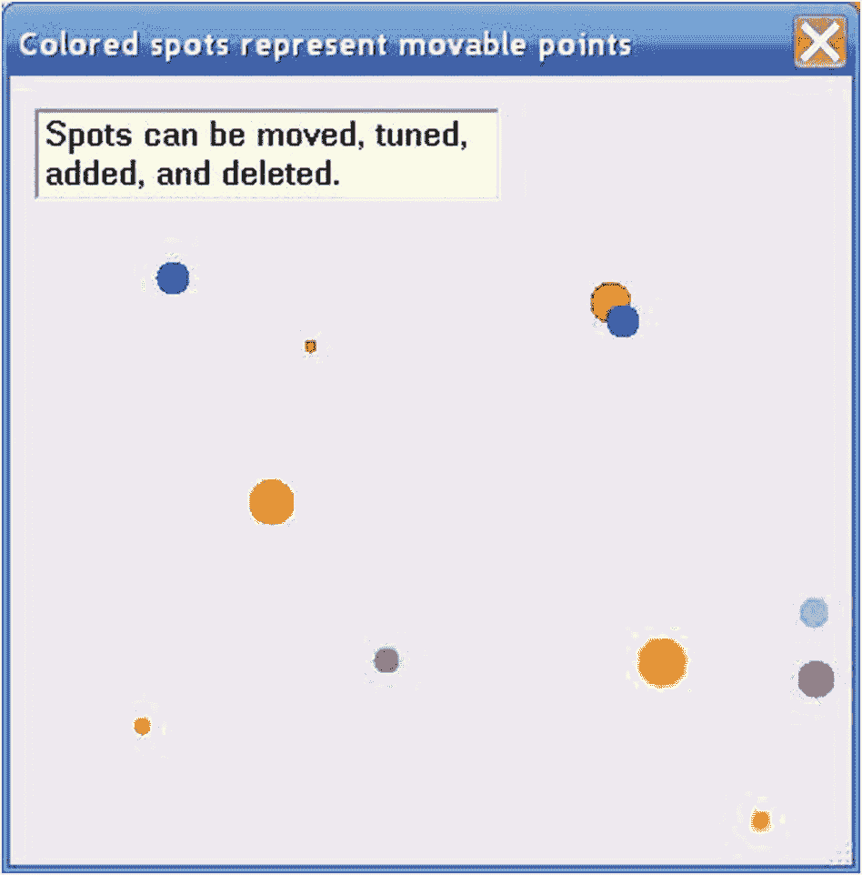

**图 2-1**

点的覆盖层由一个单一的圆形节点构成，该节点的面积等于一个元素的面积。

```
public class Spot : GraphicalObject
{
    Form m_form;
    Mover m_supervisor;
    PointF m_center;
    int m_radius;
    Color m_color;
    static int minRadius = 3;
    static int maxRadius = 12;
```

点是一个半径在 [3, 12] 范围内的小彩色圆形。要初始化这样一个对象，你需要声明其中心点坐标、半径和颜色。

```
public Spot (Form frm, Mover mvr, PointF ptC, int radius, Color clr)
{
    m_form = frm;
    m_supervisor = mvr;
    m_center = ptC;
    m_radius = Math.Min(Math.Max(minRadius, radius), maxRadius);
    m_color = clr;
}
```

点的覆盖层极其简单，由一个具有相同中心点和半径的圆形节点组成。

```
public override void DefineCover ()
{
    cover = new Cover (new CoverNode (0, m_center, m_radius));
}
```

点的正向移动只需要其中心点与鼠标移动同步变化。

```
public override void Move (int dx, int dy)
{
    m_center += new Size (dx, dy);
}
```

方法 `MoveNode()` 描述了对任何节点移动的响应。点只能参与正向移动，并且覆盖层中只有一个节点，因此 `MoveNode()` 方法调用 `Move()` 方法即可，无需其他操作。

```
public override bool MoveNode (int i, int dx, int dy, Point ptM,
    MouseButtons catcher)
{
    bool bRet = false;
    if (catcher == MouseButtons.Left)
    {
        Center = ptM;
        bRet = true;
    }
    return (bRet);
}
```

当对象被鼠标按下时会发生什么？通常，这是一些移动的开始时刻。一般来说，对象的移动可能受到其他屏幕对象位置的限制，尺寸的变化也常常受到某些范围的限制。移动类型几乎总是取决于按下的按钮，而后续移动的限制则取决于按下的点以及按下的覆盖层节点。因此，在最初按下的时刻，会调用特定类（即被按下对象的类）的 `Press()` 方法。这个方法总是具有相同的三个参数。^(⁶)

```
public void Press (Point ptMouse, MouseButtons catcher, int iNode)
```

`Spot.Press()` 方法需要做什么？你按下点是为了将其移动到另一个位置。点的定位由其中心点完成，但这个点并没有以任何方式标记。当点被按下，然后鼠标光标在不释放的情况下移动时，点会跟随鼠标移动。鼠标光标清晰可见，因此任何时候你都能准确知道箭头点的位置。同时，点的中心点未被标记，且始终在附近某处。在整个移动过程中，两个点之间的差值从未改变，但点的中心点的确切位置并不明显。为了在视觉上更好地控制点的移动，让箭头点位于点的中心点上会更理想。期望任何用户都能恰好按下点的中心点是不现实的，因此这由程序来完成。鼠标按下的点是已知的，点的中心点也是已知的，所以在这个时刻改变鼠标坐标即可，仅此而已。

听起来简单，但有一个陷阱。在我们需要调整光标位置的那一刻，点已经被移动器抓住，因此任何光标移动都会被 `Spot.MoveNode()` 方法复制为点的移动，点的中心点再次与光标保持相同的初始偏移量（类似于阿喀琉斯与乌龟悖论）。唯一的解决方案是切断移动器与被抓住对象之间的链接，然后调整光标位置，之后再重新建立它们的链接。这由 `AdjustCursorPosition()` 方法完成，该方法包含两次对 `Mover.MouseTraced` 属性的调用。（任何对象既可以直接在窗体中使用，也可以在 `TabControl` 的页面上使用；这就是该方法代码中有两个分支的原因。）

```
private void AdjustCursorPosition (PointF pt)
{
    m_supervisor.MouseTraced = false;
    if (m_tabpage != null)
    {
        Cursor.Position = m_tabpage.PointToScreen (Point.Round (pt));
    }
    else
    {
        Cursor.Position = m_form.PointToScreen (Point.Round (pt));
    }
    m_supervisor.MouseTraced = true;
}
```

在点被按下的时刻，我们还需要做其他事情吗？不需要。`Spot` 类的对象只参与正向移动；这种移动由左键完成。此类的覆盖层中只有一个节点，无论按下哪个点，光标都会被移到中心点。

```
public void Press (Point ptMouse, MouseButtons catcher, int iNode)
{
    if (catcher == MouseButtons.Left)
    {
        AdjustCursorPosition (m_center);
    }
}
```

这种将光标从一个位置初始移动到另一个位置的方式是否存在不便之处？检验这种情况的最佳方法是亲自尝试。点的半径可以在 [3, 12] 范围内更改。稍后你会发现，相同的调整总是用于小的圆形节点。此类节点的标准半径是三像素；在某些情况下，也有半径为四或五像素的圆形节点。在所有这些情况下，鼠标按下时光标的初始调整甚至不会被我们的眼睛察觉。对于更大的半径，这种移动是可见的，但当圆形节点位于某个特殊点上时，我从不使用更大的半径。

现在让我们回到我们的示例 `Form_Spot.cs`。任何移动都是在对象被按下时开始的。在这个例子中，我们只有两个类的对象，因此无论在哪种情况下，都会调用相应的 `Press()` 方法。

# 鼠标事件处理

## 鼠标按下事件

```csharp
private void OnMouseDown (object sender, MouseEventArgs e)
{
ptMouse_Down = e .Location;
if (mover .Catch (e .Location, e .Button))
{
GraphicalObject grobj = mover .CaughtSource;
int iNode = mover .CaughtNode;
if (grobj is Spot)
{
spotPressed = grobj as Spot;
spotPressed .Press (e .Location, e .Button, iNode);
}
else if (grobj is Info_Resizable)
{
info .Press (e .Location, e .Button, iNode);
}
}
ContextMenuStrip = null;
}
```

带有信息的矩形对象属于 `Info_Resizable` 类，该类包含在 `MoveGraphLibrary.dll` 中；类似元素将出现在配套应用程序的许多示例中。一个带有信息的矩形可以通过任何内部点移动，并通过任何边界点调整大小。当区域缩小时，矩形的右侧和底部会出现小圆圈；这些圆圈允许你滚动区域内的信息。由于信息区域可以涉及两种类型的移动（正向移动和调整大小），因此其覆盖层中必须包含多个节点。

当 `Spot` 对象被左键按下时；光标位置会发生初始调整，现在点被按下的位置是在其中心点。当按下按钮的鼠标移动时会发生什么？移动器知道被抓住对象的类，并调用该类的 `MoveNode()` 方法。`Spot.MoveNode()` 方法的代码已在上一页展示过；我在此处重复所需部分。

```csharp
public override bool MoveNode (..., Point ptM, ...)
{
... ...
if (catcher == MouseButtons .Left)
{
Center = ptM;
... ...
```

`MoveNode()` 方法获取当前光标位置（`ptM`），然后 `Spot.Center` 属性将斑点中心点设置到同一位置。

```csharp
public PointF Center
{
get { return (m_center); }
set
{
m_center = value;
DefineCover ();
}
}
```

因此，无论鼠标如何移动，被按下斑点的中心点都会跟随光标。这种两个不同对象的同步移动分两步完成。

1.  鼠标光标移动到任意位置。

2.  斑点中心点移动到鼠标位置。

## 鼠标移动事件

`Mover.Move()` 方法返回的值指示当前是否捕获了任何对象。如果捕获了任何对象，则返回值为 `true`，并且必须重绘该区域。

```csharp
private void OnMouseMove (object sender, MouseEventArgs e)
{
if (mover .Move (e .Location))
{
Invalidate ();
}
}
```

## 鼠标释放事件

第三个重要事件是鼠标按钮的释放。如果之前按下鼠标按钮时捕获了任何对象，则释放该对象。如果某个对象是被左键按下的，那么通常不需要对该释放的对象做任何处理。例如，被释放的按钮需要重绘，但这属于规则的一个例外情况。如果某个对象之前是被右键按下的，并且按下和释放点之间的距离可以忽略不计（在我的程序中，当距离不超过三个像素时即视为如此），则将其视为菜单调用。通常，每一类元素都有自己的菜单。当按下-释放事件对发生在空白区域时，也适用相同的菜单调用规则。因此，在这个示例中，我们有三个菜单（图 2-2）。

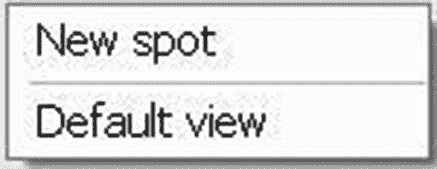

图 2-2c

空白区域上的菜单

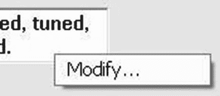

图 2-2b

信息上的菜单

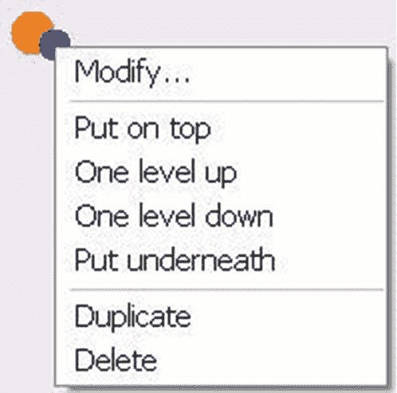

图 2-2a

斑点上的菜单

```csharp
private void OnMouseUp (object sender, MouseEventArgs e)
{
ptMouse_Up = e .Location;
double fDist = Auxi_Geometry .Distance (ptMouse_Down, ptMouse_Up);
int iObj, iNode;
if (mover .Release (out iObj, out iNode))
{
if (e .Button == MouseButtons .Right && fDist <= 3)
{
GraphicalObject grobj = mover .ReleasedSource;
if (grobj is Spot)
{
ContextMenuStrip = menuOnSpot;
}
else if (grobj is Info_Resizable)
{
ContextMenuStrip = menuOnInfo;
}
}
}
else if (e .Button == MouseButtons .Right && fDist <= 3)
{
ContextMenuStrip = menuOnEmpty;
}
}
```

## 斑点与轨道

斑点是一个小而简单的对象，有两个可以改变的参数：颜色和半径。这些参数的改变是通过一个小的调整窗体（图 2-3）来组织的。

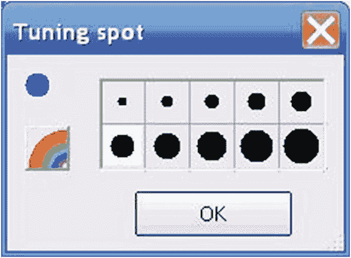

图 2-3

斑点的调整窗体

一个带有信息的小矩形区域是包含在 `MoveGrapLibrary.dll` 中的 `Info_Resizable` 类的对象。类似的带有信息的区域在配套应用程序的许多示例中都有使用，并且所有这些元素的操作都完全相同。可以在信息上调用的小菜单（图 2-2b）包含一个命令，允许你调出信息的调整窗体（图 2-4）。信息区域有四个可以改变的参数：文本的字体和颜色、区域的背景色以及小圆形滑块的颜色。调整窗体内部的按钮提供了对标准字体和颜色选择对话框的访问；一个轨道条允许你更改区域的透明度。这个辅助窗体由一些元素组成，这些元素在第 5 章中有更详细的讨论，但我希望在讨论它们之前，使用所有这些元素以及窗体本身不会有什么问题。

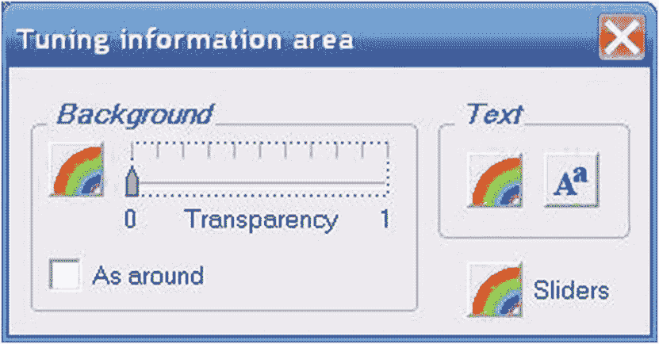

图 2-4

`Info_Resizable` 对象的调整窗体

- 文件：`Form_Spot_OnLineAndCircle.cs`

- 菜单位置：简单对象 ➤ 线段和圆上的斑点

让我们修改我们的示例，使得每个斑点不是自由地在屏幕上移动，而是只能沿着某个轨道移动。这样的轨道可以是直线段或圆形（图 2-5）。在当前示例中，轨道是不可移动的；这样的示例将在后面讨论。在我所有的程序中，所有元素都是可移动的，因此当前示例中轨道不可移动让我感觉像一个重大缺陷。我无法移动这些线段和圆形，也无法调整那些圆形轨道的大小，因此我无法重新安排这个示例的整体视图。这些轨道可以通过空白区域菜单中的命令进行更改，但这个命令会以随机方式设置新轨道，所以我无法控制这个过程。这个不便之处可以很容易地消除，但这将在稍后完成。

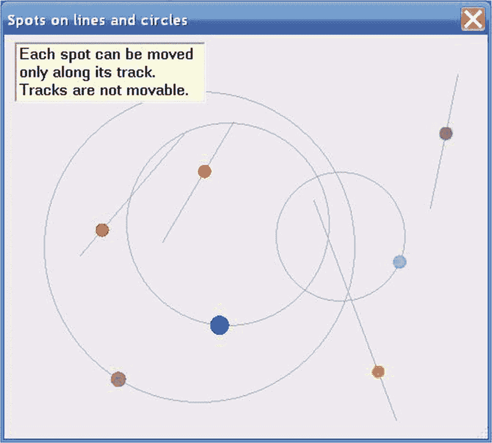

图 2-5

斑点是可以移动的，而当前示例中的轨道是不可移动的

位于直线和圆形轨道上的斑点看起来相似，但它们被组织为两个不同类的对象。让我们从线段上的斑点开始。

```csharp
public class Spot_OnLineSegment : GraphicalObject
{
PointF ptA, ptB;
PointF m_center, ptPressed;
int m_radius;
Color m_color;
Pen penLine;
int minSegmentLength = 30;
static int minRadius = 3;
static int maxRadius = 12;
```

要初始化 `Spot_OnLineSegment` 类的一个元素，你必须声明线段的端点以及斑点的三个参数：初始位置、半径和颜色。如果你希望斑点精确出现在轨道上的某个点，你可以预先计算这个点，并将其作为初始化时的参数使用。无论你计算的精度如何，斑点都会出现在线段上距离所声明的初始位置最近的点。

```csharp
public Spot_OnLineSegment (Form frm, Mover mvr, PointF pt0, PointF pt1,
PointF ptSpot, int r, Color clrSpot)
{
... ...
m_center = Auxi_Geometry .Segment_NearestPoint (ptSpot, ptA, ptB);
m_radius = Math .Min (Math .Max (minRadius, r), maxRadius);
```

该类的 `DefineCover()` 和 `Move()` 方法与 `Spot` 类的类似方法相同。对于轨道上的斑点，我决定演示可移动性的变化，因此从 `Press()` 方法开始有一些不同。对于可移动的斑点，需要对光标位置进行相同的调整，使其移动到斑点中心点。对于不可移动的斑点，则没有光标调整，但会记住按下点（`ptPressed`）。

```csharp
public void Press (Point ptMouse, MouseButtons catcher, int iNode)
{
    if (catcher == MouseButtons .Left)
    {
        if (Movable)
        {
            AdjustCursorPosition (m_center);
        }
        else
        {
            ptPressed = ptMouse;
        }
    }
}
```

`MoveNode()` 方法中也发生了一些变化。

```csharp
public override bool MoveNode (...)
{
    bool bRet = false;
    if (catcher == MouseButtons .Left)
    {
        if (Movable)
        {
            Center = ptMouse;
            AdjustCursorPosition (m_center);
        }
        else
        {
            AdjustCursorPosition (ptPressed);
        }
        bRet = true;
    }
    return (bRet);
}
```

线条上的 `Movable` 点与前一个示例中的点几乎相同。新的点的移动如何被限制在其端点之间的直线段内？

当用左键按下某个点时，会执行之前对 `Spot` 对象解释过的相同光标位置调整。光标会切换到点的中心点。最初，点的中心点正好位于线条上，因此现在光标也正好位于线条上，并且该点被抓住。

然后，鼠标移动到某个新位置（`ptMouse`）。你可以尝试沿着线条移动光标，但该新点很可能并不精确地位于线条上，而是在附近某处。由于点必须严格保持在线条上，因此点中心点（`m_center`）不会与光标同步移动，而是移动到线段上离光标位置最近的那个点。

```csharp
public PointF Center
{
    get { return (m_center); }
    set
    {
        m_center = Auxi_Geometry .Segment_NearestPoint (value, ptA, ptB);
        DefineCover ();
    }
}
```

随后，通过熟悉的 `AdjustCursorPosition()` 方法将光标移动到点的中心点。如果你尝试将点移动到线条旁边的任意位置，它总会回到线条上离光标最近的点。如果你尝试将点移动到端点之外，它会被保持在端点上，不会移动一像素。在存在限制的情况下，我们就有这样一系列移动步骤。

1.  鼠标光标移动到任意位置。
2.  点中心点移动到线条上离鼠标位置最近的点。
3.  光标移动到点中心点。

将这一步骤序列与前一个示例中的步骤序列进行比较，存在一个明显且重要的区别。

**对于自由移动的对象**，光标移动到任意位置，然后对象跟随光标移动。

**对于受限移动**，光标移动到任意位置，然后根据光标和限制条件确定对象位置；之后，光标返回到对象上。

当你按下并尝试移动*不可移动*的点时会发生什么？`MoveNode()` 方法使用 `AdjustCursorPosition()` 方法将光标保持在最初按下的位置。我认为将按下的鼠标保持在同一位置，是对象不可移动性的最佳指示。

```csharp
public override bool MoveNode (int iNode, int dx, int dy, Point ptMouse,
MouseButtons catcher)
{
    bool bRet = false;
    if (catcher == MouseButtons .Left)
    {
        if (Movable)
        {
            ... ...
        }
        else
        {
            AdjustCursorPosition (ptPressed);
        }
        ... ...
```

将点保持在直线段上和在圆形轨道上有什么区别？区别主要在于描述轨道的参数。

```csharp
public class Spot_OnCircle : GraphicalObject
{
    PointF centerCircle;
    float radiusCircle;
    PointF m_center, ptPressed;
    int m_radius;
    Color m_color;
    Pen penCircle;
    float minRadius_Circle = 30;
```

圆形轨道由其中心点和半径决定；其他的初始化参数都是相同的。首先组织轨道。然后计算轨道上离参数所提议的点最近的点；该点被定位在这个计算出的点上。

```csharp
public Spot_OnCircle (Form frm, Mover mvr, PointF ptC_track, float rad_track,
PointF ptSpot, int r, Color clrSpot)
{
    ... ...
    centerCircle = ptC_track;
    radiusCircle = Math .Max (rad_track, minRadius_Circle);
    m_center = Auxi_Geometry .PointToPoint (centerCircle,
Auxi_Geometry .Angle (centerCircle, ptSpot), radiusCircle);
    ... ...
```

点必须始终保持在轨道上，因此新位置被计算为圆上离鼠标光标最近的点。

```csharp
public PointF Center
{
    get { return (m_center); }
    set
    {
        m_center = Auxi_Geometry .PointToPoint (centerCircle,
Auxi_Geometry .Angle (centerCircle, value), radiusCircle);
        DefineCover ();
    }
}
```

其他所有方面与直线段上的点完全相同。

我们讨论了按下可移动点和不可移动点后的反应差异，但并未解释任何对象的可移动性是如何管控的。

### 可移动与不可移动对象

可移动性是一个在基础类 `GraphicalObject` 层级上设定的特性。默认情况下，任何新创建的对象都是可移动的，因此当你启动当前示例（包含线上点和圆形上的点）时，所有这些点都是可移动的。要切换某个点的可移动性，你可以在该点上调用菜单（图 2-6），然后点击第二个命令；相关联的方法将被执行。

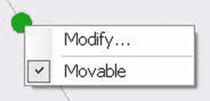

**图 2-6** 点上的菜单

```csharp
private void Click_miMovable_LineSpot (object sender, EventArgs e)
{
    spotPressed_onLine .Movable = !spotPressed_onLine .Movable;
}
```

从 `GraphicalObject` 派生的类没有自己的 `a Movable` 属性，它们使用基类的属性。

```csharp
public bool Movable
{
    get { return (m_movable); }
    set
    {
        m_movable = value;
        DefineCover ();
    }
}
```

# 对象可移动状态与线段

使用对象可移动状态有两种方式。一种方式是，根据需要的可移动性来改变覆盖层；这种技术在我书 [2] 中的一些示例里有所使用。另一种方式是使用相同的覆盖层，但在 `MoveNode()` 方法内部考虑可移动性的值。目前，我倾向于使用这种技术，这在有关线上点和圆形点的两个类中均可见。

本书才刚刚开始，展示的示例也很简单，但很容易看出如何将相同的技术应用于更复杂的场景。在我书 [2] 的 `Form_SpotOnCommentedWay.cs` 示例中，类似点沿道路系统的移动看起来就像一个玩具火车轨道（图 2-7）。道路部分要么是直线段，要么是弧线；道路可以分叉、合并和交叉。沿每条道路部分的移动，其组织方式与沿我们的直线和圆形的移动方式同样简单。你只需要一个简单的算法来在任何时刻（针对任何点位置）判断从一条道路段到另一条道路段进一步移动的可能性。

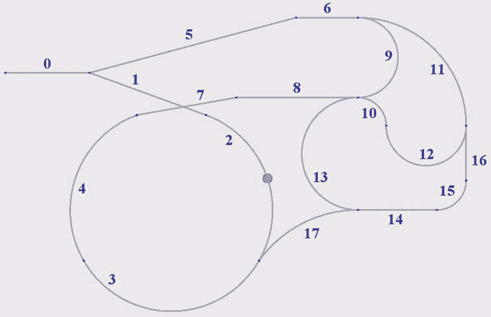

**图 2-7** 点沿这些道路的移动方式与当前示例中沿线段和圆形的移动方式类似

* 文件：`Form_ElementOnTrack.cs`
* 菜单位置：简单对象 ➤ 轨道上的元素

将鼠标光标调整到点的中心，对于小的点来说效果不错，但对于较大的圆形则效果不佳。这个新示例展示了针对此问题的不同方法。在当前示例中，轨道并非如此原始（图 2-8），并且针对两种不同大小的圆形使用了两种不同的技术。

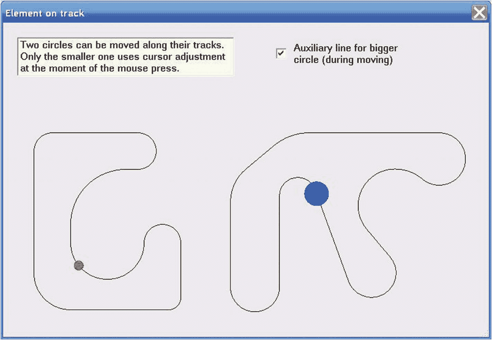

**图 2-8** 小圆形在初始鼠标按下时使用鼠标调整；较大的圆形则无需此操作即可工作

一个小的红点的移动方式与前一个示例相同。当按下 `SmallSpotOnTrack` 类的对象时，光标会移动到点的中心点，该中心点正好位于轨道上。在鼠标释放之前，这两个点——光标和点中心点——会同步且精确地沿轨道移动。

对于尺寸较大的对象，无法使用初始光标调整功能，因此 `BigSpotOnTrack` 类的点不使用此功能。在初始按下鼠标的时刻，会计算光标位置与点中心点之间的差值（`m_shift`）；之后，会构建一条路径的副本，并且这个副本会从原始路径偏移相同的距离。

```csharp
public void Press (Point ptMouse)
{
    m_shift = new SizeF (ptMouse .X - m_center .X, ptMouse .Y - m_center .Y);
    m_wayForMouse = m_way .Copy (m_shift);
}
```

在鼠标按下的时刻，与任何其他时刻一样，点的中心点精确地位于原始路径上，而光标则位于该路径的偏移副本上（图 2-9）。在鼠标释放之前，鼠标光标与点的中心点之间始终存在相同的偏移量。使用标准的光标调整技术来使光标保持在其路径上；鼠标光标与点中心点之间的固定偏移量保证了点的中心点将始终位于其路径上。在正常情况下，辅助路径是不可见的。只有原始路径是可见的，并且无论鼠标位置如何，点的中心点都沿着这条可见路径移动。

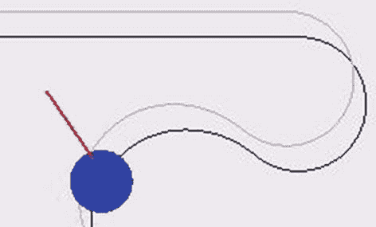

**图 2-9** 红色线条显示了使用光标按下点的位置

在当前示例中，鼠标光标的快速移动将允许你将点从路径的一部分移动到另一部分，甚至可以跨越空白区域。有一种易于使用的技术可以防止此类移动，但它需要更大的代码量，并且与移动解释无关。这类代码在我书 [2] 的示例中有所展示，但未在当前示例中使用。

## 线段

-   文件：`Form_Line_Segment.cs`
-   菜单位置：简单对象 ➤ 线段

为了移动和调整对象大小，它会获得一个覆盖层。覆盖层中的每个节点用于启动某种移动。左键按下会启动三种不同的移动，因此每个节点只能启动其中一种移动。如果一个对象的覆盖层只包含一个节点，那么该对象只能参与一种移动，通常这是向前移动；这在 `Form_Spot.cs` 的第一个示例中已演示过。大多数对象既涉及向前移动也涉及调整大小，因此它们的覆盖层中有多个节点。

直线段是接下来要探索的对象。在日常生活中，当我们有一根弹性绳子并想移动它时，我们抓住它的任意位置并移动整根绳子；但如果我们想拉伸它，我们会通过它的端点来操作。同理，屏幕上的线段也可以被移动和调整大小。按下端点与按下所有其他点的反应不同。此外，被抓住的端点的移动可以用两种不同的方式组织。

-   它可以自由地在屏幕上移动，从而同时改变线段的长度和角度。
-   可以只允许沿着线段移动，从而改变长度但不改变角度。

图 2-10 显示了 `Line_Segment` 类的几个对象。辅助线提供了关于每个线段当前允许的更改的信息。

如果有一条细线沿着线段延伸并超出其端点，那么该线段的端点只能沿着这条线移动。

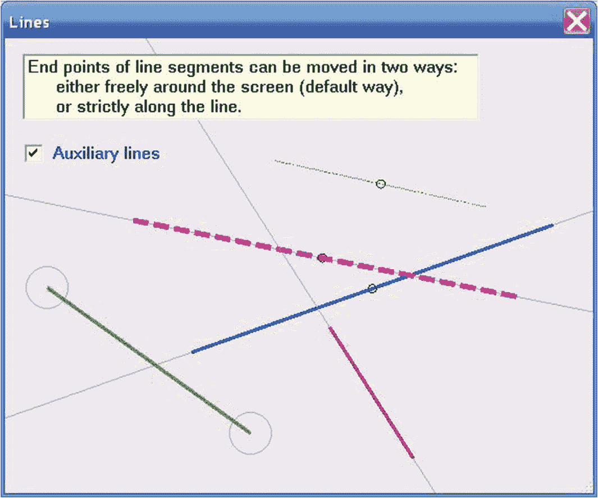

**图 2-10** 辅助线可以提供关于每个线段可能更改的一些信息

-   如果端点周围有圆圈，那么这些端点可以在屏幕上自由移动，但端点不能移动到另一个端点周围的圆圈内部，因为存在最小线段长度的限制。这个限制适用于所有线段，但对于那些只能沿线调整大小的线段则不体现。
-   线段中间的一个小圆圈表示该线段可以旋转，同时也标记了旋转中心。

```csharp
public class Line_Segment : GraphicalObject
{
    EndPointMove m_typeEndMove;
    PointF ptA, ptB;
    Pen m_pen, m_penAuxi;
    bool bResizable, bRotatable, bShowAuxi;
    PointF pt0_limit, pt1_limit, ptPressed;
    float maxWidth = 6;
    float minLen = 20;
}
```

此类对象的覆盖层由三个节点组成：两个端点的圆形节点和沿整个线段的条形节点（图 2-11）。节点的顺序很重要。圆形节点的默认直径与条形节点的默认宽度相同。两个圆形节点的中心点与条形节点两端半圆的中心点相同。如果你将条形节点放在最前面，那么它会遮挡两个圆圈，这两个节点将无法工作。为了实现调整大小，两个圆形节点必须放在条形节点之前。这是构建所有覆盖层的通用规则：如果节点重叠，则较小的节点必须放在较大的节点之前。

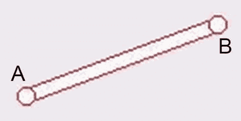

**图 2-11** 线段覆盖层由一个条形节点和两个圆形节点组成

```csharp
public override void DefineCover ()
{
    float rad = Resizable ? 4 : 0;
    cover = new Cover (new CoverNode [] {new CoverNode (0, ptA, rad),
                                        new CoverNode (1, ptB, rad),
                                        new CoverNode (2, ptA, ptB)});
    if (TransparentForMover)
    {
        cover.SetBehaviour (Behaviour.Transparent);
    }
}
```

为了便于调整大小，圆形节点的半径比默认值稍大。圆形节点的半径还取决于特定线段所需的可调整性。线段可调整性的改变可以通过两种不同的方式实现。

-   对于不可调整大小的线段，可以简单地将两个圆形节点排除在覆盖层之外，从而在覆盖层中只留下一个节点。在这种情况下，可调整大小和不可调整大小线段的条形节点编号将不同，这将需要两个不同版本的 `MoveNode()` 方法。
-   另一种方法是为不可调整大小线段的圆形节点声明一个零半径；这样，可调整大小和不可调整大小的线段就可以使用相同的 `MoveNode()` 方法。我倾向于在可调整大小和不可调整大小元素的覆盖层中保持相同数量的节点，并将当前不需要的节点压缩到零大小。

## 按下线段时的处理

当按下一条线段时，会调用 `Line_Segment.Press()` 方法。此方法包含由该按下动作启动的进一步移动的所有计算。

`左`按钮按下启动调整大小或向前移动，因此计算取决于按下的点和按下的节点。如果按下的是小圆形节点，则光标会移动到该按下节点所覆盖的线段端点；如果按下的是条形节点，则光标会移动到线段轴上最近的点。

```csharp
public void Press (Point ptMouse, MouseButtons catcher, int iNode)
{
    if (catcher == MouseButtons.Left)
    {
        switch (iNode)
        {
            case 0:
                ptPressed = ptA;
                break;
            case 1:
                ptPressed = ptB;
                break;
            case 2:
            default:
                ptPressed =
                    Auxi_Geometry.Segment_NearestPoint (ptMouse, ptA, ptB);
                break;
        }
        AdjustCursorPosition (ptPressed);
        // ... ...
    }
}
```

当按下的端点只能沿着线段移动时，需要进行额外的计算。存在一个最小线段长度（`minLen`）的限制，因此需要计算轴线上距离另一端最近且按下端点无法移过的点（`pt0_limit`）。按下端点将被允许仅在该点的一侧沿线移动；为了组织这种移动，会计算另一个点（`pt1_limit`），该点位于同一侧且距离很远。

```csharp
if (Resizable && m_typeEndMove == EndPointMove.Along)
{
    if (iNode == 0)
    {
        double ang = Angle + Math.PI;
        pt0_limit = Auxi_Geometry.PointToPoint (ptB, ang, minLen);
        pt1_limit = Auxi_Geometry.PointToPoint (ptB, ang, 4000);
    }
    else if (iNode == 1)
    {
        pt0_limit = Auxi_Geometry.PointToPoint (ptA, Angle, minLen);
        pt1_limit = Auxi_Geometry.PointToPoint (ptA, Angle, 4000);
    }
}
// ... ...
```

在所有可能的移动中，只有旋转是由`右`按钮按下启动的。在这种情况下，鼠标会被移动到线段轴上最近的点；然后计算从旋转中心到鼠标的角度（`angleMouse`）以及该角度与线段角度之间的补偿值。

```csharp
public void Press (Point ptMouse, MouseButtons catcher, int iNode)
{
    // ... ...
    else if (catcher == MouseButtons.Right)
    {
        ptPressed = Auxi_Geometry.Segment_NearestPoint (ptMouse, ptA, ptB);
        AdjustCursorPosition (ptPressed);
        double angleMouse = Auxi_Geometry.Angle (Center, ptPressed);
        compensation = Auxi_Common.LimitedRadian (angleMouse - Angle);
    }
}
```

## 移动节点

按下的线段的进一步移动由 `MoveNode()` 方法描述。代码取决于端点允许的移动类型；我们首先讨论端点仅沿线移动的情况。

按下的端点`允许仅沿线移动`的情况与之前讨论的线段上小点的类似。允许移动的端点——`pt0_limit` 和 `pt1_limit`——已经计算好。被抓住的线段端点的新位置只能位于这些点之间的线段上。如果在线段内部某处按下了线段，那么整个对象（线段）都会被移动。

```csharp
public override bool MoveNode (...)
{
    bool bRet = false;
    if (catcher == MouseButtons.Left)
    {
        if (m_typeEndMove == EndPointMove.Along)
        {
            switch (iNode)
            {
                case 0:
                    Point_A = Auxi_Geometry.Segment_NearestPoint (ptMouse, pt0_limit, pt1_limit);
                    AdjustCursorPosition (Point_A);
                    bRet = true;
                    break;
                case 1:
                    Point_B = Auxi_Geometry.Segment_NearestPoint (ptMouse, pt0_limit, pt1_limit);
                    AdjustCursorPosition (Point_B);
                    bRet = true;
                    break;
                default:
                    if (Movable)
                    {
                        Move (dx, dy);
                        bRet = true;
                    }
                    else
                    {
                        AdjustCursorPosition (ptPressed);
                    }
                    break;
            }
        }
        ... ...
```

对于可以在屏幕上`自由移动的端点`而言，被按住的端点唯一禁止进入的区域是对侧端点周围的一个圆形区域；该禁止圆的半径等于线段的最小允许长度。

-   如果鼠标放置在此圆之外的任何位置，则被捕捉的端点会跟随鼠标移动。
-   如果鼠标移入此圆内，则被捕捉的端点无法移动至该处。相反，会计算圆边界上离光标最近的点；端点会被放置在该位置，并且光标也会调整到相同位置。

当线条不是被按下端点，而是按下中间任意位置时，整条线会像之前的情况一样被移动。

```csharp
... ...
else
{
    double fNewLen;
    switch (iNode)
    {
        case 0:
            fNewLen = Auxi_Geometry.Distance (ptB, ptMouse);
            if (fNewLen >= minLen)
            {
                ptA = ptMouse;
            }
            else
            {
                Point_A = Auxi_Geometry.PointToPoint (ptB,
                    Auxi_Geometry.Angle (ptB, ptMouse), minLen);
                AdjustCursorPosition (ptA);
            }
            bRet = true;
            break;
        case 1:
            fNewLen = Auxi_Geometry.Distance (ptA, ptMouse);
            if (fNewLen >= minLen)
            {
                ptB = ptMouse;
            }
            else
            {
                Point_B = Auxi_Geometry.PointToPoint (ptA,
                    Auxi_Geometry.Angle (ptA, ptMouse), minLen);
                AdjustCursorPosition (ptB);
            }
            bRet = true;
            break;
        default:
            ... ...
```

## 鼠标右键旋转线条

*鼠标右键*用于线条旋转。在整个旋转过程中，光标与线条之间的角度保持不变。补偿角度在初始按下时刻计算；在整个旋转过程中，它被用来计算任意时刻的线条角度。如果线条不可旋转，则光标会被固定在按下点，其方式与不可移动线条的处理方式完全相同。

```csharp
... ...

else if (catcher == MouseButtons.Right)

{

    if (Rotatable)

    {

        double angleMouse = Auxi_Geometry.Angle (Center, ptMouse);

        Angle = angleMouse - compensation;

        DefineCover ();

        bRet = true;

    }

    else

    {

        AdjustCursorPosition (ptPressed);

    }

}

... ...
```

## 菜单调节操作

通过在线条上调出的菜单（图 2-12）中的命令来调节允许的操作。在单独调节可移动性和可调整大小性方面存在一些模糊之处。假设您使用菜单命令将一个线段声明为不可移动。这意味着您无法通过按下该段的任何内部点将其移动到任何地方。但这是否意味着无法将该段移动到其他位置？实际上，您可以通过先移动线段的一端，再移动另一端来实现。我不打算阻塞这条迂回路径；这很容易做到，但我不确定是否有必要这样做。对于本书接近结尾处演示的诸如绘图之类的复杂对象，我会使用对象固定；这种固定会阻止所有可能的移动。对于简单对象（线条和其他几种对象），我倾向于展示所有细节和不同变体。

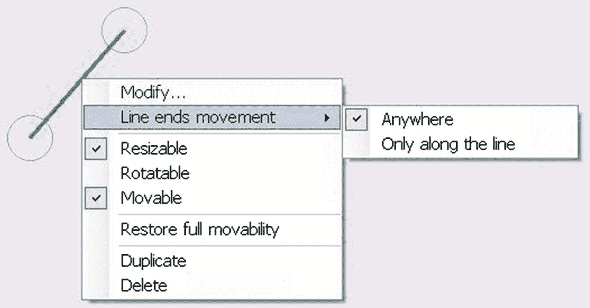

**图 2-12** 线段上的菜单

### 可移动性与可调整大小性

我已经解释过，可移动性是在基类 `GraphicalObject` 级别上调节的。那么可调整大小性和可旋转性呢？并非所有类都需要它们，因此它们在每个特定类中进行调节。有两个字段和两个属性用于更改它们，但它们之间有一个小区别。覆盖层设计取决于可调整大小性的当前值，因此更改可调整大小性需要调用 `DefineCover()` 方法。可旋转性的值只是简单地更改；之后由 `MoveNode()` 方法使用。

同一个菜单（图 2-12）还包含用于复制被按下的线段、删除它或借助特殊的调优窗体 `Form_Tuning_Line.cs`（图 2-13）对其进行修改的命令。

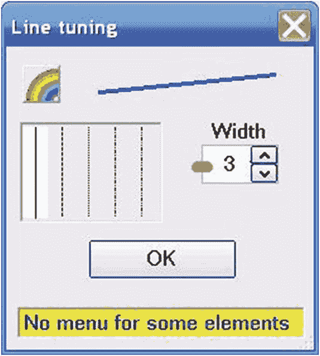

**图 2-13** 线条调优

-   文件：`Form_Polyline.cs`
-   菜单位置：简单对象 ➤ 折线

## 折线对象

让我们转向折线。每条折线由一系列线段组成。每个段都可以按照刚刚讨论的方式进行更改，但多了一个额外的特性。折线的配置不仅可以通过移动连接点和端点来更改，还可以通过更改线段数量来更改。见图 2-14。

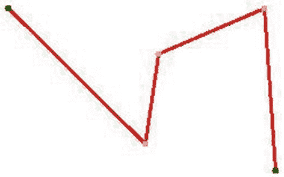

**图 2-14** 标有端点和连接点的折线

### 类定义与覆盖层

```csharp
public class Polyline : GraphicalObject

{

    List m_points = new List ();

    Pen m_pen;

    Color clrEnds = Color.DarkGreen;

    Color clrJoints = Color.DarkGray;

    bool bMarkEnds = true;

    bool bMarkJoints = true;

    bool bReconfigurable, bRotatable;
```

此类对象的覆盖层很简单：圆形节点放置在线段的端点处，带状节点基于每对连续的点。如果有 N 个点需要连接，则覆盖层的前 N 个节点是圆形的；之后，有 N-1 个带状节点。如果线条不可重新配置，则所有圆形节点的大小压缩为零。

```csharp
public override void DefineCover ()

{

    float rad = Reconfigurable ? 4 : 0;

    int nPts = m_points.Count;

    CoverNode [] nodes = new CoverNode [nPts + (nPts - 1)];

    for (int i = 0; i < nPts; i++)

    {

        nodes [i] = new CoverNode (i, m_points [i], rad);

    }

    for (int i = 0; i < nPts - 1; i++)

    {

        nodes [nPts + i] =

            new CoverNode (nPts + i, m_points [i], m_points [i + 1]);

    }

    cover = new Cover (nodes);

    if (!Movable && Reconfigurable)

    {

        cover.SetCursor (NodeShape.Strip, Cursors.Hand);

    }

    else

    {

        cover.SetCursor (NodeShape.Strip, Cursors.SizeAll);

    }

    ... ...
```

所有线段的端点都用于更改配置，因此我们将像在 `Line_Segment` 类中那样处理圆形节点。带状节点可用于移动整个折线，但一组特殊的参数允许您在需要的点按下线条，在该点添加一个新的连接点，并且在不释放鼠标的情况下，将此新连接点移动到某个需要的位置。不同的反应通过使用不同的光标来指示。

-   当折线可移动时，其线段上的光标会呈现可移动对象的标准形状：`Cursors.SizeAll`。
-   通过用鼠标按下线段来添加新连接点，仅允许用于不可移动但可重新配置的折线；对于此类组合，光标会变为 `Cursors.Hand`。

### 添加新连接点的实现

让我们检查一下这个添加新连接点是如何组织的。一切都在鼠标按下时发生，因此我们查看 `OnMouseDown()` 方法。

-   被按下节点的编号由移动器提供（`iNode`）。覆盖层中节点的顺序是已知的：先是圆形，然后是带状。圆形节点从线条的一端开始编号到另一端；圆形和带状的编号从同一端开始，因此被按下段（`iSegment`）的编号很容易计算。

```csharp
private void OnMouseDown (object sender, MouseEventArgs e)

{

    ptMouse_Down = e .Location;

    if (mover .Catch (e .Location, e .Button))

    {

        GraphicalObject grobj = mover .CaughtSource;

        int iNode = mover .CaughtNode;

        if (grobj is Polyline)

        {

            linePressed = grobj as Polyline;

            linePressed .Press (e .Location, e .Button, iNode);

            if (mover .CaughtNodeShape == NodeShape .Strip)

            {

                iSegment = iNode - linePressed .PointsNumber;

            }

            else

            {

                iSegment = -1;

            }

            if (!linePressed .Movable && linePressed .Reconfigurable &&

                e .Button == MouseButtons .Left  &&

                mover .CaughtNodeShape == NodeShape .Strip)

            {

                mover .Release ();

                linePressed .InsertPoint (iSegment + 1, e .Location);

                mover .Catch (e .Location, e .Button);

                Invalidate ();

            }

            ... ...
```

# 线条节点添加

- 第 1 段：线条是在一个线段上被按下的，但必须由新节点来捕获，因此移动器会释放已捕获的对象。

```
iSegment = iNode - linePressed.PointsNumber;
```

- 第 2 段：通过 `Polyline.InsertPoint()` 方法向线条添加一个新节点。由于节点和线段的编号从同一端开始，因此线段 `k` 是点 `k` 和点 `k+1` 之间的线段。于是，新点的编号将为 `iSegment+1`。添加节点会导致覆盖更新，因为节点数量发生了变化。`DefineCover()` 方法是从 `InsertPoint()` 方法内部调用的。

```
mover.Release();
```

- 第 3 段：移动器收到命令，要捕获光标下的对象。

```
linePressed.InsertPoint(iSegment + 1, e.Location);
```

```
mover.Catch(e.Location, e.Button);
```

从按下那一刻起，光标没有移动过，而新圆形节点的中心点正好位于光标下方，因此移动器除了新节点之外无法捕获其他任何东西，因而捕获的也是同一条线条。这样一来，当你决定改变线条配置时，你声明线条不可移动，然后按下该线段，最后继续移动鼠标，此时已捕获圆形节点。

节点不受线条可移动性的影响，因此可以通过其菜单删除节点，而无需考虑当前线条的可移动性。既然如此，那么节点的添加也必须独立于线条的可移动性。虽然所描述的按下并移动的节点添加过程仅适用于不可移动的线条，但节点也可以通过线段上的菜单进行添加，而且这不受线条可移动性的影响。

## 矩形

- 文件：`Form_Rectangle.cs`
- 菜单位置：简单对象 ➤ 矩形

矩形形状的对象是最常用的屏幕元素之一。矩形看起来是一个简单的对象，但其变换可以通过多种不同方式组织；在我的书 [2] 中，有一整章专门讲解不同类型的矩形。最通用的调整大小类型允许你通过移动任意边或角来实现，但也可能施加不同类型的限制。有些矩形有一条固定边，而对边移动可以改变元素的大小，甚至将其翻转。在某些情况下，需要对称地移动对边。还有宽高比恒定的矩形情况。不同类型的调整大小需要使用不同的覆盖，因此对于这些特殊情况，你最好查阅我的书 [2]。在当前示例中，使用了经典的矩形，可以通过所有边和角进行调整大小。`Rectangle_Unicolored` 类的元素可以自由移动、调整大小和旋转。只有最小尺寸限制，以防止对象意外消失。参见图 2-15。

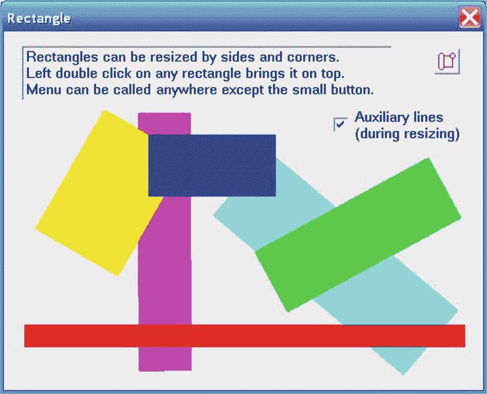

图 2-15 可以通过移动边和角来改变矩形

```
public class Rectangle_Unicolored : GraphicalObject
{
    PointF [] m_points;
    SolidBrush m_brush;
    bool bResizable, bRotatable;
    PointF m_center, ptPressed;
    double m_angle, compensation;
    static int minSide = 20;
```

矩形形状的对象始终具有水平和垂直边且从不旋转的情况并不罕见；信息区域就是这样一个例子。描述此类对象最简单的方法是设置其左上角的坐标以及区域的两个尺寸。`Rectangle_Unicolored` 类的对象围绕其中心点旋转，因此描述此类矩形几何形状最简单的方法是声明其中心点、两个尺寸和角度。

```
public Rectangle_Unicolored (Form frm, Mover mvr, PointF ptC,
    double w, double h, double angleDegree, Color clr)
```

`Rectangle_Unicolored` 类的对象采用经典的覆盖设计：四个角上有圆形节点，四条边上有条形节点，整个对象区域有一个大的矩形节点。为了更容易捕获角节点，圆形节点的半径略大于默认值。对于不可调整大小的矩形，边界上的所有八个节点都压缩为零大小，仅有大节点保持不变（图 2-16）。

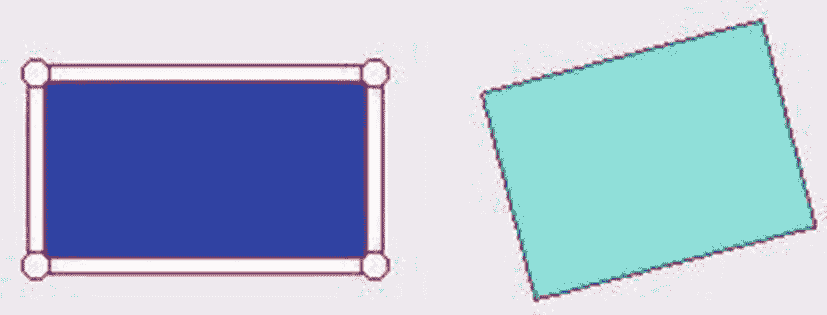

图 2-16 可调整大小和不可调整大小矩形的覆盖

```
public override void DefineCover ()
{
    float wHalf, rad;
    if (Resizable)
    {
        wHalf = 3;
        rad = 5;
    }
    else
    {
        wHalf = rad = 0;
    }
    CoverNode [] nodes = new CoverNode [9];
    for (int i = 0; i < 4; i++)
    {
        nodes [i] = new CoverNode (i, m_points [i], rad);
    }
    for (int i = 0; i < 4; i++)
    {
        nodes [i + 4] = new CoverNode (i + 4, m_points [i],
            m_points [(i + 1) % 4], wHalf);
    }
    nodes [8] = new CoverNode (8, m_points);
    cover = new Cover (nodes);
    if (!Movable)
    {
        cover.SetCursor (NodeShape.Polygon, Cursors.NoMove2D);
    }
    ... ...
```

带有覆盖和节点编号的矩形示意图（图 2-17）有助于进一步讨论。当矩形被按下时，会调用 `Rectangle_Unicolored.Press()` 方法。后续的移动取决于被按下的节点，因此按下时刻的初始计算也取决于节点编号。

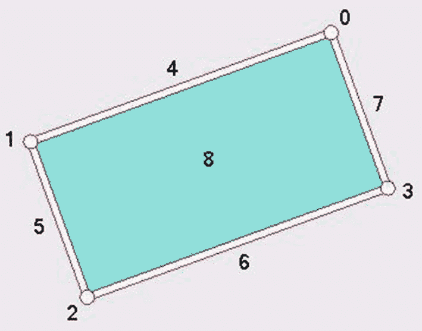

图 2-17 节点的编号

*   `条形`节点用于改变矩形的单边尺寸，因此当按下条形节点时，光标只允许沿着与被按侧边正交的直线移动。在此光标移动过程中，被捕捉的侧边会跟随光标，从而仅改变矩形的一个尺寸。
*   `圆形`节点用于同时改变矩形的两个尺寸，因此当按下一个角点时，它可以在一段区域内移动，两个尺寸可以同时改变。

由于按下圆形节点和条形节点时的响应存在差异，涉及的方法中的代码通常会有两个分支。让我们从按下角点的情况开始。

假设图 2-17 中矩形的上角点被按下（`iNode = 0`）。矩形的任何一条边都存在最小允许尺寸（`minSide`），因此被按下的角点不能移动到比该值更靠近两条相邻边的位置。如果表单复选框内有选中标记（图 2-15），那么两条细线会示出被按角点可移动区域的边界（图 2-18）。（出于计算目的，这个允许角点移动的区域被定义为一个矩形。该矩形的两条边由这些细线显示，而另外两条边则不可见，因为该矩形被声明为一个非常大的矩形。）当被按角点移动时，与之对角的角点（`ptBase`）位置保持不变。被按角点允许移动的矩形区域由四个角点（`ptsAllowed[]`）确定。为了在某些方法中进一步使用，我需要将该区域的边界表示为一个闭合多边形，因此相同的四个点被转换为一个包含五个点的数组（`ptsBorderAllowed[]`），其中最后一个值与第一个值相同。

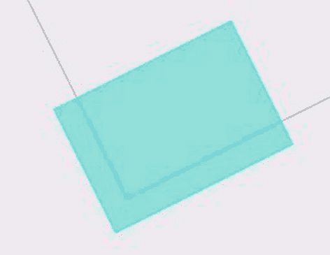

图 2-18 矩形的上角点被按下；其允许移动的区域由两条灰色线条限定

当圆形节点被按下时，光标会通过 `AdjustCursorPosition()` 方法精确地切换到被覆盖的角点位置。

```
public void Press (Point ptMouse, MouseButtons catcher, int iNode)
{
    if (catcher == MouseButtons.Left)
    {
        if (iNode == 8)
        {
            ptPressed = ptMouse;
            return;
        }
        PointF ptNearest;
        if (iNode < 4)      // 角点
        {
            ptNearest = m_points [iNode];
```

```markdown
从角点被按下的那一刻起，并在随后按下鼠标的移动过程中，光标和该角点必须保持同步移动。对角角点（所示情况下是 `iNode = 2`）位置从不改变；另外两个角点必须改变位置以保持矩形形状。

当光标在允许区域内移动时，被捕捉的角点会无阻碍地跟随光标移动。

```csharp
public override bool MoveNode (...)
{
    bool bRet = false;
    if (catcher == MouseButtons.Left)
    {
        if (iNode < 4)      // 角点
        {
            PointF ptNext, ptPrev;
            if (Auxi_Geometry.PointInsideConvexPolygon(ptMouse, ptsAllowed))
            {
                m_points[iNode] = ptMouse;
                Auxi_Geometry.Distance_PointLine(ptMouse,
                    m_points[(iNode + 1) % 4],
                    m_points[(iNode + 2) % 4],
                    out ptNext);
                Auxi_Geometry.Distance_PointLine(ptMouse,
                    m_points[(iNode + 2) % 4],
                    m_points[(iNode + 3) % 4],
                    out ptPrev);
                m_points[(iNode + 1) % 4] = ptNext;
                m_points[(iNode + 3) % 4] = ptPrev;
                DefineCover();
                bRet = true;
            }
```

如果光标移动到了允许区域之外，则光标会被返回到该区域边界上最近的点，并且被捕捉的角点会跟随光标移动。

```csharp
            else
            {
                m_points[iNode] = Auxi_Geometry.Polyline_NearestPoint(
                    ptMouse, ptsBorderAllowed);
                Auxi_Geometry.Distance_PointLine(ptMouse,
                    m_points[(iNode + 1) % 4],
                    m_points[(iNode + 2) % 4],
                    out ptNext);
                Auxi_Geometry.Distance_PointLine(ptMouse,
                    m_points[(iNode + 2) % 4],
                    m_points[(iNode + 3) % 4],
                    out ptPrev);
                m_points[(iNode + 1) % 4] = ptNext;
                m_points[(iNode + 3) % 4] = ptPrev;
                DefineCover();
                AdjustCursorPosition(m_points[iNode]);
                bRet = false;
            }
            ... ...
        }
```

移动侧边稍微简单一些。首先，计算被捕捉侧边上最近的点（`ptNearest`）和对边上最近的点（`ptOnOppositeSide`）。穿过这些点的直线（其角度为 `angleBeam`）与被按下的侧边正交（图 2-19）。按下鼠标的光标只允许沿着这条线移动。光标路径的一端（`ptEndIn`）由矩形的最小允许尺寸（`minSide`）决定，另一端（`ptEndOut`）则位于远处。矩形的每条边都由一个条形节点覆盖，因此当按下此类节点时，光标会切换到该节点下边界上最近的点（`ptNearest`）。通常，光标位置的调整由 `AdjustCursorPosition()` 方法完成。

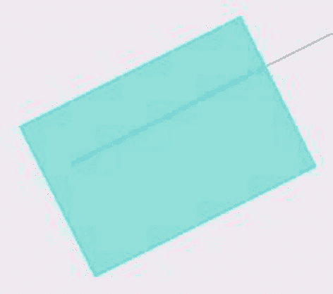

图 2-19

光标在辅助线与侧边相交的点处按下；该辅助线与被按侧边正交；光标仅沿此线移动

```csharp
public void Press (...)
{
    ... ...
    else                // 侧边
    {
        ptNearest = Auxi_Geometry.Segment_NearestPoint(ptMouse,
            m_points[iNode - 4], m_points[(iNode - 3) % 4]);
        ptOnOppositeSide = Auxi_Geometry.Segment_NearestPoint(ptMouse, m_points[(iNode + 2) % 4], m_points[(iNode + 3) % 4]);
        double angleBeam = Auxi_Geometry.Angle(ptOnOppositeSide, ptMouse);
        ptEndIn = Auxi_Geometry.PointToPoint(ptOnOppositeSide, angleBeam, minSide);
        ptEndOut = Auxi_Geometry.PointToPoint(ptOnOppositeSide,
            angleBeam, 5000);
    }
    ... ...
    AdjustCursorPosition(ptNearest);
}
... ...
```

当任意一条侧边被移动时，只有该侧边的两个端点会改变，而矩形的另外两个角点保持其当前位置不变。图 2-19 展示了鼠标在右侧边框上与辅助线相交的点处按下的情况。图 2-17 显示了带有节点编号的覆盖层，并且清晰地表明这是节点 7 被按下的情况，因此当移动此侧边时，只有点 0 和点 3 会改变。

```csharp
public override bool MoveNode (...)
{
    bool bRet = false;
    if (catcher == MouseButtons.Left)
    {
        ... ...
        else if (iNode < 8)   // 侧边
        {
            double newW, newH;
            PointF ptNearest = Auxi_Geometry.Segment_NearestPoint(ptMouse, ptEndIn, ptEndOut);
            ... ...
            else    // iNode == 7
            {
                newW = Auxi_Geometry.Distance(ptNearest, ptOnOppositeSide);
                m_points[0] = Auxi_Geometry.PointToPoint(m_points[1],
                    m_angle, newW);
                m_points[3] = Auxi_Geometry.PointToPoint(m_points[2],
                    m_angle, newW);
            }
            DefineCover();
            AdjustCursorPosition(ptNearest);
            bRet = true;
            ... ...
```

### 矩形案例

矩形案例完美演示了在调整大小时使用吸附鼠标的主要规则。

- 边界由小型圆形节点和窄条的组合覆盖。按下边界时，可能会对光标位置进行一些调整。当按下圆形节点时，光标会移动到其中心点；当按下条状节点时，光标会移动到条状轴上最近的点。无论如何，光标都会精确地放置在边界上。
- 与此同时，会计算光标进一步移动的`限制范围`。如果光标只允许沿直线段移动，则计算该线段的两个端点。如果允许在某个区域内进一步移动，则计算该区域的边界。
- 如果光标允许沿直线段移动，那么对于任何光标移动，都会计算该线段上的最近点；光标会被移动到该点，并引起对象的相应变化。如果允许光标在某个区域内移动，但发现光标位于该区域之外，则光标会被返回到该区域边界上的最近点。

`Rectangle_Unicolored` 元素的旋转组织方式对所有对象都是标准的，因此我们来了解一下此过程的细节。

### 可旋转与不可旋转对象

并非所有屏幕对象都需要旋转，因此此功能并未包含在基类中，而仅包含在需要它的类中。可旋转性的调节也包含在这些类中。默认情况下，矩形是可旋转的。要更改特定矩形的可旋转性，请在该对象上调用菜单，并使用该菜单中的相应命令。调用 `Rectangle_Unicolored.Rotatable` 属性不会更改覆盖层，但在尝试旋转对象时会使用 `bRotatable` 字段的值。

```csharp
public bool Rotatable
{
    get { return (bRotatable); }
    set { bRotatable = value; }
}
```

如果一个对象是可旋转的，那么它的参数中就会包含一个角度。对于 `Rectangle_Unicolored` 类，`m_angle` 参数被计算为从 `m_points[1]` 到 `m_points[0]` 的角度。当用鼠标右键按下矩形时（这通常表示旋转开始），会计算从旋转中心到按下点的角度（`angleMouse`），以及该角度与对象角度之间的补偿值。这个`补偿`角度将在整个旋转过程中使用。

```csharp
public void Press (Point ptMouse, MouseButtons catcher, int iNode)
{
    ... ...
    else if (catcher == MouseButtons .Right)
    {
        if (bRotatable)
        {
            m_center = Center;
            double angleMouse = Auxi_Geometry .Angle (m_center, ptMouse);
            compensation = Auxi_Common .LimitedRadian (angleMouse - m_angle);
        }
        else
        {
            ptPressed = ptMouse;
        }
    }
    ... ...
}
```

当一个可旋转的矩形被鼠标右键捕获并移动鼠标时，矩形必须旋转。在任何时刻，都会计算从旋转中心到鼠标光标的角度，然后使用`补偿`角度来确保矩形与鼠标光标旋转相同的角度。

```csharp
public override bool MoveNode (...)
{
    ... ...
    else if (catcher == MouseButtons .Right)
    {
        if (Rotatable)
        {
            double angleMouse = Auxi_Geometry .Angle (m_center, ptMouse);
            Angle = angleMouse - compensation;
            bRet = true;
        }
        else
        {
            AdjustCursorPosition (ptPressed);
            bRet = false;
        }
    }
    ... ...
}
```

我经常在对象的前向移动和调整大小时使用吸附鼠标，但很少在旋转时使用。这不是因为编程实现这样的功能有什么困难。当用鼠标右键按下对象且旋转必须开始时，很容易计算鼠标光标到旋转中心点的距离，然后将光标沿该半径的圆移动。这种移动在后面的章节中会有几个示例演示，但这样做仅仅是为了演示这种可能性。旋转精度随着光标移动半径的增大而提高，因此如果需要更高的旋转精度，最好先按下对象，然后将按下的鼠标远离旋转中心，并在那里继续光标的圆周运动。

`Rectangle_Unicolored` 类展示了一种经典的旋转技术，该技术将被复制用于许多其他类的对象。有一些对象的各个不同点可以独立放置。在这种情况下，对象使用单一角度是不够的。每个独立放置的特殊点都有自己的角度，因此在按下瞬间会为每个点计算各自的补偿角度，然后在旋转过程中使用这些补偿角度。这在 `Polyline` 类中已经使用过；同样的方法稍后将在 `Polygon_Elastic` 类中使用。

当一个对象被声明为不可旋转时，会记住右键初始按下的点（`ptPressed`），并且光标会保持在该点，直到鼠标释放。

#### 移动器透明性

在讨论小区域时，我们已经了解了一种调节任意物体可移动性的简单机制。默认情况下，任何从基础`GraphicalObject`类派生的新对象都是可移动的。这种可移动性通过`GraphicalObject.Movable`属性进行调节。如果你尝试移动一个对象，那么当前可移动的对象会被移动，而对于不可移动的对象，光标则会停留在同一点直到鼠标释放。下面这段来自`Rectangle_Unicolored.MoveNode()`方法的代码几乎可以在任何其他类中找到。无论被按下的对象是可移动的还是不可移动的，移动器都只处理这个对象；其他对象的存在完全无关紧要。

```csharp
public override bool MoveNode (...)
{
    bool bRet = false;
    if (catcher == MouseButtons .Left)
    {
        ... ...
        else
        {
            if (Movable)
            {
                Move (dx, dy);
                bRet = true;
            }
            else
            {
                AdjustCursorPosition (ptPressed);
            }
        }
    }
    ... ...
}
```

还存在另一种调节可移动性的方法。通过使用这种不同的机制，一个对象可以变为不可移动，但`此对象`对鼠标按下的反应取决于其他对象的存在以及它们在屏幕上的相对位置。

默认情况下，任何从`GraphicalObject`类派生并注册到移动器队列中的对象都会被该移动器感知。它可以是可移动的或不可移动的，但在每种情况下，对此类对象的鼠标按下都会有一些反应。屏幕对象可能会重叠。如果多个对象重叠，那么普遍的期望是显示在其他对象之上的对象必须对鼠标按下做出反应。是否有可能组织这样一种方式，使得鼠标按下仿佛穿过一个或多个对象，并捕获（拾取以进行移动）其下方的某个对象？如果可以实现，那么必须有一个易于使用的机制，让用户决定应该捕获哪个对象。

这种机制是存在的，它被称为`移动器透明性`。为了能与任何对象配合使用，这种移动器透明性功能被包含在基础`GraphicalObject`类的级别，并在同一级别进行调节。

假设你在蓝色、黄色和紫色矩形重叠的点调出菜单（图 2-20）。如果蓝色矩形的基本特性自其初始化以来未曾更改，则该菜单是为蓝色矩形调用的。菜单中的复选标记告知我们，这个蓝色矩形是可调整大小、可旋转、可移动且对移动器`非透明`的。

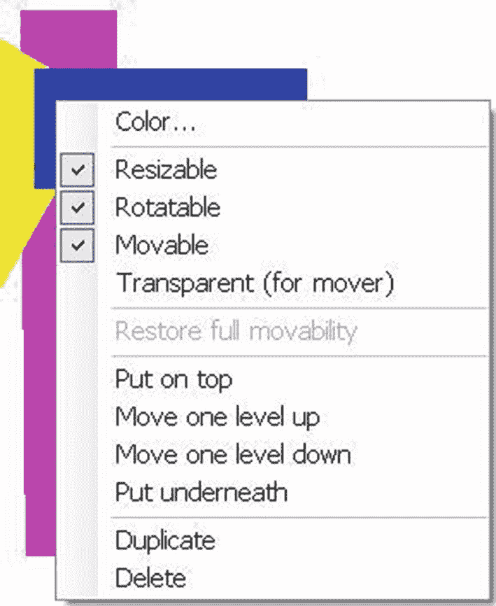

图 2-20 矩形的菜单

让我们将蓝色矩形变为对移动器透明。点击菜单上的相应命令；这将调用关联的方法。

```csharp
private void Click_miTransparent (object sender, EventArgs e)
{
    rectPressed .TransparentForMover = true;
}
```

当你使用之前三个命令（`Resizable`、`Rotatable` 或 `Movable`）之一时，相应的特性会简单地将其值更改为相反值，而对于透明性，则设置为`true`值。当然这也算是将透明性值改变为相反值，但我想强调的是，此命令与使用之前的命令相比有不同的后果。

`Rectangle_Unicolored` 类本身没有 `TransparentForMover` 属性，因此使用了基类 `GraphicalObject` 的属性。

```csharp
public bool TransparentForMover
{
    get { return (m_transparentForMover); }
    set
    {
        m_transparentForMover = value;
        DefineCover ();
    }
}
```

# 透明对象与移动器

基类中的 `m_transparentForMover` 字段被设置为 `true`；然后调用 `DefineCover()` 方法。在 `DefineCover()` 方法的末尾，*对于任何可移动对象类*，都有完全相同的代码行。如果一个对象被声明为对移动器透明，则该对象的覆盖层会被声明为透明。这意味着该覆盖层的所有节点，无论其数量、类型、大小和位置如何，都变得对移动器透明。

```csharp
public override void DefineCover ()
{
    ... ...
    if (TransparentForMover)
    {
        cover .SetBehaviour (Behaviour .Transparent);
    }
}
```

我们已将蓝色矩形声明为对移动器透明；现在需要测试此更改的效果。再次用左键在同一位置按下同一个蓝色矩形。整个分析从鼠标按下时通过 `Mover.Catch()` 方法开始。

```csharp
private void OnMouseDown (object sender, MouseEventArgs e)
{
    ptMouse_Down = e .Location;
    if (mover .Catch (e .Location, e .Button))
    {
        GraphicalObject grobj = mover .CaughtSource;
        int iNode = mover .CaughtNode;
        ... ...
```

移动器根据它们在移动器队列中的顺序，一个接一个地分析对象；对于每个对象，分析会按其覆盖层中节点的顺序逐个节点进行。当 `Mover.Catch()` 方法检测到带有 `Behaviour.Transparent` 参数的节点时，不仅会跳过该节点的分析，还会跳过该节点所属的整个对象。不要错过这个重要的事情：不仅忽略当前的透明节点，而且忽略该节点所属的整个覆盖层。在当前的例子中无法展示这一点的重要性，因为对于每个矩形，所有节点要么都是透明的，要么都是非透明的。稍后我们将处理同时包含透明和非透明节点的覆盖层，而对于此类对象的所有操作都取决于第一个被检查的节点的透明性。这将在后面讨论；现在让我们回到对之前声明为对移动器透明的矩形的鼠标按下操作。

如果在被按下的点，透明矩形下方没有其他对象，则完全没有反应。如果有其他对象，则反应取决于在此点找到的第一个非透明对象。如果图 2-20 中的蓝色矩形变为透明，然后在同一点按下左键，则此次按下将捕获并移动黄色矩形。移动器能够穿透的透明对象数量没有限制。如果你将黄色矩形也变为对移动器透明，并在同一点再次按下，则会捕获紫色矩形。

将对象设为透明有一个问题：你可以通过该对象的菜单将其声明为对移动器透明，但无法通过同一个菜单再次将这个透明对象声明为非透明。当 `Mover.Catch()` 方法开始分析时，它首先检查光标下方节点的 `Behaviour` 参数。如果是 `Behaviour.Transparent`，那么其他任何东西都无关紧要了。在这种情况下，按下的按钮无关紧要，该元素无法被移动，其关联的菜单也无法被调用。整个对象会被移动器完全忽略。

我总是强调，这两个属性（`Movable` 和 `TransparentForMover`）都涉及可移动性，但方式不同。将两个具有初始属性的矩形以不重叠的方式放置。（要恢复初始状态，请在任何空白处调用菜单，并使用 `Default view` 命令。）在一个矩形上调用菜单，使其不可移动；然后在另一个矩形上调用菜单，使其对移动器透明。尝试移动其中任何一个。两个元素都不会移动，因此从用户角度看，这两个元素都是不可移动的，因为按下并移动对两者都不起作用。再次在第一个矩形（不可移动的那个）上调用菜单，恢复其可移动性，之后你就可以在屏幕上移动这个元素了。尝试在第二个（透明的）矩形上调用菜单，你会发现这是不可能的：你看到的将不是矩形的菜单，而是空白区域的菜单。你无法在透明于移动器的对象上调用菜单，因此无法通过同一菜单的命令将其恢复为非透明状态。

我有时会写道，移动器检测不到透明对象。从反应角度（或用户角度）看这是正确的，但从理解代码和算法的角度（开发者的角度）看这是不正确的。移动器确实不仅能检测到透明节点，还能检测到该节点所属的整个覆盖层；之后，移动器会完全忽略这个覆盖层，但对用户来说，这看起来就像是移动器看不到该对象。

假设你将某个对象声明为 `透明于移动器`。如何让这个对象再次变为非透明呢？

我通常通过调用上一级的菜单来实现。我们的对象都位于窗体中，因此对于所有对象来说，上一级就是窗体本身。可以在任何空白处调用的菜单（图 2-21）包含一个使所有元素变为非透明的命令。

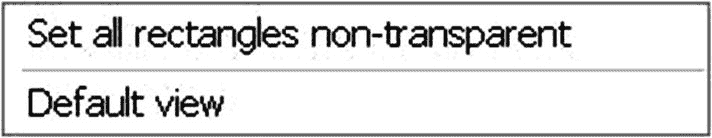

图 2-21：空白处的菜单

```csharp
private void Click_miAllNontransparent (object sender, EventArgs e)
{
    foreach (Rectangle_Unicolored rect in rects)
    {
        rect .TransparentForMover = false;
    }
}
```

## 通用设计规则

`Form_Rectangle.cs` 文件包含了后续大多数示例中可能出现的所有特性；浏览这些特性、相关命令及其实现会很有帮助。

所有对象都是可移动的。为了使用它们的可移动性，需要初始化一个 `Mover` 对象，并且所有对象都要注册到其队列中。该队列中对象的顺序很重要，因为移动决策是通过严格按照队列顺序逐一分析屏幕对象来作出的。所有对象的绘制则是按相反顺序进行的，因此在决定移动器队列中对象的顺序时必须考虑这一点。为了更容易找到较小的对象，它们通常排在较大的对象之前。

如果在设计中使用了普通控件，则它们在移动器队列中必须排在图形对象之前，因为控件总是显示在所有图形对象的上面。本示例中没有普通控件，因此元素的顺序主要由尺寸决定，但也不仅限于此。信息区域的大小与矩形相当，并且始终存在（只能改变其大小），而矩形的数量是可变的，因为它们可以被添加或删除。在本例以及本章后续的几个例子中，我们有一组始终存在的对象和另一组数量可随时改变的对象。这两组对象的顺序仅取决于开发者的偏好。在当前示例中，这种顺序组织如下：按钮（`Button_Drawing` 类）、复选框（`CheckBox_GR` 类）、信息区域（`Info_Resizable` 类）以及一组矩形（`Rectangle_Unicolored` 类）。

```csharp
public void RenewMover ()
{
    mover .Clear ();
    for (int i = 0; i < rects .Count; i++)
    {
        mover .Add (rects [i]);
    }
    info .IntoMover (mover, 0);
    checkAuxi .IntoMover (mover, 0);
    btnCover .IntoMover (mover, 0);
    if (bAfterInit)
    {
        Invalidate ();
    }
}
```

移动器队列由 `RenewMover()` 方法填充。每当矩形的数量或顺序发生变化时，队列都会更新，并且屏幕视图也会刷新。

此示例允许你可视化矩形的覆盖层。这在真实应用中从未使用过，但在讨论覆盖层设计时可能很有帮助。在我的书[2]中，讨论了覆盖层可视化的几种变体；在当前示例中，仅使用了 `MovableObject.DrawCover()` 方法。

```csharp
private void OnPaint (object sender, PaintEventArgs e)
{
    Graphics grfx = e .Graphics;
    GraphicalObject grobj;
    for (int i = mover .Count - 1; i >= 0; i--)
    {
        grobj = mover [i] .Source;
        if (grobj is Rectangle_Unicolored)
        {
            (grobj as Rectangle_Unicolored) .Draw (grfx);
            if (bShowCovers)
            {
                mover [i] .DrawCover (grfx);
            }
        }
    }
    ... ...
```

任何移动操作都是在对象被鼠标按下时开始的。此时通常需要执行一些计算；计算是在相应类的 `Press()` 方法内部完成的。某些图形“控件”在按下时可能会改变，因此在这种情况下必须刷新屏幕视图；在当前示例中，当按钮被按下时就需要刷新。

```csharp
private void OnMouseDown (object sender, MouseEventArgs e)
{
    ptMouse_Down = e .Location;
    if (mover .Catch (e .Location, e .Button))
    {
        GraphicalObject grobj = mover .CaughtSource;
        int iNode = mover .CaughtNode;
```

if (grobj is Rectangle_Unicolored)
{
    rectPressed = grobj as Rectangle_Unicolored;
    rectPressed.Press(e.Location, e.Button, iNode);
    // ...
}
else if (grobj is Button_GR)
{
    btnCover.Press(e.Location, e.Button, iNode);
    Invalidate();
}
else if (grobj is CheckBox_GR)
{
    checkAuxi.Press(e.Location, e.Button, iNode);
}
else if (grobj is Info_Resizable)
{
    info.Press(e.Location, e.Button, iNode);
}
}
ContextMenuStrip = null;
}

## 任何对象的移动

任何对象的移动都用其类的`Move()`和`MoveNode()`方法描述，因此窗体的`OnMouseMove()`方法通常很简单，仅在移动器指示当前有对象被捕获时才需要重绘。

```csharp
private void OnMouseMove(object sender, MouseEventArgs e)
{
    if (mover.Move(e.Location))
    {
        Invalidate();
    }
}
```

当鼠标按钮释放时，会对后续动作做出一些决策。这些决策取决于释放的鼠标按钮、释放的对象（如果释放了对象）以及对象覆盖层的释放节点。

当*释放左按钮*时，普通图形对象无需任何操作，而图形“控件”通常需要操作，并且总是需要屏幕重绘。（在当前示例中，释放矩形后有一次不寻常的重绘，因为必须擦除辅助线。）

```csharp
private void OnMouseUp(object sender, MouseEventArgs e)
{
    ptMouse_Up = e.Location;
    double fDist = Auxi_Geometry.Distance(ptMouse_Down, ptMouse_Up);
    int iObj, iNode;
    if (mover.Release(out iObj, out iNode))
    {
        GraphicalObject grobj = mover.ReleasedSource;
        if (e.Button == MouseButtons.Left)
        {
            if (grobj is Button_GR)
            {
                if (btnCover.Enabled)
                {
                    if (fDist <= 3 && iNode == Button_GR.Node_FullArea)
                    {
                        bShowCovers = !bShowCovers;
                    }
                    btnCover.Pressed = false;
                    Invalidate();
                }
            }
            else if (grobj is CheckBox_GR)
            {
                if (fDist <= 3)
                {
                    checkAuxi.Checked = !checkAuxi.Checked;
                    Invalidate();
                }
            }
            else if (grobj is Rectangle_Unicolored)
            {
                Invalidate();
            }
        }
```

当*释放右按钮*且鼠标按下与释放点之间的距离可以忽略不计时，必须调用某个菜单，因为这是一种广泛使用的做法：为每个对象类和空白区域都提供上下文菜单。在当前示例中，只有小按钮没有菜单；在其他任何点上都可以调用某个菜单。

```csharp
else if (e.Button == MouseButtons.Right && fDist <= 3)
{
    if (grobj is Rectangle_Unicolored)
    {
        ContextMenuStrip = menuOnRectangle;
    }
    else if (grobj is CheckBox_GR)
    {
        ContextMenuStrip = menuOnCheckBox;
    }
    else if (grobj is Info_Resizable)
    {
        ContextMenuStrip = menuOnInfo;
    }
}
}
else if (e.Button == MouseButtons.Right && fDist <= 3)
{
    ContextMenuStrip = menuOnEmpty;
}
}
```

在当前演示应用程序中，当某个示例中有多个彩色元素时，可以使用鼠标左键双击将点击的元素置于其他元素之上。

```csharp
private void OnMouseDoubleClick(object sender, MouseEventArgs e)
{
    if (e.Button == MouseButtons.Left)
    {
        if (mover.Release())
        {
            GraphicalObject grobj = mover.ReleasedSource;
            if (grobj is Rectangle_Unicolored)
            {
                PopupFigure(grobj.ID);
            }
            // ...
```

当使用多个对象时，会有几条更改其顺序的命令包含在它们的菜单中（图 2-20）。如果某些对象涉及不同类型的移动，并且这些移动必须为每个对象单独调节，则这些调节的命令也包含在同一个菜单中。对象的大小可调性、可旋转性和普通可移动性可以随时通过这些命令来回更改。对象可以通过类似命令设置为对移动器透明，但无法借助移动器在透明对象上调用菜单，因此通过同一菜单反向更改透明度是不可能的。必须采用其他方法将透明对象（对移动器而言）变为不透明。在这种情况下（以及许多其他情况下），我使用上一级菜单的命令。通常这是窗体的菜单（图 2-21）。窗体菜单的命令作用于所有对象，因此所有元素的透明度都会被重新设置。

元素的可移动性允许您以任何可能的方式更改整体视图，因此必须有一个命令来重置默认视图。这样的命令也包含在空白区域的菜单中。

### 注释

*   文件：`Form_Comment.cs`
*   菜单位置：简单对象 ➤ 注释

矩形形状中最常用的元素之一是注释。许多屏幕对象不言自明；其他对象则需要一些解释。它可以是简短的（例如只言片语），但在许多情况下，没有注释就无法组织正常的界面。例如，一个调谐窗体可能用于设置多种颜色。对于每个颜色参数，都有一个小的按钮来调用标准对话框。所有更改颜色的按钮都相同，因此它们需要注释来说明与这些按钮关联的参数。

注释可以显示在一行或多行中，因此注释区域的一个尺寸由字体和行数决定。如果有多个行，则每行都有自己的长度，但为了简化注释的处理，我更倾向于根据其最长行来确定注释的另一个尺寸。这样，任何注释都有一个矩形区域。

有些注释始终是水平的，不参与旋转；水平矩形的位置可以通过其左上角来描述。在`MoveGraphLibrary.dll`文件中，有一个`Text_Horizontal`类可用于此类注释。

有些情况下需要旋转注释。旋转可以围绕任意点进行，但围绕注释中心点的旋转是最流行的变体。这种可旋转的注释可以通过其中心点、两个尺寸和角度来描述；这样，`MoveGraphLibrary.dll`文件中的`Text_Rotatable`类就是为此设计的。


注释很少作为独立对象使用，但当你启动随附的应用程序并查看其主窗体时，可以看到这种注释的使用方式；书名作为两个注释显示。通常，注释与另一个对象关联，它们共同构成一个复杂对象，其中注释扮演从属角色。（复杂对象将在下一章讨论。）当注释与某个对象关联时，不仅必须声明注释的绝对（屏幕）位置，还必须声明其相对于主导元素的位置。相对位置的描述取决于主导元素的形状，因此有指向点的注释（`CommentToPoint`类）、指向矩形的注释（`CommentToRect`类）、指向圆的注释（`CommentToCircle`类）、指向环的注释（`CommentToRing`类）以及其他一些注释。所有提到的类都派生自`Text_Rotatable`类，因此所有这些注释都围绕它们的中心点旋转。

然而，在许多情况下，通过注释中心点定位并不方便，并且围绕其他点旋转也可能有用。`Comment_Adh`类的对象有九个特殊点；每个点都可以用作定位的锚点和旋转的中心点。

让我们取一个水平文本，绘制其矩形边框，并在线上根据基本方向和中间方向标记八个特殊点（图 2-22）。这些点连同框架区域的中心点由`TextBasis`枚举描述。

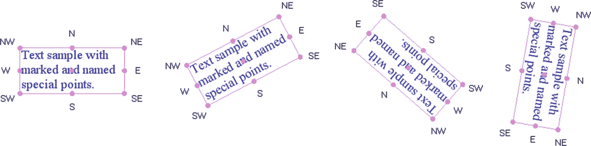

图 2-22

文本的矩形区域及其特殊点

```csharp
public enum TextBasis { NW, N, NE, W, M, E, SW, S, SE };
```

特殊点的名称与其初始标记保持一致，并且这种关联在旋转过程中不会改变。图 2-22 显示了围绕中心点旋转过程中的变化，但旋转可以围绕这九个特殊点中的任意一点进行。

```csharp
public class Comment_Adh : GraphicalObject
{
    PointF [] m_pts;
    TextBasis m_basis;
    string m_text;
    SizeF m_size;
    Font m_font;
    double m_angle;       // 以弧度为单位
    Color m_color;
    bool m_bRotatable;
}
```

此类设计较为简单。在其诸多参数中，任何构造函数都包含要显示的文本（`txt`）和要使用的字体（`fnt`）。这两个参数决定了矩形区域的大小。另外三个参数——锚点坐标（`ptAnch`，即注释中必须放置在该点的特殊点）、文本基准（`textbasis`）以及初始角度（`angleDeg`）——确定了注释的初始位置。计算得到的数组 `m_pts[]` 按照其在 `TextBasis` 枚举中的顺序，包含了所有特殊点。

```csharp
public Comment_Adh (Form frm, Mover mvr, PointF ptAnch, TextBasis textbasis, string txt, Font fnt, double angleDeg, Color clr)
{
    ... ...
    m_size = Auxi_Geometry .MeasureString (frm, m_text, m_font);
    m_angle = Auxi_Common .LimitedRadian (
        Auxi_Convert .DegreeToRadian (angleDeg));
    m_basis = textbasis;
    m_pts = Auxi_Geometry .TextGeometry (m_size, m_angle, ptAnch, m_basis);
    ... ...
}
```

注释不可调整大小，其区域始终为矩形，因此其覆盖层仅由一个矩形节点组成。

```csharp
public override void DefineCover ()
{
    cover = new Cover (new CoverNode (0, Corners, Cursors .Hand));
    if (!Movable)
    {
        cover .SetCursor (Cursors .NoMove2D);
    }
    ... ...
}
```

为了更好地演示注释，提供了 `Form_Comment.cs` 示例（图 2-23）。该示例使用了派生类 `Comment_withMarks`，可以显示注释区域以及所有带名称的特殊点。

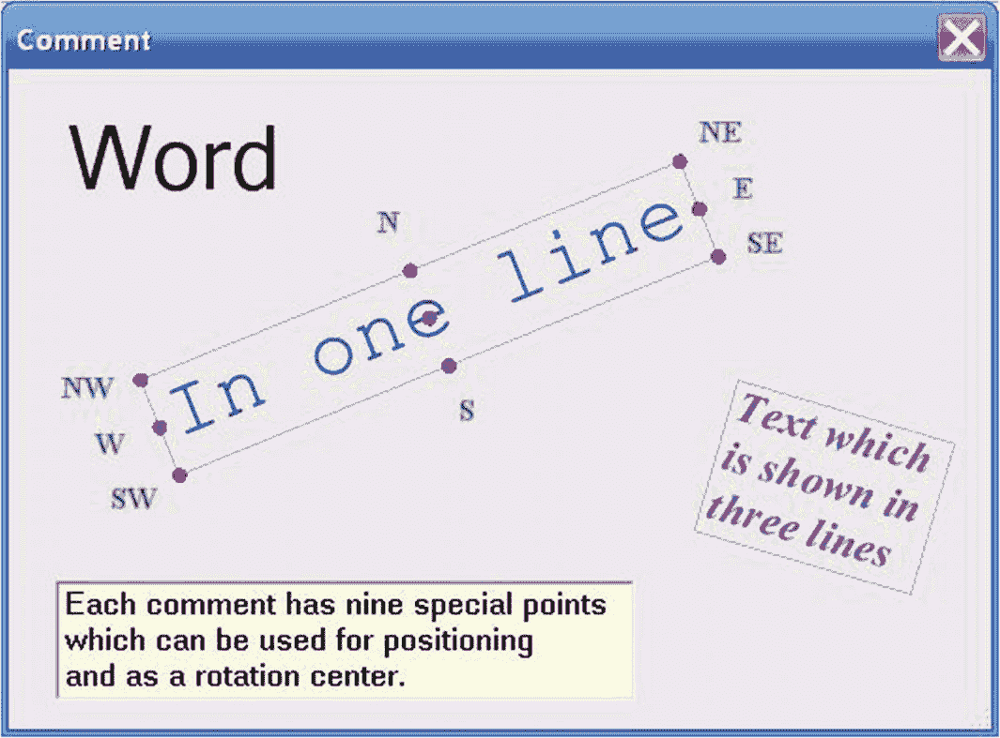

图 2-23 - `Comment_withMarks` 对象

```csharp
public class Comment_withMarks : Comment_Adh
{
    Font m_fntSpotNames;
    Color m_clrSpotNames;
    Color m_clrSpots,
          m_clrAnchorSpot;
    Pen m_penFrame;
    float fSpotRadius = 4;
    float spaceToLetters = 6;
    bool bShowFrame, bShowSpots, bShowSpotNames;
}
```

基类`Comment_Adh`有三个可更改的参数：字体、颜色和选定的锚点。派生类`Comment_withMarks`在特殊点上带有标记及其名称；此外还有几个参数用于控制辅助部分的显示外观。所有这些参数都可以通过右键点击任意`Comment_withMarks`元素调出的菜单进行调节。

## 圆形

*   文件：`Form_Circle.cs`
*   菜单位置：简单对象 ➤ 圆形

在我刚开始研究屏幕对象的可移动性时，对于具有曲线边界的元素的调整大小存在一些问题。后来我考虑了`N 节点覆盖层`，它成为了处理曲边对象的通用解决方案。N 节点覆盖层在我的书[2]中有论述，但本书中并未出现，原因很简单。最流行的曲边对象是圆形和圆环，但对于这些对象，我后来发明了一种极其简单的覆盖层，能提供所有所需的移动和调整大小功能。

本例中的圆形是单色的（图 2-24）；添加辅助线仅仅是为了更好地观察旋转。

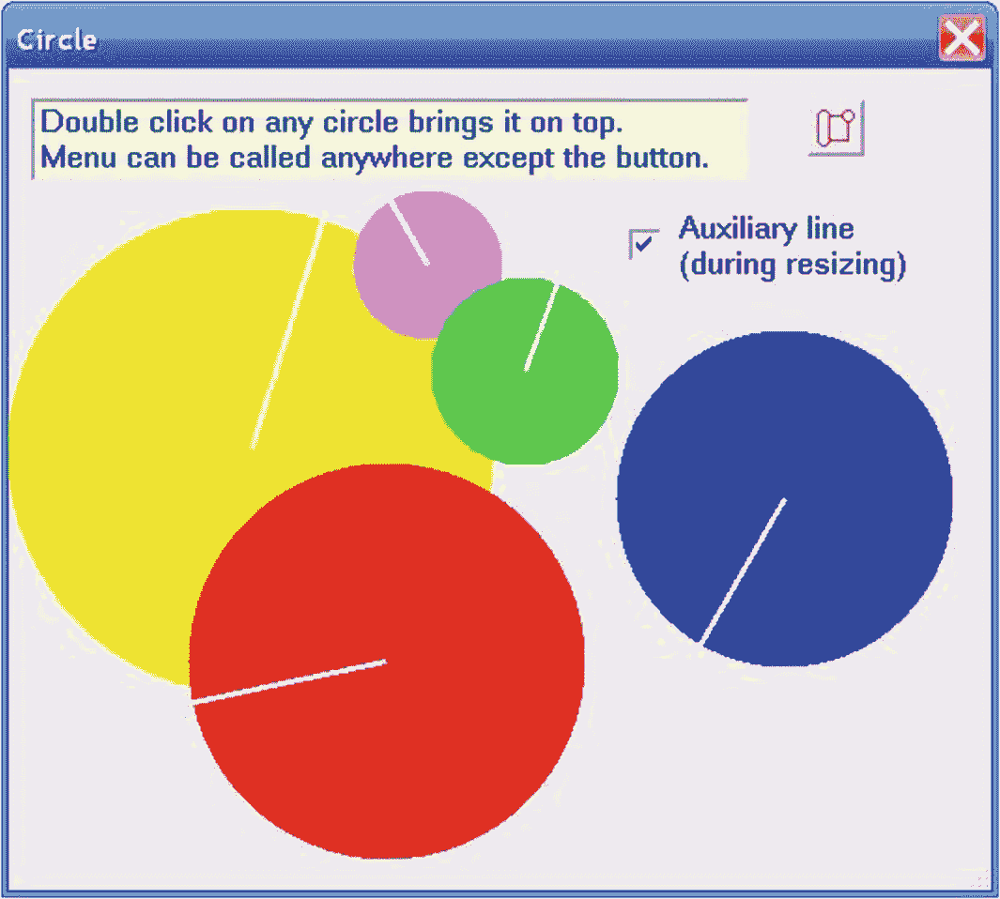

**图 2-24** - 圆内的辅助线使得旋转变得明显

```csharp
public class Circle_Unicolored :
    GraphicalObject
{
    PointF m_center;
    float m_radius;
    double m_angle;
    Color m_color;
    bool bResizable, bRotatable;
    Pen penAuxi;
    static float minRadius = 15;
}
```

两种不同的移动操作必须由左键触发：整个对象的前向移动和调整大小。每个节点在被左键按下时只能启动一种移动操作^(⁷)，因此所需的最少节点数为两个。`Circle_Unicolored`类的覆盖层恰好有两个节点（图 2-25）。两个节点都是圆形的；其大小略微依赖于对象的可调整大小需求。

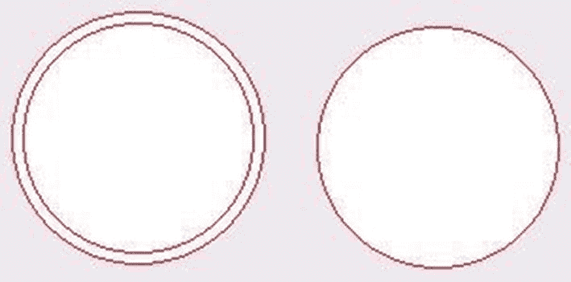

**图 2-25** - 可调整大小和不可调整大小的圆形的覆盖层

*   对于不可调整大小的圆形，两个节点完全相同，因此移动器只看到第一个节点；该节点用于移动圆形。
*   对于可调整大小的圆形，两个节点大小略有不同。第一个节点仍用于移动对象。第二个节点稍大；其未阻塞的部分沿圆形边界形成一个狭窄的圆环，该区域用于调整圆形大小。

```csharp
public override void DefineCover ()
{
    int delta = Resizable ? 3 : 0;
    cover = new Cover (new CoverNode [] {
        new CoverNode (0, Center, Radius - delta, Cursors .SizeAll),
        new CoverNode (1, Center, Radius + delta)});
    if (!Movable)
    {
        cover [0] .Cursor = Cursors .NoMove2D;
    }
    ... ...
}
```

当左键在可调整大小的圆形边界附近按下时，光标会调整到边界上最近的点（`ptPressed`）。在边界上按下鼠标后，只能沿着两点之间的半径方向移动。线段的一端（`ptEndIn`）由允许的最小半径决定；另一端（`ptEndOut`）则设置在远离屏幕边界之外很远的地方。

```csharp
public void Press (Point ptMouse, MouseButtons catcher, int iNode)
{
    if (catcher == MouseButtons .Left)
    {
        if (iNode == 0)
        {
            ptPressed = ptMouse;
        }
        else
        {
            double angleBeam = Auxi_Geometry .Angle (Center, ptMouse);
            ptPressed = Auxi_Geometry.PointToPoint (Center, angleBeam, Radius);
            AdjustCursorPosition (ptPressed);
            ptEndIn =
                Auxi_Geometry .PointToPoint (Center, angleBeam, minRadius);
            ptEndOut = Auxi_Geometry .PointToPoint (Center, angleBeam, 4000);
        }
    }
    ... ...
}
```

在任何时刻，被按下的鼠标光标都位于两个计算点（`ptNearest`）之间的线段上。然后，圆形半径被计算为该点与圆心之间的距离；通过这种方式，圆形边界始终跟随光标移动。

```csharp
public override bool MoveNode (...)
{
    bool bRet = false;
    if (catcher == MouseButtons .Left)
    {
        if (iNode == 0)
        {
            ... ...
        }
        else
        {
            PointF ptNearest = Auxi_Geometry .Segment_NearestPoint (ptMouse, ptEndIn, ptEndOut);
            Radius = Convert .ToSingle (Auxi_Geometry .Distance
                (Center, ptNearest));
            AdjustCursorPosition (ptNearest);
            bRet = true;
        }
    }
    ... ...
}
```

在初始化时，会声明初始角度。对于单色圆形，旋转不可见，因此当前角度对应的半径会以特殊颜色显示。通过这种方式，圆形的旋转可以完美地被观察到。旋转的具体实现方式与矩形相同，采用标准方法。

### 圆环

-   文件：`Form_Ring.cs`
-   菜单位置：简单对象 ➤ 圆环

圆形和圆环的移动与调整大小通常以类似方式进行组织，因此在圆环的案例中，你将看到与之前圆形示例中讨论过的熟悉内容。然而，在`Ring_Unicolored`覆盖层中有一个新特性，因为它使用了透明节点。通过使用透明节点，某些对象的移动/调整大小变得简单而优雅，而在此之前，相同的情况对开发来说是最困难的。在开始使用透明节点之前，有几件事你必须清楚理解。

-   对象的视觉透明度和节点透明度是不同的事物。它们互不关联，毫无共同之处，且彼此独立存在。
-   视觉透明度是一个可平滑变化的值，范围从零到一。视觉透明度为零意味着一个对象完全可见，但透过它却什么都看不见。当你平滑增加某个对象的视觉透明度时，你能越来越清晰地看到其底层的对象，而该对象本身却越来越不清晰。节点透明度是一个布尔值：节点要么被移动器检测到，要么未被检测到。
-   严格来说，*透明节点不会被移动器检测到*这一说法是不正确的。移动器能轻易检测到透明节点，但这是移动器对此类节点唯一会做的事情。不允许对透明节点本身执行任何操作，但还不止于此。同一个覆盖层的节点经常会重叠，因为覆盖层的设计需要如此。覆盖层中节点的顺序很重要，因为移动器会根据其顺序逐个分析覆盖层节点。如果移动器在按下的位置找到了一个透明节点，那么*对该对象的分析就此结束*，如果该位置还有其他对象，移动器将开始分析下一个对象。
-   同一覆盖层的透明节点不会影响其他对象的覆盖层。当覆盖层由非透明节点组成时，你需要设计覆盖层，使得节点覆盖对象区域，或许再超出其边界几个像素（以便更容易捕捉边界），但不要延伸更远，以免阻挡移动器检测其他对象。当覆盖层中有透明节点时，它们超出对象边界的延伸则完全无关紧要。一个对象的透明节点可以重叠其他对象，但它们不会阻挡移动器检测这些对象。有时，即使对于小对象，设计覆盖层时使用大的透明节点也很有用；这在月牙形的案例中可以完美体现。在我著作 [2] 中，也有扇形和弧形的有趣示例；这些对象的覆盖层使用了大的透明节点，这些节点比它们为之提供移动和调整大小功能的元素要大得多。（弧形将在本章后面讨论。）

图 2-26 展示了`Ring_Unicolored`类的一些元素。你可以按下透过另一个圆环的孔洞（甚至穿过多个圆环的孔洞）可见的一个圆环，然后移动、调整大小或旋转该对象。`Ring_Unicolored`类的元素可以通过两个边框进行调整大小。

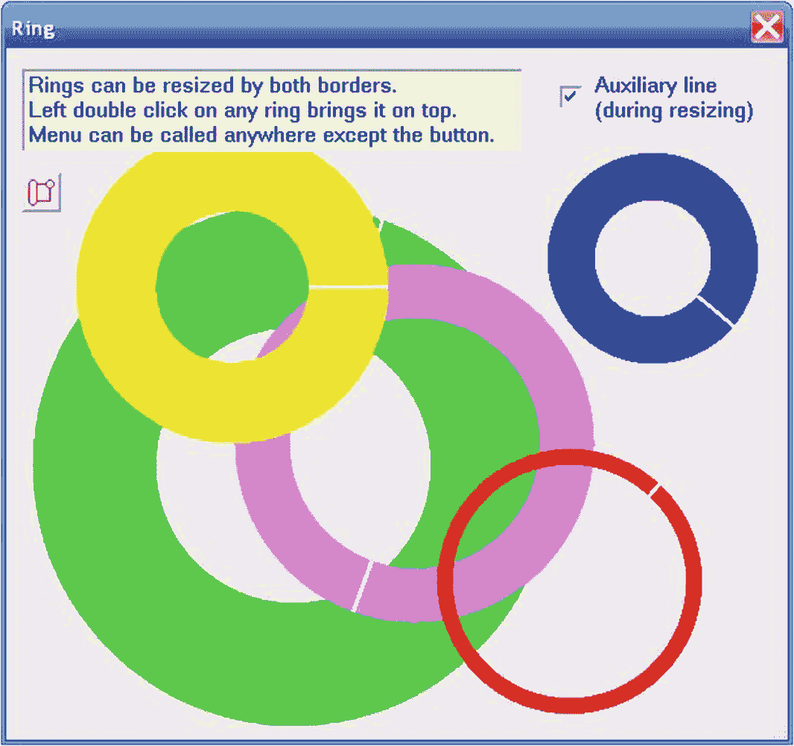

图 2-26 — 圆环可通过两个边框调整大小

```csharp
public class Ring_Unicolored : GraphicalObject
{
    PointF m_center;
    float m_radiusInner, m_radiusOuter;
    double m_angle;
    Color m_color;
    bool bResizable, bRotatable;
    Pen penAuxi;
    static float minRadiusInner = 15;
    static float minWidth = 10;
}
```

此类的覆盖层由四个圆形节点组成；编号从内侧节点开始向外排列。最小的节点（`iNode = 0`）始终是透明的。

-   对于可调整大小的圆环，每个后续节点都比前一个节点大，因此每个节点的工作部分仅是未被前一个节点遮挡的部分（图 2-27）。这四个节点分为两对。第二对节点在尺寸（半径）上的差异形成了一条沿外边界的窄带，并提供了与圆形解释方式完全相同的外边界调整大小功能。第一对节点则提供了类似的内边界调整大小功能。

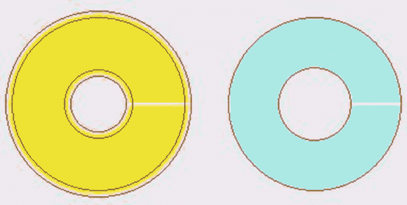

图 2-27 — 可调整大小和不可调整大小圆环的覆盖层

```csharp
public override void DefineCover ()
{
    delta = bResizable ? 3 : 0;
    CoverNode [] nodes = new CoverNode [] {
        new CoverNode (0, Center, RadiusInner - delta,
                       Behaviour .Transparent),
        new CoverNode (1, Center, RadiusInner + delta),
        new CoverNode (2, Center, RadiusOuter - delta, Cursors .SizeAll),
        new CoverNode (3, Center, RadiusOuter + delta)};
    cover = new Cover (nodes);
    cover .SetClearance (false);
    if (!Movable)
    {
        cover [2] .Cursor = Cursors .NoMove2D;
    }
    ... ...
}
```

-   对于不可调整大小的圆环，每个奇数编号的节点都完全被前一个节点遮挡。因此，移动器只能处理节点 2，而这个节点提供了圆环的向前移动和旋转。

圆环覆盖层的每个节点都有其特定用途。

-   节点 0 始终是透明的，用于裁切出内部圆形区域。
-   节点 1 如果可访问，则提供内边界的调整大小功能。对于不可调整大小的圆环，此节点被前一个节点完全遮挡。
-   节点 2 提供整个圆环的向前移动和旋转。
-   节点 3 如果可访问，则提供外边界的调整大小功能。对于不可调整大小的圆环，此节点被前一个节点完全遮挡。

节点 0 始终是透明的，因此在 `Press()` 或 `MoveNode()` 方法中均未提及。如果按下节点 1 或 3，则开始调整大小。在这两种情况下，按下的鼠标光标只允许沿半径方向移动，因此 `Press()` 方法必须计算允许光标移动的端点。对于内边界（节点 1），一个端点（`ptEndIn`）由洞的最小允许半径（`MinimumRadiusInner`）决定，而另一个端点（`ptEndOut`）则由最小允许圆环宽度（`OuterRadius - MinimumWidth`）决定。

```csharp
public void Press (Point ptMouse, MouseButtons catcher, int iNode)
{
    ptPressed = ptMouse;
    if (catcher == MouseButtons .Left)
    {
        angleBeam = Auxi_Geometry .Angle (Center, ptMouse);
        if (iNode == 1)
        {
            ptEndIn = Auxi_Geometry .PointToPoint (Center, angleBeam,
                                                   MinimumRadiusInner);
            ptEndOut = Auxi_Geometry .PointToPoint (Center, angleBeam,
                                                    RadiusOuter - MinimumWidth);
            AdjustCursorPosition (Auxi_Geometry .PointToPoint (Center,
                                                               angleBeam, m_radiusInner));
        }
        ... ...
    }
}
```

对于外边界（节点 3），一个端点（`ptEndIn`）由最小允许圆环宽度（`InnerRadius + MinimumWidth`）决定，而另一个端点（`ptEndOut`）则设置在屏幕边界之外。

```csharp
else if (iNode == 3)
{
    ptEndIn = Auxi_Geometry .PointToPoint (Center, angleBeam,
                                           RadiusInner + MinimumWidth);
    ptEndOut = Auxi_Geometry .PointToPoint (Center, angleBeam, 4000);
    AdjustCursorPosition (Auxi_Geometry .PointToPoint (Center,
                                                       angleBeam, m_radiusOuter));
}
```

圆环的调整大小工作方式与圆形相同。当按下边界附近的一个小区域时，光标会切换到该边界上最近的点，并计算出光标移动的两个端点。当按下左键的鼠标移动时，光标会定位到这两个点之间的线段上的最近点，而按下的边界也随之移动。

以上是关于`Ring_Unicolored`类覆盖层设计的两点说明。

### 排版后的内容

对于不可调整大小的环形，其思路是让节点 1 和节点 3 对移动器不可见，从而使这些节点完全被其前驱节点遮挡。通过将这两个节点挤压为零尺寸，也能达到同样效果。

圆形和环形的覆盖层显示存在细微差别：圆形被擦除后仅显示节点边框（见图 2-25），而环形则可以同时看到节点边框和原始环形颜色（见图 2-27）。这是通过在`Ring_Unicolored.DefineCover()`方法中添加一行代码得到的结果：

```
cover .SetClearance (false);
```

这行代码对对象的移动/调整大小没有影响，但有助于我为此类解释准备图片。在实际应用中，覆盖层从不显示，但其视图有助于讨论覆盖设计。通常，圆形和条形节点尺寸较小，因此我决定擦除其内部区域可提高这些小节点的可见性。相反，多边形节点通常尺寸较大，因此不会对其整个区域进行清理。通过使用不同的节点清理方法，一切都可以改变。偶尔你会看到使用此类方法进行节点清理，但这仅是为了在整个解释过程中保持可见性。

## 圆角条形

* 文件：`Form_Strip.cs`
* 菜单位置：简单元素 ➤ 圆角条形

圆角条形可以看作是一个矩形，在其两条对边上附加了半圆形（图 2-28）。条形也可以看作是两半个圆分开，中间用矩形填充间隙。这种对新图形观察方式解释了为什么条形覆盖层和调整大小与圆形类似。

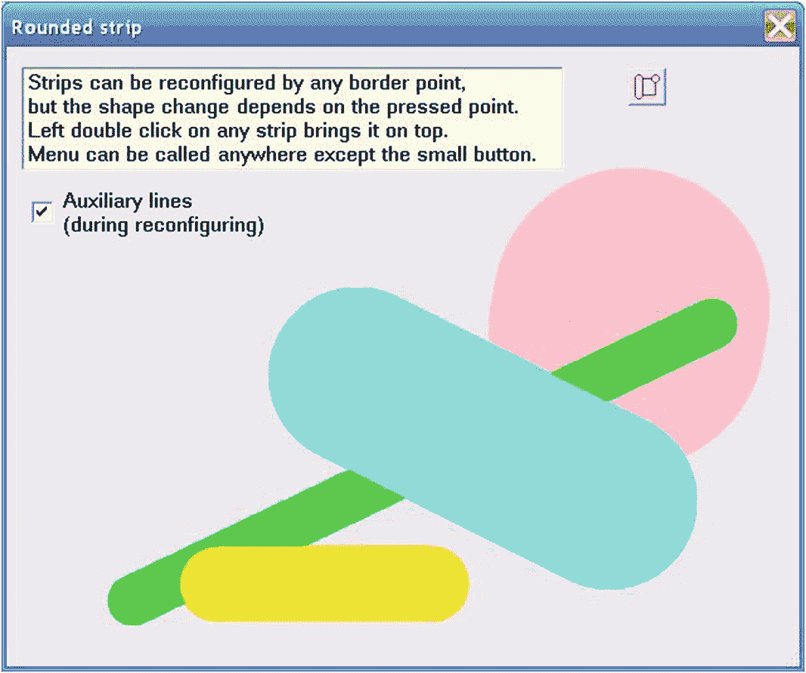

图 2-28

`Strip_Unicolored`类的元素

```
public class Strip_Unicolored
    : GraphicalObject
{
    PointF ptC0, ptC1;
    double m_angle;
    float m_radius;
    SolidBrush m_brush;
    bool bResizable,
         bRotatable;
    PointF ptEndIn, ptEndOut, ptPressed, m_center;
    CaughtLine caught_line;
    PointF [] m_points;
}
```

有几个点对于条形调整大小至关重要。这些点是两个半圆的圆心以及矩形部分的四个角点；所有这些点已在图 2-29 中标出；数字对应`m_points[]`数组中点的顺序。条形角度（`m_angle`）计算为从点`C0`到点`C1`的角度。

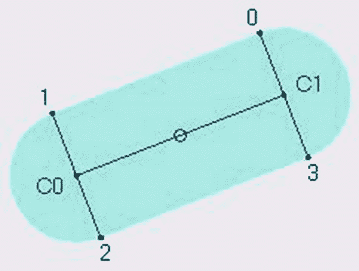

图 2-29

条形特殊点

```
public PointF [] SpecialPoints
{
    get
    {
        return (new PointF [] {
            Auxi_Geometry .PointToPoint (ptC1, m_angle + Math .PI / 2, m_radius),
            Auxi_Geometry .PointToPoint (ptC0, m_angle + Math .PI / 2, m_radius),
            Auxi_Geometry .PointToPoint (ptC0, m_angle - Math .PI / 2, m_radius),
            Auxi_Geometry .PointToPoint (ptC1, m_angle - Math .PI / 2, m_radius)
        });
    }
}
```

每当我遇到处理圆形时真正新颖的方法，我都会尝试将同样的新方法应用于圆角条形，并最终找到实现方式。多年前我意识到由两个节点组成的覆盖层最适合圆形，但思维中的某个错误阻止我将同样的想法推广到圆角条形。因此，条形使用的覆盖层由五个节点组成：两个薄条形节点提供从直边线段开始的调整大小，两个圆形节点提供沿曲线的调整大小，以及一个大的条形节点提供向前移动。我本无意修改该覆盖层中的任何内容，但在 2016 年的一次检查中，我发现对于特定的尺寸组合，存在一个微小区域，其中调整大小工作略有偏差。正是多种条件的组合使得这个错误难以察觉：条形必须很大，其形状必须接近圆形，错误调整大小的区域很小，并且调整大小必须从不寻常的位置开始。（五个节点覆盖设计方案的变体仍在我书[2]的`Strip_SimpleCoverAdh`类中展示，因此你可以尝试找出那个隐藏的错误。）有几种方法可以解决这个问题，但我发现最佳方案是切换到由两个条形节点组成的覆盖层（图 2-30）。

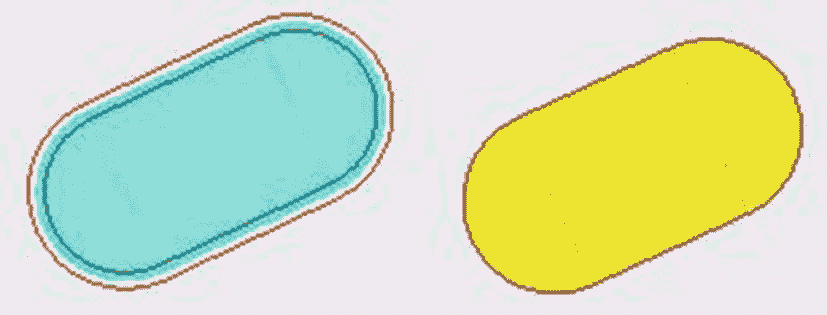

图 2-30

可调整大小和不可调整大小条形的覆盖层

```
public override void DefineCover ()
{
    int delta = Resizable ? 3 : 0;
    CoverNode [] nodes = new CoverNode [] {
        new CoverNode (0, ptC0, ptC1, m_radius - delta, Cursors .SizeAll),
        new CoverNode (1, ptC0, ptC1, m_radius + delta)};
    cover = new Cover (nodes);
    cover .SetClearance (false);
    ... ...
}
```

### 排版结果

如果不是因为那个避免错误的变动，我倾向于使用旧版的五个节点的覆盖。这看起来有点不合逻辑，因为如果你有两个覆盖能提供所有需要的移动和调整大小功能，那么节点数更少的覆盖通常更可取。为什么使用五个节点的覆盖更好，而在 strip（条带）的情况下两个节点会有什么问题？当我们处理圆形时，一个用于调整大小的节点就完美且足够了，因为无论按下的边界点是什么，调整大小的操作都是一样的。在 strip 的情况下，边界区域有四个明显不同的部分，按下每个区域后的反应是不同的。

*   当按下边界的弯曲部分时，被按下的半圆可以沿 strip 轴移动，对面的半圆不动，strip 的半径和宽度不变，只有直线部分的长度改变。

*   当按下边界的直线部分时，光标只能垂直于 strip 轴移动，被抓住的一侧随光标移动。对面的直线边界不动，直线部分的长度不变，但 strip 的宽度改变，同时半圆的半径（以及 strip 总长度）也随之改变。

在每种情况下，与被抓住部分相对的边界部分不动，可以作为新 strip 尺寸的基准。因为 strip 边界有四个部分，我倾向于使用每个边界部分都由其自身节点覆盖的覆盖，并且按下每个节点的反应由一段专门的代码来描述。在双节点覆盖的情况下，只有一个节点负责所有的调整大小操作。在这种情况下，按下的点决定了被按下的边界部分，然后启动一种或另一种调整大小的变体。确定被按下的边界部分，然后按照旧版本已经采用的方式继续操作，这并不困难，但这是我首次在同一个节点上为不同类型的调整大小操作使用不同部分的例子。也许这并不坏，也许我会发现其他对象也能用到这种技术，但目前这是唯一一个这样的例子，对我来说也是一个不寻常的情况。

当在 strip 边界附近按下左键时，第一件事就是确定被按下的边界部分。计算到边界所有四个部分的距离（`dist[]`），并根据最小值确定被按下的部分（`iMinDist`）。

```csharp
public void Press (Point ptMouse, MouseButtons catcher, int iNode)
{
    if (catcher == MouseButtons .Left)
    {
        ptPressed = ptMouse;
        if (iNode == 1)
        {
            int iMinDist;
            double angleBeam;
            PointF ptOnCircle, ptCursor, ptBase;
            PointOfSegment typeOfPoint;
            m_points = SpecialPoints;
            PointF [] ptsNearest = new PointF [4];
            double [] dist = new double [] {
                Auxi_Geometry .Distance_PointSegment (ptMouse, m_points [0], m_points [1], out ptsNearest [0]),
                Auxi_Geometry .Distance_PointSegment (ptMouse, m_points [2], m_points [3], out ptsNearest [1])
```

# Strip 边界的调整

strip 边界的四个部分在 `CaughtLine` 枚举中命名。

```csharp
public enum CaughtLine { Straight_01, Straight_23, Curve_C0, Curve_C1 }
```

第一个是点 0 和点 1 之间的直线边界（见图 2-29），所以我们从这个情况开始（图 2-31）。

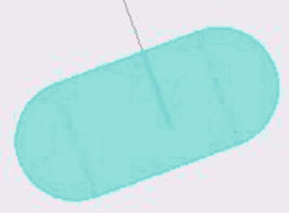

Figure 2-31

边界的直线段在实线穿过它的点被按下

*   光标只能沿与直线边界段成直角的方向移动。这些线段平行于 strip 轴，因此线条角度（`angleBeam`）很容易计算。
*   `ptBase` 是该线与对侧的交点。
*   `Strip_Unicolored` 类有半圆的最小允许半径（`minRadius`）。strip 的最小允许宽度是其两倍，这给出了光标移动的一个端点（`ptEndIn`）。
*   另一个端点（`ptEndOut`）被计算为在同一条线上很远的点。

```csharp
caught_line = (CaughtLine) iMinDist;
if (caught_line == CaughtLine.Straight_01)
{
    angleBeam = m_angle + Math.PI / 2;
    ptBase = Auxi_Geometry.Segment_NearestPoint(ptCursor,
        m_points[2], m_points[3]);
    ptEndIn = Auxi_Geometry.PointToPoint(ptBase, angleBeam, 2 * minRadius);
    ptEndOut = Auxi_Geometry.PointToPoint(ptBase, angleBeam, 4000);
}
... ...
```

## 被按下节点的移动

被按下节点的移动由 `Strip_Unicolored.MoveNode()` 方法描述。当直线边界段随光标移动时，新半径被计算为两个直线段之间距离的一半；然后计算两个半圆的中心点。当通过 `Strip_Unicolored.Radius` 属性设置新半径时，它也定义了新的覆盖。

```csharp
public override bool MoveNode (...)
{
    bool bRet = false;
    double rNew, dist;
    if (catcher == MouseButtons.Left)
    {
        if (iNode == 0)
        {
            ... ...
        }
        else
        {
            PointF ptNearest = Auxi_Geometry.Segment_NearestPoint(ptMouse, ptEndIn, ptEndOut);
            if (caught_line == CaughtLine.Straight_01)
            {
                rNew = Auxi_Geometry.Distance_PointLine(ptNearest,
                    m_points[2], m_points[3]) / 2;
                ptC0 = Auxi_Geometry.PointToPoint(corners[2],
                    m_angle + Math.PI / 2, rNew);
                ptC1 = Auxi_Geometry.PointToPoint(corners[3],
                    m_angle + Math.PI / 2, rNew);
                Radius = Convert.ToSingle(rNew);
            }
            ... ...
            AdjustCursorPosition(ptNearest);
            bRet = true;
            ... ...
```

## 通过曲线进行的调整大小

现在让我们看看通过曲线进行的调整大小；分析一下当围绕点 C0 的圆弧被按下时的情况（图 2-29）。

*   光标只能沿平行于 strip 轴（`angleBeam`）的线移动。
*   光标路径与图 2-32 中所示的辅助线成直角。这两条线标记了 strip 矩形部分的两侧；它们也是半圆的直径。从按下的点到最近一条线的距离是 `additionToLength`；鼠标路径穿过另一条线的假想点是 `ptBase`。

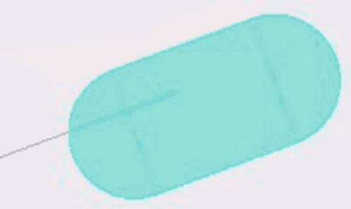

Figure 2-32

弯曲的边界在实线穿过它的点被按下

*   `Strip_Unicolored` 类有直线部分的最小允许长度（`minStraight`）。在整个通过曲线进行的大小调整过程中，光标（正好放置在曲线上）与图中所示最近线之间的距离（`additionToLength`）不变，但两条线之间的距离会改变。因此，光标与远端线之间的最小距离是 `minStraight + additionToLength`；这给出了光标移动的一个端点（`ptEndIn`）。
*   另一个端点（`ptEndOut`）被计算为在同一条线上很远的点。

```csharp
public void Press (Point ptMouse, int iNode)
{
    ... ...
    else if (caught_line == CaughtLine.Curve_C0)
    {
        angleBeam = m_angle + Math.PI;
        Auxi_Geometry.Distance_PointLine(ptCursor, m_points[0],
            m_points[3], out ptBase);
        additionToLength = Auxi_Geometry.Distance_PointSegment(
            ptCursor, m_points[1], m_points[2]);
        ptEndIn = Auxi_Geometry.PointToPoint(ptBase, angleBeam,
            minStraight + additionToLength);
        ptEndOut = Auxi_Geometry.PointToPoint(ptBase, angleBeam, 4000);
    }
    ... ...
```

通常，调整大小的结果由 `MoveNode()` 方法决定。计算到远程线的距离（`dist`）；这允许你计算点 `C0` 的新位置，之后可以组织新的覆盖层。

```csharp
public override bool MoveNode (...)
{
    ... ...
    else if (caught_line == CaughtLine.Curve_C0)
    {
        dist = Auxi_Geometry.Distance_PointLine(ptNearest,
            m_points[0], m_points[3]);
        ptC0 = Auxi_Geometry.PointToPoint(ptC1, m_angle + Math.PI,
            dist - additionToLength);
        DefineCover();
    }
    ... ...
```

# 正多边形

*   文件：`Form_Polygon_Regular.cs`
*   菜单位置：简单对象 ➤ 多边形（正多边形）

此示例涉及属于 `Polygon_Regular` 类的元素（图 2-33）。

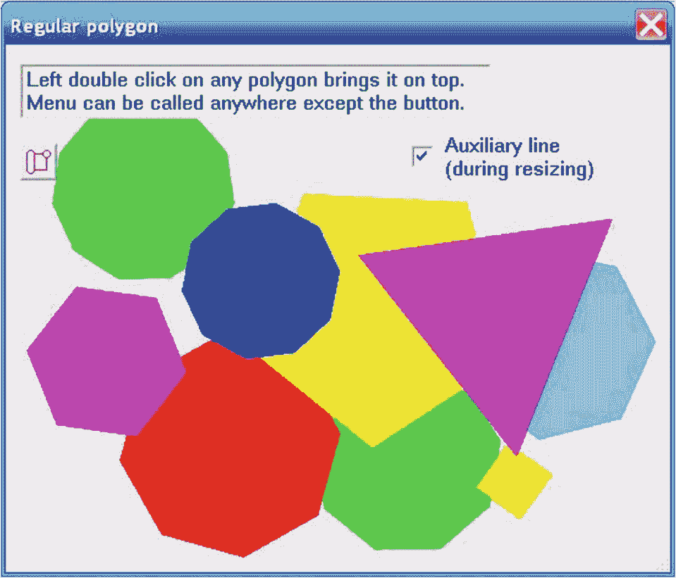

图 2-33

`Polygon_Regular` 类的元素

```csharp
public class Polygon_Regular :
    GraphicalObject
{
    PointF m_center;
    double m_angle;
    double m_radiusVertices;
    int nVertices;
    SolidBrush m_brush;
```

bool `bResizable`, `bRotatable`;

double `delta` = 3;

double `deltaR`;

圆形和正多边形的覆盖层设计方式类似。唯一的区别在于节点的形状，毫不奇怪，`Polygon_Regular`类覆盖层中的节点具有正多边形的形状。节点 0 用于移动，并具有所有多边形节点的默认光标形状（`Cursors.SizeAll`）；对于不可移动的多边形，它会变为`Cursors.NoMove2D`。节点 1 用于调整大小。对于可调整大小的多边形，第一个节点略小，第二个节点略大于多边形本身。只有沿对象边界的第二个节点的一小部分没有被前一个节点遮挡，可用于调整大小（图 2-34）。为了指示按下此部分时结果的差异，节点 1 具有另一种光标形状（`Cursors.Hand`）。对于不可调整大小的多边形，第一个节点的区域等于对象本身，而第二个节点被压缩为零大小。

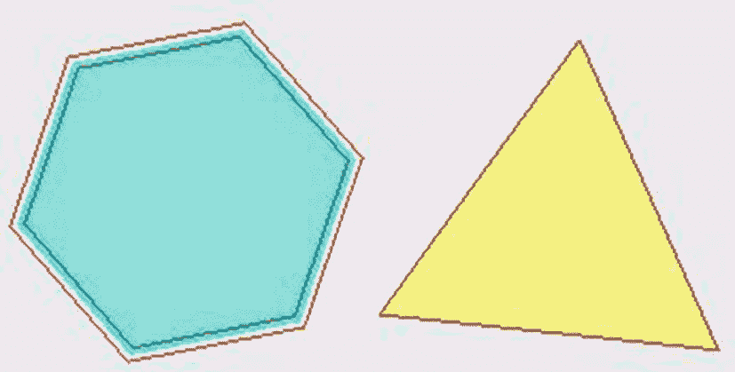

图 2-34

可调整大小和不可调整大小多边形的覆盖层

```
public override void DefineCover ()
{
    CoverNode [] nodes = new CoverNode [2];
    if (Resizable)
    {
        nodes [0] = new CoverNode (0, VerticesMinus);
        nodes [1] = new CoverNode (1, VerticesPlus, Cursors .Hand);
    }
    else
    {
        nodes [0] = new CoverNode (0, Vertices);
        nodes [1] = new CoverNode (1, m_center, 0f);
    }
    cover = new Cover (nodes);
    ... ...
}
```

两个多边形节点的计算方式使得它们边界之间的最小距离为六个像素（`2 * delta`）。这是两个边界的直线段之间的差值，而计算时需要它们的顶点。两个数组的计算很简单；这些数组的点取决于顶点数量、多边形半径以及两个边界之间所需的空间。`deltaR`是多边形顶点与节点顶点之间的距离；两个点位于同一条径向射线上。内部和外部节点的顶点由`VerticesMinus`和`VerticesPlus`属性计算。

```
deltaR = delta / Math .Cos (Math .PI / nVertices);

public PointF [] VerticesPlus
{
    get { return (Auxi_Geometry .RegularPolygon (m_center,
        m_radiusVertices + deltaR, nVertices, m_angle)); }
}

public PointF [] VerticesMinus
{
    get { return (Auxi_Geometry .RegularPolygon (m_center,
        m_radiusVertices - deltaR, nVertices, m_angle)); }
}
```

当多边形可调整大小，并且在多边形边界附近按下鼠标左键时，光标会移动到最近的边界点（`ptNearest`）。之后，按下的鼠标光标只允许沿半径方向移动。路径的终点之一（`ptEndIn`）通过使用多边形顶点允许的最小半径计算得出；另一个终点（`ptEndOut`）设置在屏幕边界之外。

```
public void Press (Point ptMouse , MouseButtons catcher, int iNode)
{
    SavePosition ();
    if (catcher == MouseButtons .Left)
    {
        if (iNode == 0)
        {
            ptPressed = ptMouse;
        }
        else
        {
            PointF ptNearest;
            Auxi_Geometry .Distance_PointPolyline (ptMouse, Vertices, true,
                out ptNearest);
            AdjustCursorPosition (ptNearest);
            scaling = m_radiusVertices / Auxi_Geometry .Distance (Center, ptNearest);
            angleBeam = Auxi_Geometry .Angle (Center, ptNearest);
            ptEndIn = Auxi_Geometry .PointToPoint (Center, angleBeam,
                Polygon_Regular_Adh .MinimumRadius / scaling);
            ptEndOut = Auxi_Geometry .PointToPoint (Center, angleBeam, 4000);
        }
    }
    ... ...
}
```

在按住鼠标按钮移动的整个过程中，边界线随光标移动。所有顶点的半径由光标位置以及`scaling`系数决定，该系数是在`Press()`方法中计算的。

```
public override bool MoveNode (...)
{
    bool bRet = false;
    if (catcher == MouseButtons .Left)
    {
        if (iNode == 1)
        {
            PointF ptNearest = Auxi_Geometry . Segment_NearestPoint (ptMouse, ptEndIn, ptEndOut);
            double dist = Auxi_Geometry .Distance (Center, ptNearest);
            RadiusVertices = dist * scaling;
            AdjustCursorPosition (ptNearest);
            bRet = true;
        }
    }
    ... ...
}
```

### 弹性多边形

- 文件：`Form_Polygon_Elastic.cs`
- 菜单位置：简单对象 ➤ 多边形（弹性）

前一示例中的多边形在构造时便确定了形状。它们可以移动和旋转，可以改变大小，但形状固定不变。然而，在我们的程序中，对象有时需要在应用运行过程中改变形状。现在，我们通过使用另一类多边形来探索这种可能性。

在我的著作 [2] 中，你可以找到凸多边形的示例，这些凸多边形虽然可以重新配置，但始终保持凸形，因此其形状变化有限。当前示例中的多边形则没有形状限制。为了使形状变换更加直观，新型多边形的特殊点都与各自的颜色相关联，并且对象的实体表面通过从点到点的平滑色彩过渡进行绘制。多年来，我一直称这类多边形为*猫眼多边形*，因此类名强调了其绘制过程。从几何角度来看，它们的主要特点是形状的无限变化，所以现在我更倾向于称它们为*弹性多边形*，尽管它们仍沿用旧有的绘制方法，并继续保持猫眼效果。

图 2-35 展示了几个 `Polygon_Elastic` 类对象的示例。

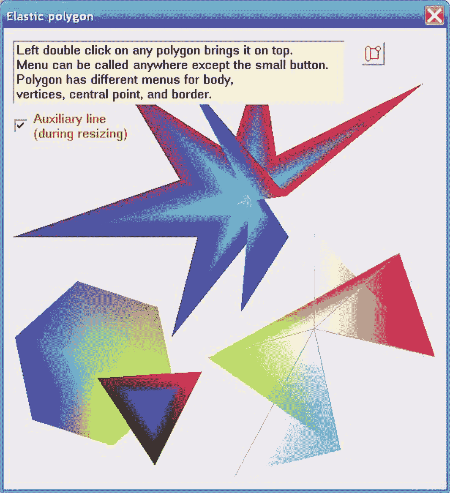

图 2-35 — 弹性多边形

```
public class Polygon_Elastic : GraphicalObject
{
    PointF m_center;
    List m_points;
    Color clrCenter;
    List clrVertices;
    bool bShowRibs, bResizable, bReconfigurable, bRotatable;
```

此类多边形在形状变化上的灵活性决定了初始化时的参数集合。

- 顶点放置没有限制，因此可以使用任意点数组进行初始化。
- 初始化时必须声明另一个点，该点用于封面设计和绘制。在后续解释中，它被称为*中心点*，尽管它可以放置在任意位置。
- 中心点和每个顶点都与各自的颜色相关联，因此所有点在一开始就需要声明某些颜色。

```
public Polygon_Elastic (Form frm, Mover mvr, PointF ptC, PointF [] pts,
    Color clrC, Color [] clrs)
```

## 弹性多边形的覆盖与交互

弹性多边形的覆盖包含所有三种不同形状的控制点（图 2-36）。通常情况下，较小的控制点在覆盖中排在较大的控制点之前，因此我们以小型圆形控制点开始，接着是长条控制点，而多边形控制点位于最后。对于一个拥有 `N` 个顶点的多边形，其覆盖按此顺序由 `3*N + 1` 个控制点组成。

- 每个顶点由一个小型圆形控制点覆盖。
- 中心点由一个小型圆形控制点覆盖。
- 每对连续的顶点用于组织一个窄长条控制点；最后一个顶点与第一个顶点相连接。
- 每对连续的顶点与中心点共同构成一个多边形（三角形）控制点；另一个三角形控制点由最后一个顶点、第一个顶点和中心点构建而成。

在后续解释中，连接连续顶点的那组线段被称为*边界*。初始化弹性多边形最简单的方法是将其点计算为正多边形的顶点，在这种情况下，连续顶点之间的线段最初就构成了边界。之后，顶点可以任意移动，顶点可以添加和删除，某些顶点可以放置在整个多边形的区域内部，并且原始边界的各个线段可以相互交叉。无论进行何种变换，在本说明中，连续顶点之间的那组线段仍被称为*边界*。

如果禁止重新配置，那么所有圆形控制点将被压缩至零尺寸，但对于长条控制点的压缩，则可能有不同的处理方式。

- 在《完全可移动性元素》一书中，我展示了类似的弹性多边形，其中沿不可调整大小多边形边界的长条控制点被压缩至零尺寸。从调整大小的角度来看，这看起来完全合乎逻辑（如果多边形不可调整大小，那么它就不需要沿其边界的控制点），但当决定向不可调整大小的多边形添加一个顶点时，这便要求一个不合逻辑的步骤。要添加顶点，你需要标记其位置。你不能简单地将它添加在屏幕上的任意一点，因为在这种情况下，无法判断所需的对象。即使你在某个多边形内部某处按下鼠标，也无法确定新顶点在该多边形现有顶点中的顺序。因此，添加新顶点的显而易见的方法是按下两个顶点之间的长条控制点，新顶点将被插入它们之间。顶点用于重新配置；可调整大小和不可调整大小的多边形都可以重新配置。然而，如果不可调整大小多边形的长条控制点被压缩至零尺寸，那么就不可能向这样的多边形添加新顶点。如此一来，重新配置的第一步——添加新顶点——竟依赖于可调整大小性，这毫无意义。调整大小和重新配置是两种不同的操作，我不喜欢让它们之间产生某种关联。

- 在当前版本中，长条控制点的大小不依赖于当前的可调整大小性，因此无论多边形是否可调整大小，都可以添加顶点并对其进行重新配置。

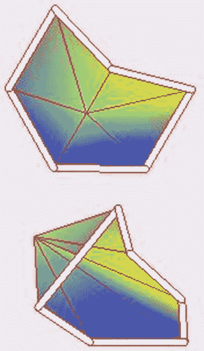

图 2-36c — 这些是不可重新配置的多边形，但无法判断它们是否可调整大小

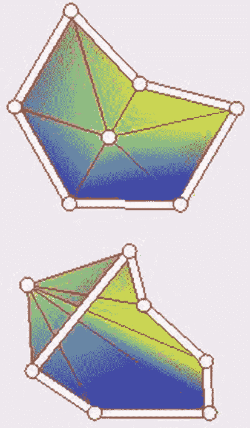

图 2-36b — 可见的圆形控制点表明可以重新配置

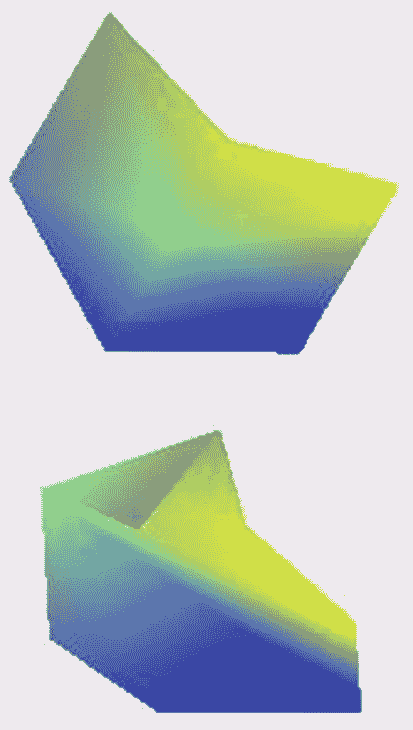

图 2-36a — 两个弹性多边形，其中心点分别位于内部和外部

所有特殊点都可以不受限制地移动，因此中心点也可以放置在外部。图 2-36a 展示了中心点位于边界线内部和外部的变体。如果没有辅助线，则很难发现中心点。当肋线（即中心点与顶点之间的连线）可视化显示后，中心点便一目了然。

```csharp
public override void DefineCover ()
{
    CoverNode [] nodes = new CoverNode [3 * VerticesNumber + 1];
    float rad = bReconfigurable ? 5f : 0f;
    for (int i = 0; i < VerticesNumber; i++)
    {
        nodes [i] = new CoverNode (i, m_points [i], rad);
    }
    nodes [VerticesNumber] = new CoverNode (VerticesNumber, m_center, rad);
    int k0 = VerticesNumber + 1;
    for (int i = 0; i < VerticesNumber; i++)
    {
        nodes [k0 + i] = new CoverNode (k0 + i, m_points [i],
                                        m_points [(i + 1) % VerticesNumber]);
    }
    k0 = 2 * VerticesNumber + 1;
    for (int i = 0; i < VerticesNumber; i++)
    {
        PointF [] pts = new PointF [3] { m_points [i],
                                        m_points [(i + 1) % VerticesNumber], m_center };
        nodes [k0 + i] = new CoverNode (k0 + i, pts);
    }
    cover = new Cover (nodes);
    ... ...
}
```

当多边形被按下时，可以启动不同的移动操作。移动类型取决于控制点的类型，但在 `Press()` 方法中，决定是基于控制点编号做出的。

- 如果按下的是圆形控制点，则通过使用标准的 `AdjustCursorPosition()` 方法，将光标切换到该控制点的中心点位置。此时无需其他操作，因为所有特殊点都可以在屏幕上自由移动。

### 多边形交互与缩放

- 如果按下某个条带节点，则表明缩放开始。光标会移动到该条带节点覆盖的边界线段上最近的点（`ptPressed`）；然后计算按下鼠标的允许移动路径。该路径是一条从中心点穿过光标所移至边界点的直线段；`angleBeam` 是这条线的角度。允许光标移动的线段由其两个端点 `ptEndIn` 和 `ptEndOut` 描述。所有顶点的缩放系数都会被计算出来（`scaling[]`）；这些系数将贯穿整个缩放过程。

```csharp
public void Press (Point ptMouse , MouseButtons catcher, int iNode)
{
    if (catcher == MouseButtons .Left)
    {
        if (iNode < VerticesNumber)             // 顶点
        {
            ptPressed = m_points [iNode];
            AdjustCursorPosition (ptPressed);
        }
        else if (iNode == VerticesNumber)       // 中心点
        {
            ptPressed = m_center;
            AdjustCursorPosition (ptPressed);
        }
        ... ...
```

- 如果按下任何多边形节点，则仅保存该按下点。

```csharp
        else if (iNode < 2 * VerticesNumber + 1)        // 线段
        {
            int iSegment = iNode - (VerticesNumber + 1);
            ptPressed = Auxi_Geometry .Segment_NearestPoint (ptMouse,
                                                             m_points [iSegment],
                                                             m_points [(iSegment + 1) % VerticesNumber]);
            if (Resizable)
            {
                distInitial = Auxi_Geometry .Distance (m_center, ptPressed);
                double angleBeam = Auxi_Geometry .Angle (m_center, ptPressed);
                ptEndIn = Auxi_Geometry.PointToPoint (m_center, angleBeam, 20);
                ptEndOut = Auxi_Geometry .PointToPoint (m_center, angleBeam, 4000);
                FillAuxiArrays ();
                for (int i = 0; i < VerticesNumber; i++)
                {
                    scaling [i] = radii [i] / distInitial;
                }
            }
            AdjustCursorPosition (ptPressed);
        }
```

```csharp
        else
        {
            ptPressed = ptMouse;
        }
```

对任意节点移动的响应在 `MoveNode()` 方法中描述；该覆盖区中的三种节点负责完全不同的操作，因此该方法中有三个分支。

- 当某个圆形节点被移动时，与该节点关联的点（可以是顶点或中心点）会跟随光标移动。

- 所有多边形节点负责移动整个对象，但仅当该对象可移动时生效。

```csharp
public override bool MoveNode (...)
{
    bool bRet = false;
```

if (catcher == MouseButtons.Left)
{
    if (iNode < VerticesNumber)
    {
        m_points[iNode] = ptMouse;
        bRet = true;
    }
    else if (iNode == VerticesNumber)
    {
        m_center = ptMouse;
        bRet = true;
    }
    ... ...
}
```

- 当某个条带节点被移动时，整个对象会进行缩放。光标沿着之前计算好的直线段移动；边界点随着光标移动，所有顶点的新位置由光标位置结合之前计算的缩放系数确定。

```
else if (iNode >= 2 * VerticesNumber + 1)
{
    if (Movable)
    {
        Move(dx, dy);
        bRet = true;
    }
    else
    {
        AdjustCursorPosition(ptPressed);
    }
}
```

```
else
{
    if (Resizable)
    {
        PointF ptNearest = Auxi_Geometry.Segment_NearestPoint(
            ptMouse, ptEndIn, ptEndOut);
        double distMouse = Auxi_Geometry.Distance(m_center, ptNearest);
        List ptsNew = new List();
        for (int j = 0; j < m_points.Count; j++)
        {
            ptsNew.Add(Auxi_Geometry.PointToPoint(m_center,
                angles[j], distMouse * scaling[j]));
        }
        m_points = ptsNew;
        DefineCover();
        AdjustCursorPosition(ptNearest);
        bRet = true;
    }
    else
    {
        AdjustCursorPosition(ptPressed);
    }
}
... ...
```

旋转以标准方式围绕中心点进行，但由于中心点可移动，因此旋转是围绕中心点的当前位置进行的。在鼠标右键按下多边形时，通过 `Press()` 方法进行初步计算。此时会填充两个数组；这两个数组存储了从中心点到所有顶点的距离和角度。

```
private void FillAuxiArrays()
{
    for (int i = 0; i < m_points.Count; i++)
    {
        radii[i] = Auxi_Geometry.Distance(m_center, m_points[i]);
        angles[i] = Auxi_Geometry.Angle(m_center, m_points[i]);
    }
}
```

在已知这些角度的基础上，计算每个顶点的补偿值。

```
public void Press(Point ptMouse, MouseButtons catcher, int iNode)
{
    ... ...
    else if (catcher == MouseButtons.Right)
    {
        ptPressed = ptMouse;
        FillAuxiArrays();
        double angleMouse = Auxi_Geometry.Angle(m_center, ptMouse);
        for (int i = 0; i < VerticesNumber; i++)
        {
            compensation[i] = Auxi_Common.LimitedRadian(angleMouse - angles[i]);
        }
    }
}
```

为每个顶点存储的半径和补偿值允许你在旋转的任何时刻计算顶点位置。

```
public override bool MoveNode(...)
{
    ... ...
    else if (catcher == MouseButtons.Right)
    {
        if (Rotatable)
        {
            double angleMouse = -Math.Atan2(ptMouse.Y - m_center.Y,
                ptMouse.X - m_center.X);
            for (int j = 0; j < VerticesNumber; j++)
            {
                m_points[j] = Auxi_Geometry.PointToPoint(m_center,
                    Auxi_Common.LimitedRadian(angleMouse - compensation[j]), radii[j]);
            }
            DefineCover();
            return (true);
        }
        ... ...
```

## 多边形重构

多边形可以通过移动其顶点和中心点进行重构，但还有一种选择。弹性多边形的顶点数量可以更改，但此操作有几个条件限制。添加顶点和删除顶点通过两个不同菜单的命令来组织。

要删除一个顶点，请使用该顶点上的菜单；当然，对于三角形，该命令不可用。菜单会在覆盖该顶点的小圆形节点上被调用。这种节点仅对可重构多边形具有非零尺寸，因此这是唯一且绝对合理的条件：如果多边形是可重构的，则存在非零的圆形节点，并且可以使用“删除顶点”菜单命令。

要添加一个顶点，你需要标记其位置。你不能简单地在任意屏幕点添加它，因为在这种情况下，无法确定所需的对象。即使你在多边形内部某处按下鼠标，也无法设置新顶点在该对象现有顶点中的顺序。因此，包含一个新顶点的明显方法是按下两个现有顶点之间的条带节点。之后，可以将新顶点移动到所需位置。

对于弹性多边形，新顶点的添加及其后续使用是分离的。首先，在多边形边界上的所需点调用菜单，然后按下“添加顶点”命令。现在，你可以用左键按下该顶点并将其移动到任何其他位置，从而改变多边形的形状。在折线的示例中，添加新关节及其移动是在单一的按下并移动操作中组织的。为什么多边形不采用同样的方式？弹性多边形可以使用任何边界点进行缩放，因此无法预测用左键按下边界是缩放的开始还是对新顶点的请求。（在折线的情况下，新关节的添加仅针对不可移动的线进行组织，因此两个操作之间没有冲突。）

弹性多边形的无限制更改可能会产生奇怪的结果。在设计的所有这些年里，我在实际应用中从未遇到过这种情况，并且在接下来的任何示例中你也不会看到类似的奇怪现象，但因为这些情况是可能发生的，我想提一下它们，并借助图 2-37 进行解释。

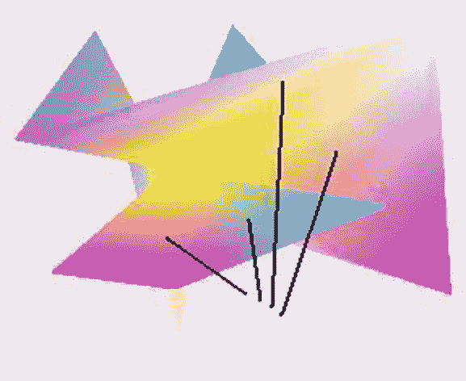
图 2-37e 不可见边界的位置

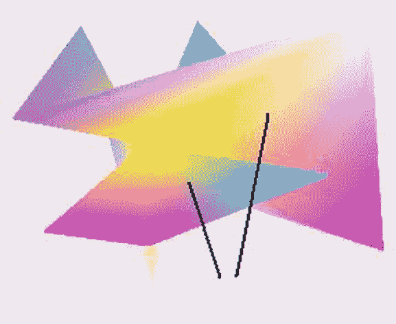
图 2-37d 不可见顶点的位置

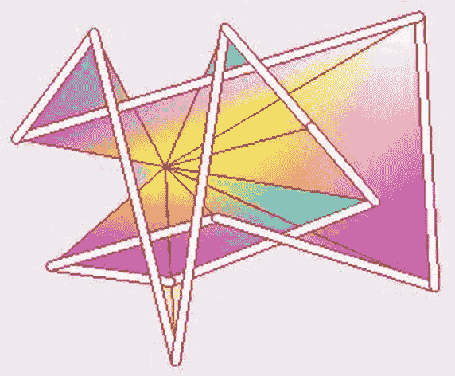
图 2-37c 不可重新配置多边形的覆盖

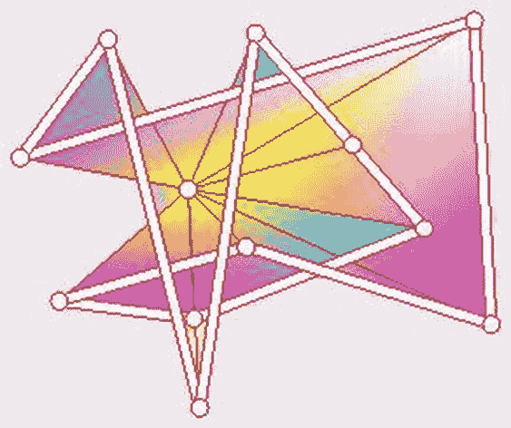
图 2-37b 完全覆盖


图 2-37a 多边形

图 2-37a 展示了您在屏幕上看到的一个多边形。在实际应用中，这些覆盖层从不显示，但它们的可视化有助于解释和分析，因此图 2-37b 展示了当所有节点都具有实际尺寸时同一多边形的覆盖层；图 2-37c 展示了该多边形被声明为不可重新配置时的覆盖层。如您所见，在这种情况下，所有圆形节点都被压缩为零尺寸。图 2-37d 和 2-37e 标记了一些需要讨论的有趣位置。

出现一些奇怪情况的原因在于，我们（用户）和移动器对同一对象有着不同的视角。无论其所有参数如何，我们在图 2-37a 中看到的是同一个重新配置后的多边形。对于移动器来说，没有颜色和绘制，只有覆盖层，因此，根据声明的 `Reconfiguration` 属性，移动器在图 2-37b 或 2-37c 中只看到节点。这还不是全部，因为后续的一些移动器操作还取决于当前声明的可调整大小属性。（我想提醒您，在 `Polygon_Elastic` 类中，带状节点的大小不依赖于可调整大小属性，因此无法通过覆盖视图来判断图 2-37c 中的多边形是否可调整大小。）

默认情况下，多边形是可移动的，并且在这种情况下，它应该可以通过任何内部点移动。您将光标移过此多边形，几乎所有地方光标都显示为十字形。但在图 2-37d 中由黑线端点标记的两个小区域上方，十字形会变为手形。移动器会持续寻找节点，并根据第一个检测到的节点的参数改变光标形状。对于我们的眼睛来说，这些是颜色平滑变化且没有任何特殊特征的地方，但对于移动器来说，这些是圆形节点的位置，因此光标形状会改变。如果您移动光标的速度不是太快，就能捕捉到这种变化。如果此时停止并按下光标，那么您将移动的不是整个多边形，而是被抓取的那个顶点。是否打算这样做取决于您，但您需要了解存在这种可能性。该顶点对用户来说可能是不可见的，因为它被多边形的某个部分遮挡了视线，但 `Polygon_Elastic` 对象的圆形节点在其覆盖层中排在首位，因此会首先被移动器分析和抓取 (!)。

这些多边形中的圆形节点很小，意外移动某个顶点的概率微乎其微。带状节点从不消失，它们的面积更大，但按下某个隐藏边界部分的效果可能会有所不同。带状节点上的光标形状也会从十字形变为手形。如果您按下了图 2-37e 中由黑线端点标记的区域之一，并且该多边形是可调整大小的（默认情况下是可调整大小的），那么您将开始调整大小。如果您对不可调整大小的多边形执行相同操作，光标则会吸附在按下的点上。

有两种方法可以将新多边形添加到当前示例中。一种是通过其菜单中的命令复制现有多边形。另一种是在任意空白位置调用菜单，并使用“添加多边形”命令，该命令会调用一个辅助窗体 `Form_NewElasticPolygon.cs`（图 2-38）。来自示例 `Form_Polygon_Elastic.cs` 的弹性多边形可以任意变换，因此我认为没有必要在辅助窗体中定义新多边形的形状。此辅助窗体的目的是定义一个具有所需顶点数量以及所有特殊点所需颜色的新多边形。在此辅助窗体中使用的多边形可以调整大小和旋转，但它始终是一个正多边形，其顶点附近放置有额外的小圆圈。

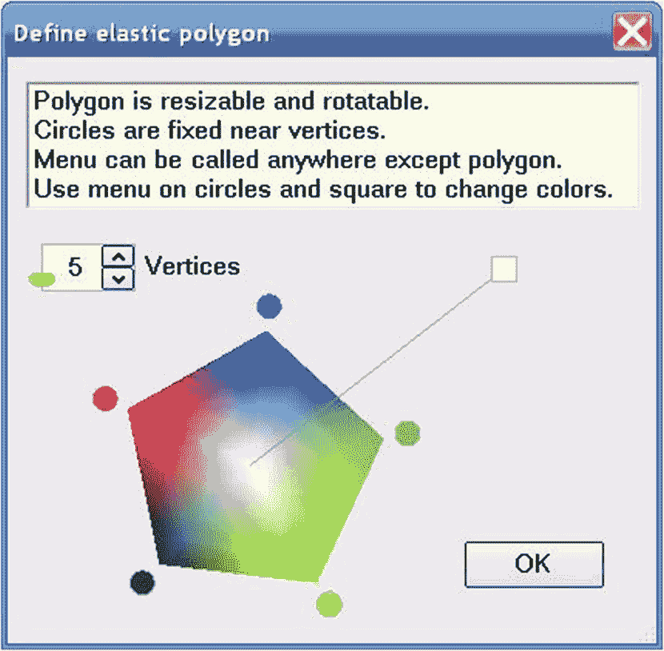
图 2-38 此处定义了新多边形的顶点数量和颜色集

```csharp
public class Polygon_RegChat_withCircles : GraphicalObject
{
    PointF m_center;
    double m_angle;
    double radiusVertices, fRadiusToCenters;
    int nVertices;
    Color clrCenter;
    Color [] clrVertices;
    float fSpaceToCircles, fRadiusSmall;
    bool bResizable, bRotatable;
```

`Polygon_RegChat_withCircles` 类的对象演示了在其他屏幕对象中很少见的一个特性。通常，屏幕对象是作为一个整体显示的。一个对象可以是任意形状，但它通常是一个单一的整体，因此通常有一个由重叠节点组成的覆盖层。对于这个多边形来说，构成单个对象的几个完全分离的部分。例如，您可以通过任何内部点旋转此多边形，也可以通过任何小圆圈进行同样的旋转。

小圆圈放置在距离顶点固定距离（`fSpaceToCircles`）的位置，并位于从多边形中心点穿过顶点的射线上，因此多边形的几何形状以及这些圆圈已知的距离和半径（`fRadiusSmall`）完美地描述了这些小部分的位置。圆圈不能单独移动。一个具有 N 个顶点的多边形的覆盖层由 N + 2 个节点组成。该对象的主要部分是一个正多边形，因此两个节点提供其移动和调整大小功能；N 个圆形节点覆盖这些小圆圈。

```csharp
public override void DefineCover ()
{
    CoverNode [] nodes = new CoverNode [VerticesNumber + 2];
    PointF [] ptCircles = Auxi_Geometry .RegularPolygon (Center,
        fRadiusToCenters, VerticesNumber, Angle);
    for (int i = 0; i < VerticesNumber; i++)
    {
        nodes [i] = new CoverNode (i, ptCircles [i], fRadiusSmall);
    }
    int k0 = VerticesNumber;
    if (Resizable)
    {
        nodes [k0] = new CoverNode (k0, VerticesMinus);
        nodes [k0 + 1] = new CoverNode (k0 + 1, VerticesPlus, Cursors .Hand);
    }
    else
    {
        nodes [k0] = new CoverNode (k0, Vertices);
```

# 多边形交互与圆弧类

在不同位置（节点）按下多边形会产生什么反应？

对于鼠标左键按下：

*   如果在多边形内部按下，则移动整个对象。
*   如果在边界上按下，则调整多边形大小。
*   如果在任何圆圈上按下，则光标固定在按下的点上。

鼠标右键按下会启动旋转，无论按下的点是哪里。

颜色的更改通过可以在圆圈和小正方形上调用的菜单完成。一条细线表示小正方形与中心点相关联，因此通过此正方形上的菜单调用的标准颜色选择对话框允许您设置中心点的颜色。

## Arc

- 文件：`Form_Arc.cs`
- 菜单位置：`简单对象 ➤ 圆弧`

让我们再次转向一个带有弯曲边缘的对象。在我的书[2]中，你可以找到各种宽窄圆弧的例子，以及一些看似宽圆弧的环形扇区示例。在此，我尝试将所有情况统一到一个类中。此外，`Arc`类还展示了两个有趣的特性。

-   通常，大节点形状与其所关联的对象形状相似。这虽常见，但并非铁律；有时大节点的形状与对象本身毫无相似之处，但这类节点在封面设计中却很有用。
-   有些情况下，节点形状会动态变化，并取决于对象的某些参数。

在深入探讨 `Arc` 类的细节之前，我们先提一下设计思路。圆弧，尤其是宽圆弧，看起来像圆环的一部分，因此需要具备一些相同的参数，例如中心点、内半径和外半径。此外，还有描述弧线两端的两个角度。

当你观察任何一段圆弧时，无法看出其两端有何区别。同样地，我们也看不出矩形的四个角有何不同，但当你按下任意一个角时，移动器因为每个角都被一个带有独立编号的节点覆盖，所以能准确知道按下了哪个。为了使圆弧的两端可移动，它们被节点覆盖；这些节点拥有自己的编号，因此移动器能知道按下的是哪一端。在代码中，一端被称为头，从中心点到这一端的角度称为`angleHead`。圆弧的另一端称为尾；从头部到尾部之间的角度称为`angleArc`。我想提醒你，逆时针方向的角度为正。圆弧的头部可以用字母 *H* 标记（图 2-39）。

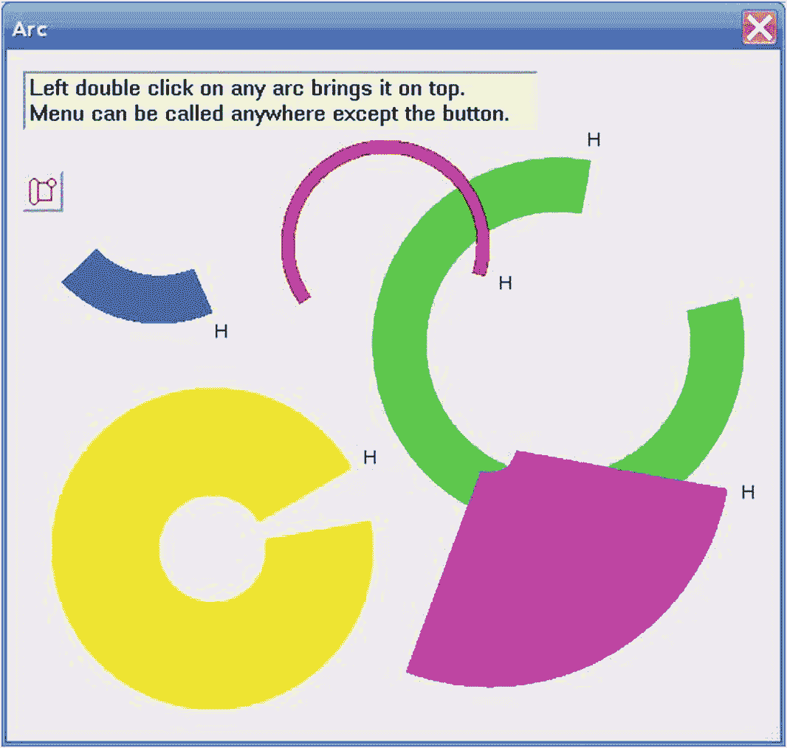

图 2-39

`Arc` 类的几个对象

```csharp
public Arc (Form frm, Mover mvr, PointF ptC, float rIn, float rOut,
            double angleHead_Degree, double angleArc_Degree, Color clr)
```

该类的圆弧具有可移动的端点；通过移动一端或另一端，可以改变圆弧角度。此角度只能在某个范围内更改。最小角度限制（`minDegree_Arc = 10`）防止圆弧消失。最大角度限制（`maxDegree_Arc = 350`）防止圆弧变成完整的圆环；图 2-39 中的黄色圆弧展示了接近最大允许角度的情形。

圆弧的内外边界是可移动的。理论上，圆弧的宽度可以减小到单个像素，从而将圆弧变成一条曲线，但这样做会导致沿着一条边界的感应环被另一条边界的类似感应环所阻挡。35 页前讨论的 `Ring_Adh` 类的覆盖层包含从最小到最大的同轴圆形节点。`Arc` 类覆盖层中的节点顺序相同，这在圆弧很薄的情况下可能导致死锁。

假设你将圆弧内边界压缩至最小尺寸，然后开始压缩外边界。如果允许圆弧主体的宽度被压缩至一个像素，你这样做并释放外边界后，将无法再更改或移动这个圆弧。内边界上的节点会阻挡主体和外边界上的节点，但内边界本身无法移动，因为它已经达到了允许的最小半径。为避免这种情况，对圆弧的最小允许宽度设置了限制（`minWidth = 10`）。这样的限制保证了在任何时候都可以在屏幕上移动圆弧并移动其外边界。

```csharp
public class Arc : GraphicalObject
{
    PointF m_center;
    float rInner, rOuter;
    double rCursor;
    double angleHead, angleArc, compensation, angleFixedTail;
    SpecArea curArea;
    SolidBrush m_brush;
    bool bChangeableWidth, bMovableHead, bMovableTail, bRotatable;
    float minRadius_Inner = 20;
    float minWidth = 10;
    double minDegree_Arc = 10;
    double maxDegree_Arc = 350;
```

通常，圆弧可以通过其边界的任何部分进行更改，并且有几个参数调节边界各部分的可能移动。圆弧边界有四个不同的部分：内边界、外边界和两个端部边界。为这四个部分分别组织移动性的独立调节并非难事，但在当前版本的 `Arc` 类中，通过内边界和外边界进行的尺寸调整是同步变化的。圆弧覆盖层取决于所声明的边界部分移动性以及当前的圆弧角度（!），其变体如图 2-40 所示。

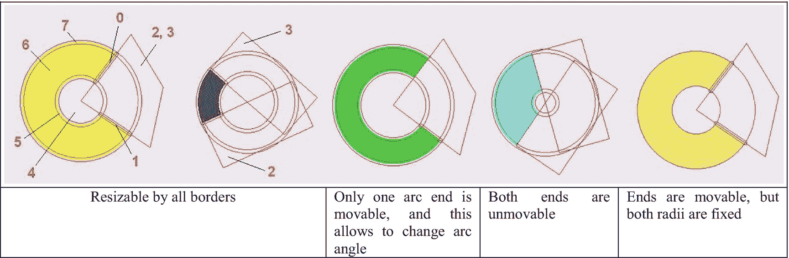

图 2-40

`Arc` 类的覆盖层变体

覆盖层始终由八个节点组成；它们都被标记在左侧的圆弧上。前两个节点覆盖圆弧两端；移动它们可以改变圆弧角度。有些情况下，圆弧角度需要固定（图 2-40 中的青色圆弧），或者只允许移动一端（图 2-40 中的绿色圆弧）。

```csharp
public override void DefineCover ()
{
    CoverNode [] nodes = new CoverNode [8];
    double angleTail = angleHead + angleArc;
    float wHalf = bMovableHead ? 3 : 0;
    double rClean;
    nodes [0] = new CoverNode (0,
        Auxi_Geometry .PointToPoint (m_center, angleHead, rInner),
        Auxi_Geometry .PointToPoint (m_center, angleHead, rOuter), wHalf);
    wHalf = bMovableTail ? 3 : 0;
    nodes [1] = new CoverNode (1,
        Auxi_Geometry .PointToPoint (m_center, angleTail, rInner),
        Auxi_Geometry .PointToPoint (m_center, angleTail, rOuter), wHalf);
    ... ...
```

圆弧缺口必须由透明节点覆盖。虽然圆弧是圆环的一部分，但这些透明节点是多边形的，其几何形状取决于圆弧角度（或缺口角度）。

-   当圆弧角度不超过 180 度时（图 2-40 中的蓝色圆弧），有两个不同的矩形节点。每个节点紧邻圆弧一端，并遮挡住外圆的一半。
-   当圆弧角度超过 180 度时（图 2-40 中的黄色圆弧），缺口可以用一个多边形节点封闭，但在所有情况下处理相同数量的节点更为简便，因此计算所需多边形，然后组织两个相同的节点。

```csharp
if (Math .Abs (angleArc) = 0)
{
    angleB = angleHead;
    angleA = angleTail;
}
else
{
    angleA = angleHead;
    angleB = angleTail;
}
rClean = rOuter + wHalf;
ptA = Auxi_Geometry .PointToPoint (m_center, angleA, rClean);
ptB = Auxi_Geometry .PointToPoint (m_center, angleB, rClean);
PointF [] ptsA = new PointF [] {ptA,
    Auxi_Geometry .PointToPoint (ptA, angleA + Math .PI / 2, rClean),
    Auxi_Geometry .PointToPoint (m_center, angleA + 3 * Math .PI / 4,
        rClean * Math .Sqrt (2)),
    Auxi_Geometry .PointToPoint (m_center, angleA - Math.PI, rClean) };
PointF [] ptsB = new PointF [] {ptB,
    Auxi_Geometry .PointToPoint (m_center, angleB - Math .PI, rClean),
```

# 圆弧覆盖节点的实现与交互

## 节点创建与初始化

```csharp
Auxi_Geometry.PointToPoint(m_center, angleB - 3 * Math.PI / 4, rClean * Math.Sqrt(2)),
Auxi_Geometry.PointToPoint(ptB, angleB - Math.PI / 2, rClean) };
nodes[2] = new CoverNode(2, ptsA, Behaviour.Transparent);
nodes[3] = new CoverNode(3, ptsB, Behaviour.Transparent);
}
```

```csharp
else
{
    double angleGap;
    if (angleArc > 0)
    {
        angleGap = angleArc - 2 * Math.PI;
    }
    else
    {
        angleGap = angleArc + 2 * Math.PI;
    }
    rClean = (rOuter + wHalf) * Math.Sqrt(2);
    PointF[] pts = new PointF[] { m_center,
        Auxi_Geometry.PointToPoint(m_center, angleHead, rClean),
        Auxi_Geometry.PointToPoint(m_center,
            angleHead + angleGap / 2, rClean),
        Auxi_Geometry.PointToPoint(m_center, angleHead + angleGap,
            rClean) };
    nodes[2] = new CoverNode(2, pts, Behaviour.Transparent);
    nodes[3] = new CoverNode(3, pts, Behaviour.Transparent);
}
```

最后四个节点的组织方式与环形覆盖中描述的方式相同。这四个节点是圆形的；其中第一个是透明的，用于擦除孔洞，两个节点用于通过内边框和外边框调整大小，剩下的一个节点用于推动整个圆弧向前移动。在此版本的`Arc`类中，通过内边框和外边框调整大小是同时进行的，因此图 2-40 中淡黄色圆弧的内半径和外半径均无法独立改变。

```csharp
int delta = bChangeableWidth ? 3 : 0;
nodes[4] = new CoverNode(4, m_center, rInner - delta,
    Behaviour.Transparent);
nodes[5] = new CoverNode(5, m_center, rInner + delta);
nodes[6] = new CoverNode(6, m_center, rOuter - delta, Cursors.SizeAll);
nodes[7] = new CoverNode(7, m_center, rOuter + delta);
if (!Movable)
{
    nodes[6].Cursor = Cursors.NoMove2D;
}
cover = new Cover(nodes);
... ...
```

## 圆弧角度改变与光标轨迹

圆弧半径的改变方式与`Ring_Adh`类中的相同。在改变圆弧角度的过程中，会展现出两个有趣的现象，都值得提及。

首先是当捕获到圆弧端点进行移动时的光标轨迹。在撰写关于任何对象旋转的文章时，我始终强调，为了获得更高的精度，必须将光标移离旋转中心更远，这就是为什么在整个旋转过程中光标的移动半径从不固定。然而，如果从美学或任何其他角度出发，你希望让光标保持在同一个圆形轨迹上，这很容易实现；当前示例就展示了这一点。当按下圆弧端点时，会计算圆弧中心与按下点之间的距离（`rCursor`）。

```csharp
public void Press(Point ptMouse, MouseButtons catcher, int iNode)
{
    if (catcher == MouseButtons.Left)
    {
        if (iNode < 2)
        {
            double angle = (iNode == Node_Head) ? angleHead
                : (angleHead + angleArc);
            ptEnd = Auxi_Geometry.Segment_NearestPoint(ptMouse,
                Auxi_Geometry.PointToPoint(m_center, angle, rInner),
                Auxi_Geometry.PointToPoint(m_center, angle, rOuter));
            rCursor = Auxi_Geometry.Distance(m_center, ptEnd);
            AdjustCursorPosition(ptEnd);
            ... ...
```

随后，被按下光标的可能轨迹被计算为具有该半径（`rCursor`）的圆弧。

在端点移动过程中，光标的当前位置通过`NearestPointOnTrail()`方法被计算为该圆弧上的最近点。

```csharp
public override bool MoveNode(...)
{
    bool bRet = false;
    if (catcher == MouseButtons.Left)
    {
        if (iNode == Node_Head)
        {
            ptNew = NearestPointOnTrail(ptMouse);
            ... ...
        }
        else if (iNode == Node_Tail)
        {
            ptNew = NearestPointOnTrail(ptMouse);
            ... ...
```

# 端点移动的特性与圆弧角度限制

端点移动的第二个特性或许更有趣。圆弧角度存在最小值和最大值限制，因此必须有一种机制来保持圆弧角度在此范围内。当你需要将光标保持在直线段端点之间时，通过计算到光标的距离很容易实现。但当你面对圆形轨迹时，同样的任务就有点棘手了，因为角度并非无限增长，而是始终保持在 [-180, 180] 度范围内。必须进行额外的检查。多年来，我使用过多种技术来将圆弧角度保持在允许范围内；我想借助另一个示例来演示和解释当前使用的技术。将圆弧角度保持在某个范围内，或者让一个点沿着一条仅有一个小缺口的近似圆形轨迹移动并防止该点越过缺口，这两个任务是等价的，但后者更直观，也更容易理解。

## 示例：`Spot_OnArc` 类

- 文件：`Form_Spot_OnArc.cs`
- 菜单位置：`Simple objects ➤ Spot on arc`

图 2-41 展示了 `Spot_OnArc` 类的三个元素。我们之前已经有了在线段和圆形上放置类似点的示例。在那个旧示例中，点是可以移动的，但它们的轨迹不能移动。而在新示例中，点可以沿着其轨迹移动，同时轨迹本身也可以移动和旋转。

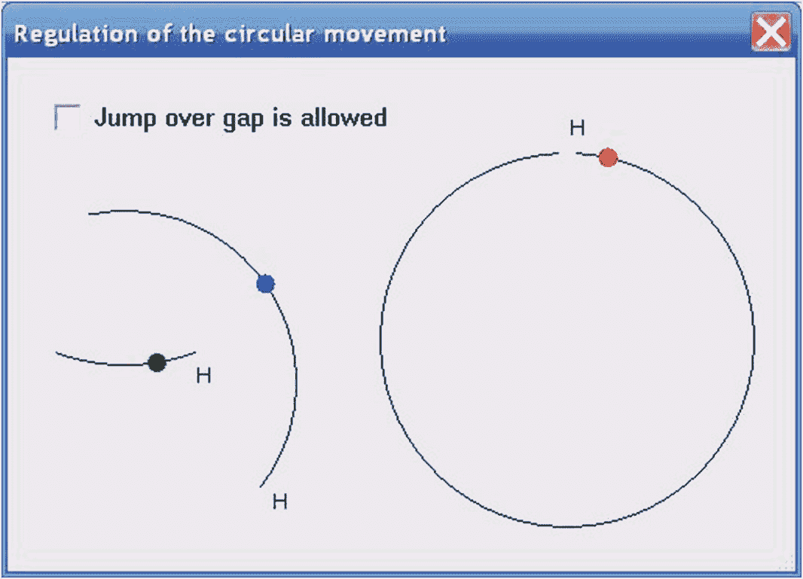

**图 2-41** `Spot_OnArc` 类的对象

当前示例中的三条轨迹展示了从较小角度到几乎整个圆的圆弧轨迹。在这三种情况下，都使用了相同的代码，但最有趣的是带小缺口的轨迹。将点保持在轨迹上的基本思路始终相同：按下点，然后按住按钮移动光标。对于光标的任何新位置，会计算轨迹上最近的允许点；点被移动到该位置，光标则被放置在点的中心点。如果这个新点位于光标移动的方向上，那么整个过程看起来就像平滑移动。如果这个最近点位于与光标移动相反的方向上，那么看起来点就好像被冻结在圆弧端点处；当你试图让蓝色或绿色的点越过其轨迹端点时，就会发生这种情况。那么，在圆形轨迹上有一个小缺口会带来什么问题呢？

假设在图 2-41 所示的情况下，你按下红色点并慢慢向左移动。该点会移动到轨迹的端点，但如果你试图缓慢移动，它不会越过缺口。有一种简单的方法可以计算最近点，不仅适用于整个圆，也适用于圆的任意部分（即圆弧）。如果你缓慢移动被按下的点，光标可能会移动到右端点之外几个像素，但圆弧上的最近点仍然在缺口的右侧，因此光标总是会被拉回那里。整个过程看起来就像点在缺口的右侧被冻结了。

现在，在同一位置（图 2-41）按下红色点，并快速向左移动光标。光标会轻易地穿过这样一个小缺口，而圆弧上的最近点将位于缺口的左侧。这个为点提议的下一个位置也可以绕圆的长路径到达，因此缺口左侧的点对于点来说是一个合适的位置。如果允许越过缺口，那么这样的小缺口对点的移动来说根本不是障碍。如果不允许越过缺口，则必须使用某些额外的机制来防止这种跳跃。

## 光斑位置与区域划分

光斑位置始终通过其与圆弧中心点的夹角来描述。当光斑沿弧线缓慢移动时，系统会持续计算其与圆弧中心的夹角；若新角度位于圆弧范围内，则该新位置被允许。当红色光斑沿其轨道完整移动一周时，其角度始终处于允许范围内，实现光斑从一个位置到另一个位置的迁移。当光标快速跨越缺口时，新位置也处于允许范围内。为避免这种跳变，将光斑可能移动的整个平面划分为三个区域：缺口右侧区域、缺口左侧区域和其余区域。左右区域之间的直接切换被禁止，而其他移动均被允许。这两个特殊区域各覆盖四分之一圆弧，其公共边界位于缺口中央（图 2-42）。

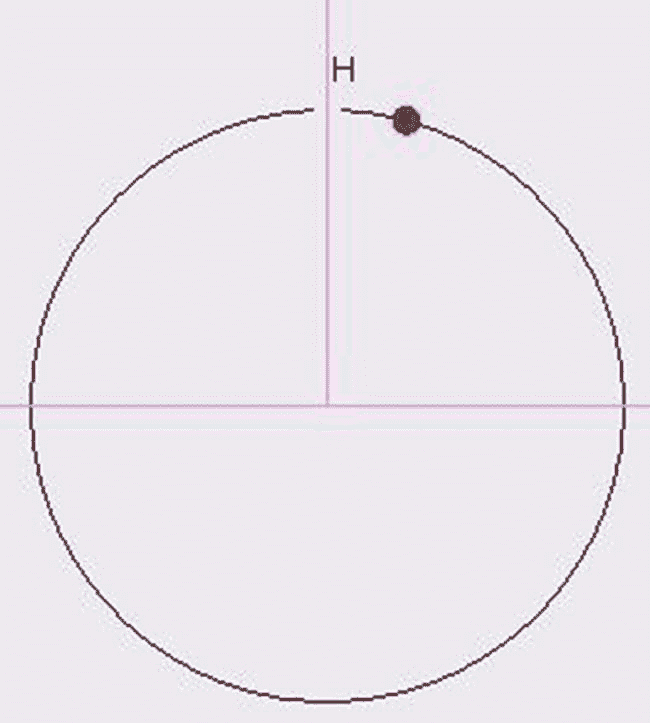

图 2-42 两个特殊区域的边界以细紫线标示

带有光斑的弧线本可组织为由两部分组成的复杂对象，但实际采用单一对象并包含两部分的参数进行组织。

## 类定义与构造函数

```csharp
public class Spot_OnArc : GraphicalObject
{
    PointF center_Arc;
    float radius_Arc;
    double m_angleHead, m_angleArc;
    bool bJumpOverGapAllowed = false;
    SpecArea curArea;
    Pen m_penArc;
    double compensationForArc, compensationForSpot;
    PointF [] areaPlus = new PointF [3];
    PointF [] areaMinus = new PointF [3];
    PointF m_ptSpot;
    int m_radiusSpot;
    Color m_colorSpot;
```

构造函数接收圆弧和光斑两者的参数。

```csharp
public Spot_OnArc (Form frm, Mover mvr, PointF ptC_track, float rad_track,
    double angleHead_Degree, double angleArc_Degree,
    PointF ptSpot, int rSpot, Color clrSpot)
```

## 覆盖层定义

该类的覆盖层与 `Arc` 类相似但更简单，因为轨道（弧线）较薄，只需一对圆形节点即可覆盖。缺口始终由两个节点覆盖，但根据缺口角度的不同，这两个节点可能不同或相同；相关说明已在 `Arc` 类中给出（见图 2-40）。光斑由一个小圆形节点覆盖，且该节点必须是覆盖层中的第一个节点。因此，覆盖层由五个节点组成，其中只有第一个和最后一个节点是不透明的。第一个节点负责沿弧线移动光斑，最后一个节点负责圆弧的所有移动。小光斑使用所有圆形节点的默认光标：`Cursors.Hand`。覆盖层中的最后一个节点也是圆形的。为提示其不同的移动方式，且由于轨道可在屏幕上自由移动，该圆形节点的光标被更改为 `Cursors.SizeAll`。

```csharp
public override void DefineCover ()
{
    double angleEnd = Auxi_Common .LimitedRadian (m_angleHead + m_angleArc);
    float wHalf = 3;
    float rOuter = radius_Arc + wHalf;
    CoverNode [] nodes = new CoverNode [5];
    nodes [0] = new CoverNode (0, m_ptSpot, m_radiusSpot);
    if (Math .Abs (m_angleArc) <= Math .PI)
    {
        ... ...
        nodes [1] = new CoverNode (1, ptsA, Behaviour .Transparent);
        nodes [2] = new CoverNode (2, ptsB, Behaviour .Transparent);
    }
    else
    {
        ... ...
        nodes [1] = new CoverNode (1, pts, Behaviour .Transparent);
        nodes [2] = new CoverNode (2, pts, Behaviour .Transparent);
    }
    nodes [3] = new CoverNode (3, center_Arc, radius_Arc - wHalf,
        Behaviour .Transparent);
    nodes [4] = new CoverNode (4, center_Arc, radius_Arc + wHalf,
        Cursors .SizeAll);
    cover = new Cover (nodes);
    ... ...
```

## 按压处理

覆盖层中有两个不透明节点，因此 `Press()` 方法中包含两个分支。

```csharp
public void Press (Point ptMouse, MouseButtons catcher, int iNode)
{
    if (catcher == MouseButtons .Left)
    {
        if (iNode == 0)
        {
            AdjustCursorPosition (m_ptSpot);
            SetTriangles ();
            curArea = InsideArea (m_ptSpot);
        }
        else
        {
            PointF pt = NearestPointOnArc (ptMouse);
            AdjustCursorPosition (pt);
        }
    ... ...
```

有趣的是按下光斑时的情况（`iNode == 0`）。此时，图 2-42 中所示的两个区域被计算出来。

```csharp
private void SetTriangles ()
{
    double angleGapMiddle = Auxi_Common .LimitedRadian (
        m_angleHead + m_angleArc / 2 + Math .PI);
    areaPlus [0] = center_Arc;
    areaPlus [1] = Auxi_Geometry .PointToPoint (center_Arc, angleGapMiddle, 4000);
    areaPlus [2] = Auxi_Geometry .PointToPoint (center_Arc,
        angleGapMiddle + Math .PI / 2, 4000);
    areaMinus [0] = center_Arc;
    areaMinus [1] = Auxi_Geometry .PointToPoint (center_Arc, angleGapMiddle, 4000);
    areaMinus [2] = Auxi_Geometry .PointToPoint (center_Arc,
        angleGapMiddle - Math .PI / 2, 4000);
}
```

随后确定当前按下光斑所在的区域。

```csharp
private SpecArea InsideArea (PointF pt)
{
    if (Auxi_Geometry .Point_InsideConvexPolygon (pt, areaPlus))
    {
        return (SpecArea .Plus);
    }
    else if (Auxi_Geometry .Point_InsideConvexPolygon (pt, areaMinus))
    {
        return (SpecArea .Minus);
    }
    else
    {
        return (SpecArea .Outside);
    }
}
```

返回的值被保存下来。

```csharp
curArea = InsideArea (m_ptSpot);
```

按照惯例，所有被捕获节点的移动都在`MoveNode()`方法中描述。光标可从被捕获的光斑处移动到任意位置；对于任何新光标位置（`ptMouse`），都会计算轨道上的最近点（`ptNew`）。后续操作取决于是否允许跨越缺口。

- 若允许跳越，则光斑移动到新计算的点。
- 若不允许跨越缺口，则进行额外检查。确定新提议位置所在的区域（`newArea`）。如果两个值的比较表明提议从缺口一侧切换到另一侧，则将光标返回到当前光斑位置；否则，将光斑移动到提议位置，并记录该位置的区域。

```csharp
public override bool MoveNode (...)
{
    bool bRet = false;
    if (catcher == MouseButtons .Left)
    {
        if (iNode == 0)
        {
            PointF ptNew = NearestPointOnArc (ptMouse);
            if (m_bJumpOverGapAllowed)
            {
                m_ptSpot = ptNew;
            }
            else
            {
                SpecArea newArea = InsideArea (ptNew);
                if ((curArea == SpecArea.Plus && newArea == SpecArea.Minus) ||
                    (curArea == SpecArea.Minus && newArea == SpecArea.Plus))
                {
                }
                else
                {
                    m_ptSpot = ptNew;
                    curArea = newArea;
                }
            }
            AdjustCursorPosition (m_ptSpot);
        }
    ... ...
```

# 像瑞士乳酪

- 文件：`Form_FillHoles.cs`
- 菜单位置：应用程序 ➤ 填充孔洞

在本章末尾，我们将提供一个有趣的示例来换换脑筋。幼儿通过将合适的插件放入塑料形状的孔洞中来学习区分不同形状的物体。我们将完成类似的任务。

图 2-43 展示了本例中使用的所有元素。有一块带孔的板；有一组用于初始化所需插件的按钮；还有一个插件。当一个插件激活时（如图 2-43 所示），所有按钮都将被禁用，因此同一时刻只能使用一个插件。要使用插件闭合某个孔洞，可以移动、调整大小和旋转插件。当插件与某个孔洞匹配时，插件和孔洞都会消失，并且组内的按钮将变为可用。（我的著作 [2] 包含一个类似的示例，允许您同时拥有多个板和任意数量的插件。对于本书，我决定简化此示例。）

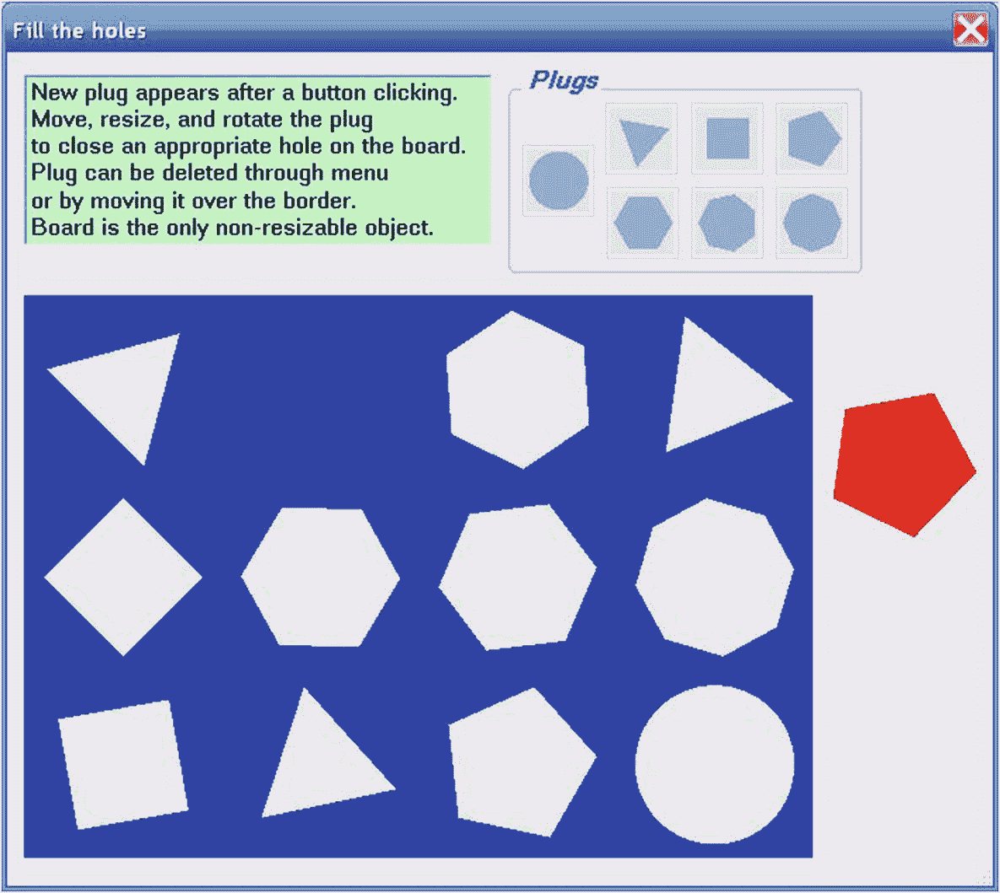

图 2-43

点击按钮激活相应形状的插件。要使插件与某个孔洞匹配，可以移动、旋转和调整插件大小

带孔的矩形板属于 `AreaWithHoles` 类。

```csharp
public class AreaWithHoles : GraphicalObject
{
    RectangleF m_rc;
    int nRow, nCol;
    List<Hole> holes = new List<Hole>();
    SolidBrush m_brush;
    float spaceAroundHole = 10;
```

该板是一个不可调整大小的矩形，孔洞按行和列排列。此对象有一个简单但有趣的覆盖层，其中除最后一个节点外，所有节点都是透明的。这些透明节点每个孔洞使用一个。

```csharp
public override void DefineCover()
{
    int nHoles = holes.Count;
    CoverNode[] nodes = new CoverNode[nHoles + 1];
    for (int i = 0; i < nHoles; i++)
    {
        if (holes[i].VerticesNumber == 0)
        {
            nodes[i] = new CoverNode(i, holes[i].Center, holes[i].Radius, Behaviour.Transparent);
        }
        else
        {
            nodes[i] = new CoverNode(i, holes[i].Vertices,
                Behaviour.Transparent);
        }
    }
    nodes[nHoles] = new CoverNode(nHoles, m_rc);
    cover = new Cover(nodes);
}
```

该板有一个非透明节点，因此该节点用于移动整个板。

```csharp
public override bool MoveNode(...)
{
    bool bRet = false;
    if (catcher == MouseButtons.Left)
    {
        Move(dx, dy);
        bRet = true;
    }
    return (bRet);
}
```

在进行这种板移动的过程中，所有孔洞的位置都会同步改变。

```csharp
public override void Move(int dx, int dy)
{
    m_rc.X += dx;
    m_rc.Y += dy;
    SizeF size = new SizeF(dx, dy);
    for (int i = 0; i < holes.Count; i++)
    {
        holes[i].Center += size;
    }
}
```

每个孔洞要么是圆形，要么是正多边形。这些变体与插件的变体相同，并在 `Plug_Shape` 枚举中列出。

```csharp
public enum Plug_Shape { Circle, RegPoly };
```

孔洞的参数描述其几何形状，但孔洞不是可移动对象，因此它并非派生自 `GraphicalObject` 类。

```csharp
public class Hole
{
    Plug_Shape shape;
    PointF m_center;
    float m_radius;
    int nVertices;
    double m_angle;
```

插件对象具有相同的参数集来描述其几何形状，但插件是可移动、可调整大小和可旋转的。

```csharp
public class Plug : GraphicalObject
{
    Plug_Shape m_shape;
    PointF m_center;
    float m_radius;
    double m_angle;
    SolidBrush m_brush;
    int nVertices;
```

我们已经讨论过圆形和正多边形的覆盖层。在这两种情况下，两个节点提供了所有必要的移动，并且在这两种情况下，这些节点都复制对象的形状，第一个节点比对象本身稍小，第二个节点比对象本身稍大。

```csharp
public override void DefineCover()
{
    CoverNode[] nodes = new CoverNode[2];
    if (m_shape == Plug_Shape.Circle)
    {
        nodes[0] = new CoverNode(0, m_center, m_radius - delta,
            Cursors.SizeAll);
        nodes[1] = new CoverNode(1, m_center, m_radius + delta);
    }
    else
    {
        nodes[0] = new CoverNode(0, VerticesMinus);
        nodes[1] = new CoverNode(1, VerticesPlus, Cursors.Hand);
    }
    cover = new Cover(nodes);
}
```

插件的移动、调整大小和旋转方式与圆形和正多边形相同，但与插件移动相关的一个有趣之处。假设您点错了按钮，屏幕上出现了一个不需要形状的插件。您可以通过其菜单的命令删除它，但还有另一种更有趣的方法来实现相同的目的：可以将不需要的插件移到边界之外并在那里释放。该程序不允许您将除插件之外的任何其他对象移过边界。这是如何组织的呢？

移动器以标准方式初始化，并将窗体本身作为参数传入。

```csharp
public Form_FillHoles()
{
    InitializeComponent();
    mover = new Mover(this);
    ...
```

这意味着移动器的裁剪设置为 `Clipping.Visual` 级别，并且没有对象可以移过边界。只有当插件被按下以进行移动（而不是调整大小！）时，此裁剪级别才会更改为 `Clipping.Unsafe`。在插件覆盖层的两个节点中，第一个用于移动，第二个用于调整大小，因此会根据按下的节点编号进行额外检查。

```csharp
private void OnMouseDown(object sender, MouseEventArgs e)
{
    ptMouse_Down = e.Location;
    if (mover.Catch(e.Location, e.Button))
    {
        GraphicalObject grobj = mover.CaughtSource;
        int iNode = mover.CaughtNode;
        if (grobj is Plug)
        {
            m_plug.Press(e.Location, e.Button, iNode);
            if (e.Button == MouseButtons.Left && iNode == 0)
            {
                mover.Clipping = Clipping.Unsafe;
            }
            ...
```

通过这种级别的移动器裁剪，被捕获的插件可以移过任何边界。当鼠标按钮释放时，会重置 `Clipping.Visual` 级别。

```csharp
private void OnMouseUp(object sender, MouseEventArgs e)
{
    ...
    mover.Clipping = Clipping.Visual;
}
```

此示例的主要目的不是插件在边界上的重定位，因此让我们检查一下插件释放时会发生什么。首先，检查它是在窗体内部还是外部释放的。如果插件是在可见区域之外释放的，那么它的生命周期就结束了，组中的所有按钮都将变为可用，因此可以初始化另一个插件。

# 插件匹配与移动操作

以下是`OnMouseUp`方法的代码片段：

```csharp
private void OnMouseUp (object sender, MouseEventArgs e)
{
    ptMouse_Up = e .Location;
    double fDist = Auxi_Geometry .Distance (ptMouse_Down, ptMouse_Up);
    int iObj, iNode;
    if (mover .Release (out iObj, out iNode))
    {
        GraphicalObject grobj = mover .ReleasedSource;
        if (e .Button == MouseButtons .Left)
        {
            ...
            else if (grobj is Plug)
            {
                Rectangle rcClient = ClientRectangle;
                Rectangle rcPlug = Rectangle .Round (plug .RectAround);
                if (Rectangle.Empty == Rectangle .Intersect (rcPlug, rcClient))
                {
                    plug = null;
                    BtnsStatus ();
                    RenewMover ();
                }
```

如果插件在视图内的任何位置释放，它仍然存活，并且必须与板上的所有孔洞进行比较；这种比较通过 `CheckMatch()` 方法完成。

```csharp
if (plug != null)
{
    CheckMatch ();
}
```

如果插件与某个孔洞完美匹配，则插件消失，孔洞也消失，并且组内的按钮变为可用。如果板上的最后一个孔洞被闭合，则会组织一组新的孔洞，并且可以再次启动相同的过程。

```csharp
private bool CheckMatch ()
{
    ...
    if (bHoleClosed)
    {
        plug = null;
        BtnsStatus ();
        board .Holes .RemoveAt (iHole);
        if (board .Holes .Count == 0)
        {
            board .RenewHoles ();
        }
        board .DefineCover ();
        RenewMover ();
    }
    ...
```

## 结论

在本章中，我们了解了如何让最常用形状的对象变得可移动。这些对象可以被移动、调整大小和旋转。所讨论的对象之所以被称为简单对象，是因为每个对象都拥有自己的覆盖层，并且能够参与所有必要的移动操作，而无需关注屏幕上的其他对象。然而，在实际应用中，除了独立的移动之外，各元素也常常会与其他元素一同参与同步或关联移动。这类复杂对象的设计将在下一章中讨论。

脚注 1 2
