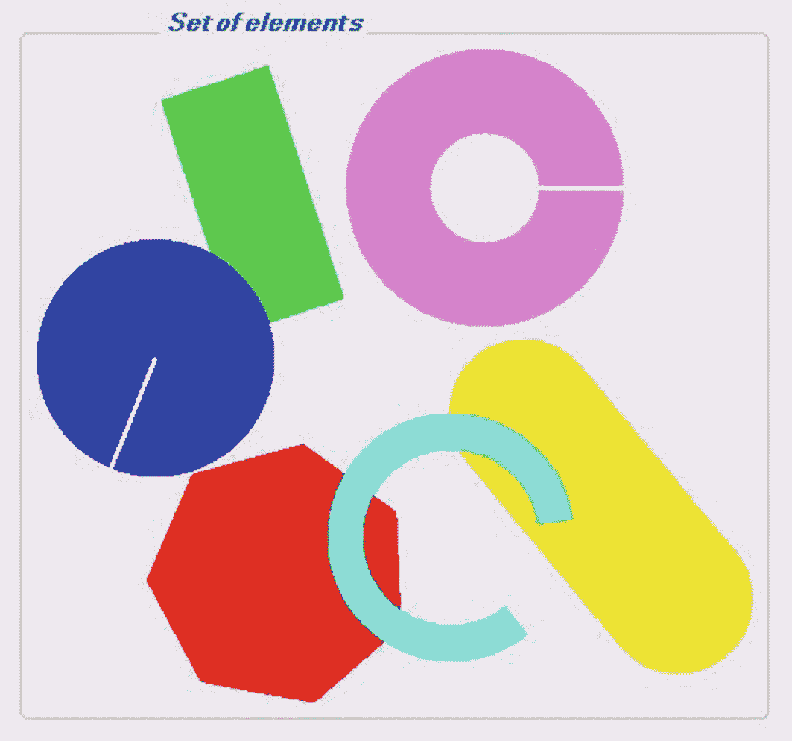
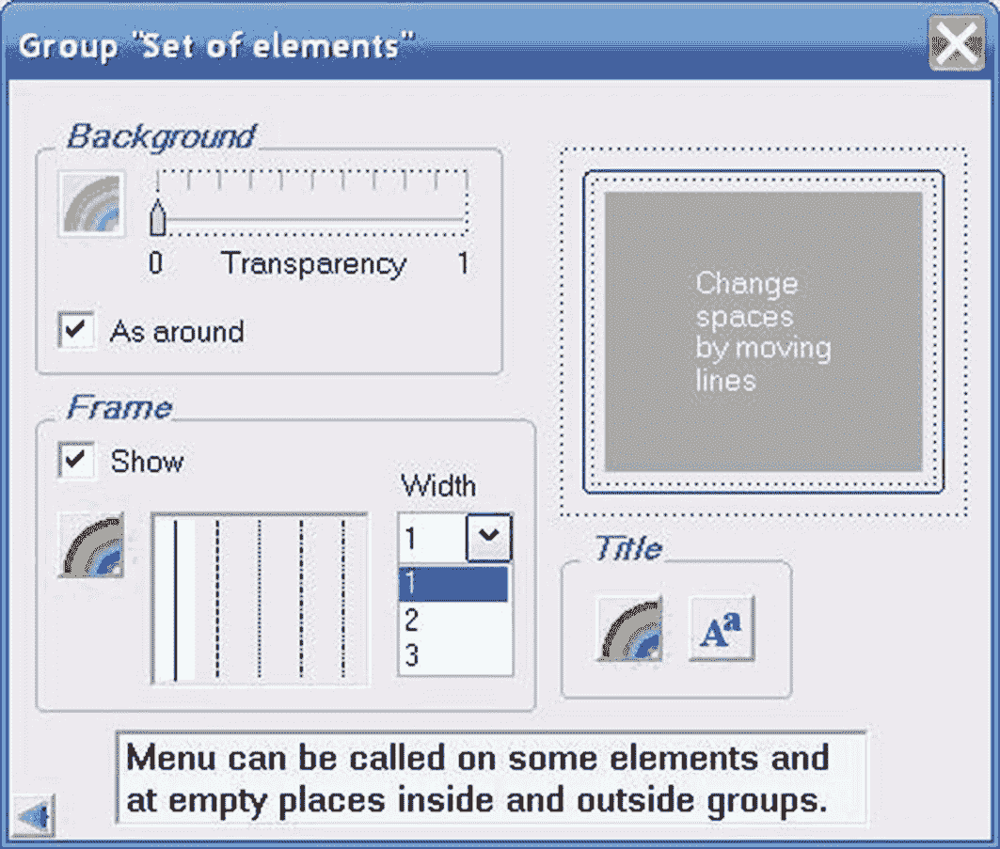

# 4. 组

一组对象可以共同处理某个子任务；这些对象的集合必须在视觉上显而易见。必须有一种简便的方法来将整组对象在屏幕上移动，以及在不丢失其集合视图的情况下，轻松改变它们的相对位置。

-   文件：`Form_Group_ArbitraryElements.cs`
-   菜单位置：组 ➤ 包含任意元素

屏幕对象组是一个抽象概念，易于演示但难以定义。通常，它是一组为某个任务或子任务而联合起来的元素。本书通篇都在讨论屏幕对象的可移动性，以及在完全可移动性基础上设计新程序的方法，因此，关于简单对象、复杂对象和组的三个章节，必须介绍那些在可移动性的组织和监督方式上有所不同的对象。

-   一个**简单对象**的所有部分共用一个覆盖层。通常（但并非强制），简单对象各部分保持在一起。简单对象没有拥有各自独立覆盖层的下级元素。
-   一个**复杂对象**由多个元素组成，每个部分都有自己的覆盖层。这些覆盖层在移动队列中单独注册；通常，这些部分在移动队列中的顺序很重要。复杂对象中有一个部分起主导作用，而其他部分是其从属。复杂对象的各部分可以参与同步、相关和独立移动。通常，主导部分的向前移动会导致所有从属部分同步移动，主导部分的大小调整会导致从属部分的相关移动，而任何从属部分的移动则不影响其他所有部分。
-   一个**组**包含一组对象，每个对象都有各自的独立覆盖层；组本身也有自己的覆盖层。有些组只允许特定的内部元素；而其他组则可以使用任意元素。通常，组内没有主导元素，因此每个元素独立移动，且不影响其他元素。组本身用于可视化这些内部元素的集合，并提供一种同步移动所有元素的简便方法。内部元素的移动与组的移动之间的关联，可以通过不同方式组织。

如您所见，这些定义中经常使用“通常”或“一般来说”这样的措辞。这是因为有些类完美无缺、毫无疑问地适合某一类别，但也存在一些边界情况，同时适合两个类别。还有一些对象会根据用户的命令改变其行为。在我的著作[2]中，我展示了一个有趣的例子，其中有几个几乎完全相同的对象，仅颜色不同（以便更好地说明）。每个元素都可以独立移动和调整大小而不影响其他元素，因此它们只是一组简单对象。但在任何时候，用户都可以将其中的任意一个声明为主导元素，然后所有其他元素会自动变为从属元素，因此从这一刻起，它就变成了一个经典的复杂对象。

将元素联合成一个组可以有多种不同的组织方式，因此“组”这一章是我另一本书[2]中篇幅最大的章节之一。它展示了我多年来在可移动对象工作中设计和使用过的不同类型的组。

当一组对象被联合成一个组时，拥有某种视觉元素来提示这种联合是很有帮助的。通常情况下，一组内部对象会用边框包裹起来；这种边框还可以包含一个标题，说明该组的目的。根据主要的设计理念，组可以通过其内部的任意点来移动，但边框与内部元素之间的交互存在一个有趣的方面。对于组织这种交互，可能存在两种完全不同的观点。

可以将边框视为移动和更改内部对象的限制。如果您决定组织这样的规则，就必须决定边框调整大小对内部元素的影响结果。边框调整大小可以通过三种方式影响内部元素。

-   内部元素的大小改变，但它们的相对位置不变。
-   内部元素的大小不变，但它们的相对位置改变。
-   内部元素的大小和相对位置同时改变。

您可以比较并讨论这些变体的优缺点，但在我看来，它们都是错误的。它们都违反了用户驱动应用程序的主要规则之一：“用户关于移动/调整对象大小的命令……必须严格按照原样执行；不允许开发者进行任何添加或扩展解释。”无论您更偏好并实现哪个变体，这恰恰是我所反对的扩展解释。一种解决方案是实现所有三个变体，并让用户选择所需的那个；我的另一本书[2]中展示了这样一个例子。但我认为，唯一正确的决定是改变对整个组边框作用的看法。

组边框对内部元素的直接规约会立即导致用户驱动应用程序主要规则之一的破坏。从一开始，这就向我表明，在新应用程序中，上述规约是不可接受的。理解了这个根本缺陷后，我便开始设计不同类型的组。在新类型的组中，边框对内部元素没有规约作用，因此上述三种变体都不使用。边框不被视为可独立调整大小的元素，而仅仅是一个装饰和信息元素。尽管边框的角色改变了，它仍然需要提示内部元素的联合，因此边框必须根据内部的任何变化调整其大小和位置。此外，仅仅为了便于移动整组元素，可以通过边框内的任意点来移动组。就这样，新组的想法诞生了。见图 4-1。



图 4-1

`Group_ArbitraryElements` 类的对象可以包含任何元素

`Group_ArbitraryElements` 类的对象已经在之前的示例中出现过（见图 3-1 和 3-7），但没有进行任何讨论；现在是时候深入了解一下细节了。这样的组可以通过任意点移动，但不能直接调整大小。组区域是一个矩形形状 (`m_rcBigNode`)，由内部元素的合并区域加上一些额外的周边空间决定。

```csharp
public class Group_ArbitraryElements : GraphicalObject
{
RectangleF rcFrame, rcBigNode, rcTitle;
GroupParameters paramsSet;
string title;
bool bTitleMovable = true;
```

对于一个可移动且不可调整大小的矩形，拥有一个单一的节点覆盖层就足够了，但还有一个小的补充。组标题可用于提示组的目的。标题是一个简短的文本（通常是一个单词），放置在组区域的顶部。像任何文本一样，它有一个矩形区域 (`rcTitle`)。我决定让标题可以在左右边界之间移动。因此，组覆盖层由两个矩形节点组成。如果没有标题，则一个节点的大小被压缩为零。

```csharp
public override void DefineCover ()
{
rcBigNode = RectangleF .FromLTRB (rcFrame .Left, rcFrame .Top,
rcFrame .Right + 1, rcFrame.Bottom);
CoverNode [] nodes = new CoverNode [2];
if (TitleExist)
{
nodes [0] = new CoverNode (0, rcTitle);
if (bTitleMovable)
{
nodes [0] .SetBehaviourCursor (Behaviour.Moveable, Cursors.SizeWE);
}
}
else
{
nodes [0] = new CoverNode (0, rcFrame .Location, 0f);
}
nodes [1] = new CoverNode (1, rcBigNode);
cover = new Cover (nodes);
... ...
```

一个组必须提供几个主要操作：

-   绘制
-   内部元素的同步移动
-   在移动者队列中注册

如果预先知道内部元素的允许类，则可以设计一个具有所有这些操作的预定义方法的组；附录 A 中的几个示例演示了`ElasticGroup`类的此类组。当内部元素可以属于任意类时，唯一的方法是在组初始化时提供所需的方法。以下是构造函数的最一般情况：

| `public` `Group_ArbitraryElements` `(Form frm,` | // 使用该组的窗体 |
| --- | --- |
| `Mover mvr,` | // 移动者 |
| `PointF ptFrame,` | // 框架左上角 |
| `GroupParameters viewparams,` | // 可见性参数 |
| `string strTitle,` | // 标题 |
| `Delegate_Bounds onCalcBoundsElems,` | // 计算内部元素区域的方法 |
| `Delegate_Draw onDrawElems,` | // 绘制内部元素的方法 |
| `Delegate_Move onSynchroMoveElems,` | // 元素同步移动的方法 |
| `Delegate_IntoMover onIntoMoverGroup)` | // 向移动者注册组的方法 |

图 4-1 展示了`Form_Group_ArbitraryElements.cs`示例中的一个组。该组的所有内部元素都已讨论过。在当前示例中，它们都是可移动和可调整大小的。只能更改内部元素的颜色，因此此示例仅关注组的行为。内部元素被初始化，然后围绕它们组织组。

## 组初始化

组初始化时使用的四个方法很简单。

```csharp
void DefaultView ()
{
    rectangle = new Rectangle_Unicolored (...);
    ring = new Ring_Unicolored (...);
    strip = new Strip_Unicolored (...);
    circle = new Circle_Unicolored (...);
    polygon = new Polygon_Regular (...);
    arc = new Arc (...);
    arc .MarkHead = false;
    group = new Group_ArbitraryElements (this, mover, new PointF (30, 30),
        "Set of elements",
        ElemsArea_group, DrawElems_group,
        SynchroMove_group, IntoMover_group);
    group .Update ();
}
```

## 四个方法

### 1. 组合区域

第一个方法返回所有内部元素的组合区域。

```csharp
private RectangleF ElemsArea_group ()
{
    return (RectangleF .Union (RectangleF .Union (RectangleF .Union (
        RectangleF .Union (RectangleF .Union (
            rectangle .RectAround, ring .RectAround), strip .RectAround),
            circle .RectAround), polygon .RectAround), arc .RectAround));
}
```

### 2. 绘制

第二个方法提供内部元素的绘制。元素的绘制必须按照与它们加入移动者队列相反的顺序进行。

```csharp
private void DrawElems_group (Graphics grfx)
{
    rectangle .Draw (grfx);
    ring .Draw (grfx);
    strip .Draw (grfx);
    circle .Draw (grfx);
    polygon .Draw (grfx);
    arc .Draw (grfx);
}
```

### 3. 同步移动

第三个方法提供内部元素的同步移动。

```csharp
void SynchroMove_group (int dx, int dy)
{
    rectangle .Move (dx, dy);
    ring .Move (dx, dy);
    strip .Move (dx, dy);
    circle .Move (dx, dy);
    polygon .Move (dx, dy);
    arc .Move (dx, dy);
}
```

### 4. 注册

第四个方法提供在移动者队列中的注册。这是唯一提及组本身的方法。

```csharp
void IntoMover_group (Mover mv, int iPos)
{
    mv .Insert (iPos, group);
    rectangle .IntoMover (mv, iPos);
    ring .IntoMover (mv, iPos);
    strip .IntoMover (mv, iPos);
    circle .IntoMover (mv, iPos);
    polygon .IntoMover (mv, iPos);
    arc .IntoMover (mv, iPos);
}
```

## 组参数与更新

任何组都有一组通用参数，用于一些辅助计算和绘图。这些参数保存在一个`GroupParameters`对象中。

使用`Group_ArbitraryElements`类时需记住一点：该组不包含其内部元素的列表，因此组无法根据内部元素的任何变化进行自我调整。这种调整是通过调用`Group_ArbitraryElements.Update()`方法完成的，因此在以下几种明显情况下必须调用此方法：

- 每当任何元素被移动或调整大小时
- 向组中添加元素或删除内部元素时
- 组被修改时

```csharp
private void OnMouseMove (object sender, MouseEventArgs e)
{
    if (mover .Move (e .Location))
    {
        group .Update ();
        Invalidate ();
    }
}
```

## 调谐表单

可以使用一个特殊的调谐表单（图 4-2）来修改任何`Group_ArbitraryElements`对象。调谐表单通过`Group_ArbitraryElements.ParametersDialog()`方法调用；其中一个参数是在组发生任何更改时要执行的方法。

```csharp
private void Click_miModify_Group (object sender, EventArgs e)
{
    group .ParametersDialog (this, ParamsChanged_group,
        PointToScreen (ptMouse_Up));
}
private void ParamsChanged_group (object sender, EventArgs ea)
{
    group .Update ();
    Invalidate ();
}
```



图 4-2 `Group_ArbitraryElements`对象的调谐表单

## 说明与结论

关于本章，我有两点说明。

- 在我的另一本书 [2] 中，名为“Groups”的章节是篇幅最大的章节之一，而在这里它是最小的。原因很简单：在我的另一本书 [2] 中，我试图展示许多不同的变体，而在当前这本书中，仅演示了组设计的最终产品。
- 你将看到其他具有类似行为的组类。因为所有这些组都使用了预定义类型的内部元素，所以在某些提到的场合下它们会自动更新，而在其他场合下则必须调用它们的`Update()`方法。

屏幕元素可以是简单的或复杂的；这些独立的元素也可以组合成组。这三种情况在前面的章节中已经讨论过。所有演示的对象都是图形化的，并且它们都非常适合可移动性算法。然而，从 PC 时代开始，大多数严肃的程序都是基于控件开发的，许多程序员无法想象没有控件的程序设计。同样的可移动性算法允许你使用标准控件；这在附录 A 中讨论。对于用户驱动的应用程序，使用图形化的控件替代标准控件会更好。它们将在下一章中讨论。
