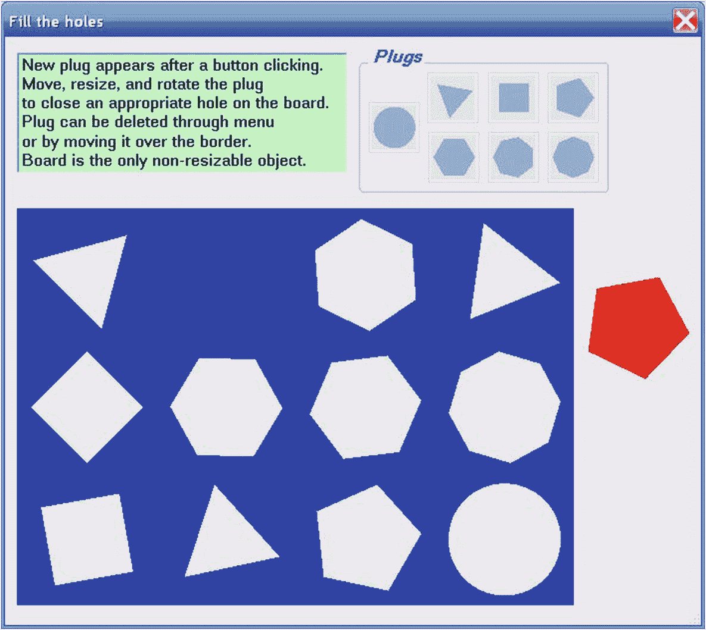

# 像瑞士乳酪

*   文件：`Form_FillHoles.cs`
*   菜单位置：应用程序 ➤ 填充孔洞

在本章末尾，我们将提供一个有趣的示例来换换脑筋。幼儿通过将合适的插件放入塑料形状的孔洞中来学习区分不同形状的物体。我们将完成类似的任务。

图 2-43 展示了本例中使用的所有元素。有一块带孔的板；有一组用于初始化所需插件的按钮；还有一个插件。当一个插件激活时（如图 2-43 所示），所有按钮都将被禁用，因此同一时刻只能使用一个插件。要使用插件闭合某个孔洞，可以移动、调整大小和旋转插件。当插件与某个孔洞匹配时，插件和孔洞都会消失，并且组内的按钮将变为可用。（我的著作 [2] 包含一个类似的示例，允许您同时拥有多个板和任意数量的插件。对于本书，我决定简化此示例。）



图 2-43

点击按钮激活相应形状的插件。要使插件与某个孔洞匹配，可以移动、旋转和调整插件大小

带孔的矩形板属于 `AreaWithHoles` 类。

```
public class AreaWithHoles : GraphicalObject
{
RectangleF m_rc;
int nRow, nCol;
List holes = new List ();
SolidBrush m_brush;
float spaceAroundHole = 10;
```

该板是一个不可调整大小的矩形，孔洞按行和列排列。此对象有一个简单但有趣的覆盖层，其中除最后一个节点外，所有节点都是透明的。这些透明节点每个孔洞使用一个。

```
public override void DefineCover ()
{
int nHoles = holes .Count;
CoverNode [] nodes = new CoverNode [nHoles + 1];
for (int i = 0; i < nHoles; i++)
{
if (holes [i] .VerticesNumber == 0)
{
nodes [i] = new CoverNode (i, holes [i] .Center, holes [i] .Radius, Behaviour .Transparent);
}
else
{
nodes [i] = new CoverNode (i, holes [i] .Vertices,
Behaviour .Transparent);
}
}
nodes [nHoles] = new CoverNode (nHoles, m_rc);
cover = new Cover (nodes);
}
```

该板有一个非透明节点，因此该节点用于移动整个板。

```
public override bool MoveNode (...)
{
bool bRet = false;
if (catcher == MouseButtons .Left)
{
Move (dx, dy);
bRet = true;
}
return (bRet);
}
```

在进行这种板移动的过程中，所有孔洞的位置都会同步改变。

```
public override void Move (int dx, int dy)
{
m_rc .X += dx;
m_rc .Y += dy;
SizeF size = new SizeF (dx, dy);
for (int i = 0; i < holes .Count; i++)
{
holes [i] .Center += size;
}
}
```

每个孔洞要么是圆形，要么是正多边形。这些变体与插件的变体相同，并在 `Plug_Shape` 枚举中列出。

```
public enum Plug_Shape { Circle, RegPoly };
```

孔洞的参数描述其几何形状，但孔洞不是可移动对象，因此它并非派生自 `GraphicalObject` 类。

```
public class Hole
{
Plug_Shape shape;
PointF m_center;
float m_radius;
int nVertices;
double m_angle;
```

插件对象具有相同的参数集来描述其几何形状，但插件是可移动、可调整大小和可旋转的。

```
public class Plug : GraphicalObject
{
Plug_Shape m_shape;
PointF m_center;
float m_radius;
double m_angle;
SolidBrush m_brush;
int nVertices;
```

我们已经讨论过圆形和正多边形的覆盖层。在这两种情况下，两个节点提供了所有必要的移动，并且在这两种情况下，这些节点都复制对象的形状，第一个节点比对象本身稍小，第二个节点比对象本身稍大。

```
public override void DefineCover ()
{
CoverNode [] nodes = new CoverNode [2];
if (m_shape == Plug_Shape .Circle)
{
nodes [0] = new CoverNode (0, m_center, m_radius - delta,
Cursors .SizeAll);
nodes [1] = new CoverNode (1, m_center, m_radius + delta);
}
else
{
nodes [0] = new CoverNode (0, VerticesMinus);
nodes [1] = new CoverNode (1, VerticesPlus, Cursors .Hand);
}
cover = new Cover (nodes);
}
```

插件的移动、调整大小和旋转方式与圆形和正多边形相同，但与插件移动相关的一个有趣之处。假设您点错了按钮，屏幕上出现了一个不需要形状的插件。您可以通过其菜单的命令删除它，但还有另一种更有趣的方法来实现相同的目的：可以将不需要的插件移到边界之外并在那里释放。该程序不允许您将除插件之外的任何其他对象移过边界。这是如何组织的呢？

移动器以标准方式初始化，并将窗体本身作为参数传入。

```
public Form_FillHoles ()
{
InitializeComponent ();
mover = new Mover (this);
...
```

这意味着移动器的裁剪设置为 `Clipping.Visual` 级别，并且没有对象可以移过边界。只有当插件被按下以进行移动（而不是调整大小！）时，此裁剪级别才会更改为 `Clipping.Unsafe`。在插件覆盖层的两个节点中，第一个用于移动，第二个用于调整大小，因此会根据按下的节点编号进行额外检查。

```
private void OnMouseDown (object sender, MouseEventArgs e)
{
ptMouse_Down = e .Location;
if (mover .Catch (e .Location, e .Button))
{
GraphicalObject grobj = mover .CaughtSource;
int iNode = mover .CaughtNode;
if (grobj is Plug)
{
m_plug .Press (e .Location, e .Button, iNode);
if (e .Button == MouseButtons .Left && iNode == 0)
{
mover .Clipping = Clipping .Unsafe;
}
...
```

通过这种级别的移动器裁剪，被捕获的插件可以移过任何边界。当鼠标按钮释放时，会重置 `Clipping.Visual` 级别。

```
private void OnMouseUp (object sender, MouseEventArgs e)
{
...
mover .Clipping = Clipping .Visual;
}
```

此示例的主要目的不是插件在边界上的重定位，因此让我们检查一下插件释放时会发生什么。首先，检查它是在窗体内部还是外部释放的。如果插件是在可见区域之外释放的，那么它的生命周期就结束了，组中的所有按钮都将变为可用，因此可以初始化另一个插件。

```
private void OnMouseUp (object sender, MouseEventArgs e)
{
ptMouse_Up = e .Location;
double fDist = Auxi_Geometry .Distance (ptMouse_Down, ptMouse_Up);
int iObj, iNode;
if (mover .Release (out iObj, out iNode))
{
GraphicalObject grobj = mover .ReleasedSource;
if (e .Button == MouseButtons .Left)
{
...
else if (grobj is Plug)
{
Rectangle rcClient = ClientRectangle;
Rectangle rcPlug = Rectangle .Round (plug .RectAround);
if (Rectangle.Empty == Rectangle .Intersect (rcPlug, rcClient))
{
plug = null;
BtnsStatus ();
RenewMover ();
}
```

如果插件在视图内的任何位置释放，它仍然存活，并且必须与板上的所有孔洞进行比较；这种比较通过 `CheckMatch()` 方法完成。

```
if (plug != null)
{
CheckMatch ();
}
```

如果插件与某个孔洞完美匹配，则插件消失，孔洞也消失，并且组内的按钮变为可用。如果板上的最后一个孔洞被闭合，则会组织一组新的孔洞，并且可以再次启动相同的过程。

```
private bool CheckMatch ()
{
...
if (bHoleClosed)
{
plug = null;
BtnsStatus ();
board .Holes .RemoveAt (iHole);
if (board .Holes .Count == 0)
{
board .RenewHoles ();
}
board .DefineCover ();
RenewMover ();
}
...
```


## 结论

在本章中，我们了解了如何让最常用形状的对象变得可移动。这些对象可以被移动、调整大小和旋转。所讨论的对象之所以被称为简单对象，是因为每个对象都拥有自己的覆盖层，并且能够参与所有必要的移动操作，而无需关注屏幕上的其他对象。然而，在实际应用中，除了独立的移动之外，各元素也常常会与其他元素一同参与同步或关联移动。这类复杂对象的设计将在下一章中讨论。

脚注 1 2

