# 3. 复杂对象

在上一章讨论对象的可移动性时，我们假设可以在不关注其他任何因素的情况下讨论它们的移动。然而，除了独立的移动之外，对象往往还涉及关联和/或同步移动。这会如何影响可移动性算法？又如何影响用户驱动型应用程序的设计？这些问题将在本章中探讨。在这一讨论过程中，我们将在设计复杂绘图区域方面迈出一大步，这些区域通常由与无限数量的标尺和注释相关联的图形组成。这是一个重要的步骤，因为大多数科学和工程应用程序都在使用这类绘图区域。

上一章讨论的对象涉及多种不同的移动。所有移动都是基于覆盖层来组织的，覆盖层可能包含不同数量的节点。覆盖层中非透明节点的数量与这些对象所涉及的不同移动数量之间存在某种关联，因为按下任何一个节点的左键都只能启动一个移动。

*   一个小正方形（类 `Square_Sample`）和一个带孔的板（类 `AreaWithHoles`）在覆盖层中只有一个非透明节点，因此这些元素只能参与前向移动。
*   一个正多边形（类 `Polygon_Regular`）和一个圆（类 `Circle_Unicolored`）的覆盖层中有两个节点，因此它们可以被移动和调整大小。
*   弹性多边形（类 `Polygon_Elastic`）的覆盖层中包含所有三种类型的节点，因此它们可以被移动、调整大小和重新配置。

随着覆盖层中节点数量的增加，对象看起来也越来越复杂。然而，所有这些对象都在第 2 章中讨论过，因为我区分简单对象和复杂对象的依据并非节点的数量和种类，而是覆盖层的设计方式。

*   如果一个对象拥有一个单一的覆盖层，该覆盖层能够提供其所有部件所需的全部移动功能，那么它就是一个简单对象。
*   如果一个对象的各个部件拥有独立的覆盖层，并且这些覆盖层是通过单独的命令注册到移动队列中的，那么它就是一个复杂对象。

有些对象可以通过这两种方式设计，并且两种方式都能提供相同的可移动性。在实际操作中，你将无法判断该对象是作为简单对象还是复杂对象设计的。因此，这完全取决于开发者来决定特定类的设计方式。`Spot_OnArc` 就是一个可以轻松设计为复杂对象的绝佳例子。

有些对象从一开始就表明它们必须设计为复杂对象。复杂对象最常见的形式是某个简单元素与一个注释相结合，而这种组合最常见的情况是一个不可旋转的矩形带有一个或多个注释。

## 带注释的矩形

*   文件：`Form_Rectangle_withComments.cs`
*   菜单位置：复杂对象 ➤ 带注释的矩形

在图 3-1 中，显示了 `Rectangle_withComments` 类的几个对象。该类的每个矩形都可以关联无限数量的注释。当按下某个矩形或注释时，它们的参数会显示在组内的两个列表中。组内那个彩色的小矩形用于提醒用户当前显示的是哪个矩形的参数。让我们从这个小的矩形开始介绍，因为从覆盖层设计和所有可能的移动角度来看，它的设计方式是相同的。

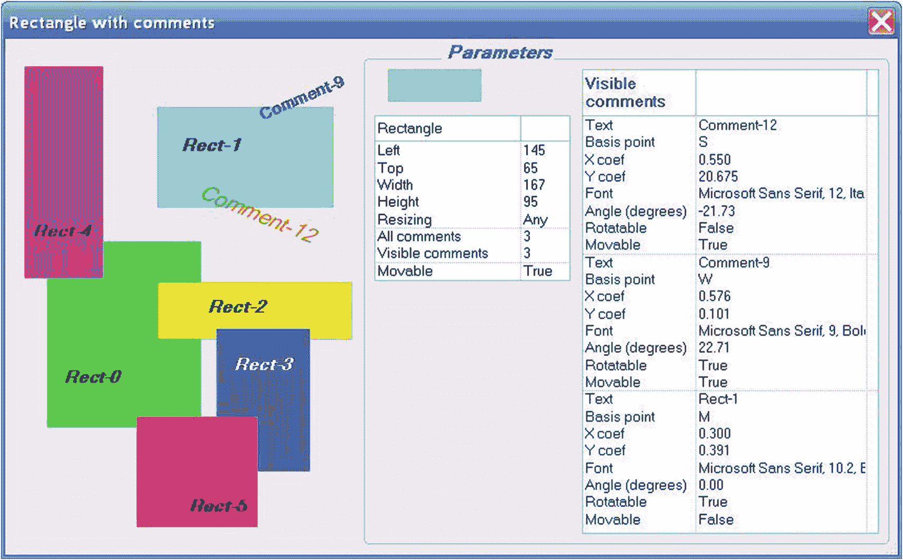

图 3-1

按下某个对象时显示参数

```
public class Rectangle_SizeRange : GraphicalObject
{
PointF [] ptsCorner;
Resizing m_resize;
RectRange m_range;
bool bShowFrame;
RectFrameType typeFrame;
Pen penLine = new Pen (Color .DarkGray);
Delegate_Draw m_draw = null;
static int minSide = 20;
```

此类矩形的边始终保持水平或垂直，不能被旋转，但允许设置不同类型的调整大小操作，这些操作由 `Resizing` 枚举来描述。

```
public enum Resizing { None, NS, WE, Any };
```

初始化参数包括原始尺寸以及用于改变宽度和高度的两个范围；通过比较这些参数，可以设置当前调整大小的类型（`m_resize`）。`ptsCorner` 数组中点的编号从左上角开始，按顺时针方向进行。

```
public Rectangle_SizeRange (Form frm, Mover mvr, RectangleF rc,
RectRange range, Delegate_Draw drawmethod)
{
... ...
ptsCorner = new PointF [4] { new PointF (rc .X, rc .Y),
new PointF (rc .X + w, rc .Y),
new PointF (rc .X + w, rc .Y + h),
new PointF (rc .X, rc .Y + h) };
... ...
```

覆盖层由九个节点组成（图 3-2）。前四个节点的位置和编号与 `ptsCorner[]` 数组中的点相对应。

```
public override void DefineCover ()
{
float rad = (m_resize == Resizing .Any) ? 5 : 0;
float wHalf_WE =
(m_resize == Resizing .Any || m_resize == Resizing .WE) ? 3 : 0;
float wHalf_NS =
(m_resize == Resizing .Any || m_resize == Resizing .NS) ? 3 : 0;
CoverNode [] nodes = new CoverNode [9] {
new CoverNode (0, ptsCorner [0], rad, Cursors .SizeNWSE),
new CoverNode (1, ptsCorner [1], rad, Cursors .SizeNESW),
new CoverNode (2, ptsCorner [2], rad, Cursors .SizeNWSE),
new CoverNode (3, ptsCorner [3], rad, Cursors .SizeNESW),
new CoverNode (4, ptsCorner [0], ptsCorner [3], wHalf_WE, Cursors .SizeWE),
new CoverNode (5, ptsCorner [1], ptsCorner [2], wHalf_WE, Cursors .SizeWE),
new CoverNode (6, ptsCorner [0], ptsCorner [1], wHalf_NS, Cursors .SizeNS),
new CoverNode (7, ptsCorner [3], ptsCorner [2], wHalf_NS, Cursors .SizeNS),
new CoverNode (8, ptsCorner) };
cover = new Cover (nodes);
```

... ...

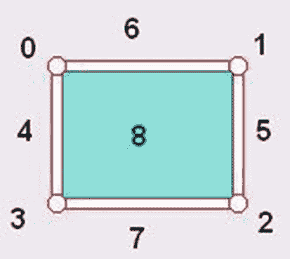

图 3-2

覆盖层及节点编号

始终存在九个节点，但根据所需的调整大小类型，可调整大小（非零）节点的数量可以是一个、三个或九个。所有可能的变体都显示在图 3-3 中，其顺序与 `Resizing` 枚举中的顺序相同。

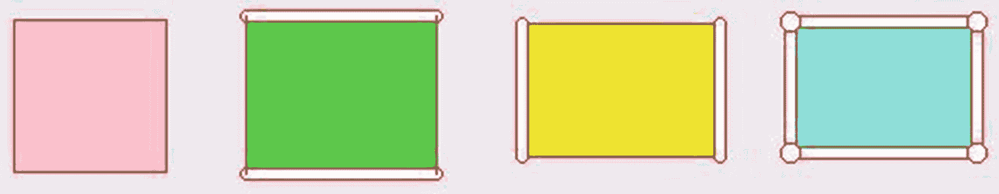

图 3-3

所有调整大小变体的覆盖层


矩形的尺寸调整方式与前一章所述相同。如果按下一个圆形节点，光标会调整到角落位置，并且只能在由按下矩形所允许的最小和最大尺寸决定的某个矩形区域内移动。如果按下一个带状节点，光标会调整到被覆盖的边框上，并且只能垂直于被按下的一侧移动；光标移动的限制范围由该按下矩形所允许的最小和最大尺寸决定。

从一个独立的矩形，我们可以转向 `Rectangle_withComments` 类。该矩形具有相同的覆盖层，因此其移动和调整尺寸的方式完全相同。最有趣的是矩形和批注的协同工作。

当两个元素（在本例中为矩形和批注）为了协同工作而联合起来时，其中一个必须被声明为主导元素，而另一个则为从属元素。通常矩形比其批注更大，并包含更重要的信息，因此显而易见的选择是让矩形成为该对中的主导元素。在 `Rectangle_withComments` 类的情况下，可以有多个从属元素，而不仅仅是一个。

```
public class Rectangle_withComments : GraphicalObject
{
PointF [] ptsCorner;
Resizing m_resize;
SolidBrush m_brush;
List m_comments = new List ();
static int minSide = 20;
```

矩形及其关联批注的独立和关联移动根据以下规则组织。

- 当矩形移动时，其所有批注同步移动。
- 当矩形调整大小时，其所有批注会移动以保持它们相对于矩形的位置。
- 任何批注都可以独立移动和旋转；此类移动不会对其他元素产生任何影响。

矩形的批注派生自前一章讨论过的 `Comment_Adh` 类（见图 2-22）。`Comment_ToRectangle` 类有几个自己的字段；这些字段用于组织矩形和批注的协同工作。

```
public class Comment_ToRectangle : Comment_Adh
{
RectangleF m_rcParent;
double m_xCoef;
double m_yCoef;
```

`Comment_Adh` 对象有九个特殊点（图 2-22）。当 `Comment_ToRectangle` 对象初始化时，这些点中的一个被声明为锚点，并为该点计算两个定位系数。

```
public Comment_ToRectangle (Form frm, Mover mvr, RectangleF rc,
PointF ptAnch, TextBasis textbasis, string txt,
Font fnt, double ang_Deg, Color clr)
: base (frm, mvr, ptAnch, textbasis, txt, fnt, ang_Deg, clr)
{
m_rcParent = rc;
Auxi_Geometry .CoefficientsByLocation (m_rcParent, ptAnch,
out m_xCoef, out m_yCoef);
}
```

批注可以通过 `AddComment()` 方法与矩形关联。

```
public void AddComment (Comment_ToRectangle cmnt)
{
cmnt .ParentRect = MainElementArea;
cmnt .ParentID = ID;
m_comments .Add (cmnt);
}
```

这个简单方法中的两行代码对于元素的后续协同工作很重要。首先，批注存储了与其关联的矩形的 ID。稍后，当鼠标按下任何批注时，这可以方便地识别相关的矩形。

```
cmnt .ParentID = ID;
```

其次，批注被告知主导元素的区域。

```
cmnt .ParentRect = MainElementArea;
```

要参与与矩形的同步和关联移动，任何批注都需要两样东西：矩形的区域，以及描述批注锚点相对于该矩形位置的一对系数。两个坐标轴上的系数计算方式类似，因此只需查看水平系数的计算规则即可。

- 如果批注锚点位于矩形左侧的任何位置，则系数等于该点到矩形左边界的距离，并带有负号。
- 如果锚点位于矩形右侧，则系数等于该点到矩形右边界的距离，并带有正号。准确地说，在这种情况下，`系数 = 距离 + 1`。
- 如果该点位于矩形左右边界之间，则系数属于 [0, 1] 范围，其中 0 在左边界上，1 在右边界上。（对于垂直系数，矩形的上边界对应 0，下边界对应 1。）

在任何时刻，批注的位置通过两种不同的方式确定：其锚点有一个 `PointF` 值，另一个定义则是通过矩形和一对位置系数。在矩形或批注的任何移动中，只有一个参数被直接改变，并导致另一个参数的重新计算。

- 当矩形移动或调整大小时，其所有关联的批注通过 `InformRelatedElements()` 方法获知此变化。

```
private void InformRelatedElements ()
{
RectangleF rc = MainArea;
foreach (Comment_ToRectangle cmnt in m_comments)
{
cmnt .ParentRect = rc;
}
}
```

每个批注通过其 `ParentRect` 属性获得矩形区域的新值；使用不变的系数 `{m_xCoef, m_yCoef}` 来计算新的批注位置。

- 当批注移动时，其新位置由基类的 `Move()` 方法确定，该方法会更改批注锚点的坐标。然后计算新的系数。

```
public RectangleF ParentRect
{
get { return (m_rcParent); }
set
{
m_rcParent= value;
AnchorPoint = Auxi_Geometry .LocationByCoefficients (m_rcParent,
m_xCoef, m_yCoef);
}
}
```

```
public override void Move (int dx, int dy)
{
base .Move (dx, dy);
CoefficientsByLocation ();
}
private void CoefficientsByLocation ()
{
m_xCoef = Auxi_Geometry .CoefficientByCoor (m_rcParent .Left,
m_rcParent .Right, AnchorPoint .X);
m_yCoef = Auxi_Geometry .CoefficientByCoor (m_rcParent .Top,
m_rcParent .Bottom, AnchorPoint .Y);
}
```

我之前提过，在视觉上简单对象和复杂对象之间没有严格区分。滑块条正是那种可以用两种方式设计的对象，使用“简单”滑块条或“复杂”滑块条并不会有任何区别。然而，简单对象和复杂对象在一点上绝对不同：它们在移动器中注册的方式。

一个简单对象可以极其简单，可能只参与一种移动（例如不可调整大小的矩形或圆形），或者由参与不同移动的不同部分组成（弹性多边形或弧线），但在所有这些情况下，对象都有一个单一的覆盖层来提供所有这些移动。这样的对象通过以下两种方法之一在移动器队列中注册：

```
Mover .Add (GraphicalObject grobj)
```

或

```
Mover .Insert (int iPos, GraphicalObject grobj)
```

你在前面的例子中可以看到，简单对象也可以通过 `GraphicalObject.IntoMover()` 方法注册。这是可能的，因为所有可移动对象都派生自 `GraphicalObject` 类，并且 `GraphicalObject.IntoMover()` 方法简单地调用了 `Mover.Insert()` 方法。

```
public void IntoMover (Mover mover, int iPos)
{
mover .Insert (iPos, this);
}
```

你可以使用此方法来注册任何简单的图形对象，并且它将正确工作。


一个复杂对象由几个（至少两个）具有独立覆盖层的部分组成。在当前带注释的矩形示例中，矩形有其覆盖层，每个注释也有其自己的覆盖层。如果你尝试对复杂对象使用`GraphicalObject.IntoMover()`方法，它将注册主要部分，但不会注册关联的组件，因为移动器（mover）没有关于组件可能存在性及其数量的信息。为了正确注册任何复杂对象，你需要为你特定的类编写这样一个方法，并且始终只使用此方法进行注册。

以下是`Rectangle_withComments.IntoMover()`方法的代码：

```
public void IntoMover (Mover mvr, int iPos)
{
mvr .Insert (iPos, this);
for (int i = m_comments .Count - 1; i >= 0; i--)
{
if (m_comments [i] .Visible)
{
mvr .Insert (iPos, m_comments [i]);
}
}
}
```

首先，矩形的覆盖层被插入到移动器队列中所需位置`iPos`处；然后，所有关联的注释被插入到其“父”矩形之前。因此，矩形及其所有注释（无论数量多少）都会被正确注册。

任何复杂对象的从属部分都注册在其主导元素之前，这是一种标准做法。屏幕对象的绘制顺序与其在移动器队列中的注册顺序相反。同样的规则也适用于复杂对象的各个部分，因此首先绘制矩形，然后按与其注册顺序相反的顺序绘制其所有注释。

```
public void Draw (Graphics grfx)
{
grfx .FillPolygon (m_brushBack, ptsCorner);
... ...
for (int i = m_comments .Count - 1; i >= 0; i--)
{
m_comments [i] .Draw (grfx);
}
}
```

在这个示例中，可以对矩形进行许多不同的操作；许多不同的动作是通过可以在矩形上调用的菜单命令启动的（图 3-4a）。

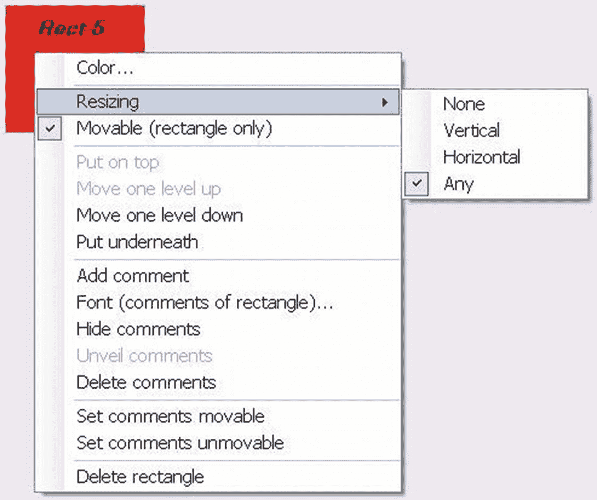

图 3-4a

矩形的上下文菜单

注释可以暂时隐藏，这可以通过其各自的菜单单独完成（图 3-4b），或者通过主导元素的菜单（图 3-4a）同步隐藏矩形的所有注释。隐藏的注释不会注册到移动器队列中（参见`IntoMover()`方法的代码），因此无法在隐藏的注释上调用菜单；此类注释只能通过主导元素上的菜单（图 3-4a）恢复显示。

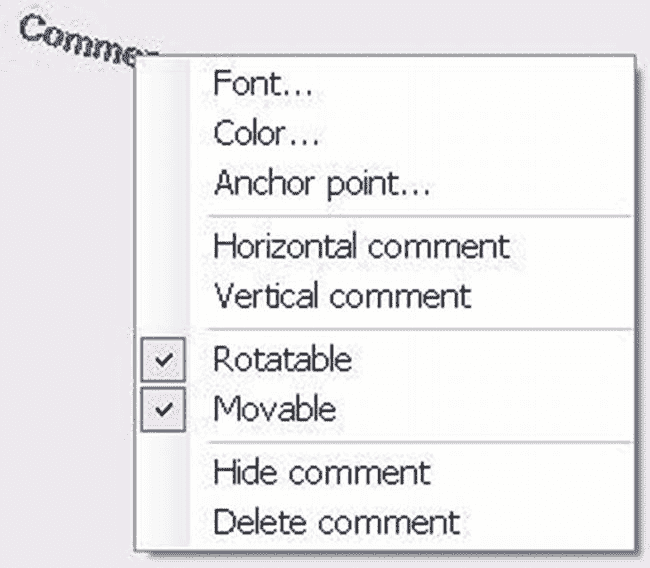

图 3-4b

矩形注释的菜单

本例中还演示了另一件事，尽管它在更复杂的应用程序中也很有用。

稍后我将介绍工程和科学应用程序，它们经常使用大量的绘图。当你有一个包含不同图形的绘图区域时，在具有不可移动元素的经典设计情况下，总是存在如何定位某些注释的问题，这些注释必须明确对应线条，同时又不能遮挡它们。注释的可移动性和可旋转性有助于组织用户所需的视图，但可能会带来一点小不便。注释旋转和注释菜单的调用都是通过右键单击启动的，在调用菜单时，用户可能会轻微旋转此注释。有两件事可以帮助解决这个问题。

首先，有一个指示器（其外观由用户调节）允许您设置（或恢复）注释所需的角度。为了更容易地沿矩形边定位注释，注释菜单中的两个命令允许您将其严格设置为水平或垂直（图 3-4b）。其次，注释的可旋转性可以单独调节（图 3-4b），也可以同步调节所有注释（图 3-4c）。

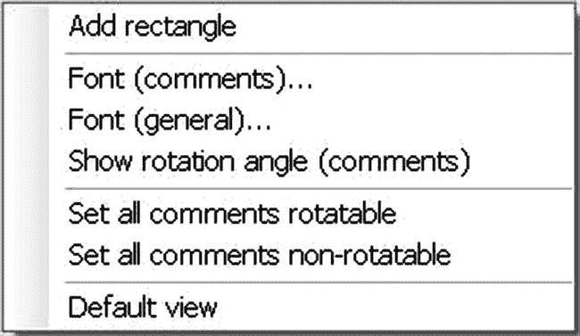

图 3-4c

空白处的菜单

为了演示注释的所有功能以及处理它们的众多可能性，我在其菜单中包含了大量命令（图 3-4b）。`Comment_ToRectangle`对象被用于许多不同的类；例如，它们几乎与所有替代普通控件的图形控件类一起使用。（图形化的普通控件替代品几乎出现在本书开头的每个示例中，但将在第 5 章中讨论。）每当使用这样的注释时，总有一个菜单可以在注释上调用，但通常注释上的菜单命令比当前示例中的要少。字体和颜色总是可更改的，但所有其他命令可能存在变体。在将近一半的情况下，不使用时锚点选择。如果我认为不需要旋转注释，那么这样的注释可以初始化为不可旋转。有时，一个注释被声明为可旋转，但菜单中只保留将其严格设置为水平的命令。当你看到注释上有小菜单时，请记住，大菜单中缺失的所有命令（图 3-4b）都可以轻松添加。

为了演示复杂对象的设计及其各部分之间的交互，使用了抽象的矩形。真实对象各部分之间的类似交互将在下一个示例中演示。

*   文件：`Form_Scrolling.cs`
*   菜单位置：复杂对象 ➤ 滚动

程序通常需要显示某些文件的名称。通常，包含完整路径的文件名太长，因此显示文件名的区域需要滚动。工程和科学程序通常使用多个输入文件来存储不同类型的数据；为了区分这些文件，每个区域需要一条注释。图 3-5 展示了`FilenameViewer_withSlider`类的一个对象。

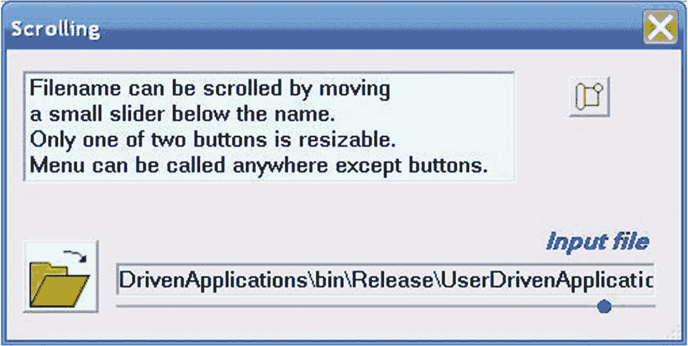

图 3-5

用于显示文件名的矩形区域附带有注释

该对象的主要区域包括一个用于显示文件名的矩形和一条细轨道，小滑块沿该轨道移动。

此类的覆盖层仅由四个节点组成。第一个是位于该元素底部沿轨道移动的点上的小圆形节点（图 3-6）。接下来是矩形区域两侧的两个条形节点；这些节点用于更改元素的大小。覆盖文件名区域及其下方轨道的矩形，用作主导部分的区域。最后一个节点覆盖此矩形，用于移动整个对象。`Comment_ToRectangle`类的注释与此区域相关联。

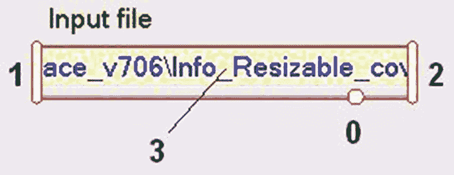

图 3-6

文件名查看器的覆盖层


此文件名查看器的工作原理与之前的示例相同。当按下左或右边框时，光标会精确调整到所按的边框位置，计算出水平鼠标移动的端点，并且按下的鼠标只允许在这些端点之间移动。当按下圆时，光标会调整到其中心点，计算出沿轨迹移动光标的端点，并且带有光标的圆只能在这些端点之间移动。

唯一值得一提的变化是字体。在文件名区域内的任意位置调用菜单，并通过标准对话框选择所需字体。选择字体后，类的 `NameFont` 属性会获取新值。该 `NameFont` 属性会将文件名矩形的高度 (`hFrame`) 调整为新字体的高度，并对其他部分（轨道、圆球、注释）的位置进行必要的调整。

```csharp
public Font NameFont
{
get { return (m_font); }
set
{
if (value != null)
{
m_font = value;
sizeFilename = Auxi_Geometry .MeasureString (m_form, filename,
m_font);
float hFrame = 2 * fShift_side + Auxi_Geometry .MeasureString (
m_form, "File name", m_font) .Height;
rcTextFrame .Height = hFrame;
rcRail .Y = rcTextFrame .Bottom + fRadius;
... ...
```

简单吗？是的。意料之中吗？是的。正确吗？不！

每次我重读上一页，看到关于根据字体大小调整矩形高度的文字时，我立刻就会意识到这是个错误的操作，急忙去修改代码，然后才想起来当初是故意这么做的，并特意留在这里。

在本书开头，我制定了用户驱动应用程序的规则。规则 3 声明：“……不允许开发人员对[命令]进行任何添加或扩展解释。” 你通过菜单命令要求更改字体，但并没有要求做其他任何事情。在用户驱动应用程序中，更改字体后自动调整区域高度绝对是错误的。我猜想大多数用户会期望这样的调整，但这仍然是不正确的。最好的解决方案是增加一个参数，让用户自行决定是否同意这种自动调整。如果用户不同意，那么必须有一种简便的方法来同时更改文件名区域的垂直大小。我希望稍后在另一个示例中演示这样的解决方案，但现在请记住这个案例，不要忘记，即使是多年来看起来毫无疑问正确的解决方案，在新类型应用程序中也可能并非如此。⁸

我不打算更改这个示例，但文件名查看器的正确版本需要一种不同的覆盖层，允许用户更改区域的高度。在角落带有圆形节点、在边缘带有条形节点的标准覆盖层就能完美地工作。

## 带注释的圆形

*   文件：`Form_Circle_withComments.cs`

*   菜单位置：复杂对象 ➤ 带注释的圆形

在上一章中，我们使用简单的单色元素演示了圆的向前移动和调整大小。许多领域中使用的圆形图具有相同的形状，但为了演示所需数据，这些图被显示为划分为扇区的圆形。如果用户需要更改扇区之间的比例，那么扇区划分线必须是可移动的。

由扇区组成的圆形需要两种类型的注释（图 3-7）。两种类型的注释对圆形移动和大小调整的反应相同，但通常对圆形旋转的反应不同。两种类型注释的单独移动则完全不同。

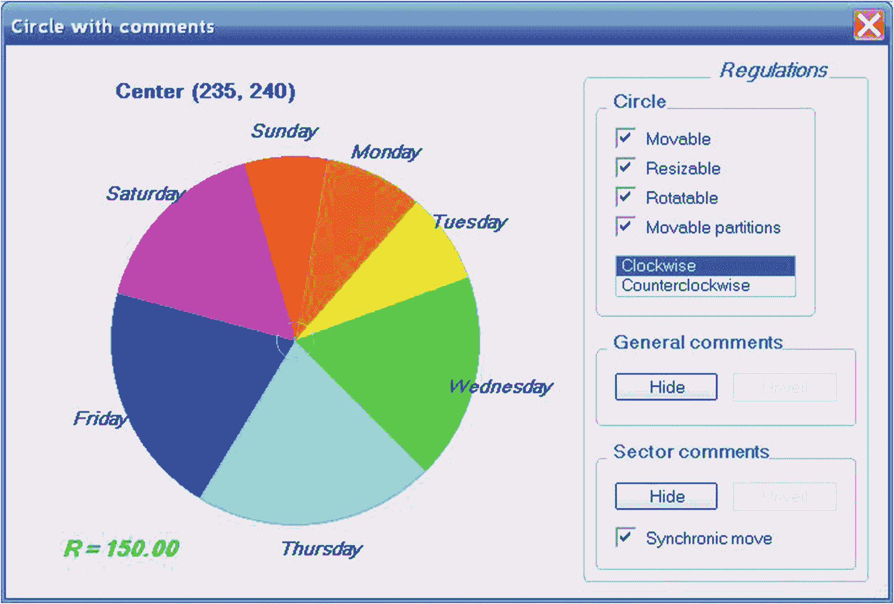

图 3-7

带有整体注释和扇区注释的圆形

*   首先，有一些注释适用于整个圆形；这些注释被称为*整体*注释；在当前示例中，这些注释属于 `Comment_ToCircle` 类。用户决定每个此类注释是否对圆形旋转做出反应。这些注释可以在屏幕上自由移动。整体注释的数量没有限制。当您可以直观地比较具有不同设置的注释时，注释参数的变化会更加明显，因此在本示例中，有两条此类注释。

*   还有一些注释与扇区相关联；它们被称为*扇区*注释。每个扇区只有一条此类注释，因此注释的数量等于扇区的数量。为了演示注释与扇区的关联性，此类注释不能在屏幕上自由移动。在当前示例中，我使用了 `Comment_OnCircleRadius` 类；该类的每个对象都位于关联扇区的角平分线上。注释只能单独沿着这条角平分线移动。

每个注释都有自己的覆盖层。圆形是主导元素，而所有注释都是其附属元素。

```csharp
public class Circle_withComments : GraphicalObject
{
CircleData m_data;
bool bResizable, bRotatable, bMovablePartitions;
Comment_OnCircleRadius [] cmntSector;
List cmntsGeneral = new List ();
```

在展示此类覆盖层设计的代码之前，我想提一下已实现的设计思路。

*   此圆形通过任何边框点调整大小，其方式与 `Circle_Unicolored` 类所解释的相同，因此覆盖层包含同样的一对大圆形节点，它们的半径略有差异。这两个节点将是新类覆盖层中的最后两个节点。

*   为了使所有划分线可移动，每条划分线都由一个从中心点到圆形边界的条形节点覆盖。当左键捕捉到此类节点时，鼠标光标只允许沿着圆形轨迹移动，因此越靠近圆形边界按下，扇区变更的精度就越高。

*   在中心点附近，这些条形节点会重叠，用户无法预先判断在某个点捕捉到的是哪条划分线。即使所需的划分线在非常靠近中心点的位置被捕捉到，被捕捉的划分线在此小半径下的移动也受到限制，并且扇区的变更不准确。为了避免所有这些问题，我在中心点周围放置了一个小的圆形节点。它是覆盖层中的第一个节点，其区域由一条细线显示。此节点用于移动整个对象。


```csharp
public override void DefineCover ()
{
    float wHalf = MovablePartitions ? 3 : 0;
    int delta = Resizable ? 3 : 0;
    double [] partition_angle = PartitionAngles;
    int nSectors = m_data .SectorsNumber;
    CoverNode [] nodes = new CoverNode [1 + nSectors + 2];
    nodes [0] = new CoverNode (0, Center, radInner, Cursors .SizeAll);
    for (int i = 0; i < nSectors; i++)            // 各扇区边界上的节点
    {
        nodes [i + 1] = new CoverNode (i + 1, Center,
            Auxi_Geometry .PointToPoint (Center, partition_angle [i], Radius), wHalf);
    }
    nodes [nSectors + 1] = new CoverNode (nSectors + 1, Center, Radius - delta, Cursors .SizeAll);
    if (!Movable)
    {
        nodes [0] .Cursor = Cursors .NoMove2D;
        nodes [nSectors + 1] .Cursor = Cursors .NoMove2D;
    }
    nodes [nSectors + 2] = new CoverNode (nSectors + 2, Center,
        Radius + delta);
    cover = new Cover (nodes);
    ... ....
}
```

一如既往，所有后续移动的预计算都在对象被按下时完成。

- 此类圆形中最少扇区数为两个。当用左键按下任意分隔线时，沿顺时针方向存在相邻分隔线，相反方向也存在另一条相邻分隔线。（在只有两个扇区的情况下，两个方向上的相邻分隔线是同一个，但通常它们是不同的。）绘制方向可以更改；在当前示例中，通过列表框实现。为避免扇区消失，任何扇区都存在最小允许角度（0.05 弧度）。因此，被捕获的分隔线移动受到其相邻分隔线的限制。分隔线的编号按绘制方向进行，因此在代码中，相邻分隔线被命名为`previous`和`next`。

- 在整个分隔线移动过程中，两侧扇区的角度比例可以改变，但其总和（`angleArc_TwoSectors`）保持不变。

```csharp
public void Press (Point ptMouse, MouseButtons catcher, int iNode)
{
    if (catcher == MouseButtons .Left)
    {
        ... ...
        else       // 分隔线
        {
            int iPartition = iNode - 1;
            double [] sector_angle = SectorAngles;
            double [] partition_angle = PartitionAngles;
            iPartition_Prev = (iPartition == 0) ? (nSectors - 1)
                : (iPartition - 1);
            int iPartition_Next = (iPartition + 1) % nSectors;
```

- 后续光标移动的半径（`rCursor`）由初始按下的点决定。

```csharp
anglePartition_Prev = partition_angle [iPartition_Prev];
anglePartition_Next = partition_angle [iPartition_Next];
angleArc_TwoSectors = sector_angle [iPartition_Prev] +
    sector_angle [iPartition];
```

- 后续光标移动沿弧线轨迹进行，该轨迹由一端角度（`angleWay_Head`）和弧角度（`angleWay_Arc`）决定。

```csharp
double anglePartition = partition_angle [iPartition];
ptPressed = Auxi_Geometry .Segment_NearestPoint (ptMouse, Center, Auxi_Geometry .PointToPoint (Center, anglePartition, Radius));
rCursor = Auxi_Geometry .Distance (Center, ptPressed);
```

```csharp
if (DrawingDirection == DrawingDirection .Clockwise)
{
    angleWay_Head =
        partition_angle [iPartition_Prev] - minSectorAngle;
    angleWay_Arc = sector_angle [iPartition_Prev] +
        sector_angle [iPartition] + 2 * minSectorAngle;  // 负值
}
else
{
    angleWay_Head = partition_angle [iPartition_Prev] + minSectorAngle;
    angleWay_Arc = sector_angle [iPartition_Prev] +
        sector_angle [iPartition] - 2 * minSectorAngle;  // 正值
}
SetTriangles ();
curArea = InsideArea (ptPressed);
... ...
```

光标沿弧线且不超出其端点移动的方式，与之前用 `Spot_OnArc` 和 `Arc` 类讲解的方式相同。当按下的鼠标光标沿此弧线移动时，被按下的分隔线随之移动，其两侧两个扇区的角度也随之改变。

本章的主要目的是研究组合成某个复杂对象的不同元素之间的协同工作。该圆形可被移动、调整大小和旋转。

- 移动圆形时，通过 `Center` 属性改变其圆心点。
- 调整圆形大小时，通过 `Radius` 属性改变其半径。
- 旋转圆形时，通过 `Angle` 属性改变其角度。

当圆形被移动或调整大小时，两类批注的位置变化以相同方式实现。任何批注的位置（其锚点位置）由相对于圆心的角度和特殊系数决定。对于圆形内部点，该系数从零（圆心处）变化到一（圆形边界处）。对于圆形外部点，该系数等于到圆心的距离。（确切地说，`coef = dist + 1`。）

当圆形旋转时，所有扇区批注同步旋转，因为它们位于关联的角平分线上。默认情况下，通用批注忽略圆形旋转。用户可通过菜单命令更改此行为。

扇区批注沿角平分线的移动，类似于沿线段移动光点，本书开头已演示过。仅在 `Comment_OnCircleRadius` 类的情况下，按下时没有鼠标调整。当用左键按下扇区批注时，会计算批注锚点（中心点）与按下点之间的偏移量。之后，光标沿平行于角平分线的直线移动，这使得批注锚点精确沿角平分线移动。


### 图表类比

多年前，正是科学应用中图表的**不可移动性**激发了我对屏幕对象**可移动性**的研究，因此图表成为首个测试移动性算法的对象。或许这不是最佳选择，因为图表是包含大量参数的复杂对象，但正是这种复杂性要求所开发的算法具备清晰的逻辑和通用性，使其后来能毫无阻碍地应用于其他领域的各种不同对象。在本书后续章节中，我们将探讨科学与工程应用中使用的真实图表；而此刻，我想先讨论这些图表的简化版类比。

*   文件：`Form_PlotAnalogue.cs`
*   菜单路径：复杂对象 ➤ 图表类比

每个图表的核心是一个用于绘图的矩形区域。该区域可包含任意数量的水平与垂直刻度；每个刻度对应一定数值范围。端点数值通常显示在刻度旁，但为了更便捷地评估中间值，刻度上常设有若干刻度线。为提升图表估算精度，主刻度线之间还可显示更短的子刻度线。不仅刻度端点值，刻度线的数值也可显示。此外，绘图区域和每个刻度都可关联注释。这是绘图区域及其所有关联元素的整体视图，而在当前示例中，我们使用的是其简化版。

在当前示例中，绘图区域由一个彩色矩形表示，刻度则显示为主线上带有固定数量的刻度线，这些刻度线将刻度间隔划分为五段。不使用子刻度线和关联数值；所有刻度线长度相同。绘图区域和任意刻度均可关联注释。图 3-8 展示了多个 `Plot_analogue` 类的对象。这些是典型的复杂对象。

我们之前已讨论过带注释的矩形示例；主绘图区域及其注释是另一类此类对象。这里的情况更为复杂，因为刻度是主区域的从属元素，因此它是另一个复杂对象。刻度可能拥有自己的注释从属元素，从而形成一条包含三个关联元素的链。让我们从主要元素开始：绘图区域。

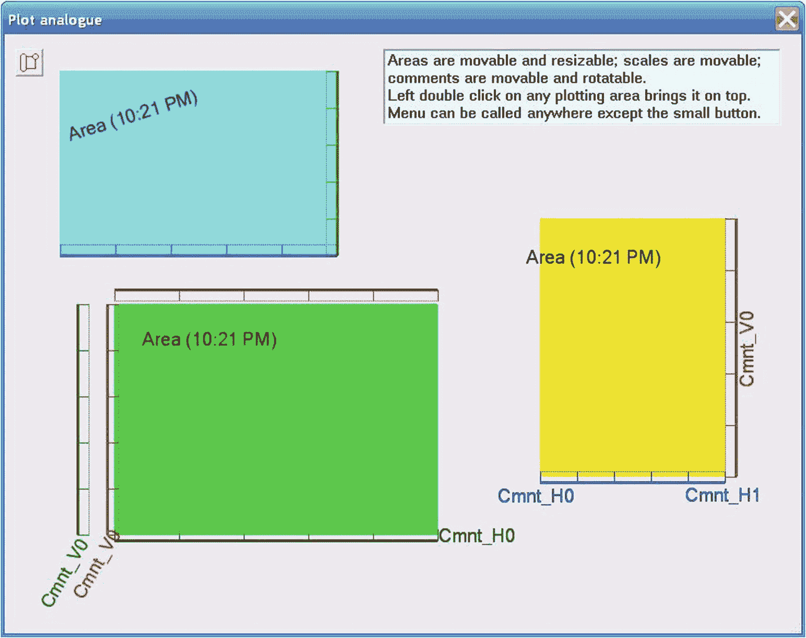

**图 3-8**

图表类比由主矩形区域和任意数量的刻度组成。主区域和任意刻度均可关联任意数量的注释

```
public class Plot_analogue : GraphicalObject
{
PointF [] ptsCorner;
SolidBrush m_brush;
bool bResizable;
List m_horScales = new List ();
List m_verScales = new List ();
List m_comments = new List ();
```

`Plot_analogue` 类的覆盖层（图 3-9）与第 82 页 `Rectangle_SizeRange` 类所示的完全相同：四个角上有圆形节点，四条边上有条形节点，以及一个代表整个元素的矩形节点。与旧类中使用的四种缩放类型不同，新类只有两种变体，因此每个区域要么可调整大小，要么不可调整。如果绘图区域不可调整大小，则边界上的所有八个节点都会收缩到零尺寸。绘图区域的移动和缩放以标准方式完成。与之前讨论的 `Rectangle_withComments` 类的区别在于关联元素的类型。在图表类比的情况下，从属对象属于不同的类，但每个类都有一个属性用于获取主矩形的新值。


**图 3-9**

`Plot_analogue` 覆盖层

```
private void InformRelatedElements ()
{
RectangleF rc = PlottingArea;
foreach (Comment_ToRectangle cmnt in m_comments)
{
cmnt .ParentRect = rc;
}
foreach (HorScale_analogue scale in m_horScales)
{
scale .ParentRect = rc;
}
foreach (VerScale_analogue scale in m_verScales)
{
scale .ParentRect = rc;
}
}
```

`Plot_analogue` 类的刻度可以放置在主区域外部、与主区域部分重叠或完全位于主区域内部；图 3-8 展示了所有这些变体。为了能够访问所有刻度，无论其位置如何，所有刻度都预先在其主元素之前注册。

```
new public void IntoMover (Mover mvr, int iPos)
{
mvr .Insert (iPos, this);
for (int i = m_comments .Count - 1; i >= 0; i--)
{
if (m_comments [i] .Visible)
{
mvr .Insert (iPos, m_comments [i]);
}
}
for (int i = m_horScales .Count - 1; i >= 0; i--)
{
m_horScales [i] .IntoMover (mvr, iPos);
}
for (int i = m_verScales .Count - 1; i >= 0; i--)
{
m_verScales [i] .IntoMover (mvr, iPos);
}
}
```

水平刻度和垂直刻度非常相似。可以为两种类型的刻度使用一个类，添加一个额外的字段来确定特定刻度的方向，并在该类的几乎每个方法内包含两种变体。相反，我决定使用两个相似但不同的类。因为它们非常相似，只需查看其中一个的代码和运行方式即可。让我们看看水平刻度。

```
public class HorScale_analogue : GraphicalObject
{
RectangleF rcParent;        // 主绘图区域
PointF pt_LT, pt_RB;        // 主线的端点
double posCoef;             // 主线相对于 rcParent 的定位系数
List m_comments = new List ();
Side sideTicks = Side .N;         // N 或 S
float lenTicks = 12;
Pen penLine, penTicks, penDots;
```

刻度类比是一个经典的复杂对象，它由一个主元素和任意数量的从属元素（注释）组成。同时，它几乎是一个独一无二的复杂对象，因为主元素很简单。它是一个原始的、不可（直接）调整大小的元素，只能沿垂直于其主线的方向移动。这条主线的长度等于绘图区域的一个边长。刻度的另一个边长等于固定长度的刻度线，因此刻度有一个矩形区域，其覆盖层由一个矩形节点组成。该节点上的光标会提示刻度的可能移动方向。水平刻度只能上下移动，因此其光标形状为 `Cursors.SizeNS`。

```
public override void DefineCover ()
{
cover = new Cover (new CoverNode (0, MainArea, Cursors .SizeNS));
if (!Movable)
{
cover .SetCursor (Cursors .NoMove2D);
}
... ...
```

在研究与矩形关联的注释案例时，我们已经讨论了 `Comment_ToRectangle` 类中使用的定位系数。同样的系数用于确定刻度位置，但由于每个刻度只能沿一个轴移动，因此一个系数就足够了。该系数决定了刻度主线相对于绘图矩形的位置。

```
public HorScale_analogue (Form frm, Mover mvr, RectangleF rcRel, double coef,
Side sideOfTicks, Color clr)
{
... ...
rcParent = rcRel;
posCoef = coef;
MainLineByCoefficient ();
... ...
```

该系数（`posCoef`）允许您计算刻度主线的坐标。

```
public void MainLineByCoefficient ()
{
float cy = Auxi_Geometry .CoorByCoefficient (rcParent .Top,
rcParent .Bottom, posCoef);
pt_LT = new PointF (rcParent .Left, cy);
pt_RB = new PointF (rcParent .Right, cy);
}
```

刻度线垂直于主线，但可以放置在一侧或另一侧。刻度区域取决于刻度线的所在侧。


```
public RectangleF MainArea
{
get {
float cyTop = (sideTicks == Side.N) ? (pt_LT.Y - lenTicks) : pt_LT.Y;
return (new RectangleF (pt_LT.X, cyTop, pt_RB.X - pt_LT.X, lenTicks));
}
}
```

用户驱动的应用程序基于所有元素的 **可移动性**，而处理每个新类时的首要任务，就是以能够提供所有必要移动的方式来组织其“封面”。同时，新应用程序的完全控制权交给用户，并且，用户控制着所有屏幕元素的可移动性。当你有一个屏幕对象较少、额外空间很多的应用程序时，可移动性的调节看起来并不重要，所有元素可以一直作为完全可移动的来使用。在具有大量可移动元素的应用程序中，工作空间会变得过于拥挤，因此对每个及所有元素的可移动性（和可调整大小性）进行调节就变成了一件重要的事情。通常，科学和工程程序在屏幕上有很多元素。用户常常会试图通过移动和调整所涉及对象的大小，以最佳方式组织视图。移动随时可以轻松完成，但如果用户组织好某个视图后想要避免不必要的（通常是意外的）移动，那么就需要有固定元素的命令。如果有固定任何东西的命令，那就必须有解除固定的命令。

每个元素的可移动性可以通过其菜单中的命令来调节，但复杂对象的情况有很多变体，因为如果需要，复杂对象每个部分的可移动性都可以单独调节。当前示例是一个科学应用程序的简单情况。真实科学应用程序的用户总是告诉我，他们不需要太多可调节可移动性的变体。他们确实需要每个及所有元素的可移动性，但当科学家们组织好他们偏好的视图后，他们希望有一个单一的“固定所有”命令来避免意外更改。

在当前示例中，可移动性的调节是通过几个上下文菜单的命令来组织的。

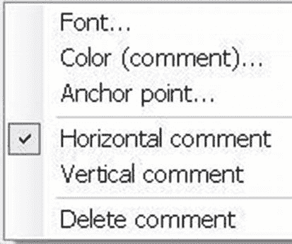

图 3-10d

注释菜单

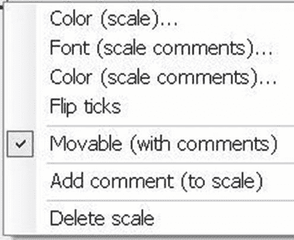

图 3-10c

刻度菜单

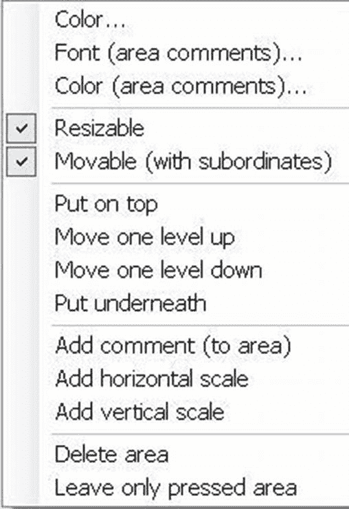

图 3-10b

绘图区域菜单

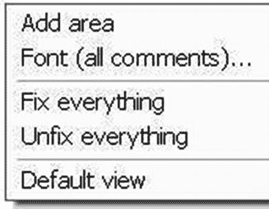

图 3-10a

空白区域菜单

*   空白区域菜单（图 3-10a）包含应用于窗体上所有对象的命令。
*   绘图区域菜单（图 3-10b）允许您为按下的区域、其刻度以及所有相关注释设置相同的可移动性。
*   刻度菜单（图 3-10c）允许您为按下的刻度及其注释声明相同的可移动性。
*   只有注释菜单（图 3-10d）没有用于调节按下注释可移动性的命令。我只是认为单独调节按下注释的可移动性没有意义，但如果您觉得这有用，这样的命令可以很容易地添加。

以下是对整体可移动性和不可移动性的一些说明。

通常，屏幕对象可以移动、调整大小和旋转。我将这三种类型的更改视为三种不同的移动；它们通过不同的方法和属性，由三个不同的字段（这些字段也属于不同的类）进行调节。如果某个绘图区域被声明为不可移动但可调整大小，那么通过依次移动其边界，仍然可以产生与可移动区域相同的效果。这需要更多时间，看起来有点笨拙，但可调整大小且不可移动的区域可以从一个位置移动到另一个位置，这对于一个被声明为不可移动的对象来说是很奇怪的。我认为，当用户想要固定所有东西时，用户是想避免任何类型的更改，因此空白区域菜单（图 3-10a）中的“固定所有”和“解除固定所有”命令会同时处理所有元素的可移动性、可调整大小性和可旋转性。

```
private void Click_miFix_All (object sender, EventArgs e)
{
foreach (Plot_analogue area in areas)
{
area .TotalMovability = false;
area .Resizable = false;
}
AllCommentsRotatability = false;
info .Movable = false;
info .Resizing = Resizing .None;
btnCover .Movable = false;
Invalidate ();
}
```

在查看上述 `Click_miFix_All()` 方法的代码以及其孪生方法 `Click_miUnfix_All()` 的代码时，不要忘记所有相关对象的初始设计。

*   信息区域和绘图区域是可移动且可调整大小的。
*   按钮和所有刻度是可移动且不可调整大小的。
*   注释是可移动且不可调整大小的；它们也是本示例中唯一可旋转的元素。

在任意空白区域调用菜单并点击“固定所有”命令。绘图区域、刻度和注释随之被固定，当鼠标移动到这些元素上时，光标形状（`Cursors.NoMove2D`）会提示底层元素不可移动。如果在这种情况下在任一对象上按下鼠标，则光标会吸附在按下的点上，直到鼠标释放。

让我们转向一个小问题，我确信你还没有遇到过。这个问题就其发生的区域大小而言可以称为一个小问题，但多年前我在设计复杂的科学应用程序时遇到它时，对我来说却是一个大问题，直到我找到了一个有趣且不寻常的解决方案。见图 3-11。

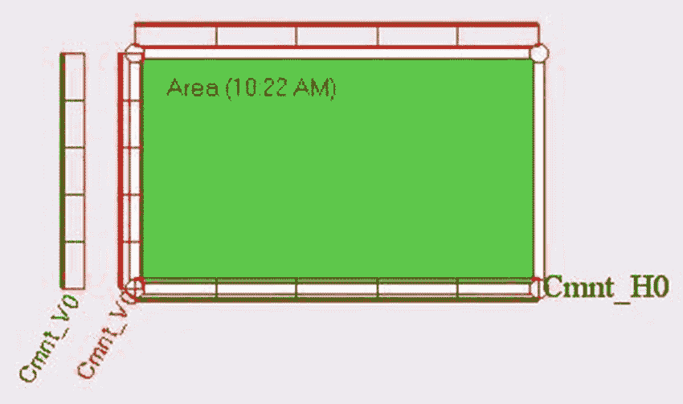

图 3-11b

封面的可视化有助于理解通过绘图区域角点进行调整大小的问题

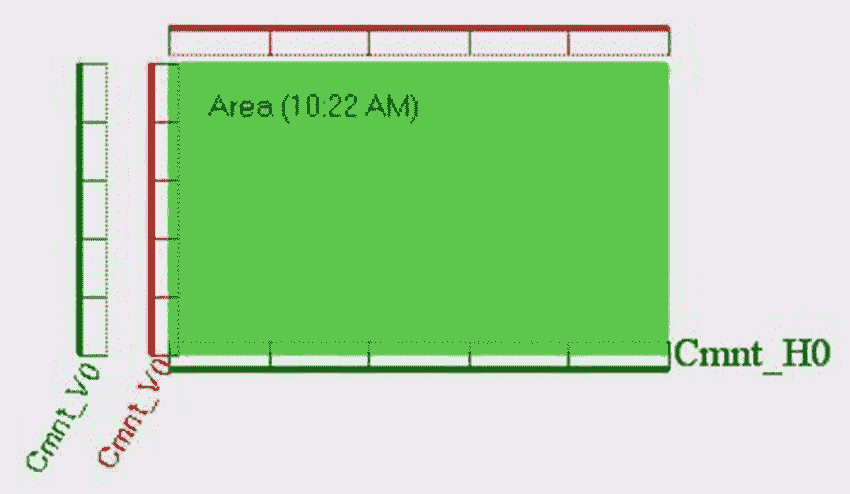

图 3-11a

一个 `Plot_analogue` 对象，其刻度沿绘图区域边侧标准放置

尝试调整我们示例中绿色绘图区域的大小（图 3-11a）。最好的方法是移动其角点，但根据所需更改的方向，你可能会发现该任务要么容易完成，要么无法完成。作为科学应用程序的用户，我不会期望在所有角点上都出现问题，但在当前情况下，右上角没有问题，左上角有小问题，而无法移动下侧的两个角点。


你可能立即想到，问题出在刻度尺所在的那几条边上。你对问题原因的判断完全正确，但这并不能消除问题本身。图 3-11b 展示了相关元素的覆盖区（至少是其中大部分元素的覆盖区），但问题不仅在于这些节点的尺寸，还在于覆盖区的顺序。`Plot_analogue.IntoMover()`方法的代码可以在几页前看到，它清楚地表明所有刻度尺和注释的覆盖区都排在其主控元素覆盖区之前，进入了移动器队列。

刻度尺沿绘图区边缘放置是最常见的情况，因此图 3-11a 中的视图并不罕见。我们来看看绘图区角落的小圆形节点会发生什么情况。

*   右上角的节点没有被任何东西遮挡，因此移动这个角没有问题。
*   左上角节点的一半被垂直刻度尺的覆盖区遮挡。当光标移近这个角落时，在靠近角落的点附近，光标会显示不同的形状。只需将光标移动一两个像素，你就能捕捉到光标变成 45 度倾斜箭头的瞬间。如果此时按下鼠标按钮，就可以通过左上角调整绘图区的大小。
*   绿色矩形左下角的圆形节点有四分之三被两个刻度尺遮挡。现在考虑到注释覆盖区没有显示，但它在注释文本周围有一个矩形区域，因此同一个圆形节点的剩余四分之一被注释遮挡。
*   在右下角，圆形的一半被刻度尺遮挡，另一半被注释遮挡。

因此，在底部的两个角上，倾斜光标根本不会出现，所以无法通过这些角调整区域大小。这个问题有一个显而易见的解决方案：将相邻的刻度尺和注释稍微移开，调整绘图区大小，然后将刻度尺和注释移回它们靠近绘图区的原始位置。这个方案显而易见却很不方便。如果为了改变某个对象，需要先来回移动其他几个对象，这看起来至少很奇怪。

刻度尺和注释必须显示在其关联绘图区的上方，因此它们在移动器队列中的顺序必须位于该绘图区之前，且这个元素顺序无法更改。为了能够轻松地通过角落调整大小，而无论刻度尺和注释的位置如何，我只需要让圆形节点出现在所有刻度尺和注释的前面。但根据所使用的覆盖区设计，这是不可能的，因为一个覆盖区的节点必须连续排列，不能被另一个覆盖区打断。无法在移动器队列中先放置绘图区的几个节点，然后在它们前面放入刻度尺和注释的覆盖区，再在它们前面放入主区域覆盖区的其余节点（圆形节点）。

有一段时间，我找不到解决方案。当我最终找到一个时，发现它其实很简单。情况往往如此：找到这样的解决方案后，很难理解为什么花了这么长时间才想出来，因为解决方案显而易见。

*   最好的解决方案是将主区域的覆盖区拆分成两部分，并分别注册，而所有其他部分的覆盖区则注册在它们之间。这是不可能的，那么为何不添加一个仅由四个圆形节点组成的覆盖区元素呢？如果这个元素注册在所有其他部分之前，那么它的四个圆形节点就永远不会被遮挡。
*   假设我们有了这个额外的元素，其覆盖区由四个圆形节点组成。这个新元素注册在其他部分之前，因此它必须在所有其他部分之后绘制，并显示在它们之上。但我们已经有了包含所有必要部分的绘图区所需视图。什么样的对象可以绘制在所有内容之上，同时又不会破坏现有视图呢？这必须是一个不可见的元素，或者更确切地说，是一个不需要任何绘制的元素。
*   因此，我们有了一个始终不可见的新元素。这个元素的几何形状有点奇怪，因为它由四个相距很远的点组成。到目前为止，我们遇到的元素中，覆盖节点都是并排排列且经常重叠的；而在新元素中，节点永远不会相互靠近。这个新元素必须作为主控绘图区的另一个从属元素工作。

尽管其几何形状不同寻常（只有四个点，没有其他内容）、特性奇特（始终不可见）以及覆盖节点的定位方式奇怪（它们永远不会相互靠近），但这样的元素完美地解决了问题。为了使代码不至于过于复杂，我决定在一个外观完全相似但使用`Plot_analogue_advanced`类绘图区的独立示例中演示这个解决方案。

*   文件：`Form_PlotAnalogue_Advanced.cs`
*   菜单位置：复杂对象 ➤ 绘图区模拟（高级）

```csharp
public class Plot_analogue_advanced : GraphicalObject
{
    PointF [] ptsCorner;
    SolidBrush m_brush;
    bool bResizable;
    RectCornerPoints m_rectcorners;
    List m_horScales = new List ();
    List m_verScales = new List ();
    List m_comments = new List ();
```

新类的绘图区使用相同的刻度尺和注释，但增加了一个新的`RectCornerPoints`字段。

`Plot_analogue_advanced`类的覆盖区（图 3-12a）比`Plot_analogue`类的覆盖区（图 3-9）更简单。角落的圆形节点将始终被新元素的圆形节点遮挡，因此矩形本身的覆盖区中不需要圆形节点。新的主元素覆盖区仅由五个节点组成：沿边的四个条状节点和一个覆盖整个区域的矩形节点（图 3-12a）。

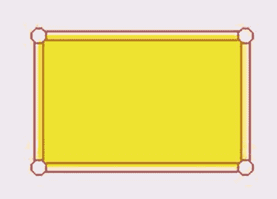

图 3-12c：两个覆盖区的组合视图

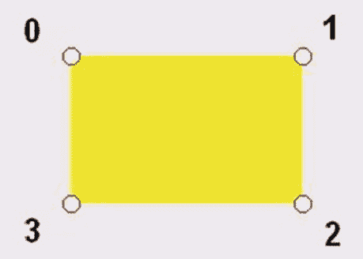

图 3-12b：`RectCornerPoints`类的覆盖区

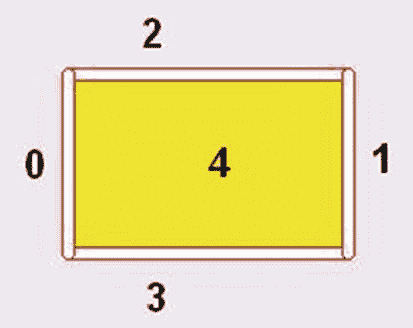

图 3-12a：`Plot_analogue_advanced`类的覆盖区

```csharp
public override void DefineCover ()
{
    float wHalf = bResizable ? 3 : 0;
    CoverNode [] nodes = new CoverNode [] {
        new CoverNode (0, ptsCorner [0], ptsCorner [3], wHalf, Cursors .SizeWE),
        new CoverNode (1, ptsCorner [1], ptsCorner [2], wHalf, Cursors .SizeWE),
        new CoverNode (2, ptsCorner [0], ptsCorner [1], wHalf, Cursors .SizeNS),
        new CoverNode (3, ptsCorner [2], ptsCorner [3], wHalf, Cursors .SizeNS),
        new CoverNode (4, ptsCorner) };
    cover = new Cover (nodes);
    ... ...
```

新矩形的`MoveNode()`方法也是`Plot_analogue`类中类似方法的简化版本；只需移除由角节点触发的部分，其余内容完全相同。当矩形被移动或调整大小时，必须通知所有从属元素。与之前示例的唯一区别是增加了一个名为`m_rectcorners`的从属元素。


`private void InformRelatedElements ()`
```
{
    RectangleF rc = PlottingArea;
    m_rectcorners.ParentRect = rc;
    foreach (Comment_ToRectangle cmnt in m_comments)
    {
        cmnt.ParentRect = rc;
    }
    ... ...
}
```

在初始化一个新的矩形时，有一个新元素也会被同时初始化，即 `RectCornerPoints` 元素。

```
public Plot_analogue_advanced (Form frm, Mover mvr, RectangleF rc, Color clr)
{
    ... ...
    float w = Math.Max (minSide, rc.Width);
    float h = Math.Max (minSide, rc.Height);
    ptsCorner = new PointF [4] { new PointF (rc.X, rc.Y),
        new PointF (rc.X + w, rc.Y),
        new PointF (rc.X + w, rc.Y + h),
        new PointF (rc.X, rc.Y + h) };
    m_brush = new SolidBrush (clr);
    bResizable = true;
    m_rectcorners = new RectCornerPoints (frm, mvr, PlottingArea, bResizable,
        CornersRelocated);
    m_rectcorners.ParentID = ID;
}
```

`RectCornerPoints` 元素仅由四个点组成。

```
public class RectCornerPoints : GraphicalObject
{
    PointF [] ptsCorner;
    bool bResizable;
    Delegate_Rect InformParent = null;
}
```

该元素的覆盖层由以这四个点为中心的圆形节点构成（图 3-12b）。这四个圆形节点具有相同的半径，半径大小取决于该元素是否可调整大小。

```
public override void DefineCover ()
{
    float rad = bResizable ? 5 : 0;
    CoverNode [] nodes = new CoverNode [] {
        new CoverNode (0, ptsCorner [0], rad, Cursors.SizeNWSE),
        new CoverNode (1, ptsCorner [1], rad, Cursors.SizeNESW),
        new CoverNode (2, ptsCorner [2], rad, Cursors.SizeNWSE),
        new CoverNode (3, ptsCorner [3], rad, Cursors.SizeNESW) };
    cover = new Cover (nodes);
}
```

当 `RectCornerPoints` 元素被初始化时，它会获取主矩形的区域，将其自身的四个点定位在该矩形的四个角，并将其自身的可调整大小属性与主元素的该属性同步。这个新元素还会获取一个方法（`inform`），用于将该从属元素的反馈传递给主元素。

```
public RectCornerPoints (Form frm, Mover mvr, RectangleF rc, bool resizable, Delegate_Rect inform)
{
    ... ...
    float w = Math.Max (minSide, rc.Width);
    float h = Math.Max (minSide, rc.Height);
    ptsCorner = new PointF [4] { new PointF (rc.X, rc.Y),
        new PointF (rc.X + w, rc.Y),
        new PointF (rc.X + w, rc.Y + h),
        new PointF (rc.X, rc.Y + h) };
    bResizable = resizable;
    InformParent = inform;
}
```

从复杂矩形的各部分关系来看，这个特殊元素从属于主绘图区域，并且会与其他所有从属元素一同被告知父区域的任何变化（参见两页前的 `Plot_analogue_advanced.InformRelatedElements()` 方法）。但 `RectCornerPoints` 类有一个独特的特性：无论何时，只要它改变了其点的位置，就必须将此变化通知主元素，然后主元素会改变自身尺寸，并将此变化通知所有从属元素。`Plot_analogue_advanced.CornersRelocated()` 方法提供了来自四个角点的这一反馈。

```
private void CornersRelocated (RectangleF rc)
{
    ptsCorner [0] .X = ptsCorner [3] .X = rc.Left;
    ptsCorner [1] .X = ptsCorner [2] .X = rc.Right;
    ptsCorner [0] .Y = ptsCorner [1] .Y = rc.Top;
    ptsCorner [2] .Y = ptsCorner [3] .Y = rc.Bottom;
    DefineCover ();
    InformRelatedElements ();
}
```

这种双向通信实现了同步移动，尽管可移动的边属于一个元素，而可移动的角点属于另一个元素。图 3-12c 展示了当标尺被移开且不与这两个元素重叠时，两个覆盖层的组合视图。更多情况下，标尺会与它们重叠，而当所有部分保持相邻时，两种变体之间的差异会变得更加明显。

图 3-13a 展示了一个 `Plot_analogue_advanced` 类的对象。这个新类使用了与 `Plot_analogue` 类相同的标尺和注释，因此在视觉上，这两个类的对象无法相互区分。在如图 3-13a 所示的标尺和注释位置下，对于 `Plot_analogue` 对象而言，主区域的两个下角将是不可访问的。图 3-13b 清楚地表明了为什么 `Plot_analogue_advanced` 类没有这样的问题：无论标尺和注释的位置如何，四个角上的圆形节点永远不会被遮挡。

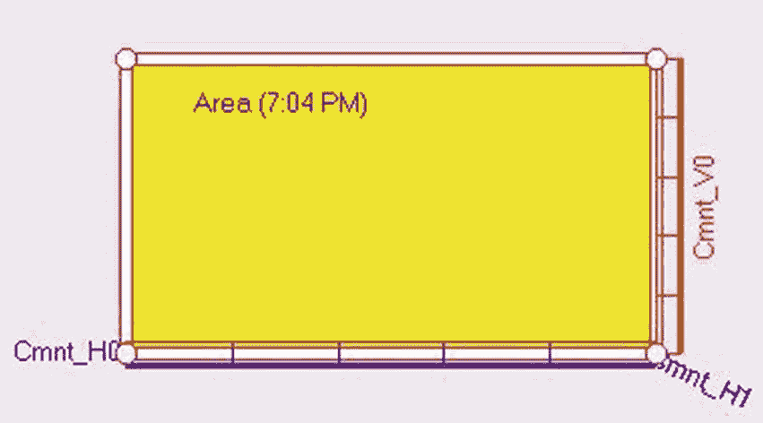

图 3-13b

`RectCornerPoints` 元素的覆盖层被放置在所有其他从属元素之前，因此无论所有标尺和注释的位置如何，这四个圆形节点都不会被遮挡。

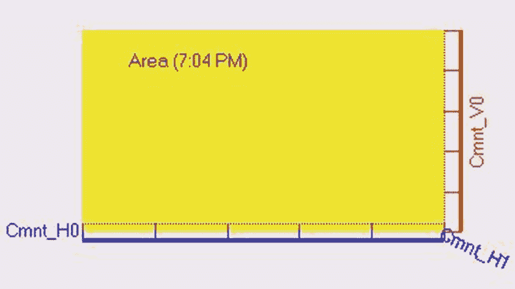

图 3-13a

`Plot_analogue_advanced` 类的对象使用了与 `Plot_analogue` 类相同的标尺和注释。

## 结论

在本章中，我们讨论了复杂对象的设计。此类对象的每个部分都有自己的覆盖层，因此每个部分都可以参与独立的移动，但同时各部分也参与关联移动，因此在其整体设计上存在一些考量。多个对象联合处理某个子任务的情况并不少见，因此这样一组对象必须作为一个组来移动和工作。这将在下一章中讨论。

脚注 1


