# 6. 数据可视化元素

分析那些由参与不同运动的部件构成、且具有许多需要调节的特性的复杂对象的设计，是颇有裨益的。金融应用中使用的某些对象最适合用于此类讨论。

屏幕对象的可移动性可以应用于许多不同领域的程序中，但有一条通用规则：开发者能够预先决定的应用程序未来所需视图越小，转向用户驱动应用的优势就越大。在下一章中，我将通过从一个功能有限的简单程序，过渡到用户工作场景完全无法预测的应用来阐述这一规则。

假设某个应用程序获取了一些需要以不同方式展示的数据。数据可视化只是分析前的预备步骤，但根据所使用的可视化方式，它可能隐藏或完美地展示数据中隐含的某些特征，因此分析结果在很大程度上取决于数据的视图。这不仅取决于视图本身，还取决于数据视图与特定用户的期望和偏好的契合度。由于流行应用拥有大量用户，开发者无法为每个用户提供最佳的视图。用户驱动应用的主要目标并非为所有人准备最佳视图（这不可能实现），而是提供一种易于使用的工具，使每个用户都能以最符合自身偏好和优势的方式查看数据。

从过去几个世纪到现代，科学家们是如何分析数据的？研究人员在纸上绘制图表，然后查看这些纸张，试图理解图表背后的过程。可以是一张纸一个图表，也可以是一张纸上多组图表。图表的大小可以不同；线条的样式、颜色和类型也可以各异。数据可能非常庞大，而分析结果往往取决于纸张的摆放方式，邻近图表的视图能为后续分析提供线索。当你将纸张替换为电脑屏幕时，并没有任何本质上的创新。你拥有图表区域和线条，但失去了在桌面上随意但以最优方式绘制线条和摆放纸张的简便性，取而代之的是一套必须学习的命令系统，以及在屏幕上看图表时面临的诸多限制。通常（几乎总是如此），你能同时看到的绘图区域数量有限，图表的定位和视图也受到限制。科学家们始终不得不在应用开发者们认为已足够满足研究需求的界限内工作。

数据可视化应用于众多领域。我对屏幕对象可移动性的研究，正是受科学与工程应用领域的需求所启发。在这个广阔的领域中，最常用的是带刻度的矩形图形区域；这类图表的讨论将在下一章中展开。金融和经济领域的研究与分析不仅涉及同样的标准图表类型，还涉及特殊的数据视图。对我来说，将可移动性应用于一些我原本永远不会接触的屏幕对象是一件有趣的事。我无意设计金融领域使用的所有不同类型图表的可移动版本，因此这里仅讨论两个流行的元素：柱状图和饼图。我的另一本书 [2] 对两者均有详细论述。在此需要强调的是，无论新旧书中的示例存在多少相似之处，这些示例中使用的类是不同的。

## 条形图

- 文件：`Form_BarChart.cs`
- 菜单位置：复杂对象 ➤ 条形图

通常，条形图包含一个用于绘图的矩形区域和一对刻度（图 6-1）。

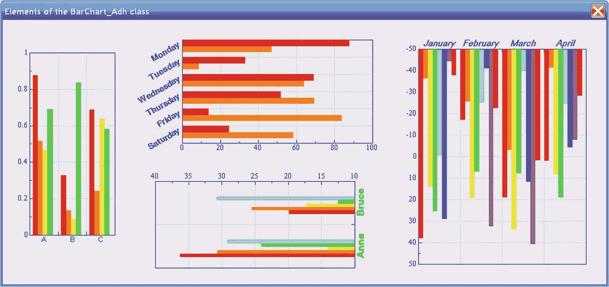

图 6-1

具有不同条形方向的 `BarChart_Adh` 类对象

数据可以以不同方式展示，但最常见的是带有彩色条形的情况。条形的长度可以由数据决定从而固定不变，也可以是可变的。在某些版本中，条形可以通过两端进行改变，但最流行的是条形基于绘图区域某一边界的情况，而条形的另一端可以移动。条形沿着带数字的刻度拉伸；这使得估算更加容易。正交刻度包含对主要区域不同部分（分段）的文字说明。主绘图区域和刻度可以与注释相关联。图 6-2 更好地展示了一个单独的 `BarChart_Adh` 对象。通常情况下，每个刻度的主刻度线正好位于绘图区域的边界上（图 6-1），但为了更好地查看某些细节，图 6-2 中的一个刻度被稍微移开了一些。

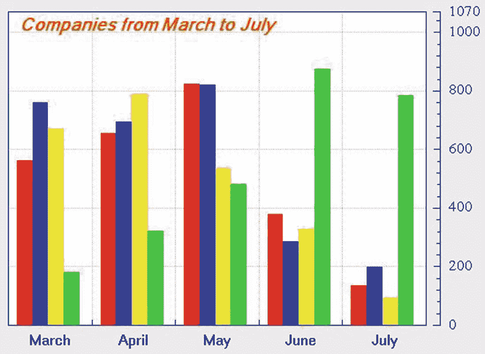

图 6-2

带有刻度的条形图

在第 3 章中，我们讨论了一个由带有刻度的矩形绘图区域组成的对象。我们还讨论了当刻度沿边界放置时，它们会遮挡主要区域角节点所导致的调整大小问题；该问题通过使用一个额外的不可见元素来解决，该元素在绘图区域的四个角上放置了圆形节点。`BarChart_Adh` 类也存在同样的问题，并通过使用 `RectCorners_Adh` 类的额外元素以相同方式解决。

条形图是一个复杂对象，由不同部分组成，并拥有大量可调参数。刻度本身也是复杂对象，具有大量可调节参数。带数字的刻度属于 `Scale_Numbers` 类；带文字的刻度属于 `Scale_Texts` 类；而注释，无论它们是与主绘图区域还是与某个刻度一起使用，都属于 `CommentToRect` 类。

```csharp
public class BarChart_Adh : GraphicalObject
{
PointF [] ptsCorner;
RectCorners_Adh rectCorners;
bool bResizable = true;
Scale_Texts scaleTexts;
Scale_Numbers scaleNumbers;
TextsDrawingDirection dirDrawing;
Side sideBase;         // 所有条形不可移动边所在的矩形边
List m_comments = new List ();
```

所有注释、刻度和主要区域的可见性参数都通过辅助调谐窗体进行修改。通常，一个更复杂的对象拥有更多可调节参数，因此需要具有更多元素的更复杂的调谐窗体。所有这些调谐窗体都由普通控件的图形模拟构件构成，因此你会反复看到前一章讨论过的相同元素。用户驱动应用程序的规则必须在所有级别应用，因此调谐窗体内部的所有元素也是可调谐的；它们的调谐窗体也在前一章中讨论过。

这种元素系统，其调谐窗体又由拥有自身调谐窗体的元素构成，听起来像是一个难以理解和记忆的复杂系统。实际上，它很简单，因为一切都基于几条简单的设计规则。

- 任何元素都是可调谐的。
- 调谐从来不是强制性的，并且总是只在用户请求时启动。
- 所有调谐结果都会被保存，并在你下次启动应用程序或再次调用调谐窗体时恢复。

本章中的示例并非真正的应用程序（这将是下一章示例的情况），但这些示例是像真实应用程序一样开发的。这意味着屏幕每个元素的任何参数都受用户控制。用户无需阅读和学习每个新示例的说明，因为它们对所有示例都是相同的。

条形图是一个拥有大量可调谐参数的复杂对象，但移动/调整条形图大小确实很简单。主要区域是一个矩形，可以通过任意内部点移动，并通过其边界调整大小；其覆盖层很简单，与第 3 章中讨论的绘图模拟相同。任何刻度都是一个不可调整大小的矩形，因为其大小只能随着主绘图区域调整大小而间接改变。一个不可调整大小的矩形对象拥有最简单的覆盖层，仅由一个矩形节点组成。此外，刻度只能正交于其主刻度线移动。所有移动都与绘图模拟示例中讨论的相同。当前条形图示例中令人感兴趣的不是覆盖层设计或移动，而是这个示例的整体设计，包括所有调谐窗体和菜单。

菜单可以在示例的任何位置调用，无论该位置是元素还是空白处。如果在元素上调用菜单，则第一个命令允许你为按下的元素调用调谐窗体。（菜单将在本节后面显示和讨论。）带文字的刻度在设计上比带数字的刻度简单，因此让我们从较简单的对象开始。

图 6-3 展示了一个 `Scale_Texts` 对象及其调谐窗体；这样的定位使解释和理解更加容易。

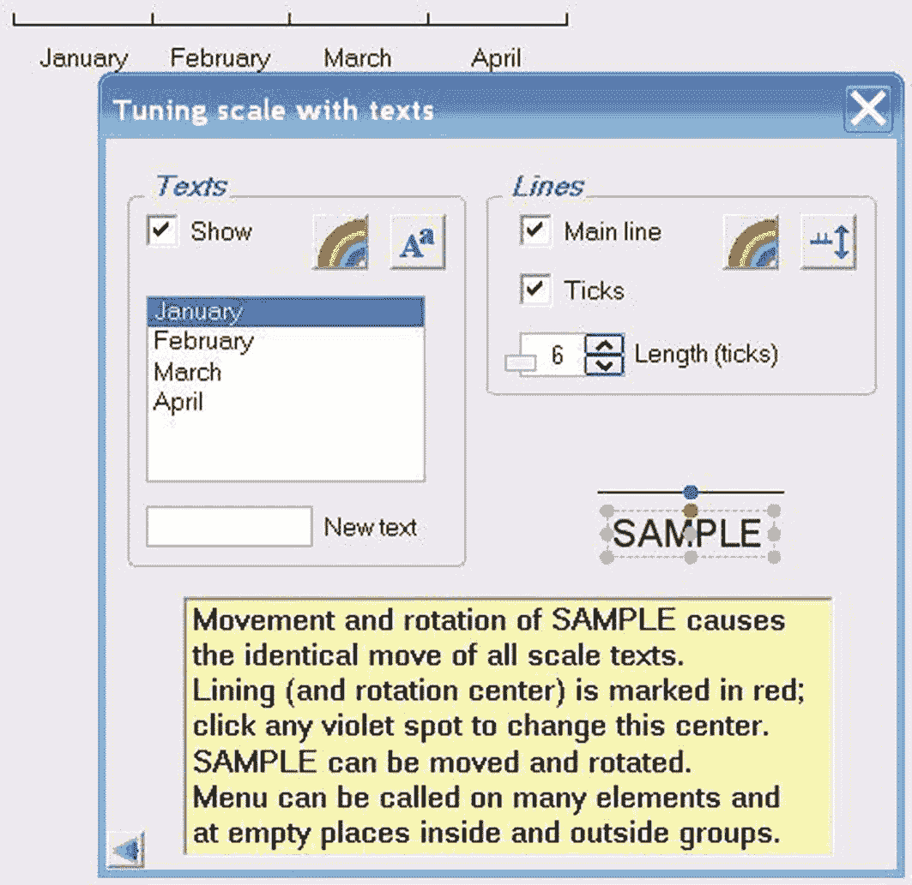

图 6-3

`Scale_Texts` 对象及其调谐窗体

刻度由三部分组成：主刻度线、主刻度线一侧标示分段边界的刻度标记，以及与分段相关的文字。线条和文字的绘制基于完全不同的、不相关的参数，因此它们的调谐在两个不同的组内进行组织。

主刻度线、刻度标记和文字可以以任何组合出现，仅禁止所有三者同时消失；因此，程序不允许你同时关闭所有三个复选框。如果需要隐藏刻度，则通过其菜单命令来完成。

**线条**组中的调谐。主刻度线和刻度标记始终具有一个像素的宽度，并以相同颜色显示。刻度标记可以出现在主刻度线的任一侧；所有刻度标记的长度相同，取值范围为 [3, 20]。

**文字**组中的调谐。文字以相同的字体和颜色显示。

“文本样本（`Sample for texts`）”是一种特殊元素，允许你对齐和旋转所有文本。该对象由一条短线段和一个`SAMPLE`单词构成。（图 6-3 展示了水平刻度的调谐表单；对于垂直刻度，你会看到一个几乎相同的表单，但配有一条用于样本的垂直线段。）刻度上的每个文本都定位到对应区段的中心点；在调谐表单中，该中心点由短线段中间的蓝色点标记。`SAMPLE`单词代表文本。在第 2 章关于注释的示例中，曾解释过任意文本的九个特殊点。同样的九个点也标记在`SAMPLE`上。当前用于对齐和作为旋转中心的点显示为红色；其余八个点为紫色。这对元素——线段 + `SAMPLE`——可以通过移动短线段来同步移动。当`SAMPLE`被移动或旋转时，刻度上的所有文本都会以相同方式移动和旋转。通过点击`SAMPLE`上的某个特殊标记，你可以更改所有刻度文本的对齐和旋转中心。

沿刻度分布的文本长度各不相同，且与`SAMPLE`的长度不同。当你在`SAMPLE`上选择另一个基点时，该单词本身不会移动，只有两个小点互换颜色。与此同时，沿刻度的所有文本也会发生相同的基点变化，但由于文本长度不同，并且它们从`SAMPLE`复制了基点与锚点之间的偏移，因此沿刻度的所有文本都会随之移动。将文本沿刻度定位的最佳方法是移动和旋转`SAMPLE`单词，同时观察文本的位置。

在本节稍后部分，我将演示一个用于准备新条形图的辅助表单。该表单为刻度文本提供了几种变体，但实际的条形图可能需要其他文本。在刻度调谐表单中，你会看到当前使用的文本列表以及一个用于输入所需文本的文本框。选择你想要更改的文本，输入新文本，然后按`Enter`键。

图 6-4 展示了一个`Scale_Numbers`对象及其调谐表单，该表单比用于带文本刻度的调谐表单复杂得多。

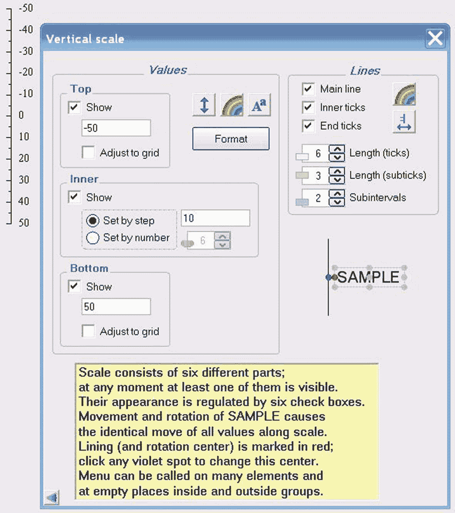

*图 6-4*

*垂直`Scale_Numbers`对象的调谐表单*

这里的`Lines`（线条）组更复杂。除了主线之外，还有显示在主线一侧的主刻度线和子刻度线。三个不同的部分——主线、主刻度线和子刻度线——是独立显示的，因此有三个复选框来控制它们的显示。相邻主刻度线之间的子区间数量可以更改；子刻度线的数量比子区间数量少一。主刻度线和子刻度线的长度可单独调节，但在这两者中，主刻度线的长度总是更大。主线、主刻度线和子刻度线始终以同一种颜色显示，并且所有线条的宽度始终为一个像素。

`Values`（数值）组是导致此调谐表单复杂性的主要原因。出于绘图（和调谐）的目的，所有数字被分为三组，其中两组代表边界值，第三组代表所有内部值。这三个组的数字是独立调谐的；它们可以以任意组合出现，也可以完全不出现；这由三个复选框控制。

内部值的数量由相邻数值之间的步长决定，或者由与数值对应的所需内部线条数量决定。在后一种情况下，程序要么使用声明的数量，要么略微增加该数量以提供更规整的步长，这对于视觉评估更有利。（如果你不喜欢对刻度线数量提出的更改，可以设置所需的步长值。）

如果边界上的值与最近的内部值略有差异，则屏幕上的两个数字可能会重叠，从而难以阅读。一种解决方案是关闭边界值的显示。另一种解决方案是将边界值调整到网格步长；可以对两个端点值独立进行此操作。

`Values`组内的几个按钮允许你更改显示数字的字体和颜色、交换端点值，以及更改所有数字的显示格式。

条形图上的菜单允许你将选中的对象按一个方向或另一个方向旋转 90 度。每次旋转都会将垂直刻度转换为水平刻度，反之亦然。这种带文本刻度的转换只需要对其调谐表单进行最小的更改，即只需更改`Lines`组中辅助线的方向（参见图 6-3）。带数字刻度的调谐表单则需要更多更改，因为现在需要调谐的是左值和右值，而不是顶部和底部的值。此外，设置一个良好的调谐表单默认视图也更为适宜，这样不会让用户感到困惑，并能清晰地指示被调谐刻度的方向。因此，水平数字刻度的调谐表单具有相同的一组元素，但默认视图不同（图 6-5）。

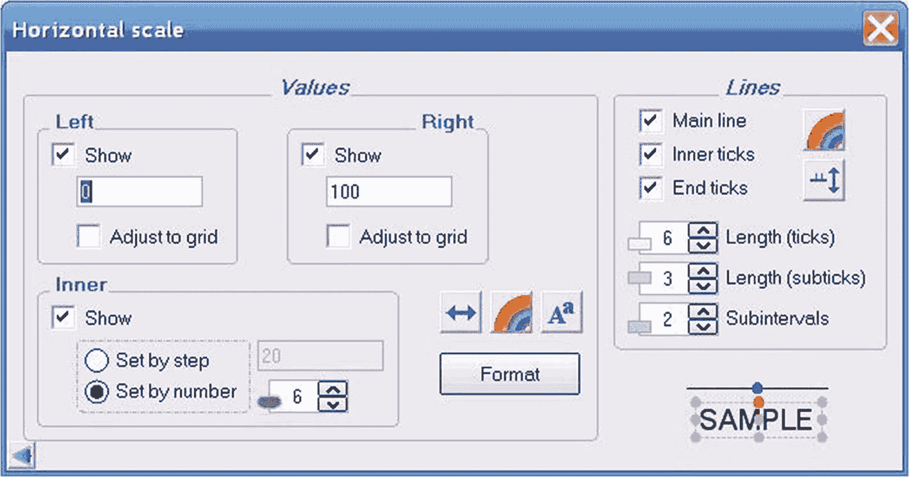

*图 6-5*

*水平`Scale_Numbers`对象的调谐表单*

`Lines`组内的三个复选框控制线条的显示；`Values`组内的三个`Show`复选框控制沿刻度数字的显示。将这六个复选框切换为 ON/OFF，可以选择你希望看到的精确部分。唯一被禁止的组合是所有六个复选框都处于 OFF 模式，因此表单不允许你这样操作；其他所有组合都是可能的。

调谐表单的默认视图（图 6-4 和 6-5）看起来有点复杂，并占据了宝贵的屏幕空间的一大部分，但用户并非被迫只处理这些表单的默认视图。假设你设置了首选的主刻度线和子刻度线长度、首选的子区间数量以及沿刻度数字所需的显示外观。如果你在近期内不需要调谐这些参数，你可以隐藏调谐表单的许多元素，只将你真正需要的元素留在视图中。图 6-6 中的红色椭圆标记了可以通过其菜单隐藏的元素。我想强调一下，你并非必须隐藏全部或全部不隐藏；你可以隐藏这 13 个标记元素中的任意组合，但如果你将它们全部隐藏，那么原始调谐表单（图 6-5）可以缩小为更小的东西（图 6-7）。该调谐表单是根据用户驱动应用程序的标准规则设计的。如果有任何内容被隐藏，可以通过上一级菜单将其显示出来，因此`Lines`组的元素可以通过该组的菜单显示。`Left`（左）、`Inner`（内部）和`Right`（右）组的元素可以通过相应组的菜单显示，而`Values`组的所有元素则可以通过其菜单显示。

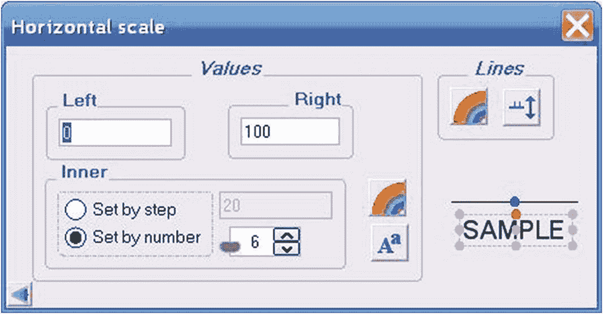

*图 6-7*

*同一调谐表单的不同视图*

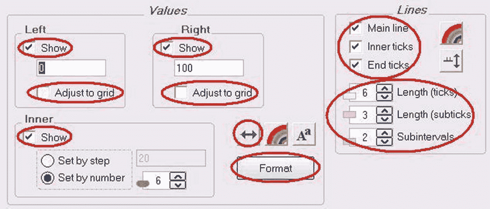

*图 6-6*

*标记的元素可以通过其菜单命令隐藏。*

我们已经完成了两种刻度尺的调优，现在可以来看条形图主体区域的调优（图 6-8）。令人惊讶的是，它看起来可能比某些刻度尺的调优更简单。

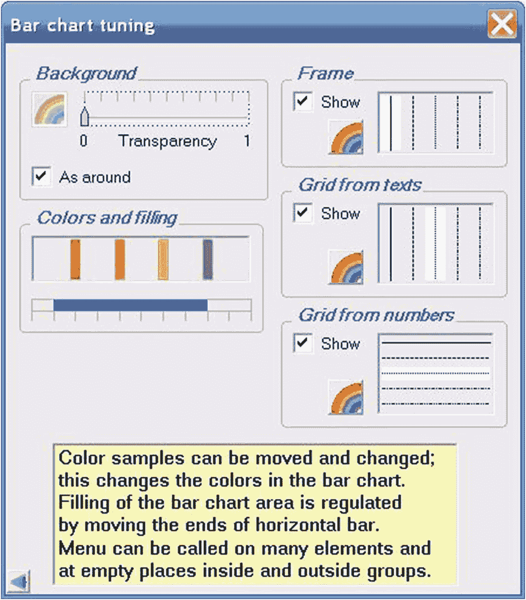

**图 6-8** *条形图主体区域调优*

-   绘图区的框架以及来自两个刻度尺的网格是独立但以类似方式调优的。每个元素都可以选择显示或不显示；如果显示，则可以选取线的颜色和样式。网格线的位置由刻度尺上刻度线的位置决定，但刻度线和网格的外观是独立的，并且通过不同的调优表单进行调节。

-   背景的调优采用标准方式，与之前为不同分组和控件展示的方式相同（图 4-2、5-9 和 5-30）。

-   “颜色与填充”分组允许您调节主体区域被条形填充的方式，并选择条形颜色。该分组内部水平条形的左右端点可以移动，从而改变条形图每个分段的填充。作为一名研究人员，我更喜欢分段之间留有一定间距的条形图，所以我总是将这个水平条形的端点从极端位置向中心移动。是移动一端还是两端，以及移动多少，通常取决于特定条形图的填充情况。

该分组内的另一个区域包含条形颜色的样本。样本数量不能少于数据集数量，但可以更多；颜色从左端开始使用。可以通过在该区域内直接移动样本，并将抓住的样本拖放到其他位置来改变顺序。也可以更改任何样本的颜色（从而更改关联条形的颜色）。为此，您需要在样本上调用菜单。同样的菜单允许您删除已按下的样本，但前提是样本数量超过条形图中的数据集数量。要添加更多颜色，请在样本区域内的空白位置调用菜单。如果您想在不改变现有顺序的情况下添加更多颜色，请在最后一个样本的右侧调用菜单来添加新颜色。

调优表单处理可见性参数，从而改变屏幕上对象的外观；其他参数则通过菜单命令来更改。每种使用的元素类别都有对应的菜单，空白位置也有菜单（图 6-9d）。绘图区的菜单拥有最多的命令（图 6-9a）。刻度尺属于不同的类别，但它们的菜单是相同的（图 6-9b）。最简单的元素——注释——拥有最简单的菜单（图 6-9c）。可以在信息区域调用的菜单只包含一条启动该区域调优的命令，因此我决定甚至不展示这个极小的菜单。

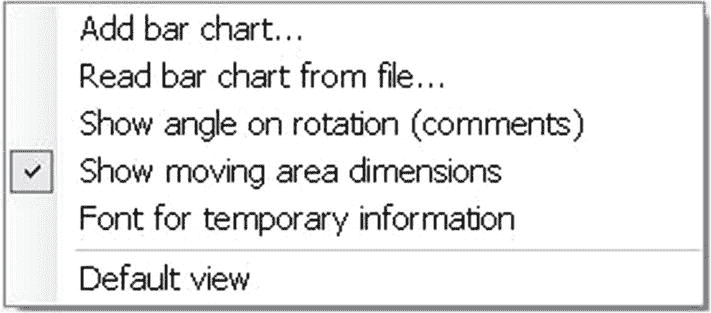

**图 6-9d** *空白位置菜单*

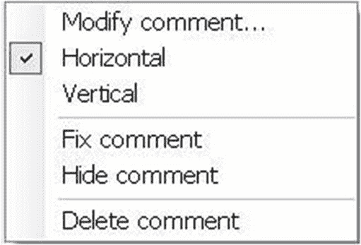

**图 6-9c** *注释菜单*

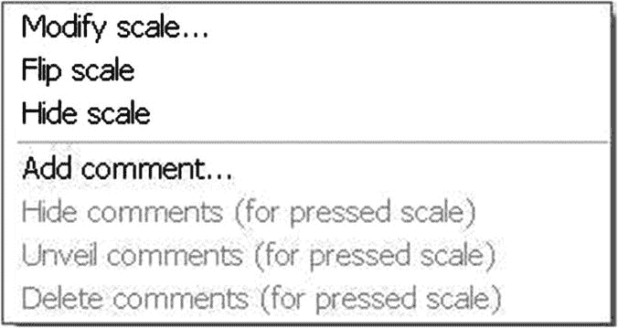

**图 6-9b** *刻度尺菜单*

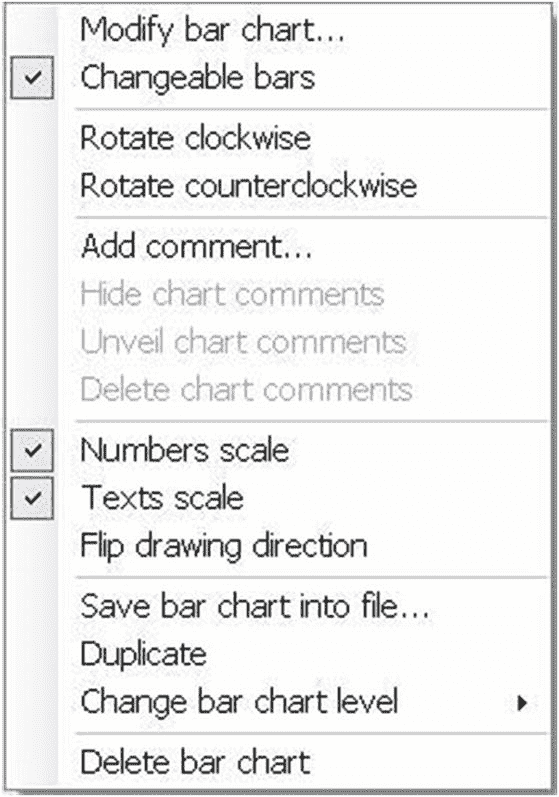

**图 6-9a** *绘图区菜单*

对于经济和金融程序的专业人员来说，本示例中使用的一些菜单命令可能看起来有点奇怪，这些命令的出现有两个原因。首先，我更熟悉科学应用的需求，许多命令就是直接从那个领域复制过来的。我在为科学/工程应用开发类系统上花了很多时间。这些类将在下一章中演示，但绘制`Y(x)`函数和条形图之间存在很多相似性，因此一些参数和相关命令从一个领域复制到了另一个领域。其次，我使用当前示例来检查所涉及的类及其特性。

# 注释上的菜单

注释上的菜单会调用一个标准调谐表单来修改被按下的注释。该菜单还允许您固定/取消固定被按下的注释，隐藏它，或删除它。每个注释都可以通过同一个菜单的命令进行固定或取消固定，但对于已固定的注释，第二个命令的文本会有所不同。无法在隐藏元素上调用菜单，因此隐藏的注释可以通过其父级菜单（可以是刻度尺或条形图主体区域）来显示。

## 刻度尺上的菜单

刻度尺上的菜单允许您隐藏、显示和删除注释；这三个命令会同时应用于与该刻度尺关联的所有注释。对于带有数字的刻度尺，数字和注释之间存在明显区别；对于带有文本的刻度尺，区别不那么明显，因为所有内容都显示为文本，并且可以使用相同的字体和颜色。区别在于调谐和移动。文本在刻度尺调谐表单中同步调谐和移动，而注释则通过另一个调谐表单单独修改。当点击“添加注释”命令时，会使用相同的表单。

“翻转刻度尺”命令存在一个有趣的情况。想象一条平行于刻度尺主线并穿过绘图区中心点的直线。“翻转刻度尺”命令必须将刻度尺镜像到这条线的另一侧。对于刻度尺线和刻度线来说，这很容易实现，但文本（和数字）会出现问题。还记得您试图理解展窗中镜像文本的尝试吗？我们没有学过阅读这类文本，并且当刻度尺翻转时，我们期望看到正常的文本，但这样某些参数就必须改变。当刻度尺翻转时，文本的原始矩形区域被镜像，文本会以使其可读的方式绘制在新的矩形内。对于任何刻度尺翻转，所有文本的角度和基准点都会改变（图 `6-10` 和 `6-11`）。对于严格水平的文本，其角度不变，但在任何其他情况下，阅读方向（从上到下或从下到上）会变为相反方向。

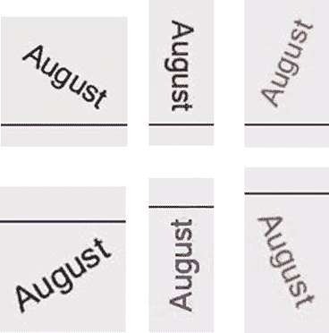

**图 `6-11`** *水平刻度尺的翻转*


**图 `6-10`** *垂直刻度尺的翻转*

## 条形图菜单

让我们来看看本例中最大的菜单——条形图菜单（图 `6-9a`）。

| *将条形图保存到文件* | 该命令与另一命令配合使用，后者可在空白区域菜单中找到。当你处理大量图表时，总有可能在某些时刻看到的图表数量超出预期。你不想丢失之后可能需要的图表，因此必须有一种方法，通过将图表保存到某个存储中（可随时从中恢复），从而删除图表。针对这种额外存储和临时从屏幕移除的问题，有不同解决方案；其中一种方案在下一章将要讨论的函数查看器（`Function Viewer`）程序中演示。在当前示例中，演示了一种简单解决方案。使用此命令，被点击的条形图可以保存到一个二进制文件中。不需要的条形图可通过同一菜单的另一命令删除（图 `6-9a`）。之后，可在任意空白位置调用另一个菜单，并通过该菜单中的命令从文件中恢复条形图（图 `6-9d`）。 |
| --- | --- |

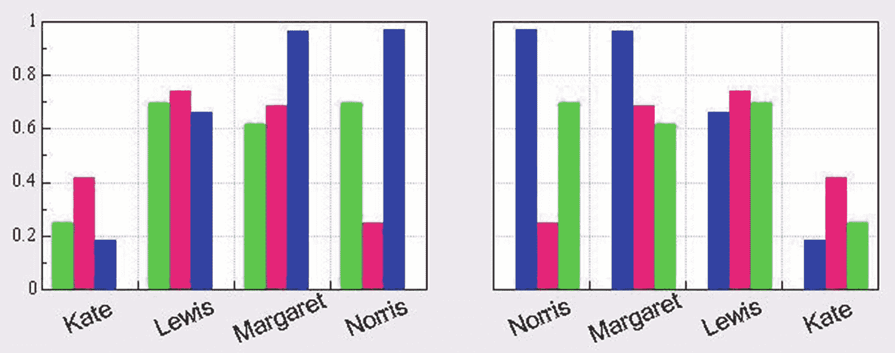

**图 `6-13`** 绘制方向的改变会影响带文本的刻度以及条形图的外观

| *数字刻度*/*文本刻度* | 两个命令用于控制刻度的可见性。 |
| --- | --- |
| *翻转绘制方向* | 图 `6-13` 演示了此命令的效果，它仅影响主绘图区域和带文本的刻度，但影响方式不同。条形图围绕绘图区域的中心线镜像翻转。文本必须与相同的区段关联，因此文本的位置也围绕同一条线镜像翻转，但文本的角度不变。准备此图时，让我有机会演示前一个命令的用法，通过该命令可以隐藏或显示刻度。改变绘制方向不影响数字刻度，因此在翻转绘制方向后，我简单地关闭了它的可视化显示。 |

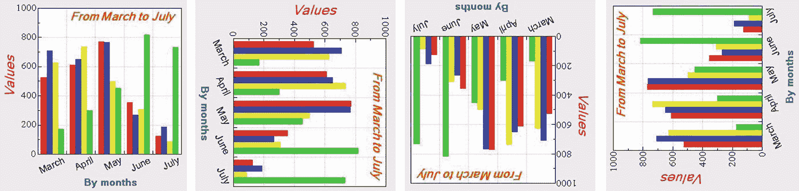

**图 `6-12`** 原始条形图逐步顺时针旋转。通过逆时针旋转可以获得相同的视图，但顺序不同

| *可更改的条形* | 复选框指示条形图是否可以直接更改。稍后我将演示一个辅助表单，在其中组织新的条形图。在该表单中，任何条形都可以更改，并且在此过程中会显示条形的值，因此可以精确设置数值。在当前示例的主表单中，没有包含条形值的指示，尽管添加起来很容易。条形图可以通过绘图区域的任意点在屏幕上移动。有可能出现这种情况：当用户在主矩形区域内按下时，可能会按到某个条形的可移动末端，从而启动不必要的更改。为避免这种情况，用户可以将条形切换为不可更改模式。此命令仅应用于被点击的条形图。如果需要为所有条形图设置相同模式，则必须在空白区域调用的菜单中添加类似命令。 |
| --- | --- |
| *逆时针旋转*/*顺时针旋转* | 两个命令用于旋转条形图。图 `6-12` 演示了顺时针旋转，尽管相同的图形可以重新排序，然后它们将演示逆时针旋转。原始条形图（左图）的文本可以是水平、垂直或倾斜的。在后续的旋转步骤中，部分文本的阅读效果不佳，并且在每一步旋转中，如何调整它们以获得更好的视图是显而易见的。是否可以将这类改进包含到`BarChart_Adh.Rotate()`方法中？可以，这很容易做到，但这将是一个巨大的错误，我不打算这样做。用户驱动应用程序的规则 3 指出：“用户关于移动和调整大小的命令……必须完全按照原样执行；不允许开发人员添加或扩展解释。”如果你想展示在旋转后改进条形图的技巧，可以通过添加另一个命令如“带调整的旋转”来实现。然后用户可以尝试两种变体，比较结果，并选择自己偏好的那种。选择将完全是用户自己的决定，对应用程序的控制权仍将掌握在用户手中。不要试图强迫用户使用他们未曾要求的功能。 |

条形图菜单上的其余命令不言自明，无需解释。让我们来看一下空白位置菜单中的一些命令（图 `6-9d`）。

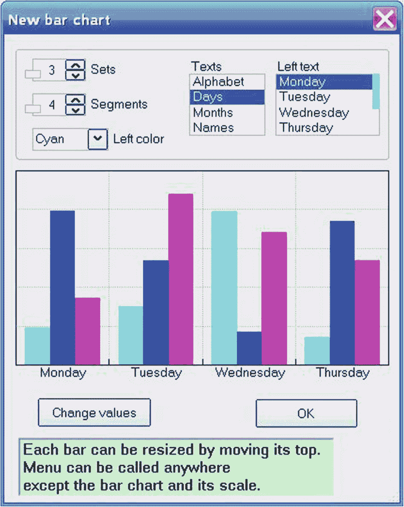

**图 `6-15`** 准备新的条形图

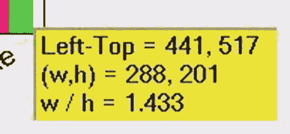

**图 `6-14`** 关于条形图区域当前尺寸和位置的临时信息

| *显示移动区域尺寸* | 用户可以移动和调整条形图的大小；在此过程中，任何区域的确切尺寸和位置并不重要。但正如我之前提到的，此示例中的某些命令是直接从科学应用程序中复制而来的，因此对这些命令的需求也源于此。科学家们经常将屏幕图像作为插图放入他们的文章中。为了获得所需图形的最佳视图，他们希望绘图区域具有特定的尺寸或比例，或者希望在不产生任何不必要偏移的情况下，将多个相同尺寸的图表并排放置。有些人看不到微小的偏移，而另一些人则能轻易捕捉到哪怕一个像素的偏移并因此感到烦恼。为了便于准备图形，我添加了临时显示当前正在移动或调整大小的绘图区域尺寸的功能（图 `6-14`）。在应用程序的正常使用中，并不需要这些信息，因此其显示通过菜单命令进行控制。 |
| --- | --- |
| *临时信息的字体* | 此命令是对上一个命令的补充。每当用户想要更改某个对象的字体时，就在该对象上调用菜单，菜单中的相应命令允许使用标准字体选择对话框。在按下鼠标选择条形图的瞬间，会显示一个包含尺寸和位置信息的小区域，当鼠标释放时，该区域消失。因此，无法按下这个临时信息来更改其字体。空白处的菜单命令允许您为此临时信息选择字体，但选择的结果仅在下次按下条形图时才能看到。 |
| *添加条形图* | 此命令允许您组织一个新的条形图，这将在辅助窗口 `Form_NewBarChart.cs` 中完成（图 `6-15`）。此窗口允许您设置主要的重要参数：数据集数量、分段数量以及所有条形的值。任何条形的值都可以通过移动其顶部来更改；在此移动过程中，`[0, 1]` 范围内的当前值会显示在移动线条旁边的一个小区域内。刻度的文本选择有限。仅使用标准颜色，并且可以选择第一个颜色。 |

新条形图是否不需要拥有完整调谐就足够了呢？是的，因为这是一个辅助窗口，用于准备所需条形图的草图。当您单击“确定”按钮时，主窗口中会出现一个新的条形图，新条形图可以像其他任何条形图一样进行调谐。

出于同样的原因，此辅助窗口中的条形图区域和唯一可见的刻度是不可调谐的，而此窗口中的所有其他元素都可以修改。

### 饼图

- 文件：`Form_PieChart.cs`
- 菜单位置：复杂对象 ➤ 饼图

在第 3 章中，我们已经讨论了带两种注释类型的圆形。一种注释类型与整个圆形关联；此类注释仅对圆形的大小调整做出反应，忽略圆形的旋转，而它们在屏幕上的移动不受任何限制。圆形被划分为扇区，其他注释则与这些扇区关联。该类注释中的每个元素都放置在关联扇区的角平分线上，并且只能沿着该线移动。当前部分讨论的 `PieChart_Adh` 类的元素具有类似的设计。对扇区注释的这种移动限制并非强制性的；在我的另一本书[2]中，我演示了 `PieChart` 类，其中扇区注释可以在屏幕内自由移动。当前示例的饼图（图 `6-16`）与第 3 章中讨论的带注释的圆形类似，但它们在扇区注释方面的行为略有不同。

# 饼图对象

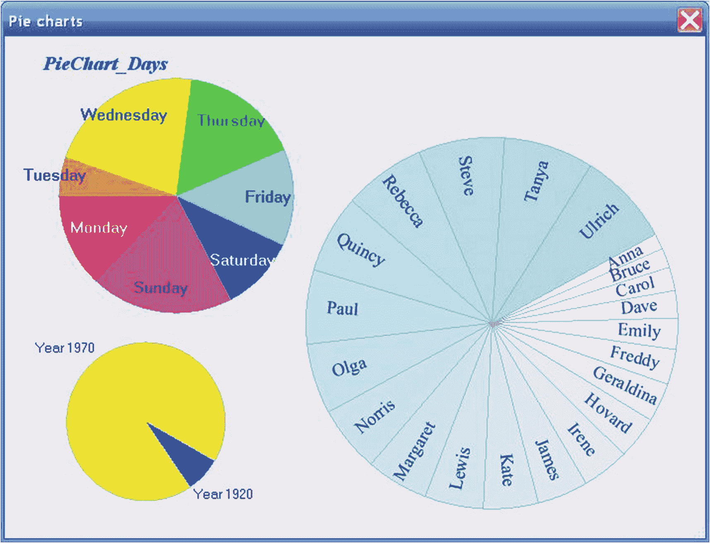

图 6-16 `PieChart_Adh` 类的对象

```csharp
public class PieChart_Adh : GraphicalObject
{
    PointF m_center;
    float m_radius;
    DrawingDirection dirDrawing;
    bool bResizable, bRotatable, bMovablePartitions;
    List<Color> m_clrs = new List<Color>();      // 每个扇区一种颜色
    CommentToPieChartSector[] commentsForSectors;
    List<CommentToCircle> commentsForCircle = new List<CommentToCircle>();
}
```

饼图是一个复杂对象，由主导的圆形部分和从属的两种不同类型注释组成。默认情况下，主要部分是可调整大小、可旋转且分区可移动的，但所有这些属性都可以通过菜单命令轻松调节。无论注释类型如何，每个注释都可以围绕其中心点旋转。

## 注释类型与操作

### 通用注释

与整个圆形关联的注释称为通用注释。这些是 `CommentToCircle` 类的元素。任何饼图都可以关联任意数量的通用注释。当圆形移动时，此类注释会同步移动；当圆形调整大小时，它会保持其相对位置；并且它会忽略圆形的旋转。

通用注释可以被修改、隐藏或删除。

### 扇区注释

`CommentToPieChartSector` 类的注释与扇区关联；每个扇区都有一个此类注释。此类注释的中心点位于关联扇区的角平分线上，并且注释只能沿此线移动。扇区注释不会同步移动，但可以通过使用菜单命令将它们放置在相同的距离上。

扇区注释可以隐藏但不能删除，因为此类注释的数量始终等于扇区的数量。这种类型的注释可以通过多种不同的方式显示。

两种类型的注释都是纯文本字符串，因此只能更改其字体、颜色和文本内容。这些操作在一个小巧的辅助窗口中进行，该窗口对两种注释类型都是相同的。从视觉上看，这两种类型的注释是无法区分的，但它们的菜单中有不同的命令集。

饼图关联着某个通过扇区分配的值，因此每个扇区都与一个较小的值以及占总额的百分比相关联。扇区上的注释可以包含纯文本、值和百分比的组合；有选项可以将它们显示在一行或两行中。所有变体如图 6-17 所示，从带有注释“January”的黄色扇区开始，按逆时针方向排列。

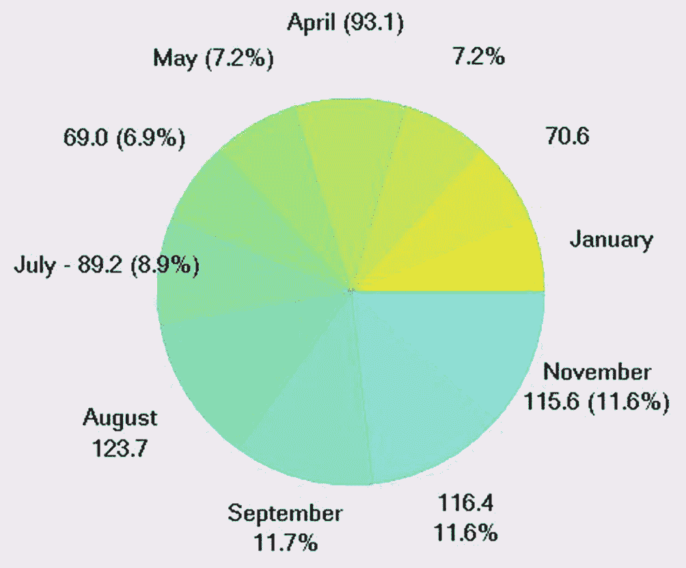

图 6-17 扇区注释的不同视图

虽然一般评论的数量没有限制，但我怀疑此类评论不会超过一个。另一方面，扇区评论的数量至少是两个（扇区的最小数量），但也可能非常大。每条评论都可以单独修改，但用户也有可能希望将某个扇区评论的参数传播到其所有同级评论；这可以通过菜单完成。

一般评论和扇区评论看起来相似；它们都可以移动和旋转，但为了正确组织所有这些移动，只需在 `OnMouseDown()` 方法中提及它们的某个类。为什么？一般评论属于 `CommentToCircle` 类，该类派生自 `TextRotatable` 类。移动器知道如何移动和旋转该类的元素，无需任何指令。另一方面，扇区评论属于 `CommentToPieChartSector` 类，该类并非派生自 `TextRotatable` 类，因此必须调用 `CommentToPieChartSector.Press()` 方法。

```csharp
private void OnMouseDown(object sender, MouseEventArgs e)
{
    ptMouse_Down = e.Location;
    if (mover.Catch(e.Location, e.Button))
    {
        GraphicalObject grobj = mover.CaughtSource;
        // ... ...
        else if (grobj is CommentToPieChartSector)
        {
            sectorcmntPressed = grobj as CommentToPieChartSector;
            sectorcmntPressed.Press(e.Location, e.Button, iNode);
        }
        // ... ...
}
```

## 调整与配置

图 6-18 显示了 `PieChart_Adh` 对象的调整表单。颜色可以单独更改，也可以全部一起更改。要进行单独更改，您必须在特定颜色样本上调用菜单，然后使用标准对话框。您还可以通过将任何样本移动到其他位置来更改颜色的顺序。样本只能在带框的矩形区域内移动，但该区域本身大小可调，因此如果您需要处理大量颜色（如图 6-16 中最大的饼图那样），可以轻松放大该区域。样本数量可以大于扇区数量，但实际使用的颜色始终从左侧开始选取。

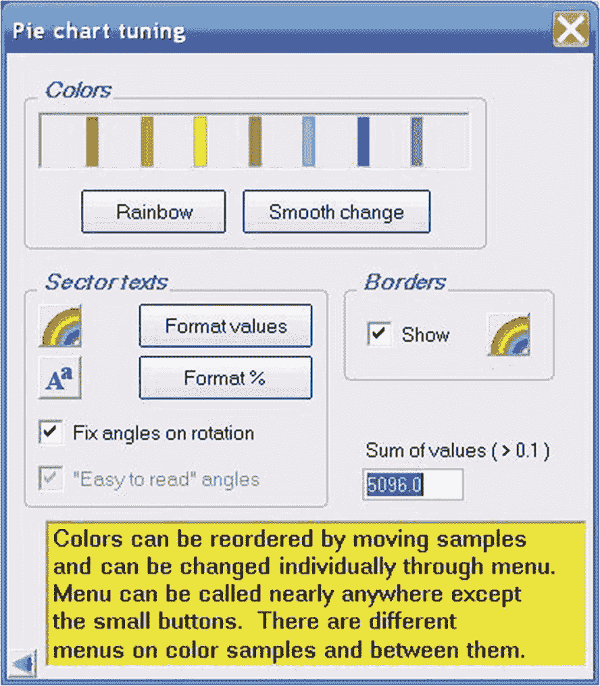

图 6-18 饼图的调整表单

“颜色”组内的两个按钮允许您同时更改所有颜色。一个按钮设置颜色的彩虹顺序；如果需要超过七种颜色，则会重复使用。另一个按钮设置颜色从左样本到右样本的平滑变化。

“扇区文本”组同时处理所有扇区评论。可以为值和百分比选择不同的格式，这些值和百分比会显示在评论中。两个复选框允许您调整扇区评论的角度。

当组织一个新的饼图时，其所有扇区评论都是水平的（图 6-19a），并且位于与圆心相同距离的位置。每条评论都可以单独移动和旋转（图 6-19b）。默认情况下，扇区评论的角度在整个饼图旋转过程中是固定的；图 6-18 中的“旋转时固定角度”复选框显示为选中状态，这会自动禁用另一个复选框。当评论角度在整个旋转过程中固定时，每条评论都保持其角度，无论扇区位置如何（图 6-19c）。因此，图 6-19b 到 6-19c 的变化是当扇区评论的角度固定时旋转的结果。

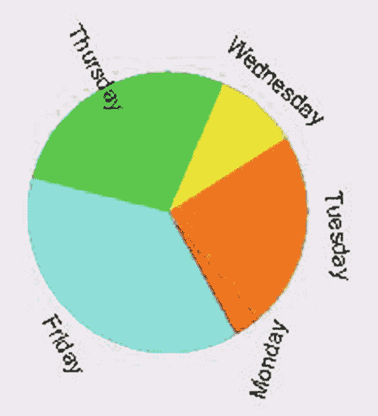

图 6-19d 每个评论的角度随饼图角度同步变化

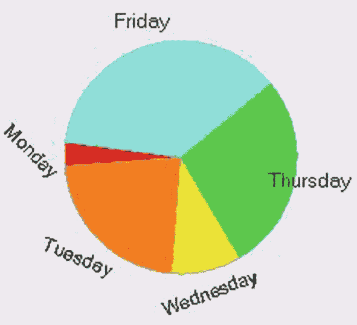

图 6-19c 饼图已旋转

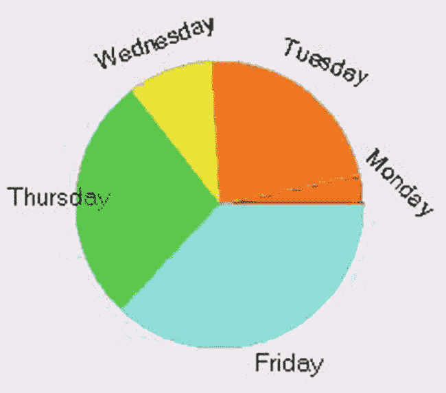

图 6-19b 评论已移动和旋转

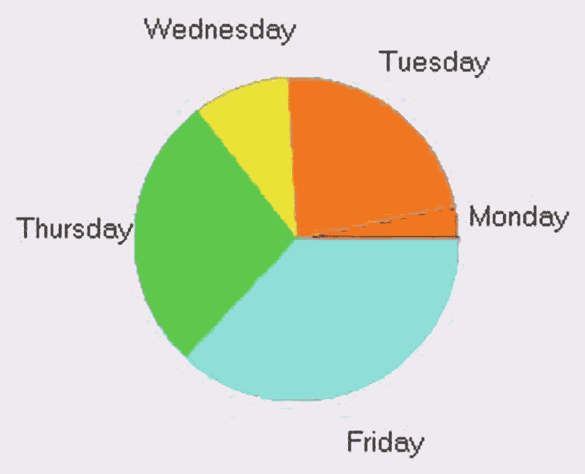

图 6-19a 默认情况下，新饼图的所有扇区评论均为水平

现在将饼图旋转回图 6-19b 所示的状态，打开调整表单，并关闭旋转时固定角度的选项。第二个复选框变为可用，但它仍处于选中状态。现在将饼图旋转到图 6-19d 所示的视图。当评论角度在旋转时未固定时，它会以与饼图角度相同的方式改变，因此 `Thursday` 沿着角平分线显示，而 `Wednesday` 则与角平分线正交。`Monday` 发生了一件有趣的事情。在图 6-19b 中，`Tuesday` 和 `Monday` 的角度几乎相同，而在图 6-19d 中，这两个评论看起来方向几乎相反。这是因为调整表单中的第二个复选框被勾选，这不允许任何评论上下颠倒显示。取消该勾选，评论就会在饼图旋转使其上下颠倒时显示为颠倒。图 6-19b 到 6-19d 的变化是当扇区评论的角度未固定时旋转的结果。

图 6-16 中最大的饼图展示了另一种可以改变扇区评论角度的方法。可以通过在饼图上使用菜单中的“扇区评论朝向中心”命令来获得这种视图。

某些用于调节评论角度的命令可以一起使用，而另一些则不能。例如，“扇区评论朝向中心”命令允许您使用“易于阅读”角度复选框的任何模式，但该命令会自动关闭旋转时固定角度的选项。

新饼图通过一个辅助表单（图 6-20）来组织。该表单允许您设置一些参数，但主要的调整还是在主表单中当新饼图出现时完成的。

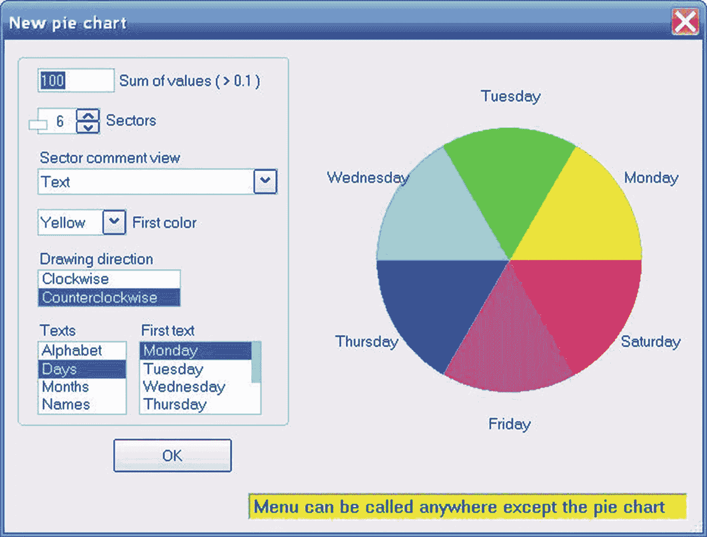

图 6-20 用于准备新饼图的辅助表单

## 结论

本章仅涉及两个众所周知的复杂对象，但通过它们展示了在所有用户驱动应用程序中处理复杂对象的标准方法。

所有参数都需要调整，因此必须有一个与复杂对象不同部分相关联的菜单系统。每类复杂对象都需要一个特殊表单，用户可以在其中组织新元素。可以在准备过程中使用一定程度的调整，因为当组织新对象时，可以在其使用的任何地方对其进行全面调整。
