# 7. 示例

用户驱动的应用程序只能建立在完全可移动性的基础上，因此前几章主要讨论的是设计各种完全不同的可移动对象。我们循序渐进，从最常用形状（矩形、圆形、多边形、环形等）的简单对象，过渡到可包含任意类型对象的复杂对象和组。我认为前几章的示例已经充分展示了如何将截然不同的对象转变为可移动对象，以及如何在新类型的应用程序中使用它们。几乎所有之前的示例都以展示所提算法的最重要特性及其实现方式为目的而开发。

本章不再讨论可移动性尚未涉及的方面，而是聚焦于具有明确用途的真实用户驱动应用程序的整体设计。以下示例最初是作为独立应用程序开发的，后来才被收录为本书配套程序的一部分。

## 计算器

我只有在极少数需要计算两个大数相除，且懒得用纸笔计算时，才会使用标准的 Windows 计算器。也许是因为我很少用这个程序，但每次使用时，我都很难找到印有正确数字的按钮，因为这些按钮的位置绝对不像我会作为设计师摆放的那样。我从小（并且至今仍）被教导从左到右、从上到下阅读和书写，考虑到从 0 到 9 的数字顺序几个世纪以来从未改变，而计算器的设计者也受教于同样的规则，我实在搞不懂为什么 Windows 计算器中的相同数字却是从底部开始向上排列的（图 7-1a）。这种布局背后肯定有某种伟大的想法，但我无法理解。每次使用这个程序，我都要花额外的时间寻找需要的按键。最终找到它们，得出结果，然后就会忘记这次搜索，直到下次再犯。

多年前，在我将普通控件纳入我的可移动性算法后，我一直在思考一个能展示这部分算法的好例子。这时我想到了计算器程序，它是一个绝佳的演示候选，因为它完全由控件构建，并且每个人都熟悉它。我的第一个计算器版本功能有限，但重现了原始程序的界面，并完美展示了所有元素的可移动性（图 7-1）。

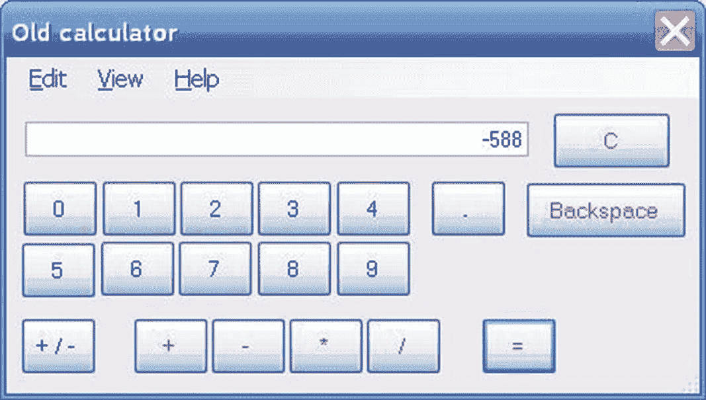

图 7-1b

可移动性允许每位用户组织自己偏好的视图

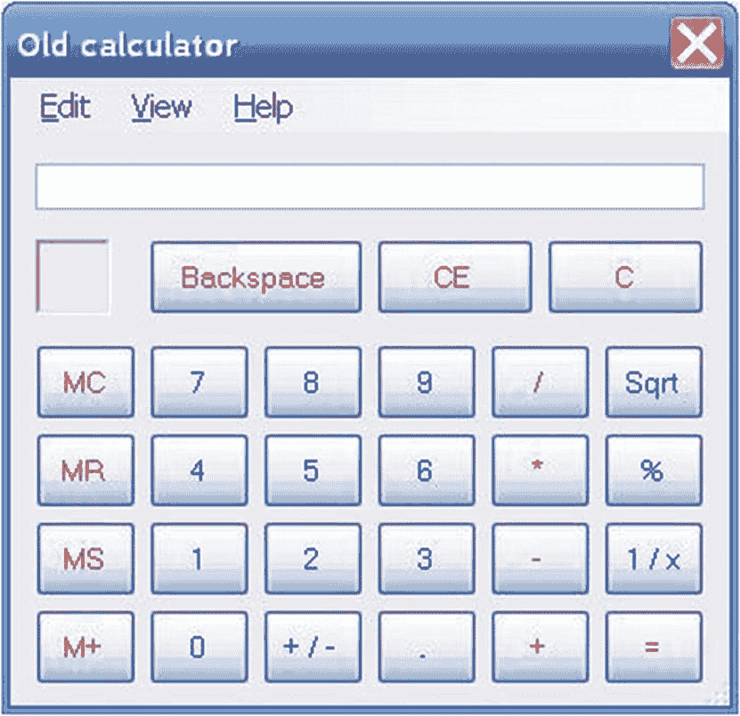

图 7-1a

原始计算器程序的默认视图

我本无意再用这个计算器做其他事，但几年后，在与一位同事交谈时，我听到了抱怨：这位同事视力不佳，使用标准计算器程序时遇到很大麻烦，因为即便数位专家共同努力，也未能找到任何方法来增大该应用程序使用的字体。于是，我坐下来开发了另一个同事能用的计算器。由于不是为自己开发，这个程序必须能作为一个具有运算和功能的普通计算器运行。当然，改变字体并非我在该程序中允许用户做的唯一事情；它是按照用户驱动应用程序的所有规则来设计的。

我的第二个计算器版本外观与图 7-2 所示相同；只是简短信息的文本略有不同，因为我的第二个计算器版本仍然使用普通控件设计。又过了几年，在下一个版本的计算器中，不再保留任何普通控件。图 7-2 展示的就是这个程序，也是我现在想讨论的程序。


图 7-2

最新计算器的默认视图

*   文件：`Form_Calculator.cs`

*   菜单位置：Applications ➤ Calculator

我无意设计一个能与 Windows 同类程序竞争的程序。这个新计算器是为特定个人使用的；此人从未使用过原始程序的存储操作，所以我的程序中没有用于存储操作的按钮。

在进一步说明之前，有一点需要注意：在下文中，术语`所有元素`指的是除信息元素之外的所有元素。

### 排版后内容

新应用程序的所有元素中，除了两个之外，其余都是 `Button_Text` 类的按钮。这些按钮被分为四组；在图 7-2 中，它们通过不同的文本颜色被轻易区分。

*   带有数字的按钮文本显示为蓝色。从数学角度来看，小数点和符号绝对不是数字，但它们在书写数字时被用作记法的一部分，因此在这个程序中，这两个按钮被归入`数字`组。

```
Button_Text btn_0, btn_1, btn_2, btn_3, btn_4, btn_5, btn_6, btn_7, btn_8, btn_9, btnSign, btnDot;                   // 数字
```

*   带有运算符号的按钮显示为红色。

```
Button_Text btnPlus, btnMinus, btnMultiply, btnDivide, btnDegree, btnEqual;
```

*   `函数`按钮的文本显示为紫色。我可以很容易地添加更多函数，但为我设计这个程序的人说这组函数已经够用了。你可以在此程序中添加更多函数，但请仔细检查代码，并在使用此组的所有位置进行修改。

```
Button_Text btnLn, btnLog, btnExp, btnSin, btnCos,
btnTg, btnInverse, btnSqrt;
```

*   三个绿色文本的按钮被归为一组`清除器`，因为它们用于删除部分或全部已准备的数据。

```
Button_Text btnBackspace, btnClearAll, btnClearEdit;
```

为了更好地展示结果，这里有两个辅助区域；一个用于显示当前数值，另一个用于显示整个表达式。

```
Label_GR labelValue, labelExpression;
```

计算器旨在实现其主要目的，但这是一个用户驱动的应用程序，具备移动、调整大小、调优、保存和恢复等所有功能。让我们从移动开始。

移动可以应用于单个对象、三个预定义组（数字、运算和函数）的元素以及临时组元素。元素的单独移动以标准方式组织：用左键按下它，然后移动到另一个位置。

数字、运算或函数组（图 7-3）可以通过菜单命令来组织；我稍后会介绍菜单。因此，组织好的“标准”组只包含该预定义集合中的元素，不包含其他任何元素，即使当调用该组时，有其它对象恰好位于框架内。因此，函数组始终恰好包含八个具有函数名称的按钮；图 7-3 中框架内的另外两个元素（一个带有数字，另一个带有等号）不属于此组。

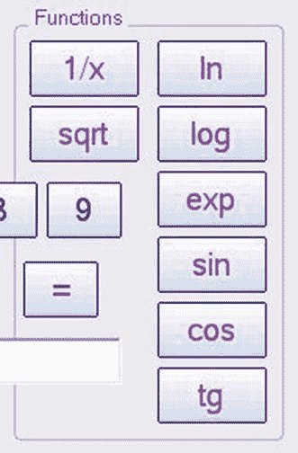

图 7-3

函数组包含八个按钮

临时组可以包含任意元素集合。在任何空白位置按下左键，并在不释放按钮的情况下移动鼠标光标。在此移动过程中，您将看到一个矩形框架；该矩形的两个对角分别是初始按下点和当前鼠标位置。如果在释放鼠标时，该矩形内包含多于一个对象，则会组织一个由这些圆角对象组成的临时组。例如，图 7-4 中的临时组包含数字组中的八个按钮、运算组中的三个按钮、清除器组中的一个按钮以及一个标签。

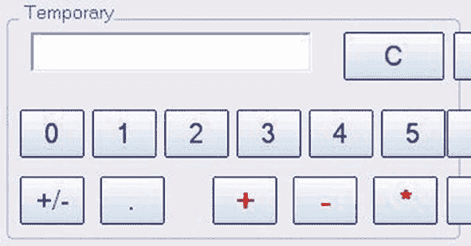

图 7-4

临时组

任何组，无论是预定义组还是临时组，都属于 `Group_ArbitraryElements` 类，因此可以通过其内部的任何点进行移动。框架会根据内部元素的任何变化调整其大小和位置。我想说的是，在计算器中组织的任何组都类似于临时组，仅用于移动某些元素集合的目的；这就是为什么没有修改组的命令。

在 `Form_Calculator.cs` 文件中（图 7-2），排除信息区域后，共有 31 个元素。这 31 个对象被分配到两个 `List` 中。这些 `List` 的名称清楚地表明，其中一个包含当前存在的组中的所有元素；其余元素则进入另一个 `List`。

```
List elemsInGroup = new List ();
List elemsSingle = new List ();
```

元素在两个 `List` 之间的分配，要么在调用“设置”菜单中适当的命令时（图 7-5）进行，要么在视图内绘制矩形后释放鼠标时进行。在这两种情况下，都会调用 `SetGroup()` 方法，但参数不同。

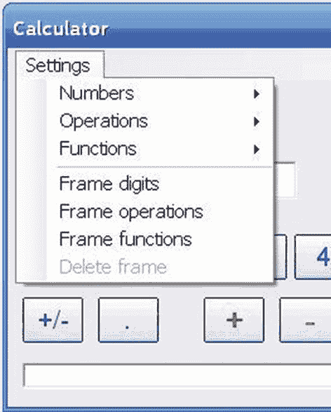

图 7-5

“设置”菜单

当调用菜单命令并命令标记某个预定义组时，`SetGroup()` 方法会获取一个参数，即要框选的特定元素类型。作为初步步骤，所有元素会按预定顺序被包含到 `elemsSingle` 中，同时清空 `elemsInGroup`。

## 元素默认排序

```csharp
private void ElemsDefaultOrder ()
{
elemsSingle .Clear ();
elemsSingle .Add (new CalcElem (labelValue));
elemsSingle .Add (
new CalcElem (labelExpression));
... ...
elemsInGroup .Clear ();
}
```

现在，指定类型的所有元素都会从 `elemsSingle` 移动到 `elemsInGroup`。

## 按类型分组

```csharp
private void SetGroup (CalcElemType elem_type)
{
ElemsDefaultOrder ();
for (int i = elemsSingle .Count - 1; i >= 0; i--)
{
if (elemsSingle [i] .ElemType == elem_type)
{
elemsInGroup .Insert (0, elemsSingle [i]);
elemsSingle .RemoveAt (i);
}
}
... ...
```

当鼠标绘制一个矩形然后释放时，会调用另一个版本的 `SetGroup()` 方法。这种情况下，矩形会被用作参数。

```csharp
private void OnMouseUp (object sender, MouseEventArgs e)
{
ptMouse_Up = e .Location;
double fDist = Auxi_Geometry .Distance (ptMouse_Down, ptMouse_Up);
int iObj, iNode;
if (mover .Release (out iObj, out iNode))
{
... ...
}
else
{
if (e .Button == MouseButtons .Left)
{
if (bRectInView)
{
SetGroup (new Rectangle (Math .Min (ptMouse_Down .X, e .X),
Math .Min (ptMouse_Down .Y, e .Y),
Math .Abs (e .X - ptMouse_Down .X),
Math .Abs (e .Y - ptMouse_Down .Y)));
bRectInView = false;
}
}
... ...
```

所有元素都会被检查是否在此矩形内部；任何位于内部的元素都会被包含到 `elemsInGroup` 中。

## 按矩形区域分组

```csharp
private void SetGroup (RectangleF rc)
{
elemsInGroup .Clear ();
group = null;
ElemsDefaultOrder ();
if (MoreThanOneInside (rc))
{
for (int i = elemsSingle .Count - 1; i >= 0; i--)
{
if (rc .Contains (elemsSingle [i] .RectAround))
{
elemsInGroup .Insert (0, elemsSingle [i]);
elemsSingle .RemoveAt (i);
}
}
... ...
```

如果最终 `elemsInGroup` 中有多于一个元素，那么这些元素就构成一个组。

## 组的创建与消除

```csharp
private void SetGroup (CalcElemType elem_type)
{
... ...
RectangleF rcElems = ElemsArea_group ();
PointF ptLT =
new PointF (rcElems .Left - GroupParameters .DefaultFrameSpaces [0],
rcElems .Top - GroupParameters .DefaultFrameSpaces [1]);
group = new Group_ArbitraryElements (this, mover, ptLT, grparams, strTitle,
ElemsArea_group, DrawElems_group,
SynchroMove_group, IntoMover_group);
GroupMovability ();
}
```

一个组可以通过使用“Delete frame”命令（图 7-5）来消除，但组中拥有多个元素的条件还提供了另一种方法。只需绘制一个不包含任何元素或只包含单个元素的新矩形即可。在这些情况下，都不会组织成组，但如果此时有某个组显示出来，它将会消失。甚至不需要绘制矩形；只需在任意空白位置单击左键就足够了。

## 预定义组的标准定位

还有另一种重新排列元素位置的方法，但此方法仅适用于三个预定义的组。图 7-6 中的子菜单显示了可应用于 Numbers 组的三个命令；当选择 Operations 或 Functions 菜单时，会打开相同的子菜单。

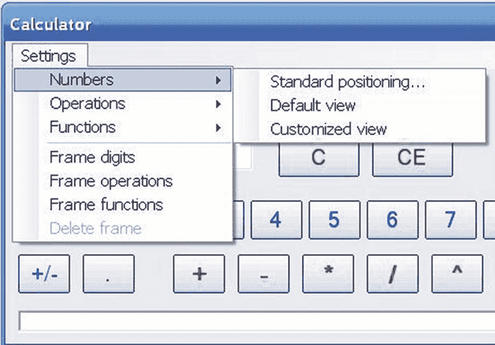

Figure 7-6

`Standard positioning`菜单命令会打开一个辅助窗口，允许您为该预定义组选择一些标准元素定位。

`Settings ➤ Numbers ➤ Standard positioning`命令会打开`Form_BtnPlaces_Numbers.cs`文件（图 7-7a）；此窗口允许您为 Numbers 组选择标准元素定位。Functions 和 Operations 组也有类似的窗口来选择它们的标准视图，但这些组的元素更少，可供选择的组合也更少（图 7-7b 和 7-7c）。

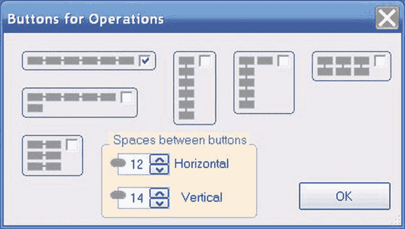

Figure 7-7c

Operations 组标准定位的选择

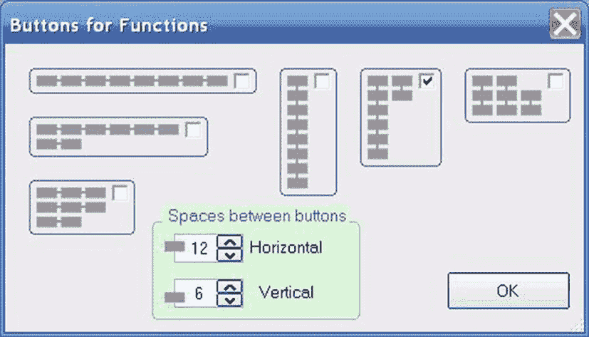

Figure 7-7b

Functions 组标准定位的选择

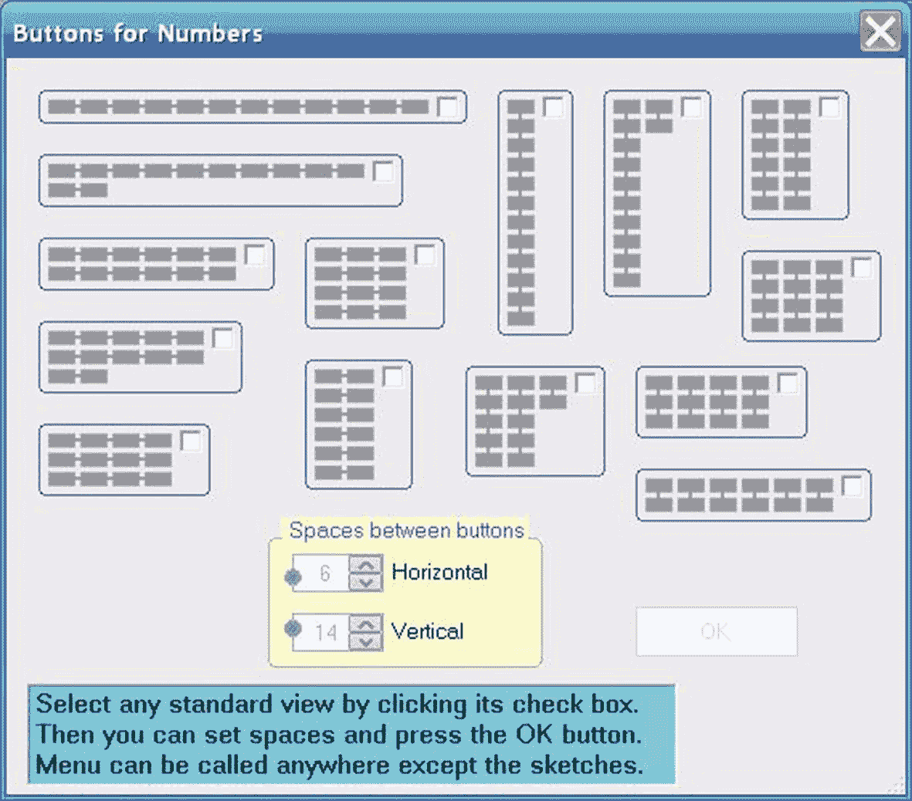

Figure 7-7a

Numbers 组标准定位的选择

每个标准定位变体都显示为一个草图，并带有一个用于选择该变体的附加复选框。每个草图由一组代表实际控件的矩形组成。这些小矩形通过线条连接，这些线条显示了组中元素的顺序。否则，将无法区分元素按行或按列排列的相似变体。当通过单击`OK`按钮关闭`Form_BtnPlaces_Numbers.cs`文件时，Calculator 中 Numbers 组的按钮将根据所选变体进行排列。此时 Number 组是否有框架并不重要；标准定位始终有效。

每个用于选择标准定位的辅助窗口都包含一个小型组，其中包含两个`NumericUpDown_GR`元素；在图 7-7 中，这些组以不同颜色显示。更改这些元素内的值对草图视图没有影响，因此当这些值更改时，辅助窗口内不会有任何反应。但是，如果选择了任何标准定位并按下`OK`按钮，则 Calculator 中组的元素将根据所选情况放置，并且元素之间的距离由这两个值确定。我们继续讨论 Calculator，但之后，我将回到对图 7-7 中草图的讨论。

## 元素大小的批量调整

Calculator 中的任何元素都可以单独调整大小。现在，假设您想要更改 Numbers 组中按钮的大小；您尝试一个按钮并设置合适的大小。接下来您要做什么？您是希望这个按钮与组中的其他按钮保持不同，还是以相同的方式更改 Numbers 组中其他 11 个按钮的大小？您打算一个一个手动操作吗？有些人可能喜欢让按钮的尺寸根据其上的数字稳定增长，或者组织其他非凡的视图（在用户驱动的应用程序中，没有任何限制！），但我感觉大多数用户更倾向于为组内所有按钮设置相同的大小。我还认为，在一个大组中手动逐个标准化按钮不会是一种受欢迎的操作。

当然，有一种更好的方法：一个元素可以作为其所有兄弟元素的样本。变化仅在于选择传播的参数以及决定将所选参数传播到哪个按钮组。

图 7-8 显示了可以在 Numbers 组的任何按钮上调用的菜单。第一个命令打开一个用于调整此类按钮的辅助窗口（参见图 5-5）；第二个命令的子菜单允许您将参数传播到组中的其他按钮；最后一个命令允许您为两个组的按钮设置相同大小。Numbers 和 Operations 组的按钮最初具有相同大小；最后一个命令允许您保持这种大小相等性。

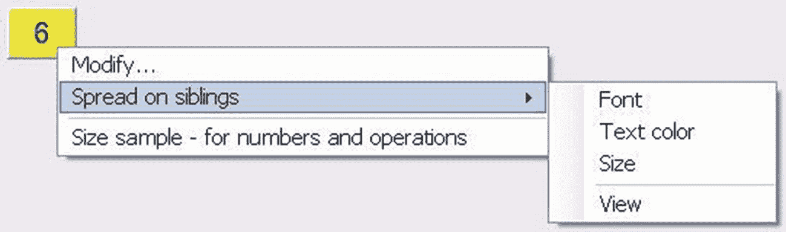

Figure 7-8

Numbers 组按钮上的菜单

几乎相同的菜单可以在 Operations 和 Functions 组的按钮上调用。类似的但更小的菜单可以在 Cleaners 组的按钮上调用。

通常，应用程序由不同类的元素构建而成，并通过分析被点击元素的类来选择相应的菜单。在这个 Calculator 中，仅通过类来选择元素是不够的，因为大多数元素都属于同一个 `Button_Text` 类，因此需要额外的 `ID` 检查。

```csharp
private void OnMouseUp (object sender, MouseEventArgs e)
{
ptMouse_Up = e .Location;
double fDist = Auxi_Geometry .Distance (ptMouse_Down, ptMouse_Up);
int iObj, iNode;
if (mover .Release (out iObj, out iNode))
{
GraphicalObject grobj = mover .ReleasedSource;
long id = grobj .ID;
if (e .Button == MouseButtons .Left)
{
... ...
}
else if (e .Button == MouseButtons .Right && fDist <= 3)
{
if (grobj is Button_Text)
{
if (id == btn_0 .ID || id == btn_1 .ID || id == btn_2 .ID ||
id == btn_3 .ID || id == btn_4 .ID || id == btn_5 .ID ||
id == btn_6 .ID || id == btn_7 .ID || id == btn_8 .ID ||
id == btn_9 .ID || id == btnSign .ID || id == btnDot .ID)
{
ContextMenuStrip = menuOnNumbers;
}
else if (id == btnPlus .ID || id == btnMinus .ID ||
id == btnMultiply .ID || id == btnDivide .ID ||
id == btnDegree .ID || id == btnEqual .ID)
{
ContextMenuStrip = menuOnOperations;
}
else if (id == btnLn .ID || id == btnLog .ID ||
id == btnExp .ID || id == btnSin .ID ||
id == btnCos .ID || id == btnTg .ID ||
id == btnInverse .ID || id == btnSqrt .ID)
{
ContextMenuStrip = menuOnFunctions;
}
else
{
ContextMenuStrip = menuOnCleaners;
}
}
... ...
```

## 可移动性功能

完全可移动性是改变我们使用应用程序方式的功能，但这种可移动性，如同任何其他功能一样，也受用户控制。假设在移动和调整对象大小后，您组织了一个您喜欢的 Calculator 视图，并且不希望因意外移动任何元素而破坏此视图。您可以通过将元素设置为不可移动来保留此视图。在 Calculator 中，可移动性通过空白位置的菜单同步更改所有元素。

```csharp
private void Click_miFixUnfixAll (object sender, EventArgs e)
{
bMovable = !bMovable;
Resizing resize = bMovable ? Resizing .Any : Resizing .None;
for (int i = 0; i < elemsSingle .Count; i++)
{
elemsSingle [i] .Movable = bMovable;
elemsSingle [i] .Resizing = resize;
}
if (group != null)
{
GroupMovability ();
}
info .Movable = bMovable;
info .Resizing = resize;
RenewMover ();
}
```

相同的可移动性声明应用于组内的内部元素、组本身以及组标题。

```csharp
private void GroupMovability ()
{
Resizing resize = bMovable ? Resizing .Any : Resizing .None;
for (int i = 0; i < elemsInGroup .Count; i++)
{
elemsInGroup [i] .Movable = bMovable;
elemsInGroup [i] .Resizing = resize;
}
group .Movable = bMovable;
group .TitleMovable = bMovable;
}
```

## 草图类与变体

现在让我们回到对草图的讨论，这些草图用于三种辅助表单（图 7-7）。这些表单中的所有元素都是可移动的，因此你可以通过任意方式定位这些草图来重新排列它们的视图。不必担心任何操作：表单的默认视图可以随时通过空白位置的菜单进行重置。

每当你开发用户驱动的应用程序时，都需要不时地设计具有一些有趣且非标准特性的可移动对象，因为需求本身就是非标准的。我认为，当你需要思考一些不平凡的问题时，这是编程中最有趣的部分。

这三种表单中的草图属于 `ButtonsSketch` 类。草图是一个图形对象，其大多数字段用于描述其几何形状。

```csharp
public class ButtonsSketch : GraphicalObject
{
    bool bSelected;                     // 草图选中指示器
    Rectangle m_rc;                     // 对象的整个区域
    Rectangle rcSelect;                 // 虚构复选框的矩形
    Point [] ptBtn;                     // 草图上所有“按钮”的位置
    int w = 16;                         // “按钮”的尺寸
    int h = 8;
    int spaceInside = 4;                // “按钮”之间的间距
    int spaceOnBorders = 6;             // 边缘的间距
    int sideSelectSquare = 14;
}
```

每个辅助表单中的草图展示了特定分组按钮的定位变体。每个标准分组都有固定数量的按钮，因此一个辅助表单中的所有草图都展示了相同数量按钮的定位变体；让我们将这个数量称为 N。图 7-9 展示了 N = 12 时的一些变体。

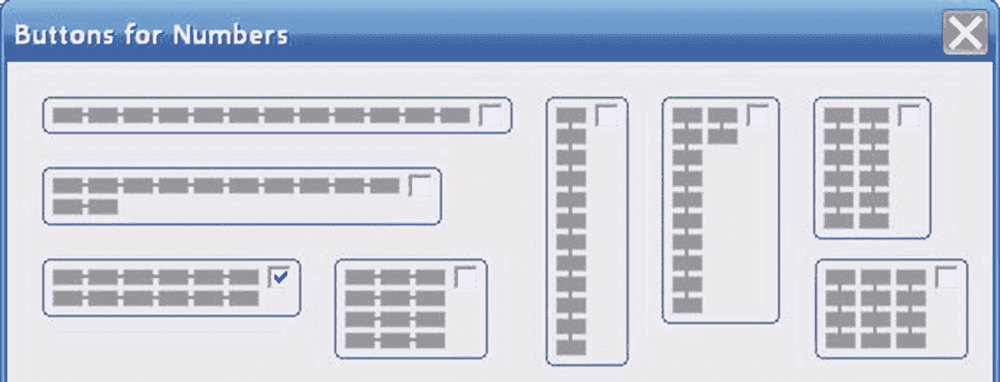

**图 7-9** N = 12 情况下的几个草图

- 每个按钮由一个小的深色矩形表示；其尺寸为 `16*8` 像素（`w * h`）。
- 草图中相邻小矩形之间的距离始终相同，等于 `4` 像素（`spaceInside`）。
- 草图有一个圆角边框；此边框与内部元素之间的距离为 `6` 像素（`spaceOnBorders`）。
- 要选择分组按钮所需的定位，必须标记所需的草图；这通过框架内的一个小复选框来完成。这个特殊复选框占据一个边长为 `14` 像素（`sideSelectSquare`）的矩形。
- 通过行和列来定位 N 个按钮可以有多种方式，但有两种边界变体：所有按钮在一行和所有按钮在一列。为了描述草图上“按钮”的位置，我使用了一个大小为 `N*N` 的矩阵。位置的编号从左上角开始为 `0`，沿上行向右；然后逐行向下；在每一行中，编号从左位置开始，向右递增。因此，第二行的左位置编号为 N；矩阵右下角的位置编号为最大的 `N*N-1`。图 7-9 中的所有草图都是为 `N = 12` 的情况设计的。位置数组是草图初始化的参数之一。接下来你可以看到图 7-9 左下角被选中草图的初始化代码。

```csharp
ButtonsSketch sketch_2rows = new ButtonsSketch (nCode, false,
    new Point (rect .Left, rect .Bottom + 20),
    new int [] { 0, 1, 2, 3, 4, 5, 12, 13, 14, 15, 16, 17 },
    brushBtns);
```

- 草图可能具有相同的行数和列数，但元素的顺序不同。例如，图 7-9 中的两个草图各有四行三列；然而，在左侧示例中，元素需要按行定位，而在另一个示例中，则需要按列定位。为了在视觉上区分这种情况，草图中行或列内的连续元素会用线条连接起来。

```csharp
public void Draw (Graphics grfx)
{
    Pen penConnect = new Pen (brushBtns .Color, 2);
    Auxi_Drawing .CurvedFrame (grfx, m_rc, penFrame);
    for (int i = 0; i < ptBtn .Length; i++)
    {
        if (i > 0)
        {
            if (ptBtn[i].X == ptBtn [i - 1].X || ptBtn[i].Y == ptBtn [i - 1].Y)
            {
                grfx .DrawLine (penConnect,
                    ptBtn [i] .X + w / 2, ptBtn [i] .Y + h / 2,
                    ptBtn [i - 1] .X + w / 2, ptBtn [i - 1] .Y + h / 2);
            }
        }
    }
    ControlPaint .DrawCheckBox (grfx, rcSelect,
        bSelected ? ButtonState .Checked : ButtonState .Normal);
}
```

草图可通过其任何内部点（复选框区域除外）进行移动，因此 `ButtonsSketch` 的覆盖区域由两个矩形节点组成。通常，覆盖复选框矩形（`rcSelect`）的较小节点必须位于负责移动整个对象的较大节点之前。

```csharp
public override void DefineCover ()
{
    CoverNode [] nodes = new CoverNode [] {
        new CoverNode (0, rcSelect, Cursors .Hand),
        new CoverNode (1, m_rc, Cursors .SizeAll) };
    cover = new Cover (nodes);
}
```

仅当按下较大的节点（编号 1）时，才会执行草图移动操作。

```csharp
public override bool MoveNode (...)
{
    bool bRet = false;
    if (catcher == MouseButtons .Left)
    {
        if (i == 1)
        {
            Move (dx, dy);
            bRet = true;
        }
    }
    return (bRet);
}
```

草图是可移动但不可调整大小的。当移动草图时，所有基本点的值会同步改变。

```csharp
public override void Move (int dx, int dy)
{
    m_rc .X += dx;
    m_rc .Y += dy;
    for (int i = 0; i < ptBtn .Length; i++)
    {
        ptBtn [i] .X += dx;
        ptBtn [i] .Y += dy;
    }
    rcSelect .X += dx;
    rcSelect .Y += dy;
}
```

这些就是可以在 `ButtonsSketch` 类中找到的所有有趣之处。与该类相关的另一个重要事项在使用草图的表单中会提及，例如在 `Form_BtnPlaces_Numbers.cs` 中。通过点击显示为复选框的特殊区域来选择所需的草图；这个小的方形区域由 `ButtonsSketch` 类的节点零覆盖。任何时候，一个表单中只能标记一个草图，因此通过一组单选按钮进行选择会更正确，但由于在较早的示例中使用了相同的小方块选择方式，我决定不改变视图。

```csharp
private void OnMouseUp (object sender, MouseEventArgs e)
{
    ptMouse_Up = e .Location;
    double fDist = Auxi_Geometry .Distance (ptMouse_Down, ptMouse_Up);
    int iObject, iNode;
    if (mover .Release (out iObject, out iNode))
    {
        GraphicalObject grobj = mover .ReleasedSource;
        if (e .Button == MouseButtons .Left)
        {
            if (grobj is ButtonsSketch && iNode == 0)
            {
                ButtonsSketch sketch = grobj as ButtonsSketch;
                for (int i = 0; i < sketches .Count; i++)
                {
                    sketches [i] .Selected = false;
                }
                sketch .Selected = true;
                viewSelected = (Calculator_FunctionsGroupView) (sketch .Code);
                places = sketch .Places;
                numericHor .Enabled = true;
                numericVer .Enabled = true;
                btnOK .Enabled = true;
                Invalidate ();
            }
            ...
```

多年前，我设计了第一版 `Calculator`，旨在演示如何将一个完全基于普通控件的程序转变为用户驱动型应用。现在我们有了一个外观相似、功能相同，但仅用图形元素设计的应用。作为用户驱动型应用，这个版本确实好得多，但……我是否必须再找一个使用普通控件的演示程序呢？

## 家谱

本节的主要示例是一个我自己使用的真实应用。自 2013 年初我在一篇文章中首次写到这个示例以来，它便吸引了世界各地程序员的关注。还有其他一些领域（电路设计是其中之一），其设计与家谱类似，因此这些领域的专家也对当前示例产生了兴趣。

在我们到达本节的最终程序——真正的 `Family Tree` 应用之前，还有一整套简单的示例来逐步展示开发过程。在为这个应用编写代码时，我再次想到了霍格本家族的成员，他们能用原始元素构建出极其精巧的装置。^(⁹) 在这个 `Family Tree` 应用中，我只使用直线、矩形和最简洁的注释。在本节结束时，你将看到在如此原始的基础上能开发出怎样的成果。

`Family Tree` 程序是一个标准的用户驱动型应用，用户可以修改其中的所有内容，并且所有这些更改都会被保存和恢复。初步示例中的某些元素可能不会被保存和恢复，但这仅仅是因为我希望辅助示例始终能为我的讲解呈现最佳视图。

你可以轻松地拿起一张纸，开始绘制自己的家谱。多年前，我在祖母的指导下做过这件事，那些旧纸张我至今仍保存着。许多家庭中的很多人都会在某个时刻做同样的事，并且几乎每个人都对家谱应有的样子有自己的理解。家谱可以在许多历史书籍中找到，那些专业绘制的家谱与简单的钢笔或铅笔草图相比，仅在一些细微之处有所不同。任何家谱草图看起来都像图 7-10 所示。不过，这张草图展示的是一个代表三代人的小型简单家谱。为了简化草图和讨论，我省略了通常显示的每个人的出生和死亡信息；你将在后续示例中看到这些信息。


**图 7-10** 一个三代家谱的示例

# 家族树应用中的图形表示与“Bus”系统

即使是一个简单的草图（图 7-10），也能充分说明需要在 `Family Tree` 应用中实现的规则。每个人用一个小的矩形表示，大量信息通过矩形之间的连接关系来展示。通常，一对夫妇被表示为两个紧邻的矩形，它们之间有一条短的直线（*总线*）。如果一对夫妇有孩子，那么从那条中间线上会向下延伸出另一条总线（图 7-11），但下一代的视图取决于孩子的数量。如果只有一个孩子，那么这条线会直接向下延伸到代表这个人的矩形（图 7-12）。如果有多个孩子，那么两代之间会有一条中间总线；这条总线向下连接到每个孩子，并向上连接到其父母之间的线。例如，图 7-13 顶部显示的夫妇有三个孩子。

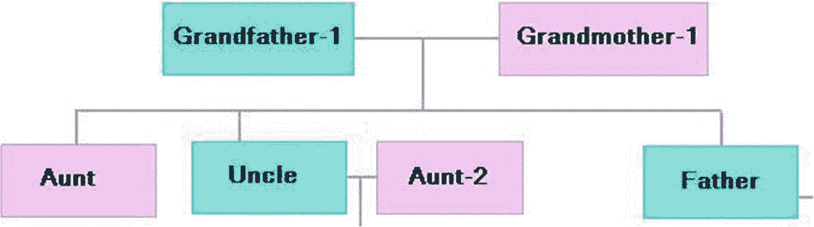

**图 7-13** 有三个孩子的夫妇


**图 7-12** 有一个孩子的夫妇


**图 7-11** 有孩子的夫妇

当绘制仅包含直系亲属的部分时，您通常了解所有必要的信息，不会有任何问题。当尝试绘制家族谱系图的某些外围部分时，可能会出现信息缺失，您要么绘制一些没有任何信息的空白矩形，要么按照已知信息绘制，即使这违反了简单的生物学规则（图 7-14）。

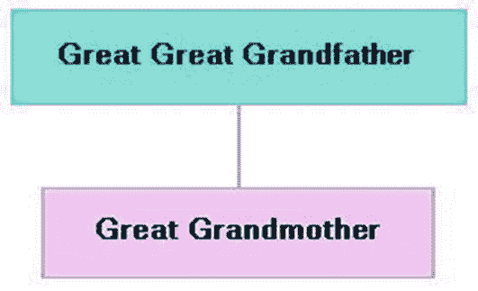

图 7-14

这种情况从生物学角度来说不正确，但没有更多信息

`FamilyTree`程序必须包含简化添加某些标准部分（配偶、父母、一个孩子、多个孩子）过程的命令。作为开发人员，您必须考虑最常需要的变体，并提供一个命令系统来响应此类请求，但没有哪个命令系统能涵盖所有可能的亲属关系变体。这是一种经典情况，用户驱动型应用远优于任何具有固定变体系统的程序，这也是用户驱动型应用可能是唯一真正优秀方案的例子之一。

让我们再看一下图 7-10。如前所述，有矩形和线条，在当前程序中称为 *bus*。有些`bus`连接矩形，有些`bus`连接其他`bus`，还有`bus`连接`bus`和矩形。灵活的`bus`系统允许您绘制任何所需内容，因此我们通过开发一些灵活的`bus`来开始`FamilyTree`应用程序的工作。

```csharp
public class Bus : GraphicalObject
{
    Pen m_pen;
    bool bMarkJoints = true;
    bool bMarkEnds = true;
    Color clrEnds = Color.Red;
    Color clrJoints = Color.White;
    bool bRegisteredWithMover = true;
    bool bUseWarningColor = true;
    Pen penWarn = new Pen(Color.Magenta, 2);
    List<PointF> m_pts = new List<PointF>();
    List<object> headsConnected = new List<object>();
    List<object> tailsConnected = new List<object>();
}
```

任何`bus`都由一组直线段组成，这些线段一个接一个地连接成一条链；每个`bus`中至少有一个线段，但线段数量没有上限。每个线段由两个点描述，前一个线段的终点是下一个线段的起点。因此，`bus`的最小点数是两个，线段数总是比点数少一个。`bus`可以通过点的`List`或仅通过两个点进行初始化；在后一种情况下，`bus`由单个线段组成。

```csharp
public Bus(Form frm, Mover mvr, List<PointF> points, Pen pen)
{
    ... ...
    m_pen = new Pen(pen.Color, pen.Width);
    m_pen.DashStyle = pen.DashStyle;
    m_pts = points;
    Movable = false;
}
```

`bus`的覆盖物（cover）由`List`中所有点上的小圆形节点和另一组覆盖线段的条状节点组成。

```csharp
public override void DefineCover()
{
    int rad = Math.Max(4, Convert.ToInt32(Width / 2));
    int nCircles = pts.Count;
    int nStrips = pts.Count - 1;
    CoverNode[] nodes = new CoverNode[nCircles + nStrips];
    for (int i = 0; i < nCircles; i++)
    {
        nodes[i] = new CoverNode(i, m_pts[i], rad);
    }
    for (int i = 0; i < nStrips; i++)
    {
        nodes[nCircles + i] = new CoverNode(nCircles + i, m_pts[i],
        m_pts[i + 1], rad, Behaviour.Frozen);
    }
    cover = new Cover(nodes);
    if (Movable)
    {
        cover.SetBehaviour(NodeShape.Strip, Behaviour.Moveable);
        cover.SetCursor(Cursors.SizeAll);
    }
}
```

通过移动圆形节点，可以改变线段的长度和角度；这样，`bus`的配置就改变了。

现在，是时候开始我们逐步的设计，并从一个初步示例过渡到另一个示例了。所有这些辅助示例分为三组。第一组示例中只使用自由的`bus`。第二组中的示例演示了连接的`bus`。在第三组中，使用了`Person`对象。

## 自由 Buses

*   文件：`Form_FreeBuses.cs`

*   菜单位置：应用程序 ➤ FamilyTree 设计逐步 ➤ 自由 buses

第一个初步示例演示了两个`bus`；其中一个由单个线段组成，而另一个有四个线段（图 7-15）。`bus`可以通过一对点或一个点的`List`进行初始化；当前示例中演示了两种情况。第二个`bus`的点由`PointsForLine()`方法提供；这些是来自表单区域的随机点，但有一个限制。`bus`是在信息区域之后构建的，因此`PointsForLine()`方法保证了在初始化时，没有`bus`特殊点隐藏在信息区域后面。


图 7-15b

警告已打开


图 7-15a

为查看自由`bus`的颜色，警告已关闭

```csharp
private void DefaultBuses()
{
    bus_2 = new Bus(this, mover, new PointF(100, 220), new PointF(300, 400), new Pen(Color.Green, 3));
    bus_5 = new Bus(this, mover, PointsForLine(5), new Pen(Color.Blue, 3));
    bus_2.UseWarningColor =
    bus_5.UseWarningColor = checkboxWarning.Checked;
}
```

## 警告颜色与基本结构

这两个`bus`使用两种不同的画笔初始化，但为了查看自由`bus`的颜色，必须关闭特殊警告（图 7-15a）。未连接到任何东西的`bus`，甚至带有一个自由端的`bus`，在家族谱系图中都是异常情况，此类`bus`会使用特殊的警告颜色显示。几个初步示例包含一个复选框，允许您打开/关闭此警告，并查看那些在初始化时声明的颜色下的自由`bus`。每个`bus`的警告颜色使用通过`Bus.UseWarningColor`属性进行调节。稍后在本节中，将演示`bus`的调整表单；此表单包含一个复选框，用于调节警告颜色的使用。在这样一个初步示例中，强制切换到正常颜色可能有用，图 7-15a 中的`bus`视图比图 7-15b 中的更好，但在实际应用中，这样的警告是有帮助的，我建议不要将其关闭。

`bus`是一个相对简单的对象。其主要部分是一条带有所有三个可视化参数（颜色、宽度和线条样式）的线条，这些参数打包到一个字段（`m_pen`）中。另外两种颜色用于标记`bus`端点（`clrEnds`）和线段之间的连接点（`clrJoints`），但这些特殊标记的出现是有条件的。所有特殊点（端点和连接点）上的标记仅对不可移动的`bus`显示，即便如此，还有两个布尔参数——`bMarkEnds`和`bMarkJoints`——来调节这些标记的出现与否。`Bus.Draw()`方法首先检查一整套条件，在这些条件下，线条必须以警告颜色显示。我们将在后面的示例中探讨所有这些条件。

```csharp
public void Draw(Graphics grfx)
{
    if (((bHeadConnected != bTailConnected) ||
        (bHeadConnected == false && bTailConnected == false &&
        headsConnected.Count == 0 && tailsConnected.Count == 0 &&
        bRegisteredWithMover)) && bUseWarningColor)
    {
        grfx.DrawLines(penWarn, m_pts.ToArray());
    }
    else
    {
        grfx.DrawLines(m_pen, m_pts.ToArray());
    }
    if (!Movable)
    {
        if (bMarkJoints)
        {
            for (int i = 1; i < m_pts.Count - 1; i++)
            {
                Auxi_Drawing.FillCircle(grfx, m_pts[i], 3, clrJoints);
            }
        }
        if (bMarkEnds)
        {
            Auxi_Drawing.FillCircle(grfx, m_pts[0], 3, clrEnds);
            Auxi_Drawing.FillCircle(grfx, m_pts[m_pts.Count - 1], 3,
            clrEnds);
        }
    }
}
```

在当前示例中，可视化参数和母线段数均不可更改，但所有这些内容将在后续示例中进行调整。

## 可移动性与节点操作

使用两种额外颜色标记所有可移动点，使得总线配置的更改更加容易。但在某些情况下，根本不需要此类更改；此时，可以显示不带任何额外标记的总线。当用户已经熟悉如何更改总线时，这些额外标记也不再需要。在“家谱”应用程序中，有一个简单的方法可以开启/关闭它们，用户可以在任何时候进行操作。

任何新的`Bus`都会作为不可移动对象进行构造；`Bus`构造函数已在前面介绍过。可移动性的更改将在本节后文中讨论，而在当前示例中，总线始终是不可移动的。

总线作为一个整体对象是不可移动的，但所有特殊点（端点和连接点）都可以移动。任何移动都始于对相应类的`Press()`方法的调用。

```csharp
private void OnMouseDown (object sender, MouseEventArgs e)
{
    ptMouse_Down = e.Location;
    if (mover.Catch(e.Location, e.Button))
    {
        GraphicalObject grobj = mover.CaughtSource;
        int iNode = mover.CaughtNode;
        if (grobj is Bus)
        {
            (grobj as Bus).Press(e.Location, e.Button, iNode);
        }
        ... ...
    }
}
```

如果某个小圆形节点被左键按下，则会出现一种完全标准的反应——光标位置会调整到该节点的中心点。

```csharp
public void Press (Point ptMouse, MouseButtons catcher, int iNode)
{
    if (catcher == MouseButtons.Left && iNode < m_pts.Count)
    {
        AdjustCursorPosition(m_pts[iNode]);
    }
}
```

任何被捕获节点的移动都由`Bus.MoveNode()`方法描述；在当前情况下，我们只对该方法中应用于不可移动总线的部分感兴趣。

```csharp
public override bool MoveNode (...)
{
    if (catcher == MouseButtons.Left)
    {
        if (Movable)
        {
            ... ...
        }
        else
        {
            if (iNode < m_pts.Count)
            {
                m_pts[iNode] = ptMouse;
                InformConnections(PositionUpdate.Soft, iNode - 1, iNode);
                bRet = true;
            }
        }
    }
}
```

现在讨论连接还为时过早，但您可以从这段代码中看到，在移动圆形节点的整个过程中，与该节点关联的特殊点始终跟随光标。

```csharp
m_pts[iNode] = ptMouse;
```

## 添加连接点

第一个示例允许您移动特殊点，但除此之外不能对总线进行任何其他操作。下一个示例允许您向现有总线添加新的连接点。

*   文件：`Form_FreeBuses_AddingJoints.cs`
*   菜单位置：应用程序 ➤ FamilyTree 逐步设计 ➤ 自由总线；添加连接点

在本示例中，有两种方法可以更改总线配置（图 7-16）：移动其中一个特殊点（端点和连接点），或者在某个线段内部左键点击，并在不松开按钮的情况下，继续移动在点击点处出现的新连接点。这种添加连接点的方式在`Form_Polyline.cs`中已经演示过，但由于时间已久，我想再提醒一下这个过程。

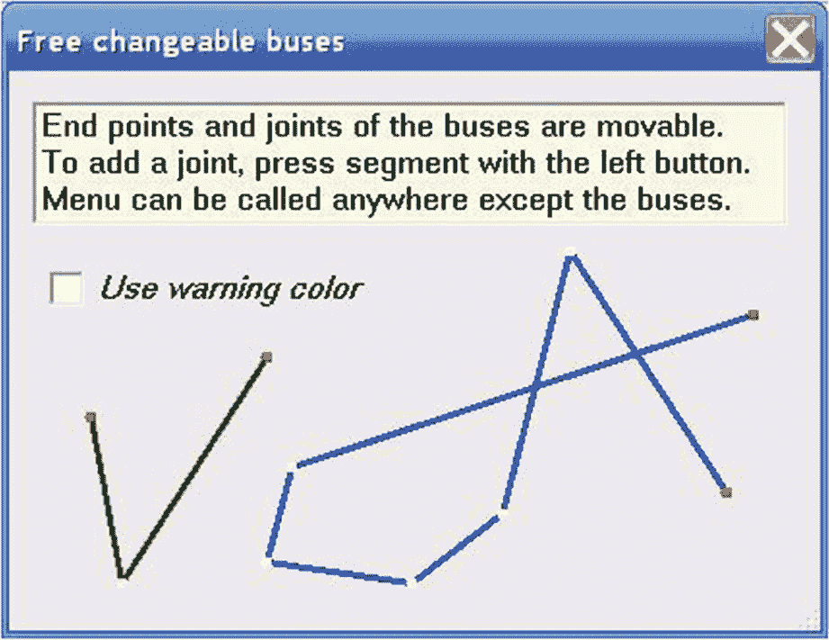

图 7-16 彩色标记显示了所有特殊点

总线可以按可移动和不可移动两种方式使用。可移动总线是指在任何点按下后即可在屏幕上移动而无需更改配置的总线。如果总线是可移动的，则无法通过同样的左键按下来添加新的连接点。家谱既需要可移动总线，也需要不可移动总线。一些总线只能用作不可移动（这将在后面解释）；其他总线的可移动性可以开启/关闭，这由用户通过菜单命令进行控制。当前示例中的两条总线始终是不可移动的，但为了使`OnMouseDown()`方法的代码与所有后续示例保持一致，仍然会对总线的可移动性进行检查。（我想强调一下，在当前示例中这是多余的。）

新的连接点是在按下总线线段的那一刻组织的，因此所有逻辑都在`OnMouseDown()`方法的代码中。我认为在查看代码之前先看一些注释会很有帮助。

当在一个`不可移动总线`的带状节点上按下时，会出现以下步骤序列：

1.  线段编号（`iSegment`）可以通过按下的节点编号（`iNode`）轻松计算得出。
2.  该线段上最近的点（`pt`）由`Bus.NearestPointOnSegment()`方法计算得出。
3.  添加连接点将导致总线覆盖区域发生变化。此后，同一个总线将被另一个节点捕获，因此首先必须通过`mover`释放该总线。

# 连接点的创建与节点线可移动性

4.  新的连接点通过`Bus.InsertPoint()`方法在计算出的点`pt`处创建。由于连接点数量已发生变化，覆盖区域被重新定义；这由`InsertPoint()`方法内部完成。

5.  总线再次被`mover`捕获，但此时光标位于新圆形节点的区域内。在`Bus`覆盖区域中，所有圆形节点都排在带状节点之前，因此总线在同一位置不是被带状节点捕获，而是被这个圆形节点捕获。

```csharp
private void OnMouseDown (object sender, MouseEventArgs e)
{
    ptMouse_Down = e.Location;
    if (mover.Catch(e.Location, e.Button))
    {
        GraphicalObject grobj = mover.CaughtSource;
        int iNode = mover.CaughtNode;
        if (grobj is Bus)
        {
            Bus bus = grobj as Bus;
            bus.Press(e.Location, e.Button, iNode);
            if (e.Button == MouseButtons.Left &&
                mover.CaughtNodeShape == NodeShape.Strip && !bus.Movable)
            {
                int iSegment = iNode - bus.PointsNumber;
                PointF pt = bus.NearestPointOnSegment(e.Location, iSegment);
                mover.Release();
                bus.InsertPoint(iSegment + 1, pt);
                mover.Catch(e.Location, e.Button);
                Invalidate();
            }
        }
        ... ...
    }
}
```

通过这种方式，一个新的连接点被添加到一个不可移动的总线上。下一个示例演示了在按下可移动和不可移动总线时的反应。

*   文件：`Form_FreeBuses_ChangingMovability.cs`

*   菜单位置：应用程序 ➤ FamilyTree 逐步设计 ➤ 自由总线；更改可移动性

图 7-17 对图 7-13 进行了略微修改，为不同类型的总线添加了标记。即使是这样一棵仅包含几个人的简单家谱，也展示了用于不同类型连接的总线；在图 7-17 中，它们用不同字母进行了标记。家谱中的总线用于连接不同的元素，因此带有自由端的总线是一个例外。

| `Case` **A** | 在当前案例中，这是一个夫妻之间的节点线，但通常此类节点线用于两人之间。它的两端必须始终连接到代表这两个人的矩形上，因此这个节点线不能自由移动到任何其他位置。在图中，这些节点线是直线，每条都可以变成带有多个拐点的折线，但在任何时刻，它都必须显示这两人之间的链接。 |
| `Case` **B** | 这种短节点线将一条长节点线与同层节点相连。代表同层节点的矩形可以任意放置在屏幕上；连接到其中任何一个的节点线都可能更长，并且可以变成折线，但每条节点线的两端都连接到某些对象（一端连接节点线，另一端连接矩形），因此这样的节点线不能自由在屏幕上移动。 |
| `Case` **C** | 这种类型的节点线用于连接两条节点线，因此它的两端也都放置在其他元素上，并且此节点线不能自由移动。 |
| `Case` **S** | 这是唯一一种两端不固定在其他对象上的节点线；此节点线的字母 *S* 取自单词 ***s**pecial*（特殊）。这种节点线的两端不固定，因此可以在不改变外观的情况下自由移动。这是连接同层节点的节点线；当你移动这条节点线时，所有连接都会随之移动。在图 7-17 中，这条节点线与属于两代人的矩形（父母及其子女之间）保持等距。如果有人更喜欢将此节点线靠近某一代人的矩形，可以在不破坏家谱的情况下完成。这将是设计的一个良好特性，但随之而来的问题是实现方式，因为到目前为止，在任何节点线上按下鼠标只能添加新拐点并移动该拐点。 |

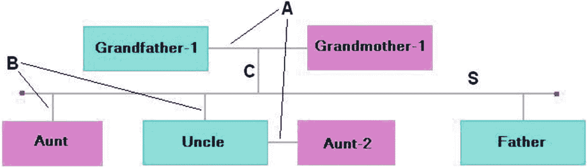

图 7-17

这个小树只有一条两端未放置在其他元素上的节点线。该节点线上标有字母 `S`（表示特殊）

在本书的所有示例中，使用左键移动整个对象或对象的任何部分，我打算遵循此规则。在上一个示例 `Form_FreeBuses_AddingJoints.cs` 中，在线段内部的任意点按下左键会在按下点添加一个拐点，并开始移动这个新拐点的过程。然而，我们遇到一种情况：根据我们的意愿，按下左键必须启动添加并移动新拐点，或者在不改变其配置的情况下移动整个节点线。计算机无法读取用户的思想来判定该用户打算在某一时刻执行哪种操作，因此用户必须执行一些预备操作来判定。这个预备操作就是更改节点线的可移动性。

## 节点线的可移动性

让我们不把节点线看作是一系列特殊点以及连接这些点的直线段（图 7-18），而是看作一组节点。这些节点不可见，但很容易想象它们的几何形状。图 7-18 中的每条线段都是一个带状节点的轴，每个特殊点是一个圆形节点的中心，因此所有节点的组合区域与线条视图相同，但比我们在图中看到的更宽。尽管所有特殊点对节点线的工作都很重要，但它们所有圆形节点的组合区域只占覆盖面积的极小部分。将节点线的可移动性视为其线段的可移动性是有道理的，实际情况也确实如此。同时，特殊点的可移动性始终与线段的可移动性相反。

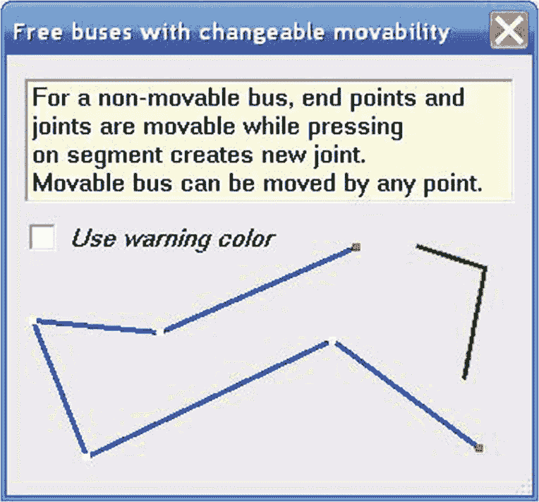

图 7-18

节点线的可移动性可以通过菜单命令更改。端点以及拐点仅对不可移动的节点线显示

任何节点线初始化时都是不可移动的。

```csharp
public Bus (Form frm, Mover mvr, List points, Pen pen)
{
... ...
Movable = false;
```

根据此节点线不可移动的声明，带状节点必须是不可移动的，而圆形节点必须是可移动的。默认情况下，所有节点都是可移动的，因此圆形节点在初始化时无需任何更改，而带状节点则需要通过一个额外的参数来指定其行为，从而被固定（不可移动）。

```csharp
public override void DefineCover ()
{
... ...
for (int i = 0; i < nCircles; i++)
{
nodes [i] = new CoverNode (i, m_pts [i], rad);
}
for (int i = 0; i < nStrips; i++)
{
nodes [nCircles + i] = new CoverNode (nCircles + i, m_pts [i],
m_pts [i + 1], rad, Behaviour .Frozen);
}
... ...
```

这种声明的结果在之前的示例中已经展示过。

*   你可以按下任何一个圆形节点（任何拐点或端点）并在屏幕上移动它。

*   你可以按下任何一个带状节点，因为移动器能感知到所有被固定的节点，但你无法移动它。相反，会在按下的点处组织一个新拐点，并且像任何其他拐点一样，它是可移动的；这一点在之前的示例中已经解释过。这种添加新拐点的操作是在 `OnMouseDown()` 方法内部完成的，但前提是按下的节点线是不可移动的（参见三页前的早期代码）。

如果节点线从不可移动变为可移动，会发生什么？节点线可移动性的切换不会改变覆盖中节点的数量、形状或顺序，但它会改变带状节点的行为。对于可移动的节点线，在 `Bus.DefineCover()` 方法的末尾有一个特殊的附加处理。

```csharp
public override void DefineCover ()
{
... ...
if (Movable)
{
cover .SetBehaviour (NodeShape .Strip, Behaviour .Moveable);
cover .SetCursor (Cursors .SizeAll);
}
}
```

对于可移动的节点线，用左键按下哪个节点或哪个点都无关紧要，因为 `MoveNode()` 方法只是简单地调用 `Move()` 方法。

```csharp
public override bool MoveNode (...)
{
bool bRet = false;
if (catcher == MouseButtons .Left)
{
if (Movable)
{
Move (dx, dy);
... ...
```

`Move()` 方法以相同的方式更改所有特殊点；整个节点线被移动而不改变其配置。

```csharp
public override void Move (int dx, int dy)
{
SizeF size = new SizeF (dx, dy);
for (int i = 0; i < m_pts .Count; i++)
{
m_pts [i] += size;
}
}
```

在当前示例（图 7-18）中，节点线的可移动性通过小型上下文菜单的单个命令来更改。

```csharp
private void Click_miMovable (object sender, EventArgs e)
{
busPressed .Movable = !busPressed .Movable;
Invalidate ();
}
```

对左键按下的反应对于可移动和不可移动的节点线来说完全不同，如果可移动和不可移动的节点线看起来一模一样，用户会感到困惑。为了避免这种混淆，节点线的外观略微取决于其可移动性。对于不可移动的节点线，其拐点和端点可以用特殊标记显示（图 7-19a）；这使得按下特殊点更容易。可移动的节点线上没有特殊标记（图 7-19b）；整个节点线用一种颜色绘制。可见特殊点的缺失表明没有可改变配置的点，因此在任何点按下的反应都是相同的。


图 7-19b

可移动节点线上的菜单


图 7-19a

不可移动节点线上的菜单

# 总线连接与配置

前面几页展示了 `Bus.Draw()` 方法，但当时尚未讨论总线的可移动性，因此这里专门抽取出该方法中用于绘制所有特殊点的部分。如果存在这些标记，它们会在总线绘制完成后被绘制出来，并且无论总线是以正常颜色还是警告颜色显示，这些特殊标记的颜色都保持不变。

```csharp
public void Draw (Graphics grfx)
{
... ...
if (!Movable)
{
if (bMarkJoints)
{
... ...
}
if (bMarkEnds)
{
... ...
}
}
}
```

在真正的族谱应用程序中，可能需要更多对总线视图和配置的更改；这些可能的更改将在下一个示例中演示。

- 文件：`Form_FreeBuses_AllChanges.cs`
- 菜单位置：应用程序 ➤ 族谱设计逐步指南 ➤ 自由总线；所有更改

这个新示例的视图与前一个相同。主要区别在于，通过两个菜单的命令可以实现所有可能的总线更改，这两个菜单可以在总线的不同部分调用。当你点击接点或线段时，你会看到这些菜单，但在工作程序的任何时刻，你只能看到其中一个菜单。无法同时看到它们，因此图 7-20 有点人为构造的意味，但我认为这种视图能让所有可能性更加清晰。像往常一样，要调用的菜单由窗体的 `OnMouseUp()` 方法决定。当需要在同一对象的不同部分调用不同的菜单时，菜单的选择可以基于节点编号和形状；当前示例中两种方式都用到了。在这个过程中，会确定被按下的特殊点（`iPressedPoint`）或线段（`iPressedSegment`）的编号；这些编号对于某些菜单命令是必需的。

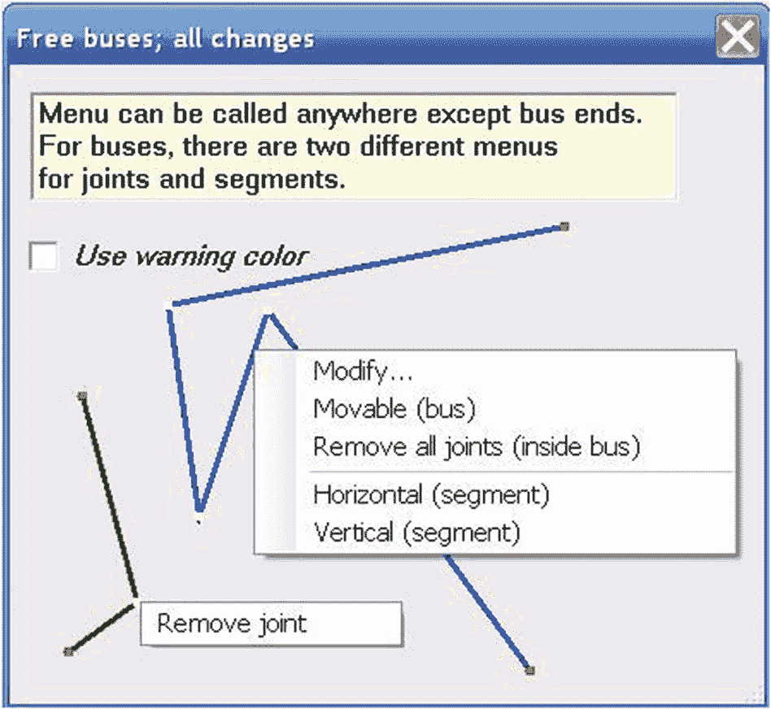

**图 7-20** 线段和接点的不同菜单

```csharp
private void OnMouseUp (object sender,
MouseEventArgs e)
{
int iWasObject, iWasNode;
NodeShape shapeNode;
ptMouse_Up = e .Location;
double fDist = Auxi_Geometry .Distance (ptMouse_Down, ptMouse_Up);
if (mover .Release (out iWasObject, out iWasNode, out shapeNode))
{
GraphicalObject grobj = mover .ReleasedSource;
if (e .Button == MouseButtons .Left)
{
... ...
}
else if (e .Button == MouseButtons .Right && fDist <= 3)
{
if (grobj is Bus)
{
int nPoints = busPressed .PointsNumber;
if (shapeNode == NodeShape .Strip)
{
iPressedSegment = iWasNode - nPoints;
ContextMenuStrip = menuOnSegment;
}
else
{
if (0 < iWasNode && iWasNode < nPoints - 1)
{
iPressedPoint = iWasNode;
ContextMenuStrip = menuOnJoint;
}
... ...
```

接点菜单（`menuOnJoint`）包含一个用于删除被按下接点的命令；执行此命令后，可以无需手动移动接点即可拉直总线。在此示例中，允许对可移动和不可移动总线删除接点，但对于将此命令应用于可移动总线的正确性存在一些疑问。当总线被声明为可移动时，就无法通过鼠标点击线段来添加新接点；也无法单独移动现有的特殊点，因为总线可以通过任何点来移动。因此，总线的两个特性——可移动性和重新配置的可能性——在某种程度上是相互关联的，对于它们之间的关联程度可能存在不同看法。

- 如果你仅将总线可移动性的改变视为移动整个对象的机会，那么擦除此类总线接点的可能性是正确的。
- 如果你认为对于可移动总线，必须阻止所有改变其配置的可能性，那么对于可移动总线，此命令必须被禁用。

如果你决定阻止可移动总线的配置更改，则需要在两个不同的地方修改代码，因为接点菜单只允许删除被按下的接点，而线段菜单则允许删除被按下总线的所有接点。

在线段上调用的菜单包含多个命令（这是图 7-20 中较大的那个菜单）。

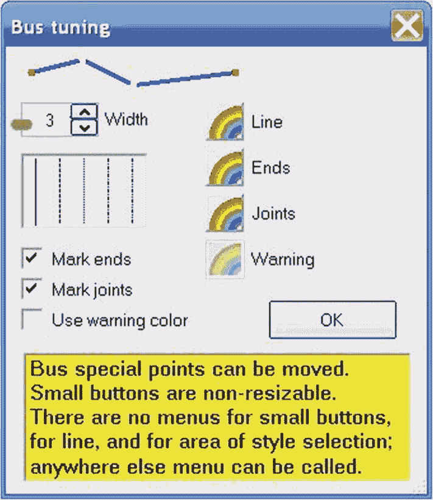

**图 7-21** 总线调整窗体

| 命令 | 描述 |
| :--- | :--- |
| *修改* | 调用一个附加的调整窗体来修改被按下总线的视图。此 `Form_Tuning_Bus.cs`（图 7-21）允许您执行以下操作：更改总线的颜色、宽度和样式 (`DashStyle`)，调节端点与接点处特殊标记的外观，更改特殊标记的颜色，调节警告颜色的使用。 |
| *可移动（总线）* | 允许您切换被按下总线的可移动性。可移动性的改变会略微改变总线的视图，如上一个示例所述。 |
| *删除所有接点（总线内部）* | 擦除所有接点，使总线仅由端点之间的单个线段组成。 |
| *水平（线段）* | 将按下的线段转换为水平线。 |
| *垂直（线段）* | 将按下的线段转换为垂直线。 |

最后两个命令的工作方式类似，并且使用限制也相似。

- 要将线段严格转换为水平或垂直，必须移动线段的一个端点。总线的两个端点看起来相似，无法从视觉上确定点的顺序从哪个端点开始，但所有特殊点都按某种顺序存储在 `List<PointF> m_pts` 中，并且这些命令会移动编号较大的点。这对于除最后一个线段之外的任何线段都是正确的，对于最后一个线段，移动的是编号较小的点。
- 在当前初步示例中，我们处理的是自由总线。稍后，相同的命令将用于真实树状图中的线段，此时总线连接到某些对象。这些命令不得影响连接点；因此，将这些命令应用于任何总线的最后一个线段的逻辑是不同的。这也意味着这两个命令不能用于仅由单个线段构成的总线。
- 如果按下的线段近乎水平，并且您命令将其转换为垂直线，则其端点将获得相同的 X 坐标，新线段将变得非常短。如果您对水平线段应用相同的命令，它将变成一个点并从视图中消失。为避免此类情况，仅当转换后的新线段长度不小于 10 像素时，才允许使用这些命令。

到目前为止，我们一直在查看未连接任何东西的自由总线。在真实的族谱图中，我们并没有完全自由的总线；图 7-10 显示，总线要么相互连接，要么可以作为代表人物的矩形之间的链接。我们稍后将讨论那些特殊的矩形，现在让我们考虑一下连接总线的情况。

### 连接的总线

总线并非通过任意点相互连接。相反，组织任何总线连接只有一种方式，并且关于此连接如何工作有严格的规定。连接两条总线的唯一方法，是将一条总线的端点移动并以某种方式固定在另一条总线上。从此刻起，第一条总线的连接端只能沿着第二条总线（将其作为轨道）移动。无论第二条总线是直线还是折线，第一条总线的连接端都可以在第二条总线的两个端点之间全程移动。

`BusConnection` 类的一个元素用于连接两条总线。

```csharp
public class BusConnection : GraphicalObject
{
    PointF ptCon;           // 连接点
    int m_radius;           // 节点半径
    Bus m_busOfEnd;         // 通过其端点连接的总线
    EndType end_type;       // 端点类型
    Bus m_busRail;          // 端点所连接的总线（轨道）
    int iSegment;           // 轨道线段
    double coefOnSegment;   // 该线段上的定位系数
}
```

`BusConnection` 类的对象在将要连接到另一条总线的那个总线的端点处组织。要组织一个新的连接，需要两条总线的相关信息。这些信息包括：连接点（`ptCon`）、连接点周围敏感区域的半径（`m_radius`）、通过其端点连接的总线（`m_busOfEnd`）、指定连接端类型的附加值（`end_type`），以及第一条总线所连接且连接端可沿其移动的总线（`m_busRail`）。

# BusConnection 类详解

## 类定义与构造函数

```csharp
public BusConnection (Form frm, Mover mvr, PointF pt, int rad, Bus bus_End,
    EndType endType, Bus bus_Rail)
{
    ... ...
    m_radius = Math .Max (Math .Abs (rad), 3);
    m_busOfEnd = bus_End;
    end_type = endType;
    m_busRail = bus_Rail;
    ... ...
    ptCon = Auxi_Geometry .Polyline_NearestPoint (pt, m_busRail .Points,
        out dist, out iSegment, out coefOnSegment);
}
```

从视觉上看，任何总线两端是无法区分的，但任何总线都是一个由线段按严格顺序连接的点序列。每个 `Bus` 对象将其特殊点保存为一个 `List`，这些点根据它们在 `List` 中的顺序进行连接。`List` 中的第一个点是总线头，最后一个点是总线尾。

## EndType 枚举

```csharp
public enum EndType { Head, Tail };
```

## 连接点的计算

当组织总线连接时，建议的连接点作为参数（`pt`）传递。这个点可以是精确计算的点、不那么精确计算的点、甚至是一个任意点。实际的连接点（`ptCon`）被计算为总线上最接近建议点（`pt`）的点。`Auxi_Geometry.Polyline_NearestPoint()` 方法不仅返回连接将要在其上组织的精确点（`ptCon`），还返回该点所属的总线线段编号（`iSegment`）以及该点在此线段上的定位系数（`coefOnSegment`）。总线的所有特殊点从头部开始编号为 0，并向尾部递增，因此每个线段的端点有两个连续的编号。沿线段的定位系数取值在 [0, 1] 范围内，其中 0 与编号较小的线段端点关联，1 与另一个端点关联。

## 覆盖层定义

总线连接的几何形状由一个点表示，因此该对象的覆盖层极其简单明了：覆盖层由一个小的圆形节点组成。

```csharp
public override void DefineCover ()
{
    cover = new Cover (new CoverNode (0, ptCon, m_radius));
}
```

## 类的特性

`BusConnection` 类有一个近乎独特的特性：这些对象非常有用，但是它们是不可见的。没有可见性参数，也没有 `Draw()` 方法。我所有的工作都集中在移动屏幕上的对象上，所以这完全关乎改变显示在屏幕上的对象的位置和大小。提到的这个特性近乎独特，到目前为止只有一个类具有此特性：在讨论使用矩形区域绘图时，我解释了在绘图区域角落使用不可见元素的方法。

## 示例：两条连接的总线

我们已经有一套四个小例子来观察自由总线；现在你将看到类似的一套四个例子，来探索总线连接的所有特性。

*   文件：`Form_ConnectedBuses_Two.cs`
*   菜单位置：应用程序 ➤ 家谱设计逐步教程 ➤ 两条连接的总线

这个例子的名称告诉我们，此表单中有两条总线。让我们逐步检查总线之间的连接设计。对于这个和接下来的几个例子，我倾向于这种便于我解释的总线视图。同时，我不想严格确定总线点，因为所讨论的连接机制的工作原理与这些点无关，因此这些点是准随机计算的。为此，示例（表单）的整个区域被 `SubRects()` 方法划分为行和列。

```csharp
void SubRects (int nRows, int nCols)
```

单元格（矩形）的编号从左上角开始，沿第一行向右，然后沿下一行从左到右，依此类推，直到右下角。通过 `RandomPointInSubrect()` 方法获取任何单元格内的随机点。

```csharp
PointF RandomPointInSubrect (int iRect)
```

为了组织准随机的总线定位，你需要声明一组单元格编号，该总线的点必须位于这些单元格内。

```csharp
private List Points_QuaziRandom (int [] nums)
{
    List points = new List ();
    for (int i = 0; i < nums .Length; i++)
    {
        points .Add (RandomPointInSubrect (nums [i]));
    }
    return (points);
}
```

现在我们可以继续我们的例子。首先，在表单的上四分之一部分组织绿色总线（`busGreen`）。然后，蓝色总线（`busBlue`）被放置在表单中间的某个位置，从上到下延伸（图 7-22）。

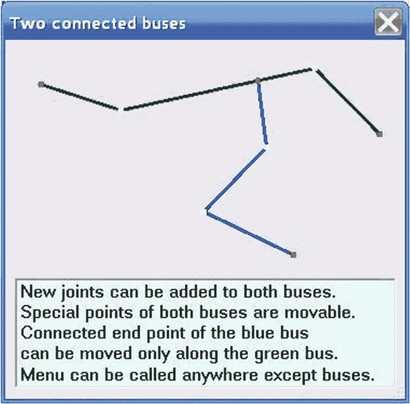

图 7-22 两条连接的总线

```csharp
public DefaultView ()
{
    ... ...
    SubRects (4, 5);
    busGreen = new Bus (this, mover,
        Points_QuaziRandom (new int [] { 0, 1, 3, 4 }),
        new Pen (Color .Green, 3));
    busBlue = new Bus (this, mover,
        Points_QuaziRandom (new int [] { 2, 7, 12, 18 }),
        new Pen (Color .Blue, 3));
```

蓝色总线必须通过其头部（即 `points [0]`）连接到绿色总线，因此需要对该点进行一些修正。计算绿色总线上离它最近的点（`pt`），蓝色总线的起点将采用这个值。

```csharp
    PointF pt = Auxi_Geometry .Polyline_NearestPoint (busBlue .Points [0],
        busGreen .Points);
    busBlue .ChangePoint (0, pt);
```

蓝色总线的头点现在位于绿色总线上，但两条总线互不知情。如果不做其他处理，它们的行为就像完全独立的对象；这样的例子在之前几页已经演示过。要实现真正的连接，需要在蓝色总线的头点组织一个 `BusConnection` 对象，并且绿色总线通过 `Bus.AddConnection()` 方法接收关于此连接的信息。

```csharp
    con = new BusConnection (this, mover, pt, busBlue, EndType.Head, busGreen);
    busGreen .AddConnection (con);
    ... ...
}
```

# BusConnection 工作原理

蓝色巴士的终点精确地位于绿色巴士上。巴士之间存在视觉连接；当使用鼠标光标按下连接点时，预期该点可被移动。移动器没有视觉，并根据队列中的顺序选择要移动的对象，因此这个`BusConnection`对象必须在移动器队列中注册在两条巴士之前。

```csharp
private void RenewMover()
{
    mover.Clear();
    busGreen.IntoMover(mover, 0);
    busBlue.IntoMover(mover, 0);
    con.IntoMover(mover, 0);
    // ...
}
```

现在，让我们看看这个连接如何工作的细节。

`BusConnection`对象在移动器队列中位于巴士之前，因此当使用左键按下连接点时，被按下和捕获的不是任何巴士，而是这个`BusConnection`对象。发生这种情况时，会调用`BusConnection.Press()`方法。

```csharp
private void OnMouseDown(object sender, MouseEventArgs e)
{
    ptMouse_Down = e.Location;
    if (mover.Catch(e.Location, e.Button))
    {
        GraphicalObject grobj = mover.CaughtSource;
        int iNode = mover.CaughtNode;
        if (grobj is BusConnection)
        {
            (grobj as BusConnection).Press(e.Location, e.Button, iNode);
        }
        // ...
    }
}
```

这个`Press()`方法中使用三个参数仅仅是为了统一性。对于由单个小圆形节点组成的覆盖层，按下的点和按下的节点号是冗余的。当`BusConnection`元素被左键按下时，鼠标光标位置会以标准方式调整到中心点。

```csharp
public void Press(Point ptMouse, MouseButtons catcher, int iNode)
{
    if (catcher == MouseButtons.Left)
    {
        AdjustCursorPosition(ptCon);
    }
}
```

现在`BusConnection`对象被移动器捕获，因此捕获对象的进一步移动由`BusConnection.MoveNode()`方法描述。

```csharp
public override bool MoveNode(...)
{
    bool bRet = false;
    if (catcher == MouseButtons.Left)
    {
        Location = ptMouse;
        AdjustCursorPosition(ptCon);
    }
    return (bRet);
}
```

从视觉上看，就好像按下的鼠标仅沿绿色巴士移动，并且连接点始终跟随鼠标光标。实际上，其工作原理正好相反：鼠标光标移动到一个点（`ptMouse`），该点极有可能在绿色巴士之外的某个位置，但连接点自身保持位于绿色巴士上，并将光标返回到连接点。将连接点保持在巴士上是使用`Location`属性简单实现的。

```csharp
Location = ptMouse;
```

因此，我们必须查看`BusConnection.Location`属性的内部。

```csharp
public PointF Location
{
    get { return (ptCon); }
    set
    {
        ptCon = Auxi_Geometry.Polyline_NearestPoint(value, m_busRail.Points,
            out dist, out iSegment, out coefOnSegment);
        DefineCover();
        if (end_type == EndType.Head)
        {
            m_busOfEnd.HeadPoint = ptCon;
        }
        else
        {
            m_busOfEnd.TailPoint = ptCon;
        }
    }
}
```

光标移动到某个新点，这个点（`value`）用于计算巴士上最近的点（`ptCon`）。蓝色巴士的被连接端点现在移动到该点。任何巴士的两个端点——头部和尾部——在视觉上是无法区分的，但`BusConnection`对象的`end_type`字段指定了被覆盖的端点，因此将蓝色巴士的正确端点移动到巴士连接的新点没有问题。当`BusConnection.Location`属性的工作完成后，`MoveNode()`方法通过通常的`AdjustCursorPosition()`方法，命令将光标位置调整到连接点的新位置。

连接点的新位置由`Auxi_Geometry.Polyline_NearestPoint()`方法确定，该方法使用一组特殊的巴士点。通过这种方式，连接点仅沿绿色巴士移动，而蓝色巴士的被连接端点随此点一起移动。当绿色巴士的特殊点集合固定时，这能完美工作，但当绿色巴士的配置以某种方式改变时会发生什么？绿色巴士的端点和连接点可以随时移动。在这些变化过程中，蓝色巴士的端点如何保持与绿色巴士的连接？

我已经提到过，在蓝色巴士端点处的连接建立后，有关此连接的信息被传递给了它所连接的巴士——绿色巴士。

```csharp
busGreen.AddConnection(con);
```

任何巴士都会跟踪其所有“侧向”连接。对于其他巴士通过头部和尾部建立的连接，有两个独立的`List`。

```csharp
public class Bus : GraphicalObject
{
    List headsConnected = new List();
    List tailsConnected = new List();
```

`Bus.AddConnection()`方法将一个新元素添加到相应的`List`中。

```csharp
public void AddConnection(BusConnection cnct)
{
    if (cnct.ConnectionType == EndType.Head)
    {
        headsConnected.Add(cnct);
    }
    else
    {
        tailsConnected.Add(cnct);
    }
}
```

当绿色巴士被组织起来时，它的四个点从左到右定义；它们在点`List`中的编号如图 7-23 所示。绿色巴士由三段组成；蓝色巴士连接在点 1 和点 2 之间的第 1 段上。现在，让我们按下并移动绿色巴士的某个特殊点。当巴士的任何一个节点被按下并移动时，就会调用`Bus.MoveNode()`方法。目前我们只关心该方法中负责移动特殊点的部分。所有特殊点都被圆形节点覆盖，这些节点是巴士覆盖层中的第一个，因此移动的圆形节点的编号等于相应特殊点的编号。我想提醒您，只有当巴士本身不可移动时，特殊点才能被移动。

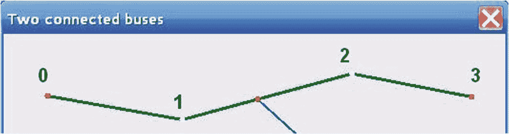

**图 7-23** 绿色巴士的点从左到右编号

```csharp
public override bool MoveNode(...)
{
    bool bRet = false;
    if (catcher == MouseButtons.Left)
    {
        if (Movable)
        {
            // ...
        }
        else
        {
            if (iNode < m_pts.Count)
            {
                m_pts[iNode] = ptMouse;
                InformConnections(PositionUpdate.Soft, iNode - 1, iNode);
                bRet = true;
            }
            // ...
```

当任何巴士移动或重新配置时，该巴士上的部分或全部连接必须更新其位置。`PositionUpdate`枚举描述了两种不同类型的更新。

*   想象一种情况（这是真实的，但我们尚未讨论这种情况）：在巴士配置未发生任何变化的情况下移动巴士，所有连接必须保持其相对位置。这意味着每个连接仍然位于同一段上，并且沿该段的定位系数相同。因此，仅因为巴士移动而改变连接的绝对屏幕坐标；这种位置变化被描述为`PositionUpdate.Soft`。

*   另一种情况发生在，例如，当命令删除巴士的所有连接点并将其转变为一条直线时。结果是，所有连接必须定位在这条新巴士上，并且无法保持连接位于同一段且具有相同的定位系数。这两个值必须重新计算，这种情况被描述为`PositionUpdate.Hard`。

```csharp
public enum PositionUpdate { Soft, Hard };
```

- 当整个总线被移动时，其所有连接都必须重新定位。当端点被移动时，仅影响一个区段。当任意关节被移动时，仅该关节两侧的区段发生改变，且只需重新定位这些区段上的连接；邻近关节之外的所有其他连接完全不受影响。更新的类型及受影响区段的范围会被发送至`InformConnections()`方法。

```csharp
public void InformConnections(PositionUpdate updateType,
    int iSeg_0, int iSeg_1)
{
    foreach (BusConnection connection in headsConnected)
    {
        connection.RailChanged(updateType, iSeg_0, iSeg_1);
    }
    foreach (BusConnection connection in tailsConnected)
    {
        connection.RailChanged(updateType, iSeg_0, iSeg_1);
    }
}
```

传递给`Bus.InformConnections()`方法的参数包括调整类型（`updateType`）以及受影响区段的范围（从`iSeg_0`到`iSeg_1`）。在对每个连接应用`BusConnection.RailChanged()`方法时，会使用相同的参数集。该方法需根据其所在总线的变化计算连接的新位置；仅当特定连接位于指定范围内的区段上时，才需要进行计算。若需移动连接，其新位置（`ptNew`）取决于更新的类型。

- 对于`PositionUpdate.Soft`，区段编号（`iSegment`）及该区段上的定位系数（`coefOnSegment`）保持不变；新位置通过使用这些不变的值计算得出。

- 对于`PositionUpdate.Hard`，新位置通过查找整个总线上的最近点来计算；此计算仅需总线的点。在此过程中，新的区段编号及该区段上的定位系数也会被计算出来。

```csharp
public void RailChanged(PositionUpdate updateType, int iSeg_0, int iSeg_1)
{
    if (iSeg_0 <= iSegment && iSegment <= iSeg_1)
    {
        PointF ptNew;
        if (updateType == PositionUpdate.Soft)
        {
            ptNew = Auxi_Geometry.PointOnLine(m_busRail.Points[iSegment],
                m_busRail.Points[iSegment + 1], coefOnSegment);
        }
        else
        {
            ptNew = Auxi_Geometry.Polyline_NearestPoint(ptCon,
                m_busRail.Points, out dist, out iSegment, out coefOnSegment);
        }
        Location = ptNew;
    }
}
```

计算得到的位置（`ptNew`）被传递给`BusConnection.Location`属性，该属性会完成两件事：将连接重新定位到新位置，然后将此值发送至所连接总线的`HeadPoint`或`TailPoint`属性；具体使用哪个属性取决于该总线是通过头还是尾进行连接。（`BusConnection.Location`属性的代码已在前面几页中展示。）

在我们的案例中，蓝色总线通过头部连接到绿色总线，因此移动后的连接会将新的点值发送至所连接总线的`Bus.HeadPoint`属性，随后该总线的头部端点发生改变。

```csharp
public PointF HeadPoint
{
    get { return (m_pts[0]); }
    set { ChangePoint(0, value); }
}
```

您会看到，并非直接修改`m_pts[0]`，而是调用了`Bus.ChangePoint()`方法，因为仅改变所连接总线的头部端点可能不够。如果第二辆总线上存在一些连接（假设其他总线也连接到蓝色总线），那么`Bus.ChangePoint()`方法不仅会重新定位总线的第一个点，还会扰动其所有连接；这种扰动最终会在某处停止，但在此过程中，所有涉及的连接和总线端点都会占据新的位置。

```csharp
public void ChangePoint(int iPoint, PointF pt)
{
    if (0 <= iPoint && iPoint < m_pts.Count)
    {
        m_pts.RemoveAt(iPoint);
        m_pts.Insert(iPoint, pt);
        DefineCover();
        InformConnections(PositionUpdate.Soft, iPoint - 1, iPoint);
    }
}
```

至此，我们已全面了解当绿色总线的某个特殊点被捕获并移动时会发生什么。对于位于移动特殊点附近或远处的连接，会产生不同的后果。为避免在文本中来回跳跃，我在此复制了图 7-23，该图显示了绿色总线特殊点的编号。现在，我们来详细观察移动点 1 和点 3 两种情况。


当移动绿色总线左侧第二个点（编号 1）时，会发生以下情况：

1.  鼠标移动到某个位置（`ptMouse`）。通过`Bus.MoveNode()`方法，捕获的关节（`iNode == 1`）被移动到与鼠标相同的位置。绿色总线的所有连接被告知总线的两个区段已发生改变。

```csharp
m_pts[1] = ptMouse;
InformConnections(PositionUpdate.Soft, 0, 1);
```

2.  绿色总线只有一个连接，且使用相同的参数调用了该连接的`BusConnection.RailChanged()`方法。

```csharp
connection.RailChanged(PositionUpdate.Soft, 0, 1);
```

3.  我们的连接恰好位于指定的区段范围内（`iSegment == 1`），因此使用软更新计算连接的新位置，然后将该新位置传递给`BusConnection.Location`属性。

```csharp
ptNew = Auxi_Geometry.PointOnLine(busRail.Points[1],
    busRail.Points[2], coefOnSegment);
Location = ptNew;
```

4.  `BusConnection.Location`属性更改连接点的实际位置，并将此新位置发送给蓝色总线，用于`Bus.HeadPoint`属性。

```csharp
ptCon = Auxi_Geometry.Polyline_NearestPoint(value, busRail.Points,
    out dist, out iSegment, out coefOnSegment);
m_busOfEnd.HeadPoint = ptCon;
```

5.  `Bus.HeadPoint`属性调用`Bus.ChangePoint()`方法来更改第一个点的位置。

```csharp
set { ChangePoint(0, value); }
```

6.  `Bus.ChangePoint()`方法更改蓝色总线头部端点的位置，由于蓝色总线上没有连接，扰动至此结束。

当移动绿色总线的右侧点（编号 3）时，事件链更短。

1.  鼠标移动到某个位置（`ptMouse`）。通过`Bus.MoveNode()`方法，捕获的总线点（`iNode == 3`）被移动到与鼠标相同的位置。绿色总线的所有连接被告知总线的两个区段已发生改变。

# 总线连接与InformConnections方法

## 1. 端点移动与连接更新

```csharp
pts[3] = ptMouse;
InformConnections(PositionUpdate.Soft, 2, 3);
```

## 2. 单一连接的总线

绿色总线只有一个连接，且使用相同的参数调用了该连接的`BusConnection.RailChanged()`方法。

```csharp
connection.RailChanged(PositionUpdate.Soft, 2, 3);
```

## 3. 连接位于范围之外

绿色总线上的连接位于指定范围之外（`iSegment == 1`），因此无需执行任何操作。在图 7-23 中，绿色总线右侧点的移动对所示的连接没有影响。

我们已经看到，每当总线的端点或某个关节被移动时，都必须调用`Bus.InformConnections()`方法。接下来的示例将展示必须调用此方法的几种情况，并且存在一些简单的逻辑来确定此调用所需的参数集。

### 排版后的文本

如果某个特殊点被鼠标移动，则总线上任何连接的相对位置不会改变；这意味着使用`PositionUpdate.Soft`参数。作为上述移动的结果，影响不超过两个连续线段，因此两个连续数字代表受影响线段的范围。对于端点，只有一个线段被改变，但为了代码的统一性，线段范围仍然由两个连续数字表示。其中一个所述的线段不存在，但这完全不是问题，因为没有连接可以定位在不存在的线段上，因此对于这个不存在的线段不需要（也不会）采取任何操作。

如果关节数量发生变化，则始终使用`PositionUpdate.Hard`参数，并且所有线段都必须包含在受影响线段的范围内。

属于第二种变体的情况之一是当按下不可移动总线的任何线段时添加新关节；在这种情况下，对`Bus.InformConnections()`方法的调用包含在`OnMouseDown()`方法中。

-   文件：`Form_ConnectedBuses_Three.cs`
-   菜单位置：`Applications ➤ FamilyTree design step by step ➤ Three connected buses`

```csharp
private void OnMouseDown (object sender, MouseEventArgs e)
{
ptMouse_Down = e .Location;
if (mover .Catch (e .Location, e .Button))
{
GraphicalObject grobj = mover .CaughtSource;
int iNode = mover .CaughtNode;
... ...
else if (grobj is Bus)
{
Bus bus = grobj as Bus;
bus .Press (e .Location, e .Button, iNode);
if (e .Button == MouseButtons .Left &&
mover .CaughtNodeShape == NodeShape .Strip && !bus .Movable)
{
... ...
bus .InformConnections (PositionUpdate .Hard,
0, bus .PointsNumber - 1);
... ...
```

在下一个示例中，有三条总线，其中一条两端都连接到其他总线（图 7-24）。此示例允许您检查总线两端连接的正确性，而其他所有内容几乎相同。

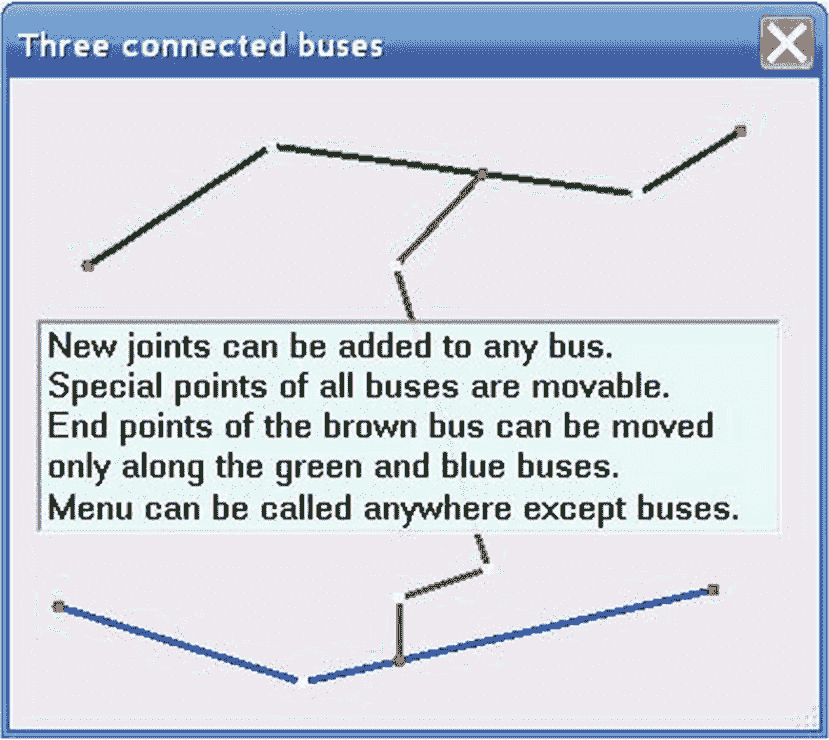

图 7-24 三条连接的总线

从此示例开始，直到开发真正的 `Family Tree` 应用程序，将会有大量的总线连接。在某些情况下，总线只有一端连接到某个对象；在其他情况下，总线两端都连接。`ConnectedBus()`方法在任何情况下都很有用。此方法构造一条新总线，其两端连接到一个或两个其他总线。不仅组织了一条新总线，新的连接（一个或两个）也被包含在现有的总线连接`List`中。我提到一个或两个新连接，因为此方法可以在新总线两端都连接或仅一端连接时使用。本可以在上一个示例中演示此方法，但我决定将其使用推迟到本示例。

此示例的总线以准随机方式计算：绿色总线（`busFrom`）出现在窗体的上半部分，蓝色总线（`busTo`）出现在下半部分，然后棕色总线（`busLink`）在中间某处连接它们。

```csharp
List connections = new List ();
public DefaultView ()
{
... ...
busFrom = new Bus (this, mover,
Points_QuaziRandom (new int [] { 0, 1, 3, 4 }),
new Pen (Color .Green, 3));
busTo = new Bus (this, mover,
Points_QuaziRandom (new int [] { 15, 17, 19 }),
new Pen (Color .Blue, 3));
busLink = ConnectedBus (this, mover, new Pen (Color .Brown, 3),
busFrom, busTo,
Points_QuaziRandom (new int [] { 2, 7, 13, 18 }),
out connections);
... ...
```

`ConnectedBus()`方法获取提议的点`List`，但第一个和最后一个点会根据新连接必须位于的总线的几何形状进行调整。`busLink`两端必须连接到的两条总线在调用`ConnectedBus()`方法之前已经存在。家谱通常是通过一次添加一个新元素来构建的，因此新总线一端连接而另一端稍后使用是很正常的。如果使用此方法来组织单端连接，则对于另一端的总线，使用`null`参数代替。

```csharp
public Bus ConnectedBus (Form frm, Mover mvr, Pen pn,
Bus busHeadConnected, Bus busTailConnected,
List points, out List cons)
{
List newcons = new List ();
int iLast = points .Count - 1;
if (busHeadConnected != null)
{
points [0] = Auxi_Geometry .Polyline_NearestPoint (points [0],
busHeadConnected .Points);
}
if (busTailConnected != null)
{
points [iLast] = Auxi_Geometry .Polyline_NearestPoint (points [iLast], busTailConnected .Points);
}
Bus bs = new Bus (frm, mvr, points, pn);
if (busHeadConnected != null)
{
BusConnection conHead = new BusConnection (frm, mvr, points [0],
Math .Max (busHeadConnected .NodeRadius, bs .NodeRadius), bs, EndType .Head, busHeadConnected);
busHeadConnected .AddConnection (conHead);
newcons .Add (conHead);
}
if (busTailConnected != null)
{
BusConnection conTail = new BusConnection (frm, mvr, points [iLast],
Math .Max (busTailConnected .NodeRadius, bs .NodeRadius), bs, EndType .Tail,
busTailConnected);
busTailConnected .AddConnection (conTail);
newcons .Add (conTail);
}
cons = newcons;
return (bs);
}
```

您可以用总线测试另一件有趣的事情。重新配置一条总线，例如绿色的那条，使其变成一个闭环。这很容易做到，因为所有特殊点都是可移动的，并且可以添加任意数量的新关节。在所有更改结束时，将绿色总线的一个端点移动到另一个端点之上。如果您将绿色总线变成一个闭环，那么棕色总线的连接端点可以毫无问题地绕此闭环移动。您甚至可以将绿色总线的两个端点放置在彼此附近，存在一个小间隙不是问题：棕色总线的可移动端点可以轻松跨越绿色总线中的小间隙。如果绿色总线被重新配置为自身交叉，那么棕色总线的端点可以从一个线段跳到另一个线段。您可以重新配置用作轨道的总线，使其不同的线段彼此相距不远；沿着此轨道移动的另一条总线的端点可以轻松跨越间隙并从一条线段移动到另一条线段。这种不仅沿轨道移动，甚至跨越某些间隙的移动，在其他沿轨道移动的应用程序中可能是个问题，因此该问题及其解决方案在我的另一本书 [2] 中进行了讨论（例如，请参阅`Form_SpotOnCommentedWay.cs`）。对于`Family Tree`应用程序，无需添加任何特殊检查来防止这种从总线的一个线段到另一个线段的跳跃。

我无法想象任何情况下有人需要以自身交叉的方式更改家谱的总线，但闭环形式的总线则不同。闭环形式的总线不仅仅是一个有趣的练习。稍后您将看到它是一个有用的元素。

-   文件：`Form_ConnectedBuses_ChangingMovability.cs`
-   菜单位置：`Applications ➤ FamilyTree design step by step ➤ Connected buses; changing movability`

在下一个示例中，三辆相同的总线以相同方式连接，但我添加了一个包含单条命令的小菜单，用于更改被按压总线的可移动性。该命令并非适用于所有总线，因此它对绿色和蓝色总线有效，但对棕色总线无效。当然，这种排除并非基于总线颜色。前面已经解释过，只有两端自由的总线才能被声明为可移动，因此棕色总线不允许更改可移动性。

在初始化时，三辆总线均不可移动。当你用左键按压任意总线的任意段时，光标下方会出现一个新节点。你继续移动这个新节点，如果被按压的总线是绿色或蓝色的，那么棕色总线的连接点只有恰好处在该节点的相邻段上时才会移动。

现在在绿色总线上调用上下文菜单，并将其变为可移动。绿色总线的视图会稍作改变以指示其可移动性；可移动总线所有特殊点上彩色标记的消失（图 7-25）已在类似自由总线的示例中展示过。

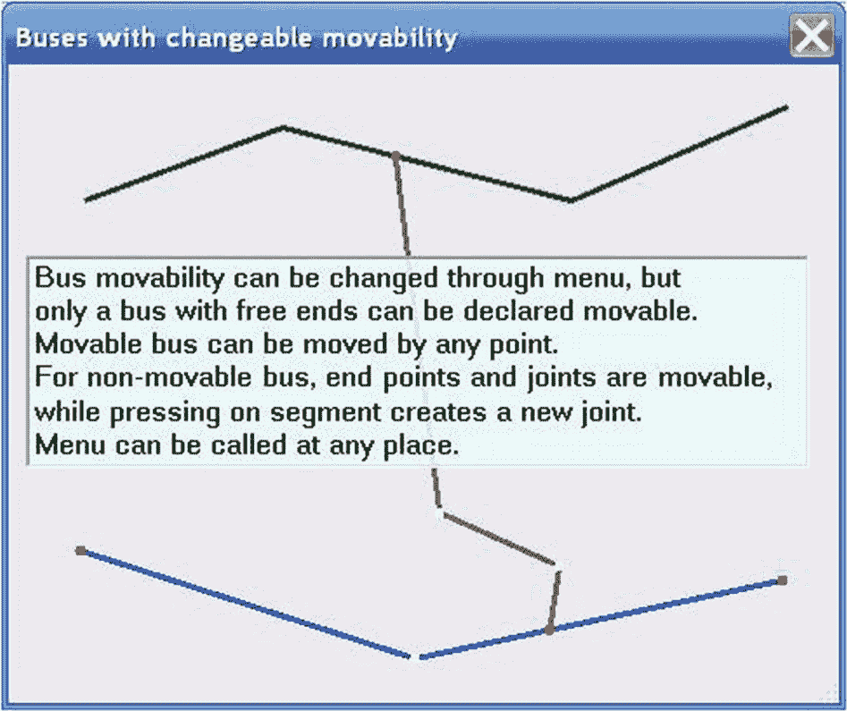

图 7-25 两辆总线（蓝色和棕色）不可移动，而绿色总线可移动

当总线可移动性切换时，不仅总线视图发生变化，其覆盖层也随之改变。所有节点的数量、顺序和形状均保持不变，但带状节点的行为会发生变化。

```csharp
public override void DefineCover ()
{
... ...
if (Movable)
{
cover .SetBehaviour (NodeShape .Strip, Behaviour .Moveable);
cover .SetCursor (Cursors .SizeAll);
}
}
```

可移动总线在特殊点上没有标记，任何总线点都可以用来启动对整个总线的完全相同的移动。在本书的多个类中，我已经演示过，如果在某些情况下不需要圆形节点，那么它们会被简单地压缩到大小为零。为什么不在`Bus`类中这样做呢？有些情况下，这些圆形节点必须从移动过程中排除，但必须在它们上面调用某些菜单。为了被移动器检测到，节点必须具有非零的大小。

当用左键按压可移动总线时，`MoveNode()`方法会直接调用`Move()`方法。在讨论自由总线时已经提到过这一点，但现在讨论`MoveNode()`方法中的另一条命令还为时过早。

```csharp
public override bool MoveNode (...)
{
bool bRet = false;
if (catcher == MouseButtons .Left)
{
if (Movable)
{
Move (dx, dy);
InformConnections (PositionUpdate .Soft, 0, pts .Count - 1);
}
... ...
```

当前示例中的绿色总线变为可移动状态并被移动时，必须通知其所有连接点关于总线的变化。在整个移动过程中，绿色总线的配置不会改变；其所有段长度相同，因此所有可能的连接到该总线的点必须保持它们的位置。这是`PositionUpdate.Soft`更新类型的经典变体，必须包含所有段，你看到的就是从`MoveNode()`方法内部调用的`InformConnections()`方法。

-   文件：`Form_ConnectedBuses_AllChanges.cs`
-   菜单位置：应用程序 ➤ 族谱逐步设计 ➤ 连接总线；所有更改

此示例演示了可应用于连接总线的所有可能更改；这些更改与`Form_FreeBuses_AllChanges.cs`（图 7-20）中为自由总线演示的更改相同。此示例中可以使用三个菜单；其中两个在总线段和节点上调用（图 7-26）。

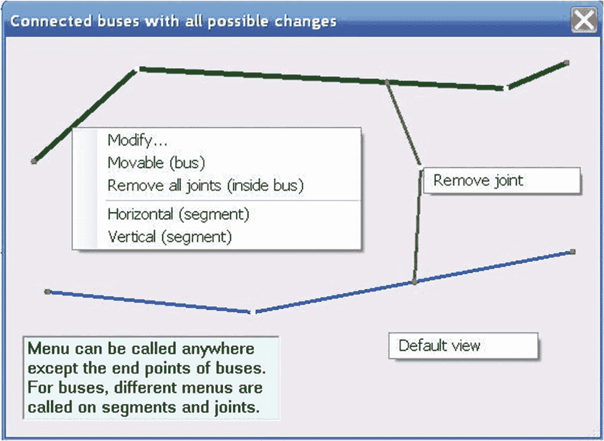

图 7-26 带有所有可能更改的连接总线

我认为现在用于族谱应用程序的总线已经开发并测试完毕。是时候看看任何族谱中的其他重要元素了——具体来说，就是代表人物的矩形。

### 家族谱系中的人物

家族谱系中的任何人物都由`Person`类的一个对象表示。在屏幕上，该对象显示为一个包含某些信息的矩形区域（图 7-27）。该矩形是可移动和可调整大小的（您还期待别的什么吗？）；人物的信息通过与此矩形关联的三个评论组织起来。

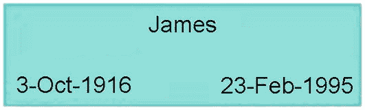

图 7-27 `Person`对象的标准视图

```csharp
public class Person : GraphicalObject
{
PointF [] ptsCorner;
SolidBrush m_brush;
Pen penBorder = new Pen (Color .DarkGray);
CommentToRect cmntName, cmntBirth, cmntDeath;
Bus busOnBorder;
static int minSide = 20;
```

其中一个评论`cmntName`用于显示人物的姓名。此评论的文本不能为空。即使您不知道人物的姓名，也可以称其为“未知”或任何其他名称，但您不能在没有此评论的情况下组织一个`Person`对象。另外两个评论是非强制的。如果一个人还活着，通常不知道其去世信息，因此在这种情况下不需要`cmntDeath`。对于几代以前的亲属，不知道其出生日期也并不罕见。可以输入带有问号的某个日期（例如年份），或者干脆省略`cmntBirth`。在开始讨论家族谱系程序时，我使用了图 7-10 到 7-14，其中每个`Person`对象只包含`cmntName`部分，而另外两个评论是空的。

姓名、出生和死亡数据只是本程序及其他类似程序中使用的标准信息片段。这三个字段仅是字符串，用户可以在其中输入任何所需的文本。

`Person`类的对象可以通过其内部任意点移动，并通过其边界上任意点调整大小。该类的对象使用了与之前演示的其他几个矩形类相同类型的覆盖层（例如，见图 5-3），因此在角上有四个圆形节点，沿边上有四个条状节点，以及一个覆盖整个对象区域的矩形节点。`Person`对象的覆盖层基于矩形的四个角点；`ptsCorner[]`数组中点的编号从左上角开始，按顺时针方向进行。`Person`对象始终可以在所有方向上调整大小，并且覆盖节点永远不会被压缩。边上的条状节点默认宽度为六个像素，而圆形节点则比默认大小略大。

# Person 对象的实现与调优

## DefineCover 方法

```csharp
public override void DefineCover ()
{
float rCorner = 4;
CoverNode [] nodes = new CoverNode [] {
new CoverNode (0, ptsCorner [0], rCorner, Cursors .SizeNWSE),
new CoverNode (1, ptsCorner [1], rCorner, Cursors .SizeNESW),
new CoverNode (2, ptsCorner [2], rCorner, Cursors .SizeNWSE),
new CoverNode (3, ptsCorner [3], rCorner, Cursors .SizeNESW),
new CoverNode (4, ptsCorner [0], ptsCorner [3], Cursors .SizeWE),
new CoverNode (5, ptsCorner [1], ptsCorner [2], Cursors .SizeWE),
new CoverNode (6, ptsCorner [0], ptsCorner [1], Cursors .SizeNS),
new CoverNode (7, ptsCorner [3], ptsCorner [2], Cursors .SizeNS),
new CoverNode (8, ptsCorner) };
cover = new Cover (nodes);
}
```

## Person 对象的运动特性

这是一个经典的复杂对象，其各个部分参与独立、关联和同步的运动。

-   矩形是主导元素；当其移动时，所有关联的评论都会同步移动。
-   当矩形调整大小时，其关联的评论保持其相对位置。
-   任何评论都可以独立移动和旋转。

与任何复杂对象一样，`Person` 对象必须通过 `Person.IntoMover()` 方法在移动器队列中注册。无论评论相对于矩形的相对位置如何，它们都必须可见且可访问，因此它们必须比矩形更早注册。

## IntoMover 方法

```csharp
new public void IntoMover (Mover mv, int iPos)
{
mv .Insert (iPos, this);
mv .Insert (iPos, cmntName);
if (BirthInfoToShow)
{
mv .Insert (iPos, cmntBirth);
}
if (DeathInfoToShow)
{
mv .Insert (iPos, cmntDeath);
}
}
```

绘制各部分的顺序总是与它们在移动器队列中的放置顺序相反，因此我们必须先绘制矩形，然后再绘制所有需要显示的评论。

-   文件：`Form_Person.cs`
-   菜单位置：应用程序 ➤ 家族谱系逐步设计 ➤ Person

## Draw 方法

```csharp
public void Draw (Graphics grfx)
{
grfx .FillRectangle (m_brush, Area);
grfx .DrawRectangle (penBorder, Rectangle .Round (Area));
cmntName .Draw (grfx);
if (BirthInfoToShow)
{
cmntBirth .Draw (grfx);
}
if (DeathInfoToShow)
{
cmntDeath .Draw (grfx);
}
}
```

## Person 对象的初始化与视图

此示例包含一个 `Person` 对象，并演示了其调优（图 7-28）。`Person` 类具有多个构造函数；当前示例使用了一个包含全部参数集的构造函数。

```csharp
private void DefaultPerson (PointF pt)
{
m_person = new Person (this, mover, new RectangleF (pt .X, pt .Y, 210, 60),
Color .Cyan, "James", "3-Oct-1916", "23-Feb-1995");
}
```

由 `DefaultPerson()` 方法组织的 `Person` 对象具有如图 7-27 所示的视图。矩形的青色由初始化时的参数之一决定，而所有三个评论都显示为水平字符串，并使用相同的字体和颜色。图 7-28 中可见的所有进一步变换都是借助调优表单完成的。

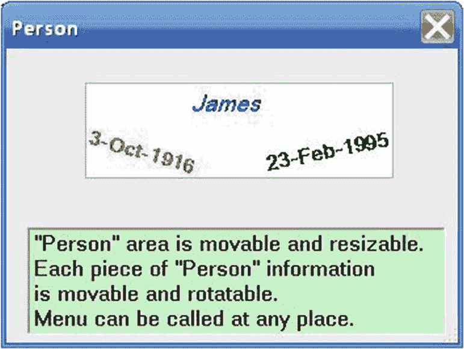

**图 7-28** `Form_Person.cs` 包含一个 `Person` 对象

## 用户交互与调优表单

在任何用户驱动的应用程序中，所有可见性参数都由用户决定。如果屏幕上有一个对象，那么必须有一种简单的方法来更改其视图。可以通过菜单命令打开针对 `Person` 对象的特殊调优表单。通常，每个对象类都有自己的菜单和自己的调优表单；通过点击对象的类可以轻松决定打开所需的菜单或调优表单。当按下 `Person` 对象内部的任何空闲位置时，移动器会通知鼠标按压确实触及到了 `Person` 对象，然后可以调用其菜单（以及最终的调优表单）。当按下 `Person` 对象的任何评论时，移动器会检测到对 `CommentToRect` 对象的按压。对于任何评论，只能更改字体和颜色。我们稍后会介绍到的真正的家族谱系应用程序，会对按下评论或按下 `Person` 区域内的空白位置提供不同的响应。然而，`Person` 对象的调优表单（图 7-29）包含了所有三个评论的调优，因此在此示例及其他几个辅助示例中，在 `Person` 区域或其任何评论内的空白位置右键单击时，会出现相同的反应。

```csharp
private void OnMouseUp (object sender, MouseEventArgs e)
{
ptMouse_Up = e .Location;
double fDist = Auxi_Geometry .Distance (ptMouse_Down, ptMouse_Up);
if (mover .Release ())
{
GraphicalObject grobj = mover .ReleasedSource;
if (e .Button == MouseButtons .Right && fDist <= 3)
{
if (grobj is Person || grobj is CommentToRect)
{
ContextMenuStrip = menuOnPerson;
}
... ...
```

调谐表单（图 7-29）允许你更改矩形的背景颜色，并修改全部三条注释。每条注释的字体和颜色都可以单独设置。出生与死亡信息的显示方式并无严格规定；它们只是字符串，你可以在其中输入任何内容。这样，调谐表单在“家谱”应用中可以正常工作，但在当前示例中存在一个限制。我不希望允许更改这个特定 `Person` 对象的信息，因此调谐表单初始化的最后一个参数会阻止对全部三条注释的编辑。三个文本框的视图清楚地表明编辑已被禁止。

```csharp
private void Click_miModify_Person (object sender, EventArgs e)
{
Form_Tuning_Person frm = new Form_Tuning_Person (
PointToScreen (ptMouse_Up), m_person, false);
... ...
```

## Bus 与 Person 的协同工作

在之前的示例中，我们对 `Bus` 对象进行了大量操作，并了解了如何移动和更改它们。借助 `BusConnection` 对象，可以将总线组织成一个连接总线系统，该系统将用于“家谱”应用。我们还有 `Person` 类，它允许显示家谱中任何人的信息。现在，我们需要弄清楚 `Bus` 和 `Person` 对象如何协同工作。

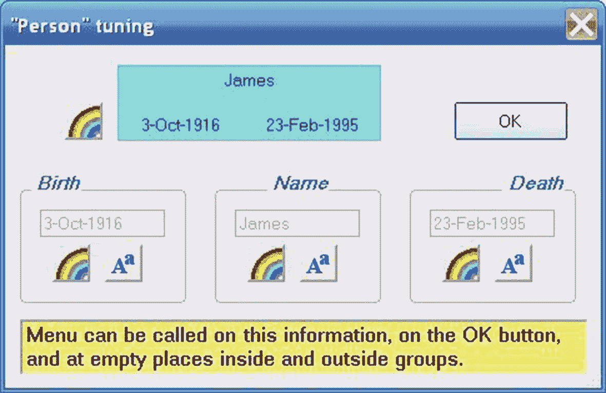

**图 7-29** Person 对象的调谐表单

在 `Person` 类中，有一个尚未提及的有趣字段。

```csharp
Bus busOnBorder;
```

`Bus.IntoMover()` 方法的代码在前面几页已经展示过。其中没有提及 `busOnBorder`，因此移动器(mover)完全不了解这个元素。如果一个元素没有在移动器中注册，那么这个元素就是不可移动的。同样的总线也没有在 `Bus.Draw()` 方法中出现（该方法也已在前面几页展示过），因此这条总线是不可见的。这个既不可移动又不可见的总线的目的是什么？它到底在哪里使用？

当任何 `Person` 对象被初始化时，其 `busOnBorder` 字段也会被初始化；新总线的点由 `Auxi_Geometry.ClosedPolyline()` 方法准备。

```
public Person (Form frm, Mover mvr, RectangleF rect, Color clrRect , Font fnt, string strName, string strBirth, string strDeath)
{
... ...
float w = Math .Max (minSide, rect .Width);
float h = Math .Max (minSide, rect .Height);
ptsCorner = new PointF [4] {rect .Location,
new PointF (rect .X + w, rect .Y),
new PointF (rect .X + w, rect .Y + h),
new PointF (rect .X, rect .Y + h) };
busOnBorder = new Bus (m_form, null,
Auxi_Geometry .ClosedPolyline (ptsCorner), penBorder);
busOnBorder .RegisteredWithMover = false;
... ...
```

因此，`busOnBorder`被组织成一个闭环，这条不可见的总线沿着矩形的边界延伸。这条总线初始化最显著的特点是传递给`RegisteredWithMover`属性的值。

```
busOnBorder .RegisteredWithMover = false;
```

该属性的名称和传递的值清楚地表明，这条总线不会在移动器中注册。下一个示例展示了这条不可移动且不可见的总线在家谱设计中的作用。

- 文件：`Form_PersonPlusBus.cs`
- 菜单位置：应用程序 ➤ 家谱设计逐步教程 ➤ 人物与连接总线

新示例中再次只有一个`Person`对象，但视图中也有一条总线（图 7-30）。这条总线的一个端点位于`Person`对象的边界上；如果你用左键按住这个点并尝试将其移动到任何地方，你会立刻发现它只能沿着矩形边界移动，无法移动到其他位置。你是否觉得似曾相识？这是否类似于将总线的端点沿着另一条与其连接的总线移动？

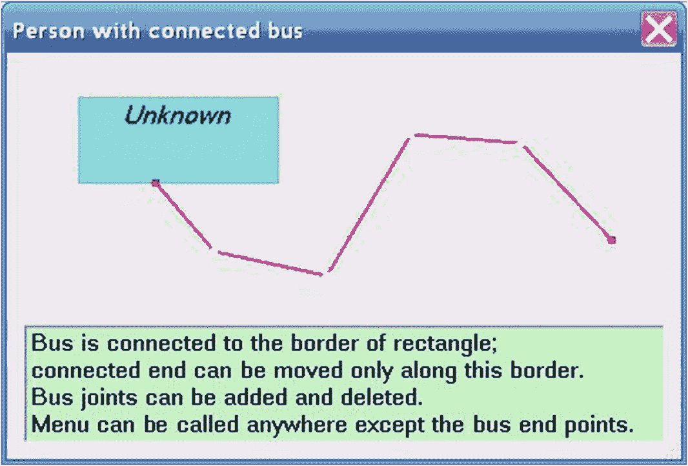

**图 7-30** 带有连接总线的 Person 对象

是的，这正是总线连接到`Person`对象时发生的情况：实际上，这条总线连接的是另一条总线——一条沿着矩形边界延伸的不可见`busOnBorder`。参与连接的两条总线中有一条是不可见的，这完全无关紧要；总线与`Person`对象之间的连接组织方式，与总线之间的连接方式相同，例如在`Form_ConnectedBuses_Two.cs`中。

尽管当前示例中的元素集是最小的——一个`Person`对象和一条可见总线——但这是第一个针对三种元素类型使用三个`List`的示例，而真正的“家谱”应用正是基于这三种元素类型设计的。在接下来的示例中，无论使用多少个元素，你都将看到完全相同的三个`List`。

```
public partial class Form_PersonPlusBus : Form
{
List people = new List ();
List buses = new List ();
List connections = new List ();
```

当`Form_PersonPlusBus.cs`启动时，所有三个列表都被清空，然后`Person`对象被设计出来。

```
private void DefaultView ()
{
people .Clear ();
buses .Clear ();
connections .Clear ();
Person person = new Person (this, mover, new RectangleF (100, 50, 140, 60), Color .Cyan, “Unknown”);
AddPerson (person);
... ...
```

当任何`Person`、`Bus`或`BusConnection`类的新对象被组织起来时，它会被添加到相应的`List`末尾。对于一个新的`Person`对象，两个列表都会增加元素。

```
private void AddPerson (Person prsn)
{
... ...
people .Add (prsn);
AddBus (prsn .Bus);
}
private void AddBus (Bus busNew)
{
... ...
buses .Add (busNew);
}
```

`Person`对象已经组织好，现在是时候组织一条总线了，你可以在图 7-30 中看到它。在其他参数中，`Bus`构造函数接收一个`List`点。此示例中的总线将不是一条自由总线，而是一条连接到`Person`对象边界上不可见总线的总线。新总线端点的预设位置极大概率需要调整，然后必须在计算出的点上组织`BusConnection`对象。所有这些操作都在`BusFromPerson()`方法中完成，该方法直接返回新的总线，并通过参数返回新的连接。

```
private void DefaultView ()
{
... ...
List points = new List ();
points .Add (new PointF (220, 130));
points .Add (new PointF (270, 170));
points .Add (new PointF (410, 90));
BusConnection con;
Bus bus = BusFromPerson (this, mover, new Pen (Color .Blue, 3), person, points, out con);
AddBus (bus);
AddConnection (con);
... ...
private Bus BusFromPerson (Form frm, Mover mvr, Pen pn, Person person,
List points, out BusConnection con)
{
Bus busFrom = person .Bus;
points [0] = Auxi_Geometry .Polyline_NearestPoint (points [0],
busFrom .Points);
Bus bs = new Bus (frm, mvr, points, pn);
con = new BusConnection (frm, mvr, points [0], bs, EndType .Head, busFrom);
busFrom .AddConnection (con);
return (bs);
}
```

所有新元素都被包含到相应的列表中，我们得到如下列表：

| • `List<Person> people` | 包含一个元素 |
| • `List<Bus> buses` | 包含两个元素；其中一个如图 7-30 所示，另一个不可见，沿着`Person`对象的边界延伸 |
| • `List<BusConnection> connections` | 包含一个元素 |

移动器可以处理所有三种已提及类别的元素，因此所有这些元素都必须在移动器中注册，但必须按照正确的顺序注册：`BusConnection`元素必须先于所有`Bus`元素，而`Bus`元素必须先于所有`Person`元素。

此示例中的`RenewMover()`方法将同样用于另外几个示例以及真正的“家谱”应用。

```
private void RenewMover ()
{
    mover .Clear ();
    foreach (Person person in people)
    {
        person .IntoMover (mover, 0);
    }
    foreach (Bus bus in buses)
    {
        bus .IntoMover (mover, 0);
    }
    foreach (BusConnection con in connections)
    {
        con .IntoMover (mover, 0);
    }
    ... ...
```

在 `Form_PersonPlusBus.cs` 中有两辆巴士：一辆在图 7-30 中完全可见，另一辆不可见，且沿着 `Person` 对象的边界移动。两辆巴士都包含在 `List` 公交车列表中，而 `RenewMover()` 方法的代码显示，对于列表中的每辆巴士，都会调用 `Bus.IntoMover()` 方法。同时，我之前提过，无论如何，不可见的 `busOnBorder` 都不应注册到 mover 中。这是如何实现的呢？

当任何 `Person` 对象被初始化时，其 `busOnBorder` 的一个参数会获得一个特殊值。

```csharp
busOnBorder .RegisteredWithMover = false;
```

当调用 `Bus.IntoMover()` 方法时，它会检查这个值，并且仅注册该字段值为合适的巴士。

```csharp
new public void IntoMover (Mover mv, int iPos)
{
    if (iPos < 0 || mv .Count < iPos || !bRegisteredWithMover)
    {
        return;
    }
    mv .Insert (iPos, this);
}
```

因此，尽管巴士列表中有两辆巴士，但只有其中一辆——即可见的那辆——注册到了 mover 中。由于位于 `Person` 对象边界上的不可见巴士未注册到 mover，mover 并不知道这辆巴士的存在，也无法对它进行任何操作。因此，无法向这辆巴士添加任何连接点，也无法用鼠标将其移动到其关联矩形边界上原本位置之外的任何地方。

用鼠标无法移动 `busOnBorder`，但当 `Person` 对象被移动或调整大小时会发生什么？在几页之前，我提到过，任何 `Person` 对象都是一个复杂对象，其主导元素（矩形）与附属评论之间遵循标准的关系规则。当时并未提及边界上的不可见巴士，但它是另一个附属元素，因此必须遵循相同的规则。当通过 `Person.Move()` 和 `Person.MoveNode()` 方法移动或调整矩形大小时，所有附属元素都必须被告知这些变化。这是通过 `Person.InformRelatedElements()` 方法完成的。

```csharp
private void InformRelatedElements ()
{
    cmntName .ParentRect = Area;
    cmntBirth .ParentRect = Area;
    cmntDeath .ParentRect = Area;
    busOnBorder .Points = Auxi_Geometry .ClosedPolyline (ptsCorner);
}
```

正如您从这段代码中看到的，无论区域如何变化，`busOnBorder` 元素始终沿着区域边界延伸。我们在之前的示例中已经讨论过，连接点如何始终保持在巴士上，无论巴士如何变化。当一辆可见巴士连接到一辆不可见巴士时，同样的机制也在起作用，因此在矩形区域的任何变化过程中，连接点都保持其在边界上的位置，因此在视觉上，巴士始终连接到矩形的边界。

关于 `Form_PersonPlusBus.cs` 还有一点补充。连接的巴士初始化为蓝色，如下所示：

```csharp
private void DefaultView ()
{
    ... ...
    Bus bus = BusFromPerson (this, mover, new Pen (Color .Blue, 3), person, points, out con);
```

然而，它显示为品红色（图 7-30），并且在 `Form_PersonPlusBus.cs` 中没有更改颜色的代码行。是什么导致了这种颜色变化？

图 7-30 中的巴士一端连接到 `Person` 对象，另一端是空闲的。对于真正的家谱来说，这不是正常情况；您无法想象一辆连接着某种事物与虚无的巴士；这是荒谬的。如果在真实家谱中出现这种情况，说明是一个未完成的构建，用户必须被告知这种异常情况。吸引用户注意异常情况的最佳方法是更改元素的颜色；这将是一个信号，表明用户需要执行某些操作。因此，`Bus` 对象中有一个特殊的 `penWarn` 字段。默认情况下，在这种异常情况下，巴士的这支笔颜色为品红色。

```csharp
Pen penWarn = new Pen (Color .Magenta, 2);
```

在某些情况下，巴士会使用这支特殊的笔来绘制，而非其真实颜色。

```csharp
public void Draw (Graphics grfx)
{
    if (((bHeadConnected != bTailConnected) ||
    (bHeadConnected == false && bTailConnected == false &&
    headsConnected .Count == 0 && tailsConnected .Count == 0 &&
    bRegisteredWithMover)) && bUseWarningColor)
    {
        grfx .DrawLines (penWarn, pts .ToArray ());
    }
    else
    {
        grfx .DrawLines (m_pen, pts .ToArray ());
    }
    ... ...
```

这种特殊警告颜色的使用可以很容易地通过 `Bus.UseWarningColor` 属性来调节。在第一个关于连接巴士的示例中，我希望两辆巴士都显示其自然（声明）的颜色，因此蓝色巴士的颜色警告被关闭。

*   文件：`Form_Spouses.cs`
*   菜单位置：Applications ➤ FamilyTree design step by step ➤ Spouses

```csharp
public Form_ConnectedBuses_Two ()
{
    ... ...
    busBlue = new Bus (...);
    ... ...
    busBlue .UseWarningColor = false;
    ... ...
```

这个示例使我们更接近家谱设计的目标，它代表了一个简单的树结构，由三个 `Person` 对象和它们之间的两辆巴士组成（图 7-31）。无论树结构多么复杂，只需为三个类各维护三个 `List` 就足够了，并且对这些 `List` 的所有操作都可以通过这样一个简单的家谱进行验证和演示。

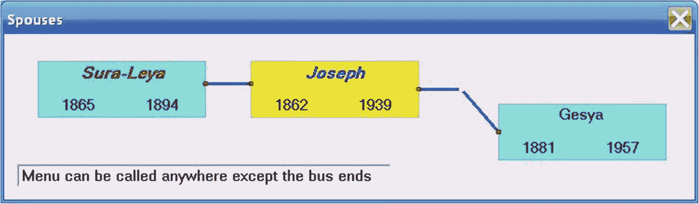

图 7-31

一个原始的家谱

```csharp
List people = new List ();
List buses = new List ();
List connections = new List ();
```

对于这样一个小型树结构，更简单的方法是先组织所有需要的 `Person` 对象，然后用巴士将它们连接起来。

```csharp
private void DefaultView ()
{
    ... ...
    people .Clear ();
    buses .Clear ();
    connections .Clear ();
    float w = 180;
    float h = 60;
    Person prsnWife_1 = new Person (this, mover, new RectangleF (80, 60, w, h), Color .Cyan, fntSelected, "Sura-Leya", "1865", "1894");
    Person prsnHusband = new Person (this, mover,
        new RectangleF (320, 60, w, h), Color .Yellow,
        fntSelected, "Joseph", "1862", "1939");
    Person prsnWife_2 = new Person (this, mover,
        new RectangleF (600, 100, w, h), Color .Cyan, fntSelected, "Gesya", "1881", "1957");
    AddPerson (prsnWife_1);
    AddPerson (prsnHusband);
    AddPerson (prsnWife_2);
    ... ...
```

两个 `Person` 对象之间的直接连接在家谱设计中经常使用，因此使用一个专门的 `LinkPeople()` 方法在这种情况中会很有用。

```csharp
Bus bus = LinkPeople (this, mover, new Pen (Color .Blue, 3),
    prsnWife_1, Side .E, 0.4, prsnHusband, Side .W, 0.4);
AddBus (bus);
bus = LinkPeople (this, mover, new Pen (Color .Blue, 3),
    prsnHusband, Side .E, 0.5, prsnWife_2, Side .W, 0.5);
AddBus (bus);
... ...
```

由 `LinkPeople()` 方法准备的巴士由单个线段组成，因此图 7-31 显示的并不是默认视图；第二辆巴士是用鼠标按过的，并且新的连接点被移动到了新位置。

## `LinkPeople()` 方法详解

`LinkPeople()` 方法不仅准备了两条 `Person` 对象之间的直线连接，还在新总线的两端创建了两个新的 `BusConnection` 元素，这些元素必须放置在矩形的两侧。每个连接点的初始位置由矩形边以及沿该边的定位系数决定。该系数取值在 `[0, 1]` 范围内。对于水平边，系数从左到右增加；对于垂直边，系数从上到下增加。

```csharp
private Bus LinkPeople (Form frm, Mover mvr, Pen pn,
Person personFrom, Side side_From, double coef_From,
Person personTo, Side side_To, double coef_To)
{
Bus busFrom = personFrom .Bus;
PointF ptA = Auxi_Geometry .PointOnRectangleBorder (personFrom .Area,
side_From, coef_From);
ptA = Auxi_Geometry .Polyline_NearestPoint (ptA, busFrom .Points);
Bus busTo = personTo .Bus;
PointF ptB = Auxi_Geometry .PointOnRectangleBorder (personTo .Area,
side_To, coef_To);
ptB = Auxi_Geometry .Polyline_NearestPoint (ptB, busTo .Points);
Bus bs = new Bus (frm, mvr, ptA, ptB, pn);
List conecs = new List ();
conecs .Add (new BusConnection (frm, mvr, ptA, bs, EndType.Head, busFrom));
conecs .Add (new BusConnection (frm, mvr, ptB, bs, EndType .Tail, busTo));
busFrom .AddConnection (conecs [0]);
busTo .AddConnection (conecs [1]);
connections .AddRange (conecs);
return (bs);
}
```

## `Person` 对象的调优

该示例中没有总线调优，而 `Person` 对象的调优则借助已演示过的调优表单（图 7-29）完成。调优通过菜单命令启动；无论按下的是 `Person` 对象内部的空白区域还是其某个注释，调用的菜单都是相同的，但在任何情况下，都必须标识出该 `Person` 对象。当按下空白区域时，表示直接点击了 `Person` 对象（`personPressed`）。当按下注释时，则表示点击了某个 `CommentToRect` 对象。该注释是某个 `Person` 对象的下属，因此注释保留了其主导对象的 ID。通过快速搜索所有 `Person` 对象即可返回所需的对象。

```csharp
private void OnMouseUp (object sender, MouseEventArgs e)
{
... ...
if (mover .Release (out iWasObject, out iWasNode, out shapeNode))
{
GraphicalObject grobj = mover .ReleasedSource;
if (e .Button == MouseButtons .Right && fDist <= 3)
{
... ...
else if (grobj is CommentToRect)
{
long idPerson = grobj .ParentID;
foreach (Person prsn in people)
{
if (prsn .ID == idPerson)
{
personPressed = prsn;
break;
}
}
ContextMenuStrip = menuOnPerson;
... ...
```

## 两代人家谱示例

保存和恢复家谱的过程不依赖于家谱的大小，下一个示例将对此进行说明。

*   文件：`Form_TwoGenerations.cs`
*   菜单位置：应用 ➤ 家族树逐步设计 ➤ 两代人

这是设计完整家族树应用之前的最后一个预备示例。实际上，这并不是一个用于演示某种特性的示例，而是一个真实的（尽管规模较小）家谱，它只有一个限制：构建完这个小家谱后，没有添加新人的命令。图 7-32 显示只有来自两代人的四个人。

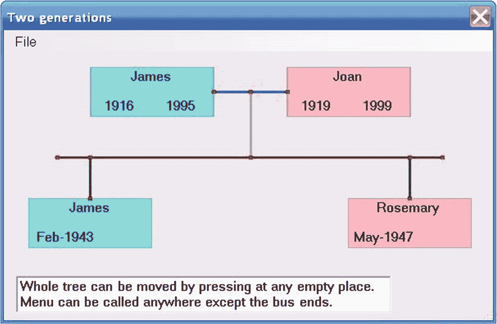

图 7-32 一个两代人的小家谱

尽管这个家谱很小，但它代表了所有可能类型的总线。总线的分类可以基于它们到不同对象的连接。为了更好地解释，我使用不同颜色来区分不同类型的总线。在图 7-17 中，相同的四种总线类型用字母 *A*、*B*、*C* 和 *S* 标记。在当前示例中，没有使用这种字母标记，但新解释中的定义顺序与旧解释相同。

*   **两个 `Person` 对象之间的总线**：在图 7-32 中，它是蓝色的。视觉上它是在两个人之间，但实际上，这条总线连接到这些 `Person` 对象边界上的不可见总线。
*   **总线与 `Person` 对象之间的总线**：在图 7-32 中，有两条这种类型的绿色总线。实际上，每条都在两条总线之间，但其中一条是不可见的。
*   **两条总线之间的总线**：在图 7-32 中，它是灰色的。
*   **两端无连接的总线**：在图 7-32 中，它是棕色的。

任何家谱，即使像这样简单，也可以用不同的方式构建。这个家谱的设计从两个代表父母的 `Person` 对象以及它们之间的总线开始；这条总线借助上一个示例中使用的 `LinkPeople()` 方法构建。

```csharp
private void DefaultView ()
{
float w = 150;
float h = 60;
Person father = new Person (this, mover, new RectangleF (140, 60, w, h),
Color .Cyan, fntSelected,
"James", "1916", "1995");
AddPerson (father);
Person mother = new Person (this, mover, new RectangleF (380, 60, w, h),
Color .LightPink, fntSelected,
"Joan", "1919", "1999");
AddPerson (mother);
Bus busParents = LinkPeople (this, mover, new Pen (Color .Blue, 3),
father, Side .E, 0.5, mother, Side .W, 0.5);
AddBus (busParents);
... ...
```

下一步，设计另外两个代表子女的 `Person` 对象。它们上方的一条总线（棕色）被初始化，但所有到这条总线的链接将稍后添加。

```csharp
float cyChildren = father .Bottom + 100;
Person son = new Person (this, mover,
new RectangleF (father .Left - w / 2, cyChildren, w, h),
Color .Cyan, fntSelected, "James", "Feb-1943", "");
Person daughter = new Person (this, mover,
new RectangleF (mother .Right - w / 2, son .Top, w, h),
Color .LightPink, fntSelected, "Rosemary",
"May-1947", "");
AddPerson (son);
AddPerson (daughter);
float cyAbove = (father .Bottom + son .Top) / 2;
float cxL = Auxi_Geometry .Middle (son .Area) .X;
float cxR = Auxi_Geometry .Middle (daughter .Area) .X;
Bus busAbove = new Bus (this, mover, new PointF (cxL - 40, cyAbove),
new PointF (cxR + 40, cyAbove),
new Pen (Color .Brown, 3));
AddBus (busAbove);
```

现在是时候将“子女”与它们上方的总线（棕色）连接起来了。每条绿色总线都由`LinkBusPerson()`方法组织。从方法名称可以看出，新总线充当了现有总线与`Person`对象之间的链接。

```
AddBus (LinkBusPerson (this, mover, new Pen (Color .Green, 3), busAbove, new PointF (cxL, cyAbove), son, Side .N, 0.5));
AddBus (LinkBusPerson (this, mover, new Pen (Color .Green, 3), busAbove, new PointF (cxR, cyAbove), daughter, Side .N, 0.5));
```

新总线通过其头部连接到现有总线（此处为棕色）。现有总线上的连接点作为参数（`ptFrom`）传入，但这只是一个优选的连接点，实际连接点将在方法内部计算。新总线通过其尾部连接到`Person`对象；连接点（`ptTo`）由矩形边和沿该边的定位系数描述；这与`LinkPeople()`方法中的方式相同。

```csharp
private Bus LinkBusPerson (Form frm, Mover mvr, Pen pn,
Bus busFrom, PointF ptFrom,
Person personTo, Side side_To, double coef_To)
{
ptFrom = Auxi_Geometry .Polyline_NearestPoint (ptFrom, busFrom .Points);
Bus busTo = personTo .Bus;
PointF ptTo = Auxi_Geometry .PointOnRectangleBorder (personTo .Area,
side_To, coef_To);
ptTo = Auxi_Geometry .Polyline_NearestPoint (ptTo, busTo .Points);
Bus bs = new Bus (frm, mvr, ptFrom, ptTo, pn);
List conecs = new List ();
conecs .Add (new BusConnection (frm, mvr, ptFrom, bs, EndType .Head,
busFrom));
conecs .Add (new BusConnection (frm, mvr, ptTo, bs, EndType .Tail, busTo));
busFrom .AddConnection (conecs [0]);
busTo .AddConnection (conecs [1]);
connections .AddRange (conecs);
return (bs);
}
```

设计这个小型家谱树的最后一步是构建两代人之间的连线——即灰色总线。

```csharp
private void DefaultView ()
{
... ...
PointF pt = Auxi_Geometry .Middle (busParents .HeadPoint,
busParents .TailPoint);
AddBus (LinkBusBus (this, mover, new Pen (Color .DarkGray, 3), busParents, pt, busAbove, new PointF (pt .X, busAbove .TailPoint .Y)));
... ...
```

两条总线之间的连线由`LinkBusBus()`方法组织。传递给该方法的两个点同样是优选位置，而实际的连接点会在方法内部计算得出。

```csharp
private Bus LinkBusBus (Form frm, Mover mvr, Pen pn,
Bus busFrom, PointF ptFrom, Bus busTo, PointF ptTo)
{
ptFrom = Auxi_Geometry .Polyline_NearestPoint (ptFrom, busFrom .Points);
ptTo = Auxi_Geometry .Polyline_NearestPoint (ptTo, busTo .Points);
Bus bs = new Bus (frm, mvr, ptFrom, ptTo, pn);
List conecs = new List ();
conecs .Add (new BusConnection (frm, mvr, ptFrom, bs, EndType .Head,
busFrom));
conecs .Add (new BusConnection (frm, mvr, ptTo, bs, EndType .Tail, busTo));
busFrom .AddConnection (conecs [0]);
busTo .AddConnection (conecs [1]);
connections .AddRange (conecs);
return (bs);
}
```

当这个小家谱树的设计完成后，会得到以下元素集合：

| `List<Person> people` | 包含四个元素。 |
| --- | --- |
| `List<Bus> buses` | 包含九个元素。其中五个以不同颜色显示，另外四个总线不可见，沿着`Person`对象的边界分布。 |
| `List<BusConnection> connections` | 包含八个元素。它们都以红色小点显示。 |

再次强调，`mover`队列中元素的顺序由`RenewMover()`方法定义。

```csharp
private void RenewMover ()
{
mover .Clear ();
foreach (Person person in people)
{
person .IntoMover (mover, 0);
}
foreach (Bus bus in buses)
{
bus .IntoMover (mover, 0);
}
foreach (BusConnection con in connections)
{
con .IntoMover (mover, 0);
}
... ...
```

如上述代码所示，首先放入所有`BusConnection`元素，然后是所有`Bus`元素，最后是所有`Person`元素。`BusConnection`元素必须位于队列头部；否则，其他元素可能会遮挡连接点，导致无法移动连接点。`Bus`和`Person`对象的顺序并不那么重要，可以更改。`mover`队列中的元素顺序与其绘制顺序相关，因此这完全取决于当总线穿过`Person`对象的矩形区域时，你希望看到怎样的视觉效果。如果你希望总线显示在任何`Person`对象之上，并且能够按下总线并将其移开，那么当前的编码顺序是正确的。如果你希望总线位于`Person`对象下方，则需要同时修改`RenewMover()`和`OnPaint()`方法。

棕色总线是这个家谱树中唯一可以声明为可移动的总线（通过其上下文菜单的命令），因为它是唯一两端都空闲的总线。如果你将棕色总线声明为可移动，那么你就可以移动它，例如，使其更靠近上方或下方的`Person`对象，并且在移动过程中，该总线上所有的连接点（共有三个）将保持其相对位置。

此示例中出现了两个新特性。在这个小树中它们并不太需要，但在真正的大型家谱树中将很有帮助。

第一个特性是将家谱树保存到二进制文件中，并从该文件中恢复家谱树；这是通过一个小型文件菜单的命令完成的。

第二个新特性是能够在屏幕上移动整个家谱树。对于这样小的树来说，这个特性完全不需要，但在真正的大型家谱树中它非常有用。首先，没有规则规定你实际家谱树的构建顺序。你可以从最遥远的已知祖先开始，一代一代向下构建，或者将你自己置于屏幕中央，并向各个方向开始添加亲属及其连线。无论如何，很可能即使是最大的屏幕也不够用，你将需要滚动屏幕。这只需在任意空白处按下左键，并向所需方向拖动即可实现。这个工具很简单。

有一个布尔字段用于指示当前是否正在移动整个家谱树。

```csharp
bool bMoveAll = false;
```

当在任意空白处按下左键时，该字段的值会改变，并记录当前鼠标位置（`ptMouse_prev`）。

```csharp
private void OnMouseDown (object sender, MouseEventArgs e)
{
ptMouse_Down = e .Location;
if (mover .Catch (e .Location, e .Button))
{
... ...
}
else
{
if (e .Button == MouseButtons .Left)
{
bMoveAll = true;
ptMouse_prev = e .Location;
}
}
... ...
```
