# 家谱应用程序设计与实现

当 `mover` 未捕捉到任何对象，但布尔参数 `bMoveAll` 指示所有元素正在移动时，会计算当前鼠标位置与前一个位置之间的距离；这一对数值（`dx, dy`）将用于同步移动所有元素。

```csharp
private void OnMouseMove (object sender, MouseEventArgs e)
{
    if (mover .Move (e .Location))
    {
        Invalidate ();
    }
    else
    {
        if (bMoveAll)
        {
            if (ptMouse_prev != e .Location)
            {
                int dx = e .X - ptMouse_prev .X;
                int dy = e .Y - ptMouse_prev .Y;
                foreach (Person person in people)
                {
                    person .Move (dx, dy);
                }
                foreach (Bus bus in buses)
                {
                    bus .Move (dx, dy);
                }
                foreach (BusConnection con in connections)
                {
                    con .Move (dx, dy);
                }
                ptMouse_prev = e .Location;
                Invalidate ();
            }
        }
        ... ...
```

当鼠标释放且未释放任何对象时，`bMoveAll` 字段的值会设置为 `false`。

```csharp
private void OnMouseUp (object sender, MouseEventArgs e)
{
    ... ...
    if (mover .Release (out iWasObject, out iWasNode, out shapeNode))
    {
        ... ...
    }
    else
    {
        bMoveAll = false;
        ... ...
```

## 整合所有部分

- 文件：`Form_FamilyTree.cs`
- 菜单位置：应用程序 ➤ 家谱

现在是将所有内容整合在一起的时候了，添加一些命令来简化真实家谱的设计，并最终开发一个家谱应用程序。此应用程序不会使用任何在前期示例中未讨论过的新类。任何复杂程度的树都可以通过 `Person`、`Bus` 和 `BusConnection` 对象来构建。这三个类的工作原理已在前面详细讨论过，在家庭树应用程序中，您会发现许多熟悉的内容。还会出现一些尚未使用过的新事物，但新颖之处不在于细节。该程序的主要区别在于设计家谱的过程。

在启动任何一个前期示例时，您会立即看到一些内容。可能有一辆或多辆公共汽车、一个 `Person` 对象、或几个带有一些连接的对象，但总能看到一些东西，所有这些小示例的主要目的是演示和解释后续如何使用已有的对象。当您启动家谱应用程序时，除了一个带有简短信息的矩形外，什么都没有。您可以将这些信息压缩到很小的尺寸，并将其留在角落。表单区域是空的！没有人事先知道特定用户要构建什么样的家谱，除了这个用户，没有人知道他想从家谱的哪个部分开始。

假设您决定以标准（传统）方式绘制您的家谱。绘制没有标准顺序。您可以从已知的最年长祖先开始，然后一代一代地往下画。您可以从您的父母开始，然后向两个方向延伸。您可以从最年轻的一代开始，然后向过去追溯。每个人通常用一个包含名字的椭圆或矩形来表示。已知的出生和死亡日期（如果已经发生，则包括死亡日期）放在名字旁边，而这个小块区域的边框明确表明名字和日期属于同一个人。

人与人之间的关系通过适当放置这些框和大量线条来显示。通常，时间线从上到下。配偶通常并排放置，他们的矩形用一条短线连接。孩子通常放在父母下方的同一水平位置。最年长的兄弟姐妹位于该行的最左端（对于书写方向从左到右的国家来说，这是正确的）。为了显示世代之间的关系，孩子通过一条线连接到他们的父母之间，但连接后续世代的方式可以有不同。您可以画一条新线从父母的连线向下延伸，然后在线的下端添加一个包含名字的矩形。如果您知道一对夫妇有三个孩子，那么很可能您会先并排画三个矩形，然后将每个矩形连接到上层的线上。这不是规则，但如果您这样做，整个图形会更精确。这也意味着您的图形可以由几个部分组成，通过添加一些线条将它们合并成一个完整的家谱。

有时您会发现遗漏了某些部分，没有空间在正确的位置放置新矩形了；那么您会将它们画在旁边，并用虚线来表示关系。当您决定绘制家谱的某个旁支时，也可能发生同样的情况。

一张纸会不够用。您会再拿一张纸，并做上特殊标记，以显示这些纸应该如何相互放置。表示人与人之间关系的线条会从一张纸延伸到另一张纸，并绕过那些恰好挡路的矩形。

我提到了在纸上绘制家谱的正常方式，但如果您想为同样的目的编写一个程序，那么这个程序必须在屏幕上提供同样的灵活性来绘制家谱。会存在一些限制，但必须将这些限制的影响最小化。

构建任何家谱都使用三个类的元素；所有这些元素都包含在三个 `List` 中。

```csharp
List m_people = new List ();
List m_buses = new List ();
List m_connections = new List ();
```

`Bus` 和 `BusConnection` 对象以类似的方式被添加到相应的列表中。每个对象都有一个唯一的 ID，因此通过这个 ID 进行简单检查，以防止同一个对象被重复包含。

```csharp
private void AddBus (Bus busNew)
{
    foreach (Bus bus in m_buses)
    {
        if (busNew .ID == bus .ID)
        {
            return;
        }
    }
    m_buses .Add (busNew);
}
private void AddConnection (BusConnection conNew)
{
    foreach (BusConnection con in m_connections)
    {
        if (conNew .ID == con .ID)
        {
            return;
        }
    }
    m_connections .Add (conNew);
}
```

添加 `Person` 对象的方式类似，但需要更多的操作。每个 `Person` 对象都包含一个不可见的 `Bus`，因此需要检查两个元素的 ID 唯一性，然后增加两个 `List`。

```csharp
private void AddPerson (Person prsn)
{
    long idPerson = prsn .ID;
    long idBus = prsn .Bus .ID;
    foreach (Person person in m_people)
    {
        if (idPerson == person .ID)
        {
            MessageBox .Show (...);
            return;
        }
    }
    foreach (Bus bus in m_buses)
    {
        if (idBus == bus .ID)
        {
            MessageBox .Show (...);
            return;
        }
    }
    m_people .Add (prsn);
    m_buses .Add (prsn .Bus);
}
```

家谱程序的用户对 `Bus` 或连接一无所知；他们更愿意用孩子、父母和配偶这些概念来思考构建的树，但任何添加单个亲属或一组亲属的命令都可以轻松追溯到这些 `AddBus()`、`AddConnection()` 和 `AddPerson()` 方法。这些方法用于收集提供程序功能的数据；用户处理的是同一数据在屏幕上的表示，并非所有的数据元素都可视化了。

- 所有 `Person` 对象都是可见的。
- `Bus` 对象分为可见和不可见。表示家谱中人物关系的 `Bus` 是可见的。每个 `Person` 对象都有一个不可见的 `Bus` 作为其下属元素。
- 所有 `BusConnection` 对象都是不可见的。

元素因使用许多不同的命令而出现在屏幕上。所有屏幕元素都可以修改，但首次出现时，任何新元素都会获得标准视图。此标准视图也可以由用户设置，但初始时程序以如下方式定义两个标准。

```csharp
public Form_FamilyTree ()
{
    ... ...
    busStandard = new Bus (this, mover, ..., new Pen (Color .DarkGray, 2));
    personStandard = new Person (this, mover, new RectangleF (0, 0, 140, 50), Color .Cyan, “姓名”, “出生”, “死亡”);
    ... ...
```

本章后面将讨论这些命令并用一些图进行说明；这些图中的元素大多显示在其提到的标准视图中。

当正在构建家谱且需要向已有元素添加新元素时，会在某个现有元素上调用菜单，新部分必须链接到该元素。也可以设计一个不相关的新部分，然后再将其链接到现有的家谱。

## 设计新版家谱

# 设计新版家谱

设计新版家谱始于在空白区域调出菜单（图 7-33）。该菜单的命令分为三组。第一组包括所有能在屏幕上放置新元素的命令；其中一项命令还包含子菜单。菜单会在鼠标右键点击的位置打开；由某个命令生成的新元素会锚定在该位置。第二组命令允许您更改现有家谱中所有总线的可视化参数。任何总线或`Person`元素的视图，均可通过在该元素上调出专用调整表单来更改。用户可以通过为所有未来元素设置首选的可视化参数来简化工作；所有新元素都将根据这些设置构建。我将在本节末尾附近详细说明这些设置；现在，我们先来看看对图 7-33 所示菜单中命令的响应。

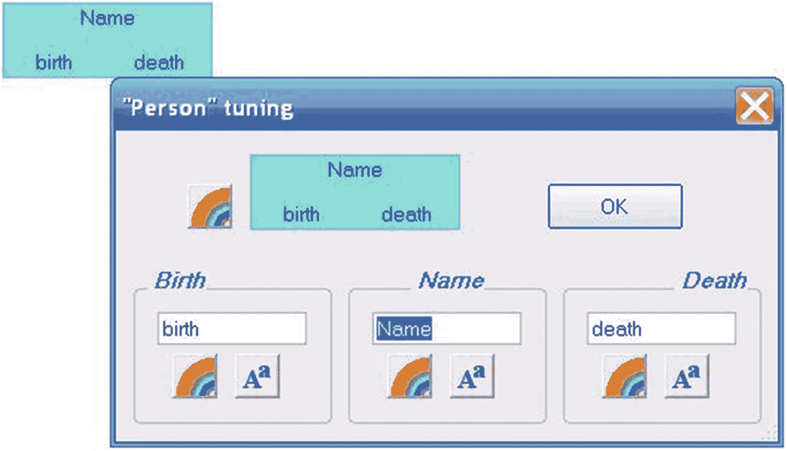

图 7-34 带有调整表单的新 `Person` 对象

| *新建个人* | 屏幕上出现一个新的 `Person` 对象；其左上角位于鼠标点击点。用户至少需要为此人定义姓名，并决定是否显示出生和死亡的相关附加信息。因此，系统会自动为该新对象调用一个辅助调整表单（图 7-34）。视图中可能存在大量 `Person` 对象，因此调整表单的初始定位有助于告知用户当前正在修改的元素。 |
|---|---|

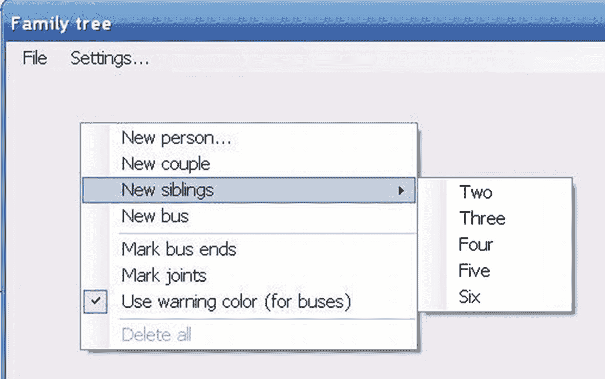

图 7-33 要开始构建家谱，请在空白区域调出菜单


图 7-35 屏幕上的新夫妻

| *新建夫妻* | 新夫妻由一对 `Person` 对象表示，它们彼此靠近放置，并由一条短直总线连接（图 7-35）。左侧元素的左上角位于鼠标点击点。两个新元素相同且具有标准视图。用户可以选择先修改哪一个，并通过元素上的菜单调出调整表单。 |
|---|---|

```csharp
private void Click_miNewPerson (object sender, EventArgs e)
{
    Person person = new Person (this, mover, ptMouse_Up, m_personStandard);
    AddPerson (person);
    RenewMover ();
    ModifyPerson (person, Auxi_Geometry .LocationByCoefficients (person .Area, 0.5, 0.95));
}
```

```csharp
private void Click_miNewCouple (object sender, EventArgs e)
{
    NewCouple(ptMouse_Up);
    RenewMover();
}
```

`NewCouple()` 方法生成两个 `Person` 对象，它们通过一条短总线相连；该总线由 `LinkPersonPerson()` 方法组织。

```csharp
private Bus NewCouple (PointF ptLT)
{
    Person personL = new Person (this, mover, ptLT, personStandard);
    AddPerson (personL);
    Person personR = new Person (this, mover,
        new PointF (personL .Right + m_nDistSpouses, ptLT .Y), personStandard);
    AddPerson (personR);
    Bus link = LinkPersonPerson (this, mover, busStandard, personL, Side .E, 0.5, personR, Side .W, 0.5);
    return (link);
}
```

有几种情况需要组织这对对象并将其连接到现有元素；图 7-39 演示了其中一种情况。由于从新夫妻到现有家谱的连接通常是从这两个新 `Person` 元素之间的短总线出发，因此 `NewCouple()` 方法会返回此总线。

从视觉上看，总线位于两个 `Person` 对象之间，但实际上它是连接这两个 `Person` 对象内部不可见总线的总线，因此 `LinkPersonPerson()` 方法只是 `LinkBusBus()` 方法的一个封装。

```csharp
private Bus LinkPersonPerson (Form frm, Mover mvr, Bus busSample,
    Person personFrom, Side side_From, double coef_From,
    Person personTo, Side side_To, double coef_To)
{
    Bus busFrom = personFrom .Bus;
    PointF ptFrom = Auxi_Geometry .PointOnRectangleBorder (personFrom .Area, side_From, coef_From);
    Bus busTo = personTo .Bus;
    PointF ptTo = Auxi_Geometry .PointOnRectangleBorder (personTo .Area,
        side_To, coef_To);
    return (LinkBusBus (frm, mvr, busSample, busFrom, ptFrom, busTo, ptTo));
}
```

一个几乎相同的 `LinkBusBus()` 方法已在之前的示例中使用过，其代码在 12 页前展示过。这两个方法的参数有一个区别：在先前的版本中，新总线的画笔作为参数之一，而当前版本则使用了总线样本。

```csharp
private Bus LinkBusBus (Form frm, Mover mvr, Bus busSample,
    Bus busFrom, PointF ptFrom, Bus busTo, PointF ptTo)
{
    ptFrom = Auxi_Geometry .Polyline_NearestPoint (ptFrom, busFrom .Points);
    ptTo = Auxi_Geometry .Polyline_NearestPoint (ptTo, busTo .Points);
    Bus bs = new Bus (frm, mvr, ptFrom, ptTo, busSample);
    BusConnection conFrom = new BusConnection (frm, mvr, ptFrom, bs,
        EndType .Head, busFrom);
    BusConnection conTo = new BusConnection (frm, mvr, ptTo, bs,
        EndType .Tail, busTo);
    busFrom .AddConnection (conFrom);
    busTo .AddConnection (conTo);
    m_connections .Add (conFrom);
    m_connections .Add (conTo);
    AddBus (bs);
    return (bs);
}
```

在使用“新建夫妻”命令的情况下，`LinkPersonPerson()` 方法被用作 `LinkBusBus()` 方法的封装。稍后您会看到一些命令，允许您在现有总线和 `Person` 对象之间设置新总线。根据新总线的端点位置，会使用 `LinkBusPerson()` 和 `LinkPersonBus()` 方法；两者都是 `LinkBusBus()` 方法的封装。

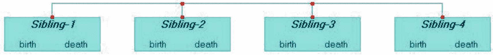

图 7-36 四个兄弟姐妹

| *新建兄弟姐妹* | 此菜单命令包含一个子菜单，允许您在屏幕上放置 2 到 6 个兄弟姐妹；图 7-36 显示了四个兄弟姐妹的变体。如果需要超过六个兄弟姐妹，最佳方法是使用此命令在屏幕上放置六个兄弟姐妹，然后通过另一个菜单中的命令添加更多兄弟姐妹；我将在本节后面介绍这一点。`NewSiblings()` 方法的返回值是兄弟姐妹上方的总线（`busAbove`）。左侧元素上方长总线的转折点即为鼠标点击点。 |
|---|---|

在之前的示例 `Form_TwoGenerations.cs`（图 7-32）中，我已经解释了添加多个兄弟姐妹的步骤。那例子中只有两个兄弟姐妹，但这并不重要。主要区别可以通过比较这两幅图看出。尽管两图在尺寸上差异不大——仅消失了两处小点——但它们的消失凸显了构建此类元素组方式上的重大变化。在旧版本中，组织了一条由单个线段组成的水平长总线；然后所有兄弟姐妹都通过短总线以相同的方式连接到这条总线上。

我特意使用图 7-36（包含两个以上兄弟姐妹）来演示，在新版本中并非所有兄弟姐妹都以相同方式连接；内部兄弟姐妹与两端兄弟姐妹的连接存在明显差异。在大型家谱的设计过程中，我开始感觉到使用旧版本进行后续树操作时有些不便，因此我更改了将兄弟姐妹纳入家谱的流程。

`NewSiblings()`方法用于处理 2 到 6 个同级节点。首先构造一个由三段组成的长总线，两端带有两个短正交线段的长线是同一总线（`busAbove`）的组成部分。

```csharp
private Bus NewSiblings (PointF ptL_busAbove, int nSiblings)
{
    nSiblings = Math .Min (Math .Max (2, nSiblings), 6);
    float cyLineAbove = ptL_busAbove .Y;
    float cySiblings = cyLineAbove + m_nDistGenerations / 2;
    float lenLineAbove =
        (nSiblings - 1) * (m_personStandard .Width + m_nDistSiblings);
    PointF ptL_above = ptL_busAbove;
    PointF ptR_above = new PointF (ptL_above .X + lenLineAbove, cyLineAbove);
    List<PointF> pts = new List<PointF> ();
    pts .Add (new PointF (ptL_above .X, cySiblings));
    pts .Add (ptL_above);
    pts .Add (ptR_above);
    pts .Add (new PointF (ptR_above .X, cySiblings));
    Bus busAbove = new Bus (this, mover, pts, m_busStandard);
    AddBus (busAbove);
    ... ...
}
```

然后，两个同级节点——第一个（`childFirst`）和最后一个（`childLast`）——连接在此总线的两端。

```csharp
float cxM_person;
PointF ptOnBus;
Person childFirst = new Person (this, mover,
    new PointF (ptL_above .X - m_personStandard .Width / 2, cySiblings), m_personStandard);
childFirst .Name_Comment .Text = "Sibling-1";
AddPerson (childFirst);
Person childLast = new Person (this, mover,
    new PointF (ptR_above .X - m_personStandard .Width / 2, cySiblings), m_personStandard);
childLast .Name_Comment .Text = "Sibling-" + nSiblings .ToString ();
AddPerson (childLast);
LinkBusBus_broken_bus (this, mover, m_busStandard,
    childFirst .Bus, busAbove .HeadPoint,
    childLast .Bus, busAbove .TailPoint, busAbove);
```

如果同级节点超过两个，则它们以标准（旧）方式通过更短的总线连接到长总线。由于长总线的长度已根据所需同级节点数量预先计算，因此它们不会发生重叠问题。

| `新总线` | 这是一个简单但有趣的命令，它在屏幕上生成一个极小的对象，无需插图即可说明。这个新对象是一条两端自由的短总线。 |

```csharp
for (int i = 2; i < nSiblings; i++)
{
    cxM_person = ptL_above .X + Convert .ToSingle (
        lenLineAbove * ((i - 1) * 1.0 / (nSiblings - 1)));
    Person child = new Person (this, mover,
        new PointF (cxM_person - m_personStandard .Width / 2, cySiblings), m_personStandard);
    child .Name_Comment .Text = "Sibling-" + i .ToString ();
    AddPerson (child);
    ptOnBus = new PointF (cxM_person, cyLineAbove);
    LinkBusPerson (this, mover, m_busStandard, busAbove, ptOnBus,
        child, Side .N, 0.5);
}
RenewMover ();
return (busAbove);
}
```

新总线的长度很可能只有 20 像素，尽管环境（或其他对象）可能迫使它变得更长。这种长度（和角度）的不确定性源于两端必须自由的要求。`Click_miNewBus()`方法的代码显示没有组织任何连接，因此无论端点的长度和位置如何，新总线都不会连接到任何对象。但我希望新总线在视觉上是自由的，这可能会带来一些问题。包含“New bus”命令的菜单在空白位置被调用，新总线的头部放置在同一位置，因此该端点肯定是自由的。当使用此命令时，没有人能预测所有其他元素的定位，但我希望新总线的另一端也位于空闲位置，因此通过`AnotherEndOfNewBus()`方法来搜索适合另一个端点的点。

```csharp
private void Click_miNewBus (object sender, EventArgs e)
{
    Bus bus = new Bus (this, mover, ptMouse_Up,
        AnotherEndOfNewBus (ptMouse_Up), m_busStandard);
    AddBus (bus);
    RenewMover ();
}
```

在本书开头的第 1 章中，我曾提到移动器不仅可以检查光标所在位置，还可以检查其工作的窗体上任何位置是否存在对象。这种检查很少需要，并且在所有其他示例中都没有使用，但在族谱应用中，这种检查在少数情况下很有用，而新总线端点的自由定位就是其中之一。

该方法首先尝试设计一条最小长度的垂直总线，并使用`Mover.PointInfoAll()`方法检查提议端点处是否存在任何对象。如果该点已被占用，则检查同一半径圆周上的另一个点。如果该半径圆周上的所有位置都被占用，则增加半径并重复相同的检查。最终会找到一个空闲点，并组织新总线。

对于同一问题，还可以有其他解决方案。例如，可以将自由总线设计得异常宽，使其视图即使在另一端放置在某些对象上时也能引起注意，但我更倾向于安装搜索空闲位置的方法。

新总线很短且不连接到任何东西，但这条自由总线允许你在族谱中组织任何需要的链接；这可以是两总线之间的链接、两个`Person`对象之间的链接，或总线与个人之间的链接。为此，你需要按下总线的端点，将其移动到要连接的对象上，然后释放总线端点。由于最后一步是释放对象，因此我们需要查看`OnMouseUp()`方法的代码。我将对以下代码片段进行一些有用的解释。

释放的总线端点可以连接到可见总线，也可以连接到`Person`对象边界上的不可见总线；在后一种情况下，它看起来像是连接到个人。这两种情况的代码仅在一些微小细节上有所不同，因此查看总线在总线上释放的情况就足够了。释放节点的编号（`iWasNode`）和形状（`shapeNode`）用于进一步分析，因此使用了相应版本的`Mover.Release()`方法。

```csharp
private void OnMouseUp (object sender, MouseEventArgs e)
{
    ptMouse_Up = e .Location;
    double dist = Auxi_Geometry .Distance (ptMouse_Down, ptMouse_Up);
    int iWasObject, iWasNode;
    NodeShape shapeNode;
    if (mover .Release (out iWasObject, out iWasNode, out shapeNode))
    {
        GraphicalObject grobj = mover .ReleasedSource;
        long id = grobj .ID;
        if (e .Button == MouseButtons .Left)
        {
```

释放的元素必须是不可移动总线的圆形节点。

```csharp
            if (grobj is Bus && shapeNode == NodeShape .Circle && !grobj .Movable)
            {
```

总线只能通过头部或尾部连接。圆形节点是总线覆盖层中的第一个节点，这些节点从头部到尾部编号；头部的节点编号为 0。释放的总线端类型（`end_type`）也由节点编号确定。

```csharp
                if (iWasNode == 0 || iWasNode == busPressed .TailPointNumber)
                {
                    EndType end_type = (iWasNode == 0) ? EndType .Head
                                                      : EndType .Tail;
```

释放总线与某个对象的连接取决于释放点处这些对象的情况。关于任何点处对象的完整信息可以通过移动器的`Mover.PointInfoAll()`方法获得。此方法返回一个`List`对象，其中包含在指定点找到的所有对象；此`List`中对象的顺序与它们在移动器队列中的顺序相同。

```csharp
                    List<MoverPointInfo> infoAll = mover.PointInfoAll (ptMouse_Up);
                    for (int j = 0; j < infoAll .Count; j++)
                    {
                        MoverPointInfo info = infoAll [j];
                        GraphicalObject objFound = mover [info .ObjectNum] .Source;
```

### 总线连接逻辑

当总线释放在某个对象（`objFound`）上时，将总线连接到自身是毫无意义的。我认为没有人真的需要组织这样的连接，但总有一些人喜欢用匪夷所思的情况来测试任何应用程序，而且也存在对象意外释放在错误位置的可能性。

```
if (id != objFound.ID)         // 总线不能连接到自身
{
```

当释放的总线必须连接到下方对象时，存在两种情况：它可以是另一条总线，也可以是一个 `Person` 对象。在第二种情况下，连接是通过矩形对象边界下方的不可见总线来组织的。这两种情况仅在少数细节上有所不同，因此只需研究其中一种情况的细节即可；我们考虑将总线释放在另一条可见总线上的情况。我们需要检查并避免尝试将释放的总线端连接到其另一端已连接的同一总线的情况。同时，两条总线相互连接也是禁止的，因此不允许出现两条总线形成回路的情况。

```
if (objFound is Bus)
{
    Bus busFound = objFound as Bus;
    if ((iWasNode == 0 && busPressed.TailConnected &&
        busPressed.ID_OnTail == busFound.ID) ||
        (iWasNode == busPressed.TailPointNumber &&
        busPressed.HeadConnected &&
        busPressed.ID_OnHead == busFound.ID) ||
        id == busFound.ID_OnHead ||
        id == busFound.ID_OnTail)
    {
        // 两端不能连接到同一条总线
        // 两条总线不能相互连接
    }
    else
    {
```

看起来我们成功地避开了所有陷阱，释放的总线端可以连接到释放点找到的另一条总线。此操作需要一些计算，并更改两个对象的几个参数。

- 计算精确的连接点（`ptOnBus`）。
- 释放的总线端（头端或尾端）必须采用此计算出的位置。
- 在计算出的点处组织新的连接（`con`）。
- 这是一个到找到的总线的新连接。每条总线都保存着所有连接的信息，因此必须使用 `Bus.AddConnection()` 方法更新找到的总线中的信息。
- 新连接被包含在完整的连接 `List` 中。
- 屏幕上会出现新的可移动对象，因此必须更新移动器队列。

```
    PointF ptOnBus =
    Auxi_Geometry.Polyline_NearestPoint (
    ptMouse_Up, busFound.Points);
    if (end_type == EndType.Head)
    {
        busPressed.HeadPoint = ptOnBus;
    }
    else
    {
        busPressed.TailPoint = ptOnBus;
    }
    BusConnection con = new BusConnection (this, mover, ptOnBus, busPressed,
    end_type, busFound);
    busFound.AddConnection (con);
    m_connections.Add (con);
    RenewMover ();
    }
    break;
}
else if (objFound is Person)
    ... ...
```

家谱应用程序提供了多种设计树状图的命令。这些命令的命名方式使其更易于从人际关系角度理解（例如 `new couple` 或 `new siblings`），但实际上，组织的元素内部并没有关于这些声明关系的任何信息，也没有构造元素所使用命令的痕迹。只有以不同方式相互链接的 `Bus`、`Person` 和 `BusConnection` 元素。同一个树状图可以通过多种不同的方式构建，并且三个列表（`m_people`、`m_buses` 和 `m_connections`）中元素的顺序可能不同。无论你是喜欢使用将连接元素组放置在屏幕上的命令，还是喜欢使用每次添加一条总线或一个人的其他命令，这都无关紧要。

例如，前面几页讨论过的 `New couple` 命令可以用以下命令和操作序列替代：

1.  在一个点使用 `New person` 命令，然后在稍偏一点的地方再次使用相同命令；屏幕上将出现两个独立的 `Person` 对象。
2.  使用 `New bus` 命令在屏幕上放置一条新总线；初始化时，此总线未连接到任何东西。
3.  移动新总线的一端，并将其释放在某个 `Person` 对象内部；该总线将连接到该对象（视觉上连接到该对象的边界）。
4.  移动总线的另一端，并将其释放在第二个 `Person` 对象内部；该总线端将连接到该对象的边界。

此序列比单个 `New couple` 命令长得多，但对于所设计树状图的工作而言，这并不重要。

如果需要断开总线连接，该怎么办？在连接点处调用菜单，并选择此菜单上唯一的命令——`Delete connection`（图 7-37a）。总线将被断开，并且在大多数情况下，其端点将移开，以在两个元素之间形成视觉间隔。如果总线长度减小会导致其变得过小，则不会移动端点，也不会形成间隔。无论是否形成间隔，总线都将被断开。具有自由端的总线是一种异常情况，因此在断开连接后，总线会使用警告颜色绘制（图 7-37b）。

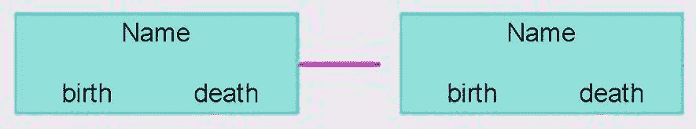

图 7-37b

断开连接后，两个对象之间存在间隔，并且总线使用警告颜色
```

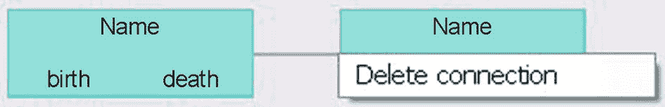

`图 7-37a`

连接点上的菜单只有一个命令。

可以在家谱元素上调用多个菜单。其中一些菜单很小，只有一两个命令，但 `Person` 对象和总线段上的菜单非常大，包含修改现有家谱和添加新部分的命令。

## 总线段上的菜单

总线段上的菜单（`图 7-38`）可以在任何总线上调用，无论这条总线是否连接到任何东西，或者完全是自由的，这都无关紧要。和往常一样，菜单在按下总线的位置处被调用。如果所选菜单命令带来新的元素到屏幕上，则此新部分将在同一点连接到被按下的总线。以下四幅图展示了将新元素放置到屏幕上的命令，被按下的总线以宽蓝线显示。

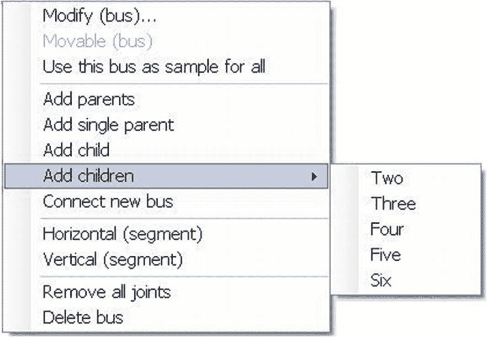

`图 7-38`

总线段上的菜单

| *Modify (bus)* | 此命令打开辅助窗体（`图 7-21`），允许你更改被按下总线的外观。 |
|---|---|
| *Movable (bus)* | 此命令允许你更改被按下总线的可移动性，但此命令只能应用于两端都自由的总线。这对于真实的族谱来说是一种极其罕见和奇怪的情况，但它是有可能的，所以我决定在菜单中保留此命令。 |
| *Use this bus as sample for all* | 假设你花了一些时间构建家谱，然后决定更改所有总线的外观。你可以通过使用其调整窗体单独更改任何总线的外观，但在大型树状图中对每条总线都重复此过程将花费太长时间。相反，你可以将一条总线的外观更改成你喜欢的任何样式，然后使用此命令；所有总线都将根据此样本更改其外观。 |
| *Add parents* | 一对带有它们之间一条总线的 `Person` 对象代表一对夫妇；父母之间的总线与被按下的总线相链接（`图 7-39`）。这对新的 `Person` 元素与 `图 7-35` 中的一对完全相同；结果中的唯一区别在于这一对元素与被按下总线之间的链接。 |

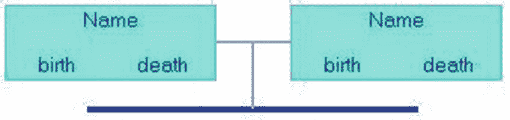

`图 7-39` “添加父母”命令的结果

| *添加单亲* | 如果有关于一位家长的信息，或者用户只想在家谱中包括一对夫妇中的一个人，那么用户可以使用“添加单亲”命令。因为屏幕上只会出现一个新的 `Person` 对象（`图 7-40`），并且这个新对象至少需要更改一些信息，因此系统会自动在该新对象上调用一个用于调整 `Person` 对象的辅助表单。 |
|---|---|

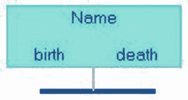

`图 7-40` 添加单亲

| *添加孩子* | 此命令与前一个命令类似，但新的 `Person` 对象出现在被点击的连接线下方（`图 7-41`）。使用此命令有两种标准情况：某对夫妇只有一个孩子，或者有超过六个兄弟姐妹的情况。六个兄弟姐妹的屏幕元素可以通过一个命令来组织；如果需要更多兄弟姐妹，可以在此兄弟姐妹上方的连接线上使用此命令来添加。 |
|---|---|

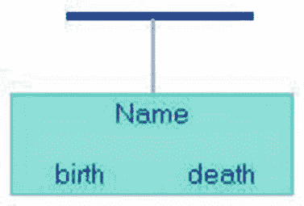

`图 7-41` 添加单个孩子

| *添加多个孩子* | 有一个子菜单可以在屏幕上放置 2 到 6 个兄弟姐妹；`图 7-42` 显示了两个兄弟姐妹的变体。如果有超过六个兄弟姐妹，你可以用一个命令放置六个，然后根据需要在兄弟姐妹上方的连接线上反复应用“添加孩子”命令。我已经解释过添加多个兄弟姐妹的步骤顺序。一切始于一条由三段折线设计的连接线；然后第一个和最后一个兄弟姐妹连接到这条连接线的两端。为了更好理解，`图 7-42` 中的连接点以特殊方式进行了标记。 |
|---|---|

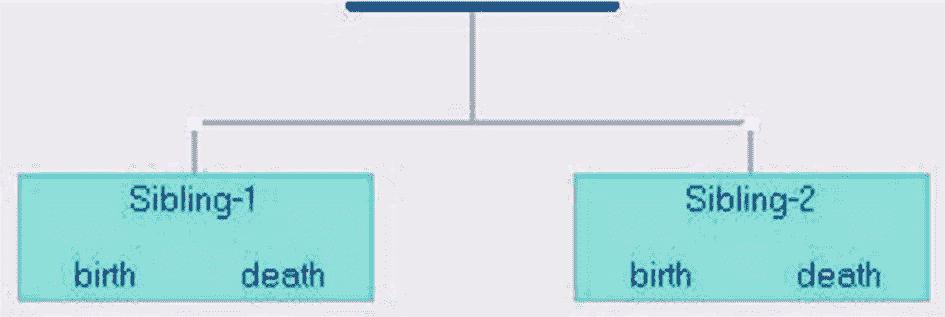

`图 7-42` “添加多个孩子”的结果：两个兄弟姐妹

| *连接新总线* | 新的短连接线连接到被点击的连接线上；新连接线的另一端是自由的。你可以重新配置新连接线，移动其自由端，并将其连接到任何所需的对象（连接线或人物）。 |
|---|---|

家谱的构建不仅可以将一组新元素连接到连接线，还可以连接到任何 `Person` 对象；这通过可以在该类对象上调用的菜单命令来完成（`图 7-43`）。从可用添加新元素命令列表可以看出，这些命令与空白位置菜单的命令（`图 7-33`）以及连接线段菜单的命令（`图 7-38`）类似。

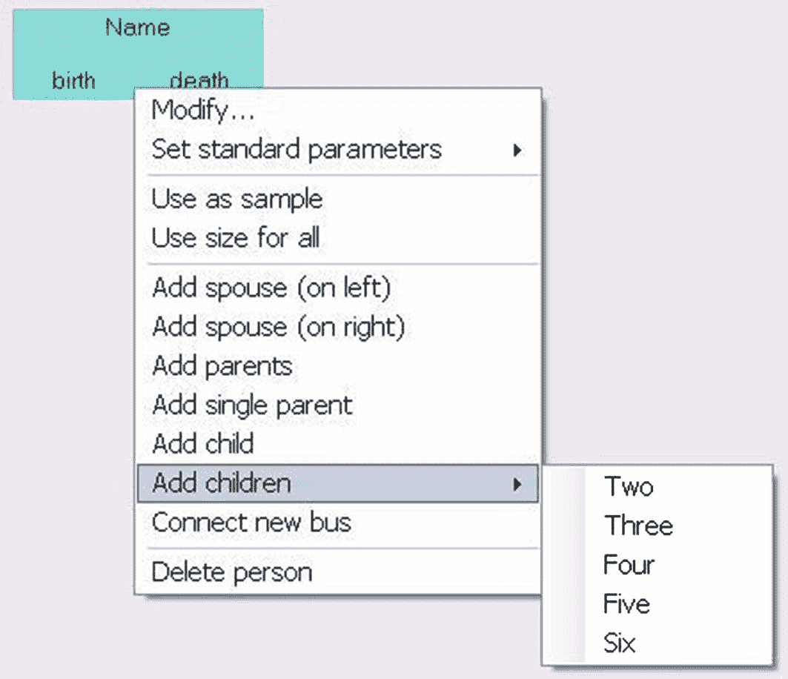

`图 7-43` 人物对象上的菜单

`Person` 对象菜单中的第一个命令会调用其调整表单，这在 40 页前已经演示过（参见 `图 7-29`），但在真实的家庭树应用程序中，用户需要编辑所有信息片段，因此所有三个文本框都允许此类编辑（`图 7-44`）。

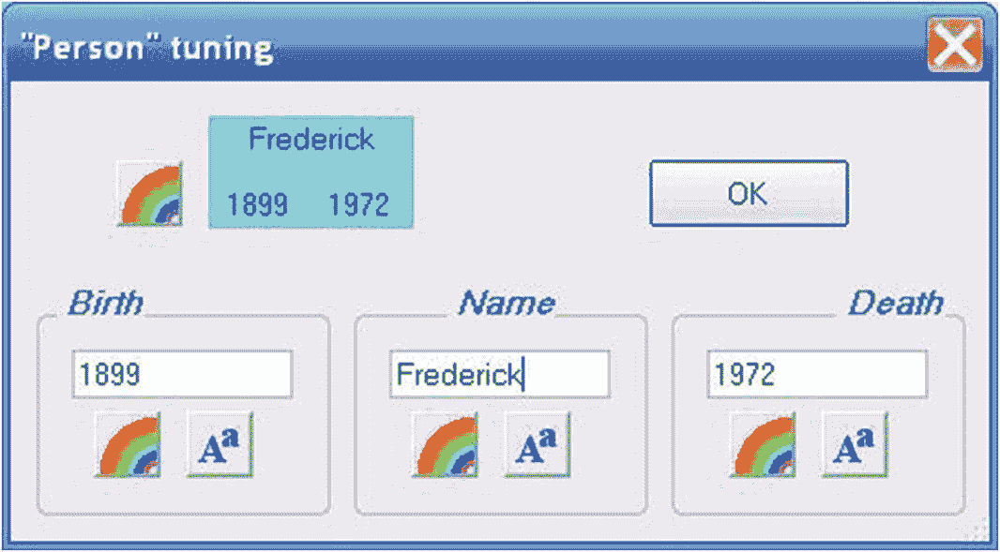

`图 7-44` 人物对象的调整表单

如果你清除了出生和死亡文本框中的信息，那么这些注释将不会出现在 `Person` 对象中。如果你尝试对姓名字段进行同样的操作，那么*未知*这个词将代替姓名出现。此调整表单允许你单独更改每个注释的字体和颜色，尽管我认为用户可能希望在家谱中对元素有更标准化的视图。我假设此调整表单主要用于更改注释文本。按照这种优先使用方式，组内的六个小按钮就变得多余了，因此它们的外观通过空白位置菜单的命令来调节。

`Person` 对象菜单的主要部分包含六个不同的命令，用于为被点击的人添加一些亲属；其中四个命令会添加一个新的 `Person` 对象。我想再次强调，菜单中的命令是按照现有人员与新人之间的关系来表述的，但这些关系并未存储在家谱中的任何地方。家谱中只有 `Bus`、`Person` 和 `BusConnection` 类的元素。

`图 7-45` 演示了使用这四个添加单个 `Person` 对象的命令的结果。该对象会与调整表单一起出现在屏幕上；其发生方式与 `图 7-34` 所示完全相同。在 `图 7-45` 的所有版本中，黄色矩形代表调用菜单的现有 `Person` 对象；青色矩形则是使用某个命令后出现的结果。如你所见，这四个不同的命令将新矩形放置在现有矩形的一侧或另一侧，这也是这四个命令之间的唯一区别。

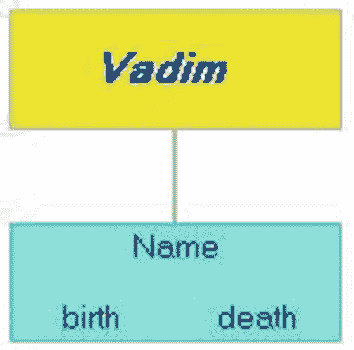

`图 7-45d` “添加孩子”命令

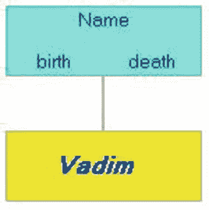

`图 7-45c` “添加单亲”命令


`图 7-45b` “添加配偶”(右侧) 命令


`图 7-45a` “添加配偶”(左侧) 命令

一个变体可以通过以下三个简单步骤转换为另一个变体：

- 将青色矩形移动到黄色矩形的另一侧。
- 将黄色矩形上的连接线端点移动到青色矩形当前所在的那一侧。
- 移动青色矩形上的连接线端点，使得连接线显示为两个矩形之间的最短直线。

其他几个命令需要一些说明。

| *连接新总线* | 此菜单在矩形内部某处调用。执行此命令后，新连接线将连接到距菜单调用点最近的边界点。如果需要，可以轻松地围绕边界移动新的连接点。 |
|---|---|

| *设置标准参数* | 此命令有一个子菜单，提供更改部分或全部可见性参数的选项。我之前提到过存在保持标准视图的 `Bus` 和 `Person` 元素，也提到用户可以在一定程度上更改这些视图。 |
|---|---|
