# 5. 普通控件的图形化模拟

如果标准控件能够替换为具有模拟功能的图形化对象，那将极大地推动用户驱动型应用程序的发展。本章将讨论最常用控件的这类图形化模拟方案。

多年来，标准控件一直是程序设计的基石，因此大多数开发者无法想象没有这些元素的程序设计。控件设计得非常出色，但……操作系统将它们作为高级元素来处理，这给用户驱动型应用程序带来了诸多问题，甚至掩盖了其宣称的优势。

我主张程序完全由用户控制，因此我不喜欢让操作系统主要控制一类特殊对象的想法。控件总是显示在所有图形对象的上层，所以如果屏幕上有控件，用户甚至无法改变元素的排列顺序。控件具有实用的功能，因此如果它们能像其他元素一样行为，并且用户能以与图形对象完全相同的方式控制它们，我就喜欢在我的程序中使用它们。“山不来就穆罕默德，穆罕默德就去就山。”普通控件是否会按照我的观点改变尚存疑虑，因此唯一的方法是设计行为类似于所需控件的图形元素。表 5-1 列出了本章讨论的最常用的普通控件及其图形化模拟。

**表 5-1：常用普通控件及其图形化模拟**

| Visual Studio 中的控件 | `MoveGraphLibrary.dll` 中的模拟控件 | 说明 |
| --- | --- | --- |
| `Button` | `Button_GR`, `Button_Text`, `Button_Drawing`, `Button_Image` | `Button_GR` 是抽象类；三个派生类代表按钮顶部信息类型不同的变体。 |
| `Label` | `Label_GR` | |
| `NumericUpDown` | `NumericUpDown_GR` | |
| `TrackBar` | `Trackbar_GR` | |
| `ListBox` | `ListBox_GR` | 最多只能选择一个元素。 |
| `ComboBox` | `ComboBox_DDList` | 经典组合框有三种变体；图形化模拟仅演示了具有 `DropDownList` 样式的一种。 |
| `CheckBox` | `CheckBox_GR` | |
| `ListView` | `ListView_GR` | 最多只能选择一个元素。 |
| `RadioButton`, `GroupBox` | `RadioButton_GR`, `Group_RadioButtons` | 单选按钮仅成组使用，因此有一个按钮类和一个用于其分组的类。 |

图 5-1 显示了这些普通控件的视图。在我多年使用的所有标准控件中，只有 `TextBox` 没有对应的图形化模拟。

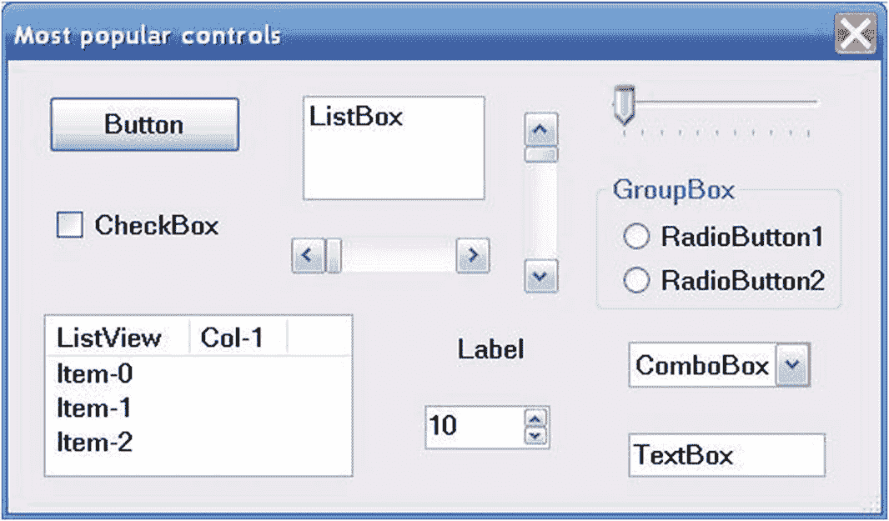

**图 5-1：普通控件视图**

在开始讨论它们的模拟控件之前，我想先提一下图形化控件的一些通用特性。之后我将只讨论图形化控件，因此可以省略“图形化”这个词，并将所有新元素简单地称为控件。如果我必须提及经典控件，我会称它们为“普通控件”。

控件可以是简单的或复杂的；控件需要像任何其他图形对象一样调节可移动性和可调整大小性，因此所有这些内容都将与新的类一起讨论。但控件有一个特性，使它们与之前讨论的所有图形对象不同。许多控件具有某种状态（例如，控件可以被选中或取消选中），根据工作应用程序的参数，这种状态的更改是被允许还是被阻止。因此，控件可以声明为启用或禁用。启用和禁用控件之间的区别必须是可见的。

以下是为所有控件实现的几条规则：

- 控件可以使用或不使用附加注释；由于所有控件都是矩形的，因此它们都使用 `Comment_ToRectangle` 类的注释。有些控件将文本作为重要组成部分，并且该文本传达了关于元素用途的足够信息。这些是复选框和单选按钮，因此 `CheckBox_GR` 和 `RadioButton_GR` 类的对象没有注释。`Button_Text` 类的按钮顶部有文本，通常这提供了关于此类按钮的充分信息。如果需要额外信息，此类按钮可以带注释使用。每个控件最多只有一个注释；唯一的例外是 `Trackbar_GR` 类，它允许有无限数量的注释。
- 任何控件都可以是启用或禁用的；唯一的例外是 `Label_GR` 类。禁用意味着与对象关联的某些状态或值无法更改；标签没有此类值，因此 `Label_GR` 类没有 `Enabled` 属性。禁用状态不影响对象的可移动性，因此启用和禁用的对象以相同的方式移动和调整大小。基本的 `GraphicalObject` 类不包含用于调节启用/禁用状态的字段和属性，因此这在每个控件类中实现。
- 类的 `Enabled` 属性在三个不同的地方使用。
  - 在类的 `Draw()` 方法中，因为启用和禁用的对象必须看起来不同。
  - 在 `OnMouseDown()` 方法中，用于阻止对禁用对象的那些以其状态（值）更改开始的点击。注意不要阻止开始调整大小或移动，因为这两种操作对于禁用对象都是允许的。
  - 在 `OnMouseUp()` 方法中，用于阻止对禁用对象的状态（值）更改。

## 按钮

- 文件：`Form_Button.cs`
- 菜单位置：*图形控件 ➤ 按钮*

本示例中的大部分元素都是按钮（图 5-2），但它们分属于三个不同的类。

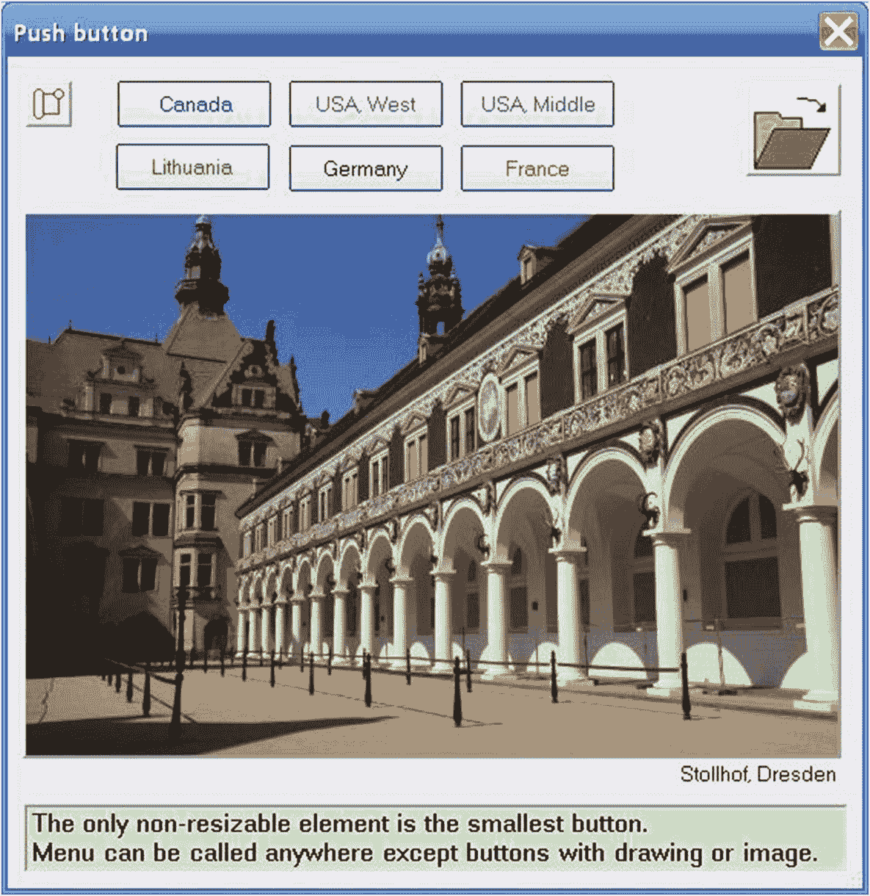

图 5-2

本示例中使用了所有三种类型的按钮——带文本、绘图或图像的按钮

```
Button_Drawing btnCover;
Button_Image btnOpen, btnImage;
Button_Text btnCanada,
btnUSA1, btnUSA2,
btnLithuania,
btnGermany, btnFrance;
```

如图 5-2 所示，按钮表面可带有文本、绘图或图像。这些按钮之间的唯一区别就在于此，因此它们都派生自抽象类 `Button_GR`，该类包含了它们的主要特性，例如封面设计、移动和允许的缩放类型。

```
public abstract class Button_GR
: GraphicalObject
{
PointF [] ptsCorner;
Resizing resize;
bool bEnabled;
bool bPressed;
Comment_ToRectangle m_cmnt = null;
```

按钮有一个用于矩形对象的标准封面：四个角上的圆形节点、四条边上的条形节点，以及一个用于整个区域的矩形节点（图 5-3）。边上的条形节点具有默认宽度（六个像素），而角上的圆形节点则稍微放大。当按钮被声明为不可移动时，其大节点上的光标形状会从标准的 `Cursors.SizeAll` 变为 `Cursors.NoMove2D`。

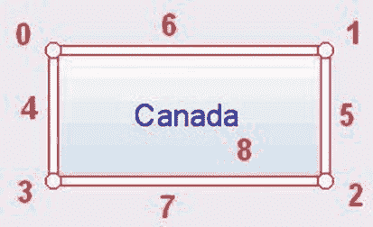

图 5-3

`Button_GR` 类封面中的节点

# 图形化按钮的实现与绘制

## 按钮变体与构造

按钮使用四种标准的缩放变体。根据具体的缩放类型，某些节点可能会被压缩到零大小；图 3-3 展示了所有四种变体。按钮的移动和缩放的组织方式与 `Rectangle_Unicolored` 类相同；但是，按钮不可旋转。

`Button_GR` 类的构造函数使用一个矩形来设置对象的初始区域，但并未描述可能的尺寸变化范围。默认情况下，任何按钮都是完全可缩放的，没有上限，但对允许的最小尺寸有限制（`minSide = 10`），以避免因缩放而意外消失。

```csharp
public Button_GR (Form frm, Mover mvr, RectangleF rc)
{
... ...
float w = Math .Max (minSide, rc .Width);
float h = Math .Max (minSide, rc .Height);
ptsCorner = new PointF [4] {rc .Location, new PointF (rc .X + w, rc .Y),
new PointF (rc .X + w, rc .Y + h),
new PointF (rc .X, rc .Y + h) };
bEnabled = true;
bPressed = false;
resize = Resizing .Any;
}
```

## 按钮的注释

任何按钮都可以关联一个注释。按钮是矩形的，因此最简单的方法是使用 `Comment_ToRectangle` 类的注释。通常，带有文本的按钮不需要任何额外的注释，因为文本本身已经清楚地说明了对象的用途。带有图像或绘图的按钮通常需要一些注释。例如，一个调整窗体可能包含用于更改不同颜色参数的相同按钮，如果没有注释，将无法选择所需的按钮。在当前示例中，只有包含图片的按钮才使用了注释。带注释的按钮的行为方式与 `Rectangle_withComments` 类所述相同。

## 按钮的绘制与焦点

三种类型按钮的主要区别在于它们的绘制方式，但在深入细节之前，我想提醒大家注意基于普通控件的程序的一些特性，以及绘制普通 `Button` 控件的一些细节，因为图形化按钮必须尽可能地复制它们的行为和外观。

控件是在 30 多年前引入的。在鼠标问世之前，键盘是用户的主要工具。多年前，即使手边有鼠标，许多用户也喜欢使用键盘来控制应用程序，因此在设计屏幕控件时，它们被期望（通过可视化）提供键盘控制程序所需的信息。为此，使用了焦点的概念。无论一个窗体中有多少个控件（很久以前甚至不使用`窗体`这个词，而是使用`窗口`或`对话框`），在任何特定时刻，只有一个屏幕控件具有焦点，并且该控件会从键盘获取命令。可以通过按 `Tab` 键将焦点从一个控件移动到另一个控件。对话框中的所有控件都按顺序排列，焦点将按照此顺序在控件之间移动。当用鼠标单击控件时，焦点也会移动到该控件上，但如果有人喜欢使用键盘，那么在具有大量控件的对话框中，将焦点从一个元素传递到另一个元素可能需要多次单击 `Tab` 键。焦点仅在控件之间传递，而图形对象（系统认为它们是次要元素）则不参与此过程。有多种突出显示焦点的方法；它可能因控件类和系统版本而异，但通常会在控件内部有一个额外的虚线框，或者在元素周围有一个更宽的（或不同颜色的）边框。

在我看来，普通控件是多余的，应尽可能用图形化替代品来代替。此外，在应用程序中，鼠标作为唯一的控制工具就足够了，因此不使用焦点。在任何时刻，按钮要么处于启用状态，要么处于禁用状态。启用的按钮要么空闲（未按下），要么按下。这三种状态——禁用按钮、按下或空闲——必须在视觉上能够区分。

按钮的绘制由两部分组成：边框绘制和内部区域绘制。如果我没记错的话，早期版本的 Windows 中的按钮有模仿三维效果的边框，但这些按钮的背景是单色的。后来，边框被简化为普通线条，而背景则变为从顶部的浅灰色到底部的浅蓝色的渐变色。正常（空闲）按钮以此方式显示，而对于按下的按钮，则使用相同方向相反的渐变色，这种颜色的切换完美地指示了按钮按下或释放的瞬间。

## Button_Text 类

好的，作为高级文档工程师和翻译员，我将遵循您的指示，翻译以下文本。

现在我们可以从抽象按钮转向实际按钮。所述从浅灰色到浅蓝色的颜色渐变用于顶部带文本的`Button`控件，因此我们从`Button_Text`类开始。在当前示例（图 5-2）中，有六个`Button_Text`类的对象。

```csharp
public class Button_Text : Button_GR
{
string m_text;
Font m_font;
Color m_color;
ButtonBackType typeBack = ButtonBackType.Gradient;
SolidBrush brushBack;
```

`Button_Text`类的构造函数有六个参数；其中三个用于基类构造函数，另外三个用于顶部的文本。

```csharp
public Button_Text (Form frm, Mover mvr, RectangleF rc,
string txt, Font fnt, Color clr)
: base (frm, mvr, rc)
{
m_text = CheckedText (txt);
m_font = fnt;
m_color = clr;
brushBack = new SolidBrush (Background);
... ...
```

过去在`Button`控件中使用了两种背景类型：单色背景和颜色渐变。默认情况下，`Button_Text`对象采用颜色渐变组织，但该类提供了两种视图，并允许用户在任何时刻决定任何按钮的具体视图。视图的差异仅存在于启用的按钮中。

```csharp
public override void Draw (Graphics grfx)
{
... ...
Rectangle rc = Rectangle.Round (MainElementArea);
RectangleF rcClip = new RectangleF (rc.Left + 2, rc.Top + 2,
rc.Width - 4, rc.Height - 4);
Color clrText;
if (Enabled)
{
ButtonState btn_state = Pressed ? ButtonState.Pushed
: ButtonState.Normal;
if (typeBack == ButtonBackType.Unicolor)
{
ControlPaint.DrawButton (grfx, rc, btn_state);
grfx.FillRectangle (brushBack, rcClip);
}
else
{
Auxi_Drawing.Button (grfx, rc, btn_state, Background);
}
clrText = m_color;
}
else
{
grfx.FillRectangle (Brushes.White, rc);
grfx.DrawRectangle (Pens.LightGray, rc);
clrText = Color.LightGray;
}
... ...
```

顶部的文本完全按照准备的样子显示；如果文本包含换行特殊符号，则此类文本会显示为多行。通常文本没有此类符号，因此会显示为一行。无论如何，文本都会居中于按钮的中点。如果文本长度超过按钮宽度且文本内部有空格，则此类文本可以在空格处分割为多部分，并显示为多行，但前提是所有文本行的总高度小于按钮高度。通过查看图 5-4，或许更容易理解这一解释。


`图 5-4` 如果文本内部有空格，并且多行文本的总高度小于按钮高度，则文本会被拆分为多行

起初按钮宽度足以在一行内显示文本。然后我开始从侧面挤压按钮；文本仍然显示在一行内，尽管其长度超过了按钮宽度。在这种情况下，文本不会显示为两行，因为按钮高度不足以容纳两行文本。我停止改变宽度，开始增加按钮高度。文本由两个用空格分隔的单词组成；当按钮高度达到两行高度时，只有在这一刻文本才以两行形式显示。

普通控件设计有大量关联事件。为了组织对标准按钮点击所需的反应，您需要编写方法，然后将此方法与按钮的`Click`事件关联。

图形按钮没有自己的事件；与所有其他图形对象一样，一切都是通过窗体的`MouseDown`和`MouseUp`事件组织的。当鼠标按下图形按钮时，会调用`Button_GR.Press()`方法。

```
private void OnMouseDown (object sender, MouseEventArgs e)
{
ptMouse_Down = e.Location;
if (mover.Catch (e.Location, e.Button))
{
if (e.Button == MouseButtons.Left)
{
GraphicalObject grobj = mover.CaughtSource;
int iNode = mover.CaughtNode;
if (grobj is Button_GR)
{
btnPressed = grobj as Button_GR;
btnPressed.Press (e.Location, e.Button, iNode);
Invalidate ();
}
... ...
```

对按钮按下的反应在鼠标释放时提供，但是否需要反应取决于释放的节点以及鼠标按下和释放点之间的距离。

*   如果释放的是边界节点（无论是角还是边），则进行大小调整，由`Button_GR.MoveNode()`方法完成。大小调整结束后，无需进一步操作。

*   如果释放的是大节点（`iNode == Button_GR.Node_FullArea`），则反应取决于鼠标按下和释放点之间的距离。普通移动的情况（`fDist > 3`）由`Button_GR.MoveNode()`方法处理，在这种特定情况下，它会调用`Button_GR.Move()`方法提供帮助。

窗体的`OnMouseUp()`方法必须处理大节点上按钮点击的剩余情况，即当上述两点之间的距离可忽略不计（`fDist <= 3`）时。反应取决于被点击的按钮，该按钮通过其唯一的`ID`轻松识别。

*   当点击按钮时，会打开标准文件选择窗体，可以选择任何图像文件进行查看。（此按钮属于`Button_Image`类，所以我稍微超前了一点，但正如您从代码中看到的，`OnMouseUp()`方法内部的分析使用了基类`Button_GR`。）

```
private void OnMouseUp (object sender, MouseEventArgs e)
{
ptMouse_Up = e.Location;
double fDist = Auxi_Geometry.Distance (ptMouse_Down, ptMouse_Up);
int iObj, iNode;
if (mover.Release (out iObj, out iNode))
{
GraphicalObject grobj = mover.ReleasedSource;
long id = grobj.ID;
if (e.Button == MouseButtons.Left)
{
if (grobj is Button_GR && btnPressed.Enabled)
{
if (iNode == Button_GR.Node_FullArea && fDist <= 3)
{
... ...
```

*   点击按钮会切换封面的可视化显示。（此按钮属于`Button_Drawing`类。）

```
if (id == btnOpen.ID)
{
SelectFileName ();
}
```

*   点击此示例中的任何`Button_Text`元素，都会导致出现与按下的按钮相关联的图像。

```
else if (id == btnCover.ID)
{
bShowCovers = !bShowCovers;
}
```

```
else
{
ShowPredefinedImage (id);
}
}
```

当任何按钮被释放时，其状态由`Pressed`属性设置，并且视图会刷新。

```
btn.Pressed = false;
Invalidate ();
... ...
```

`Button_Text`元素具有一些可更改的参数，这些参数可以在特殊的调整窗体（图 5-5）中进行更改。

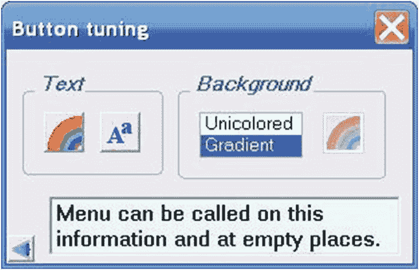

`图 5-5` `Button_Text`元素的调整

此示例中`Button_Text`元素的小菜单包括一个命令，用于在启用/禁用模式之间切换按下的按钮。在任何实际应用程序中，这仅由程序逻辑控制，但我特意添加了此命令以演示`Button_Text.Draw()`方法的所有可能性。

小按钮属于`Button_Drawing`类。此类有一个自己的字段；该字段表示用于在按钮区域上绘图的方法。

```csharp
public class Button_Drawing : Button_GR
{
    Delegate_DrawInRect m_draw = null;
```

最简单的 `Button_Drawing` 构造函数包含基类的三个参数，外加所需的绘图方法。

```csharp
public Button_Drawing (Form frm, Mover mvr, RectangleF rc,
    Delegate_DrawInRect drawmethod)
    : base (frm, mvr, rc)
{
    m_draw = drawmethod;
}
```

初始化时传递的绘图方法有两个参数。第二个参数是不含边框的按钮区域。绘图结果显示在该区域内，但这绝不意味着您的绘图方法必须严格限定在该矩形内部完成。通常情况下确实如此，例如在按钮顶部绘制箭头这类简单场景，在提供的矩形内绘制即可，一切看起来都很好。但有时按钮上的绘图需要是一幅更大画面中的一部分。在这种情况下，您可以计算大画面相对于传入矩形的位置，并绘制完整画面，无需考虑任何限制；裁剪是自动完成的，因此只有适合该声明矩形的部分才会显示在屏幕上。这样一来，不仅绘图更简单，而且绘图可以取决于按钮的位置、按钮与其他屏幕元素的相对位置，以及其他许多因素。按钮的大小也可以取决于其位置（例如，不需要的按钮可以移到窗体一侧并缩小），绘图可以取决于按钮大小，并在更大区域中显示更多细节。使用 `Button_Drawing` 对象可以实现许多有趣的功能。

用于调用字体和颜色选择标准对话框的小按钮通常声明为不可调整大小，但这仅仅是为了避免它们变得过小。默认情况下，所有 `Button_Drawing` 元素都是可调整大小的。在 `Form_FillHoles.cs`（图 2-43）中，使用一组按钮来选择所需的插头。在第二章末尾讨论该示例时，尚不宜关注该组或其中所用按钮的某些特性。现在很容易理解，内部 `Button_Drawing` 元素的移动/调整大小会自动改变 `Group_ArbitraryElements` 类的组，因此组的原始视图可以在几秒钟内改变。如果某些用户在原始组中订购七边形或八边形的插头时遇到问题，那么在稍加更改的组（图 5-6）中就不应再出现此类问题。每个按钮的大小和位置由用户决定，因此可以有无数种变体。

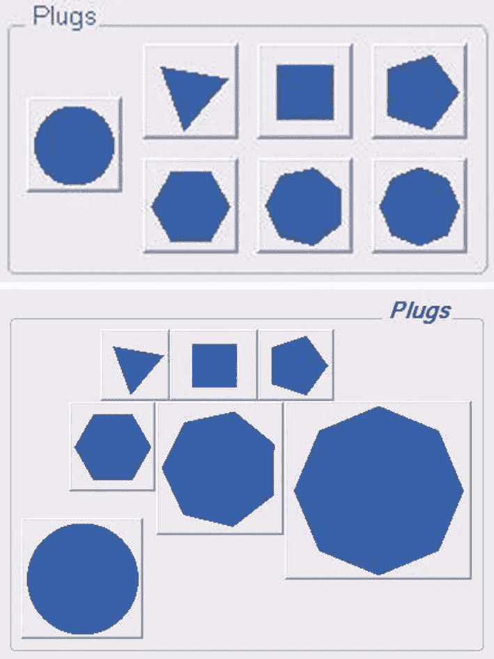

图 5-6

该组内的所有元素都是 `Button_Drawing` 类的按钮。该组的初始视图显示在顶部。

当前示例中使用了两个 `Button_Image` 类的元素。`Button_Image` 类的一个字段包含图像的路径；另一个字段用于存储图像本身。

```csharp
public class Button_Image : Button_GR
{
    string strImage = "";
    Image m_image = null;
```

初始化时使用四个参数。其中三个是基类的标准参数，最后一个是包含图像的文件路径。此参数可以包含文件的完整名称或相对路径；无论如何，完整路径都会存储在指定的按钮中。

```csharp
public Button_Image (Form frm, Mover mvr, RectangleF rc, string image_name)
```

任何 `Button_Image` 对象顶部的图像都在水平和垂直方向上居中。绘图使用 `Auxi_Drawing.ShowImage()` 方法，该方法会分析图像比例并将其适应到提议的矩形中。不会裁剪图像；如果按钮和图像具有不同的宽高比，则会在两个相对侧看到空白条。按钮通常是可调整大小的，因此您可以将其更改为所需大小，然后根据图像比例再稍作调整。图 5-7 展示了 `btnOpen` 元素的四种视图：一个小尺寸、两个仅在一个方向放大按钮的变体，以及一个我尝试保持原始比例的较大版本。

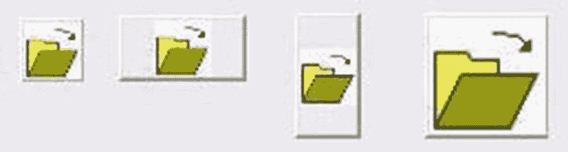

图 5-7

对同一个 `Button_Image` 对象调整大小的结果。

此示例使用了六张代表地球上风景如画地点的照片。我特意选择了一些具有不同宽高比的图片，以便您可以调整显示图像的 `Button_Image` 对象的大小。

矩形可以通过不同的方式调整大小。在我的另一本书[2]中，演示了如何以固定宽高比调整矩形大小。组织一个派生自 `Button_Image` 类的类很容易，该类将根据当前显示图片的比例来调整按钮大小。我决定在此处不这样做，但这可以成为一个很好的练习。

### 标签

- 文件：`Form_Label.cs`
- 菜单位置：图形控件 ➤ 标签

标签是一种用于显示文本的简单控件。如果文本太长无法在一行内显示，则在普通的 `Label` 控件中，文本会自动换行并显示在多行上。`Label_GR` 对象中显示文本的逻辑则不同：没有文本换行。

`Form_Label.cs` 示例（图 5-8）中显示了四个 `Label_GR` 类的对象。两个标签内的文本表示同一时间段的不同视图。这两个标签及其注释被合并到一个组中。

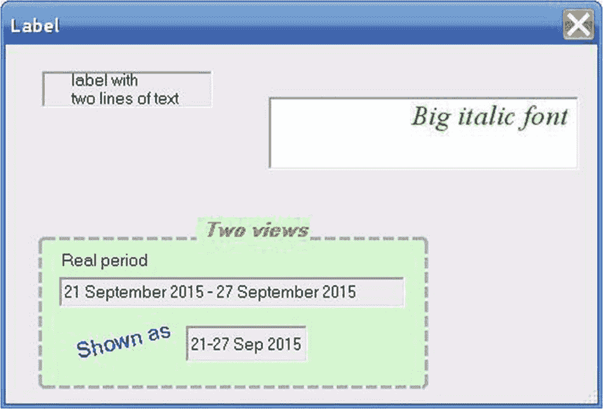

图 5-8

多个 `Label_GR` 对象。

`Label_GR` 类具有与 12 页前演示的按钮相同的外壳。

```csharp
public class Label_GR : GraphicalObject
{
    PointF [] ptsCorner;
    Resizing resize;
    string m_text;
    Font fntText;
    Color clrText;
    bool bHeightAdjustmentToFont = false;
```

`Label_GR` 类的任何构造函数都指定标签区域和文本；其他参数可以声明或使用默认值。

```csharp
public Label_GR (Form frm, Mover mvr, RectangleF rc, string txt,
    Font fnt_txt, Color clr_txt, RectFrameType frtype, Color clrBack)
```

`Label_GR` 对象有一个特殊的调谐窗体（图 5-9）。此窗体的某些部分，例如整个 `Background` 组，将在其他元素的调谐窗体中反复出现。

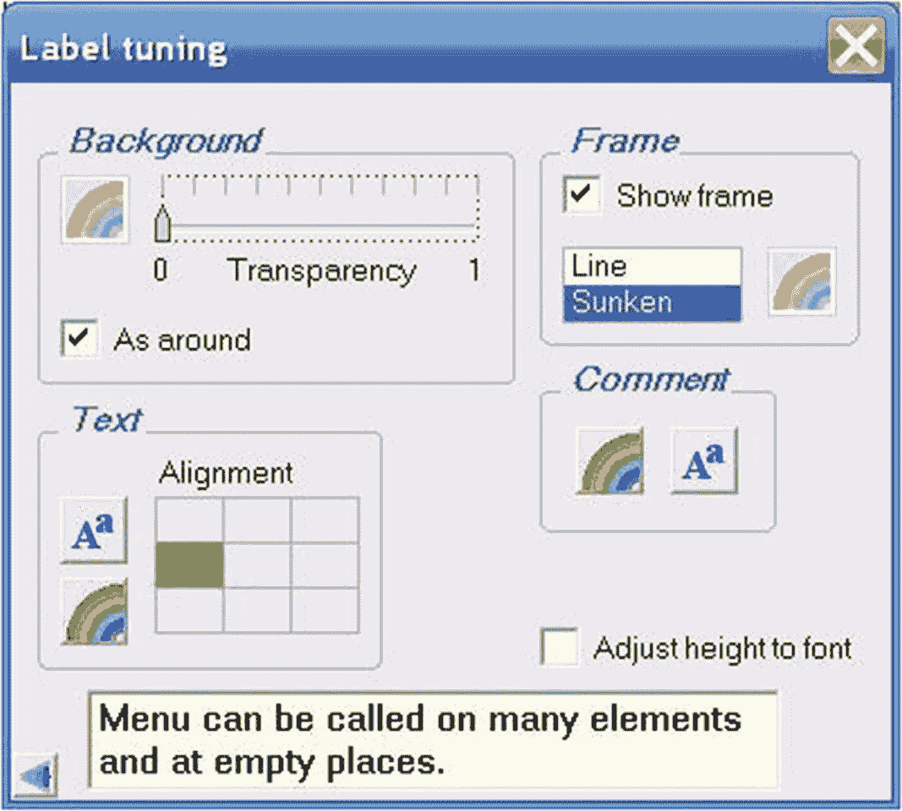

图 5-9

`Label_GR` 对象的调谐窗体。

任何 `Label_GR` 对象都用于在矩形区域内显示一些文本；该区域的大小可以通过直接调整大小来改变。文本本身也有一个矩形形状，其大小由所使用的字体决定。我始终坚持认为，字体更改虽然会导致文本区域改变，但不能影响标签区域。默认情况下，这些大小是独立的，并且有一种简单的方法可以通过调谐窗体来更改标签区域内文本的位置。

尽管我倾向于字体大小和标签高度的独立性，但某些用户可能更喜欢看到它们的关联性，因此提供了实现这种关联的可能性。如果您在“根据字体调整高度”复选框内打上勾，那么标签区域的高度将随任何字体更改而变化，但仅此而已。此勾选不会更改标签区域的宽度，也不会阻止直接调整标签大小。

### NumericUpDown

- 文件：`Form_NumericUpDown.cs`
- 菜单位置：图形控件 ➤ NumericUpDown

一个普通的 `NumericUpDown` 控件有两种改变数值的调节器：两个小按钮可以按预设的步长增减当前值，以及直接编辑数值的功能。`NumericUpDown_GR` 类取消了编辑功能，但增加了一个小型滑块，允许您快速遍历整个数值范围。我对 `NumericUpDown` 控件的使用经验有限，不足以断言这种增强功能能完美适配所有数值范围要求，但在所有需要用到 `NumericUpDown_GR` 元素的场景中，它们都表现得非常出色。

图 5-10 中几乎所有的 `NumericUpDown_GR` 对象都在左侧带有滑块。此外，还有一个滑块位于底部的对象、一个滑块位于顶部的对象，以及一个完全没有滑块的对象。这些对象展示了滑块可以以不同方式定位，并且没有滑块的新元素看起来与普通控件完全一致。

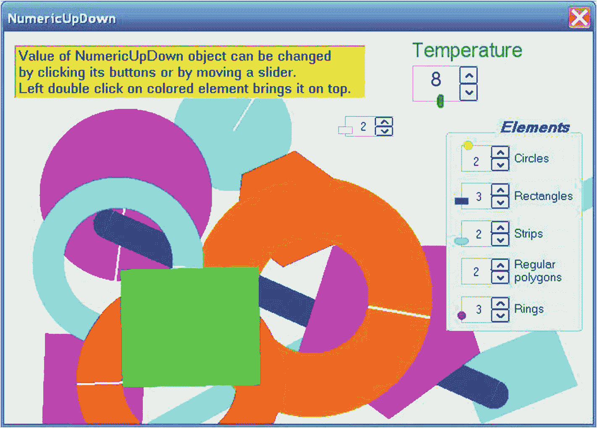

图 5-10

`NumericUpDown_GR` 元素的值可以通过点击两个按钮或移动滑块来改变

```csharp
public class NumericUpDown_GR : GraphicalObject
{
    PointF [] ptsCorner;
    Resizing resize;
    int minVal, maxVal, curVal, stepVal;
    Font m_font;
    SideAlignment alignValue;
    Side sideSlider;
    bool bSliderShow = true;
    NumericSliderShape shapeSlider = NumericSliderShape .Rectangle;
```

可能的滑块形状由 `NumericSliderShape` 枚举定义；图 5-10 展示了所有变体。

```csharp
public enum NumericSliderShape { Circle, Rectangle, Strip };
```

`NumericUpDown_GR` 对象的覆盖层由 12 个节点组成（图 5-11）。

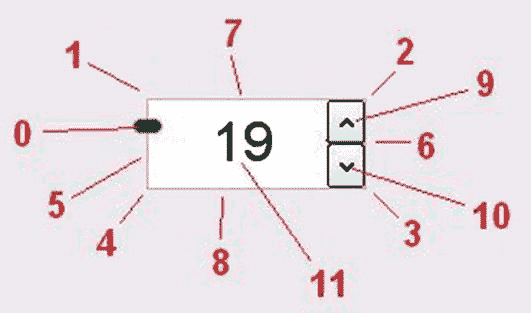

图 5-11

节点编号

- 对于已启用且显示滑块的元素，节点 0 覆盖滑块；该节点的形状由滑块形状决定。对于禁用的对象，该节点被压缩至零尺寸。
- 角落的四个小圆形节点（1–4）和侧边的四个条状节点（5–8）覆盖整个边框，用于调整大小。有四种标准的调整大小变体（与按钮部分讨论的相同），因此根据所选类型，这八个节点中的部分或全部可能被压缩至零尺寸。
- 矩形节点 9 和 10 覆盖两个带箭头的按钮。
- 矩形节点 11 覆盖整个区域，用于移动对象。

偶尔节点编号可能发生变化，因此在编写程序时，最好依赖关键节点的名称：`Node_Slider`、`Node_ArrowUp` 和 `Node_ArrowDown`。

滑块形状定义了第一个节点的形状；该节点的鼠标光标取决于滑块所在的边。只有右侧禁止放置滑块，因为两个带箭头的按钮紧邻此侧放置。

滑块只能沿其所处的边框移动。如果边框是可移动的，则滑块只能垂直于其自身线条方向移动。两个节点都采用双箭头形状的光标，但箭头指向正交方向，因为两个节点的移动方向正交。

在本章开头，我提到了三个必须检查元素启用/禁用状态的地方。对于 `NumericUpDown_GR` 类的对象，此状态也会影响覆盖层设计：禁用元素的第一个节点被压缩至零尺寸。对于已启用且滑块可见的对象，第一个节点的计算很容易，但取决于滑块侧边和形状，因此在此处展示会略显冗长。`DefineCover()` 方法的其余部分则很简单。为了使通过角落调整大小更容易，圆形节点的半径比默认值略有增加。

```csharp
public override void DefineCover ()
{
CoverNode [] nodes = new CoverNode [12];
if (bSliderShow && bEnabled)
{
... ...
}
else
{
nodes [0] = new CoverNode (0, ptsCorner [3], 0f, Cursors .Hand);
}
float rCorner = (m_resize == Resizing .Any) ? 5 : 0;
float wHalf_WE =
(m_resize == Resizing .Any || m_resize == Resizing .WE) ? 3 : 0;
float wHalf_NS =
(m_resize == Resizing .Any || m_resize == Resizing .NS) ? 3 : 0;
nodes [1] = new CoverNode (1, ptsCorner [0], rCorner, Cursors .SizeNWSE);
nodes [2] = new CoverNode (2, ptsCorner [1], rCorner, Cursors .SizeNESW);
nodes [3] = new CoverNode (3, ptsCorner [2], rCorner, Cursors .SizeNWSE);
nodes [4] = new CoverNode (4, ptsCorner [3], rCorner, Cursors .SizeNESW);
nodes [5] = new CoverNode (5, ptsCorner [0], ptsCorner [3], wHalf_WE,
Cursors .SizeWE);
nodes [6] = new CoverNode (6, ptsCorner [1], ptsCorner [2], wHalf_WE,
Cursors .SizeWE);
nodes [7] = new CoverNode (7, ptsCorner [0], ptsCorner [1], wHalf_NS,
Cursors .SizeNS);
nodes [8] = new CoverNode (8, ptsCorner [3], ptsCorner [2], wHalf_NS,
Cursors .SizeNS);
nodes [9] = new CoverNode (9, rcBtnUp, Cursors .Hand);
nodes [10] = new CoverNode (10, rcBtnDown, Cursors .Hand);
nodes [11] = new CoverNode (11, ptsCorner);
if (!Movable)
{
nodes [11] .Cursor = Cursors .NoMove2D;
}
cover = new Cover (nodes);
... ...
}
```

在不可移动对象的按下点固定光标的思想在许多类的元素中都有实现。对于 `NumericUpDown_GR` 对象，每当按下那两个小按钮时，无论对象是否可移动，都会发生相同的光标固定。

```csharp
public override bool MoveNode (...)
{
bool bRet = false;
if (catcher == MouseButtons .Left)
{
... ...
else if (iNode == Node_ArrowUp || iNode == Node_ArrowDown)    // 按钮
{
AdjustCursorPosition (ptFixed);
bRet = false;
}
... ...
}
```

对于任何可移动元素，其 `Press()` 方法在鼠标按下时被调用。`NumericUpDown_GR` 类属于少数几个需要在左键释放对象时使用其 `Release()` 方法的类之一。严格来说，只有在释放两个带箭头按钮之一时才需要使用此方法，但由于释放按钮和滑块时所需的操作相同，将三种情况统一处理更简便。

```csharp
private void OnMouseUp (object sender, MouseEventArgs e)
{
ptMouse_Up = e .Location;
double fDist = Auxi_Geometry .Distance (ptMouse_Down, ptMouse_Up);
int iObj, iNode;
if (mover .Release (out iObj, out iNode))
{
GraphicalObject grobj = mover .ReleasedSource;
long id = grobj .ID;
if (e .Button == MouseButtons .Left)
{
if (grobj is NumericUpDown_GR && numericPressed .Enabled)
{
if (iNode == NumericUpDown_GR .Node_Slider ||
iNode == NumericUpDown_GR .Node_ArrowUp ||
iNode == NumericUpDown_GR .Node_ArrowDown)
{
... ...
numericPressed .Release ();
}
Invalidate ();
}
... ...
}
```

任何 `NumericUpDown_GR` 对象的参数都可以在专门的调谐表单中更改（图 5-12）。

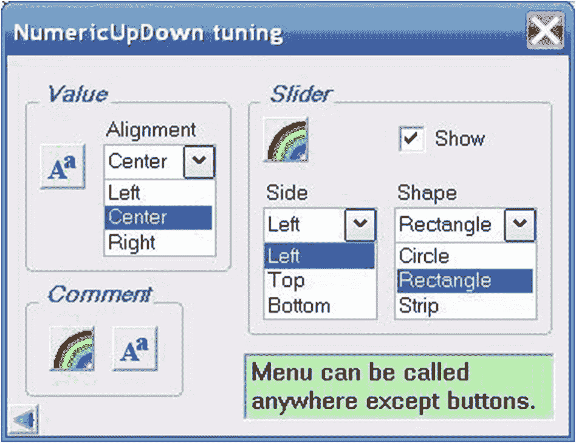

图 5-12 `NumericUpDown_GR` 对象的调谐表单

## 轨道条

- 文件：`Form_Trackbar.cs`
- 菜单位置：图形控件 ➤ 轨道条

轨道条是界面设计中广为人知的元素。在一个细长条上滑动小滑块，从而在某个范围内选择任意值的对象设计理念，在许多场景下都很有用。遗憾的是，Visual Studio 中该控件的实现过于笨拙，以至于每次尝试使用普通的 `TrackBar` 控件后，我都不得不放弃它。但轨道条的核心思想非常完美，而一个好的同类元素又时常令人向往，因此不得不使用它。我设计了几类轨道条；在此我要演示 `Trackbar_GR` 类。你已经熟悉此类对象的使用，因为它被用于所有通过改变背景颜色进行调整的表单中（图 2‑4、4‑2 和 5‑9）。

```csharp
public class Trackbar_GR : GraphicalObject
{
RectangleF rcTicks;
PointF ptLT_rail_axis, ptRB_rail_axis, ptSliderAnchor;
RectangleF rcRail;        // 窄矩形
RectangleF rcFrame;       // 包含 rcTicks 和可移动滑块覆盖的区域
bool bEnabled = true;
bool bResizable = true;
```

图 5‑13 中的轨道条以经典样式展示，所有部件均可见。然而，唯一必须展示的部件是细轨道和可沿其移动的滑块。

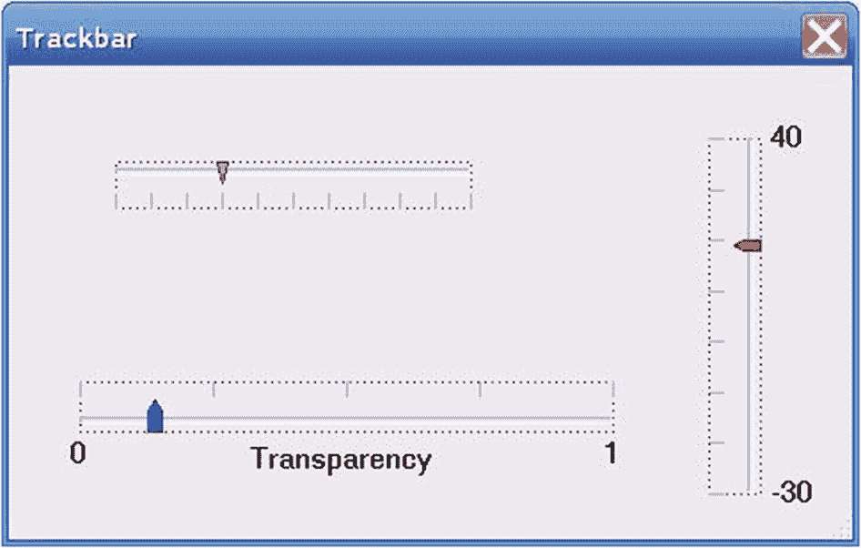

图 5‑13 `Trackbar_GR` 类的元素

轨道条可以是垂直或水平方向；方向由轨道决定。每种情况下，滑块都有两种可能的朝向。滑块形状有两种变体（三角形或五边形），尺寸也有多种变化。

`Trackbar_GR` 类有两个构造函数。其中一个需要若干参数来定义滑块和刻度线的外观，而另一个构造函数中这些参数多数取默认值。在当前的示例中，两个水平轨道条都使用了带完整参数列表的构造函数，而垂直轨道条则以最少参数构建。这组最少参数包括滑块朝向、轨道左上角坐标、轨道长度以及滑块系数。所有其他参数取默认值，但滑块颜色和刻度线数量可通过某些属性进行更改。

## 轨道条

```
void DefaultView ()
{
... ...
trackbars .Add (new Trackbar_GR (this, mover, Side .S, new PointF (60, 60),
200, 0.3, SharpSlider .Triangle, 12, 4,
true, 6, 8, 11));
Trackbar_GR elem = new Trackbar_GR (this, mover, Side .N,
new PointF (40, 200), 300, 0.14,
SharpSlider .Pentagon, 12, 8, true, 2, 8, 5);
elem .SliderColor = Color .Blue;
... ...
elem = new Trackbar_GR (this, mover, Side .W,
new PointF (440, 50), 200, 0.3);
elem .SliderColor = Color .Red;
elem .TicksNumber = 8;
... ...
}
```

轨道条的覆盖层由四个节点组成。

- 一个节点覆盖滑块；如果轨道条被禁用，则该节点尺寸压缩为零。
- 两个节点覆盖轨道条区域的相对两侧，允许更改轨道条长度。轨道条只能沿轨道方向调整大小。对于不可调整大小的轨道条，两侧的这两个节点尺寸均压缩为零。
- 最后一个节点覆盖元素的整个区域。

```
public override void DefineCover ()
{
CoverNode [] nodes = new CoverNode [4];
float wHalf = bResizable ? 3 : 0;
if (sideHead == Side .N || sideHead == Side .S)       // 水平轨道
{
nodes [0] = new CoverNode (0, ptsSlider, Cursors .SizeWE);
nodes [1] = new CoverNode (1, rcFrame .Location,
new PointF (rcFrame .Left, rcFrame .Bottom),
wHalf, Cursors .SizeWE);
nodes [2] = new CoverNode (2, new PointF (rcFrame.Right, rcFrame .Top),
new PointF (rcFrame.Right, rcFrame .Bottom),
wHalf, Cursors .SizeWE);
}
else
{
nodes [0] = new CoverNode (0, ptsSlider, Cursors .SizeNS);
nodes [1] = new CoverNode (1, rcFrame .Location,
new PointF (rcFrame .Right, rcFrame .Top),
wHalf, Cursors .SizeNS);
nodes [2] = new CoverNode (2,
new PointF (rcFrame .Left, rcFrame .Bottom),
new PointF (rcFrame.Right, rcFrame .Bottom),
wHalf, Cursors .SizeNS);
}
nodes [3] = new CoverNode (3, m_rcFrame, Cursors .SizeAll);
if (!Enabled)
{
nodes [0] = new CoverNode (0, ptSliderAnchor, 0f);
}
if (!Movable)
{
nodes [3] .Cursor = Cursors .NoMove2D;
}
cover = new Cover (nodes);
... ...
}
```

令人惊讶的是，这样一个简单的对象竟有大量可调节的参数；所有调节都在一个特殊表单中完成（图 5‑14）。我之前提到过，细轨道和可沿其移动的滑块总是会显示。刻度线和框架的外观则通过此调节表单进行控制。

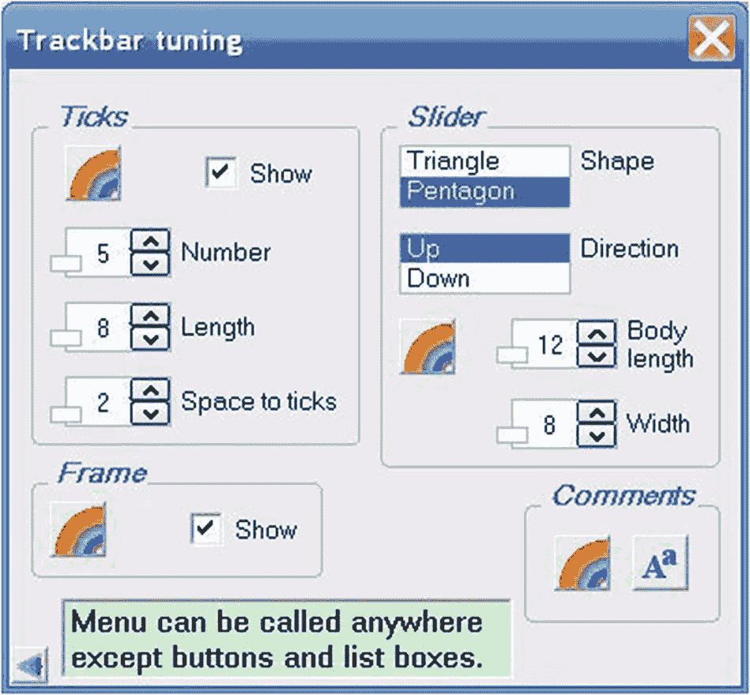

**图 5‑14** 轨道条的调节表单

## 列表框

- 文件：`Form_ListBox.cs`
- 菜单位置：图形控件 ➤ 列表框

列表框包含一组字符串。普通的 `ListBox` 控件可用于单选或多选；而本方案中的 `ListBox_GR` 类仅允许单选（或完全不选）。

通常情况下，`ListBox_GR` 元素的高度与所含字符串的总高度并不相关。如果区域高度不足以显示所有字符串，则右侧边框旁会出现滚动条。如果区域高度超过所有字符串的总高度，则底部会出现空白区域。图 5-15 展示了所有变体情况。

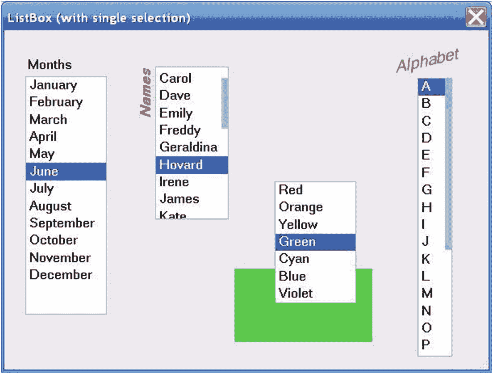

图 5-15 — `ListBox_GR` 对象

```
public class ListBox_GR :
GraphicalObject
{
PointF [] ptsCorner;
Resizing resize;
int m_iSel;
List m_strs = new List ();
Font m_font;
bool bEnabled = true;
float minWidth = SystemInformation .VerticalScrollBarWidth * 2;
float minHeight = 22;
```

列表的最小允许宽度（`minWidth`）和最小允许高度（`minHeight`）可防止因调整大小而意外消失。一般情况下没有上限尺寸限制，但如需设置也可设定。覆盖层对于所有矩形对象来说几乎是标准的（四个角为圆形节点，四条边为带状节点，整个区域有一个大节点），但顶部额外包含一个用于滚动条的节点。当不需要滚动条时，该节点会被压缩至零尺寸。

```
public override void DefineCover ()
{
float rCorner = (resize == Resizing .Any) ? 5 : 0;
float wHalf_WE = (resize == Resizing.Any || resize == Resizing.WE) ? 3 : 0;
float wHalf_NS = (resize == Resizing.Any || resize == Resizing.NS) ? 3 : 0;
CoverNode [] nodes = new CoverNode [] {
new CoverNode (0, ptsCorner [1], 0f, Cursors .SizeNS),
new CoverNode (1, ptsCorner [0], rCorner, Cursors .SizeNWSE),
new CoverNode (2, ptsCorner [1], rCorner, Cursors .SizeNESW),
new CoverNode (3, ptsCorner [2], rCorner, Cursors .SizeNWSE),
new CoverNode (4, ptsCorner [3], rCorner, Cursors .SizeNESW),
new CoverNode (5, ptsCorner [0], ptsCorner [3], wHalf_WE,
Cursors .SizeWE),
new CoverNode (6, ptsCorner [1], ptsCorner [2], wHalf_WE,
Cursors .SizeWE),
new CoverNode (7, ptsCorner [0], ptsCorner [1], wHalf_NS,
Cursors .SizeNS),
new CoverNode (8, ptsCorner [3], ptsCorner [2], wHalf_NS,
Cursors .SizeNS),
new CoverNode (9, ptsCorner, Cursors .Hand) };
if (m_hStrings > Height)
{
nodes [0] = new CoverNode (0, rcSlider, Cursors .SizeNS);
}
if (!Movable)
{
nodes [9] .Cursor = Cursors .NoMove2D;
}
cover = new Cover (nodes);
... ...
```

列表框的初始化参数包括初始矩形区域、一组字符串、字体以及选中的行。

```
public ListBox_GR (Form frm, Mover mvr, RectangleF rc, string [] txts,
Font fnt, int iSel)
```

字体大小决定了所有字符串的总高度（`m_hStrings`）。如果总高度小于矩形的声明高度，则整个列表下方会出现空白区域。在当前示例中，`listboxMonths` 就出现了这种情况，如图 5-15 左侧所示。

```
private void DefaultView ()
{
... ...
listboxMonths = new ListBox_GR (this, mover,
new RectangleF (20, 50, 100, 280),
Auxi_Common .strMonths, fntSelected, 5);
... ...
```

构造函数中的最后一个参数是选中行的编号。当不需要选中时，选中行声明为 `-1`；颜色名称列表即属此情况。

```
listboxColors = new ListBox_GR (this, mover, new RectangleF (...),
Auxi_Colours .strRainbowColorNames,
fntSelected, -1);
```

`ListBox_GR` 对象的向前移动通过在任何内部点按下鼠标左键启动。列表框不仅用于展示一组字符串，还用于从中进行选择。选择操作通过点击所需字符串的左键完成，因此两种不同的动作在同一位置以相同方式启动。决定执行哪种动作的依据是鼠标按下与释放点之间距离的估算。如果该距离可忽略不计（`fDist <= 3`），则视为选择被按下行的命令；选择操作由 `ListBox_GR.SelectByPoint()` 方法执行。

```
private void OnMouseUp (object sender, MouseEventArgs e)
{
ptMouse_Up = e .Location;
double fDist = Auxi_Geometry .Distance (ptMouse_Down, ptMouse_Up);
int iObj, iNode;
if (mover .Release (out iObj, out iNode))
{
GraphicalObject grobj = mover .ReleasedSource;
if (e .Button == MouseButtons .Left)
{
if (grobj is ListBox_GR)
{
if (fDist <= 3 && listPressed .Enabled &&
iNode == ListBox_GR .Node_FullArea)
{
listPressed .SelectByPoint (e .Location);
... ...
```

如果按下了列表框中的某个字符串，则会计算该字符串的编号。如果按下了最后一个字符串之外的空白区域，则不会进行选择，但某些情况下不允许出现空白区域，完美的解决方案是使用一个没有空白区域的列表框。这很容易实现，只需将矩形的最大允许高度设置为所有字符串的总高度即可。

默认情况下，任何 `ListBox_GR` 对象的高度都是无限的，但可以通过 `ListBox_GR.MaxHeightLimit` 属性进行更改。最优列表高度指所有字符串同时可见的尺寸；可通过 `OptimalHeight()` 方法设置此类高度。包含颜色名称的列表框演示了这两种情况。

```
private void DefaultView ()
{
... ...
listboxColors = new ListBox_GR (...);
listboxColors .MaxHeightLimit = ListBoxMaxHeight .Optimal;
listboxColors .OptimalHeight ();
... ...
```

包含颜色名称的列表框是可调整大小的。它可以被压缩，随后右侧边框旁会出现滚动条，但其最后一个字符串之后永远不会出现空白区域，因此在 `listboxColors` 内部任意点击都会选中一种颜色。

用户驱动应用程序的规则之一规定，可见性参数的更改不得影响元素的尺寸。然而，此处我们特意将列表框的最大允许尺寸与字符串的总高度相关联。由于该总高度取决于字体大小，我们为此规则设置了可被打破的条件。

调出 `listboxColors` 的菜单，如图 5-15 所示，并增大字体。列表框的尺寸不会改变，但每个字符串会变大，部分字符串将超出矩形范围，矩形右侧会出现滚动条。尝试增大列表框的高度。它起初会增大，但当达到新的最大允许尺寸时，便会停止增长，滚动条也会消失。你将看到所有字符串可见，但字体更大的类似图形。现在再次调出菜单并减小字体。新的最大允许高度也会减小，为避免底部出现空白区域，列表框的实际高度会相应减小。如你所见，可见性参数（字体）的更改仅在绝对必要且列表框被要求按“无空白区域”规则限制其高度时，才会影响对象尺寸。对于所有其他列表框，没有此类要求，字体大小与列表框最大高度之间也不存在关联。

`ListBox_GR` 类使用 `SystemColors` 类中的标准颜色。字体是唯一可更改的参数，因此这是图形控件中唯一没有自带调整表单的类。所需字体的选择通过菜单命令来组织。

### 组合框

-   文件：`Form_ComboBox.cs`

-   菜单位置：图形控件 ➤ 组合框

组合框将文本框与列表框结合在一起。文本框可以是可编辑或不可编辑的；列表可以始终可见，也可以在选中某个字符串后下拉并再次隐藏。在普通的 `ComboBox` 控件中，这四种变体中有三种得到体现；所需的变体由 `ComboBoxStyle` 枚举中的值决定。我的图形组合框使用了一个不可编辑的文本框，因此这对应于 `DropDownList` 样式；新类的名称中也已提及这一点。由于新对象中没有文本框，因此最好将其两个部分称为*头部*和*列表*。

当列表隐藏时，剩余可见部分仅能水平调整大小。当列表下拉时，`ComboBox_DDList` 对象的矩形区域可通过其边角和边以标准方式调整大小。如果列表框的高度不足以显示所有字符串，则右侧会出现一个滚动条。新元素的最大高度受所有字符串总高度的限制，因此底部永远不会显示空白。

在 `Form_ComboBox.cs` 示例中，`ComboBox_DDList` 类的元素在有或没有注释的情况下使用；其中既有独立对象，也有组合成一组的整套组合框（图 5-16）。

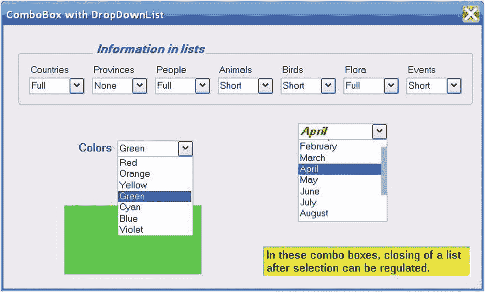

**图 5-16** `ComboBox_DDList` 类的对象

```
public class ComboBox_DDList : GraphicalObject
{
PointF [] ptsCorner;
Resizing resize;
bool bDroppedDown, bArrowPressed, bAutoHideOnClickSelect;
int m_iSel;
string [] m_strs;
Font fntHead, fntList;
bool bEnabled = true;
float wBtn = SystemInformation .VerticalScrollBarWidth;
float minWidth = SystemInformation .VerticalScrollBarWidth * 5 / 2;
float minListHeight = 30;
```

列表部分的颜色取自标准 `SystemColors` 类。新的组合框类允许为头部和列表使用两种不同的字体；依我之见，增大的头部字体可能很有用。也可以为头部字符串使用不同的颜色。

组合框的几何形状由其四个角 (`PointF [] ptsCorner`) 描述；点的编号从左上角开始，顺时针进行。头部右侧有一个特殊的箭头方块。该区域 (`wBtn`) 的宽度由 `SystemInformation` 类中的一个值确定。该区域的高度不能小于宽度，但如果为头部使用了大字体，则高度会增加。

一个 `ComboBox_DDList` 对象的覆盖层由 12 个节点组成。

-   如果滚动条可见，则它由矩形节点 0 覆盖；否则，该节点会被压缩为零尺寸。

-   矩形节点 1 覆盖箭头方块。

-   四个角上的圆形节点 (2–5) 和沿边的四个条状节点 (6–9) 覆盖整个边框，用于调整大小。有四种标准的调整大小变体，因此根据所选类型，这八个节点中的部分或全部可被压缩为零尺寸。

-   当列表可见时，节点 10 覆盖列表区域。

-   最后一个节点（节点 11）覆盖对象的整个区域。当然，当列表可见时，该节点的大部分区域会被前一个节点遮挡。

# 以上是下拉列表情况下覆盖层设计的代码（图 5-17）。

当列表隐藏时，节点数量不变，但其中三分之二会被压缩为零尺寸。在剩余的四个节点中，如果禁止水平调整大小，则还有两个节点会被压缩为零尺寸。

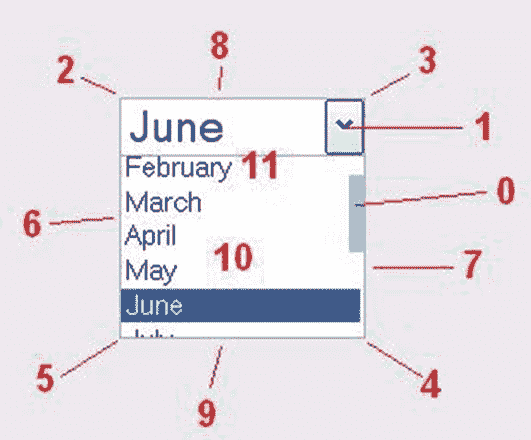

`图 5-17` `ComboBox_DDList` 覆盖层的节点编号

```
else
{
// only four nodes are used (1, 6, 7, 11)
nodes = new CoverNode [] {
new CoverNode (0, ptsCorner [0], 0f, Cursors .Hand),
new CoverNode (1, ArrowSquare, Cursors .Hand),
new CoverNode (2, ptsCorner [0], 0f, Cursors .Hand),
new CoverNode (3, ptsCorner [1], 0f, Cursors .Hand),
new CoverNode (4, ptsCorner [2], 0f, Cursors .Hand),
new CoverNode (5, ptsCorner [3], 0f, Cursors .Hand),
new CoverNode (6, ptsCorner [0], ptsCorner [3], wHalf_WE,
Cursors .SizeWE),
new CoverNode (7, ptsCorner [1], ptsCorner [2], wHalf_WE,
Cursors .SizeWE),
new CoverNode (8, ptsCorner [0], 0f, Cursors .Hand),
new CoverNode (9, ptsCorner [0], 0f, Cursors .Hand),
new CoverNode (10, ptsCorner [0], 0f, Cursors .Hand),
new CoverNode (11, ptsCorner, Cursors .SizeAll) };
}
if (!Movable)
{
nodes [10] .Cursor = Cursors .NoMove2D;
nodes [11] .Cursor = Cursors .NoMove2D;
}
cover = new Cover (nodes);
...
```

有时节点编号可能会改变，因此最好依赖关键节点的名称：`Node_Slider`、`Node_Arrow` 和 `Node_List`。

## 与普通 `ComboBox` 控件相比，`ComboBox_DDList` 对象的绘制有两个主要变化

这两个变化都是由缺少焦点引起的。

- 当 `ComboBox` 控件的列表隐藏且该组合框拥有焦点时，文本框中的文本会被高亮显示。在 `ComboBox_DDList` 对象中，头部始终以标准颜色显示。

- 当鼠标在 `ComboBox` 控件的列表上移动时，光标下的当前行会被高亮显示；这在 `ComboBox_DDList` 对象中没有被复制，因为我更倾向于始终高亮显示当前选中的行。

## 当一个对象被按下时，会调用`ComboBox_DDList.Press()`方法

通过角部和边部进行大小调整的方式与其他矩形对象相同。组合框可以通过内部任意一点（箭头小按钮区域除外）进行移动。这个小的箭头区域仅用于切换列表视图（显示或隐藏），因此当该按钮被按下时，光标会固定在按下点。当按钮被按下时，会发生两件有趣的事情。

- `ArrowPressed`属性获得相反的值，箭头方块的背景会变为不同的外观。（该区域看起来像一个带有颜色渐变的按钮。当方块被按下时，相同的颜色会以相反的顺序使用。）

- `DroppedDown`属性获得相反的值，列表要么出现，要么消失。

```
public void Press (Point ptMouse , MouseButtons catcher, int iNode)
{
... ...
if (Enabled)
{
if (iNode == ComboBox_DDList .Node_Arrow)
{
ArrowPressed = !ArrowPressed;
DroppedDown = !DroppedDown;
}
}
... ...
```

## 按下组合框时的反应取决于释放的节点

- 如果释放的是箭头方块，那么`ComboBox_DDList.ArrowPressed`属性获得`false`值，箭头方块的背景恢复为正常外观。

- 如果释放的是列表区域，且这并非移动结束，而是一次选择（`fDist <= 3`），那么选中的行将由`ComboBox_DDList.SelectByPoint()`方法确定。在普通的`ComboBox`控件中，选择行后列表会自动隐藏。在新类中，列表隐藏行为通过`ComboBox_DDList.AutoHideOnClickSelect`属性来控制；其值可以在调谐表单中更改。对选中行的变化可能会有某种“外部”反应；在当前示例中，仅对`comboColors`对象发生——辅助矩形会用选中的颜色进行绘制。

# 图形控件实现细节

## ComboBox_DDList 的实现

```csharp
private void OnMouseUp (object sender, MouseEventArgs e)
{
    ... ...
    int iObj, iNode;
    if (mover .Release (out iObj, out iNode))
    {
        GraphicalObject grobj = mover .ReleasedSource;
        if (e .Button == MouseButtons .Left)
        {
            if (grobj is ComboBox_DDList && comboPressed.Enabled && fDist <= 3)
            {
                if (iNode == ComboBox_DDList .Node_Arrow)
                {
                    comboPressed .ArrowPressed = false;
                    Invalidate ();
                }
```

```csharp
                else if (iNode == ComboBox_DDList .Node_List)
                {
                    comboPressed .SelectByPoint (e .Location);
                    if (comboPressed .AutoHideOnClickSelect)
                    {
                        comboPressed .DroppedDown = false;
                    }
                    if (comboPressed .ID == comboColors .ID)
                    {
                        SetSampleColor ();
                    }
                    Invalidate ();
                }
            }
            ... ...
```

阻止列表自动隐藏可能看起来是一个小特性，但在某些情况下它可能非常有帮助。每次选择都会改变屏幕上的某些内容，在做出最终决定之前，您希望查看并直观地比较（或评估）所有可能性，这种情况并不少见。如果每次都必须先点击箭头才能看到列表，那么这个过程会变得非常繁琐。这个新功能的实用性通过一组组合框得到了演示。

在当前示例中，我们有一组组合框被组合成一个组（图 5-16）。在我的另一本书 [2] 的一个示例中，也展示过类似外观的组，当时那个旧示例使用的是普通的`ComboBox`控件。我对那个变体的主要不满在于无法同时看到所有组合框的所有可能变体。一个普通的`DropDownList`样式的`ComboBox`在选择后会自动隐藏其列表，因此在任何时刻都只能看到一个`ComboBox`的列表。对于`ComboBox_DDList`对象，在选择时关闭列表并非强制要求。通过菜单命令，您可以同时打开所有组合框（或仅打开所需的那些）的列表，进行所有选择，然后通过一个菜单命令关闭所有列表。

现在让我们注意一下在`ComboBox_DDList`类中使用注释的一个不寻常方面。所有控件都是矩形形状，因此所有普通控件的图形模拟都使用`Comment_ToRectangle`类的注释。在为此类添加注释时，我原本没有预料到会有什么问题，因为完成此操作的方式与其矩形元素的其他类完全相同，但后来我意识到存在一个问题。

在此之前，任何注释都用于*手动调整大小的矩形*。注释的相对位置由两个系数决定，当通过移动其边界来改变矩形大小时，注释的位置会利用这两个系数进行重新计算。手动调整大小意味着矩形尺寸的平滑变化，因此注释的锚点也会平滑移动。在过去的版本中，从未出现过父矩形突然变化的情况，因此也从未有过注释从一个位置跳到另一个位置的情况。组合框区域可能会突然变化，因此必须为组合框的注释设计不同的方案。区别不在于使用不同的注释类；而在于响应主导矩形突然变化时注释位置的计算方式。

当一个`ComboBox_DDList`对象被移动或调整大小时，其区域会平滑变化。在这些情况下，可以通过其`ParentRect`属性通知关联的注释发生了更改，一切都能正常工作。

```csharp
public override void Move (int dx, int dy)
{
    for (int i = 0; i < 4; i++)
    {
        ptsCorner [i] .X += dx;
        ptsCorner [i] .Y += dy;
    }
    ... ...
    InformComment ();
}
public void InformComment ()
{
    if (CommentExist)
    {
        m_cmnt .ParentRect = MainElementArea;
    }
}
```

但组合框还有一种改变其几何形状的可能性，即通过显示或隐藏字符串列表。根据列表中字符串的数量，这种变化可能是突然的。如果列表中有`N`个字符串，那么高度变化可以用比率 `1 : (N + 1)` 来描述，在此类变化中一直使用相同的`ParentRect`属性可能会导致问题。

组合框的视图由`ComboBox_DDList.DroppedDown`属性控制；关联的注释通过此属性获知主要部分的矩形区域。将主矩形及其注释的位置关联起来有两种方式；在每种情况下，注释都会获得新的矩形，但反应有所不同。

- 当使用`CommentToRect.ParentRect`属性时，会利用两个现有的系数来改变注释的位置。

- 当使用`CommentToRect.SetParentRect()`方法时，注释的位置不会改变，但会计算新的系数。

起初，我对组合框区域的任何更改都使用`InformComment()`，因此所有情况下都调用了`ParentRect`属性；有些情况我对结果满意，而有些则不。最后我意识到，在某些情况下`SetParentRect()`方法效果更好，而在这两种情况之间进行选择必须基于注释的初始位置（即其锚点的位置）。图 5-18 显示了两个区域（以红线为边界），对于这些区域会调用`SetParentRect()`方法；在所有其他情况下，会调用`InformComment()`方法，而该方法使用了`ParentRect`属性。

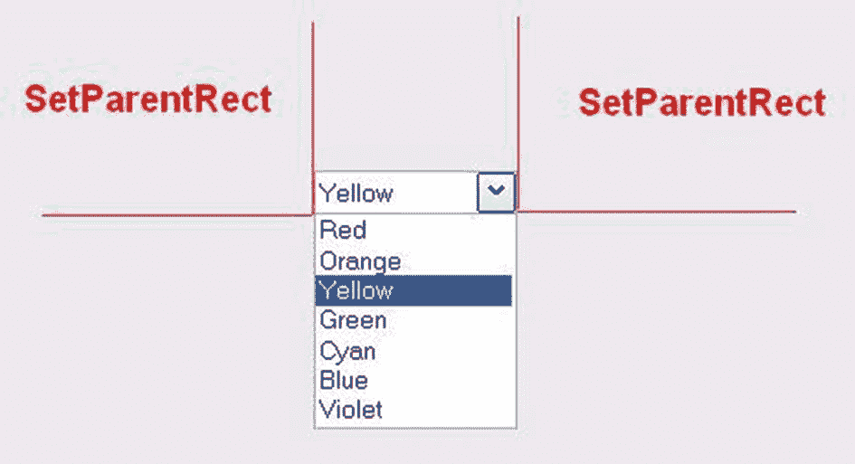

图 5-18

`SetParentRect()`方法用于注释最初位于两个标记区域之一内部的情况；在所有其他情况下，使用`ParentRect`属性。

```csharp
public bool DroppedDown
{
    get { return (bDroppedDown); }
    set
    {
        ... ...
        PointF ptA = m_cmnt .AnchorPoint;
        if ((ptA.X < MainElementArea.Left || MainElementArea.Right < ptA.X) &&
            ptA .Y <= MainElementArea .Top + hHead)
        {
            m_cmnt .SetParentRect (MainElementArea);
        }
        else
        {
            InformComment ();
        }
        ... ...
```

`ComboBox_DDList` 对象可以借助一个专用调谐窗体（图 5-19）与其注释一起进行调节。同时，用户无需感知类体系，如果希望更改注释，只需调用此注释上的菜单，通过该菜单的命令执行相同的更改。

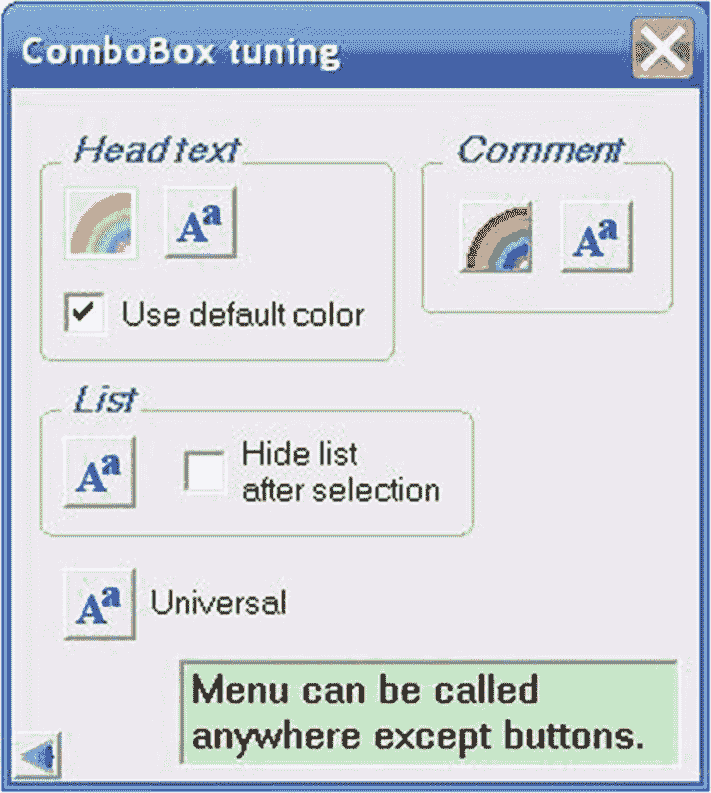

图 5-19 `ComboBox_DDList` 对象的调谐窗体

## 复选框

- 文件：`Form_CheckBox.cs`

- 菜单位置：图形控件 ➤ 复选框

对于初学者而言，普通的 `CheckBox` 控件多用于双状态（选中或未选中）变体，但也有三状态选项。虽然设计一个三状态图形副本并非难事，但当前演示的 `CheckBox_GR` 类仅有双状态版本。

```csharp
public class CheckBox_GR : GraphicalObject
{
    RectangleF rcCheck, rcText;
    float m_space;
    Side sideText;
    SideAlignment alignParts;
    string m_text;
    Font m_font;
    Color m_color;
    bool bChecked = true;
    bool bEnabled = true;
    bool bFixMouseOnUnmovable = true;
```

每个复选框由两个完全不同的部分组成：一个小方块和文本。普通的 `CheckBox` 控件允许更改这些部分的相对位置，但除了文本位于方块右侧的情况外，我从未见过其他变体。`CheckBox_GR` 类提供了 12 种相对位置变体；此参数及其他若干参数可通过调谐窗体进行调节。

# 关于 `sideText` 字段含义的一个重点说明

关于 `sideText` 字段含义的一个重点说明是：该字段决定了方块和文本的相对位置，其中方块较小，而文本要么较大，要么显著更大（见图 5-20）。无论尺寸差异如何，方块始终是任何复选框的锚定部分，因此 `sideText` 字段定义了`文本相对于方块的边所放置的位置`。图 5-20 中除一个复选框外，其余均展示了文本位于方块右侧这种最常用的情形；在此情况下，`sideText = Side.E`。当在 `CheckBox_GR` 构造函数中省略相应参数时，这也是 `sideText` 字段的默认值。

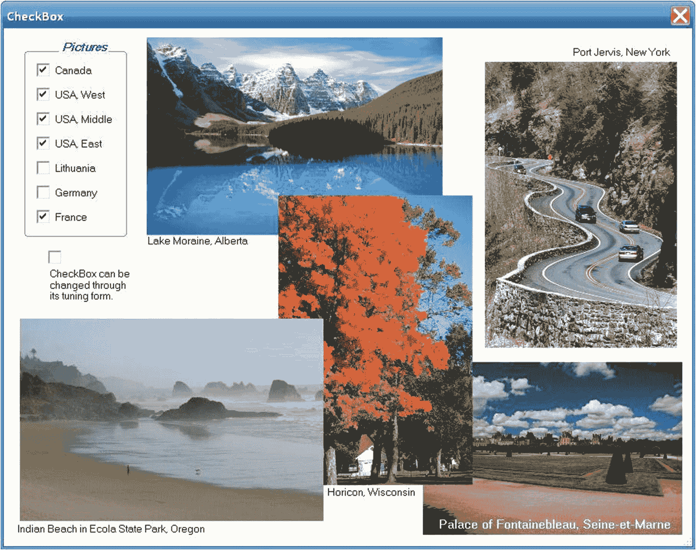

**图 5-20** 复选框由一个小方块和文本组成

## 复选框由两个明确的部分组成

复选框由两个明确的部分组成。每个部分都是一个不可调整大小的矩形，因此看似在覆盖层中有两个节点就足够了，但实际上有三个。为了更好观察对象，两个部分之间留有一点间隙，但我不喜欢通过这个间隙捕捉另一个对象的想法，因此该间隙被一个额外的多边形节点覆盖。方块的大小是固定的（`nSquare = 18`），而文本的大小则变化不定。根据这两种尺寸的比例，额外节点要么是矩形，要么是梯形。计算该节点的角点（`PointF [] pts`）虽然简单，但由于篇幅过长，此处不再赘述。

```csharp
public override void DefineCover ()
{
PointF [] pts = new PointF [4];
... ...
CoverNode [] nodes = new CoverNode [] {
new CoverNode (0, rcCheck, Cursors .Hand),
new CoverNode (1, rcText),
new CoverNode (2, pts) };
if (!Movable)
{
nodes [1] .Cursor = Cursors .NoMove2D;
nodes [2] .Cursor = Cursors .NoMove2D;
}
cover = new Cover (nodes);
... ...
```

## 选中或取消选中复选框

选中或取消选中复选框是通过点击对象的任意点完成的，因此对于更改勾选状态的目的而言，方块和文本这两个部分的作用完全相同。移动对象只允许通过文本进行，而鼠标光标在方块内按下时会被固定，直至鼠标松开。复选框的覆盖层及其工作逻辑非常简单，因此对复选框按下的唯一反应是存储按下点的位置。

```csharp
public void Press (...)
{
ptPressed = ptMouse;
}
```

对元素按下的反应是在鼠标松开时刻确定的，并取决于鼠标按下点和松开点之间的距离。如果距离可忽略不计（`fDist <= 3`），则视为更改勾选状态，此操作通过 `Checked` 属性完成。由于光标位置是固定的，且鼠标只能在同一点松开，因此这是对方块内点击唯一可能的反应。

```csharp
private void OnMouseUp(object sender, MouseEventArgs e)
{
    ptMouse_Up = e.Location;
    double fDist = Auxi_Geometry.Distance(ptMouse_Down, ptMouse_Up);
    int iObj, iNode;
    if (mover.Release(out iObj, out iNode))
    {
        GraphicalObject grobj = mover.ReleasedSource;
        if (e.Button == MouseButtons.Left)
        {
            if (grobj is CheckBox_GR && checkPressed.Enabled && fDist <= 3)
            {
                checkPressed.Checked = !checkPressed.Checked;
                ButtonsVisibililty();
                RenewMover();
            }
            ...
        }
    }
}
```

## 对象的移动

对象的移动由其类的`MoveNode()`方法描述。如果被按下的节点用于移动整个对象，则对所有对象存在一个标准做法，且代码简单。

- 对于可移动对象，调用其`Move()`方法。

- 对于不可移动对象，光标固定在按下点。

对于`CheckBox_GR`类，如果按下发生在小方块内部，光标始终固定，但以下代码几乎是标准的：

```csharp
public override bool MoveNode(...)
{
    bool bRet = false;
    if (catcher == MouseButtons.Left)
    {
        if (Movable)
        {
            if (iNode == 0)
            {
                AdjustCursorPosition(ptPressed);
            }
            else
            {
                Move(dx, dy);
                bRet = true;
            }
        }
        ...
    }
}
```

如上代码所示，对于可移动复选框实现了标准反应，而对于不可移动元素则有所不同。在查看按下不可移动复选框的情况之前，我们先提出一个更一般的问题：按下*不可移动元素*时，你期望得到什么反应？

可移动和不可移动元素在视觉上没有区别，因此任何元素的当前可移动状态只能通过鼠标按下并尝试移动时的反应来揭示。可移动元素会随鼠标移动，但按下不可移动对象时，可能有两种完全不同的反应：

- 光标固定在按下点，在鼠标释放前不允许任何鼠标移动。

- 光标可自由移动，但没有任何元素跟随移动。

我更喜欢第一种方案，因此在大多数演示类中，实现了鼠标在不可移动元素上固定的想法。然而，形成个人观点的最佳方式是比较两种方案。为方便比较，在`CheckBox_GR`类中两种反应都是可能的。

`CheckBox_GR.MoveNode()`方法中的额外几行代码让你拥有两种变体：

```csharp
public override bool MoveNode(...)
{
    bool bRet = false;
    if (catcher == MouseButtons.Left)
    {
        if (Movable)
        {
            ...
        }
        else
        {
            if (bFixMouseOnUnmovable)
            {
                AdjustCursorPosition(ptPressed);
            }
        }
    }
    return (bRet);
}
```

在当前示例中，组内的复选框以其标准方式使用，因此如果此处所有可显示的图片均可用，则所有这些复选框都是启用的。为演示一些特殊情况，组外的复选框有一个不同的菜单。该菜单的命令允许你比较不可移动复选框在固定光标和自由光标两种情况下的表现，并查看复选框变为禁用时视图的变化。

# `CheckBox_GR`对象的调优

`CheckBox_GR`对象的调优通过特殊窗体`Form_Tuning_CheckBox.cs`（图 5-21）进行组织。复选框在视觉上很简单，因此其调优形式也很简单。方块和文本的相对位置通过在小矩形内移动小方块来设置，矩形周围带有*Text*字样。

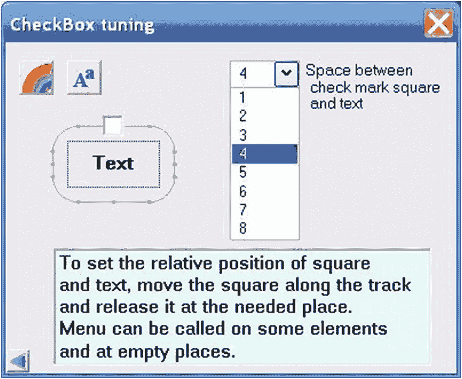

图 5-21  

`CheckBox_GR`对象的调优窗体

请注意一点：在调优窗体中，围绕一个更大的矩形移动小方块更为方便，但在正在调优的原始复选框中，小方块充当锚定元素的角色，因此方块将保持不动，而其文本会移动到新位置。

本章的第一个示例使用了多张图片来演示`Button_Image`类。按钮对所有带有边和角节点的矩形使用近乎标准的覆盖方式。这种沿边界的节点系统允许你以任意方式调整矩形大小。对于许多矩形来说，这是最佳的调整大小方式，但对于图片而言，这种任意调整大小是多余的。照片有不同的宽高比，但对于每张特定图片，该比例是固定的，并且在调整大小的过程中无需更改。在当前示例中，`Rectangle_Image`类的对象用于图片演示。这些矩形仅通过角点调整大小，且在此过程中其宽高比保持不变，因此矩形始终具有适合特定图片演示的最佳尺寸。矩形上的菜单允许你改变它们在屏幕上的显示顺序。

## 列表视图

# ListView 控件

-   文件：`Form_ListView.cs`
-   菜单位置：图形控件 ➤ 列表视图

前面我们讨论了列表框和组合框；这些对象使用单列字符串，可从中选择任意项。列表视图允许你显示由多部分组成的更复杂的数据。为此，列表视图以行和列的形式呈现这些数据，每个单元格以字符串形式显示部分数据。列表视图是显示大量数据的一种紧凑方式。见图 5-22。

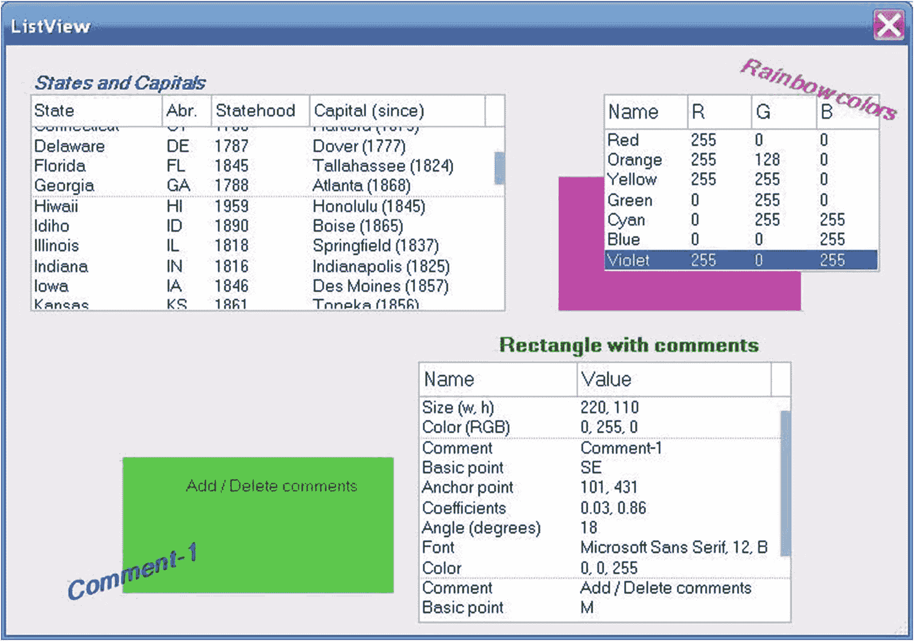
图 5-22

## ListView_GR 对象的特性

`ListView_GR` 对象的外观与展开列表的 `ComboBox_DDList` 对象相似，它们的覆盖层之间也有很多相似之处；比较图 5-23a 和图 5-17。`ListView_GR` 类的覆盖层有一个不同于其他图形控件覆盖层的特性：新覆盖层中的节点数量不是固定的。节点数量取决于列数；对于 N 列的列表，节点数为 9 + N。

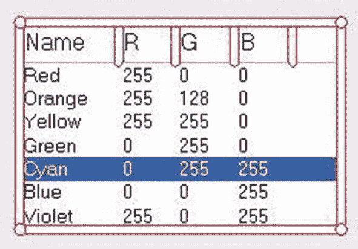
图 5-23b

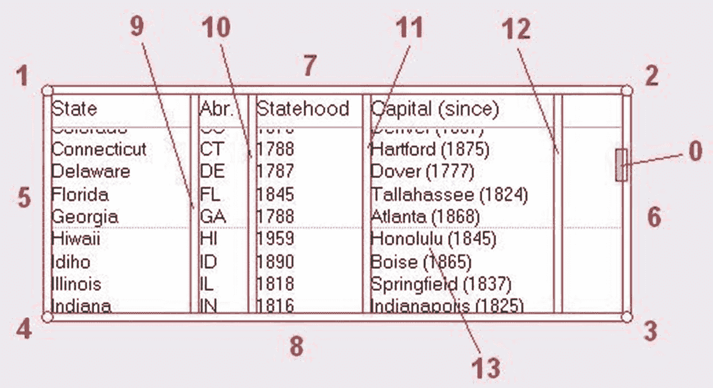
图 5-23a

-   滚动条由矩形节点 0 覆盖；如果不需要滚动条，则该节点会被压缩到零大小。
-   四个角上的圆形节点 (1–4) 和沿着边的四个条状节点 (5–8) 覆盖整个边框，用于调整大小。有四种标准的大小调整变体，因此根据所选类型，这八个节点中的部分或全部可以被压缩到零大小。
-   数据以列的形式显示。这些列的标题始终由细线分隔，而列表主体区域中垂直网格的外观由用户决定。这些垂直线由节点覆盖，但这些节点的长度取决于网格外观；图 5-23 展示了两种变体。这些节点的数量取决于列数；在图 5-23a 中，它们是节点 9–12。
-   最后一个节点覆盖列表视图的整个区域。在我们的五列列表中，它的编号是 13。

## 调优表单与构造

`ListView_GR` 和 `ComboBox_DDList` 对象在外观上的相似性意味着使用相同的参数，这也意味着在调优表单上的相似性。`ListView_GR` 对象的调优表单（图 5-24）与组合框的调优表单（图 5-19）几乎相同。

在我看来，为标题和列表主体部分使用不同的字体可以让对象的外观更好，因此可以从构建时就进行组织。所有单元格的字符串都放在一个数组中；字符串的顺序是从上到下，每一行内从左到右。

```csharp
public ListView_GR (Form frm, Mover mvr, RectangleF rc,
string [] strHeads, Font fntHead,
string [] strInner, Font fntList, int iSel)
```

## 交互方式

`ListView_GR` 对象与周围表单的其他元素之间可以有不同类型的交互。

-   完全没有交互。
-   列表中的选择变更可能导致其他元素发生变化。
-   元素的变化可能导致 `ListView_GR` 对象发生变化。

当前示例中的三个 `ListView_GR` 对象演示了这三种不同的情况。

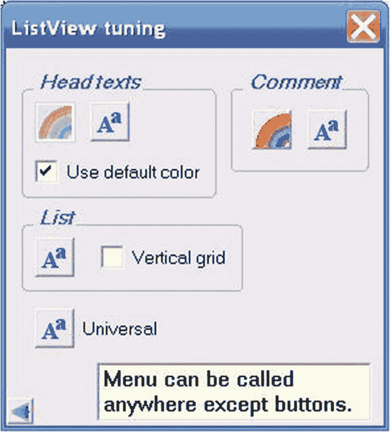
图 5-24

### 示例 1：无交互 (`listStates`)

包含州及其首府信息的列表 —— `listStates` —— 演示了最简单的无任何交互的情况。此列表在构建时获取数据，此后数据不再更改。此列表的标题使用与主体部分相同类型的字体，但略微放大。

```csharp
private void DefaultView_listStates (PointF ptLT)
{
listStates = new ListView_GR (this, mover,
new RectangleF (ptLT .X, ptLT .Y, 200, 210),
new string [] { "State", "Abr.", "Statehood", "Capital (since)" },
Auxi_Common .FontZoomed (fntSelected, 1.1),
Auxi_Common .strStatesCapitals, fntSelected, -1);
listStates .MaxHeightLimit = ListMaxHeight .Optimal;
listStates .OptimalWidth ();
listStates .UnderlinedItems = new int [] { 9, 19, 29, 39 };
... ...
```

这段代码提到了 `ListView_GR` 类的几个重要特性。

-   默认情况下，对象的高度可以更改，而不管行数及其总高度如何，因此最后一行之外可能出现空白区域。但是，如果（通过鼠标单击）选择特定行会导致进一步的操作，那么单击空白区域则毫无意义。为了避免出现空白区域，可以借助 `MaxHeightLimit` 属性将列表高度限制在最后一行。

```csharp
listStates .MaxHeightLimit = ListMaxHeight .Optimal;
```

-   用户可以在任何时刻更改任何列的宽度，而 `ListView_GR.OptimalWidth()` 方法则根据每列中最长的字符串确定其宽度，并额外增加几个像素的空白空间以获得更好的视图效果。

```csharp
listStates .OptimalWidth ();
```

-   当列表中有大量行时，为某些行添加下划线可以使阅读更容易。有一个工具可以在列表中组织任意行的下划线。在此列表中，每第 10 行都有下划线。

```csharp
listStates .UnderlinedItems = new int [] { 9, 19, 29, 39 };
```

### 示例 2：选择变更触发其他元素变化 (`listColors`)

`listStates` 仅显示预先准备好的数据，而 `listColors` 则代表在列表中选择更改会导致表单中其他元素发生变化的情况。选择更改由 `ListView_GR.SelectByPoint()` 方法完成。当前列表中选中的更改会导致关联矩形的颜色发生变化。

```csharp
private void OnMouseUp (object sender, MouseEventArgs e)
{
ptMouse_Up = e .Location;
double fDist = Auxi_Geometry .Distance (ptMouse_Down, ptMouse_Up);
int iObj, iNode;
if (mover .Release (out iObj, out iNode))
{
GraphicalObject grobj = mover .ReleasedSource;
if (e .Button == MouseButtons .Left)
{
if (grobj is ListView_GR && listPressed .Enabled)
{
if (iNode == listPressed .NodesCount - 1 && fDist = 0)
{
brushSample .Color =
Auxi_Colours .RainbowColors [listColors .SelectedIndex];
}
else
{
brushSample .Color = Color .White;
}
}
```

### 示例 3：外部元素变化触发列表更新 (`listRect`)

第三个列表 —— `listRect` —— 也与一个矩形相关联，但此矩形是 `Rectangle_withComments` 类的一个元素，并且此矩形或其关联注释的更改会导致列表中的数据更改。不仅列表单元格内的字符串会改变，甚至列表中的行数也取决于关联矩形的参数。

```csharp
private void DefaultView_listRect (PointF ptLT)
{
Font fntHead = Auxi_Common .FontZoomed (fntSelected, 1.2);
string [] strs = PrepareListStrings_listRect ();
listRect = new ListView_GR (this, mover,
new RectangleF (ptLT .X, ptLT .Y, 210, 160),
new string [] { "Name", "Value" }, fntHead,
strs, fntSelected, -1);
... ...
```

此列表的前三行显示矩形本身的参数，因此这三行始终存在。

```csharp
string [] PrepareListStrings_listRect ()
{
    Comment_ToRectangle cmnt;
    List strs = new List ();
    strs .Add (listRect_rectNames [0]);
    strs .Add (Auxi_Convert .PointToStr (rectWithComments .Location));
    strs .Add (listRect_rectNames [1]);
    strs .Add (rectWithComments .Width .ToString ("F0") + ", " +
    rectWithComments .Height .ToString ("F0"));
    strs .Add (listRect_rectNames [2]);
    strs .Add (Auxi_Convert .ClrToStr (rectWithComments .Color,
    ColorStr .NUMBER_COMA_SPACE));
    ... ...
```

对于矩形上的每条注释，列表中有七行数据，因此总行数取决于关联注释的数量。

```csharp
for (int i = 0; i < rectWithComments .Comments .Count; i++)
{
    cmnt = rectWithComments .Comments [i];
    strs .Add (listRect_cmntNames [0]);
    strs .Add (cmnt .Text);
    strs .Add (listRect_cmntNames [1]);
    strs .Add (namesTextBasis [(int) cmnt .TextBasis]);
    strs .Add (listRect_cmntNames [2]);
    strs .Add (Auxi_Convert .PointToStr (cmnt .AnchorPoint));
    strs .Add (listRect_cmntNames [3]);
    strs .Add (cmnt .XCoefficient .ToString ("F2") + ", " +
    cmnt .YCoefficient .ToString ("F2"));
    strs .Add (listRect_cmntNames [4]);
    strs .Add (cmnt .Angle_Degree .ToString ("F2"));
    strs .Add (listRect_cmntNames [5]);
    strs .Add (Auxi_Convert .FontInDetails (cmnt .Font));
    strs .Add (listRect_cmntNames [6]);
    strs .Add (Auxi_Convert .ClrToStr (cmnt .Color,
    ColorStr .NUMBER_COMA_SPACE));
}
... ...
```

在矩形或其注释发生任何更改时，通过调用同一个 `PrepareListString_listRect()` 方法来刷新整个列表并非难事，但我更倾向于展示其他几种可能性。在此示例中，我们只有一个带注释的矩形；因此，对于矩形本身，无需额外的标识。与此矩形关联的注释数量可以变化，因此点击任何注释都需要进行注释标识。

```csharp
private void OnMouseDown (object sender, MouseEventArgs e)
{
    ptMouse_Down = e .Location;
    if (mover .Catch (e .Location, e .Button, bShowAngle))
    {
        GraphicalObject grobj = mover .CaughtSource;
        ... ...
        else if (grobj is Comment_ToRectangle)
        {
            cmntPressed = grobj as Comment_ToRectangle;
            CommentIdentification ();
            cmntPressed .Press (e .Location, e .Button, iNode);
        }
        ... ...
```

这个简单的标识功能会给出被点击注释在矩形所有注释中的序号 (`jCmntRWC`)；同时也决定了 `listRect` 中显示该注释数据的行。

```csharp
private void CommentIdentification ()
{
    jCmntRWC = -1;
    if (cmntPressed .ParentID == rectWithComments .ID)
    {
        for (int j = 0; j < rectWithComments .Comments .Count; j++)
        {
            if (cmntPressed .ID == rectWithComments .Comments [j] .ID)
            {
                jCmntRWC = j;
                break;
            }
        }
    }
}
```

对矩形或其被点击注释的大多数更改都需要更改特定单元格中的数据，这通过 `ListView_GR.Subitem()` 方法完成。例如，下面是被点击注释的字体更改。

```csharp
private void Click_miFont_Cmnt (object sender, EventArgs e)
{
    ... ...
    if (jCmntRWC >= 0)
    {
        listRect .Subitem (3 + 5 + jCmntRWC * 7, 1,
        Auxi_Convert .FontInDetails (cmntPressed .Font));
        ... ...
```

可以通过菜单命令添加新的注释。新注释被添加到关联注释的头部；列表中必须包含相应数量的行，因此刷新整个列表更为简便。为了方便数据读取，每个注释关联的行之间会用线条分隔，因此每当注释数量发生变化（添加或删除）时，都会通过 `ListRect_HorLines()` 方法计算带下划线项目的数组。

```csharp
private void Click_miAddComment (object sender, EventArgs e)
{
    double xCoef, yCoef;
    Auxi_Geometry .CoefficientsByLocation (rectWithComments .MainElementArea,
    ptMouse_Up, out xCoef, out yCoef);
    rectWithComments .InsertComment (0, xCoef, yCoef,
    "Comment-" + rectWithComments .Comments .Count);
    string [] strs = PrepareListStrings_listRect ();
    listRect .RenewTexts (strs);
    ListRect_HorLines ();
    RenewMover ();
}
```

### 单选按钮

在界面设计中，三种按钮类型被广泛使用：普通按钮、复选框和单选按钮。我们已经有了前两种的图形化对应物；现在轮到单选按钮了。有一件事使其不仅与其他按钮不同，也与所有其他控件不同：单选按钮从不单独使用，而是仅在组中使用。拥有一个单独的单选按钮毫无意义，因为这些控件的唯一目的是在 N 个可能性中组织单一选择。普通的 `RadioButton` 控件通常通过 `GroupBox` 组合成组，尽管也可以通过 `Panel` 来实现。单选按钮的图形化对应物也仅在组中使用，但当然不会为此使用控件。在深入探讨图形化单选按钮的细节之前，我们先聊聊普通 `RadioButton` 和 `GroupBox` 控件的一些特性。

*   文件：`Form_RadioBtnsLight.cs`
*   菜单位置：图形控件 ➤ 单选按钮（轻量版）
*   `RadioButton` 对象由一个小圆圈和关联文本组成。可以组织它们相对位置的不同类型，但除了两者均位于同一水平线上且文本在圆圈右侧之外，我从未见过其他布局。我认为对于从右到左书写规则的国家，将圆圈放置在文本右侧可能更合适，但我从未处理过此类应用程序。

## RadioButton 的使用与实现

*   `RadioButton` 对象仅在组中使用。在组内，这些按钮可以任意放置，但标准做法是将其圆圈严格排列在一条垂直线上。在一个程序中，我见过一个组中将单选按钮放置在多列中，但这是我几十年来印象中唯一的案例。在我的另一本书 [2] 中，有一个例子将普通单选按钮沿着倾斜的直线放置，但这仅表明严格的垂直放置并非强制要求。

*   `RadioButton` 对象通常以相等的间距放置。在我另一本书 [2] 的同一个例子中，还有一组单选按钮的相邻间距是不均匀的。这些单选按钮与表单中位于组外的其他元素相关联。那些“外部”对象类型和大小各异，因此我采用了组内单选按钮的不均匀分布，以便将每个按钮放置在其关联的外部元素对面。这种按钮布局使得关联性更加明显。按钮之间设置不同的间距并无不妥，但我从未在其他程序中见过这种做法。

让我们从一个轻量版开始我们的图形化单选按钮工作，该版本提供了我们在程序中通常看到的按钮类型。在这个轻量版中，圆圈和文本始终位于同一水平线上，且文本在圆圈右侧。此类单选按钮可以组织成一个轻量版的组——`Group_RadioBtnsLight` 类——其中所有圆圈都位于同一条垂直线上，按钮只能上下移动。

```csharp
public class RadioButton_Light : GraphicalObject
{
    PointF ptCenter;
    string m_text;
    Font m_font;
    Color m_color;
    bool bSwitched;
    bool bEnabled = true;
    static float rBig = 8;
    RectangleF rcText;
```

按钮文本并非紧挨着圆圈放置，而是向旁边偏移了半个圆半径的距离（`rBig`）。`RadioButton_Light` 对象的覆盖区域由三个节点组成。第一个节点覆盖圆圈，第二个节点覆盖文本，第三个节点覆盖圆圈和文本之间的间隙。

```csharp
public override void DefineCover()
{
    PointF[] pts = new PointF[] {
        new PointF(ptCenter.X, ptCenter.Y - rBig),
        new PointF(rcText.Left,
            Math.Max(ptCenter.Y - rBig, rcText.Top)),
        new PointF(rcText.Left,
            Math.Min(ptCenter.Y + rBig, rcText.Bottom)),
        new PointF(ptCenter.X, ptCenter.Y + rBig) };
    CoverNode[] nodes = new CoverNode[] {
        new CoverNode(0, ptCenter, rBig),
        new CoverNode(1, rcText, Cursors.SizeNS),
        new CoverNode(2, pts, Cursors.SizeNS) };
    if (!Movable)
    {
        nodes[1].Cursor = Cursors.NoMove2D;
        nodes[2].Cursor = Cursors.NoMove2D;
    }
    cover = new Cover(nodes);
    ... ...
```

按钮的选中操作通过点击任意点完成；最后两个节点也可用于上下移动按钮。无论按下按钮的哪个点，该点都会被记录下来（`ptPressed`）。鼠标按下时不做其他操作。

```csharp
public void Press(...)
{
    ptPressed = ptMouse;
}
```

可能的移动行为由 `MoveNode()` 方法描述。

- 单选按钮的圆形部分不可移动；当按下圆形区域时（`iNode == 0`），禁止任何移动，光标将保持在同一位置直至鼠标释放。

- 当可移动按钮的非圆形部分被按下时，光标仅允许垂直移动，按钮随光标同步移动。

- 当不可移动按钮的非圆形部分被按下时，光标将保持在同一位置直至鼠标释放。

光标通过熟悉的 `AdjustCursorPosition()` 方法被控制在按下点或直线上。

```csharp
public override bool MoveNode(...)
{
    bool bRet = false;
    if (catcher == MouseButtons.Left)
    {
        if (iNode == 0)
        {
            AdjustCursorPosition(ptPressed);
        }
        else
        {
            if (Movable)
            {
                Move(0, dy);
                bRet = true;
                AdjustCursorPosition(new Point(ptPressed.X, ptMouse.Y));
            }
            else
            {
                AdjustCursorPosition(ptPressed);
            }
        }
    }
    return (bRet);
}
```

单选按钮仅在组内使用。此示例（图 5-25）展示了 `Group_RadioBtnsLight` 类的三个组。这些组的设计理念与 `Group_ArbitraryElements` 类相同。

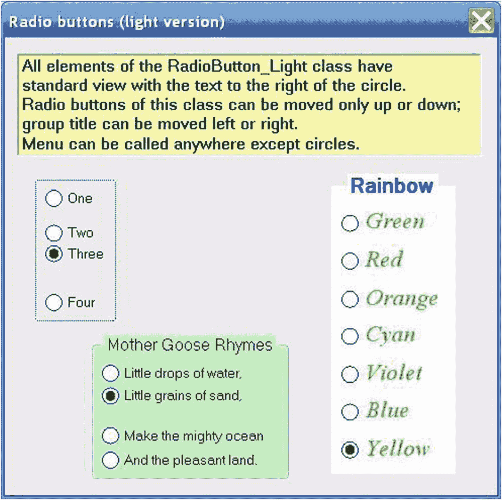

**图 5-25** — `Form_RadioBtnsLight.cs`

- 包含一组内部元素；在本例中，所有元素均属于 `RadioButton_Light` 类。

- 内部元素可移动。可将其声明为不可移动以防止意外移动，但这需由用户决定。所有内部元素均可无限制地上下移动，因此用户可自由调整元素间距、按视觉子组排列位置或改变顺序。

- 组区域可通过框架、不同背景色或两者组合进行标记。组区域会根据内部元素的任何变化自动调整。

- 组可带标题或不带标题使用。组宽度由两个元素中较宽者决定：标题（若存在）与最长按钮。若组宽度允许，标题可左右移动；此类移动使用粘附鼠标技术。用户可调节标题的可移动性。

```csharp
public class Group_RadioBtnsLight : GraphicalObject
{
    RectangleF m_rcFrame, m_rcBigNode, m_rcTitle;
    List m_elements = new List();
    string m_title;
    bool bTitleMovable = true;
    Font fntTitle;
    Color clrTitle;
    Pen penFrame;
```

此类组的覆盖层由两个节点构成。第一个节点覆盖标题矩形区域（`m_rcTitle`）；对于无标题的组，该节点尺寸被压缩为零。第二个节点也为矩形，覆盖框架区域（`m_rcBigNode`）。

```csharp
public override void DefineCover()
{
    m_rcBigNode = RectangleF.FromLTRB(m_rcFrame.Left, m_rcFrame.Top,
        m_rcFrame.Right + 1, m_rcFrame.Bottom);
    CoverNode[] nodes = new CoverNode[2];
    if (TitleExist)
    {
        nodes[0] = new CoverNode(0, m_rcTitle);
        if (bTitleMovable)
        {
            nodes[0].SetBehaviourCursor(Behaviour.Moveable, Cursors.SizeWE);
        }
    }
    else
    {
        nodes[0] = new CoverNode(0, m_rcFrame.Location, 0f);
    }
    nodes[1] = new CoverNode(1, m_rcBigNode);
    cover = new Cover(nodes);
    ... ...
```

组及其按钮的可见性参数必须由用户控制。对于单选按钮的轻量版，使用轻量版调优，因此本示例中某些次要参数不可调。所有调优通过菜单命令组织（图 5-26）。要更改特定按钮的参数或将其参数应用于所有同级按钮，需在按钮上调用菜单（图 5-26a）。

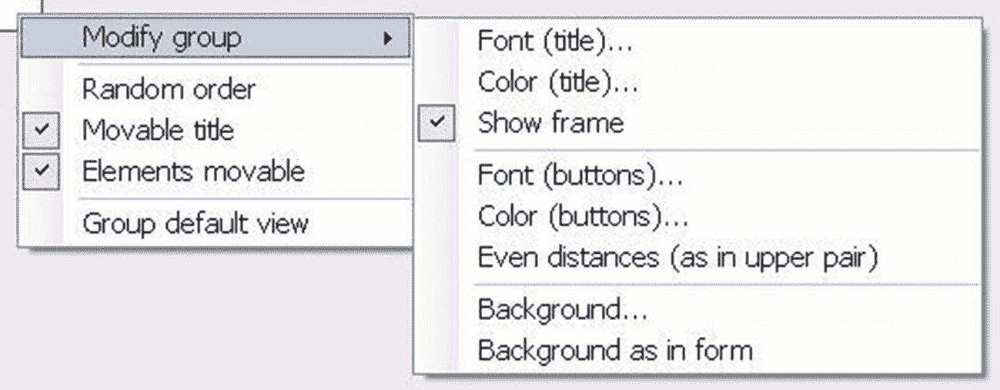

**图 5-26b** — 组上的菜单

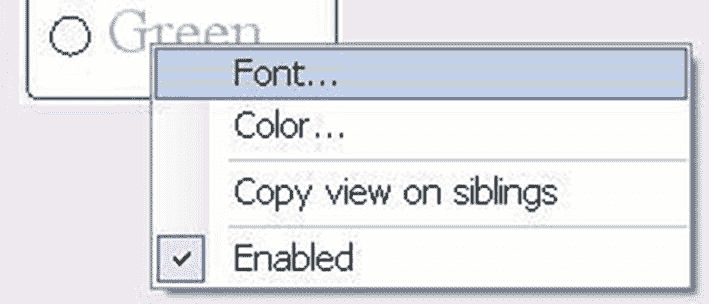

**图 5-26a** — 单选按钮上的菜单

组菜单（图 5-26b）可在组内任意空白处调用。该菜单允许您定义标题外观、调节框架绘制、为所有按钮设置参数、将上方按钮间距作为所有相邻按钮间距的样本，以及设置组背景。此外还有恢复组默认视图和调节标题及按钮可移动性的命令。

“修改组”行包含一个含有大量命令的子菜单（图 5-26b）。在这种情况下，包含所有这些功能的调优表单更为便利。我决定为组的轻量版和标准版采用不同的调优方式，因此组的标准版会在本章稍后部分介绍其预期的调优表单。

用户可以轻松更改组内单选按钮的顺序，因此选择仅基于按下按钮的 `ID`。按钮的 `ID` 在按钮构造时一次性设定，并且不依赖于后续的任何移动或参数更改。

```csharp
private void OnMouseUp(object sender, MouseEventArgs e)
{
    ptMouse_Up = e.Location;
    double fDist = Auxi_Geometry.Distance(ptMouse_Down, ptMouse_Up);
    int iObj, iNode;
    if (mover.Release(out iObj, out iNode))
    {
        GraphicalObject grobj = mover.ReleasedSource;
        if (e.Button == MouseButtons.Left)
        {
            if (grobj is RadioButton_Light && radiobtnPressed.Enabled)
            {
                if (fDist <= 3)
                {
                    groupAround.SelectButton(
                        groupAround.ButtonSearch(radiobtnPressed.ID));
                }
                ... ...
```

组菜单（图 5-26b）包含一个用于调节所有按钮可移动性的命令。选择与调优功能与此可移动性无关。

组菜单中的“随机排序”命令仅对 Rainbow 组启用。此命令使用当前按钮的坐标，但改变其顺序。Rainbow 组还有一个有趣特性：若按钮按正确的彩虹顺序排列，您即可发现该特性。

- 文件：`Form_RadioButtons.cs`

- 菜单位置：图形控件 ➤ 单选按钮

单选按钮及其组的轻量版在设计时遵循以下三条限制：

| • `按钮视图` | 文本位于圆形右侧，且中心点位于同一水平线。 |
| --- | --- |
| • `组视图` | 组内所有按钮的圆形沿同一垂直线排列。 |
| • `移动` | 按钮仅可上下移动。 |

### 排版后的文本

多年来你在所有应用程序中见过的几乎所有单选按钮都具有这样的视图，因此你会认为这是预期的显示方式，而不会觉得这三条规则是任何限制。然而，普通的`RadioButton`类允许你，例如，将圆圈放置在其关联文本的上方，并能够以任意方式在`GroupBox`内放置单选按钮。开发者可以利用普通的`RadioButton`控件做一些有趣的事情，但无论设计者有何想法，用户都必须接受给定的样式，无法自行更改任何内容。在用户驱动的应用程序中，完全的控制权交给了用户，因此新版单选按钮必须能在没有任何前述限制的情况下工作，并且新的类必须实现简便的方法，来更改圆圈-文本对内的相对位置以及组内按钮的位置。因为在大多数应用程序中，上述限制看起来根本不像限制，我决定在新类中包含一种简便的方法，用于在受限移动和无限移动两种变体之间切换。新单选按钮的变体由`RadioButtonType`枚举描述；从这些变体的名称中可以看出，自由的无限移动和新单选按钮的任意定位被视为正常模式。

```csharp
public enum RadioButtonType { Normal, Light };
```

单选按钮从不作为独立对象使用，而是仅在组内使用。`RadioButton_GR`类的按钮被组织成`Group_RadioButtons`类的组；当前示例中演示了两个这样的组（图 5-27）。在同一组内不可能同时使用受限移动和无限移动的按钮，因为这会产生如同同时使用可移动和不可移动对象一样的混乱。因此，如果用户决定更改任何组内的按钮行为，则该更改将同时应用于该组的所有按钮。

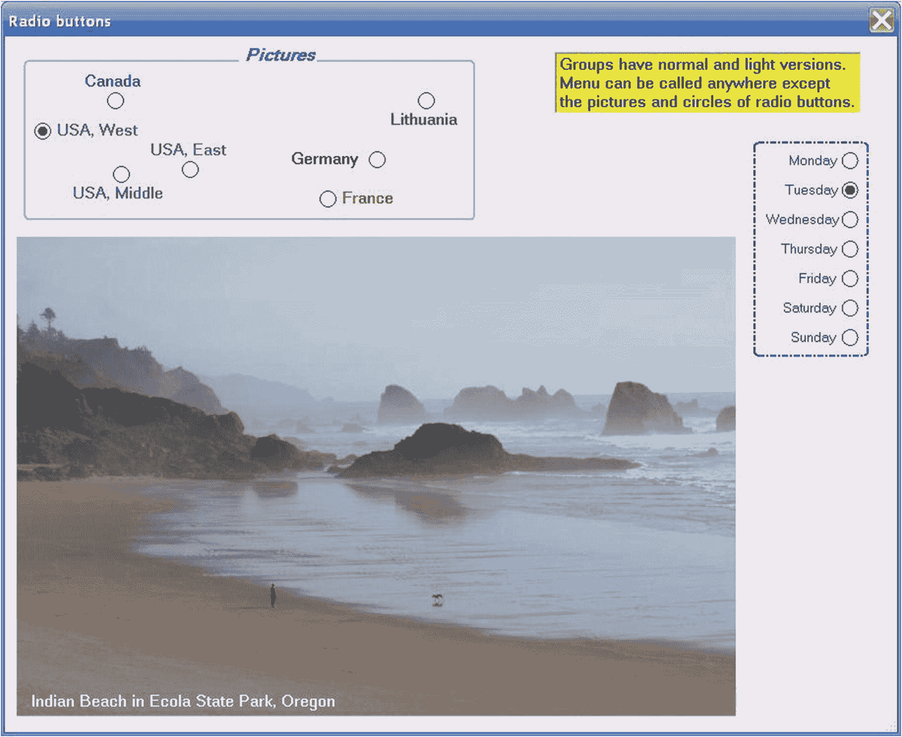

**图 5-27** `Group_RadioButtons` 类的对象

对于任何单选按钮，文本相对于圆圈的位置描述方式与复选框相同，因此文本可以放置在圆圈的任意一侧，并且每一侧都有三种圆圈-文本对齐方式。

```csharp
public class RadioButton_GR : GraphicalObject
{
RadioButtonType typeBtn = RadioButtonType .Normal;
PointF ptCenter;
Side sideText;
SideAlignment alignParts;
string m_text;
Font m_font;
Color m_color;
bool bSwitched;
bool bEnabled = true;
```

`RadioButton_GR` 类的覆盖层设计方式与精简版相同：一个节点位于圆圈之上，另一个节点位于文本之上，还有一个附加节点位于两者之间的空间。这第三个节点总是多边形，但其具体形状取决于圆圈和文本的大小及相对位置。计算这个节点很容易，但这部分代码过于冗长，此处不予展示。

```csharp
public override void DefineCover ()
{
CoverNode [] nodes = new CoverNode [3];
nodes [0] = new CoverNode (0, ptCenter, rBig);
PointF [] pts = new PointF [4];
if (typeBtn == RadioButtonType .Normal)
{
nodes [1] = new CoverNode (1, rcText, Cursors .Hand);
... ...
nodes [2] = new CoverNode (2, pts, Cursors .Hand);
}
else
{
nodes [1] = new CoverNode (1, rcText, Cursors .SizeNS);
... ...
nodes [2] = new CoverNode (2, pts, Cursors .SizeNS);
}
if (!Movable)
{
nodes [1] .Cursor = Cursors .NoMove2D;
nodes [2] .Cursor = Cursors .NoMove2D;
}
cover = new Cover (nodes);
... ...
```

组（`Group_RadioButtons` 类）和内部单选按钮（`RadioButton_GR` 类）的覆盖层设计没有什么新意；只是单选按钮上的鼠标光标形状从默认值进行了更改。当鼠标光标在组区域内移动时，它会经过内部元素和组的空白区域。在这两种情况下，鼠标下方都会有一个多边形节点，因此无需任何额外更改，光标将保持相同的默认形状，而不会提示可能的移动。为了在视觉上区分移动组或内部元素的可能性，必须更改其中一个的光标。我尝试了两种变体，并决定为组本身保留标准光标（`Cursors.SizeAll`），同时将按钮的光标更改为 `Cursors.Hand`。

一个带有星期几名称的简单组可以演示使用此类组可以完成的许多事情。对于许多读者（我认为是大多数）来说，图 5-27 中显示的天数顺序看起来很奇怪，但根据传统，有些国家/地区的第一个工作日是星期日或星期一；还有一些国家/地区（或者至少不久前还有）一周从星期六开始，因此星期列表的第一行可能不同。此应用程序无需检查其启动国家/地区的传统；如果你需要更改起始日，只需将第一行移到列表底部，反之亦然。

假设你想要在视觉上（通过字体和颜色）区分工作日和周末。在许多国家/地区，有五个工作日，而在其他国家/地区，人们每周工作六天。这些都是常规情况，但也可能有个人要求。你可能按照特殊的时间表工作，只有两个、三个或四个工作日；你可能某几天的早上有课，而另外几天晚上有课。对于所有这些情况，你都可以为此组组织一个特殊的视图。图 5-28 展示了几种变体，但可能还有许多其他变体。所有更改都可在数秒内完成，并且可以在任何需要的时候进行。即使你决定将星期五放在星期二和星期三之间，这也是允许的。

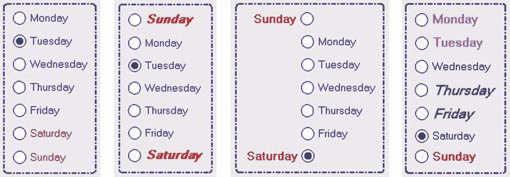

`图 5-28` 通过更改单选按钮的参数、更改其中某些按钮中圆圈和文本的相对位置以及更改按钮的顺序，组织了同一组的几种视图

巧合的是，在该组的所有四种变体中，按钮都排列在一列中。当然，组内按钮的位置没有任何限制，并且每个圆圈-文本对内的相对位置也有多种变体。图 5-29 在本示例的另一个组中展示了这一点。

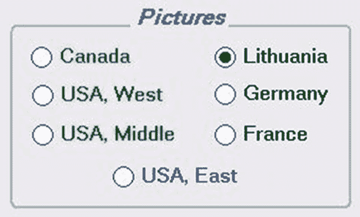

`图 5-29b` 左列的按钮关联自然图片，而右列的按钮关联建筑

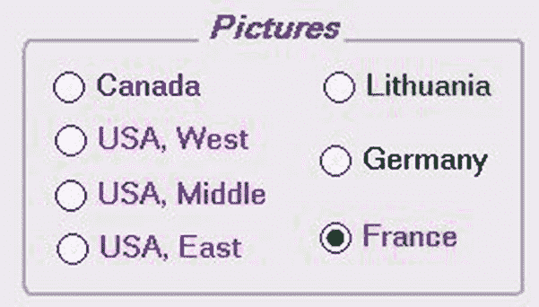

`图 5-29a` 两列的按钮分别代表北美和欧洲

该组共有七个按钮。选择一个按钮会显示关联的图片；这是我作为开发者必须提供的内容。无论用户如何调整该组及其按钮，此选择功能都必须正常工作。该组按钮的默认位置（如图 5-27 所示）类似于世界地图上对应地点的位置。用户可以根据完全不同的理念重新组织该组。例如，图 5-29a 中的两列按钮分别关联了来自北美和欧洲的图片。在图 5-29b 的变体中，左侧的按钮打开自然景色的图片，而右侧的按钮显示建筑物的图片。中间放置了一个按钮，因为虽然缺少建筑物，但主要元素是道路。

即使通过如此简单的示例，我也试图强调用户驱动应用的一个核心理念。程序员只负责应用程序的正确运行，因此每个单选按钮在被选中时，无论程序视图发生任何变化，都必须显示关联的照片。程序的呈现方式则由用户决定。

组参数的调节有两种不同方式。移动性及其他一些通用属性通过上下文菜单中的命令来调节，而所有可见性参数则可在特殊的配置表单（如图 5-29 所示）中更改。`Group_RadioButtons` 类的设计与 `Group_ArbitraryElements` 类类似，因此它们的配置表单以相似的方式设计也就不足为奇了。

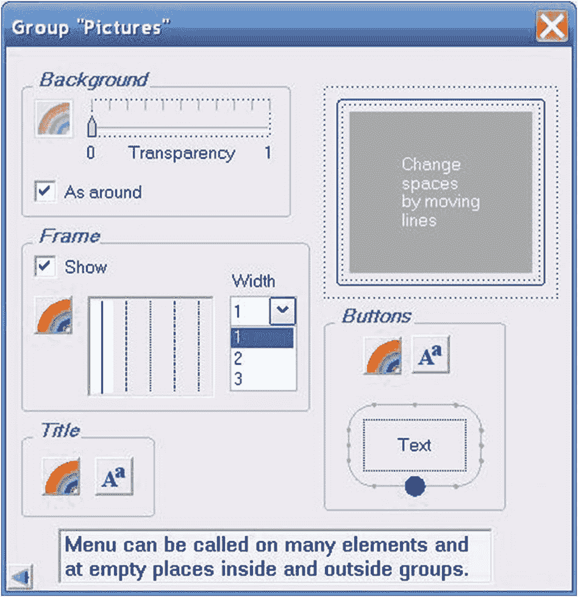

`图 5-30`

`Group_RadioButtons` 的配置

## 结论

本章讨论了最常用控件的图形化对应物。在将讨论焦点从元素转向用户驱动应用的整体设计之前，让我们先审视一些真正复杂且常用的元素的设计。