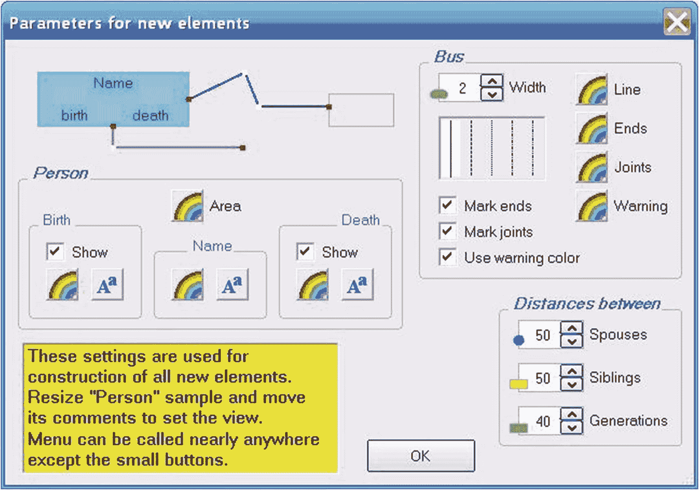
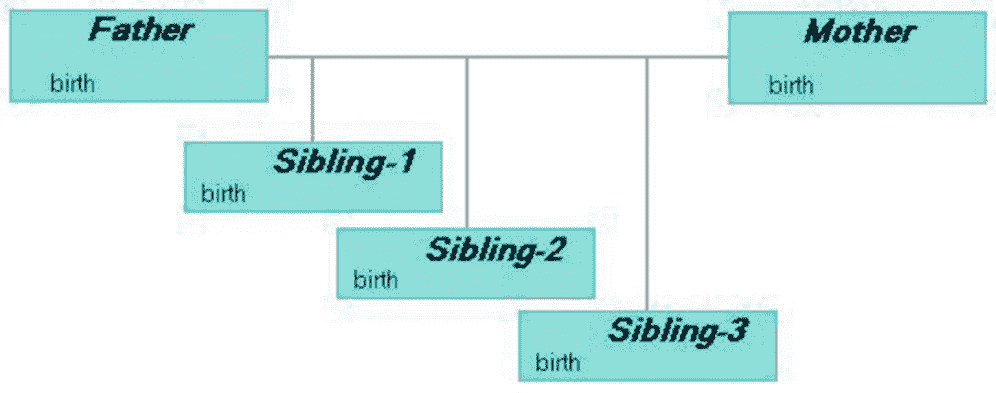
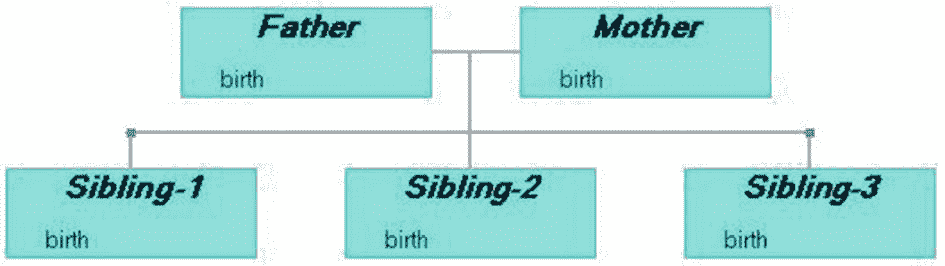

# 家庭树应用程序与函数查看器

## 家庭树应用程序

在“家庭树”应用程序的主菜单中，有一个“设置”项；如果你点击此菜单命令，将打开`Form_FamilyTree_NewElemParams.cs`（图 7-46）。

**图 7-46** 一个专门的表单允许你设置用于设计所有新元素的参数

### 设置表单

`Bus` 组允许您设置所有新总线的参数，因此该组中的元素与总线调谐表单（图 7-21）中显示的相同。

`Distances` 组允许您定义通过不同菜单命令添加到家谱中的多个 `Person` 对象之间的标准距离。调节值为配偶及兄弟姐妹之间矩形的水平间距，以及父母与子女之间的垂直间距。

`Person` 组中的元素允许您为未来的 `Person` 对象设置所有字体和颜色。此表单左上角有一个 `Person` 对象。所需的大小通过调整此示例来设置；所有三个注释（名称、出生和死亡）的定位系数通过移动注释来设置。

### 应用设置

我想强调的是，当您关闭此辅助表单并返回家谱应用程序的主表单时，此表单中的所有更改不会立即生效。这些设置仅在您开始向家谱添加新元素时使用。您可以将这些设置应用于现有家谱，但由于此操作可能会破坏精心准备的大树视图，从而造成有害影响，因此在更改整体视图的操作中，我特意加入了几个中间步骤。

首先，在某个 `Person` 对象上调用菜单，并使用子菜单中的命令 `设置标准参数`。我建议不要只对一个 `Person` 对象执行此操作，而是对多个 `Person` 对象执行，并且可能使用子菜单中的不同命令。如果您对结果满意，并希望进行全局更改，则在同一 `Person` 对象上调用菜单，并使用命令 `用作样本`。

更改总线不会导致灾难性后果，但最好也分两步进行全局更改。首先，在某个总线上调用菜单，并使用 `修改（总线）` 命令。如果您对结果满意，则调用同一菜单，并将此总线用作其他所有总线的样本。

### 主菜单命令

让我们回到主家谱。`Form_FamilyTree.cs` 的主菜单中有两个有用的命令。`文件 ➤ 另存为` 命令允许您将家谱保存为二进制文件，而 `文件 ➤ 打开` 命令允许您从文件中恢复家谱。

### 滚动与设计规则

真实的家族树可能很大，您极有可能需要比屏幕更大的空间来显示它。您可以轻松地以任意方式滚动整棵树；只需在任意空白处按下左键并开始移动即可。这种滚动整棵家谱的方法在之前的示例中已经解释过。

不要害怕在设计中进行任何操作或犯错，因为此家谱应用程序中实施了若干规则。

- 任何用户的操作都不会对家谱设计造成致命影响。如果您放置了错误的元素，可以通过上下文菜单中的命令删除它；如果您放置了错误的元素组合，可以对每个元素使用 `删除` 命令。如果总线连接到了错误的元素，只需断开连接（通过在错误连接处的菜单中使用命令），然后继续您的设计。

- 设计中有一些限制：总线不能连接到自身；总线两端不能连接到同一总线；两条总线不能通过相互连接形成环路。除此之外，其他操作都是允许的。

- 通过调整可见性参数，您可以添加从您的角度看可能重要的个人信息，但这些信息不会在任何标准命令系统中提及。例如，如果您想用两条总线突出显示配偶之间的联系，您可以这样做。没有人会阻止您尝试这样做，也不允许您在相同的两个 `Person` 对象之间组织两条并行的总线。或者，您可以在总线中为宗教婚姻和民事婚姻标记不同的方式。

- 不仅可以更改元素的视觉参数，甚至一些标准的家族联系也可以与之前描述的命令系统所建议的方式不同。图 7-47a 显示了使用几页前讨论的两个命令的结果：首先设置了一对夫妇；然后在他们之间的总线上使用另一个命令添加了三个孩子。同一个由父母和三个孩子组成的家庭可以用不同的方式表示（图 7-47b）。第一个命令是相同的；然后，将添加单个孩子的命令应用到上方总线三次。

**图 7-47b** 父母矩形作为标准命令的结果出现，而孩子则通过在上方总线上调用命令逐个添加

**图 7-47a** 此视图是使用两个标准命令的结果

这是一个标准的用户驱动型应用程序。这是您的应用程序，您是主导者，您可以完全按照自己的意愿组织视图。

## 函数查看器：一窥科学应用

在本示例的描述中，你将看到一些简短的代码片段，因为所有元素及其工作方式我们都已经讨论过了。本节要演示的主要内容，是一个相对复杂、用户操作和请求无法预测的应用的总体设计。所有科学应用都必须遵循一条简单规则来开发：“用户能做一切。”作为开发人员，我必须按照这条规则来提供程序。许多读者可能会觉得，开发允许用户为所欲为的应用会给程序员带来巨大的、不堪重负的负担，所以我想证明这种看法并不正确。设计者不需要对一切能想象到和无法想象的情况都做出响应，而是应该基于那些完全由用户控制的元素来开发程序。

在 2001 年至 2004 年间，我参与开发了一个成功销往全球的大型工程程序。该程序用于分析大型电网，包含数十个对话框，允许熟练的用户操控数百个参数，以分析不同的场景和情况。与这类程序的常规做法一样，许多计算的结果不仅要通过数字和填充的表格来展示，还需要绘制成图表。（人们以图形形式查看数据时，理解和评估数据的效果要好得多。）2004 年年中，我们这些该程序的开发者在讨论新版本的想法。其中一个想法是增加结果的图形化展示，并赋予用户对此展示的一定控制权，例如，让用户决定显示的绘图区域数量。

这个程序是以经典方式设计的。当时还没有人谈论屏幕对象的可移动性。整个应用是自适应界面的一个经典例子，因此未来的所有工作场景都必须提前构思好并编入代码。我一直在思考一种简便的工具（对用户而言），让用户能够声明所需的绘图数量及其位置。按照当时的惯常做法，所有对话框都基于普通控件来设计。无论我尝试何种方案，声明绘图位置和大小的机制看起来都不够优雅，但至少能工作，我也希望在过程中能想出更好的办法。然而，有一个小问题我甚至找不到一个稍微靠谱的解决方案。

在科学文章中，你经常会看到一个绘图区域中，几条曲线以不同颜色和线型显示。曲线之间的差异是由某个参数的变化引起的，因此曲线需要附上注释，说明其关联的参数。当文章作者准备此类图片用于发表时，要显示的曲线是已知的，为曲线附近的注释选择最佳位置也不是问题，因此在科学期刊中，整张图看起来总是很美观。

当你开发一个需要展示此类绘图区域的应用时，你事先并不知道内部会呈现什么样的曲线，因此你不得不将所需的注释放在绘图区域内部之外的某个地方。你能为它们在绘图区域下方或侧面预留一些空间吗？可以，但是：

*   注释会占用大量宝贵的屏幕空间。

*   注释会远离曲线，从而难以将曲线与注释关联起来（尤其是在同一区域有多条曲线时）。

*   还有围绕绘图区域的坐标轴刻度问题。可能存在多个坐标轴及其自身的注释，因此刻度位置与不同注释之间会有各种能想象到和无法预测的冲突。

*   如果一个视图中有多个绘图，那么问题会远远超过线性增长的速度。

总结所有这些需求，这界面本身已经因要放置所有所需绘图区域的几个控件而变得复杂，现在又得用一个额外的工具来放置所有需要的注释，这会使界面复杂得多。即使所有这些都以某种方式组织起来，看起来也非常笨拙（这是最客气的说法）。此类程序的用户是高素质的专家，他们试图解决非常严肃的工程/科学问题，不需要把时间浪费在与糟糕的界面设计作斗争上。这个需要快速、准确、简便地在带有未知曲线的绘图区域任意位置放置所需注释的问题，在设计一个庞大且非常复杂的科学应用时，可能看起来并非首要问题。因此许多人认为它总能用某种方式解决，但在标准设计下，这个问题无解。而这并非科学应用中此类问题的孤例。

在 2006 年至 2007 年间，我设计了一种屏幕对象可移动性算法，研究此算法的主要动力正是工程/科学程序的需求。2008 年初，当我的算法已准备好用于真实的科学程序时，我开始在传热传质研究所的数学建模系工作。来自该系及其他系的这些科学家是热力学领域的高素质专家，其中许多人也擅长编程，因此他们非常清楚界面的局限性。他们向我提出了一系列开发任务，这些任务需要开发成可工作的程序，但在标准设计的范畴内却无法实现。任务各不相同，但有一个共同特点：每个任务都必须处理来自实验和计算的数据不确定性。第一阶段这种不可预测性使得在标准界面下进一步工作几乎不可能。如果你试图设计一个能应对所有可能变体的程序，那么标准界面会变得极其笨拙，以至于根本无法使用该程序。每个程序都需要对屏幕元素进行手动操作，而这与用户驱动应用的理念和可能性完美契合。我逐一为这些任务设计了程序，每一次用户获得的功能都超出了他们最初的预期（或要求）。这些程序在研究工作中很有帮助，于是我收到了一个疑问：能否将所有旧程序重新设计成用户驱动应用？

通常，工程和科学程序规模庞大且复杂。每个程序都有许多特殊功能和细节，需要冗长的解释，并且只对特定领域的专家有较高价值，但对于该领域之外的人则毫无意义。同时，这些程序在设计上又有许多相似之处，因此多年来，我一直在为彼此相距甚远的知识领域设计应用。演示任何一个此类程序都需要解释其特定领域的问题和细节，这远非我在这本书中想讨论的内容。这就是为什么我更愿意演示一个包含科学应用所有特性，但又能被任何读者轻松理解的示例。我想演示和讨论一个函数查看器程序，它允许你输入`Y(x)`函数的表达式或`{X(p), Y(p)}`类型的参数方程，并对其进行操作。这个程序有助于学校的数学教学，同时它也展示了大量可用于设计复杂、专业科学应用的内容。

*   文件：`Form_FunctionViewer.cs`
*   菜单位置：应用 ➤ 函数查看器
