# Function Viewer 的设计与实现

## 核心算法的历史背景

本函数查看器所依赖的核心工具本身并无新奇之处。您可以找到多种能将数学表达式转换为图形的程序，这些程序都基于相同的数学工具。20 世纪 20 年代，波兰数学家扬·卢卡西维茨发明了一种表示法，其中省略了所有括号，并将运算符置于操作数之前；为纪念其发明者，这种表示法被称为波兰表示法。20 世纪 50 年代末，澳大利亚计算机科学家查尔斯·汉布林改变了操作数与运算符的顺序，从而发明了逆波兰表示法。如今，任何数学表达式解释器都基于此类表示法。在三十多年前出版的一些书籍中，您能找到这类解释器的说明，并附有演示汽车在火车站调头的插图。每辆汽车都承载着原始表达式中的一个元素，根据元素顺序，汽车可以直接穿过车站，或暂时驶入死胡同，只在恰当的时刻再被取出。通过这种方式，原始表达式中元素的顺序被改变，最终输出同样以逆波兰表示法形式呈现的表达式。编写这样一个解释器，是那些刚学习队列和栈的编程课程学生的标准练习，因此我不打算详述编写此类解释器的细节，而是直接使用 `MoveGraphLibrary.dll` 中提供的 `FunctionInterpreter` 类。

## `FunctionInterpreter` 类的核心方法

该类方法不多，但已足够使用。解释过程始终始于对待转换字符串的分析，该字符串需被转换为 `Elem` 类元素的 `List`，因此第一个要使用的方法是 `FunctionInterpreter.Analyse()` 方法。

```
bool Analyse (string strIn, ref List elems, out int iError,
out int kErrPlace)
```

原始函数文本可以包含不同的元素。

*   标准函数名称：`{ sin, cos, tg, sh, ch, th, ln, lg, exp, sqrt, mod, arcsin, arccos, arctg }`。
*   二元运算：`{ +, –, *, /, ^ }`。符号 `^` 用于表示幂运算。
*   一元运算：`–`
*   括号：`(` 和 `)`
*   变量：`{ x, p, r, X, P, R }`
*   数字。

如果函数文本中存在任何错误，则会返回错误类型和位置。如果文本正确，它将被转换为一种特殊视图——元素集合 `List<Elem>`；此 `List` 可用于计算。计算由 `FunctionInterpreter` 类的另一个方法完成。

```
bool Calculate (List PolishForm, double fArg, ref double fVal)
```

此方法返回的布尔值仅指示计算是否正确；计算结果通过其中一个参数（`fVal`）获取。

## 设计理念的创新

虽然函数查看器的主旨思想并无新奇之处，但其使用方式却是全新的。开发者需要提供一个无误的解释器，并将其与一个近乎无限的功能演示工具相结合。只有用户才需决定查看哪些函数以及所有可见性参数。我将此函数查看器与我多年前设计的旧版科学程序中的类似模块进行比较，之前提到的那些没有解决方案的问题就此消失了。

不再有笨拙的工具来设置新绘图的数量、位置和大小，也没有完美的工具来完成所有这些设置。这样的工具已不再需要。用户可随时添加或删除绘图区域，为单个或多个图形创建区域，移动和调整绘图区域大小，并轻松更改所有可想象的可见性参数。用户并非被迫这样做，而是可以随心所欲地随时操作。开发者不会干预这些操作，只负责提供一个易于使用的工具来完成所有操作。

多年前，存在一个无法解决的注释定位问题；现在，你无需考虑任何解决方案，因为问题本身已不复存在。用户自行决定注释文本的显示与隐藏。注释可以随时移动、旋转、隐藏、显示和修改，因此用户能轻松为任意图形决定所需的注释。

所有更改都会被保存和恢复；用户可以组织不同的变体，并在它们之间轻松切换。

这并非我多年来展示的函数查看器的第一个版本，它被收录在我的一本大部头专著[2]的示例中。^(¹⁰) 虽然当前版本与旧版高度相似，但新版使用了不同的绘图类，并具备一些不同的特性。

## 科学绘图中的通用需求

科学和工程应用可能有取决于特定领域的特殊绘图需求，但同时，许多领域的绘图都具有大量共同特征。大多数情况下，科学家处理的是 `Y(x)` 函数，这些函数通过在带有两个正交坐标轴的矩形区域中绘图来展示。通常，这些是线性坐标轴，尽管在某些领域，对数坐标轴也很常用。在大多数情况下，拥有一个水平和一个垂直坐标轴就足够了，但有时为了更好的视觉对比，同一区域内的多个图形必须在完全不同的范围内显示，这时就需要多个不同的坐标轴。旧的 `Plot` 类支持多坐标轴工作，而当前版本的 `Plot_Adh` 类在每个方向上仅使用一个坐标轴。

```
public class Plot_Adh : GraphicalObject
{
Scale_Numbers scaleHor, scaleVer;
List m_comments = new List ();
```

`Plot_Adh` 类使用了熟悉的注释类和坐标轴类；这些坐标轴在第 6 章讨论条形图、其坐标轴及其调整时已经演示过（图 6-4–6-7）。`Plot_Adh` 类主区域的调整在一个特殊的窗体（图 7-48）中完成，该窗体包含了在条形图区域调整中已展示过的几个熟悉部分和元素（参见图 6-8）。

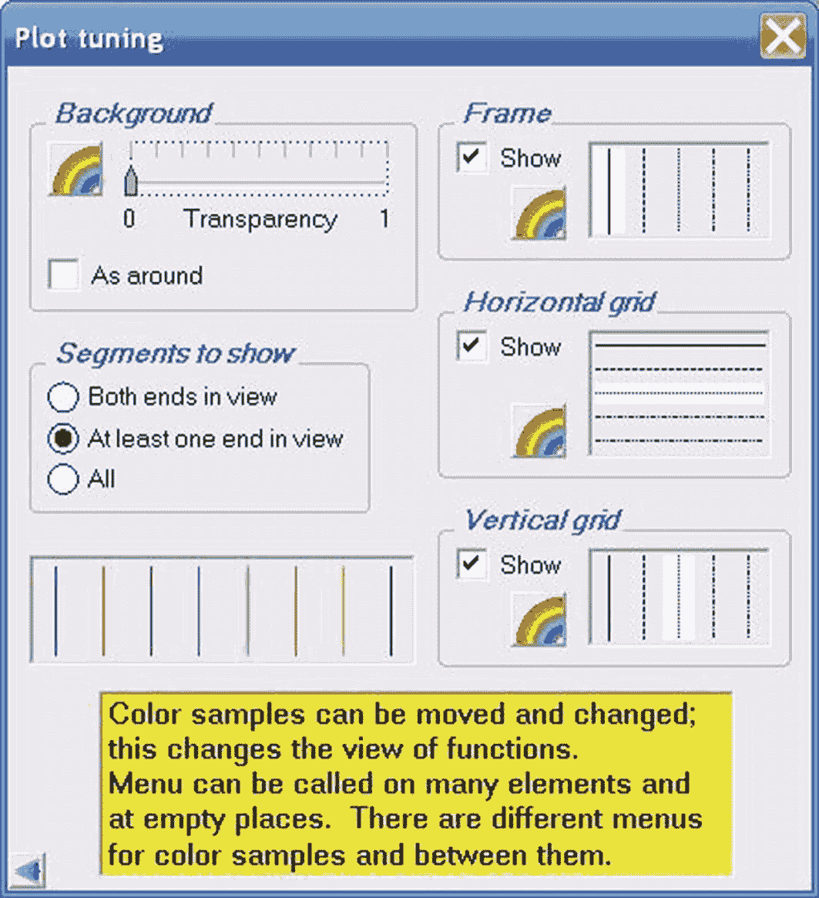

图 7-48 用于调整绘图区域的辅助窗体

## 绘图区域的可视化定制

*   背景通常设置为与周围窗体（或 `TabControl` 的页面）相同，尽管也可以轻松选择任何所需背景色及其透明度。
*   绘图区域的边框和两个方向的网格线以相似方式独立调整。它们每个都可以选择显示或不显示；如果显示，则可以选择线条颜色和样式。网格线的位置由坐标轴上数字（和刻度）的位置决定，但刻度线和网格的外观是独立的，并在不同的窗体中分别对坐标轴和主区域进行调整。

颜色的选择也与条形图的颜色选择类似。一个矩形区域包含颜色样本。所使用的颜色从最左边的样本开始选择，因此可以通过更改这些样本的顺序（按住并移动样本到另一个位置）、更改样本（在要更改的样本上调用菜单）或添加更多样本（在样本区域的空白处调用菜单）来改变函数的视图。

任何图形都显示为连接计算点的线段序列。线段的端点可以在绘图区域内部或外部；“要显示的线段”组允许您选择要显示的线段。通常，要显示的函数足够平滑，此组中的选择不会改变图形的视图。对于`Y(x)`函数，为绘图区域内的每个水平像素计算值，生成的线是每对后续值之间的线段序列。当图形线接近垂直且相邻水平点的值差异巨大时，不同变体之间的差异就变得明显。最糟糕的情况发生在垂直渐近线的情况下。在这种情况下，最好选择第一个选项（两端都在视野内），而最后一个选项（全部）可能会在渐近线位置显示垂直线。

为了更好地理解函数查看器，让我们将其用于一个足够简单的任务，该任务不需要对其数学方面进行大量解释。假设您想与某人讨论多项式函数的特性以及此类函数随多项式次数的变化。为了进行此讨论，您需要准备几个函数，并为它们选择不同的视图以便更好地演示。

首次启动函数查看器时，您只会看到一个包含空函数列表的组，并且所有按钮都处于禁用状态（图 7-49）。函数查看器允许您处理两种类型的函数。多项式函数属于`Y(x)`类型，因此主菜单的相应命令会打开所需的辅助窗体（图 7-50）。

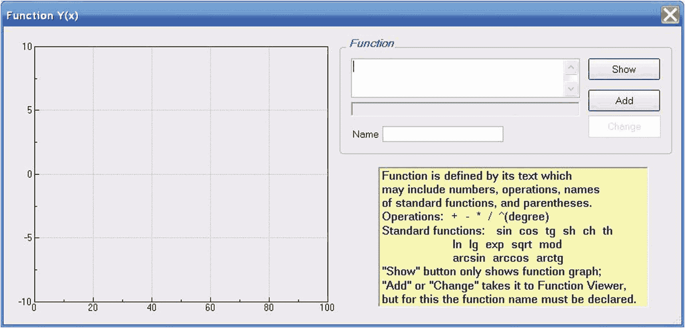

图 7-50 定义`Y(x)`函数的辅助窗体

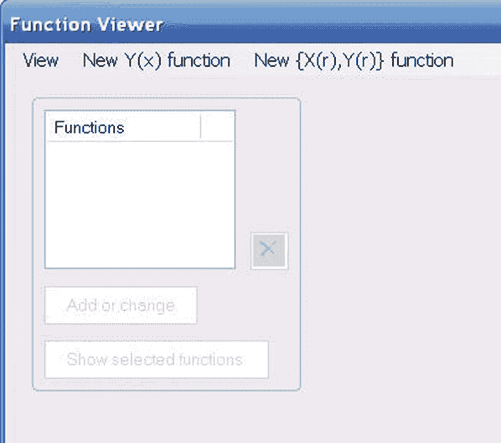

图 7-49 开始时，既没有函数也没有绘图

多年来，我对我程序的描述经常包含诸如“在左边你看到……”之类的短语。对于用户驱动的应用程序，解释中的此类词语会变得令人困惑，因为用户可以以任何可能的方式更改程序视图，而正在运行的程序的视图可能与设计师精心构思和准备的原始视图毫无共同之处。`Form_FuncYx.cs`有一个绘图区域、用于函数定义的组和信息。信息可以阅读一次，之后就不再需要，因此它可以被压缩到很小的尺寸。所有元素都可以移动和调整大小，因此每个用户都可以在几秒钟内组织他偏好的视图。

此窗体中的大多数元素都是图形对象，这些对象已在前面章节中讨论过。还有两个普通控件，与所有其他元素一样，它们也是可移动和可调整大小的。普通控件的移动和调整大小将在附录 A 中讨论，因此在此我只想简要提一下。

所有元素都必须可移动和可调整大小。通常，图形元素通过边框调整大小，并通过任意内部点移动。这对于普通控件是不可能的，因为单击其区域内的任何位置都会触发用户预定义和期望的某些操作。因此，对于控件，移动和调整大小都从边框开始。调整大小从角点和边的中间部分开始；移动从所有其他边框部分开始。

在设计任何窗体时，我尝试以对实际工作最佳的方式进行组织，但这只是我对“最佳”的看法。每个用户都可以自由组织自己的视图。用户不仅可以按照自己的意愿更改视图，而且我的主要努力是使这个更改过程对用户尽可能简单。

对于纸质插图，我会更改程序视图，使其与纸张格式匹配；偶尔我不得不考虑纸张文本中几个相邻图形的定位。因此，在进入`Form_FuncYx.cs`时，您将看到的视图与图 7-50 中显示的视图不同，但我保证，无论您如何更改它们，这些元素都将完全按照它们应该做的去做。

当用户首次打开`Form_FuncYx.cs`时，要定义的函数是不可预测的，并且显示此函数的最佳范围是未知的，因此比例尺以这样的方式组织。

```csharp
private void DefaultView ()
{
plot = new Plot_Adh (this, mover, new Rectangle (50, 30, 400, 280),
Side .S, 0, 100, GridOrigin .ByStep, 20,
Side .W, 10, -10, GridOrigin .ByStep, 5);
... ...
```

对于任何`Y(x)`函数，您需要定义函数表达式；您还需要为该函数指定一个唯一的名称，以便将其与其他函数区分开来。函数表达式和名称在“函数”组中包含的两个控件内输入。与所有普通控件一样，这两个元素通过其边框进行移动和调整大小；所有其他元素通过内部点移动并通过边框调整大小。

我们开始研究多项式函数，从一次函数开始，并输入一个简单函数`x–3`的文本。要查看其图形，请单击“显示”按钮。水平和垂直刻度的结束值是在绘图区域初始化时设置的。对于我们当前的函数，X 刻度的默认范围 [0, 100] 不太合适，因此最好更改它。用于`Scale_Numbers`类的水平和垂直刻度的调优窗体已经讨论过（图 6-4 和图 6-5）。通过使用水平和垂直刻度的调优窗体，我们可以为我们的函数获得更好的视图（图 7-51）。在辅助窗体中准备函数的过程中，不仅可以设置刻度范围，还可以设置许多其他参数。通常，每当您需要更改某个对象时，您可以在该对象上调用菜单；将会有用于更改特定参数的命令或用于调用调优窗体的命令。

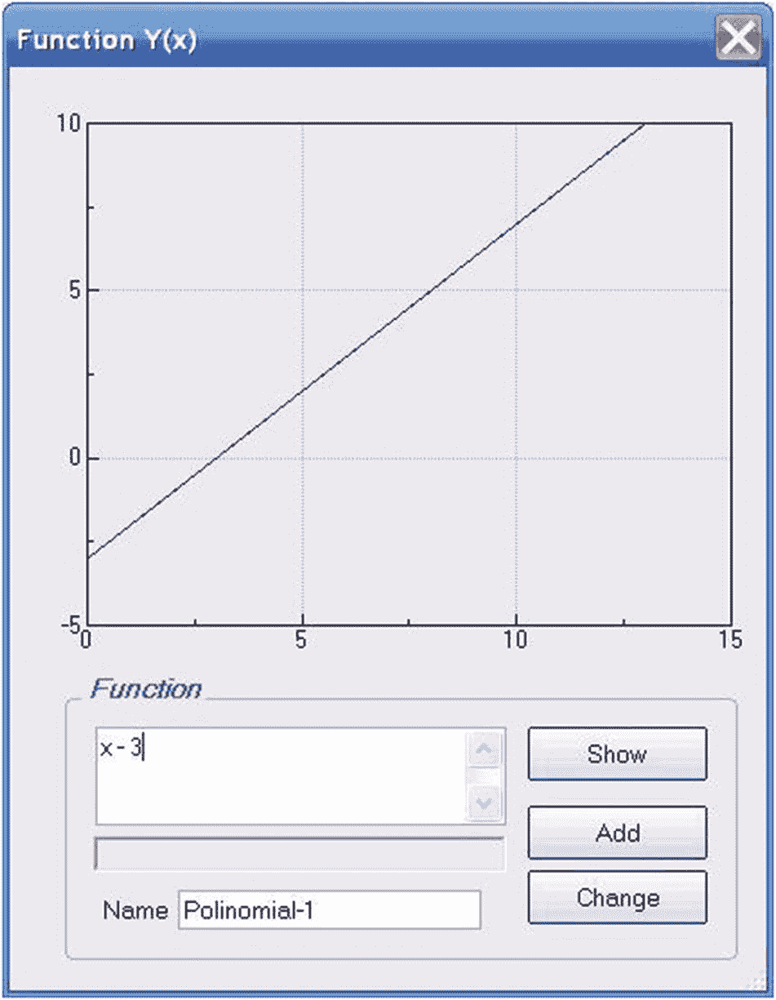

图 7-51 经过一些刻度调优后的`Form_FuncYx.cs`

必须声明函数的名称。名称只是文本，因此您的想象力有广阔的空间。

当一切准备就绪后，我们可以单击“添加”按钮，并将这个准备好的函数返回到函数查看器的主窗体。函数名称出现在列表中，而函数本身通过`NewPlotForSingleFunction()`方法显示在新的绘图区域中（图 7-52）。

```csharp
private void Click_miNewFunc_Yx (object sender, EventArgs e)
{
Form_FuncYx form = new Form_FuncYx (m_functions, -1);
form .ShowDialog ();
if (form .FunctionReady)
{
... ...
NewPlotForSingleFunction (iNew);
}
}
```

在辅助形式和函数查看器中，函数的外观存在巨大差异（图 7-51）。在辅助形式中，始终只有一个绘图区域。当我们准备示例中的第一个函数时，主窗体中有一个单独的绘图区域；之后我们会拥有越来越多的绘图区域，每个新区域都会出现在已有图形之上。试图将新图形放置在某个空白位置是没有意义的，它只会简单地出现在当前显示内容的顶层。新绘图区域的大小取决于窗体的大小，而每个新绘图区域的位置会与前一个略有偏移。

最关键的参数（如刻度范围）从辅助形式中复制，而其他参数则采用默认值。两个注释显示了函数名称及其表达式。

```csharp
private void NewPlotForSingleFunction (int iFunc)
{
RectangleF rc = NewArea ();
Function_Origin func = m_functions [iFunc];
Plot_Adh plot = new Plot_Adh (this, mover, rc, Side .S, ..., Side .W, ...);
plot .AddFunction (func);
... ...
```

用户可以在新图形出现在主窗体后立即进行移动、调整大小和修改，也可以在之后的任何时刻进行。对于多项式函数的进一步讨论，我倾向于先准备好所有需要的函数，然后为所有图形组织一个良好的视图。

当列表中的任意函数被选中时，组内的几个按钮会变为启用状态（图 7-52）。要准备一个二次多项式，我可以重复之前描述的过程，但我想将现有的一次函数作为下一个函数的一部分，在这种情况下，在列表中选择现有函数的名称并点击此按钮会更简单：。同样的`Form_FuncYx.cs`会被打开，但与准备前一个函数相比，准备新函数`Y = (x-3)(x-1)`所需的精力略少。如果在一个略有不同的 X 范围内显示，新函数看起来也更好，因此我使用水平刻度调整窗体。

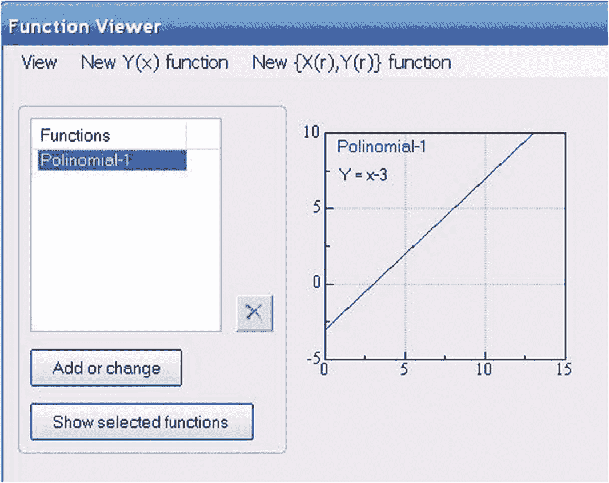

图 7-52 带有第一个多项式函数的函数查看器

由于某个函数被用作进入辅助形式的来源，因此该窗体中的`Change`按钮也会被启用（图 7-53）。我不想更改第一个函数，而是要组织一个新函数，所以输入一个不同的名称，然后点击`Add`按钮返回主窗体。

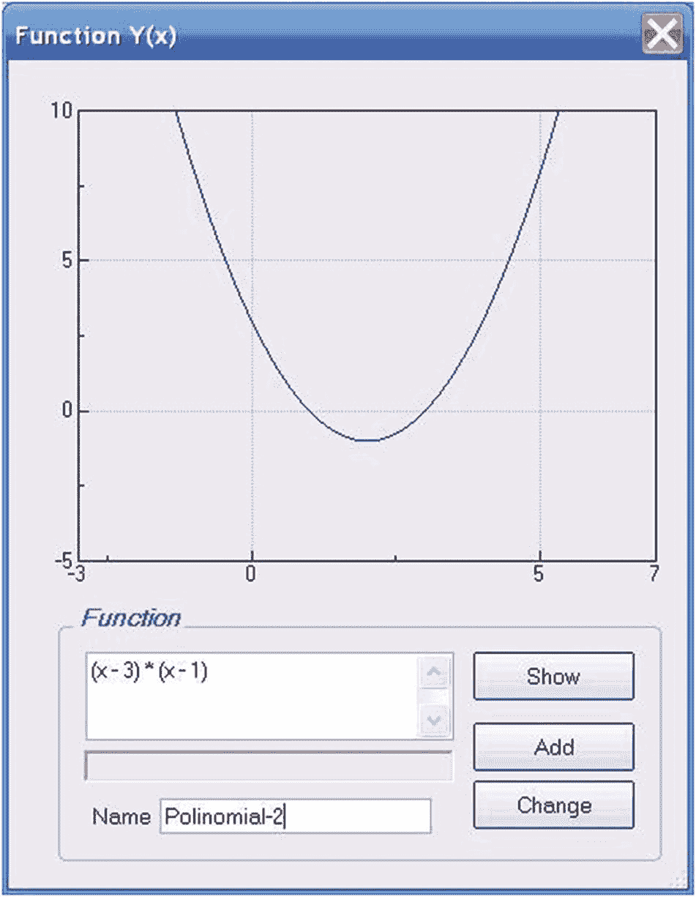

图 7-53 准备二次多项式函数

`Form_Functions.cs`中的函数列表新增了一行，并组织好了带有第二个函数的新的绘图区域。当一个带有函数的绘图区域被组织好时，它会自动获得两个新注释，分别显示函数名称及其表达式。任何注释都可以被更改、隐藏或删除。我不需要在函数各自的绘图区域中显示其名称，因此我在那里留下一个带有表达式的注释，但隐藏了名称。

我想演示高达五次的多项式，因此继续重复相同的过程几次，最终得到五个不同的绘图区域，每个区域包含一个图形（图 7-54）。这些图形可能有助于某些解释，但这种视图并不适合比较多项式，也不适合讨论随多项式次数变化而发生的变化。如果它们都在同一个绘图区域中就好了，因此我在列表中选择所有需要的函数，并点击此按钮：。屏幕上会出现另一个绘图区域；在该区域中，显示了五个图形。现在，我拥有了所有需要的图形，但视图并不理想。经过一些额外的调整后，我得到了所需的视图（图 7-55）。

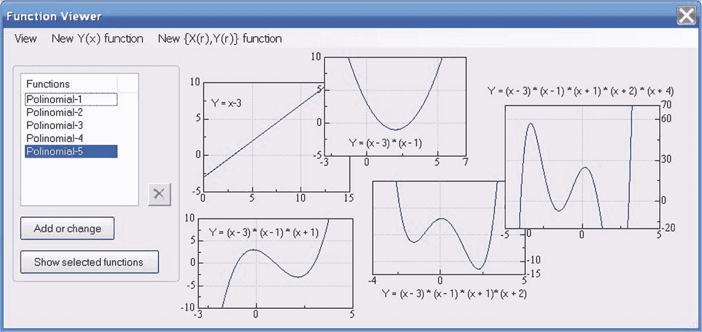

图 7-54 准备五个多项式

在准备图 7-55 时，我必须对每个绘图区域进行一些调整，但更改很小。在包含所有图形的区域中，我不喜欢其中一个图形的颜色，因此不得不更改那种颜色。然后我决定，在大绘图区域和小绘图区域中，每个函数最好用相同的颜色显示，因此对于小区域，我不得不打开它们的调整窗体，并将不同的颜色样本移到前列。

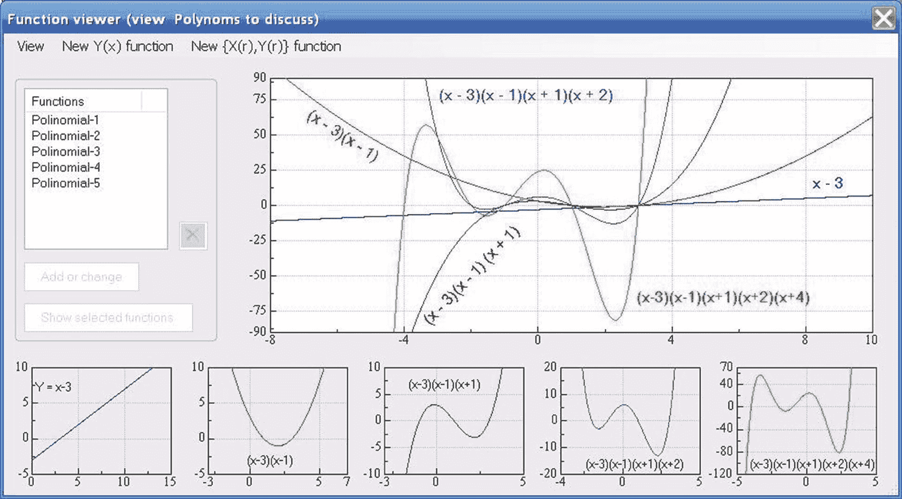

图 7-55 分别显示和全部显示的多项式

`Scale_Numbers`和`Plot_Adh`对象的调整窗体是相同的，无论它们用于哪个程序。这些调整窗体通常通过双击、菜单或两者结合来调用。绘图区域是工程/科学程序中极其有价值的对象，但总会有其他类的对象，根据程序的复杂性和新颖性，用户可能会看到熟悉的对象和新对象。为了使任何程序的使用都更加简单，所有程序都实现了一些简单的规则。

*   要对某个元素执行任何操作，用户需要调用该元素上的菜单。
*   要对一个组或组内的所有元素执行任何操作，用户需要调用该组上的菜单。（这意味着在组内的任意空白位置调用菜单。）
*   要对视图中的所有元素执行任何操作，用户需要在窗体的任意空白位置调用菜单。

将这些简单规则应用于任何应用程序意味着一个重要的事情：用户在开始使用新应用程序之前无需阅读长篇手册。这就像使用一辆新车：你不需要说明书来找到刹车踏板。

将这些规则应用于函数查看器，几乎找不到任何无法调用菜单的内部点。在此示例中，菜单仅不能在组内的小按钮上调用。（我只是想不出这个按钮所需的任何命令。）图 7-56 演示了在所有其他点上调用菜单的结果。看到所有这些菜单，用户对函数查看器的控制可能会显得过于复杂，但实际上并非如此。在工作中的应用程序中，你永远不会同时看到多个菜单，而且这恰好就是你想看到的菜单。如果你想更改某个元素，请调用该元素上的菜单。

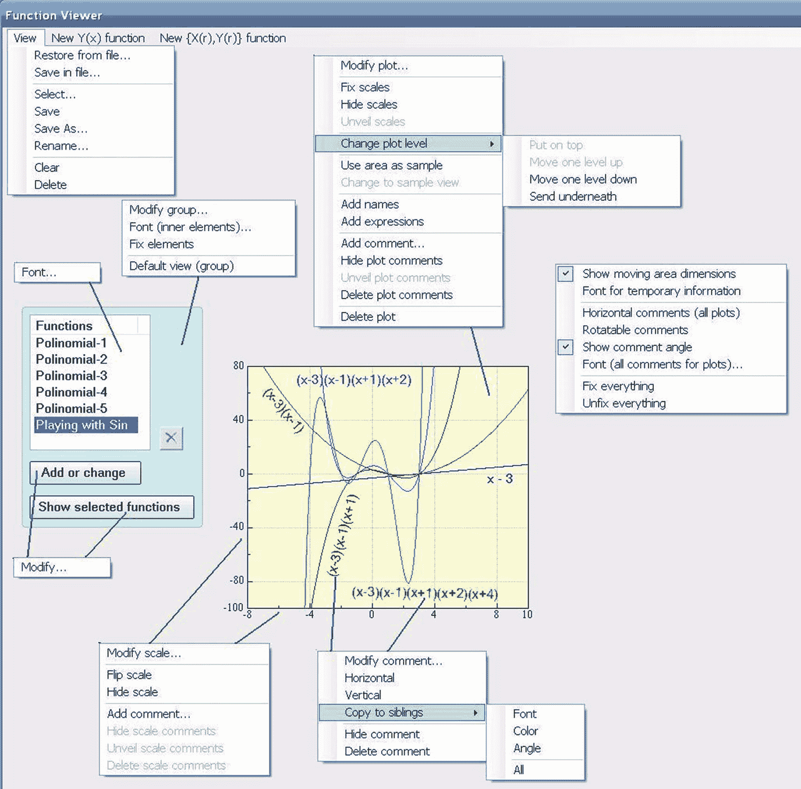

图 7-56 蓝色线条显示了菜单所关联的区域。右键菜单可以在任意空白位置调用。处理视图的命令包含在主菜单中

到目前为止，我已经演示了组织 `Y(x)` 类型函数的过程。当前的函数查看器也允许您处理 `{X(p), Y(p)}` 类型的参数函数，这可以通过另一种辅助形式来定义。要声明此类函数，用户需要为两个函数输入表达式，并为参数的范围和步长输入三个值。因此，`Form_FuncXrYr.cs` 包含更多元素，但除此之外，它的设计方式与之前类似（图 7-57）。

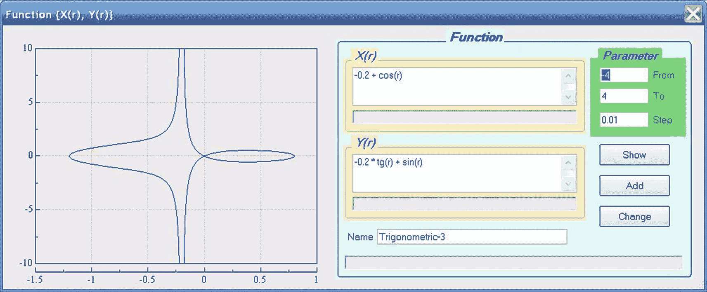

图 7-57

此辅助形式用于定义 `{X(p), Y(p)}` 类型的参数函数。

`Y(x)` 函数比参数函数更为常见，而第二类函数之所以被纳入函数查看器，主要是因为这类函数中的一种在我的记忆中占据着特殊的位置。许多年前，在我甚至还没到上学年龄的时候，我的父亲——莫斯科电信学院的教授——带着我和哥哥去了实验室。为了让我们有事可做，父亲打开了一台示波器，并教我们如何摆弄利萨茹曲线^(11)。这个新奇玩意儿让两个孩子兴奋不已，以至于我们宣布暂时休战，并尝试合作，以便在小屏幕上获得最美妙的曲线。几十年后，当我决定为我的函数查看器添加一些特别功能时，我加入了处理参数函数的能力，而程序中这一部分首个被测试的便是利萨茹曲线。

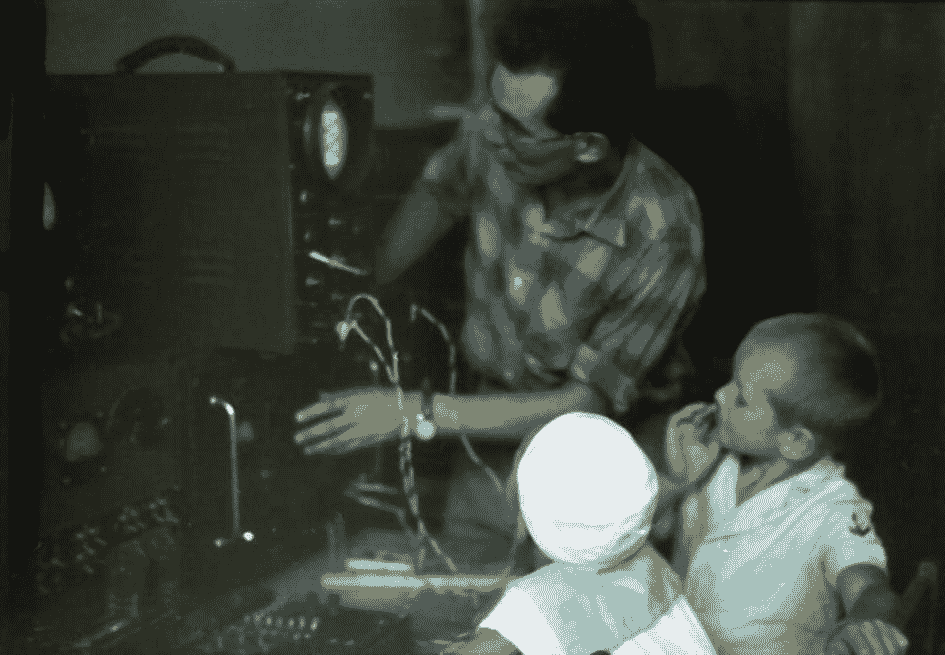

通过使用两个辅助形式（图 7-51 和图 7-57），可以准备许多所需的函数及其变体。用于调整绘图区域、比例和注释的表单允许您组织不同的视图，并在多个绘图区域中以不同组合展示这些函数。您可以准备任意数量的绘图，但屏幕尺寸有限，因此始终存在一个关于如何良好展示以及如何保存/恢复已准备图像而不丢失任何一个的问题。在我自己的电脑上工作时，我倾向于通过注册表来保存/恢复。当函数数量众多，或者我需要与他人交换结果时，通过二进制文件保存/恢复则更为合适。函数查看器通过其主菜单的命令提供了此功能（图 7-56，左上角的菜单）。

函数查看器作为一个示例，展示了开发新工程和科学应用程序的主要风格。绘图是此类程序的重要组成部分，我想演示如何在新应用程序中包含可移动、可调整大小、可调节的绘图。您可以在我的另一本书 [2] 中找到更多相关信息。

每一个新的科学任务都需要一个新的程序。如果您在研究工作中对科学家施加过多限制，就不要期望得到非凡的成果。他们所受的限制越少，其研究成果就越有趣。程序应当帮助科学家工作，而非限制他们探索新事物的尝试。

多年前，在开始使用那些用户驱动的应用程序后，数学建模系的科学家们宣称，所有新程序都必须采用这种类型。顺便提一下，他们问了一个简单的问题：“你们能否将这种完全的用户控制功能添加到我们仍在使用的所有旧程序中？”

## 几何光学示例

一些科学实验，尤其是物理学实验，可能成本高昂，需要大量时间和精力准备，甚至可能具有危险性。有些实验甚至无法在地球上组织进行。计算机的广泛使用以及编程领域的成就，促使人们萌生了从真实实验转向模型模拟的想法。

在组织真实实验时，您可以自由决定如何使用设备及所有相关元素。而在使用由他人设计的模拟程序时，您会受到其设计者对所提模型观点的限制，并且无法超越这种观点。您只能做该模型开发者认为正确的事情。通常，每个特定领域的科学家都比他们不得不使用的程序的开发者更专业。这种知识与理解水平上的差异导致了一种矛盾的局面：科学家们在寻求新颖和意想不到的结果时，却被水平较低的专业人员的视野所限制。用户驱动的应用程序指明了走出这种编程死胡同的道路。

计算机上对不同过程的模型，通常试图重现科学家们在现实世界中希望看到的真实过程。真实实验总是存在一些限制，而采用标准编程技术开发的模型也会被设计成带有同样的限制。然而，有几个非常著名的例子表明，真实实验中的设备被意外地以非常规方式使用，从而产生了一些奇怪的结果，最终获得了诺贝尔奖或促成了著名的发明（仅举两例，1895 年 X 射线的发现和 1945 年微波炉的发明）。如果一个编程模型以标准方式设计，一切都被其开发者预先决定，那么这样的模型永远不会允许我们看到意想不到的结果。关于所有编程模型的设计，存在一个根本性问题：“是否有可能开发出一个程序（模型），让你能够获得超出开发者知识范围的结果？”

用户驱动的应用程序对此问题给出了肯定的回答。这是因为新型程序被设计为研究和分析的工具。它们不是纯粹的科学计算器，而是用户可以以任何方式使用的研究工具。

汽车制造商生产汽车，并保证它们在合理条件下能够行驶。汽车制造商不会给你一份允许到达的目的地清单，因此你探索世界的欲望不受限制。用户驱动的应用程序也是如此。一个精心设计的程序就是一个研究工具；进一步的结果只取决于用户进行此类研究的意愿和能力。为了展示用户驱动应用程序的这些特性，我将从几何光学领域列举几个示例。

几何光学通常是物理课程中的一小部分，在我看来，这是该课程中最容易的部分之一。所有关于几何光学的书籍几乎都遵循标准的讲解顺序。它通常从光线直线传播开始；然后通过平面镜的讨论来说明入射角等于反射角。讨论球面镜时会涉及成像的构建。光从一种介质进入另一种介质时，会从折射率和斯涅尔定律^(12) 开始讲解。接着是光的色散。之后，讨论薄透镜中的成像。

# 2019 年，我撰写了一本名为《几何光学图解》[3]的小书，其中包含一个涵盖所有主题示例的程序。本节收录了该书中的三个示例。这本提到的书分为两部分：第一部分从光学角度进行解释，第二部分则涉及所有示例的编程。在本节中，几何光学的解释被精简到最低必要水平，而我则着重强调新设计对程序用户带来的优势。让我们从平面镜开始；这个示例完美地展示了所有示例的设计。

## 平面镜示例

*   文件：`Form_Mirror_Flat_Any.cs`
*   菜单位置：应用程序 ➤ 几何光学 ➤ 平面镜

在此示例中，用户可以处理任意数量的平面镜（图 7-58）。每个镜子都可以单独放置和旋转。镜子的数量可以轻松更改，这些特性使您能够组织出非常奇特的光线路径。这看起来像是一个有趣的游戏，但从我决定设计这个示例的那一刻起，我就想起了阿尔伯特·迈克尔逊的那次著名实验——光在威尔逊山天文台和瞭望山之间传播。

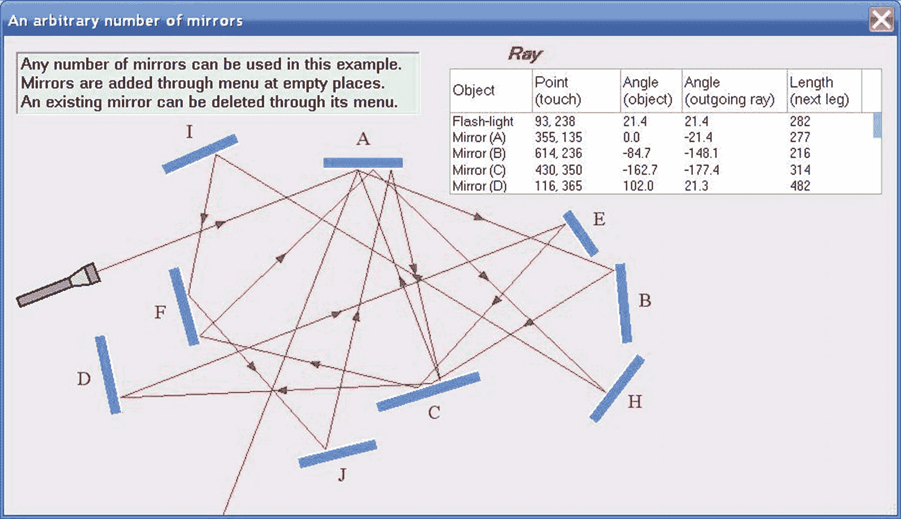

**图 7-58** — 在此示例中可以使用任意数量的镜子

每个镜子（属于 `Mirror_Flat` 类）都是矩形形状。其覆盖层的设计对所有矩形而言都是标准化的。用户可以决定每个对象是否允许调整大小，但通常情况下，矩形可以通过边和角来调整大小。镜子有一个反射面，可以通过使用不同的颜色来突出显示。另外三个面则吸收光线。

光源（`Flashlight` 类）被设计成手电筒的形式。在以下示例中，这个手电筒是唯一不可调整大小的元素；我实在想象不出可调整大小的光源有什么必要，尽管组织起来很容易。在真实实验中，不可能将一对光学对象（镜子和手电筒）放置在相同位置，因此当前示例中也禁止了这种重叠。

光线路径的计算方式如下：

*   初始光线的点及其角度从手电筒获取。
*   光线可以触及任何镜子，每个镜子有四个面，每个面都是由两个端点确定的线段。反射后的光线可以触及手电筒。手电筒的边界由八个直线段组成。因此，对于一个包含 `N` 个镜子的系统，我们有 `4 * N + 8` 个可能与光线相交的线段。系统会计算出最近的交点。
*   如果没有交点，那么这就是路径中的最后一程。（在图 7-58 中，光线在镜子 A 的中间被反射，然后延伸到窗体的底边之外。）
*   如果光线触及手电筒或任何镜子的非反射面，则计算结束。
*   如果光线触及镜子的反射面，则该接触点成为新的光源点，反射角等于入射角，然后重新开始计算。

当计算显示光线接触到了某个边界时，系统会在此边界上组织一个光学边界（`OpticalBorder` 类的元素）。该元素允许您处理吸收、反射或折射。虽然当前示例中只发生吸收和反射，但折射的情况将在后续示例中用到。

这个示例基于简单的元素——矩形——但即使是这个最简单的基元，也允许您组织起截然不同的示例。几乎在每本几何光学书籍中，你都能看到一个直角形状的反射器，其内部有两个反射面。这种设计完美地展示了入射角等于反射角的原理。在当前示例中，可以通过放置两个互成直角的镜子，并将它们的反射面端点相邻放置来构造同样的反射器。另一种有趣的设计是创建一个多边形，其反射面朝向内部。留一个小缝隙，让光线可以射入内部，然后观察结果。

我只提到了两种可能性，但一个由用户驱动的应用程序对用户的想象力没有设限。

## 折射与斯涅尔定律

光在任何材料中的速度都小于真空中的速度。在真空中的速度（`c`）与在材料中的速度（`v`）之比，称为该材料的*折射率*：`n = c / v`。由于`v`总是小于`c`，因此任何材料的折射率都大于 1。折射率略微依赖于波长，但对于可见光谱中的波，这种差异仅体现在小数点后第二位甚至第三位上。这种微小差异是色散的原因，这在书[3]中有讨论，但本书不涉及。在以下示例中，使用了单色光线，因此每种材料都使用单一的折射率。

当光线到达两种材料的界面时，一部分光线被反射，另一部分则进入另一种材料。反射角等于入射角，而折射角可以通过斯涅尔定律求得。

`n[1] * Sin ά[1] = n[2] * Sin ά[2]`

*   `n[1]` 和 `n[2]` — 两种材料的折射率
*   `ά[1]` — 入射角
*   `ά[2]` — 折射角

| 材料 | 折射率 |
| --- | --- |
| 空气 | 1.0003 |
| 水 | 1.33 |
| 玻璃 | 1.5 |
| 金刚石 | 2.48 |

有两类经典的折射示例，在每本几何光学书籍中都会被讨论：光穿过窗户的传播，以及从湖（或河）岸看水中某人的景象。这两个示例之所以流行，是因为我们一生中会多次看到它们。

### 从光疏介质到光密介质

当光线从光疏介质进入光密介质时，例如从空气进入水（图 7-59），那么 `n[1] < n[2]`，这意味着 `ά[1] > ά[2]`，因此折射光线（在此例中是在水中）会向法线方向弯曲。这对于任何入射角都同样适用。

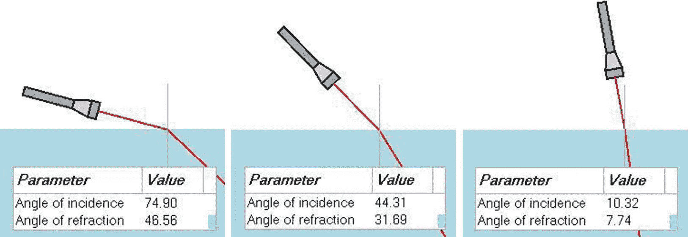

**图 7-59** — 对于从光疏介质进入光密介质的光线，折射光线总是向法线方向弯曲

现在想象一下，在手电筒的位置上是岸边某人的眼睛，而红线则显示了水中某人脚部反射的光线路径。眼睛捕捉到光线并看到了脚，但大脑对光线的弯曲一无所知。大脑认为整条光线是笔直的，因此大脑“看到”水中的脚位于上方光线的延长线上。结果，水中人的腿看起来比实际要短，而水面以上的身体部分则没有变形。

### 斯涅尔定律与折射

斯涅尔定律并未对光线方向做出任何限制，因此当光线从光密介质传播到光疏介质时，该定律同样适用。只是此时`n[1] > n[2]`，所以两个角度之间存在不同的关系，且当`ά[1] < ά[2]`时，折射光线会偏离法线（图 7-60a）。让我们从某个较小的入射角开始，并逐渐增大它。在当前程序中可以轻松实现这一点，因为你可以按下手电筒并旋转它。在一段时间内，斯涅尔定律仍然有效；折射光线越来越偏离法线，并趋近于界面（图 7-60b）。在我们的案例中，边界线是水平的，因此很容易观察和估计角度如何变化。

临界角是斯涅尔方程仍然成立，但`Sin ά[2] = 1`时的角度。对于水-空气边界，当入射角为 47.77 度时出现该情况。对于更大的入射角，方程只有在`Sin ά[2] > 1`时才成立，但这不可能，因此不会发生折射，而是发生全内反射（图 7-60c）。像往常一样，反射角等于入射角。

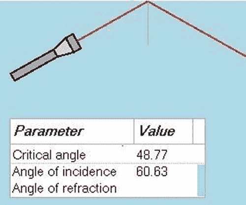

**图 7-60c** 入射角大于临界角时，发生全内反射

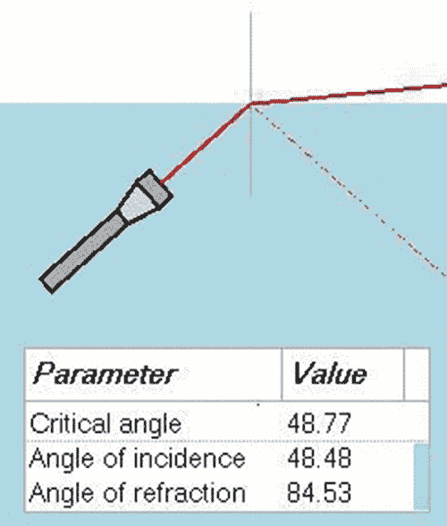

**图 7-60b** 当入射角接近临界角时，折射光线几乎沿界面传播

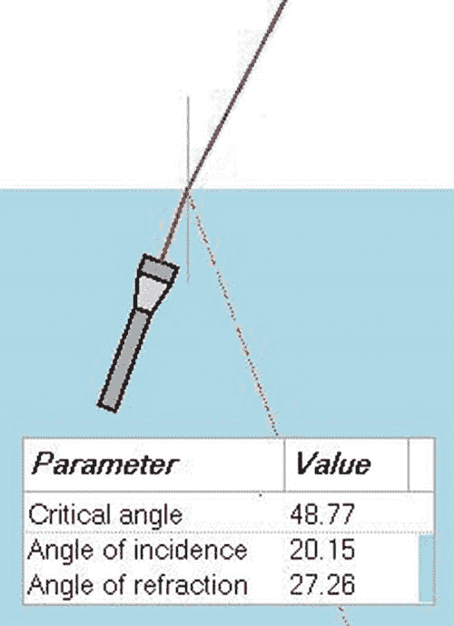

**图 7-60a** 入射角小于临界角时，根据斯涅尔定律发生正常折射

图 7-59 中的情况很容易解释和理解，因为它在我们一生中多次发生，我们非常熟悉透过水面看到的物体扭曲现象。图 7-60 中的情况很容易解释，但不太容易理解，因为我们并不生活在水下，在这种情况下，我们只能依靠数学而非感觉。让我们再看一个熟悉的情况。

当光线穿过窗户玻璃时（图 7-61），在两个边界都会发生折射。首先，空气-玻璃边界使光线向法线方向弯曲。然后，这条光线到达玻璃-空气边界，在那里使用相同的一对折射率但顺序相反，使光线偏离法线。因为两个边界使用了相同的一对折射率但作用方向相反，所以第二个角度变化的结果与第一个相同但符号相反，因此出射光线与原始光线平行。只是在传播过程中发生了侧向位移；图 7-61 中清晰可见。这正是我们透过任何窗户看到的情况。

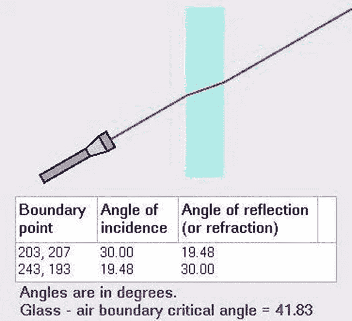

**图 7-61** 第二个边界上的折射使出射光线与原始光线平行

前面提到的两种情形——从岸边的视角和透过窗户的视角——对每个人来说都很熟悉，因此它们的解释从不会引起任何兴奋。这两种情形都包含在下一个示例中。尽管这个示例也涉及一个熟悉的情况，但我相信你会看到一些完全意想不到的结果。

## 水族馆示例

*   文件：`Form_Aquarium.cs`
*   菜单位置：`Applications ➤ From Geometric Optics ➤ Aquarium`
