# 7. 示例

用户驱动的应用程序只能建立在完全可移动性的基础上，因此前几章主要讨论的是设计各种完全不同的可移动对象。我们循序渐进，从最常用形状（矩形、圆形、多边形、环形等）的简单对象，过渡到可包含任意类型对象的复杂对象和组。我认为前几章的示例已经充分展示了如何将截然不同的对象转变为可移动对象，以及如何在新类型的应用程序中使用它们。几乎所有之前的示例都以展示所提算法的最重要特性及其实现方式为目的而开发。

本章不再讨论可移动性尚未涉及的方面，而是聚焦于具有明确用途的真实用户驱动应用程序的整体设计。以下示例最初是作为独立应用程序开发的，后来才被收录为本书配套程序的一部分。

## 计算器

我只有在极少数需要计算两个大数相除，且懒得用纸笔计算时，才会使用标准的 Windows 计算器。也许是因为我很少用这个程序，但每次使用时，我都很难找到印有正确数字的按钮，因为这些按钮的位置绝对不像我会作为设计师摆放的那样。我从小（并且至今仍）被教导从左到右、从上到下阅读和书写，考虑到从 0 到 9 的数字顺序几个世纪以来从未改变，而计算器的设计者也受教于同样的规则，我实在搞不懂为什么 Windows 计算器中的相同数字却是从底部开始向上排列的（图 7-1a）。这种布局背后肯定有某种伟大的想法，但我无法理解。每次使用这个程序，我都要花额外的时间寻找需要的按键。最终找到它们，得出结果，然后就会忘记这次搜索，直到下次再犯。

多年前，在我将普通控件纳入我的可移动性算法后，我一直在思考一个能展示这部分算法的好例子。这时我想到了计算器程序，它是一个绝佳的演示候选，因为它完全由控件构建，并且每个人都熟悉它。我的第一个计算器版本功能有限，但重现了原始程序的界面，并完美展示了所有元素的可移动性（图 7-1）。

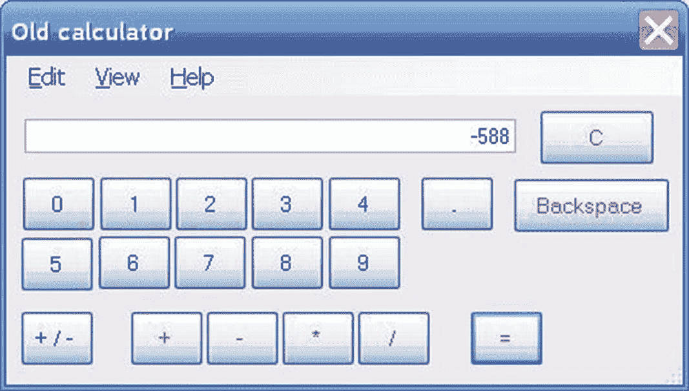

图 7-1b

可移动性允许每位用户组织自己偏好的视图

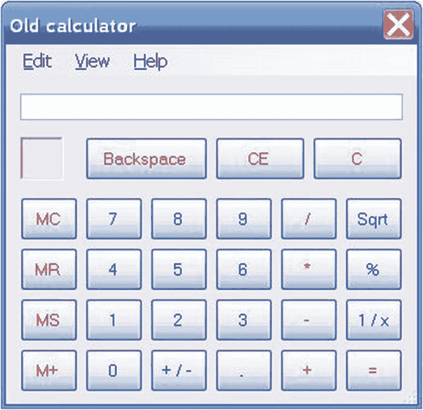

图 7-1a

原始计算器程序的默认视图

我本无意再用这个计算器做其他事，但几年后，在与一位同事交谈时，我听到了抱怨：这位同事视力不佳，使用标准计算器程序时遇到很大麻烦，因为即便数位专家共同努力，也未能找到任何方法来增大该应用程序使用的字体。于是，我坐下来开发了另一个同事能用的计算器。由于不是为自己开发，这个程序必须能作为一个具有运算和功能的普通计算器运行。当然，改变字体并非我在该程序中允许用户做的唯一事情；它是按照用户驱动应用程序的所有规则来设计的。

我的第二个计算器版本外观与图 7-2 所示相同；只是简短信息的文本略有不同，因为我的第二个计算器版本仍然使用普通控件设计。又过了几年，在下一个版本的计算器中，不再保留任何普通控件。图 7-2 展示的就是这个程序，也是我现在想讨论的程序。

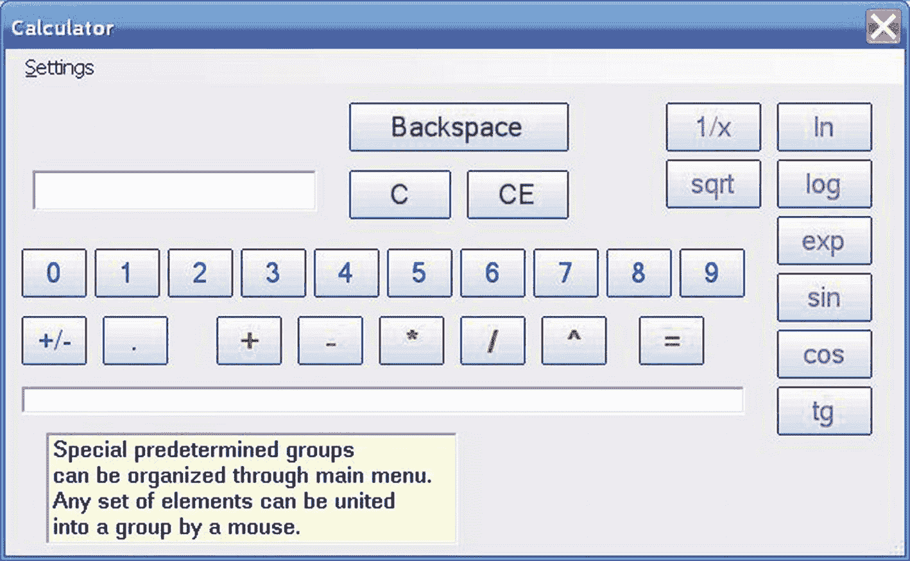

图 7-2

最新计算器的默认视图

*   文件：`Form_Calculator.cs`

*   菜单位置：Applications ➤ Calculator

我无意设计一个能与 Windows 同类程序竞争的程序。这个新计算器是为特定个人使用的；此人从未使用过原始程序的存储操作，所以我的程序中没有用于存储操作的按钮。

在进一步说明之前，有一点需要注意：在下文中，术语`所有元素`指的是除信息元素之外的所有元素。

### 排版后内容

新应用程序的所有元素中，除了两个之外，其余都是 `Button_Text` 类的按钮。这些按钮被分为四组；在图 7-2 中，它们通过不同的文本颜色被轻易区分。

*   带有数字的按钮文本显示为蓝色。从数学角度来看，小数点和符号绝对不是数字，但它们在书写数字时被用作记法的一部分，因此在这个程序中，这两个按钮被归入`数字`组。

```
Button_Text btn_0, btn_1, btn_2, btn_3, btn_4, btn_5, btn_6, btn_7, btn_8, btn_9, btnSign, btnDot;                   // 数字
```

*   带有运算符号的按钮显示为红色。

```
Button_Text btnPlus, btnMinus, btnMultiply, btnDivide, btnDegree, btnEqual;
```

*   `函数`按钮的文本显示为紫色。我可以很容易地添加更多函数，但为我设计这个程序的人说这组函数已经够用了。你可以在此程序中添加更多函数，但请仔细检查代码，并在使用此组的所有位置进行修改。

```
Button_Text btnLn, btnLog, btnExp, btnSin, btnCos,
btnTg, btnInverse, btnSqrt;
```

*   三个绿色文本的按钮被归为一组`清除器`，因为它们用于删除部分或全部已准备的数据。

```
Button_Text btnBackspace, btnClearAll, btnClearEdit;
```

为了更好地展示结果，这里有两个辅助区域；一个用于显示当前数值，另一个用于显示整个表达式。

```
Label_GR labelValue, labelExpression;
```

计算器旨在实现其主要目的，但这是一个用户驱动的应用程序，具备移动、调整大小、调优、保存和恢复等所有功能。让我们从移动开始。

移动可以应用于单个对象、三个预定义组（数字、运算和函数）的元素以及临时组元素。元素的单独移动以标准方式组织：用左键按下它，然后移动到另一个位置。

数字、运算或函数组（图 7-3）可以通过菜单命令来组织；我稍后会介绍菜单。因此，组织好的“标准”组只包含该预定义集合中的元素，不包含其他任何元素，即使当调用该组时，有其它对象恰好位于框架内。因此，函数组始终恰好包含八个具有函数名称的按钮；图 7-3 中框架内的另外两个元素（一个带有数字，另一个带有等号）不属于此组。

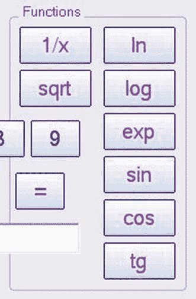

图 7-3

函数组包含八个按钮

临时组可以包含任意元素集合。在任何空白位置按下左键，并在不释放按钮的情况下移动鼠标光标。在此移动过程中，您将看到一个矩形框架；该矩形的两个对角分别是初始按下点和当前鼠标位置。如果在释放鼠标时，该矩形内包含多于一个对象，则会组织一个由这些圆角对象组成的临时组。例如，图 7-4 中的临时组包含数字组中的八个按钮、运算组中的三个按钮、清除器组中的一个按钮以及一个标签。

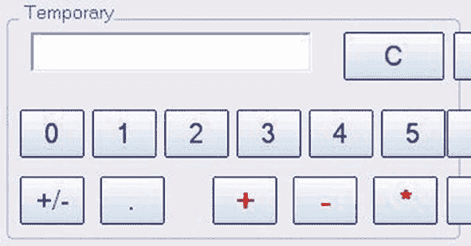

图 7-4

临时组

任何组，无论是预定义组还是临时组，都属于 `Group_ArbitraryElements` 类，因此可以通过其内部的任何点进行移动。框架会根据内部元素的任何变化调整其大小和位置。我想说的是，在计算器中组织的任何组都类似于临时组，仅用于移动某些元素集合的目的；这就是为什么没有修改组的命令。

在 `Form_Calculator.cs` 文件中（图 7-2），排除信息区域后，共有 31 个元素。这 31 个对象被分配到两个 `List` 中。这些 `List` 的名称清楚地表明，其中一个包含当前存在的组中的所有元素；其余元素则进入另一个 `List`。

```
List elemsInGroup = new List ();
List elemsSingle = new List ();
```

元素在两个 `List` 之间的分配，要么在调用“设置”菜单中适当的命令时（图 7-5）进行，要么在视图内绘制矩形后释放鼠标时进行。在这两种情况下，都会调用 `SetGroup()` 方法，但参数不同。

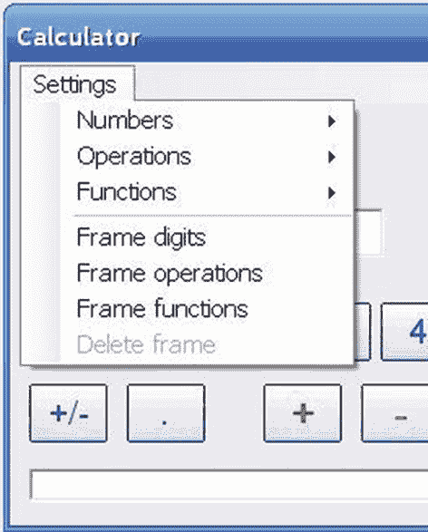

图 7-5

“设置”菜单

当调用菜单命令并命令标记某个预定义组时，`SetGroup()` 方法会获取一个参数，即要框选的特定元素类型。作为初步步骤，所有元素会按预定顺序被包含到 `elemsSingle` 中，同时清空 `elemsInGroup`。

## 元素默认排序

```csharp
private void ElemsDefaultOrder ()
{
elemsSingle .Clear ();
elemsSingle .Add (new CalcElem (labelValue));
elemsSingle .Add (
new CalcElem (labelExpression));
... ...
elemsInGroup .Clear ();
}
```

现在，指定类型的所有元素都会从 `elemsSingle` 移动到 `elemsInGroup`。

## 按类型分组

```csharp
private void SetGroup (CalcElemType elem_type)
{
ElemsDefaultOrder ();
for (int i = elemsSingle .Count - 1; i >= 0; i--)
{
if (elemsSingle [i] .ElemType == elem_type)
{
elemsInGroup .Insert (0, elemsSingle [i]);
elemsSingle .RemoveAt (i);
}
}
... ...
```

当鼠标绘制一个矩形然后释放时，会调用另一个版本的 `SetGroup()` 方法。这种情况下，矩形会被用作参数。

```csharp
private void OnMouseUp (object sender, MouseEventArgs e)
{
ptMouse_Up = e .Location;
double fDist = Auxi_Geometry .Distance (ptMouse_Down, ptMouse_Up);
int iObj, iNode;
if (mover .Release (out iObj, out iNode))
{
... ...
}
else
{
if (e .Button == MouseButtons .Left)
{
if (bRectInView)
{
SetGroup (new Rectangle (Math .Min (ptMouse_Down .X, e .X),
Math .Min (ptMouse_Down .Y, e .Y),
Math .Abs (e .X - ptMouse_Down .X),
Math .Abs (e .Y - ptMouse_Down .Y)));
bRectInView = false;
}
}
... ...
```

所有元素都会被检查是否在此矩形内部；任何位于内部的元素都会被包含到 `elemsInGroup` 中。

## 按矩形区域分组

```csharp
private void SetGroup (RectangleF rc)
{
elemsInGroup .Clear ();
group = null;
ElemsDefaultOrder ();
if (MoreThanOneInside (rc))
{
for (int i = elemsSingle .Count - 1; i >= 0; i--)
{
if (rc .Contains (elemsSingle [i] .RectAround))
{
elemsInGroup .Insert (0, elemsSingle [i]);
elemsSingle .RemoveAt (i);
}
}
... ...
```

如果最终 `elemsInGroup` 中有多于一个元素，那么这些元素就构成一个组。

## 组的创建与消除

```csharp
private void SetGroup (CalcElemType elem_type)
{
... ...
RectangleF rcElems = ElemsArea_group ();
PointF ptLT =
new PointF (rcElems .Left - GroupParameters .DefaultFrameSpaces [0],
rcElems .Top - GroupParameters .DefaultFrameSpaces [1]);
group = new Group_ArbitraryElements (this, mover, ptLT, grparams, strTitle,
ElemsArea_group, DrawElems_group,
SynchroMove_group, IntoMover_group);
GroupMovability ();
}
```

一个组可以通过使用“Delete frame”命令（图 7-5）来消除，但组中拥有多个元素的条件还提供了另一种方法。只需绘制一个不包含任何元素或只包含单个元素的新矩形即可。在这些情况下，都不会组织成组，但如果此时有某个组显示出来，它将会消失。甚至不需要绘制矩形；只需在任意空白位置单击左键就足够了。

## 预定义组的标准定位

还有另一种重新排列元素位置的方法，但此方法仅适用于三个预定义的组。图 7-6 中的子菜单显示了可应用于 Numbers 组的三个命令；当选择 Operations 或 Functions 菜单时，会打开相同的子菜单。

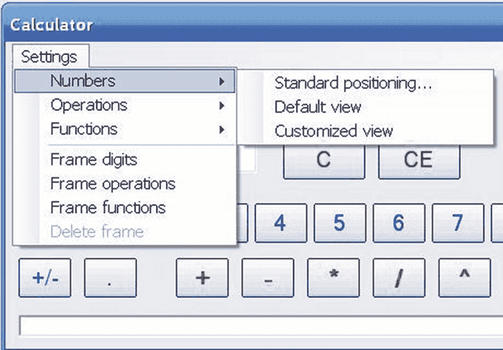

Figure 7-6

`Standard positioning`菜单命令会打开一个辅助窗口，允许您为该预定义组选择一些标准元素定位。

`Settings ➤ Numbers ➤ Standard positioning`命令会打开`Form_BtnPlaces_Numbers.cs`文件（图 7-7a）；此窗口允许您为 Numbers 组选择标准元素定位。Functions 和 Operations 组也有类似的窗口来选择它们的标准视图，但这些组的元素更少，可供选择的组合也更少（图 7-7b 和 7-7c）。

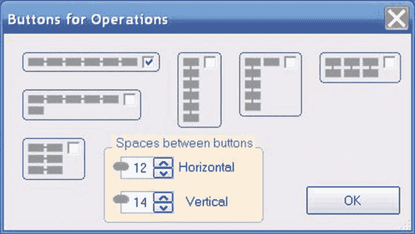

Figure 7-7c

Operations 组标准定位的选择

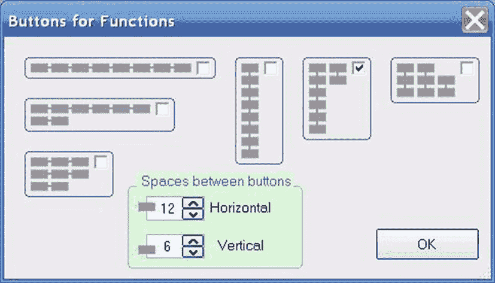

Figure 7-7b

Functions 组标准定位的选择

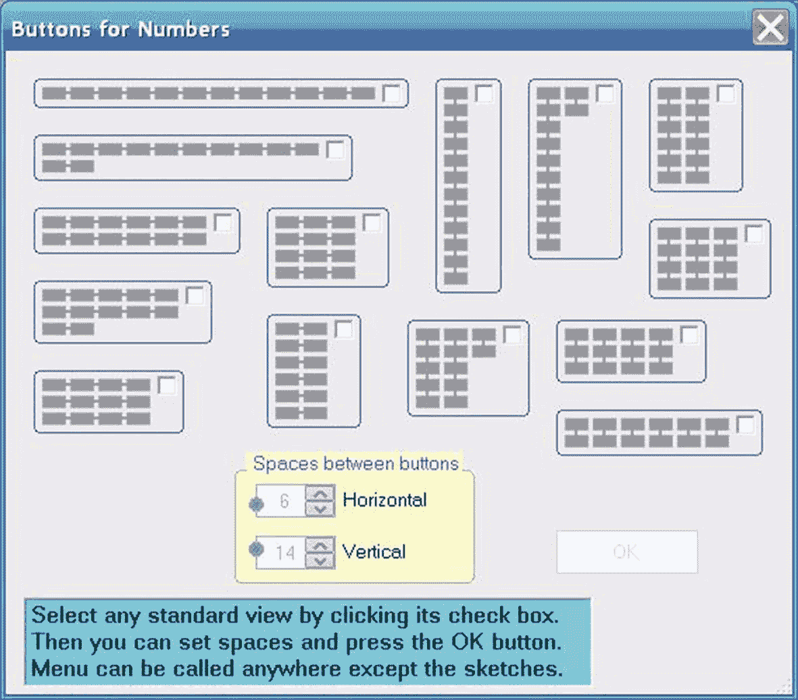

Figure 7-7a

Numbers 组标准定位的选择

每个标准定位变体都显示为一个草图，并带有一个用于选择该变体的附加复选框。每个草图由一组代表实际控件的矩形组成。这些小矩形通过线条连接，这些线条显示了组中元素的顺序。否则，将无法区分元素按行或按列排列的相似变体。当通过单击`OK`按钮关闭`Form_BtnPlaces_Numbers.cs`文件时，Calculator 中 Numbers 组的按钮将根据所选变体进行排列。此时 Number 组是否有框架并不重要；标准定位始终有效。

每个用于选择标准定位的辅助窗口都包含一个小型组，其中包含两个`NumericUpDown_GR`元素；在图 7-7 中，这些组以不同颜色显示。更改这些元素内的值对草图视图没有影响，因此当这些值更改时，辅助窗口内不会有任何反应。但是，如果选择了任何标准定位并按下`OK`按钮，则 Calculator 中组的元素将根据所选情况放置，并且元素之间的距离由这两个值确定。我们继续讨论 Calculator，但之后，我将回到对图 7-7 中草图的讨论。

## 元素大小的批量调整

Calculator 中的任何元素都可以单独调整大小。现在，假设您想要更改 Numbers 组中按钮的大小；您尝试一个按钮并设置合适的大小。接下来您要做什么？您是希望这个按钮与组中的其他按钮保持不同，还是以相同的方式更改 Numbers 组中其他 11 个按钮的大小？您打算一个一个手动操作吗？有些人可能喜欢让按钮的尺寸根据其上的数字稳定增长，或者组织其他非凡的视图（在用户驱动的应用程序中，没有任何限制！），但我感觉大多数用户更倾向于为组内所有按钮设置相同的大小。我还认为，在一个大组中手动逐个标准化按钮不会是一种受欢迎的操作。

当然，有一种更好的方法：一个元素可以作为其所有兄弟元素的样本。变化仅在于选择传播的参数以及决定将所选参数传播到哪个按钮组。

图 7-8 显示了可以在 Numbers 组的任何按钮上调用的菜单。第一个命令打开一个用于调整此类按钮的辅助窗口（参见图 5-5）；第二个命令的子菜单允许您将参数传播到组中的其他按钮；最后一个命令允许您为两个组的按钮设置相同大小。Numbers 和 Operations 组的按钮最初具有相同大小；最后一个命令允许您保持这种大小相等性。

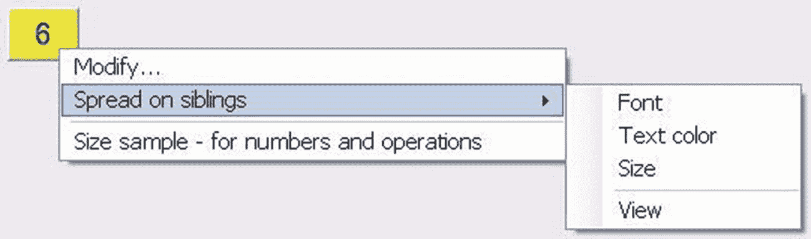

Figure 7-8

Numbers 组按钮上的菜单

几乎相同的菜单可以在 Operations 和 Functions 组的按钮上调用。类似的但更小的菜单可以在 Cleaners 组的按钮上调用。

通常，应用程序由不同类的元素构建而成，并通过分析被点击元素的类来选择相应的菜单。在这个 Calculator 中，仅通过类来选择元素是不够的，因为大多数元素都属于同一个 `Button_Text` 类，因此需要额外的 `ID` 检查。

```csharp
private void OnMouseUp (object sender, MouseEventArgs e)
{
ptMouse_Up = e .Location;
double fDist = Auxi_Geometry .Distance (ptMouse_Down, ptMouse_Up);
int iObj, iNode;
if (mover .Release (out iObj, out iNode))
{
GraphicalObject grobj = mover .ReleasedSource;
long id = grobj .ID;
if (e .Button == MouseButtons .Left)
{
... ...
}
else if (e .Button == MouseButtons .Right && fDist <= 3)
{
if (grobj is Button_Text)
{
if (id == btn_0 .ID || id == btn_1 .ID || id == btn_2 .ID ||
id == btn_3 .ID || id == btn_4 .ID || id == btn_5 .ID ||
id == btn_6 .ID || id == btn_7 .ID || id == btn_8 .ID ||
id == btn_9 .ID || id == btnSign .ID || id == btnDot .ID)
{
ContextMenuStrip = menuOnNumbers;
}
else if (id == btnPlus .ID || id == btnMinus .ID ||
id == btnMultiply .ID || id == btnDivide .ID ||
id == btnDegree .ID || id == btnEqual .ID)
{
ContextMenuStrip = menuOnOperations;
}
else if (id == btnLn .ID || id == btnLog .ID ||
id == btnExp .ID || id == btnSin .ID ||
id == btnCos .ID || id == btnTg .ID ||
id == btnInverse .ID || id == btnSqrt .ID)
{
ContextMenuStrip = menuOnFunctions;
}
else
{
ContextMenuStrip = menuOnCleaners;
}
}
... ...
```

## 可移动性功能

完全可移动性是改变我们使用应用程序方式的功能，但这种可移动性，如同任何其他功能一样，也受用户控制。假设在移动和调整对象大小后，您组织了一个您喜欢的 Calculator 视图，并且不希望因意外移动任何元素而破坏此视图。您可以通过将元素设置为不可移动来保留此视图。在 Calculator 中，可移动性通过空白位置的菜单同步更改所有元素。

```csharp
private void Click_miFixUnfixAll (object sender, EventArgs e)
{
bMovable = !bMovable;
Resizing resize = bMovable ? Resizing .Any : Resizing .None;
for (int i = 0; i < elemsSingle .Count; i++)
{
elemsSingle [i] .Movable = bMovable;
elemsSingle [i] .Resizing = resize;
}
if (group != null)
{
GroupMovability ();
}
info .Movable = bMovable;
info .Resizing = resize;
RenewMover ();
}
```

相同的可移动性声明应用于组内的内部元素、组本身以及组标题。

```csharp
private void GroupMovability ()
{
Resizing resize = bMovable ? Resizing .Any : Resizing .None;
for (int i = 0; i < elemsInGroup .Count; i++)
{
elemsInGroup [i] .Movable = bMovable;
elemsInGroup [i] .Resizing = resize;
}
group .Movable = bMovable;
group .TitleMovable = bMovable;
}
```

## 草图类与变体

现在让我们回到对草图的讨论，这些草图用于三种辅助表单（图 7-7）。这些表单中的所有元素都是可移动的，因此你可以通过任意方式定位这些草图来重新排列它们的视图。不必担心任何操作：表单的默认视图可以随时通过空白位置的菜单进行重置。

每当你开发用户驱动的应用程序时，都需要不时地设计具有一些有趣且非标准特性的可移动对象，因为需求本身就是非标准的。我认为，当你需要思考一些不平凡的问题时，这是编程中最有趣的部分。

这三种表单中的草图属于 `ButtonsSketch` 类。草图是一个图形对象，其大多数字段用于描述其几何形状。

```csharp
public class ButtonsSketch : GraphicalObject
{
    bool bSelected;                     // 草图选中指示器
    Rectangle m_rc;                     // 对象的整个区域
    Rectangle rcSelect;                 // 虚构复选框的矩形
    Point [] ptBtn;                     // 草图上所有“按钮”的位置
    int w = 16;                         // “按钮”的尺寸
    int h = 8;
    int spaceInside = 4;                // “按钮”之间的间距
    int spaceOnBorders = 6;             // 边缘的间距
    int sideSelectSquare = 14;
}
```

每个辅助表单中的草图展示了特定分组按钮的定位变体。每个标准分组都有固定数量的按钮，因此一个辅助表单中的所有草图都展示了相同数量按钮的定位变体；让我们将这个数量称为 N。图 7-9 展示了 N = 12 时的一些变体。

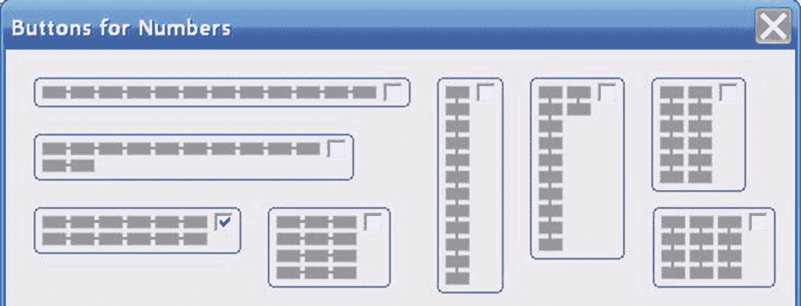

**图 7-9** N = 12 情况下的几个草图

- 每个按钮由一个小的深色矩形表示；其尺寸为 `16*8` 像素（`w * h`）。
- 草图中相邻小矩形之间的距离始终相同，等于 `4` 像素（`spaceInside`）。
- 草图有一个圆角边框；此边框与内部元素之间的距离为 `6` 像素（`spaceOnBorders`）。
- 要选择分组按钮所需的定位，必须标记所需的草图；这通过框架内的一个小复选框来完成。这个特殊复选框占据一个边长为 `14` 像素（`sideSelectSquare`）的矩形。
- 通过行和列来定位 N 个按钮可以有多种方式，但有两种边界变体：所有按钮在一行和所有按钮在一列。为了描述草图上“按钮”的位置，我使用了一个大小为 `N*N` 的矩阵。位置的编号从左上角开始为 `0`，沿上行向右；然后逐行向下；在每一行中，编号从左位置开始，向右递增。因此，第二行的左位置编号为 N；矩阵右下角的位置编号为最大的 `N*N-1`。图 7-9 中的所有草图都是为 `N = 12` 的情况设计的。位置数组是草图初始化的参数之一。接下来你可以看到图 7-9 左下角被选中草图的初始化代码。

```csharp
ButtonsSketch sketch_2rows = new ButtonsSketch (nCode, false,
    new Point (rect .Left, rect .Bottom + 20),
    new int [] { 0, 1, 2, 3, 4, 5, 12, 13, 14, 15, 16, 17 },
    brushBtns);
```

- 草图可能具有相同的行数和列数，但元素的顺序不同。例如，图 7-9 中的两个草图各有四行三列；然而，在左侧示例中，元素需要按行定位，而在另一个示例中，则需要按列定位。为了在视觉上区分这种情况，草图中行或列内的连续元素会用线条连接起来。

```csharp
public void Draw (Graphics grfx)
{
    Pen penConnect = new Pen (brushBtns .Color, 2);
    Auxi_Drawing .CurvedFrame (grfx, m_rc, penFrame);
    for (int i = 0; i < ptBtn .Length; i++)
    {
        if (i > 0)
        {
            if (ptBtn[i].X == ptBtn [i - 1].X || ptBtn[i].Y == ptBtn [i - 1].Y)
            {
                grfx .DrawLine (penConnect,
                    ptBtn [i] .X + w / 2, ptBtn [i] .Y + h / 2,
                    ptBtn [i - 1] .X + w / 2, ptBtn [i - 1] .Y + h / 2);
            }
        }
    }
    ControlPaint .DrawCheckBox (grfx, rcSelect,
        bSelected ? ButtonState .Checked : ButtonState .Normal);
}
```

草图可通过其任何内部点（复选框区域除外）进行移动，因此 `ButtonsSketch` 的覆盖区域由两个矩形节点组成。通常，覆盖复选框矩形（`rcSelect`）的较小节点必须位于负责移动整个对象的较大节点之前。

```csharp
public override void DefineCover ()
{
    CoverNode [] nodes = new CoverNode [] {
        new CoverNode (0, rcSelect, Cursors .Hand),
        new CoverNode (1, m_rc, Cursors .SizeAll) };
    cover = new Cover (nodes);
}
```

仅当按下较大的节点（编号 1）时，才会执行草图移动操作。

```csharp
public override bool MoveNode (...)
{
    bool bRet = false;
    if (catcher == MouseButtons .Left)
    {
        if (i == 1)
        {
            Move (dx, dy);
            bRet = true;
        }
    }
    return (bRet);
}
```

草图是可移动但不可调整大小的。当移动草图时，所有基本点的值会同步改变。

```csharp
public override void Move (int dx, int dy)
{
    m_rc .X += dx;
    m_rc .Y += dy;
    for (int i = 0; i < ptBtn .Length; i++)
    {
        ptBtn [i] .X += dx;
        ptBtn [i] .Y += dy;
    }
    rcSelect .X += dx;
    rcSelect .Y += dy;
}
```

这些就是可以在 `ButtonsSketch` 类中找到的所有有趣之处。与该类相关的另一个重要事项在使用草图的表单中会提及，例如在 `Form_BtnPlaces_Numbers.cs` 中。通过点击显示为复选框的特殊区域来选择所需的草图；这个小的方形区域由 `ButtonsSketch` 类的节点零覆盖。任何时候，一个表单中只能标记一个草图，因此通过一组单选按钮进行选择会更正确，但由于在较早的示例中使用了相同的小方块选择方式，我决定不改变视图。

```csharp
private void OnMouseUp (object sender, MouseEventArgs e)
{
    ptMouse_Up = e .Location;
    double fDist = Auxi_Geometry .Distance (ptMouse_Down, ptMouse_Up);
    int iObject, iNode;
    if (mover .Release (out iObject, out iNode))
    {
        GraphicalObject grobj = mover .ReleasedSource;
        if (e .Button == MouseButtons .Left)
        {
            if (grobj is ButtonsSketch && iNode == 0)
            {
                ButtonsSketch sketch = grobj as ButtonsSketch;
                for (int i = 0; i < sketches .Count; i++)
                {
                    sketches [i] .Selected = false;
                }
                sketch .Selected = true;
                viewSelected = (Calculator_FunctionsGroupView) (sketch .Code);
                places = sketch .Places;
                numericHor .Enabled = true;
                numericVer .Enabled = true;
                btnOK .Enabled = true;
                Invalidate ();
            }
            ...
```

多年前，我设计了第一版 `Calculator`，旨在演示如何将一个完全基于普通控件的程序转变为用户驱动型应用。现在我们有了一个外观相似、功能相同，但仅用图形元素设计的应用。作为用户驱动型应用，这个版本确实好得多，但……我是否必须再找一个使用普通控件的演示程序呢？

## 家谱

本节的主要示例是一个我自己使用的真实应用。自 2013 年初我在一篇文章中首次写到这个示例以来，它便吸引了世界各地程序员的关注。还有其他一些领域（电路设计是其中之一），其设计与家谱类似，因此这些领域的专家也对当前示例产生了兴趣。

在我们到达本节的最终程序——真正的 `Family Tree` 应用之前，还有一整套简单的示例来逐步展示开发过程。在为这个应用编写代码时，我再次想到了霍格本家族的成员，他们能用原始元素构建出极其精巧的装置。^(⁹) 在这个 `Family Tree` 应用中，我只使用直线、矩形和最简洁的注释。在本节结束时，你将看到在如此原始的基础上能开发出怎样的成果。

`Family Tree` 程序是一个标准的用户驱动型应用，用户可以修改其中的所有内容，并且所有这些更改都会被保存和恢复。初步示例中的某些元素可能不会被保存和恢复，但这仅仅是因为我希望辅助示例始终能为我的讲解呈现最佳视图。

你可以轻松地拿起一张纸，开始绘制自己的家谱。多年前，我在祖母的指导下做过这件事，那些旧纸张我至今仍保存着。许多家庭中的很多人都会在某个时刻做同样的事，并且几乎每个人都对家谱应有的样子有自己的理解。家谱可以在许多历史书籍中找到，那些专业绘制的家谱与简单的钢笔或铅笔草图相比，仅在一些细微之处有所不同。任何家谱草图看起来都像图 7-10 所示。不过，这张草图展示的是一个代表三代人的小型简单家谱。为了简化草图和讨论，我省略了通常显示的每个人的出生和死亡信息；你将在后续示例中看到这些信息。

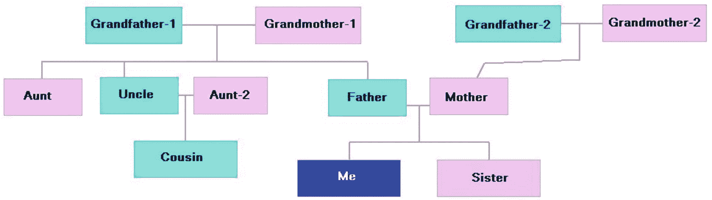

**图 7-10** 一个三代家谱的示例

# 家族树应用中的图形表示与“Bus”系统

即使是一个简单的草图（图 7-10），也能充分说明需要在 `Family Tree` 应用中实现的规则。每个人用一个小的矩形表示，大量信息通过矩形之间的连接关系来展示。通常，一对夫妇被表示为两个紧邻的矩形，它们之间有一条短的直线（*总线*）。如果一对夫妇有孩子，那么从那条中间线上会向下延伸出另一条总线（图 7-11），但下一代的视图取决于孩子的数量。如果只有一个孩子，那么这条线会直接向下延伸到代表这个人的矩形（图 7-12）。如果有多个孩子，那么两代之间会有一条中间总线；这条总线向下连接到每个孩子，并向上连接到其父母之间的线。例如，图 7-13 顶部显示的夫妇有三个孩子。

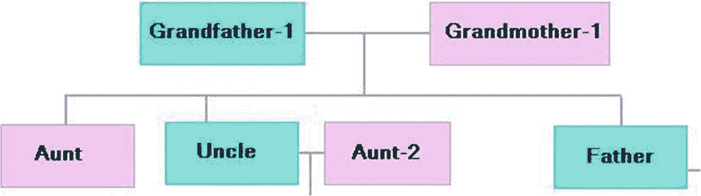

**图 7-13** 有三个孩子的夫妇

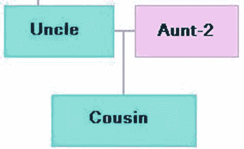

**图 7-12** 有一个孩子的夫妇


**图 7-11** 有孩子的夫妇

当绘制仅包含直系亲属的部分时，您通常了解所有必要的信息，不会有任何问题。当尝试绘制家族谱系图的某些外围部分时，可能会出现信息缺失，您要么绘制一些没有任何信息的空白矩形，要么按照已知信息绘制，即使这违反了简单的生物学规则（图 7-14）。

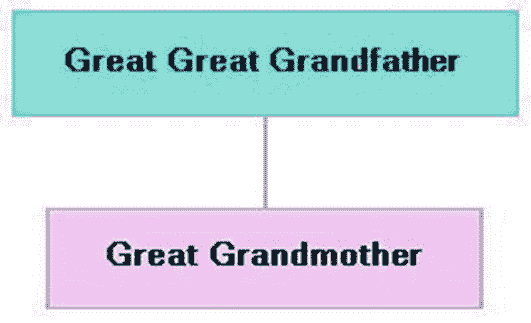

图 7-14

这种情况从生物学角度来说不正确，但没有更多信息

`FamilyTree`程序必须包含简化添加某些标准部分（配偶、父母、一个孩子、多个孩子）过程的命令。作为开发人员，您必须考虑最常需要的变体，并提供一个命令系统来响应此类请求，但没有哪个命令系统能涵盖所有可能的亲属关系变体。这是一种经典情况，用户驱动型应用远优于任何具有固定变体系统的程序，这也是用户驱动型应用可能是唯一真正优秀方案的例子之一。

让我们再看一下图 7-10。如前所述，有矩形和线条，在当前程序中称为 *bus*。有些`bus`连接矩形，有些`bus`连接其他`bus`，还有`bus`连接`bus`和矩形。灵活的`bus`系统允许您绘制任何所需内容，因此我们通过开发一些灵活的`bus`来开始`FamilyTree`应用程序的工作。

```csharp
public class Bus : GraphicalObject
{
    Pen m_pen;
    bool bMarkJoints = true;
    bool bMarkEnds = true;
    Color clrEnds = Color.Red;
    Color clrJoints = Color.White;
    bool bRegisteredWithMover = true;
    bool bUseWarningColor = true;
    Pen penWarn = new Pen(Color.Magenta, 2);
    List<PointF> m_pts = new List<PointF>();
    List<object> headsConnected = new List<object>();
    List<object> tailsConnected = new List<object>();
}
```

任何`bus`都由一组直线段组成，这些线段一个接一个地连接成一条链；每个`bus`中至少有一个线段，但线段数量没有上限。每个线段由两个点描述，前一个线段的终点是下一个线段的起点。因此，`bus`的最小点数是两个，线段数总是比点数少一个。`bus`可以通过点的`List`或仅通过两个点进行初始化；在后一种情况下，`bus`由单个线段组成。

```csharp
public Bus(Form frm, Mover mvr, List<PointF> points, Pen pen)
{
    ... ...
    m_pen = new Pen(pen.Color, pen.Width);
    m_pen.DashStyle = pen.DashStyle;
    m_pts = points;
    Movable = false;
}
```

`bus`的覆盖物（cover）由`List`中所有点上的小圆形节点和另一组覆盖线段的条状节点组成。

```csharp
public override void DefineCover()
{
    int rad = Math.Max(4, Convert.ToInt32(Width / 2));
    int nCircles = pts.Count;
    int nStrips = pts.Count - 1;
    CoverNode[] nodes = new CoverNode[nCircles + nStrips];
    for (int i = 0; i < nCircles; i++)
    {
        nodes[i] = new CoverNode(i, m_pts[i], rad);
    }
    for (int i = 0; i < nStrips; i++)
    {
        nodes[nCircles + i] = new CoverNode(nCircles + i, m_pts[i],
        m_pts[i + 1], rad, Behaviour.Frozen);
    }
    cover = new Cover(nodes);
    if (Movable)
    {
        cover.SetBehaviour(NodeShape.Strip, Behaviour.Moveable);
        cover.SetCursor(Cursors.SizeAll);
    }
}
```

通过移动圆形节点，可以改变线段的长度和角度；这样，`bus`的配置就改变了。

现在，是时候开始我们逐步的设计，并从一个初步示例过渡到另一个示例了。所有这些辅助示例分为三组。第一组示例中只使用自由的`bus`。第二组中的示例演示了连接的`bus`。在第三组中，使用了`Person`对象。

## 自由 Buses

*   文件：`Form_FreeBuses.cs`

*   菜单位置：应用程序 ➤ FamilyTree 设计逐步 ➤ 自由 buses

第一个初步示例演示了两个`bus`；其中一个由单个线段组成，而另一个有四个线段（图 7-15）。`bus`可以通过一对点或一个点的`List`进行初始化；当前示例中演示了两种情况。第二个`bus`的点由`PointsForLine()`方法提供；这些是来自表单区域的随机点，但有一个限制。`bus`是在信息区域之后构建的，因此`PointsForLine()`方法保证了在初始化时，没有`bus`特殊点隐藏在信息区域后面。

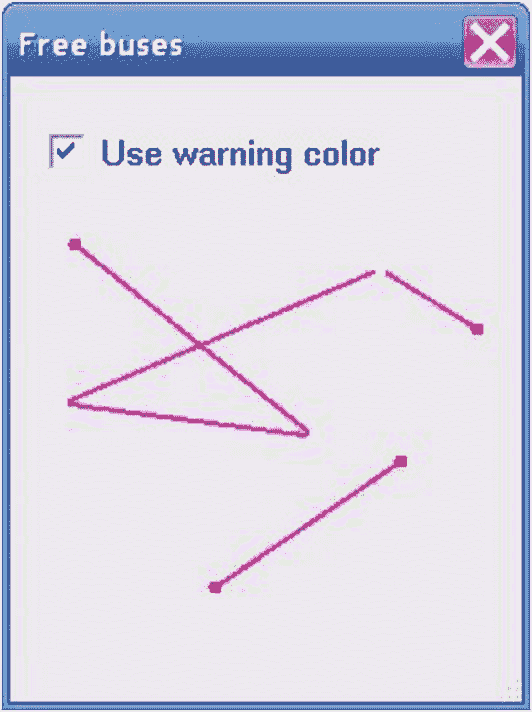

图 7-15b

警告已打开

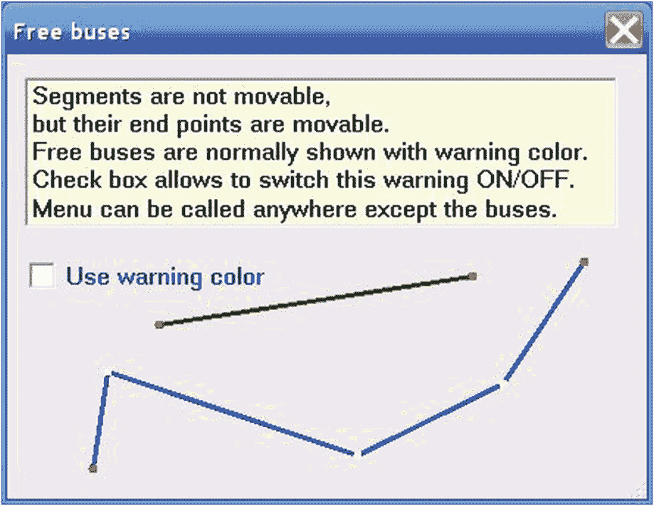

图 7-15a

为查看自由`bus`的颜色，警告已关闭

```csharp
private void DefaultBuses()
{
    bus_2 = new Bus(this, mover, new PointF(100, 220), new PointF(300, 400), new Pen(Color.Green, 3));
    bus_5 = new Bus(this, mover, PointsForLine(5), new Pen(Color.Blue, 3));
    bus_2.UseWarningColor =
    bus_5.UseWarningColor = checkboxWarning.Checked;
}
```

## 警告颜色与基本结构

这两个`bus`使用两种不同的画笔初始化，但为了查看自由`bus`的颜色，必须关闭特殊警告（图 7-15a）。未连接到任何东西的`bus`，甚至带有一个自由端的`bus`，在家族谱系图中都是异常情况，此类`bus`会使用特殊的警告颜色显示。几个初步示例包含一个复选框，允许您打开/关闭此警告，并查看那些在初始化时声明的颜色下的自由`bus`。每个`bus`的警告颜色使用通过`Bus.UseWarningColor`属性进行调节。稍后在本节中，将演示`bus`的调整表单；此表单包含一个复选框，用于调节警告颜色的使用。在这样一个初步示例中，强制切换到正常颜色可能有用，图 7-15a 中的`bus`视图比图 7-15b 中的更好，但在实际应用中，这样的警告是有帮助的，我建议不要将其关闭。

`bus`是一个相对简单的对象。其主要部分是一条带有所有三个可视化参数（颜色、宽度和线条样式）的线条，这些参数打包到一个字段（`m_pen`）中。另外两种颜色用于标记`bus`端点（`clrEnds`）和线段之间的连接点（`clrJoints`），但这些特殊标记的出现是有条件的。所有特殊点（端点和连接点）上的标记仅对不可移动的`bus`显示，即便如此，还有两个布尔参数——`bMarkEnds`和`bMarkJoints`——来调节这些标记的出现与否。`Bus.Draw()`方法首先检查一整套条件，在这些条件下，线条必须以警告颜色显示。我们将在后面的示例中探讨所有这些条件。

```csharp
public void Draw(Graphics grfx)
{
    if (((bHeadConnected != bTailConnected) ||
        (bHeadConnected == false && bTailConnected == false &&
        headsConnected.Count == 0 && tailsConnected.Count == 0 &&
        bRegisteredWithMover)) && bUseWarningColor)
    {
        grfx.DrawLines(penWarn, m_pts.ToArray());
    }
    else
    {
        grfx.DrawLines(m_pen, m_pts.ToArray());
    }
    if (!Movable)
    {
        if (bMarkJoints)
        {
            for (int i = 1; i < m_pts.Count - 1; i++)
            {
                Auxi_Drawing.FillCircle(grfx, m_pts[i], 3, clrJoints);
            }
        }
        if (bMarkEnds)
        {
            Auxi_Drawing.FillCircle(grfx, m_pts[0], 3, clrEnds);
            Auxi_Drawing.FillCircle(grfx, m_pts[m_pts.Count - 1], 3,
            clrEnds);
        }
    }
}
```

在当前示例中，可视化参数和母线段数均不可更改，但所有这些内容将在后续示例中进行调整。

## 可移动性与节点操作

使用两种额外颜色标记所有可移动点，使得总线配置的更改更加容易。但在某些情况下，根本不需要此类更改；此时，可以显示不带任何额外标记的总线。当用户已经熟悉如何更改总线时，这些额外标记也不再需要。在“家谱”应用程序中，有一个简单的方法可以开启/关闭它们，用户可以在任何时候进行操作。

任何新的`Bus`都会作为不可移动对象进行构造；`Bus`构造函数已在前面介绍过。可移动性的更改将在本节后文中讨论，而在当前示例中，总线始终是不可移动的。

总线作为一个整体对象是不可移动的，但所有特殊点（端点和连接点）都可以移动。任何移动都始于对相应类的`Press()`方法的调用。

```csharp
private void OnMouseDown (object sender, MouseEventArgs e)
{
    ptMouse_Down = e.Location;
    if (mover.Catch(e.Location, e.Button))
    {
        GraphicalObject grobj = mover.CaughtSource;
        int iNode = mover.CaughtNode;
        if (grobj is Bus)
        {
            (grobj as Bus).Press(e.Location, e.Button, iNode);
        }
        ... ...
    }
}
```

如果某个小圆形节点被左键按下，则会出现一种完全标准的反应——光标位置会调整到该节点的中心点。

```csharp
public void Press (Point ptMouse, MouseButtons catcher, int iNode)
{
    if (catcher == MouseButtons.Left && iNode < m_pts.Count)
    {
        AdjustCursorPosition(m_pts[iNode]);
    }
}
```

任何被捕获节点的移动都由`Bus.MoveNode()`方法描述；在当前情况下，我们只对该方法中应用于不可移动总线的部分感兴趣。

```csharp
public override bool MoveNode (...)
{
    if (catcher == MouseButtons.Left)
    {
        if (Movable)
        {
            ... ...
        }
        else
        {
            if (iNode < m_pts.Count)
            {
                m_pts[iNode] = ptMouse;
                InformConnections(PositionUpdate.Soft, iNode - 1, iNode);
                bRet = true;
            }
        }
    }
}
```

现在讨论连接还为时过早，但您可以从这段代码中看到，在移动圆形节点的整个过程中，与该节点关联的特殊点始终跟随光标。

```csharp
m_pts[iNode] = ptMouse;
```

## 添加连接点

第一个示例允许您移动特殊点，但除此之外不能对总线进行任何其他操作。下一个示例允许您向现有总线添加新的连接点。

*   文件：`Form_FreeBuses_AddingJoints.cs`
*   菜单位置：应用程序 ➤ FamilyTree 逐步设计 ➤ 自由总线；添加连接点

在本示例中，有两种方法可以更改总线配置（图 7-16）：移动其中一个特殊点（端点和连接点），或者在某个线段内部左键点击，并在不松开按钮的情况下，继续移动在点击点处出现的新连接点。这种添加连接点的方式在`Form_Polyline.cs`中已经演示过，但由于时间已久，我想再提醒一下这个过程。

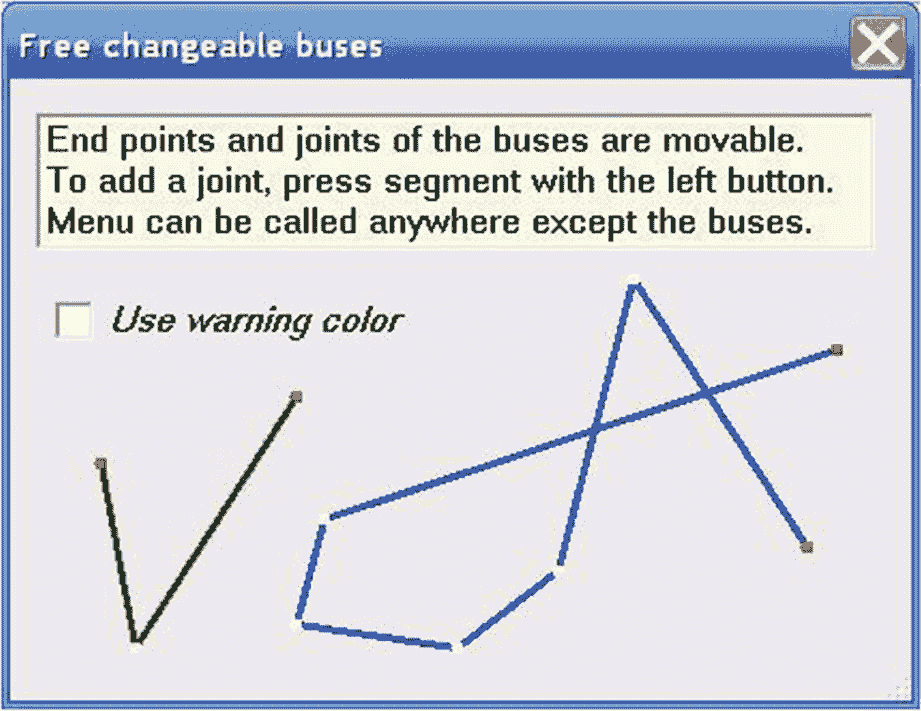

图 7-16 彩色标记显示了所有特殊点

总线可以按可移动和不可移动两种方式使用。可移动总线是指在任何点按下后即可在屏幕上移动而无需更改配置的总线。如果总线是可移动的，则无法通过同样的左键按下来添加新的连接点。家谱既需要可移动总线，也需要不可移动总线。一些总线只能用作不可移动（这将在后面解释）；其他总线的可移动性可以开启/关闭，这由用户通过菜单命令进行控制。当前示例中的两条总线始终是不可移动的，但为了使`OnMouseDown()`方法的代码与所有后续示例保持一致，仍然会对总线的可移动性进行检查。（我想强调一下，在当前示例中这是多余的。）

新的连接点是在按下总线线段的那一刻组织的，因此所有逻辑都在`OnMouseDown()`方法的代码中。我认为在查看代码之前先看一些注释会很有帮助。

当在一个`不可移动总线`的带状节点上按下时，会出现以下步骤序列：

1.  线段编号（`iSegment`）可以通过按下的节点编号（`iNode`）轻松计算得出。
2.  该线段上最近的点（`pt`）由`Bus.NearestPointOnSegment()`方法计算得出。
3.  添加连接点将导致总线覆盖区域发生变化。此后，同一个总线将被另一个节点捕获，因此首先必须通过`mover`释放该总线。

# 连接点的创建与节点线可移动性

4.  新的连接点通过`Bus.InsertPoint()`方法在计算出的点`pt`处创建。由于连接点数量已发生变化，覆盖区域被重新定义；这由`InsertPoint()`方法内部完成。

5.  总线再次被`mover`捕获，但此时光标位于新圆形节点的区域内。在`Bus`覆盖区域中，所有圆形节点都排在带状节点之前，因此总线在同一位置不是被带状节点捕获，而是被这个圆形节点捕获。

```csharp
private void OnMouseDown (object sender, MouseEventArgs e)
{
    ptMouse_Down = e.Location;
    if (mover.Catch(e.Location, e.Button))
    {
        GraphicalObject grobj = mover.CaughtSource;
        int iNode = mover.CaughtNode;
        if (grobj is Bus)
        {
            Bus bus = grobj as Bus;
            bus.Press(e.Location, e.Button, iNode);
            if (e.Button == MouseButtons.Left &&
                mover.CaughtNodeShape == NodeShape.Strip && !bus.Movable)
            {
                int iSegment = iNode - bus.PointsNumber;
                PointF pt = bus.NearestPointOnSegment(e.Location, iSegment);
                mover.Release();
                bus.InsertPoint(iSegment + 1, pt);
                mover.Catch(e.Location, e.Button);
                Invalidate();
            }
        }
        ... ...
    }
}
```

通过这种方式，一个新的连接点被添加到一个不可移动的总线上。下一个示例演示了在按下可移动和不可移动总线时的反应。

*   文件：`Form_FreeBuses_ChangingMovability.cs`

*   菜单位置：应用程序 ➤ FamilyTree 逐步设计 ➤ 自由总线；更改可移动性

图 7-17 对图 7-13 进行了略微修改，为不同类型的总线添加了标记。即使是这样一棵仅包含几个人的简单家谱，也展示了用于不同类型连接的总线；在图 7-17 中，它们用不同字母进行了标记。家谱中的总线用于连接不同的元素，因此带有自由端的总线是一个例外。

| `Case` **A** | 在当前案例中，这是一个夫妻之间的节点线，但通常此类节点线用于两人之间。它的两端必须始终连接到代表这两个人的矩形上，因此这个节点线不能自由移动到任何其他位置。在图中，这些节点线是直线，每条都可以变成带有多个拐点的折线，但在任何时刻，它都必须显示这两人之间的链接。 |
| `Case` **B** | 这种短节点线将一条长节点线与同层节点相连。代表同层节点的矩形可以任意放置在屏幕上；连接到其中任何一个的节点线都可能更长，并且可以变成折线，但每条节点线的两端都连接到某些对象（一端连接节点线，另一端连接矩形），因此这样的节点线不能自由在屏幕上移动。 |
| `Case` **C** | 这种类型的节点线用于连接两条节点线，因此它的两端也都放置在其他元素上，并且此节点线不能自由移动。 |
| `Case` **S** | 这是唯一一种两端不固定在其他对象上的节点线；此节点线的字母 *S* 取自单词 ***s**pecial*（特殊）。这种节点线的两端不固定，因此可以在不改变外观的情况下自由移动。这是连接同层节点的节点线；当你移动这条节点线时，所有连接都会随之移动。在图 7-17 中，这条节点线与属于两代人的矩形（父母及其子女之间）保持等距。如果有人更喜欢将此节点线靠近某一代人的矩形，可以在不破坏家谱的情况下完成。这将是设计的一个良好特性，但随之而来的问题是实现方式，因为到目前为止，在任何节点线上按下鼠标只能添加新拐点并移动该拐点。 |

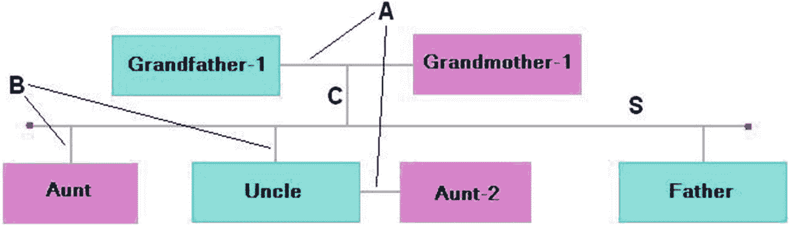

图 7-17

这个小树只有一条两端未放置在其他元素上的节点线。该节点线上标有字母 `S`（表示特殊）

在本书的所有示例中，使用左键移动整个对象或对象的任何部分，我打算遵循此规则。在上一个示例 `Form_FreeBuses_AddingJoints.cs` 中，在线段内部的任意点按下左键会在按下点添加一个拐点，并开始移动这个新拐点的过程。然而，我们遇到一种情况：根据我们的意愿，按下左键必须启动添加并移动新拐点，或者在不改变其配置的情况下移动整个节点线。计算机无法读取用户的思想来判定该用户打算在某一时刻执行哪种操作，因此用户必须执行一些预备操作来判定。这个预备操作就是更改节点线的可移动性。

## 节点线的可移动性

让我们不把节点线看作是一系列特殊点以及连接这些点的直线段（图 7-18），而是看作一组节点。这些节点不可见，但很容易想象它们的几何形状。图 7-18 中的每条线段都是一个带状节点的轴，每个特殊点是一个圆形节点的中心，因此所有节点的组合区域与线条视图相同，但比我们在图中看到的更宽。尽管所有特殊点对节点线的工作都很重要，但它们所有圆形节点的组合区域只占覆盖面积的极小部分。将节点线的可移动性视为其线段的可移动性是有道理的，实际情况也确实如此。同时，特殊点的可移动性始终与线段的可移动性相反。

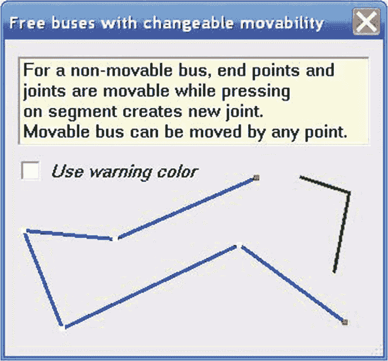

图 7-18

节点线的可移动性可以通过菜单命令更改。端点以及拐点仅对不可移动的节点线显示

任何节点线初始化时都是不可移动的。

```csharp
public Bus (Form frm, Mover mvr, List points, Pen pen)
{
... ...
Movable = false;
```

根据此节点线不可移动的声明，带状节点必须是不可移动的，而圆形节点必须是可移动的。默认情况下，所有节点都是可移动的，因此圆形节点在初始化时无需任何更改，而带状节点则需要通过一个额外的参数来指定其行为，从而被固定（不可移动）。

```csharp
public override void DefineCover ()
{
... ...
for (int i = 0; i < nCircles; i++)
{
nodes [i] = new CoverNode (i, m_pts [i], rad);
}
for (int i = 0; i < nStrips; i++)
{
nodes [nCircles + i] = new CoverNode (nCircles + i, m_pts [i],
m_pts [i + 1], rad, Behaviour .Frozen);
}
... ...
```

这种声明的结果在之前的示例中已经展示过。

*   你可以按下任何一个圆形节点（任何拐点或端点）并在屏幕上移动它。

*   你可以按下任何一个带状节点，因为移动器能感知到所有被固定的节点，但你无法移动它。相反，会在按下的点处组织一个新拐点，并且像任何其他拐点一样，它是可移动的；这一点在之前的示例中已经解释过。这种添加新拐点的操作是在 `OnMouseDown()` 方法内部完成的，但前提是按下的节点线是不可移动的（参见三页前的早期代码）。

如果节点线从不可移动变为可移动，会发生什么？节点线可移动性的切换不会改变覆盖中节点的数量、形状或顺序，但它会改变带状节点的行为。对于可移动的节点线，在 `Bus.DefineCover()` 方法的末尾有一个特殊的附加处理。

```csharp
public override void DefineCover ()
{
... ...
if (Movable)
{
cover .SetBehaviour (NodeShape .Strip, Behaviour .Moveable);
cover .SetCursor (Cursors .SizeAll);
}
}
```

对于可移动的节点线，用左键按下哪个节点或哪个点都无关紧要，因为 `MoveNode()` 方法只是简单地调用 `Move()` 方法。

```csharp
public override bool MoveNode (...)
{
bool bRet = false;
if (catcher == MouseButtons .Left)
{
if (Movable)
{
Move (dx, dy);
... ...
```

`Move()` 方法以相同的方式更改所有特殊点；整个节点线被移动而不改变其配置。

```csharp
public override void Move (int dx, int dy)
{
SizeF size = new SizeF (dx, dy);
for (int i = 0; i < m_pts .Count; i++)
{
m_pts [i] += size;
}
}
```

在当前示例（图 7-18）中，节点线的可移动性通过小型上下文菜单的单个命令来更改。

```csharp
private void Click_miMovable (object sender, EventArgs e)
{
busPressed .Movable = !busPressed .Movable;
Invalidate ();
}
```

对左键按下的反应对于可移动和不可移动的节点线来说完全不同，如果可移动和不可移动的节点线看起来一模一样，用户会感到困惑。为了避免这种混淆，节点线的外观略微取决于其可移动性。对于不可移动的节点线，其拐点和端点可以用特殊标记显示（图 7-19a）；这使得按下特殊点更容易。可移动的节点线上没有特殊标记（图 7-19b）；整个节点线用一种颜色绘制。可见特殊点的缺失表明没有可改变配置的点，因此在任何点按下的反应都是相同的。


图 7-19b

可移动节点线上的菜单


图 7-19a

不可移动节点线上的菜单