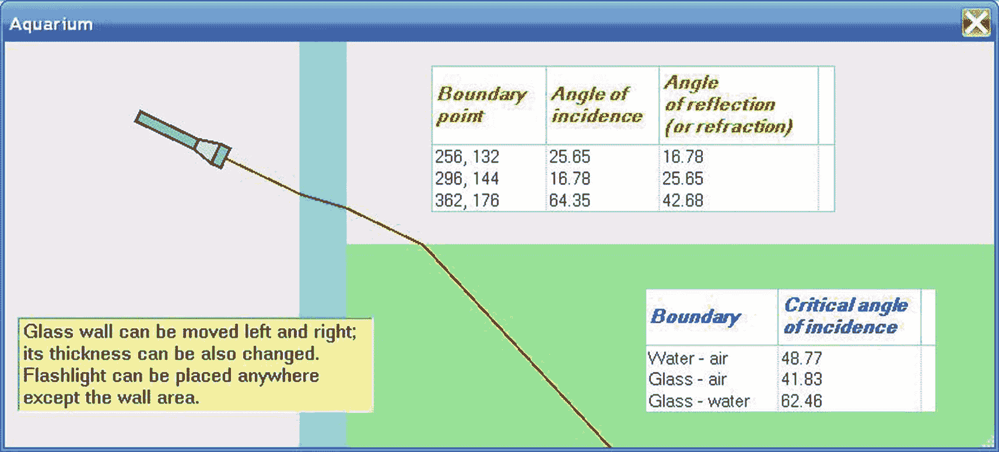
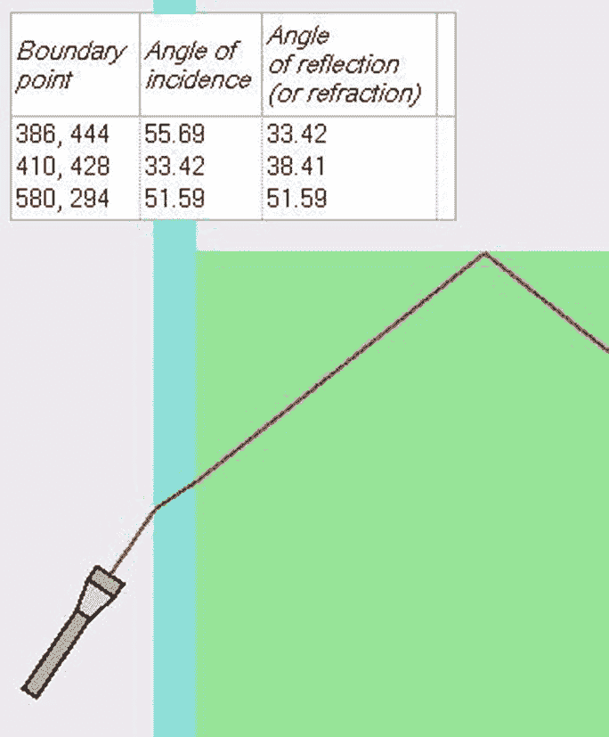
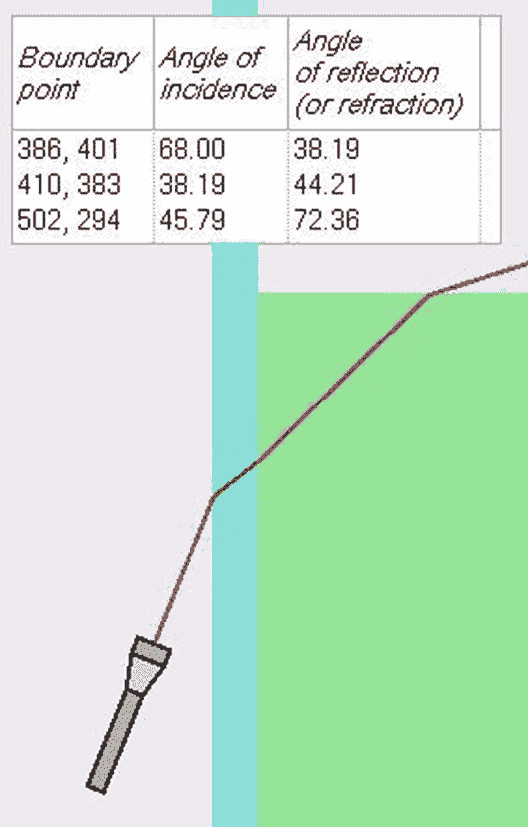
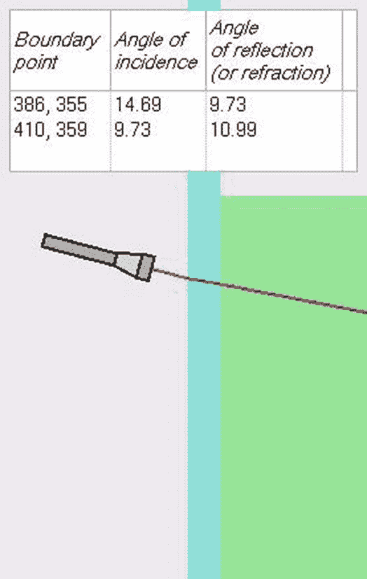
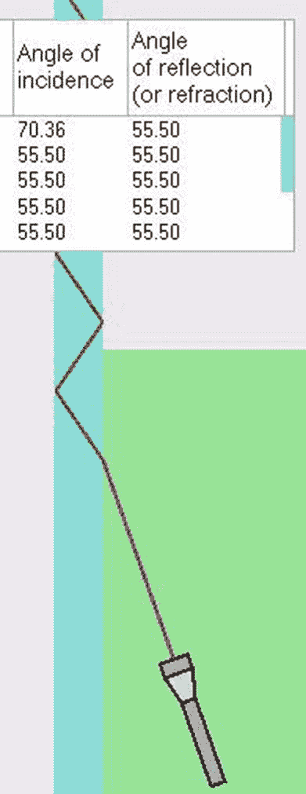
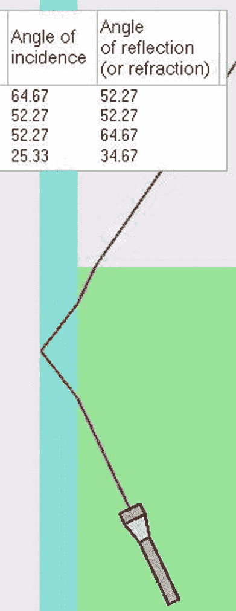
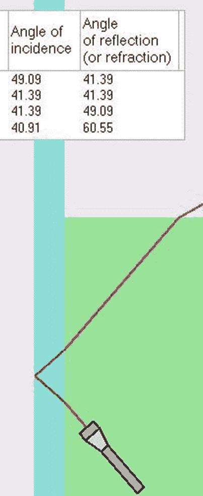
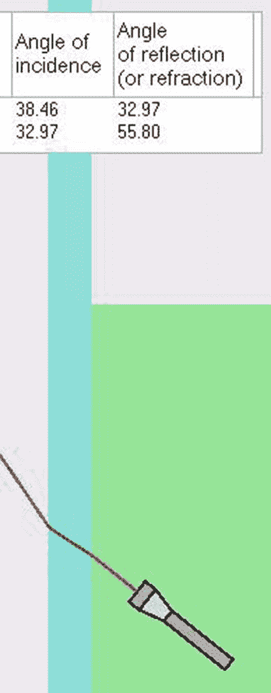

# 水族箱中的光线路径

假设你有一个大型水族箱（比如海洋馆）。玻璃墙的一侧是游客区，游客有机会从不同高度观察水族箱。在玻璃墙的另一侧，水总是填满一半的体积（图 7-62）。由于我更关注光学效果而非这类水族箱的实际构造，因此玻璃墙可以轻松地左右移动，并且其厚度也可以在合理范围内以同样简单的方式改变。厚度不会影响所讨论过程的物理原理，但会使光线路径的变化更加明显。光源——手电筒——可以放置在空气中或水中的任何位置；但是，不允许出现手电筒与玻璃重叠的任何情况。

## 光线路径变体

图 7-62 中的光线路径变体是最简单的，代表了图 7-61 和图 7-59 中情形的序列。在三个边界上发生了三种普通的折射情况。首先，光线接触到玻璃墙的垂直侧面；然后，在玻璃墙的相对侧发生折射。在这两点，外部都是空气，因此第二次折射后的光线角度等于原始角度；每个特殊点之前和之后的光线角度都显示在一个列表中。第三次折射发生在空气-水边界。

**图 7-62** 玻璃墙从底部延伸到顶部；水填满了右侧一半的体积

组织任何光线路径最简单的方法是将手电筒放置在感兴趣的点，并将其旋转到所需角度。光学的主要定律之一是光的可逆性。这意味着，如果在光线路径上的任何位置放置另一个手电筒，并将其朝向与光线相反的方向，那么第二个手电筒发出的光线将精确地到达第一个手电筒上的光源点。我们看到物体是因为光线从物体反射并进入我们的眼睛。在我们水族箱的例子中，这意味着如果一位游客从我们光源（手电筒）的位置出发，沿着发出的光线方向观察，那么这位游客会看到光线路径上的物体。

## 家庭参观的观察差异

假设一对父母带着小孩参观海洋馆；身高差对于后续讨论很重要。家庭成员站在玻璃墙附近，寻找另一侧的奇特生物。一个成年人看到前方有令人惊叹的东西（图 7-63a），并告诉孩子们往那里看。他们尝试了，但为了看到提到的那个生物，他们必须以完全不同的角度观看（图 7-63b）。也许他们会看到同一个生物，但由于光线在玻璃墙两侧的转向，他们很可能错过它。父母坚持认为前面确实有令人惊叹的东西，所以孩子们为了找到它，稍微改变了一下观看角度。他们没有看到紧靠玻璃墙的东西，反而有机会看到海洋馆底部远处角落的生物（由于页面限制，图 7-63c 未显示海洋馆的全尺寸，但你可以轻松延长光线路径的最后一段）。孩子们根本没有想到海洋馆的那个远处部分，但他们现在看到了。

**图 7-63c** 这条光线到达了远离其初始方向的某处

**图 7-63b** 在水中因折射而精确抵达同一位置并非易事。

**图 7-63a** 这条光线几乎是笔直的。

这并非我为了增加文本趣味性而设想的人造情景。图 7-63c 让我想起了一个困扰我多年的未解之谜。童年时，我家有一个鱼缸放在书柜顶上。那书柜几乎是我当时身高的两倍。为了看鱼，我得仰起头，才能看到紧贴玻璃的鱼。如果我站在离书柜稍远的地方，以一个角度仰视，有时能看到鱼缸最远端的水下洞穴。我无法直接看到它，因为视线被书柜的上部挡住了。这种偶尔瞥见隐藏角落的情形让我困惑不已，但直到多年后我才了解到全内反射。如今多年过去，我能轻易解释童年那段插曲。那些隐藏在鱼缸角落的奇特画面，多年来一直深藏在我记忆深处，直到程序向我展示了图 7-63c 中的路径，它们才重新浮现。

借助这个程序，我试图证明：如果用户能完全控制所有屏幕元素，那么由用户发起的一个微小改变，就能让你从预期的结果转向意想不到的结果。在科学领域，这两种结果都可能具有价值。预期结果能让你证明实验前所作假设的正确性。非预期结果则表明，实验所依据的理论可能是部分错误，甚至是完全错误的。同样的实验（图 7-62）让我看到了其他结果，而在设计这个例子之前，我无法对此做出任何预测。

## 水下生物的视角

你能说出当水下生物从海洋馆内部向外看时，它们看到了什么吗？为了避免讨论非人类心智的问题，我们假设里面有美人鱼在表演，或者有科学家/维护人员在作业。它们能看到玻璃墙外的游客吗？我认为不会有太多游客费心去想这类问题。在我们的日常生活中，如果我们能看到某人，那么那个人通常也能看到我们。光的可逆性意味着，如果光线沿反方向发射，它会沿着相同的路径返回。如果我们靠近玻璃墙观看另一侧的各种生物，那么那些生物也能看到我们。这个定律在生物恰好沿着光线路径的反方向观察时总是成立，但如果角度不同呢？

图 7-64 展示了当有人从水下的同一位置，以不同角度看向玻璃墙时的路径变化。我得说，只有图 7-64a 中的结果是预期的，而其他三个都是非预期的。当生物以相对较小的入射角观察时（图 7-64a），在两个边界上会因折射产生一些畸变，但至少能看到外部的一些景物。当入射角增大时，水下生物就看不到游客了。图 7-64b、7-64c 和 7-64d 展示了入射角逐渐增大时的各种情况；我不知道有多少读者能预料到这样的结果。我原本也没想到这些结果，若非在当前示例中手电筒可以移动和旋转，你根本不可能看到它们。

**图 7-64d** 首先是普通折射点，然后是一系列全内反射。

**图 7-64c** 相同的折射和全内反射序列，但最后一段光线贴到了玻璃上。

**图 7-64b** 三个普通折射点和一个全内反射点。

**图 7-64a** 两个普通折射点。

优秀的物理书不仅会给出解释，还会要求读者回答一些问题。在标准设计的书籍中，读者需要做一些计算来回答这些问题。本书附带了一个程序，让读者能够扮演实验者的角色。

假设你正在参观同一个海洋馆，你没有紧贴玻璃墙站立，而是站在远处地面最左边的角落里。（在图 7-62 中，这是黄色矩形左下角的位置。）从那里有可能看到最右边水面上方的东西吗？

*   如果可以，那么你需要看向哪里？
*   如果不行，你需要移动到何处，并从新位置看向哪里？

从编程的角度来看，这个例子与上一个例子同样简单。四个直线段描述了海洋馆内部的边界；还有八个标准线段用于描述手电筒的边界。我从未找到能返回手电筒的光线路径，所以这八个线段看起来是多余的，但我仍然把它们算上，以保持路径计算方法的一致性。在海洋馆内部的四条边界上，可能会发生折射或全内反射；这取决于每条特定边界和入射角。

这个例子完美地展示了标准设计程序与用户驱动应用程序之间的区别。为了解释折射，标准设计的程序会演示图 7-59（中间情况）、7-60a 和 7-60c 中的情况。而新设计能做的远多于此。它让你能轻松看到光线穿过窗玻璃以及光线射向水面的标准情况。如果学生对物理毫无兴趣，他们可以看看标准情况，然后就把程序抛之脑后。但对于那些想要摆弄光线和边界的人来说，这里有无数的机会。还有些有趣的结果我没有提及，甚至可能我自己都还没发现。可能结果的多样性取决于个人玩弄相关元素的意愿和能力。因此，实验者越熟练，得到的结果就可能越有趣。这就是用户驱动应用程序在科学和教育领域应用时的力量所在。

## 棱镜实验

让我们再试一个例子。

*   文件：`Form_Prism_RegularPolygon.cs`
*   菜单位置：应用程序 ➤ 几何光学 ➤ 棱镜（正多边形）

大约 350 年前，艾萨克·牛顿用三棱镜进行了他著名的实验，以解释光的起源。自那时起，一幅白色光线入射一个平面，然后从另一个平面射出七束彩色光线（或光锥）的三棱镜图像，出现在每一本几何光学书籍中。为了证明预期结果和非预期结果之间的差别微乎其微，我可以问一个简单的问题：“是否可能看到从第二个平面射出少于七束的彩色光锥？”（书中 [3] 关于三棱镜的例子能帮你找到答案。）

### 三角棱镜中射出的七色光锥
