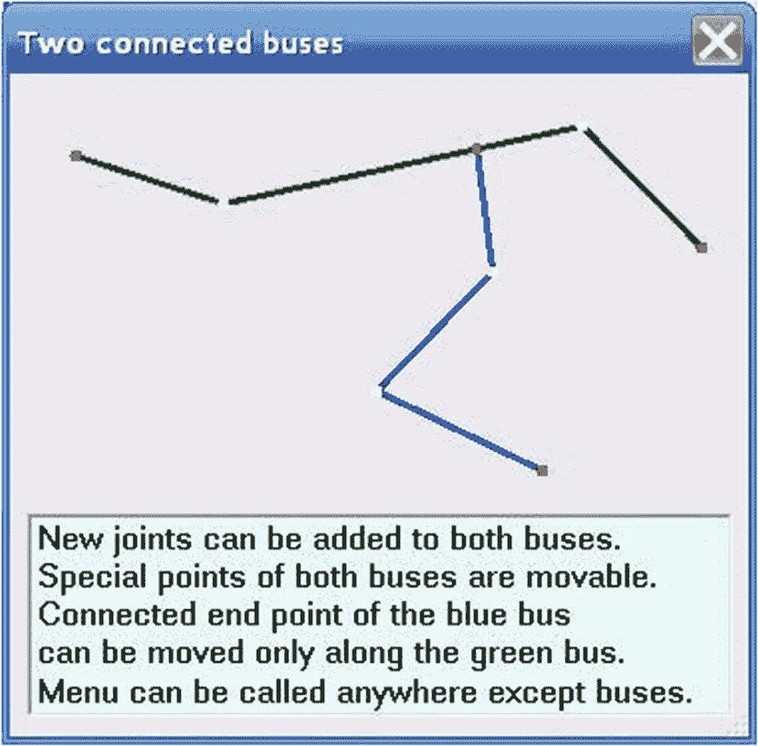

# 排版后的 Markdown 文档

前面几页展示了 `Bus.Draw()` 方法，但当时尚未讨论总线的可移动性，因此这里专门抽取出该方法中用于绘制所有特殊点的部分。如果存在这些标记，它们会在总线绘制完成后被绘制出来，并且无论总线是以正常颜色还是警告颜色显示，这些特殊标记的颜色都保持不变。

```
public void Draw (Graphics grfx)
{
... ...
if (!Movable)
{
if (bMarkJoints)
{
... ...
}
if (bMarkEnds)
{
... ...
}
}
}
```

在真正的族谱应用程序中，可能需要更多对总线视图和配置的更改；这些可能的更改将在下一个示例中演示。

- 文件：`Form_FreeBuses_AllChanges.cs`
- 菜单位置：应用程序 ➤ 族谱设计逐步指南 ➤ 自由总线；所有更改

这个新示例的视图与前一个相同。主要区别在于，通过两个菜单的命令可以实现所有可能的总线更改，这两个菜单可以在总线的不同部分调用。当你点击接点或线段时，你会看到这些菜单，但在工作程序的任何时刻，你只能看到其中一个菜单。无法同时看到它们，因此图 7-20 有点人为构造的意味，但我认为这种视图能让所有可能性更加清晰。像往常一样，要调用的菜单由窗体的 `OnMouseUp()` 方法决定。当需要在同一对象的不同部分调用不同的菜单时，菜单的选择可以基于节点编号和形状；当前示例中两种方式都用到了。在这个过程中，会确定被按下的特殊点（`iPressedPoint`）或线段（`iPressedSegment`）的编号；这些编号对于某些菜单命令是必需的。


**图 7-20** 线段和接点的不同菜单

```
private void OnMouseUp (object sender,
MouseEventArgs e)
{
int iWasObject, iWasNode;
NodeShape shapeNode;
ptMouse_Up = e .Location;
double fDist = Auxi_Geometry .Distance (ptMouse_Down, ptMouse_Up);
if (mover .Release (out iWasObject, out iWasNode, out shapeNode))
{
GraphicalObject grobj = mover .ReleasedSource;
if (e .Button == MouseButtons .Left)
{
... ...
}
else if (e .Button == MouseButtons .Right && fDist <= 3)
{
if (grobj is Bus)
{
int nPoints = busPressed .PointsNumber;
if (shapeNode == NodeShape .Strip)
{
iPressedSegment = iWasNode - nPoints;
ContextMenuStrip = menuOnSegment;
}
else
{
if (0 < iWasNode && iWasNode < nPoints - 1)
{
iPressedPoint = iWasNode;
ContextMenuStrip = menuOnJoint;
}
... ...
```

接点菜单（`menuOnJoint`）包含一个用于删除被按下接点的命令；执行此命令后，可以无需手动移动接点即可拉直总线。在此示例中，允许对可移动和不可移动总线删除接点，但对于将此命令应用于可移动总线的正确性存在一些疑问。当总线被声明为可移动时，就无法通过鼠标点击线段来添加新接点；也无法单独移动现有的特殊点，因为总线可以通过任何点来移动。因此，总线的两个特性——可移动性和重新配置的可能性——在某种程度上是相互关联的，对于它们之间的关联程度可能存在不同看法。

- 如果你仅将总线可移动性的改变视为移动整个对象的机会，那么擦除此类总线接点的可能性是正确的。
- 如果你认为对于可移动总线，必须阻止所有改变其配置的可能性，那么对于可移动总线，此命令必须被禁用。

如果你决定阻止可移动总线的配置更改，则需要在两个不同的地方修改代码，因为接点菜单只允许删除被按下的接点，而线段菜单则允许删除被按下总线的所有接点。

在线段上调用的菜单包含多个命令（这是图 7-20 中较大的那个菜单）。


**图 7-21** 总线调整窗体

| *修改* | 调用一个附加的调整窗体来修改被按下总线的视图。此 `Form_Tuning_Bus.cs`（图 7-21 允许您执行以下操作：更改总线的颜色、宽度和样式 (`DashStyle`)，调节端点与接点处特殊标记的外观，更改特殊标记的颜色，调节警告颜色的使用 |
|---|---|
| *可移动（总线）* | 允许您切换被按下总线的可移动性。可移动性的改变会略微改变总线的视图，如上一个示例所述。 |
| *删除所有接点（总线内部）* | 擦除所有接点，使总线仅由端点之间的单个线段组成。 |
| *水平（线段）* | 将按下的线段转换为水平线。 |
| *垂直（线段）* | 将按下的线段转换为垂直线。 |

最后两个命令的工作方式类似，并且使用限制也相似。

- 要将线段严格转换为水平或垂直，必须移动线段的一个端点。总线的两个端点看起来相似，无法从视觉上确定点的顺序从哪个端点开始，但所有特殊点都按某种顺序存储在 `List<PointF>m_pts` 中，并且这些命令会移动编号较大的点。这对于除最后一个线段之外的任何线段都是正确的，对于最后一个线段，移动的是编号较小的点。
- 在当前初步示例中，我们处理的是自由总线。稍后，相同的命令将用于真实树状图中的线段，此时总线连接到某些对象。这些命令不得影响连接点；因此，将这些命令应用于任何总线的最后一个线段的逻辑是不同的。这也意味着这两个命令不能用于仅由单个线段构成的总线。
- 如果按下的线段近乎水平，并且您命令将其转换为垂直线，则其端点将获得相同的 X 坐标，新线段将变得非常短。如果您对水平线段应用相同的命令，它将变成一个点并从视图中消失。为避免此类情况，仅当转换后的新线段长度不小于 10 像素时，才允许使用这些命令。

到目前为止，我们一直在查看未连接任何东西的自由总线。在真实的族谱图中，我们并没有完全自由的总线；图 7-10 显示，总线要么相互连接，要么可以作为代表人物的矩形之间的链接。我们稍后将讨论那些特殊的矩形，现在让我们考虑一下连接总线的情况。


### 连接的总线

总线并非通过任意点相互连接。相反，组织任何总线连接只有一种方式，并且关于此连接如何工作有严格的规定。连接两条总线的唯一方法，是将一条总线的端点移动并以某种方式固定在另一条总线上。从此刻起，第一条总线的连接端只能沿着第二条总线（将其作为轨道）移动。无论第二条总线是直线还是折线，第一条总线的连接端都可以在第二条总线的两个端点之间全程移动。

`BusConnection` 类的一个元素用于连接两条总线。

```csharp
public class BusConnection : GraphicalObject
{
    PointF ptCon;           // 连接点
    int m_radius;           // 节点半径
    Bus m_busOfEnd;         // 通过其端点连接的总线
    EndType end_type;       // 端点类型
    Bus m_busRail;          // 端点所连接的总线（轨道）
    int iSegment;           // 轨道线段
    double coefOnSegment;   // 该线段上的定位系数
}
```

`BusConnection` 类的对象在将要连接到另一条总线的那个总线的端点处组织。要组织一个新的连接，需要两条总线的相关信息。这些信息包括：连接点（`ptCon`）、连接点周围敏感区域的半径（`m_radius`）、通过其端点连接的总线（`m_busOfEnd`）、指定连接端类型的附加值（`end_type`），以及第一条总线所连接且连接端可沿其移动的总线（`m_busRail`）。

```csharp
public BusConnection (Form frm, Mover mvr, PointF pt, int rad, Bus bus_End,
    EndType endType, Bus bus_Rail)
{
    ... ...
    m_radius = Math .Max (Math .Abs (rad), 3);
    m_busOfEnd = bus_End;
    end_type = endType;
    m_busRail = bus_Rail;
    ... ...
    ptCon = Auxi_Geometry .Polyline_NearestPoint (pt, m_busRail .Points,
        out dist, out iSegment, out coefOnSegment);
}
```

从视觉上看，任何总线两端是无法区分的，但任何总线都是一个由线段按严格顺序连接的点序列。每个 `Bus` 对象将其特殊点保存为一个 `List`，这些点根据它们在 `List` 中的顺序进行连接。`List` 中的第一个点是总线头，最后一个点是总线尾。

```csharp
public enum EndType { Head, Tail };
```

当组织总线连接时，建议的连接点作为参数（`pt`）传递。这个点可以是精确计算的点、不那么精确计算的点、甚至是一个任意点。实际的连接点（`ptCon`）被计算为总线上最接近建议点（`pt`）的点。`Auxi_Geometry.Polyline_NearestPoint()` 方法不仅返回连接将要在其上组织的精确点（`ptCon`），还返回该点所属的总线线段编号（`iSegment`）以及该点在此线段上的定位系数（`coefOnSegment`）。总线的所有特殊点从头部开始编号为 0，并向尾部递增，因此每个线段的端点有两个连续的编号。沿线段的定位系数取值在 [0, 1] 范围内，其中 0 与编号较小的线段端点关联，1 与另一个端点关联。

总线连接的几何形状由一个点表示，因此该对象的覆盖层极其简单明了：覆盖层由一个小的圆形节点组成。

```csharp
public override void DefineCover ()
{
    cover = new Cover (new CoverNode (0, ptCon, m_radius));
}
```

`BusConnection` 类有一个近乎独特的特性：这些对象非常有用，但是它们是不可见的。没有可见性参数，也没有 `Draw()` 方法。我所有的工作都集中在移动屏幕上的对象上，所以这完全关乎改变显示在屏幕上的对象的位置和大小。提到的这个特性近乎独特，到目前为止只有一个类具有此特性：在讨论使用矩形区域绘图时，我解释了在绘图区域角落使用不可见元素的方法。

我们已经有一套四个小例子来观察自由总线；现在你将看到类似的一套四个例子，来探索总线连接的所有特性。

*   文件：`Form_ConnectedBuses_Two.cs`
*   菜单位置：应用程序 ➤ 家谱设计逐步教程 ➤ 两条连接的总线

这个例子的名称告诉我们，此表单中有两条总线。让我们逐步检查总线之间的连接设计。对于这个和接下来的几个例子，我倾向于这种便于我解释的总线视图。同时，我不想严格确定总线点，因为所讨论的连接机制的工作原理与这些点无关，因此这些点是准随机计算的。为此，示例（表单）的整个区域被 `SubRects()` 方法划分为行和列。

```csharp
void SubRects (int nRows, int nCols)
```

单元格（矩形）的编号从左上角开始，沿第一行向右，然后沿下一行从左到右，依此类推，直到右下角。通过 `RandomPointInSubrect()` 方法获取任何单元格内的随机点。

```csharp
PointF RandomPointInSubrect (int iRect)
```

为了组织准随机的总线定位，你需要声明一组单元格编号，该总线的点必须位于这些单元格内。

```csharp
private List Points_QuaziRandom (int [] nums)
{
    List points = new List ();
    for (int i = 0; i < nums .Length; i++)
    {
        points .Add (RandomPointInSubrect (nums [i]));
    }
    return (points);
}
```

现在我们可以继续我们的例子。首先，在表单的上四分之一部分组织绿色总线（`busGreen`）。然后，蓝色总线（`busBlue`）被放置在表单中间的某个位置，从上到下延伸（图 7-22）。



图 7-22 两条连接的总线

```csharp
public DefaultView ()
{
    ... ...
    SubRects (4, 5);
    busGreen = new Bus (this, mover,
        Points_QuaziRandom (new int [] { 0, 1, 3, 4 }),
        new Pen (Color .Green, 3));
    busBlue = new Bus (this, mover,
        Points_QuaziRandom (new int [] { 2, 7, 12, 18 }),
        new Pen (Color .Blue, 3));
```

蓝色总线必须通过其头部（即 `points [0]`）连接到绿色总线，因此需要对该点进行一些修正。计算绿色总线上离它最近的点（`pt`），蓝色总线的起点将采用这个值。

```csharp
    PointF pt = Auxi_Geometry .Polyline_NearestPoint (busBlue .Points [0],
        busGreen .Points);
    busBlue .ChangePoint (0, pt);
```

蓝色总线的头点现在位于绿色总线上，但两条总线互不知情。如果不做其他处理，它们的行为就像完全独立的对象；这样的例子在之前几页已经演示过。要实现真正的连接，需要在蓝色总线的头点组织一个 `BusConnection` 对象，并且绿色总线通过 `Bus.AddConnection()` 方法接收关于此连接的信息。

```csharp
    con = new BusConnection (this, mover, pt, busBlue, EndType.Head, busGreen);
    busGreen .AddConnection (con);
    ... ...
}
```


