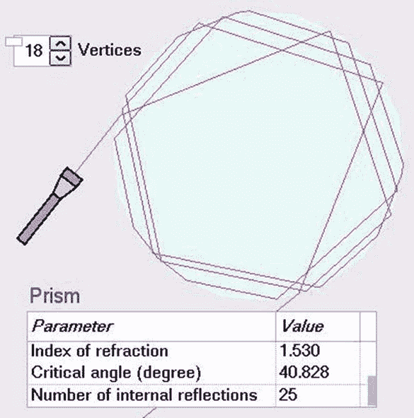
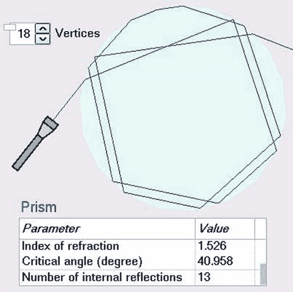
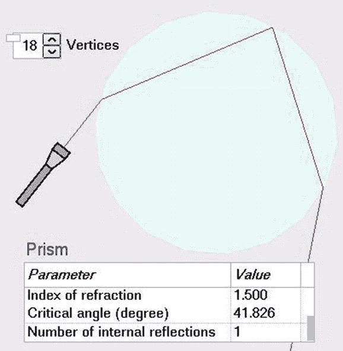

# 光的色散与彩虹

三角棱镜中射出的七色光锥是光的色散的完美展示。这种色散的另一个更著名的例子是彩虹。为了解释彩虹现象，我们使用光线在水滴中的传播过程。水滴是圆形的。一个圆形可以看作是一个具有无限多个顶点（或平面）的正多边形。因此，我们在三角棱镜中观察到光的色散，而借助具有无限多个平面的棱镜，我们观察到了色散（彩虹）。（准确地说，彩虹是光在一组水滴上发生色散的结果，每种颜色的光线来自不同的水滴。）当白光照射到具有三个以上平面的正多边形时会发生什么？当这个数字改变时又会发生什么？

进行真实实验需要准备整套棱镜，这并非易事；而用计算机建模会容易得多。屏幕上三角棱镜转变为具有可变平面数量的另一形状的过程很快。我最初看到的结果与三角棱镜相似，所以起初这种棱镜变换并没有产生任何出人意料的结果。接着我开始观察到一些截然不同的现象；过了一段时间，我意识到类似的结果在埃莉诺·H·波特所著的著名小说《波莉安娜》[6]中已有描述。

> *“波莉安娜还没在阳光照射的窗户上挂好三个吊坠，就开始略微明白将会发生什么。她兴奋得手指颤抖，几乎无法控制地挂好剩下的吊坠。但任务终于完成，她后退一步，发出了一声低低的欢呼。*
>
> *那间华丽却沉闷的卧室变成了仙境。到处都是舞动着的红色、绿色、紫色、橙色、金色和蓝色的光斑。墙壁、地板、家具，甚至床本身，都闪耀着波光粼粼的色彩。”*

这无疑是白光被分解成各色成分的过程，但这色散有点奇特，并非我们在彩虹或三角棱镜中看到的那种。在彩虹中，我们总能同时看到七种颜色并列出现；它们绝不会在天空的不同区域彼此分离。在等边三角棱镜的情况下，各色光锥也保持在一起，分散光线中红色和紫色部分之间的最大夹角大约为 10 度。从这样一个棱镜中射出的光会使彩色光斑彼此相邻排列。书中生动的描述则提到房间里到处都是彩色光斑，因此产生这种画面的原因必定有所不同；图 7-65 展示了这是如何发生的。为了避免将所有不同颜色混杂在一张图中，我针对不同光成分准备了三张不同的图。所涉及元素的几何结构对于三者来说是相同的。现在想象一下，太阳光以图中所示的方式照射到吊坠上。白光发生色散；然后每种成分将沿自己的路径传播，并以各自的角度射出。结果，我们在完全不同的位置得到了不同颜色的光斑。

图 7-65c

紫色光在内部旋转近 4 圈，经过 25 次内反射后射出

图 7-65b

蓝色光经过 13 次内反射后射出

图 7-65a

红色光经过一次内反射点后射出

当我设计一个正多边形棱镜的例子时，我预料到这样的结果了吗？当然没有，尽管我知道宝石切割工艺已经使用了几个世纪。（我们可以跳过关于我预测结果能力的讨论，但至少我是诚实的。）幸运的是，该程序被设计成一个用户驱动的应用程序，因此用户（就是我！）可以对所涉及的元素做任何想做的事。像往常一样，这位用户决定摆弄屏幕上的元素，并在此过程中得到了设计者（也是我！）从未想到过的结果。这对于“科学程序是否可能产生意外结果？”这一基本问题给出了完美的答案。

脚注 1 2 3 4
