# BusConnection 工作原理

蓝色巴士的终点精确地位于绿色巴士上。巴士之间存在视觉连接；当使用鼠标光标按下连接点时，预期该点可被移动。移动器没有视觉，并根据队列中的顺序选择要移动的对象，因此这个`BusConnection`对象必须在移动器队列中注册在两条巴士之前。

```csharp
private void RenewMover()
{
    mover.Clear();
    busGreen.IntoMover(mover, 0);
    busBlue.IntoMover(mover, 0);
    con.IntoMover(mover, 0);
    // ...
}
```

现在，让我们看看这个连接如何工作的细节。

`BusConnection`对象在移动器队列中位于巴士之前，因此当使用左键按下连接点时，被按下和捕获的不是任何巴士，而是这个`BusConnection`对象。发生这种情况时，会调用`BusConnection.Press()`方法。

```csharp
private void OnMouseDown(object sender, MouseEventArgs e)
{
    ptMouse_Down = e.Location;
    if (mover.Catch(e.Location, e.Button))
    {
        GraphicalObject grobj = mover.CaughtSource;
        int iNode = mover.CaughtNode;
        if (grobj is BusConnection)
        {
            (grobj as BusConnection).Press(e.Location, e.Button, iNode);
        }
        // ...
    }
}
```

这个`Press()`方法中使用三个参数仅仅是为了统一性。对于由单个小圆形节点组成的覆盖层，按下的点和按下的节点号是冗余的。当`BusConnection`元素被左键按下时，鼠标光标位置会以标准方式调整到中心点。

```csharp
public void Press(Point ptMouse, MouseButtons catcher, int iNode)
{
    if (catcher == MouseButtons.Left)
    {
        AdjustCursorPosition(ptCon);
    }
}
```

现在`BusConnection`对象被移动器捕获，因此捕获对象的进一步移动由`BusConnection.MoveNode()`方法描述。

```csharp
public override bool MoveNode(...)
{
    bool bRet = false;
    if (catcher == MouseButtons.Left)
    {
        Location = ptMouse;
        AdjustCursorPosition(ptCon);
    }
    return (bRet);
}
```

从视觉上看，就好像按下的鼠标仅沿绿色巴士移动，并且连接点始终跟随鼠标光标。实际上，其工作原理正好相反：鼠标光标移动到一个点（`ptMouse`），该点极有可能在绿色巴士之外的某个位置，但连接点自身保持位于绿色巴士上，并将光标返回到连接点。将连接点保持在巴士上是使用`Location`属性简单实现的。

```csharp
Location = ptMouse;
```

因此，我们必须查看`BusConnection.Location`属性的内部。

```csharp
public PointF Location
{
    get { return (ptCon); }
    set
    {
        ptCon = Auxi_Geometry.Polyline_NearestPoint(value, m_busRail.Points,
            out dist, out iSegment, out coefOnSegment);
        DefineCover();
        if (end_type == EndType.Head)
        {
            m_busOfEnd.HeadPoint = ptCon;
        }
        else
        {
            m_busOfEnd.TailPoint = ptCon;
        }
    }
}
```

光标移动到某个新点，这个点（`value`）用于计算巴士上最近的点（`ptCon`）。蓝色巴士的被连接端点现在移动到该点。任何巴士的两个端点——头部和尾部——在视觉上是无法区分的，但`BusConnection`对象的`end_type`字段指定了被覆盖的端点，因此将蓝色巴士的正确端点移动到巴士连接的新点没有问题。当`BusConnection.Location`属性的工作完成后，`MoveNode()`方法通过通常的`AdjustCursorPosition()`方法，命令将光标位置调整到连接点的新位置。

连接点的新位置由`Auxi_Geometry.Polyline_NearestPoint()`方法确定，该方法使用一组特殊的巴士点。通过这种方式，连接点仅沿绿色巴士移动，而蓝色巴士的被连接端点随此点一起移动。当绿色巴士的特殊点集合固定时，这能完美工作，但当绿色巴士的配置以某种方式改变时会发生什么？绿色巴士的端点和连接点可以随时移动。在这些变化过程中，蓝色巴士的端点如何保持与绿色巴士的连接？

我已经提到过，在蓝色巴士端点处的连接建立后，有关此连接的信息被传递给了它所连接的巴士——绿色巴士。

```csharp
busGreen.AddConnection(con);
```

任何巴士都会跟踪其所有“侧向”连接。对于其他巴士通过头部和尾部建立的连接，有两个独立的`List`。

```csharp
public class Bus : GraphicalObject
{
    List headsConnected = new List();
    List tailsConnected = new List();
```

`Bus.AddConnection()`方法将一个新元素添加到相应的`List`中。

```csharp
public void AddConnection(BusConnection cnct)
{
    if (cnct.ConnectionType == EndType.Head)
    {
        headsConnected.Add(cnct);
    }
    else
    {
        tailsConnected.Add(cnct);
    }
}
```

当绿色巴士被组织起来时，它的四个点从左到右定义；它们在点`List`中的编号如图 7-23 所示。绿色巴士由三段组成；蓝色巴士连接在点 1 和点 2 之间的第 1 段上。现在，让我们按下并移动绿色巴士的某个特殊点。当巴士的任何一个节点被按下并移动时，就会调用`Bus.MoveNode()`方法。目前我们只关心该方法中负责移动特殊点的部分。所有特殊点都被圆形节点覆盖，这些节点是巴士覆盖层中的第一个，因此移动的圆形节点的编号等于相应特殊点的编号。我想提醒您，只有当巴士本身不可移动时，特殊点才能被移动。


**图 7-23** 绿色巴士的点从左到右编号

```csharp
public override bool MoveNode(...)
{
    bool bRet = false;
    if (catcher == MouseButtons.Left)
    {
        if (Movable)
        {
            // ...
        }
        else
        {
            if (iNode < m_pts.Count)
            {
                m_pts[iNode] = ptMouse;
                InformConnections(PositionUpdate.Soft, iNode - 1, iNode);
                bRet = true;
            }
            // ...
```

当任何巴士移动或重新配置时，该巴士上的部分或全部连接必须更新其位置。`PositionUpdate`枚举描述了两种不同类型的更新。

*   想象一种情况（这是真实的，但我们尚未讨论这种情况）：在巴士配置未发生任何变化的情况下移动巴士，所有连接必须保持其相对位置。这意味着每个连接仍然位于同一段上，并且沿该段的定位系数相同。因此，仅因为巴士移动而改变连接的绝对屏幕坐标；这种位置变化被描述为`PositionUpdate.Soft`。

*   另一种情况发生在，例如，当命令删除巴士的所有连接点并将其转变为一条直线时。结果是，所有连接必须定位在这条新巴士上，并且无法保持连接位于同一段且具有相同的定位系数。这两个值必须重新计算，这种情况被描述为`PositionUpdate.Hard`。

```csharp
public enum PositionUpdate { Soft, Hard };
```

- 当整个总线被移动时，其所有连接都必须重新定位。当端点被移动时，仅影响一个区段。当任意关节被移动时，仅该关节两侧的区段发生改变，且只需重新定位这些区段上的连接；邻近关节之外的所有其他连接完全不受影响。更新的类型及受影响区段的范围会被发送至`InformConnections()`方法。

```csharp
public void InformConnections(PositionUpdate updateType,
    int iSeg_0, int iSeg_1)
{
    foreach (BusConnection connection in headsConnected)
    {
        connection.RailChanged(updateType, iSeg_0, iSeg_1);
    }
    foreach (BusConnection connection in tailsConnected)
    {
        connection.RailChanged(updateType, iSeg_0, iSeg_1);
    }
}
```

传递给`Bus.InformConnections()`方法的参数包括调整类型（`updateType`）以及受影响区段的范围（从`iSeg_0`到`iSeg_1`）。在对每个连接应用`BusConnection.RailChanged()`方法时，会使用相同的参数集。该方法需根据其所在总线的变化计算连接的新位置；仅当特定连接位于指定范围内的区段上时，才需要进行计算。若需移动连接，其新位置（`ptNew`）取决于更新的类型。

- 对于`PositionUpdate.Soft`，区段编号（`iSegment`）及该区段上的定位系数（`coefOnSegment`）保持不变；新位置通过使用这些不变的值计算得出。

- 对于`PositionUpdate.Hard`，新位置通过查找整个总线上的最近点来计算；此计算仅需总线的点。在此过程中，新的区段编号及该区段上的定位系数也会被计算出来。

```csharp
public void RailChanged(PositionUpdate updateType, int iSeg_0, int iSeg_1)
{
    if (iSeg_0 <= iSegment && iSegment <= iSeg_1)
    {
        PointF ptNew;
        if (updateType == PositionUpdate.Soft)
        {
            ptNew = Auxi_Geometry.PointOnLine(m_busRail.Points[iSegment],
                m_busRail.Points[iSegment + 1], coefOnSegment);
        }
        else
        {
            ptNew = Auxi_Geometry.Polyline_NearestPoint(ptCon,
                m_busRail.Points, out dist, out iSegment, out coefOnSegment);
        }
        Location = ptNew;
    }
}
```

计算得到的位置（`ptNew`）被传递给`BusConnection.Location`属性，该属性会完成两件事：将连接重新定位到新位置，然后将此值发送至所连接总线的`HeadPoint`或`TailPoint`属性；具体使用哪个属性取决于该总线是通过头还是尾进行连接。（`BusConnection.Location`属性的代码已在前面几页中展示。）

在我们的案例中，蓝色总线通过头部连接到绿色总线，因此移动后的连接会将新的点值发送至所连接总线的`Bus.HeadPoint`属性，随后该总线的头部端点发生改变。

```csharp
public PointF HeadPoint
{
    get { return (m_pts[0]); }
    set { ChangePoint(0, value); }
}
```

您会看到，并非直接修改`m_pts[0]`，而是调用了`Bus.ChangePoint()`方法，因为仅改变所连接总线的头部端点可能不够。如果第二辆总线上存在一些连接（假设其他总线也连接到蓝色总线），那么`Bus.ChangePoint()`方法不仅会重新定位总线的第一个点，还会扰动其所有连接；这种扰动最终会在某处停止，但在此过程中，所有涉及的连接和总线端点都会占据新的位置。

```csharp
public void ChangePoint(int iPoint, PointF pt)
{
    if (0 <= iPoint && iPoint < m_pts.Count)
    {
        m_pts.RemoveAt(iPoint);
        m_pts.Insert(iPoint, pt);
        DefineCover();
        InformConnections(PositionUpdate.Soft, iPoint - 1, iPoint);
    }
}
```

至此，我们已全面了解当绿色总线的某个特殊点被捕获并移动时会发生什么。对于位于移动特殊点附近或远处的连接，会产生不同的后果。为避免在文本中来回跳跃，我在此复制了图 7-23，该图显示了绿色总线特殊点的编号。现在，我们来详细观察移动点 1 和点 3 两种情况。

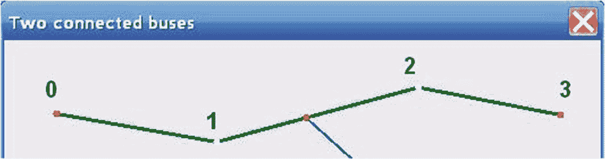

当移动绿色总线左侧第二个点（编号 1）时，会发生以下情况：

1.  鼠标移动到某个位置（`ptMouse`）。通过`Bus.MoveNode()`方法，捕获的关节（`iNode == 1`）被移动到与鼠标相同的位置。绿色总线的所有连接被告知总线的两个区段已发生改变。

```csharp
m_pts[1] = ptMouse;
InformConnections(PositionUpdate.Soft, 0, 1);
```

2.  绿色总线只有一个连接，且使用相同的参数调用了该连接的`BusConnection.RailChanged()`方法。

```csharp
connection.RailChanged(PositionUpdate.Soft, 0, 1);
```

3.  我们的连接恰好位于指定的区段范围内（`iSegment == 1`），因此使用软更新计算连接的新位置，然后将该新位置传递给`BusConnection.Location`属性。

```csharp
ptNew = Auxi_Geometry.PointOnLine(busRail.Points[1],
    busRail.Points[2], coefOnSegment);
Location = ptNew;
```

4.  `BusConnection.Location`属性更改连接点的实际位置，并将此新位置发送给蓝色总线，用于`Bus.HeadPoint`属性。

```csharp
ptCon = Auxi_Geometry.Polyline_NearestPoint(value, busRail.Points,
    out dist, out iSegment, out coefOnSegment);
m_busOfEnd.HeadPoint = ptCon;
```

5.  `Bus.HeadPoint`属性调用`Bus.ChangePoint()`方法来更改第一个点的位置。

```csharp
set { ChangePoint(0, value); }
```

6.  `Bus.ChangePoint()`方法更改蓝色总线头部端点的位置，由于蓝色总线上没有连接，扰动至此结束。

当移动绿色总线的右侧点（编号 3）时，事件链更短。

1.  鼠标移动到某个位置（`ptMouse`）。通过`Bus.MoveNode()`方法，捕获的总线点（`iNode == 3`）被移动到与鼠标相同的位置。绿色总线的所有连接被告知总线的两个区段已发生改变。

# 总线连接与InformConnections方法

## 1. 端点移动与连接更新

```csharp
pts[3] = ptMouse;
InformConnections(PositionUpdate.Soft, 2, 3);
```

## 2. 单一连接的总线

绿色总线只有一个连接，且使用相同的参数调用了该连接的`BusConnection.RailChanged()`方法。

```csharp
connection.RailChanged(PositionUpdate.Soft, 2, 3);
```

## 3. 连接位于范围之外

绿色总线上的连接位于指定范围之外（`iSegment == 1`），因此无需执行任何操作。在图 7-23 中，绿色总线右侧点的移动对所示的连接没有影响。

我们已经看到，每当总线的端点或某个关节被移动时，都必须调用`Bus.InformConnections()`方法。接下来的示例将展示必须调用此方法的几种情况，并且存在一些简单的逻辑来确定此调用所需的参数集。

### 排版后的文本

如果某个特殊点被鼠标移动，则总线上任何连接的相对位置不会改变；这意味着使用`PositionUpdate.Soft`参数。作为上述移动的结果，影响不超过两个连续线段，因此两个连续数字代表受影响线段的范围。对于端点，只有一个线段被改变，但为了代码的统一性，线段范围仍然由两个连续数字表示。其中一个所述的线段不存在，但这完全不是问题，因为没有连接可以定位在不存在的线段上，因此对于这个不存在的线段不需要（也不会）采取任何操作。

如果关节数量发生变化，则始终使用`PositionUpdate.Hard`参数，并且所有线段都必须包含在受影响线段的范围内。

属于第二种变体的情况之一是当按下不可移动总线的任何线段时添加新关节；在这种情况下，对`Bus.InformConnections()`方法的调用包含在`OnMouseDown()`方法中。

-   文件：`Form_ConnectedBuses_Three.cs`
-   菜单位置：`Applications ➤ FamilyTree design step by step ➤ Three connected buses`

```csharp
private void OnMouseDown (object sender, MouseEventArgs e)
{
ptMouse_Down = e .Location;
if (mover .Catch (e .Location, e .Button))
{
GraphicalObject grobj = mover .CaughtSource;
int iNode = mover .CaughtNode;
... ...
else if (grobj is Bus)
{
Bus bus = grobj as Bus;
bus .Press (e .Location, e .Button, iNode);
if (e .Button == MouseButtons .Left &&
mover .CaughtNodeShape == NodeShape .Strip && !bus .Movable)
{
... ...
bus .InformConnections (PositionUpdate .Hard,
0, bus .PointsNumber - 1);
... ...
```

在下一个示例中，有三条总线，其中一条两端都连接到其他总线（图 7-24）。此示例允许您检查总线两端连接的正确性，而其他所有内容几乎相同。

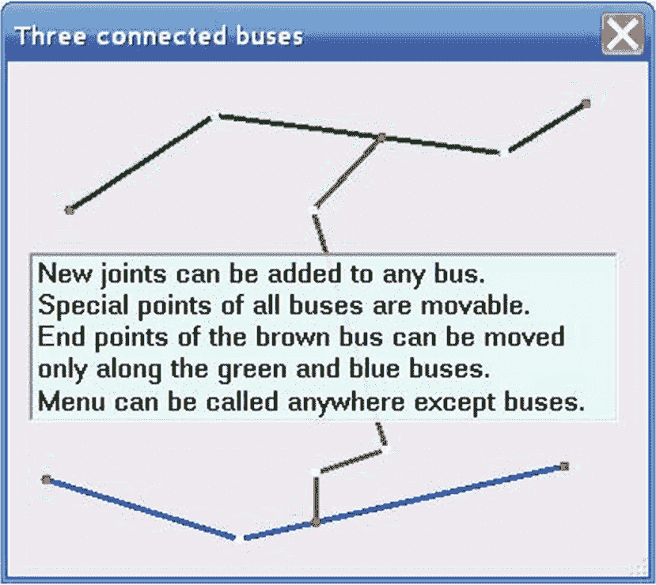

图 7-24 三条连接的总线

从此示例开始，直到开发真正的 `Family Tree` 应用程序，将会有大量的总线连接。在某些情况下，总线只有一端连接到某个对象；在其他情况下，总线两端都连接。`ConnectedBus()`方法在任何情况下都很有用。此方法构造一条新总线，其两端连接到一个或两个其他总线。不仅组织了一条新总线，新的连接（一个或两个）也被包含在现有的总线连接`List`中。我提到一个或两个新连接，因为此方法可以在新总线两端都连接或仅一端连接时使用。本可以在上一个示例中演示此方法，但我决定将其使用推迟到本示例。

此示例的总线以准随机方式计算：绿色总线（`busFrom`）出现在窗体的上半部分，蓝色总线（`busTo`）出现在下半部分，然后棕色总线（`busLink`）在中间某处连接它们。

```csharp
List connections = new List ();
public DefaultView ()
{
... ...
busFrom = new Bus (this, mover,
Points_QuaziRandom (new int [] { 0, 1, 3, 4 }),
new Pen (Color .Green, 3));
busTo = new Bus (this, mover,
Points_QuaziRandom (new int [] { 15, 17, 19 }),
new Pen (Color .Blue, 3));
busLink = ConnectedBus (this, mover, new Pen (Color .Brown, 3),
busFrom, busTo,
Points_QuaziRandom (new int [] { 2, 7, 13, 18 }),
out connections);
... ...
```

`ConnectedBus()`方法获取提议的点`List`，但第一个和最后一个点会根据新连接必须位于的总线的几何形状进行调整。`busLink`两端必须连接到的两条总线在调用`ConnectedBus()`方法之前已经存在。家谱通常是通过一次添加一个新元素来构建的，因此新总线一端连接而另一端稍后使用是很正常的。如果使用此方法来组织单端连接，则对于另一端的总线，使用`null`参数代替。

```csharp
public Bus ConnectedBus (Form frm, Mover mvr, Pen pn,
Bus busHeadConnected, Bus busTailConnected,
List points, out List cons)
{
List newcons = new List ();
int iLast = points .Count - 1;
if (busHeadConnected != null)
{
points [0] = Auxi_Geometry .Polyline_NearestPoint (points [0],
busHeadConnected .Points);
}
if (busTailConnected != null)
{
points [iLast] = Auxi_Geometry .Polyline_NearestPoint (points [iLast], busTailConnected .Points);
}
Bus bs = new Bus (frm, mvr, points, pn);
if (busHeadConnected != null)
{
BusConnection conHead = new BusConnection (frm, mvr, points [0],
Math .Max (busHeadConnected .NodeRadius, bs .NodeRadius), bs, EndType .Head, busHeadConnected);
busHeadConnected .AddConnection (conHead);
newcons .Add (conHead);
}
if (busTailConnected != null)
{
BusConnection conTail = new BusConnection (frm, mvr, points [iLast],
Math .Max (busTailConnected .NodeRadius, bs .NodeRadius), bs, EndType .Tail,
busTailConnected);
busTailConnected .AddConnection (conTail);
newcons .Add (conTail);
}
cons = newcons;
return (bs);
}
```

您可以用总线测试另一件有趣的事情。重新配置一条总线，例如绿色的那条，使其变成一个闭环。这很容易做到，因为所有特殊点都是可移动的，并且可以添加任意数量的新关节。在所有更改结束时，将绿色总线的一个端点移动到另一个端点之上。如果您将绿色总线变成一个闭环，那么棕色总线的连接端点可以毫无问题地绕此闭环移动。您甚至可以将绿色总线的两个端点放置在彼此附近，存在一个小间隙不是问题：棕色总线的可移动端点可以轻松跨越绿色总线中的小间隙。如果绿色总线被重新配置为自身交叉，那么棕色总线的端点可以从一个线段跳到另一个线段。您可以重新配置用作轨道的总线，使其不同的线段彼此相距不远；沿着此轨道移动的另一条总线的端点可以轻松跨越间隙并从一条线段移动到另一条线段。这种不仅沿轨道移动，甚至跨越某些间隙的移动，在其他沿轨道移动的应用程序中可能是个问题，因此该问题及其解决方案在我的另一本书 [2] 中进行了讨论（例如，请参阅`Form_SpotOnCommentedWay.cs`）。对于`Family Tree`应用程序，无需添加任何特殊检查来防止这种从总线的一个线段到另一个线段的跳跃。

我无法想象任何情况下有人需要以自身交叉的方式更改家谱的总线，但闭环形式的总线则不同。闭环形式的总线不仅仅是一个有趣的练习。稍后您将看到它是一个有用的元素。

-   文件：`Form_ConnectedBuses_ChangingMovability.cs`
-   菜单位置：`Applications ➤ FamilyTree design step by step ➤ Connected buses; changing movability`

在下一个示例中，三辆相同的总线以相同方式连接，但我添加了一个包含单条命令的小菜单，用于更改被按压总线的可移动性。该命令并非适用于所有总线，因此它对绿色和蓝色总线有效，但对棕色总线无效。当然，这种排除并非基于总线颜色。前面已经解释过，只有两端自由的总线才能被声明为可移动，因此棕色总线不允许更改可移动性。

在初始化时，三辆总线均不可移动。当你用左键按压任意总线的任意段时，光标下方会出现一个新节点。你继续移动这个新节点，如果被按压的总线是绿色或蓝色的，那么棕色总线的连接点只有恰好处在该节点的相邻段上时才会移动。

现在在绿色总线上调用上下文菜单，并将其变为可移动。绿色总线的视图会稍作改变以指示其可移动性；可移动总线所有特殊点上彩色标记的消失（图 7-25）已在类似自由总线的示例中展示过。

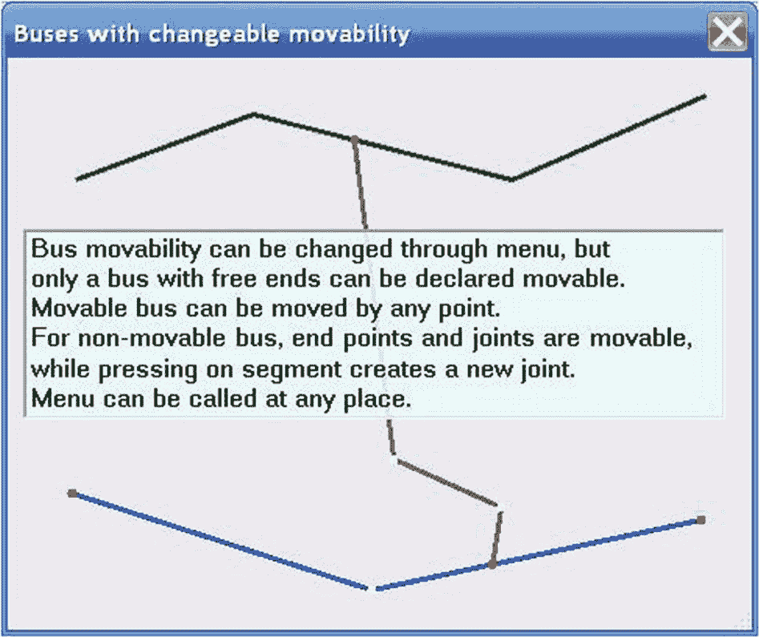

图 7-25 两辆总线（蓝色和棕色）不可移动，而绿色总线可移动

当总线可移动性切换时，不仅总线视图发生变化，其覆盖层也随之改变。所有节点的数量、顺序和形状均保持不变，但带状节点的行为会发生变化。

```csharp
public override void DefineCover ()
{
... ...
if (Movable)
{
cover .SetBehaviour (NodeShape .Strip, Behaviour .Moveable);
cover .SetCursor (Cursors .SizeAll);
}
}
```

可移动总线在特殊点上没有标记，任何总线点都可以用来启动对整个总线的完全相同的移动。在本书的多个类中，我已经演示过，如果在某些情况下不需要圆形节点，那么它们会被简单地压缩到大小为零。为什么不在`Bus`类中这样做呢？有些情况下，这些圆形节点必须从移动过程中排除，但必须在它们上面调用某些菜单。为了被移动器检测到，节点必须具有非零的大小。

当用左键按压可移动总线时，`MoveNode()`方法会直接调用`Move()`方法。在讨论自由总线时已经提到过这一点，但现在讨论`MoveNode()`方法中的另一条命令还为时过早。

```csharp
public override bool MoveNode (...)
{
bool bRet = false;
if (catcher == MouseButtons .Left)
{
if (Movable)
{
Move (dx, dy);
InformConnections (PositionUpdate .Soft, 0, pts .Count - 1);
}
... ...
```

当前示例中的绿色总线变为可移动状态并被移动时，必须通知其所有连接点关于总线的变化。在整个移动过程中，绿色总线的配置不会改变；其所有段长度相同，因此所有可能的连接到该总线的点必须保持它们的位置。这是`PositionUpdate.Soft`更新类型的经典变体，必须包含所有段，你看到的就是从`MoveNode()`方法内部调用的`InformConnections()`方法。

-   文件：`Form_ConnectedBuses_AllChanges.cs`
-   菜单位置：应用程序 ➤ 族谱逐步设计 ➤ 连接总线；所有更改

此示例演示了可应用于连接总线的所有可能更改；这些更改与`Form_FreeBuses_AllChanges.cs`（图 7-20）中为自由总线演示的更改相同。此示例中可以使用三个菜单；其中两个在总线段和节点上调用（图 7-26）。

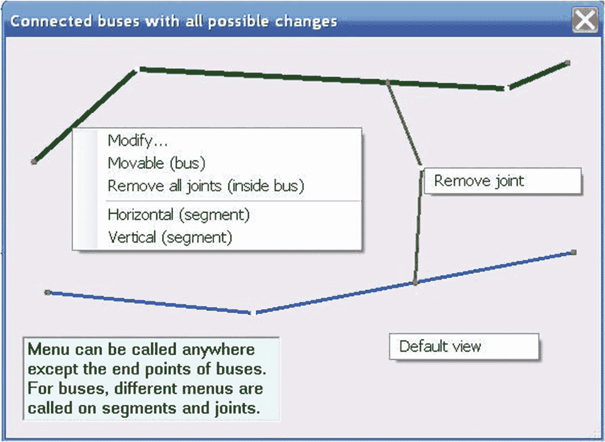

图 7-26 带有所有可能更改的连接总线

我认为现在用于族谱应用程序的总线已经开发并测试完毕。是时候看看任何族谱中的其他重要元素了——具体来说，就是代表人物的矩形。

### 家族谱系中的人物

家族谱系中的任何人物都由`Person`类的一个对象表示。在屏幕上，该对象显示为一个包含某些信息的矩形区域（图 7-27）。该矩形是可移动和可调整大小的（您还期待别的什么吗？）；人物的信息通过与此矩形关联的三个评论组织起来。

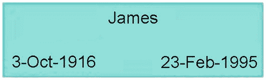

图 7-27 `Person`对象的标准视图

```csharp
public class Person : GraphicalObject
{
PointF [] ptsCorner;
SolidBrush m_brush;
Pen penBorder = new Pen (Color .DarkGray);
CommentToRect cmntName, cmntBirth, cmntDeath;
Bus busOnBorder;
static int minSide = 20;
```

其中一个评论`cmntName`用于显示人物的姓名。此评论的文本不能为空。即使您不知道人物的姓名，也可以称其为“未知”或任何其他名称，但您不能在没有此评论的情况下组织一个`Person`对象。另外两个评论是非强制的。如果一个人还活着，通常不知道其去世信息，因此在这种情况下不需要`cmntDeath`。对于几代以前的亲属，不知道其出生日期也并不罕见。可以输入带有问号的某个日期（例如年份），或者干脆省略`cmntBirth`。在开始讨论家族谱系程序时，我使用了图 7-10 到 7-14，其中每个`Person`对象只包含`cmntName`部分，而另外两个评论是空的。

姓名、出生和死亡数据只是本程序及其他类似程序中使用的标准信息片段。这三个字段仅是字符串，用户可以在其中输入任何所需的文本。

`Person`类的对象可以通过其内部任意点移动，并通过其边界上任意点调整大小。该类的对象使用了与之前演示的其他几个矩形类相同类型的覆盖层（例如，见图 5-3），因此在角上有四个圆形节点，沿边上有四个条状节点，以及一个覆盖整个对象区域的矩形节点。`Person`对象的覆盖层基于矩形的四个角点；`ptsCorner[]`数组中点的编号从左上角开始，按顺时针方向进行。`Person`对象始终可以在所有方向上调整大小，并且覆盖节点永远不会被压缩。边上的条状节点默认宽度为六个像素，而圆形节点则比默认大小略大。

# Person 对象的实现与调优

## DefineCover 方法

```csharp
public override void DefineCover ()
{
float rCorner = 4;
CoverNode [] nodes = new CoverNode [] {
new CoverNode (0, ptsCorner [0], rCorner, Cursors .SizeNWSE),
new CoverNode (1, ptsCorner [1], rCorner, Cursors .SizeNESW),
new CoverNode (2, ptsCorner [2], rCorner, Cursors .SizeNWSE),
new CoverNode (3, ptsCorner [3], rCorner, Cursors .SizeNESW),
new CoverNode (4, ptsCorner [0], ptsCorner [3], Cursors .SizeWE),
new CoverNode (5, ptsCorner [1], ptsCorner [2], Cursors .SizeWE),
new CoverNode (6, ptsCorner [0], ptsCorner [1], Cursors .SizeNS),
new CoverNode (7, ptsCorner [3], ptsCorner [2], Cursors .SizeNS),
new CoverNode (8, ptsCorner) };
cover = new Cover (nodes);
}
```

## Person 对象的运动特性

这是一个经典的复杂对象，其各个部分参与独立、关联和同步的运动。

-   矩形是主导元素；当其移动时，所有关联的评论都会同步移动。
-   当矩形调整大小时，其关联的评论保持其相对位置。
-   任何评论都可以独立移动和旋转。

与任何复杂对象一样，`Person` 对象必须通过 `Person.IntoMover()` 方法在移动器队列中注册。无论评论相对于矩形的相对位置如何，它们都必须可见且可访问，因此它们必须比矩形更早注册。

## IntoMover 方法

```csharp
new public void IntoMover (Mover mv, int iPos)
{
mv .Insert (iPos, this);
mv .Insert (iPos, cmntName);
if (BirthInfoToShow)
{
mv .Insert (iPos, cmntBirth);
}
if (DeathInfoToShow)
{
mv .Insert (iPos, cmntDeath);
}
}
```

绘制各部分的顺序总是与它们在移动器队列中的放置顺序相反，因此我们必须先绘制矩形，然后再绘制所有需要显示的评论。

-   文件：`Form_Person.cs`
-   菜单位置：应用程序 ➤ 家族谱系逐步设计 ➤ Person

## Draw 方法

```csharp
public void Draw (Graphics grfx)
{
grfx .FillRectangle (m_brush, Area);
grfx .DrawRectangle (penBorder, Rectangle .Round (Area));
cmntName .Draw (grfx);
if (BirthInfoToShow)
{
cmntBirth .Draw (grfx);
}
if (DeathInfoToShow)
{
cmntDeath .Draw (grfx);
}
}
```

## Person 对象的初始化与视图

此示例包含一个 `Person` 对象，并演示了其调优（图 7-28）。`Person` 类具有多个构造函数；当前示例使用了一个包含全部参数集的构造函数。

```csharp
private void DefaultPerson (PointF pt)
{
m_person = new Person (this, mover, new RectangleF (pt .X, pt .Y, 210, 60),
Color .Cyan, "James", "3-Oct-1916", "23-Feb-1995");
}
```

由 `DefaultPerson()` 方法组织的 `Person` 对象具有如图 7-27 所示的视图。矩形的青色由初始化时的参数之一决定，而所有三个评论都显示为水平字符串，并使用相同的字体和颜色。图 7-28 中可见的所有进一步变换都是借助调优表单完成的。

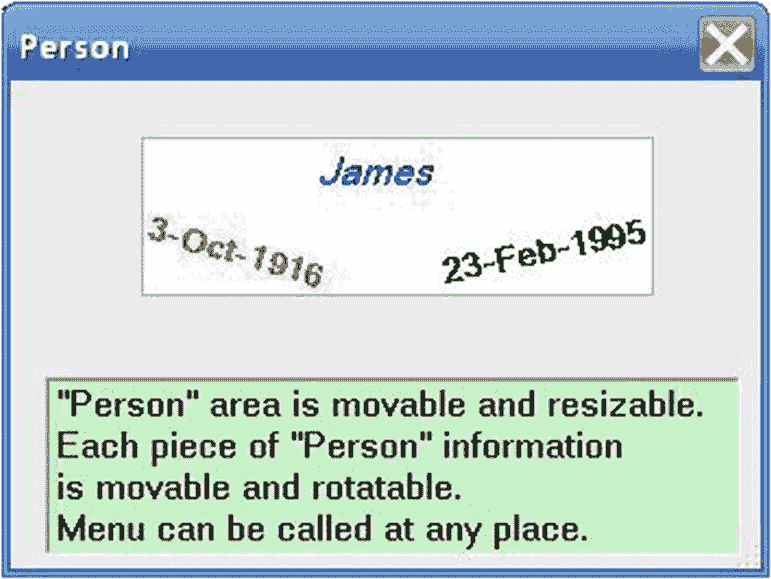

**图 7-28** `Form_Person.cs` 包含一个 `Person` 对象

## 用户交互与调优表单

在任何用户驱动的应用程序中，所有可见性参数都由用户决定。如果屏幕上有一个对象，那么必须有一种简单的方法来更改其视图。可以通过菜单命令打开针对 `Person` 对象的特殊调优表单。通常，每个对象类都有自己的菜单和自己的调优表单；通过点击对象的类可以轻松决定打开所需的菜单或调优表单。当按下 `Person` 对象内部的任何空闲位置时，移动器会通知鼠标按压确实触及到了 `Person` 对象，然后可以调用其菜单（以及最终的调优表单）。当按下 `Person` 对象的任何评论时，移动器会检测到对 `CommentToRect` 对象的按压。对于任何评论，只能更改字体和颜色。我们稍后会介绍到的真正的家族谱系应用程序，会对按下评论或按下 `Person` 区域内的空白位置提供不同的响应。然而，`Person` 对象的调优表单（图 7-29）包含了所有三个评论的调优，因此在此示例及其他几个辅助示例中，在 `Person` 区域或其任何评论内的空白位置右键单击时，会出现相同的反应。

```csharp
private void OnMouseUp (object sender, MouseEventArgs e)
{
ptMouse_Up = e .Location;
double fDist = Auxi_Geometry .Distance (ptMouse_Down, ptMouse_Up);
if (mover .Release ())
{
GraphicalObject grobj = mover .ReleasedSource;
if (e .Button == MouseButtons .Right && fDist <= 3)
{
if (grobj is Person || grobj is CommentToRect)
{
ContextMenuStrip = menuOnPerson;
}
... ...
```

调谐表单（图 7-29）允许你更改矩形的背景颜色，并修改全部三条注释。每条注释的字体和颜色都可以单独设置。出生与死亡信息的显示方式并无严格规定；它们只是字符串，你可以在其中输入任何内容。这样，调谐表单在“家谱”应用中可以正常工作，但在当前示例中存在一个限制。我不希望允许更改这个特定 `Person` 对象的信息，因此调谐表单初始化的最后一个参数会阻止对全部三条注释的编辑。三个文本框的视图清楚地表明编辑已被禁止。

```csharp
private void Click_miModify_Person (object sender, EventArgs e)
{
Form_Tuning_Person frm = new Form_Tuning_Person (
PointToScreen (ptMouse_Up), m_person, false);
... ...
```

## Bus 与 Person 的协同工作

在之前的示例中，我们对 `Bus` 对象进行了大量操作，并了解了如何移动和更改它们。借助 `BusConnection` 对象，可以将总线组织成一个连接总线系统，该系统将用于“家谱”应用。我们还有 `Person` 类，它允许显示家谱中任何人的信息。现在，我们需要弄清楚 `Bus` 和 `Person` 对象如何协同工作。

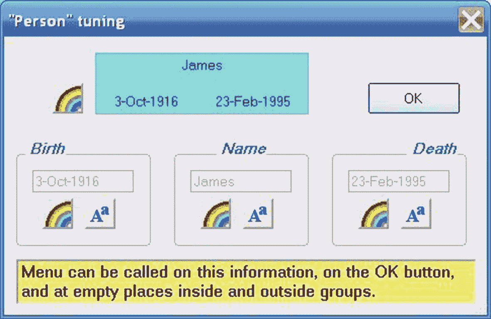

**图 7-29** Person 对象的调谐表单

在 `Person` 类中，有一个尚未提及的有趣字段。

```csharp
Bus busOnBorder;
```

`Bus.IntoMover()` 方法的代码在前面几页已经展示过。其中没有提及 `busOnBorder`，因此移动器(mover)完全不了解这个元素。如果一个元素没有在移动器中注册，那么这个元素就是不可移动的。同样的总线也没有在 `Bus.Draw()` 方法中出现（该方法也已在前面几页展示过），因此这条总线是不可见的。这个既不可移动又不可见的总线的目的是什么？它到底在哪里使用？

当任何 `Person` 对象被初始化时，其 `busOnBorder` 字段也会被初始化；新总线的点由 `Auxi_Geometry.ClosedPolyline()` 方法准备。

```
public Person (Form frm, Mover mvr, RectangleF rect, Color clrRect , Font fnt, string strName, string strBirth, string strDeath)
{
... ...
float w = Math .Max (minSide, rect .Width);
float h = Math .Max (minSide, rect .Height);
ptsCorner = new PointF [4] {rect .Location,
new PointF (rect .X + w, rect .Y),
new PointF (rect .X + w, rect .Y + h),
new PointF (rect .X, rect .Y + h) };
busOnBorder = new Bus (m_form, null,
Auxi_Geometry .ClosedPolyline (ptsCorner), penBorder);
busOnBorder .RegisteredWithMover = false;
... ...
```

因此，`busOnBorder`被组织成一个闭环，这条不可见的总线沿着矩形的边界延伸。这条总线初始化最显著的特点是传递给`RegisteredWithMover`属性的值。

```
busOnBorder .RegisteredWithMover = false;
```

该属性的名称和传递的值清楚地表明，这条总线不会在移动器中注册。下一个示例展示了这条不可移动且不可见的总线在家谱设计中的作用。

- 文件：`Form_PersonPlusBus.cs`
- 菜单位置：应用程序 ➤ 家谱设计逐步教程 ➤ 人物与连接总线

新示例中再次只有一个`Person`对象，但视图中也有一条总线（图 7-30）。这条总线的一个端点位于`Person`对象的边界上；如果你用左键按住这个点并尝试将其移动到任何地方，你会立刻发现它只能沿着矩形边界移动，无法移动到其他位置。你是否觉得似曾相识？这是否类似于将总线的端点沿着另一条与其连接的总线移动？

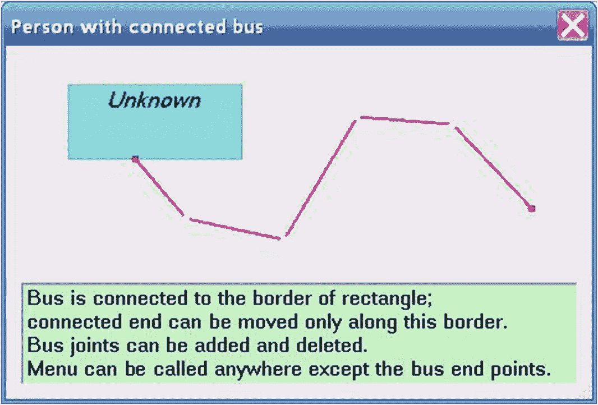

**图 7-30** 带有连接总线的 Person 对象

是的，这正是总线连接到`Person`对象时发生的情况：实际上，这条总线连接的是另一条总线——一条沿着矩形边界延伸的不可见`busOnBorder`。参与连接的两条总线中有一条是不可见的，这完全无关紧要；总线与`Person`对象之间的连接组织方式，与总线之间的连接方式相同，例如在`Form_ConnectedBuses_Two.cs`中。

尽管当前示例中的元素集是最小的——一个`Person`对象和一条可见总线——但这是第一个针对三种元素类型使用三个`List`的示例，而真正的“家谱”应用正是基于这三种元素类型设计的。在接下来的示例中，无论使用多少个元素，你都将看到完全相同的三个`List`。

```
public partial class Form_PersonPlusBus : Form
{
List people = new List ();
List buses = new List ();
List connections = new List ();
```

当`Form_PersonPlusBus.cs`启动时，所有三个列表都被清空，然后`Person`对象被设计出来。

```
private void DefaultView ()
{
people .Clear ();
buses .Clear ();
connections .Clear ();
Person person = new Person (this, mover, new RectangleF (100, 50, 140, 60), Color .Cyan, “Unknown”);
AddPerson (person);
... ...
```

当任何`Person`、`Bus`或`BusConnection`类的新对象被组织起来时，它会被添加到相应的`List`末尾。对于一个新的`Person`对象，两个列表都会增加元素。

```
private void AddPerson (Person prsn)
{
... ...
people .Add (prsn);
AddBus (prsn .Bus);
}
private void AddBus (Bus busNew)
{
... ...
buses .Add (busNew);
}
```

`Person`对象已经组织好，现在是时候组织一条总线了，你可以在图 7-30 中看到它。在其他参数中，`Bus`构造函数接收一个`List`点。此示例中的总线将不是一条自由总线，而是一条连接到`Person`对象边界上不可见总线的总线。新总线端点的预设位置极大概率需要调整，然后必须在计算出的点上组织`BusConnection`对象。所有这些操作都在`BusFromPerson()`方法中完成，该方法直接返回新的总线，并通过参数返回新的连接。

```
private void DefaultView ()
{
... ...
List points = new List ();
points .Add (new PointF (220, 130));
points .Add (new PointF (270, 170));
points .Add (new PointF (410, 90));
BusConnection con;
Bus bus = BusFromPerson (this, mover, new Pen (Color .Blue, 3), person, points, out con);
AddBus (bus);
AddConnection (con);
... ...
private Bus BusFromPerson (Form frm, Mover mvr, Pen pn, Person person,
List points, out BusConnection con)
{
Bus busFrom = person .Bus;
points [0] = Auxi_Geometry .Polyline_NearestPoint (points [0],
busFrom .Points);
Bus bs = new Bus (frm, mvr, points, pn);
con = new BusConnection (frm, mvr, points [0], bs, EndType .Head, busFrom);
busFrom .AddConnection (con);
return (bs);
}
```

所有新元素都被包含到相应的列表中，我们得到如下列表：

| • `List<Person> people` | 包含一个元素 |
| • `List<Bus> buses` | 包含两个元素；其中一个如图 7-30 所示，另一个不可见，沿着`Person`对象的边界延伸 |
| • `List<BusConnection> connections` | 包含一个元素 |

移动器可以处理所有三种已提及类别的元素，因此所有这些元素都必须在移动器中注册，但必须按照正确的顺序注册：`BusConnection`元素必须先于所有`Bus`元素，而`Bus`元素必须先于所有`Person`元素。

此示例中的`RenewMover()`方法将同样用于另外几个示例以及真正的“家谱”应用。

```
private void RenewMover ()
{
    mover .Clear ();
    foreach (Person person in people)
    {
        person .IntoMover (mover, 0);
    }
    foreach (Bus bus in buses)
    {
        bus .IntoMover (mover, 0);
    }
    foreach (BusConnection con in connections)
    {
        con .IntoMover (mover, 0);
    }
    ... ...
```

在 `Form_PersonPlusBus.cs` 中有两辆巴士：一辆在图 7-30 中完全可见，另一辆不可见，且沿着 `Person` 对象的边界移动。两辆巴士都包含在 `List` 公交车列表中，而 `RenewMover()` 方法的代码显示，对于列表中的每辆巴士，都会调用 `Bus.IntoMover()` 方法。同时，我之前提过，无论如何，不可见的 `busOnBorder` 都不应注册到 mover 中。这是如何实现的呢？

当任何 `Person` 对象被初始化时，其 `busOnBorder` 的一个参数会获得一个特殊值。

```csharp
busOnBorder .RegisteredWithMover = false;
```

当调用 `Bus.IntoMover()` 方法时，它会检查这个值，并且仅注册该字段值为合适的巴士。

```csharp
new public void IntoMover (Mover mv, int iPos)
{
    if (iPos < 0 || mv .Count < iPos || !bRegisteredWithMover)
    {
        return;
    }
    mv .Insert (iPos, this);
}
```

因此，尽管巴士列表中有两辆巴士，但只有其中一辆——即可见的那辆——注册到了 mover 中。由于位于 `Person` 对象边界上的不可见巴士未注册到 mover，mover 并不知道这辆巴士的存在，也无法对它进行任何操作。因此，无法向这辆巴士添加任何连接点，也无法用鼠标将其移动到其关联矩形边界上原本位置之外的任何地方。

用鼠标无法移动 `busOnBorder`，但当 `Person` 对象被移动或调整大小时会发生什么？在几页之前，我提到过，任何 `Person` 对象都是一个复杂对象，其主导元素（矩形）与附属评论之间遵循标准的关系规则。当时并未提及边界上的不可见巴士，但它是另一个附属元素，因此必须遵循相同的规则。当通过 `Person.Move()` 和 `Person.MoveNode()` 方法移动或调整矩形大小时，所有附属元素都必须被告知这些变化。这是通过 `Person.InformRelatedElements()` 方法完成的。

```csharp
private void InformRelatedElements ()
{
    cmntName .ParentRect = Area;
    cmntBirth .ParentRect = Area;
    cmntDeath .ParentRect = Area;
    busOnBorder .Points = Auxi_Geometry .ClosedPolyline (ptsCorner);
}
```

正如您从这段代码中看到的，无论区域如何变化，`busOnBorder` 元素始终沿着区域边界延伸。我们在之前的示例中已经讨论过，连接点如何始终保持在巴士上，无论巴士如何变化。当一辆可见巴士连接到一辆不可见巴士时，同样的机制也在起作用，因此在矩形区域的任何变化过程中，连接点都保持其在边界上的位置，因此在视觉上，巴士始终连接到矩形的边界。

关于 `Form_PersonPlusBus.cs` 还有一点补充。连接的巴士初始化为蓝色，如下所示：

```csharp
private void DefaultView ()
{
    ... ...
    Bus bus = BusFromPerson (this, mover, new Pen (Color .Blue, 3), person, points, out con);
```

然而，它显示为品红色（图 7-30），并且在 `Form_PersonPlusBus.cs` 中没有更改颜色的代码行。是什么导致了这种颜色变化？

图 7-30 中的巴士一端连接到 `Person` 对象，另一端是空闲的。对于真正的家谱来说，这不是正常情况；您无法想象一辆连接着某种事物与虚无的巴士；这是荒谬的。如果在真实家谱中出现这种情况，说明是一个未完成的构建，用户必须被告知这种异常情况。吸引用户注意异常情况的最佳方法是更改元素的颜色；这将是一个信号，表明用户需要执行某些操作。因此，`Bus` 对象中有一个特殊的 `penWarn` 字段。默认情况下，在这种异常情况下，巴士的这支笔颜色为品红色。

```csharp
Pen penWarn = new Pen (Color .Magenta, 2);
```

在某些情况下，巴士会使用这支特殊的笔来绘制，而非其真实颜色。

```csharp
public void Draw (Graphics grfx)
{
    if (((bHeadConnected != bTailConnected) ||
    (bHeadConnected == false && bTailConnected == false &&
    headsConnected .Count == 0 && tailsConnected .Count == 0 &&
    bRegisteredWithMover)) && bUseWarningColor)
    {
        grfx .DrawLines (penWarn, pts .ToArray ());
    }
    else
    {
        grfx .DrawLines (m_pen, pts .ToArray ());
    }
    ... ...
```

这种特殊警告颜色的使用可以很容易地通过 `Bus.UseWarningColor` 属性来调节。在第一个关于连接巴士的示例中，我希望两辆巴士都显示其自然（声明）的颜色，因此蓝色巴士的颜色警告被关闭。

*   文件：`Form_Spouses.cs`
*   菜单位置：Applications ➤ FamilyTree design step by step ➤ Spouses

```csharp
public Form_ConnectedBuses_Two ()
{
    ... ...
    busBlue = new Bus (...);
    ... ...
    busBlue .UseWarningColor = false;
    ... ...
```

这个示例使我们更接近家谱设计的目标，它代表了一个简单的树结构，由三个 `Person` 对象和它们之间的两辆巴士组成（图 7-31）。无论树结构多么复杂，只需为三个类各维护三个 `List` 就足够了，并且对这些 `List` 的所有操作都可以通过这样一个简单的家谱进行验证和演示。

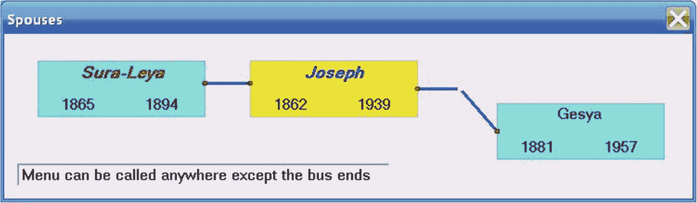

图 7-31

一个原始的家谱

```csharp
List people = new List ();
List buses = new List ();
List connections = new List ();
```

对于这样一个小型树结构，更简单的方法是先组织所有需要的 `Person` 对象，然后用巴士将它们连接起来。

```csharp
private void DefaultView ()
{
    ... ...
    people .Clear ();
    buses .Clear ();
    connections .Clear ();
    float w = 180;
    float h = 60;
    Person prsnWife_1 = new Person (this, mover, new RectangleF (80, 60, w, h), Color .Cyan, fntSelected, "Sura-Leya", "1865", "1894");
    Person prsnHusband = new Person (this, mover,
        new RectangleF (320, 60, w, h), Color .Yellow,
        fntSelected, "Joseph", "1862", "1939");
    Person prsnWife_2 = new Person (this, mover,
        new RectangleF (600, 100, w, h), Color .Cyan, fntSelected, "Gesya", "1881", "1957");
    AddPerson (prsnWife_1);
    AddPerson (prsnHusband);
    AddPerson (prsnWife_2);
    ... ...
```

两个 `Person` 对象之间的直接连接在家谱设计中经常使用，因此使用一个专门的 `LinkPeople()` 方法在这种情况中会很有用。

```csharp
Bus bus = LinkPeople (this, mover, new Pen (Color .Blue, 3),
    prsnWife_1, Side .E, 0.4, prsnHusband, Side .W, 0.4);
AddBus (bus);
bus = LinkPeople (this, mover, new Pen (Color .Blue, 3),
    prsnHusband, Side .E, 0.5, prsnWife_2, Side .W, 0.5);
AddBus (bus);
... ...
```

由 `LinkPeople()` 方法准备的巴士由单个线段组成，因此图 7-31 显示的并不是默认视图；第二辆巴士是用鼠标按过的，并且新的连接点被移动到了新位置。

## `LinkPeople()` 方法详解

`LinkPeople()` 方法不仅准备了两条 `Person` 对象之间的直线连接，还在新总线的两端创建了两个新的 `BusConnection` 元素，这些元素必须放置在矩形的两侧。每个连接点的初始位置由矩形边以及沿该边的定位系数决定。该系数取值在 `[0, 1]` 范围内。对于水平边，系数从左到右增加；对于垂直边，系数从上到下增加。

```csharp
private Bus LinkPeople (Form frm, Mover mvr, Pen pn,
Person personFrom, Side side_From, double coef_From,
Person personTo, Side side_To, double coef_To)
{
Bus busFrom = personFrom .Bus;
PointF ptA = Auxi_Geometry .PointOnRectangleBorder (personFrom .Area,
side_From, coef_From);
ptA = Auxi_Geometry .Polyline_NearestPoint (ptA, busFrom .Points);
Bus busTo = personTo .Bus;
PointF ptB = Auxi_Geometry .PointOnRectangleBorder (personTo .Area,
side_To, coef_To);
ptB = Auxi_Geometry .Polyline_NearestPoint (ptB, busTo .Points);
Bus bs = new Bus (frm, mvr, ptA, ptB, pn);
List conecs = new List ();
conecs .Add (new BusConnection (frm, mvr, ptA, bs, EndType.Head, busFrom));
conecs .Add (new BusConnection (frm, mvr, ptB, bs, EndType .Tail, busTo));
busFrom .AddConnection (conecs [0]);
busTo .AddConnection (conecs [1]);
connections .AddRange (conecs);
return (bs);
}
```

## `Person` 对象的调优

该示例中没有总线调优，而 `Person` 对象的调优则借助已演示过的调优表单（图 7-29）完成。调优通过菜单命令启动；无论按下的是 `Person` 对象内部的空白区域还是其某个注释，调用的菜单都是相同的，但在任何情况下，都必须标识出该 `Person` 对象。当按下空白区域时，表示直接点击了 `Person` 对象（`personPressed`）。当按下注释时，则表示点击了某个 `CommentToRect` 对象。该注释是某个 `Person` 对象的下属，因此注释保留了其主导对象的 ID。通过快速搜索所有 `Person` 对象即可返回所需的对象。

```csharp
private void OnMouseUp (object sender, MouseEventArgs e)
{
... ...
if (mover .Release (out iWasObject, out iWasNode, out shapeNode))
{
GraphicalObject grobj = mover .ReleasedSource;
if (e .Button == MouseButtons .Right && fDist <= 3)
{
... ...
else if (grobj is CommentToRect)
{
long idPerson = grobj .ParentID;
foreach (Person prsn in people)
{
if (prsn .ID == idPerson)
{
personPressed = prsn;
break;
}
}
ContextMenuStrip = menuOnPerson;
... ...
```

## 两代人家谱示例

保存和恢复家谱的过程不依赖于家谱的大小，下一个示例将对此进行说明。

*   文件：`Form_TwoGenerations.cs`
*   菜单位置：应用 ➤ 家族树逐步设计 ➤ 两代人

这是设计完整家族树应用之前的最后一个预备示例。实际上，这并不是一个用于演示某种特性的示例，而是一个真实的（尽管规模较小）家谱，它只有一个限制：构建完这个小家谱后，没有添加新人的命令。图 7-32 显示只有来自两代人的四个人。

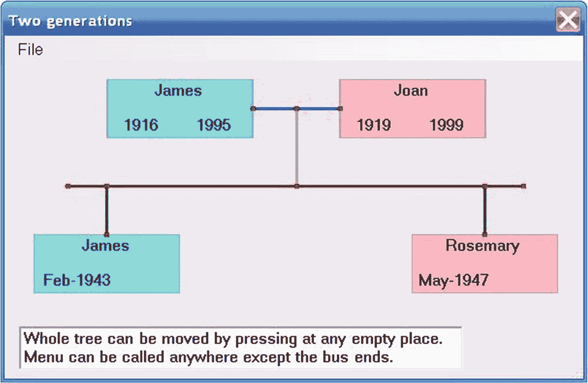

图 7-32 一个两代人的小家谱

尽管这个家谱很小，但它代表了所有可能类型的总线。总线的分类可以基于它们到不同对象的连接。为了更好地解释，我使用不同颜色来区分不同类型的总线。在图 7-17 中，相同的四种总线类型用字母 *A*、*B*、*C* 和 *S* 标记。在当前示例中，没有使用这种字母标记，但新解释中的定义顺序与旧解释相同。

*   **两个 `Person` 对象之间的总线**：在图 7-32 中，它是蓝色的。视觉上它是在两个人之间，但实际上，这条总线连接到这些 `Person` 对象边界上的不可见总线。
*   **总线与 `Person` 对象之间的总线**：在图 7-32 中，有两条这种类型的绿色总线。实际上，每条都在两条总线之间，但其中一条是不可见的。
*   **两条总线之间的总线**：在图 7-32 中，它是灰色的。
*   **两端无连接的总线**：在图 7-32 中，它是棕色的。

任何家谱，即使像这样简单，也可以用不同的方式构建。这个家谱的设计从两个代表父母的 `Person` 对象以及它们之间的总线开始；这条总线借助上一个示例中使用的 `LinkPeople()` 方法构建。

```csharp
private void DefaultView ()
{
float w = 150;
float h = 60;
Person father = new Person (this, mover, new RectangleF (140, 60, w, h),
Color .Cyan, fntSelected,
"James", "1916", "1995");
AddPerson (father);
Person mother = new Person (this, mover, new RectangleF (380, 60, w, h),
Color .LightPink, fntSelected,
"Joan", "1919", "1999");
AddPerson (mother);
Bus busParents = LinkPeople (this, mover, new Pen (Color .Blue, 3),
father, Side .E, 0.5, mother, Side .W, 0.5);
AddBus (busParents);
... ...
```

下一步，设计另外两个代表子女的 `Person` 对象。它们上方的一条总线（棕色）被初始化，但所有到这条总线的链接将稍后添加。

```csharp
float cyChildren = father .Bottom + 100;
Person son = new Person (this, mover,
new RectangleF (father .Left - w / 2, cyChildren, w, h),
Color .Cyan, fntSelected, "James", "Feb-1943", "");
Person daughter = new Person (this, mover,
new RectangleF (mother .Right - w / 2, son .Top, w, h),
Color .LightPink, fntSelected, "Rosemary",
"May-1947", "");
AddPerson (son);
AddPerson (daughter);
float cyAbove = (father .Bottom + son .Top) / 2;
float cxL = Auxi_Geometry .Middle (son .Area) .X;
float cxR = Auxi_Geometry .Middle (daughter .Area) .X;
Bus busAbove = new Bus (this, mover, new PointF (cxL - 40, cyAbove),
new PointF (cxR + 40, cyAbove),
new Pen (Color .Brown, 3));
AddBus (busAbove);
```

现在是时候将“子女”与它们上方的总线（棕色）连接起来了。每条绿色总线都由`LinkBusPerson()`方法组织。从方法名称可以看出，新总线充当了现有总线与`Person`对象之间的链接。

```
AddBus (LinkBusPerson (this, mover, new Pen (Color .Green, 3), busAbove, new PointF (cxL, cyAbove), son, Side .N, 0.5));
AddBus (LinkBusPerson (this, mover, new Pen (Color .Green, 3), busAbove, new PointF (cxR, cyAbove), daughter, Side .N, 0.5));
```

新总线通过其头部连接到现有总线（此处为棕色）。现有总线上的连接点作为参数（`ptFrom`）传入，但这只是一个优选的连接点，实际连接点将在方法内部计算。新总线通过其尾部连接到`Person`对象；连接点（`ptTo`）由矩形边和沿该边的定位系数描述；这与`LinkPeople()`方法中的方式相同。

```csharp
private Bus LinkBusPerson (Form frm, Mover mvr, Pen pn,
Bus busFrom, PointF ptFrom,
Person personTo, Side side_To, double coef_To)
{
ptFrom = Auxi_Geometry .Polyline_NearestPoint (ptFrom, busFrom .Points);
Bus busTo = personTo .Bus;
PointF ptTo = Auxi_Geometry .PointOnRectangleBorder (personTo .Area,
side_To, coef_To);
ptTo = Auxi_Geometry .Polyline_NearestPoint (ptTo, busTo .Points);
Bus bs = new Bus (frm, mvr, ptFrom, ptTo, pn);
List conecs = new List ();
conecs .Add (new BusConnection (frm, mvr, ptFrom, bs, EndType .Head,
busFrom));
conecs .Add (new BusConnection (frm, mvr, ptTo, bs, EndType .Tail, busTo));
busFrom .AddConnection (conecs [0]);
busTo .AddConnection (conecs [1]);
connections .AddRange (conecs);
return (bs);
}
```

设计这个小型家谱树的最后一步是构建两代人之间的连线——即灰色总线。

```csharp
private void DefaultView ()
{
... ...
PointF pt = Auxi_Geometry .Middle (busParents .HeadPoint,
busParents .TailPoint);
AddBus (LinkBusBus (this, mover, new Pen (Color .DarkGray, 3), busParents, pt, busAbove, new PointF (pt .X, busAbove .TailPoint .Y)));
... ...
```

两条总线之间的连线由`LinkBusBus()`方法组织。传递给该方法的两个点同样是优选位置，而实际的连接点会在方法内部计算得出。

```csharp
private Bus LinkBusBus (Form frm, Mover mvr, Pen pn,
Bus busFrom, PointF ptFrom, Bus busTo, PointF ptTo)
{
ptFrom = Auxi_Geometry .Polyline_NearestPoint (ptFrom, busFrom .Points);
ptTo = Auxi_Geometry .Polyline_NearestPoint (ptTo, busTo .Points);
Bus bs = new Bus (frm, mvr, ptFrom, ptTo, pn);
List conecs = new List ();
conecs .Add (new BusConnection (frm, mvr, ptFrom, bs, EndType .Head,
busFrom));
conecs .Add (new BusConnection (frm, mvr, ptTo, bs, EndType .Tail, busTo));
busFrom .AddConnection (conecs [0]);
busTo .AddConnection (conecs [1]);
connections .AddRange (conecs);
return (bs);
}
```

当这个小家谱树的设计完成后，会得到以下元素集合：

| `List<Person> people` | 包含四个元素。 |
| --- | --- |
| `List<Bus> buses` | 包含九个元素。其中五个以不同颜色显示，另外四个总线不可见，沿着`Person`对象的边界分布。 |
| `List<BusConnection> connections` | 包含八个元素。它们都以红色小点显示。 |

再次强调，`mover`队列中元素的顺序由`RenewMover()`方法定义。

```csharp
private void RenewMover ()
{
mover .Clear ();
foreach (Person person in people)
{
person .IntoMover (mover, 0);
}
foreach (Bus bus in buses)
{
bus .IntoMover (mover, 0);
}
foreach (BusConnection con in connections)
{
con .IntoMover (mover, 0);
}
... ...
```

如上述代码所示，首先放入所有`BusConnection`元素，然后是所有`Bus`元素，最后是所有`Person`元素。`BusConnection`元素必须位于队列头部；否则，其他元素可能会遮挡连接点，导致无法移动连接点。`Bus`和`Person`对象的顺序并不那么重要，可以更改。`mover`队列中的元素顺序与其绘制顺序相关，因此这完全取决于当总线穿过`Person`对象的矩形区域时，你希望看到怎样的视觉效果。如果你希望总线显示在任何`Person`对象之上，并且能够按下总线并将其移开，那么当前的编码顺序是正确的。如果你希望总线位于`Person`对象下方，则需要同时修改`RenewMover()`和`OnPaint()`方法。

棕色总线是这个家谱树中唯一可以声明为可移动的总线（通过其上下文菜单的命令），因为它是唯一两端都空闲的总线。如果你将棕色总线声明为可移动，那么你就可以移动它，例如，使其更靠近上方或下方的`Person`对象，并且在移动过程中，该总线上所有的连接点（共有三个）将保持其相对位置。

此示例中出现了两个新特性。在这个小树中它们并不太需要，但在真正的大型家谱树中将很有帮助。

第一个特性是将家谱树保存到二进制文件中，并从该文件中恢复家谱树；这是通过一个小型文件菜单的命令完成的。

第二个新特性是能够在屏幕上移动整个家谱树。对于这样小的树来说，这个特性完全不需要，但在真正的大型家谱树中它非常有用。首先，没有规则规定你实际家谱树的构建顺序。你可以从最遥远的已知祖先开始，一代一代向下构建，或者将你自己置于屏幕中央，并向各个方向开始添加亲属及其连线。无论如何，很可能即使是最大的屏幕也不够用，你将需要滚动屏幕。这只需在任意空白处按下左键，并向所需方向拖动即可实现。这个工具很简单。

有一个布尔字段用于指示当前是否正在移动整个家谱树。

```csharp
bool bMoveAll = false;
```

当在任意空白处按下左键时，该字段的值会改变，并记录当前鼠标位置（`ptMouse_prev`）。

```csharp
private void OnMouseDown (object sender, MouseEventArgs e)
{
ptMouse_Down = e .Location;
if (mover .Catch (e .Location, e .Button))
{
... ...
}
else
{
if (e .Button == MouseButtons .Left)
{
bMoveAll = true;
ptMouse_prev = e .Location;
}
}
... ...
```

# 家谱应用程序设计与实现

当 `mover` 未捕捉到任何对象，但布尔参数 `bMoveAll` 指示所有元素正在移动时，会计算当前鼠标位置与前一个位置之间的距离；这一对数值（`dx, dy`）将用于同步移动所有元素。

```csharp
private void OnMouseMove (object sender, MouseEventArgs e)
{
    if (mover .Move (e .Location))
    {
        Invalidate ();
    }
    else
    {
        if (bMoveAll)
        {
            if (ptMouse_prev != e .Location)
            {
                int dx = e .X - ptMouse_prev .X;
                int dy = e .Y - ptMouse_prev .Y;
                foreach (Person person in people)
                {
                    person .Move (dx, dy);
                }
                foreach (Bus bus in buses)
                {
                    bus .Move (dx, dy);
                }
                foreach (BusConnection con in connections)
                {
                    con .Move (dx, dy);
                }
                ptMouse_prev = e .Location;
                Invalidate ();
            }
        }
        ... ...
```

当鼠标释放且未释放任何对象时，`bMoveAll` 字段的值会设置为 `false`。

```csharp
private void OnMouseUp (object sender, MouseEventArgs e)
{
    ... ...
    if (mover .Release (out iWasObject, out iWasNode, out shapeNode))
    {
        ... ...
    }
    else
    {
        bMoveAll = false;
        ... ...
```

## 整合所有部分

- 文件：`Form_FamilyTree.cs`
- 菜单位置：应用程序 ➤ 家谱

现在是将所有内容整合在一起的时候了，添加一些命令来简化真实家谱的设计，并最终开发一个家谱应用程序。此应用程序不会使用任何在前期示例中未讨论过的新类。任何复杂程度的树都可以通过 `Person`、`Bus` 和 `BusConnection` 对象来构建。这三个类的工作原理已在前面详细讨论过，在家庭树应用程序中，您会发现许多熟悉的内容。还会出现一些尚未使用过的新事物，但新颖之处不在于细节。该程序的主要区别在于设计家谱的过程。

在启动任何一个前期示例时，您会立即看到一些内容。可能有一辆或多辆公共汽车、一个 `Person` 对象、或几个带有一些连接的对象，但总能看到一些东西，所有这些小示例的主要目的是演示和解释后续如何使用已有的对象。当您启动家谱应用程序时，除了一个带有简短信息的矩形外，什么都没有。您可以将这些信息压缩到很小的尺寸，并将其留在角落。表单区域是空的！没有人事先知道特定用户要构建什么样的家谱，除了这个用户，没有人知道他想从家谱的哪个部分开始。

假设您决定以标准（传统）方式绘制您的家谱。绘制没有标准顺序。您可以从已知的最年长祖先开始，然后一代一代地往下画。您可以从您的父母开始，然后向两个方向延伸。您可以从最年轻的一代开始，然后向过去追溯。每个人通常用一个包含名字的椭圆或矩形来表示。已知的出生和死亡日期（如果已经发生，则包括死亡日期）放在名字旁边，而这个小块区域的边框明确表明名字和日期属于同一个人。

人与人之间的关系通过适当放置这些框和大量线条来显示。通常，时间线从上到下。配偶通常并排放置，他们的矩形用一条短线连接。孩子通常放在父母下方的同一水平位置。最年长的兄弟姐妹位于该行的最左端（对于书写方向从左到右的国家来说，这是正确的）。为了显示世代之间的关系，孩子通过一条线连接到他们的父母之间，但连接后续世代的方式可以有不同。您可以画一条新线从父母的连线向下延伸，然后在线的下端添加一个包含名字的矩形。如果您知道一对夫妇有三个孩子，那么很可能您会先并排画三个矩形，然后将每个矩形连接到上层的线上。这不是规则，但如果您这样做，整个图形会更精确。这也意味着您的图形可以由几个部分组成，通过添加一些线条将它们合并成一个完整的家谱。

有时您会发现遗漏了某些部分，没有空间在正确的位置放置新矩形了；那么您会将它们画在旁边，并用虚线来表示关系。当您决定绘制家谱的某个旁支时，也可能发生同样的情况。

一张纸会不够用。您会再拿一张纸，并做上特殊标记，以显示这些纸应该如何相互放置。表示人与人之间关系的线条会从一张纸延伸到另一张纸，并绕过那些恰好挡路的矩形。

我提到了在纸上绘制家谱的正常方式，但如果您想为同样的目的编写一个程序，那么这个程序必须在屏幕上提供同样的灵活性来绘制家谱。会存在一些限制，但必须将这些限制的影响最小化。

构建任何家谱都使用三个类的元素；所有这些元素都包含在三个 `List` 中。

```csharp
List m_people = new List ();
List m_buses = new List ();
List m_connections = new List ();
```

`Bus` 和 `BusConnection` 对象以类似的方式被添加到相应的列表中。每个对象都有一个唯一的 ID，因此通过这个 ID 进行简单检查，以防止同一个对象被重复包含。

```csharp
private void AddBus (Bus busNew)
{
    foreach (Bus bus in m_buses)
    {
        if (busNew .ID == bus .ID)
        {
            return;
        }
    }
    m_buses .Add (busNew);
}
private void AddConnection (BusConnection conNew)
{
    foreach (BusConnection con in m_connections)
    {
        if (conNew .ID == con .ID)
        {
            return;
        }
    }
    m_connections .Add (conNew);
}
```

添加 `Person` 对象的方式类似，但需要更多的操作。每个 `Person` 对象都包含一个不可见的 `Bus`，因此需要检查两个元素的 ID 唯一性，然后增加两个 `List`。

```csharp
private void AddPerson (Person prsn)
{
    long idPerson = prsn .ID;
    long idBus = prsn .Bus .ID;
    foreach (Person person in m_people)
    {
        if (idPerson == person .ID)
        {
            MessageBox .Show (...);
            return;
        }
    }
    foreach (Bus bus in m_buses)
    {
        if (idBus == bus .ID)
        {
            MessageBox .Show (...);
            return;
        }
    }
    m_people .Add (prsn);
    m_buses .Add (prsn .Bus);
}
```

家谱程序的用户对 `Bus` 或连接一无所知；他们更愿意用孩子、父母和配偶这些概念来思考构建的树，但任何添加单个亲属或一组亲属的命令都可以轻松追溯到这些 `AddBus()`、`AddConnection()` 和 `AddPerson()` 方法。这些方法用于收集提供程序功能的数据；用户处理的是同一数据在屏幕上的表示，并非所有的数据元素都可视化了。

- 所有 `Person` 对象都是可见的。
- `Bus` 对象分为可见和不可见。表示家谱中人物关系的 `Bus` 是可见的。每个 `Person` 对象都有一个不可见的 `Bus` 作为其下属元素。
- 所有 `BusConnection` 对象都是不可见的。

元素因使用许多不同的命令而出现在屏幕上。所有屏幕元素都可以修改，但首次出现时，任何新元素都会获得标准视图。此标准视图也可以由用户设置，但初始时程序以如下方式定义两个标准。

```csharp
public Form_FamilyTree ()
{
    ... ...
    busStandard = new Bus (this, mover, ..., new Pen (Color .DarkGray, 2));
    personStandard = new Person (this, mover, new RectangleF (0, 0, 140, 50), Color .Cyan, “姓名”, “出生”, “死亡”);
    ... ...
```

本章后面将讨论这些命令并用一些图进行说明；这些图中的元素大多显示在其提到的标准视图中。

当正在构建家谱且需要向已有元素添加新元素时，会在某个现有元素上调用菜单，新部分必须链接到该元素。也可以设计一个不相关的新部分，然后再将其链接到现有的家谱。

## 设计新版家谱

# 设计新版家谱

设计新版家谱始于在空白区域调出菜单（图 7-33）。该菜单的命令分为三组。第一组包括所有能在屏幕上放置新元素的命令；其中一项命令还包含子菜单。菜单会在鼠标右键点击的位置打开；由某个命令生成的新元素会锚定在该位置。第二组命令允许您更改现有家谱中所有总线的可视化参数。任何总线或`Person`元素的视图，均可通过在该元素上调出专用调整表单来更改。用户可以通过为所有未来元素设置首选的可视化参数来简化工作；所有新元素都将根据这些设置构建。我将在本节末尾附近详细说明这些设置；现在，我们先来看看对图 7-33 所示菜单中命令的响应。

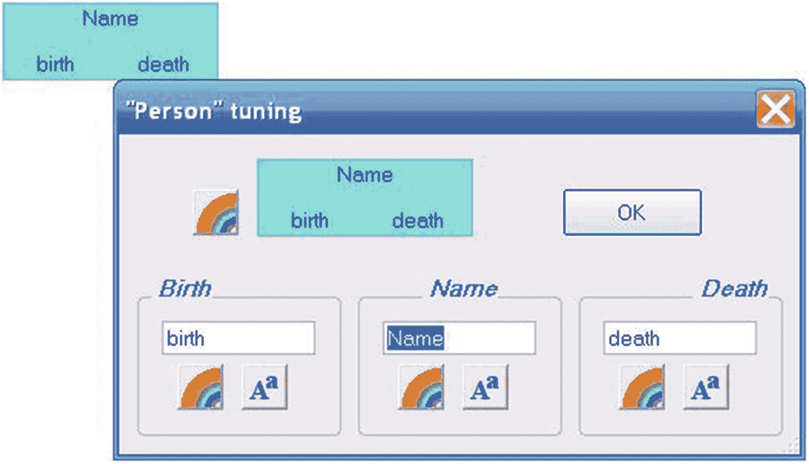

图 7-34 带有调整表单的新 `Person` 对象

| *新建个人* | 屏幕上出现一个新的 `Person` 对象；其左上角位于鼠标点击点。用户至少需要为此人定义姓名，并决定是否显示出生和死亡的相关附加信息。因此，系统会自动为该新对象调用一个辅助调整表单（图 7-34）。视图中可能存在大量 `Person` 对象，因此调整表单的初始定位有助于告知用户当前正在修改的元素。 |
|---|---|

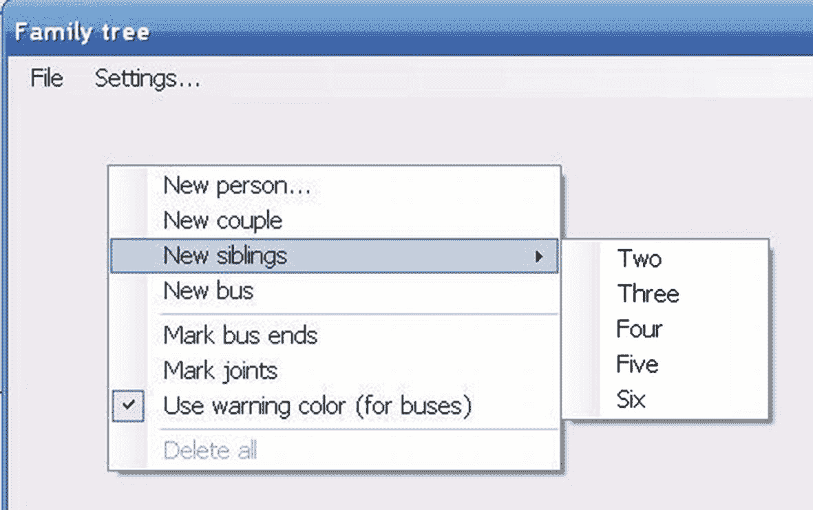

图 7-33 要开始构建家谱，请在空白区域调出菜单


图 7-35 屏幕上的新夫妻

| *新建夫妻* | 新夫妻由一对 `Person` 对象表示，它们彼此靠近放置，并由一条短直总线连接（图 7-35）。左侧元素的左上角位于鼠标点击点。两个新元素相同且具有标准视图。用户可以选择先修改哪一个，并通过元素上的菜单调出调整表单。 |
|---|---|

```csharp
private void Click_miNewPerson (object sender, EventArgs e)
{
    Person person = new Person (this, mover, ptMouse_Up, m_personStandard);
    AddPerson (person);
    RenewMover ();
    ModifyPerson (person, Auxi_Geometry .LocationByCoefficients (person .Area, 0.5, 0.95));
}
```

```csharp
private void Click_miNewCouple (object sender, EventArgs e)
{
    NewCouple(ptMouse_Up);
    RenewMover();
}
```

`NewCouple()` 方法生成两个 `Person` 对象，它们通过一条短总线相连；该总线由 `LinkPersonPerson()` 方法组织。

```csharp
private Bus NewCouple (PointF ptLT)
{
    Person personL = new Person (this, mover, ptLT, personStandard);
    AddPerson (personL);
    Person personR = new Person (this, mover,
        new PointF (personL .Right + m_nDistSpouses, ptLT .Y), personStandard);
    AddPerson (personR);
    Bus link = LinkPersonPerson (this, mover, busStandard, personL, Side .E, 0.5, personR, Side .W, 0.5);
    return (link);
}
```

有几种情况需要组织这对对象并将其连接到现有元素；图 7-39 演示了其中一种情况。由于从新夫妻到现有家谱的连接通常是从这两个新 `Person` 元素之间的短总线出发，因此 `NewCouple()` 方法会返回此总线。

从视觉上看，总线位于两个 `Person` 对象之间，但实际上它是连接这两个 `Person` 对象内部不可见总线的总线，因此 `LinkPersonPerson()` 方法只是 `LinkBusBus()` 方法的一个封装。

```csharp
private Bus LinkPersonPerson (Form frm, Mover mvr, Bus busSample,
    Person personFrom, Side side_From, double coef_From,
    Person personTo, Side side_To, double coef_To)
{
    Bus busFrom = personFrom .Bus;
    PointF ptFrom = Auxi_Geometry .PointOnRectangleBorder (personFrom .Area, side_From, coef_From);
    Bus busTo = personTo .Bus;
    PointF ptTo = Auxi_Geometry .PointOnRectangleBorder (personTo .Area,
        side_To, coef_To);
    return (LinkBusBus (frm, mvr, busSample, busFrom, ptFrom, busTo, ptTo));
}
```

一个几乎相同的 `LinkBusBus()` 方法已在之前的示例中使用过，其代码在 12 页前展示过。这两个方法的参数有一个区别：在先前的版本中，新总线的画笔作为参数之一，而当前版本则使用了总线样本。

```csharp
private Bus LinkBusBus (Form frm, Mover mvr, Bus busSample,
    Bus busFrom, PointF ptFrom, Bus busTo, PointF ptTo)
{
    ptFrom = Auxi_Geometry .Polyline_NearestPoint (ptFrom, busFrom .Points);
    ptTo = Auxi_Geometry .Polyline_NearestPoint (ptTo, busTo .Points);
    Bus bs = new Bus (frm, mvr, ptFrom, ptTo, busSample);
    BusConnection conFrom = new BusConnection (frm, mvr, ptFrom, bs,
        EndType .Head, busFrom);
    BusConnection conTo = new BusConnection (frm, mvr, ptTo, bs,
        EndType .Tail, busTo);
    busFrom .AddConnection (conFrom);
    busTo .AddConnection (conTo);
    m_connections .Add (conFrom);
    m_connections .Add (conTo);
    AddBus (bs);
    return (bs);
}
```

在使用“新建夫妻”命令的情况下，`LinkPersonPerson()` 方法被用作 `LinkBusBus()` 方法的封装。稍后您会看到一些命令，允许您在现有总线和 `Person` 对象之间设置新总线。根据新总线的端点位置，会使用 `LinkBusPerson()` 和 `LinkPersonBus()` 方法；两者都是 `LinkBusBus()` 方法的封装。

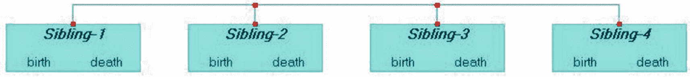

图 7-36 四个兄弟姐妹

| *新建兄弟姐妹* | 此菜单命令包含一个子菜单，允许您在屏幕上放置 2 到 6 个兄弟姐妹；图 7-36 显示了四个兄弟姐妹的变体。如果需要超过六个兄弟姐妹，最佳方法是使用此命令在屏幕上放置六个兄弟姐妹，然后通过另一个菜单中的命令添加更多兄弟姐妹；我将在本节后面介绍这一点。`NewSiblings()` 方法的返回值是兄弟姐妹上方的总线（`busAbove`）。左侧元素上方长总线的转折点即为鼠标点击点。 |
|---|---|

在之前的示例 `Form_TwoGenerations.cs`（图 7-32）中，我已经解释了添加多个兄弟姐妹的步骤。那例子中只有两个兄弟姐妹，但这并不重要。主要区别可以通过比较这两幅图看出。尽管两图在尺寸上差异不大——仅消失了两处小点——但它们的消失凸显了构建此类元素组方式上的重大变化。在旧版本中，组织了一条由单个线段组成的水平长总线；然后所有兄弟姐妹都通过短总线以相同的方式连接到这条总线上。

我特意使用图 7-36（包含两个以上兄弟姐妹）来演示，在新版本中并非所有兄弟姐妹都以相同方式连接；内部兄弟姐妹与两端兄弟姐妹的连接存在明显差异。在大型家谱的设计过程中，我开始感觉到使用旧版本进行后续树操作时有些不便，因此我更改了将兄弟姐妹纳入家谱的流程。

`NewSiblings()`方法用于处理 2 到 6 个同级节点。首先构造一个由三段组成的长总线，两端带有两个短正交线段的长线是同一总线（`busAbove`）的组成部分。

```csharp
private Bus NewSiblings (PointF ptL_busAbove, int nSiblings)
{
    nSiblings = Math .Min (Math .Max (2, nSiblings), 6);
    float cyLineAbove = ptL_busAbove .Y;
    float cySiblings = cyLineAbove + m_nDistGenerations / 2;
    float lenLineAbove =
        (nSiblings - 1) * (m_personStandard .Width + m_nDistSiblings);
    PointF ptL_above = ptL_busAbove;
    PointF ptR_above = new PointF (ptL_above .X + lenLineAbove, cyLineAbove);
    List<PointF> pts = new List<PointF> ();
    pts .Add (new PointF (ptL_above .X, cySiblings));
    pts .Add (ptL_above);
    pts .Add (ptR_above);
    pts .Add (new PointF (ptR_above .X, cySiblings));
    Bus busAbove = new Bus (this, mover, pts, m_busStandard);
    AddBus (busAbove);
    ... ...
}
```

然后，两个同级节点——第一个（`childFirst`）和最后一个（`childLast`）——连接在此总线的两端。

```csharp
float cxM_person;
PointF ptOnBus;
Person childFirst = new Person (this, mover,
    new PointF (ptL_above .X - m_personStandard .Width / 2, cySiblings), m_personStandard);
childFirst .Name_Comment .Text = "Sibling-1";
AddPerson (childFirst);
Person childLast = new Person (this, mover,
    new PointF (ptR_above .X - m_personStandard .Width / 2, cySiblings), m_personStandard);
childLast .Name_Comment .Text = "Sibling-" + nSiblings .ToString ();
AddPerson (childLast);
LinkBusBus_broken_bus (this, mover, m_busStandard,
    childFirst .Bus, busAbove .HeadPoint,
    childLast .Bus, busAbove .TailPoint, busAbove);
```

如果同级节点超过两个，则它们以标准（旧）方式通过更短的总线连接到长总线。由于长总线的长度已根据所需同级节点数量预先计算，因此它们不会发生重叠问题。

| `新总线` | 这是一个简单但有趣的命令，它在屏幕上生成一个极小的对象，无需插图即可说明。这个新对象是一条两端自由的短总线。 |

```csharp
for (int i = 2; i < nSiblings; i++)
{
    cxM_person = ptL_above .X + Convert .ToSingle (
        lenLineAbove * ((i - 1) * 1.0 / (nSiblings - 1)));
    Person child = new Person (this, mover,
        new PointF (cxM_person - m_personStandard .Width / 2, cySiblings), m_personStandard);
    child .Name_Comment .Text = "Sibling-" + i .ToString ();
    AddPerson (child);
    ptOnBus = new PointF (cxM_person, cyLineAbove);
    LinkBusPerson (this, mover, m_busStandard, busAbove, ptOnBus,
        child, Side .N, 0.5);
}
RenewMover ();
return (busAbove);
}
```

新总线的长度很可能只有 20 像素，尽管环境（或其他对象）可能迫使它变得更长。这种长度（和角度）的不确定性源于两端必须自由的要求。`Click_miNewBus()`方法的代码显示没有组织任何连接，因此无论端点的长度和位置如何，新总线都不会连接到任何对象。但我希望新总线在视觉上是自由的，这可能会带来一些问题。包含“New bus”命令的菜单在空白位置被调用，新总线的头部放置在同一位置，因此该端点肯定是自由的。当使用此命令时，没有人能预测所有其他元素的定位，但我希望新总线的另一端也位于空闲位置，因此通过`AnotherEndOfNewBus()`方法来搜索适合另一个端点的点。

```csharp
private void Click_miNewBus (object sender, EventArgs e)
{
    Bus bus = new Bus (this, mover, ptMouse_Up,
        AnotherEndOfNewBus (ptMouse_Up), m_busStandard);
    AddBus (bus);
    RenewMover ();
}
```

在本书开头的第 1 章中，我曾提到移动器不仅可以检查光标所在位置，还可以检查其工作的窗体上任何位置是否存在对象。这种检查很少需要，并且在所有其他示例中都没有使用，但在族谱应用中，这种检查在少数情况下很有用，而新总线端点的自由定位就是其中之一。

该方法首先尝试设计一条最小长度的垂直总线，并使用`Mover.PointInfoAll()`方法检查提议端点处是否存在任何对象。如果该点已被占用，则检查同一半径圆周上的另一个点。如果该半径圆周上的所有位置都被占用，则增加半径并重复相同的检查。最终会找到一个空闲点，并组织新总线。

对于同一问题，还可以有其他解决方案。例如，可以将自由总线设计得异常宽，使其视图即使在另一端放置在某些对象上时也能引起注意，但我更倾向于安装搜索空闲位置的方法。

新总线很短且不连接到任何东西，但这条自由总线允许你在族谱中组织任何需要的链接；这可以是两总线之间的链接、两个`Person`对象之间的链接，或总线与个人之间的链接。为此，你需要按下总线的端点，将其移动到要连接的对象上，然后释放总线端点。由于最后一步是释放对象，因此我们需要查看`OnMouseUp()`方法的代码。我将对以下代码片段进行一些有用的解释。

释放的总线端点可以连接到可见总线，也可以连接到`Person`对象边界上的不可见总线；在后一种情况下，它看起来像是连接到个人。这两种情况的代码仅在一些微小细节上有所不同，因此查看总线在总线上释放的情况就足够了。释放节点的编号（`iWasNode`）和形状（`shapeNode`）用于进一步分析，因此使用了相应版本的`Mover.Release()`方法。

```csharp
private void OnMouseUp (object sender, MouseEventArgs e)
{
    ptMouse_Up = e .Location;
    double dist = Auxi_Geometry .Distance (ptMouse_Down, ptMouse_Up);
    int iWasObject, iWasNode;
    NodeShape shapeNode;
    if (mover .Release (out iWasObject, out iWasNode, out shapeNode))
    {
        GraphicalObject grobj = mover .ReleasedSource;
        long id = grobj .ID;
        if (e .Button == MouseButtons .Left)
        {
```

释放的元素必须是不可移动总线的圆形节点。

```csharp
            if (grobj is Bus && shapeNode == NodeShape .Circle && !grobj .Movable)
            {
```

总线只能通过头部或尾部连接。圆形节点是总线覆盖层中的第一个节点，这些节点从头部到尾部编号；头部的节点编号为 0。释放的总线端类型（`end_type`）也由节点编号确定。

```csharp
                if (iWasNode == 0 || iWasNode == busPressed .TailPointNumber)
                {
                    EndType end_type = (iWasNode == 0) ? EndType .Head
                                                      : EndType .Tail;
```

释放总线与某个对象的连接取决于释放点处这些对象的情况。关于任何点处对象的完整信息可以通过移动器的`Mover.PointInfoAll()`方法获得。此方法返回一个`List`对象，其中包含在指定点找到的所有对象；此`List`中对象的顺序与它们在移动器队列中的顺序相同。

```csharp
                    List<MoverPointInfo> infoAll = mover.PointInfoAll (ptMouse_Up);
                    for (int j = 0; j < infoAll .Count; j++)
                    {
                        MoverPointInfo info = infoAll [j];
                        GraphicalObject objFound = mover [info .ObjectNum] .Source;
```

### 总线连接逻辑

当总线释放在某个对象（`objFound`）上时，将总线连接到自身是毫无意义的。我认为没有人真的需要组织这样的连接，但总有一些人喜欢用匪夷所思的情况来测试任何应用程序，而且也存在对象意外释放在错误位置的可能性。

```
if (id != objFound.ID)         // 总线不能连接到自身
{
```

当释放的总线必须连接到下方对象时，存在两种情况：它可以是另一条总线，也可以是一个 `Person` 对象。在第二种情况下，连接是通过矩形对象边界下方的不可见总线来组织的。这两种情况仅在少数细节上有所不同，因此只需研究其中一种情况的细节即可；我们考虑将总线释放在另一条可见总线上的情况。我们需要检查并避免尝试将释放的总线端连接到其另一端已连接的同一总线的情况。同时，两条总线相互连接也是禁止的，因此不允许出现两条总线形成回路的情况。

```
if (objFound is Bus)
{
    Bus busFound = objFound as Bus;
    if ((iWasNode == 0 && busPressed.TailConnected &&
        busPressed.ID_OnTail == busFound.ID) ||
        (iWasNode == busPressed.TailPointNumber &&
        busPressed.HeadConnected &&
        busPressed.ID_OnHead == busFound.ID) ||
        id == busFound.ID_OnHead ||
        id == busFound.ID_OnTail)
    {
        // 两端不能连接到同一条总线
        // 两条总线不能相互连接
    }
    else
    {
```

看起来我们成功地避开了所有陷阱，释放的总线端可以连接到释放点找到的另一条总线。此操作需要一些计算，并更改两个对象的几个参数。

- 计算精确的连接点（`ptOnBus`）。
- 释放的总线端（头端或尾端）必须采用此计算出的位置。
- 在计算出的点处组织新的连接（`con`）。
- 这是一个到找到的总线的新连接。每条总线都保存着所有连接的信息，因此必须使用 `Bus.AddConnection()` 方法更新找到的总线中的信息。
- 新连接被包含在完整的连接 `List` 中。
- 屏幕上会出现新的可移动对象，因此必须更新移动器队列。

```
    PointF ptOnBus =
    Auxi_Geometry.Polyline_NearestPoint (
    ptMouse_Up, busFound.Points);
    if (end_type == EndType.Head)
    {
        busPressed.HeadPoint = ptOnBus;
    }
    else
    {
        busPressed.TailPoint = ptOnBus;
    }
    BusConnection con = new BusConnection (this, mover, ptOnBus, busPressed,
    end_type, busFound);
    busFound.AddConnection (con);
    m_connections.Add (con);
    RenewMover ();
    }
    break;
}
else if (objFound is Person)
    ... ...
```

家谱应用程序提供了多种设计树状图的命令。这些命令的命名方式使其更易于从人际关系角度理解（例如 `new couple` 或 `new siblings`），但实际上，组织的元素内部并没有关于这些声明关系的任何信息，也没有构造元素所使用命令的痕迹。只有以不同方式相互链接的 `Bus`、`Person` 和 `BusConnection` 元素。同一个树状图可以通过多种不同的方式构建，并且三个列表（`m_people`、`m_buses` 和 `m_connections`）中元素的顺序可能不同。无论你是喜欢使用将连接元素组放置在屏幕上的命令，还是喜欢使用每次添加一条总线或一个人的其他命令，这都无关紧要。

例如，前面几页讨论过的 `New couple` 命令可以用以下命令和操作序列替代：

1.  在一个点使用 `New person` 命令，然后在稍偏一点的地方再次使用相同命令；屏幕上将出现两个独立的 `Person` 对象。
2.  使用 `New bus` 命令在屏幕上放置一条新总线；初始化时，此总线未连接到任何东西。
3.  移动新总线的一端，并将其释放在某个 `Person` 对象内部；该总线将连接到该对象（视觉上连接到该对象的边界）。
4.  移动总线的另一端，并将其释放在第二个 `Person` 对象内部；该总线端将连接到该对象的边界。

此序列比单个 `New couple` 命令长得多，但对于所设计树状图的工作而言，这并不重要。

如果需要断开总线连接，该怎么办？在连接点处调用菜单，并选择此菜单上唯一的命令——`Delete connection`（图 7-37a）。总线将被断开，并且在大多数情况下，其端点将移开，以在两个元素之间形成视觉间隔。如果总线长度减小会导致其变得过小，则不会移动端点，也不会形成间隔。无论是否形成间隔，总线都将被断开。具有自由端的总线是一种异常情况，因此在断开连接后，总线会使用警告颜色绘制（图 7-37b）。

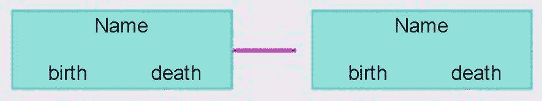

图 7-37b

断开连接后，两个对象之间存在间隔，并且总线使用警告颜色
```

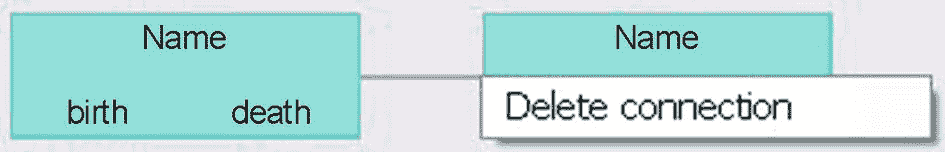

`图 7-37a`

连接点上的菜单只有一个命令。

可以在家谱元素上调用多个菜单。其中一些菜单很小，只有一两个命令，但 `Person` 对象和总线段上的菜单非常大，包含修改现有家谱和添加新部分的命令。

## 总线段上的菜单

总线段上的菜单（`图 7-38`）可以在任何总线上调用，无论这条总线是否连接到任何东西，或者完全是自由的，这都无关紧要。和往常一样，菜单在按下总线的位置处被调用。如果所选菜单命令带来新的元素到屏幕上，则此新部分将在同一点连接到被按下的总线。以下四幅图展示了将新元素放置到屏幕上的命令，被按下的总线以宽蓝线显示。

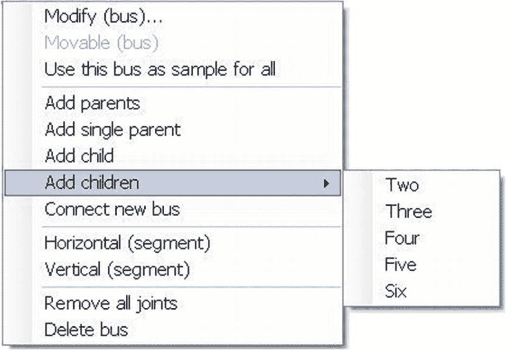

`图 7-38`

总线段上的菜单

| *Modify (bus)* | 此命令打开辅助窗体（`图 7-21`），允许你更改被按下总线的外观。 |
|---|---|
| *Movable (bus)* | 此命令允许你更改被按下总线的可移动性，但此命令只能应用于两端都自由的总线。这对于真实的族谱来说是一种极其罕见和奇怪的情况，但它是有可能的，所以我决定在菜单中保留此命令。 |
| *Use this bus as sample for all* | 假设你花了一些时间构建家谱，然后决定更改所有总线的外观。你可以通过使用其调整窗体单独更改任何总线的外观，但在大型树状图中对每条总线都重复此过程将花费太长时间。相反，你可以将一条总线的外观更改成你喜欢的任何样式，然后使用此命令；所有总线都将根据此样本更改其外观。 |
| *Add parents* | 一对带有它们之间一条总线的 `Person` 对象代表一对夫妇；父母之间的总线与被按下的总线相链接（`图 7-39`）。这对新的 `Person` 元素与 `图 7-35` 中的一对完全相同；结果中的唯一区别在于这一对元素与被按下总线之间的链接。 |


`图 7-39` “添加父母”命令的结果

| *添加单亲* | 如果有关于一位家长的信息，或者用户只想在家谱中包括一对夫妇中的一个人，那么用户可以使用“添加单亲”命令。因为屏幕上只会出现一个新的 `Person` 对象（`图 7-40`），并且这个新对象至少需要更改一些信息，因此系统会自动在该新对象上调用一个用于调整 `Person` 对象的辅助表单。 |
|---|---|

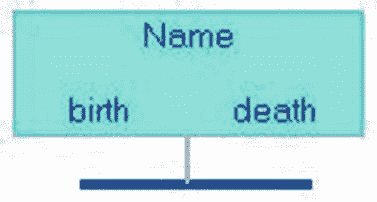

`图 7-40` 添加单亲

| *添加孩子* | 此命令与前一个命令类似，但新的 `Person` 对象出现在被点击的连接线下方（`图 7-41`）。使用此命令有两种标准情况：某对夫妇只有一个孩子，或者有超过六个兄弟姐妹的情况。六个兄弟姐妹的屏幕元素可以通过一个命令来组织；如果需要更多兄弟姐妹，可以在此兄弟姐妹上方的连接线上使用此命令来添加。 |
|---|---|

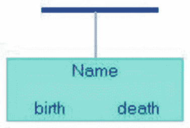

`图 7-41` 添加单个孩子

| *添加多个孩子* | 有一个子菜单可以在屏幕上放置 2 到 6 个兄弟姐妹；`图 7-42` 显示了两个兄弟姐妹的变体。如果有超过六个兄弟姐妹，你可以用一个命令放置六个，然后根据需要在兄弟姐妹上方的连接线上反复应用“添加孩子”命令。我已经解释过添加多个兄弟姐妹的步骤顺序。一切始于一条由三段折线设计的连接线；然后第一个和最后一个兄弟姐妹连接到这条连接线的两端。为了更好理解，`图 7-42` 中的连接点以特殊方式进行了标记。 |
|---|---|

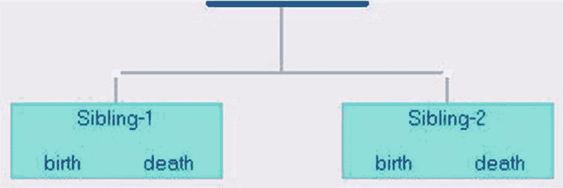

`图 7-42` “添加多个孩子”的结果：两个兄弟姐妹

| *连接新总线* | 新的短连接线连接到被点击的连接线上；新连接线的另一端是自由的。你可以重新配置新连接线，移动其自由端，并将其连接到任何所需的对象（连接线或人物）。 |
|---|---|

家谱的构建不仅可以将一组新元素连接到连接线，还可以连接到任何 `Person` 对象；这通过可以在该类对象上调用的菜单命令来完成（`图 7-43`）。从可用添加新元素命令列表可以看出，这些命令与空白位置菜单的命令（`图 7-33`）以及连接线段菜单的命令（`图 7-38`）类似。

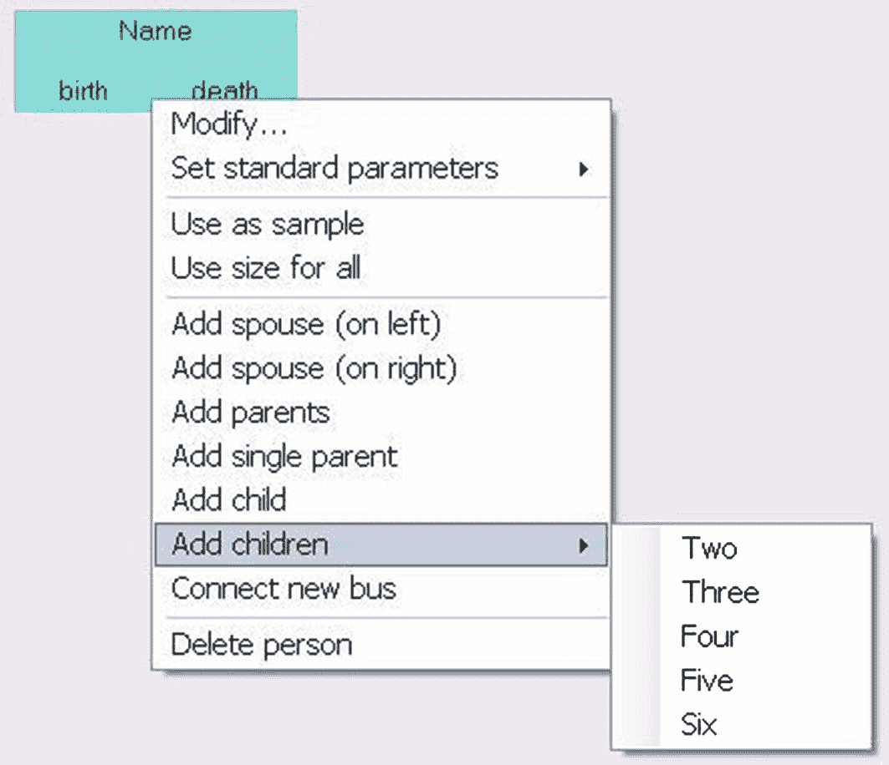

`图 7-43` 人物对象上的菜单

`Person` 对象菜单中的第一个命令会调用其调整表单，这在 40 页前已经演示过（参见 `图 7-29`），但在真实的家庭树应用程序中，用户需要编辑所有信息片段，因此所有三个文本框都允许此类编辑（`图 7-44`）。

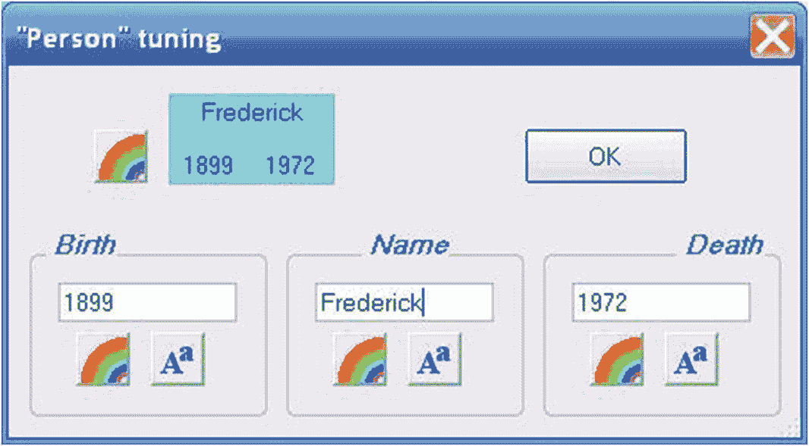

`图 7-44` 人物对象的调整表单

如果你清除了出生和死亡文本框中的信息，那么这些注释将不会出现在 `Person` 对象中。如果你尝试对姓名字段进行同样的操作，那么*未知*这个词将代替姓名出现。此调整表单允许你单独更改每个注释的字体和颜色，尽管我认为用户可能希望在家谱中对元素有更标准化的视图。我假设此调整表单主要用于更改注释文本。按照这种优先使用方式，组内的六个小按钮就变得多余了，因此它们的外观通过空白位置菜单的命令来调节。

`Person` 对象菜单的主要部分包含六个不同的命令，用于为被点击的人添加一些亲属；其中四个命令会添加一个新的 `Person` 对象。我想再次强调，菜单中的命令是按照现有人员与新人之间的关系来表述的，但这些关系并未存储在家谱中的任何地方。家谱中只有 `Bus`、`Person` 和 `BusConnection` 类的元素。

`图 7-45` 演示了使用这四个添加单个 `Person` 对象的命令的结果。该对象会与调整表单一起出现在屏幕上；其发生方式与 `图 7-34` 所示完全相同。在 `图 7-45` 的所有版本中，黄色矩形代表调用菜单的现有 `Person` 对象；青色矩形则是使用某个命令后出现的结果。如你所见，这四个不同的命令将新矩形放置在现有矩形的一侧或另一侧，这也是这四个命令之间的唯一区别。

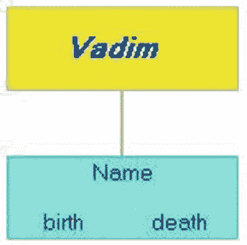

`图 7-45d` “添加孩子”命令

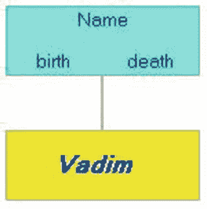

`图 7-45c` “添加单亲”命令


`图 7-45b` “添加配偶”(右侧) 命令


`图 7-45a` “添加配偶”(左侧) 命令

一个变体可以通过以下三个简单步骤转换为另一个变体：

- 将青色矩形移动到黄色矩形的另一侧。
- 将黄色矩形上的连接线端点移动到青色矩形当前所在的那一侧。
- 移动青色矩形上的连接线端点，使得连接线显示为两个矩形之间的最短直线。

其他几个命令需要一些说明。

| *连接新总线* | 此菜单在矩形内部某处调用。执行此命令后，新连接线将连接到距菜单调用点最近的边界点。如果需要，可以轻松地围绕边界移动新的连接点。 |
|---|---|

| *设置标准参数* | 此命令有一个子菜单，提供更改部分或全部可见性参数的选项。我之前提到过存在保持标准视图的 `Bus` 和 `Person` 元素，也提到用户可以在一定程度上更改这些视图。 |
|---|---|

# 家庭树应用程序与函数查看器

## 家庭树应用程序

在“家庭树”应用程序的主菜单中，有一个“设置”项；如果你点击此菜单命令，将打开`Form_FamilyTree_NewElemParams.cs`（图 7-46）。

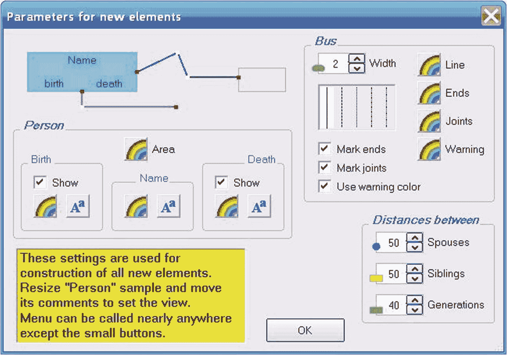

**图 7-46** 一个专门的表单允许你设置用于设计所有新元素的参数

### 设置表单

`Bus` 组允许您设置所有新总线的参数，因此该组中的元素与总线调谐表单（图 7-21）中显示的相同。

`Distances` 组允许您定义通过不同菜单命令添加到家谱中的多个 `Person` 对象之间的标准距离。调节值为配偶及兄弟姐妹之间矩形的水平间距，以及父母与子女之间的垂直间距。

`Person` 组中的元素允许您为未来的 `Person` 对象设置所有字体和颜色。此表单左上角有一个 `Person` 对象。所需的大小通过调整此示例来设置；所有三个注释（名称、出生和死亡）的定位系数通过移动注释来设置。

### 应用设置

我想强调的是，当您关闭此辅助表单并返回家谱应用程序的主表单时，此表单中的所有更改不会立即生效。这些设置仅在您开始向家谱添加新元素时使用。您可以将这些设置应用于现有家谱，但由于此操作可能会破坏精心准备的大树视图，从而造成有害影响，因此在更改整体视图的操作中，我特意加入了几个中间步骤。

首先，在某个 `Person` 对象上调用菜单，并使用子菜单中的命令 `设置标准参数`。我建议不要只对一个 `Person` 对象执行此操作，而是对多个 `Person` 对象执行，并且可能使用子菜单中的不同命令。如果您对结果满意，并希望进行全局更改，则在同一 `Person` 对象上调用菜单，并使用命令 `用作样本`。

更改总线不会导致灾难性后果，但最好也分两步进行全局更改。首先，在某个总线上调用菜单，并使用 `修改（总线）` 命令。如果您对结果满意，则调用同一菜单，并将此总线用作其他所有总线的样本。

### 主菜单命令

让我们回到主家谱。`Form_FamilyTree.cs` 的主菜单中有两个有用的命令。`文件 ➤ 另存为` 命令允许您将家谱保存为二进制文件，而 `文件 ➤ 打开` 命令允许您从文件中恢复家谱。

### 滚动与设计规则

真实的家族树可能很大，您极有可能需要比屏幕更大的空间来显示它。您可以轻松地以任意方式滚动整棵树；只需在任意空白处按下左键并开始移动即可。这种滚动整棵家谱的方法在之前的示例中已经解释过。

不要害怕在设计中进行任何操作或犯错，因为此家谱应用程序中实施了若干规则。

- 任何用户的操作都不会对家谱设计造成致命影响。如果您放置了错误的元素，可以通过上下文菜单中的命令删除它；如果您放置了错误的元素组合，可以对每个元素使用 `删除` 命令。如果总线连接到了错误的元素，只需断开连接（通过在错误连接处的菜单中使用命令），然后继续您的设计。

- 设计中有一些限制：总线不能连接到自身；总线两端不能连接到同一总线；两条总线不能通过相互连接形成环路。除此之外，其他操作都是允许的。

- 通过调整可见性参数，您可以添加从您的角度看可能重要的个人信息，但这些信息不会在任何标准命令系统中提及。例如，如果您想用两条总线突出显示配偶之间的联系，您可以这样做。没有人会阻止您尝试这样做，也不允许您在相同的两个 `Person` 对象之间组织两条并行的总线。或者，您可以在总线中为宗教婚姻和民事婚姻标记不同的方式。

- 不仅可以更改元素的视觉参数，甚至一些标准的家族联系也可以与之前描述的命令系统所建议的方式不同。图 7-47a 显示了使用几页前讨论的两个命令的结果：首先设置了一对夫妇；然后在他们之间的总线上使用另一个命令添加了三个孩子。同一个由父母和三个孩子组成的家庭可以用不同的方式表示（图 7-47b）。第一个命令是相同的；然后，将添加单个孩子的命令应用到上方总线三次。

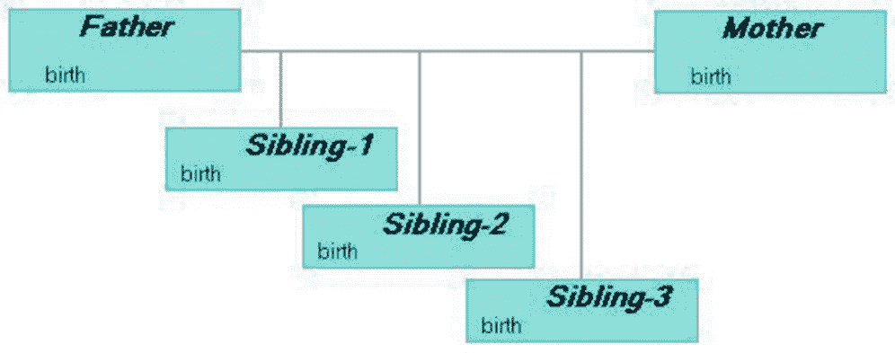

**图 7-47b** 父母矩形作为标准命令的结果出现，而孩子则通过在上方总线上调用命令逐个添加

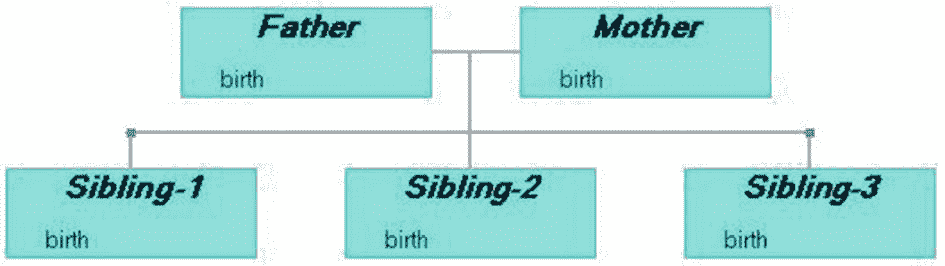

**图 7-47a** 此视图是使用两个标准命令的结果

这是一个标准的用户驱动型应用程序。这是您的应用程序，您是主导者，您可以完全按照自己的意愿组织视图。

## 函数查看器：一窥科学应用

在本示例的描述中，你将看到一些简短的代码片段，因为所有元素及其工作方式我们都已经讨论过了。本节要演示的主要内容，是一个相对复杂、用户操作和请求无法预测的应用的总体设计。所有科学应用都必须遵循一条简单规则来开发：“用户能做一切。”作为开发人员，我必须按照这条规则来提供程序。许多读者可能会觉得，开发允许用户为所欲为的应用会给程序员带来巨大的、不堪重负的负担，所以我想证明这种看法并不正确。设计者不需要对一切能想象到和无法想象的情况都做出响应，而是应该基于那些完全由用户控制的元素来开发程序。

在 2001 年至 2004 年间，我参与开发了一个成功销往全球的大型工程程序。该程序用于分析大型电网，包含数十个对话框，允许熟练的用户操控数百个参数，以分析不同的场景和情况。与这类程序的常规做法一样，许多计算的结果不仅要通过数字和填充的表格来展示，还需要绘制成图表。（人们以图形形式查看数据时，理解和评估数据的效果要好得多。）2004 年年中，我们这些该程序的开发者在讨论新版本的想法。其中一个想法是增加结果的图形化展示，并赋予用户对此展示的一定控制权，例如，让用户决定显示的绘图区域数量。

这个程序是以经典方式设计的。当时还没有人谈论屏幕对象的可移动性。整个应用是自适应界面的一个经典例子，因此未来的所有工作场景都必须提前构思好并编入代码。我一直在思考一种简便的工具（对用户而言），让用户能够声明所需的绘图数量及其位置。按照当时的惯常做法，所有对话框都基于普通控件来设计。无论我尝试何种方案，声明绘图位置和大小的机制看起来都不够优雅，但至少能工作，我也希望在过程中能想出更好的办法。然而，有一个小问题我甚至找不到一个稍微靠谱的解决方案。

在科学文章中，你经常会看到一个绘图区域中，几条曲线以不同颜色和线型显示。曲线之间的差异是由某个参数的变化引起的，因此曲线需要附上注释，说明其关联的参数。当文章作者准备此类图片用于发表时，要显示的曲线是已知的，为曲线附近的注释选择最佳位置也不是问题，因此在科学期刊中，整张图看起来总是很美观。

当你开发一个需要展示此类绘图区域的应用时，你事先并不知道内部会呈现什么样的曲线，因此你不得不将所需的注释放在绘图区域内部之外的某个地方。你能为它们在绘图区域下方或侧面预留一些空间吗？可以，但是：

*   注释会占用大量宝贵的屏幕空间。

*   注释会远离曲线，从而难以将曲线与注释关联起来（尤其是在同一区域有多条曲线时）。

*   还有围绕绘图区域的坐标轴刻度问题。可能存在多个坐标轴及其自身的注释，因此刻度位置与不同注释之间会有各种能想象到和无法预测的冲突。

*   如果一个视图中有多个绘图，那么问题会远远超过线性增长的速度。

总结所有这些需求，这界面本身已经因要放置所有所需绘图区域的几个控件而变得复杂，现在又得用一个额外的工具来放置所有需要的注释，这会使界面复杂得多。即使所有这些都以某种方式组织起来，看起来也非常笨拙（这是最客气的说法）。此类程序的用户是高素质的专家，他们试图解决非常严肃的工程/科学问题，不需要把时间浪费在与糟糕的界面设计作斗争上。这个需要快速、准确、简便地在带有未知曲线的绘图区域任意位置放置所需注释的问题，在设计一个庞大且非常复杂的科学应用时，可能看起来并非首要问题。因此许多人认为它总能用某种方式解决，但在标准设计下，这个问题无解。而这并非科学应用中此类问题的孤例。

在 2006 年至 2007 年间，我设计了一种屏幕对象可移动性算法，研究此算法的主要动力正是工程/科学程序的需求。2008 年初，当我的算法已准备好用于真实的科学程序时，我开始在传热传质研究所的数学建模系工作。来自该系及其他系的这些科学家是热力学领域的高素质专家，其中许多人也擅长编程，因此他们非常清楚界面的局限性。他们向我提出了一系列开发任务，这些任务需要开发成可工作的程序，但在标准设计的范畴内却无法实现。任务各不相同，但有一个共同特点：每个任务都必须处理来自实验和计算的数据不确定性。第一阶段这种不可预测性使得在标准界面下进一步工作几乎不可能。如果你试图设计一个能应对所有可能变体的程序，那么标准界面会变得极其笨拙，以至于根本无法使用该程序。每个程序都需要对屏幕元素进行手动操作，而这与用户驱动应用的理念和可能性完美契合。我逐一为这些任务设计了程序，每一次用户获得的功能都超出了他们最初的预期（或要求）。这些程序在研究工作中很有帮助，于是我收到了一个疑问：能否将所有旧程序重新设计成用户驱动应用？

通常，工程和科学程序规模庞大且复杂。每个程序都有许多特殊功能和细节，需要冗长的解释，并且只对特定领域的专家有较高价值，但对于该领域之外的人则毫无意义。同时，这些程序在设计上又有许多相似之处，因此多年来，我一直在为彼此相距甚远的知识领域设计应用。演示任何一个此类程序都需要解释其特定领域的问题和细节，这远非我在这本书中想讨论的内容。这就是为什么我更愿意演示一个包含科学应用所有特性，但又能被任何读者轻松理解的示例。我想演示和讨论一个函数查看器程序，它允许你输入`Y(x)`函数的表达式或`{X(p), Y(p)}`类型的参数方程，并对其进行操作。这个程序有助于学校的数学教学，同时它也展示了大量可用于设计复杂、专业科学应用的内容。

*   文件：`Form_FunctionViewer.cs`
*   菜单位置：应用 ➤ 函数查看器