# 2019 年，我撰写了一本名为《几何光学图解》[3]的小书，其中包含一个涵盖所有主题示例的程序。本节收录了该书中的三个示例。这本提到的书分为两部分：第一部分从光学角度进行解释，第二部分则涉及所有示例的编程。在本节中，几何光学的解释被精简到最低必要水平，而我则着重强调新设计对程序用户带来的优势。让我们从平面镜开始；这个示例完美地展示了所有示例的设计。

## 平面镜示例

*   文件：`Form_Mirror_Flat_Any.cs`
*   菜单位置：应用程序 ➤ 几何光学 ➤ 平面镜

在此示例中，用户可以处理任意数量的平面镜（图 7-58）。每个镜子都可以单独放置和旋转。镜子的数量可以轻松更改，这些特性使您能够组织出非常奇特的光线路径。这看起来像是一个有趣的游戏，但从我决定设计这个示例的那一刻起，我就想起了阿尔伯特·迈克尔逊的那次著名实验——光在威尔逊山天文台和瞭望山之间传播。

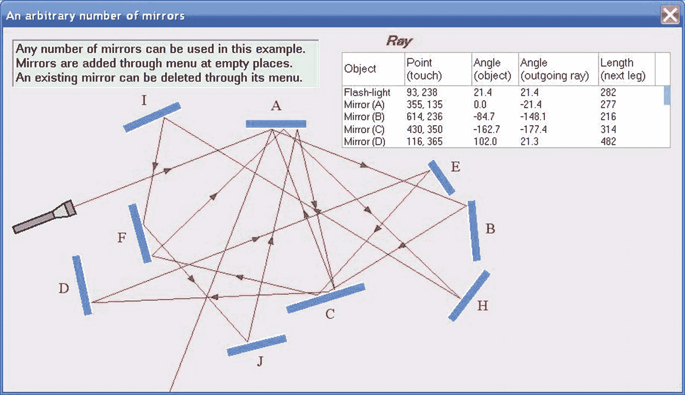

**图 7-58** — 在此示例中可以使用任意数量的镜子

每个镜子（属于 `Mirror_Flat` 类）都是矩形形状。其覆盖层的设计对所有矩形而言都是标准化的。用户可以决定每个对象是否允许调整大小，但通常情况下，矩形可以通过边和角来调整大小。镜子有一个反射面，可以通过使用不同的颜色来突出显示。另外三个面则吸收光线。

光源（`Flashlight` 类）被设计成手电筒的形式。在以下示例中，这个手电筒是唯一不可调整大小的元素；我实在想象不出可调整大小的光源有什么必要，尽管组织起来很容易。在真实实验中，不可能将一对光学对象（镜子和手电筒）放置在相同位置，因此当前示例中也禁止了这种重叠。

光线路径的计算方式如下：

*   初始光线的点及其角度从手电筒获取。
*   光线可以触及任何镜子，每个镜子有四个面，每个面都是由两个端点确定的线段。反射后的光线可以触及手电筒。手电筒的边界由八个直线段组成。因此，对于一个包含 `N` 个镜子的系统，我们有 `4 * N + 8` 个可能与光线相交的线段。系统会计算出最近的交点。
*   如果没有交点，那么这就是路径中的最后一程。（在图 7-58 中，光线在镜子 A 的中间被反射，然后延伸到窗体的底边之外。）
*   如果光线触及手电筒或任何镜子的非反射面，则计算结束。
*   如果光线触及镜子的反射面，则该接触点成为新的光源点，反射角等于入射角，然后重新开始计算。

当计算显示光线接触到了某个边界时，系统会在此边界上组织一个光学边界（`OpticalBorder` 类的元素）。该元素允许您处理吸收、反射或折射。虽然当前示例中只发生吸收和反射，但折射的情况将在后续示例中用到。

这个示例基于简单的元素——矩形——但即使是这个最简单的基元，也允许您组织起截然不同的示例。几乎在每本几何光学书籍中，你都能看到一个直角形状的反射器，其内部有两个反射面。这种设计完美地展示了入射角等于反射角的原理。在当前示例中，可以通过放置两个互成直角的镜子，并将它们的反射面端点相邻放置来构造同样的反射器。另一种有趣的设计是创建一个多边形，其反射面朝向内部。留一个小缝隙，让光线可以射入内部，然后观察结果。

我只提到了两种可能性，但一个由用户驱动的应用程序对用户的想象力没有设限。

## 折射与斯涅尔定律

光在任何材料中的速度都小于真空中的速度。在真空中的速度（`c`）与在材料中的速度（`v`）之比，称为该材料的*折射率*：`n = c / v`。由于`v`总是小于`c`，因此任何材料的折射率都大于 1。折射率略微依赖于波长，但对于可见光谱中的波，这种差异仅体现在小数点后第二位甚至第三位上。这种微小差异是色散的原因，这在书[3]中有讨论，但本书不涉及。在以下示例中，使用了单色光线，因此每种材料都使用单一的折射率。

当光线到达两种材料的界面时，一部分光线被反射，另一部分则进入另一种材料。反射角等于入射角，而折射角可以通过斯涅尔定律求得。

`n[1] * Sin ά[1] = n[2] * Sin ά[2]`

*   `n[1]` 和 `n[2]` — 两种材料的折射率
*   `ά[1]` — 入射角
*   `ά[2]` — 折射角

| 材料 | 折射率 |
| --- | --- |
| 空气 | 1.0003 |
| 水 | 1.33 |
| 玻璃 | 1.5 |
| 金刚石 | 2.48 |

有两类经典的折射示例，在每本几何光学书籍中都会被讨论：光穿过窗户的传播，以及从湖（或河）岸看水中某人的景象。这两个示例之所以流行，是因为我们一生中会多次看到它们。

### 从光疏介质到光密介质

当光线从光疏介质进入光密介质时，例如从空气进入水（图 7-59），那么 `n[1] < n[2]`，这意味着 `ά[1] > ά[2]`，因此折射光线（在此例中是在水中）会向法线方向弯曲。这对于任何入射角都同样适用。

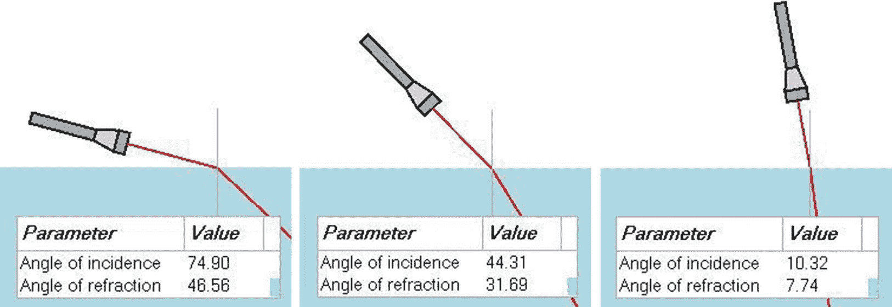

**图 7-59** — 对于从光疏介质进入光密介质的光线，折射光线总是向法线方向弯曲

现在想象一下，在手电筒的位置上是岸边某人的眼睛，而红线则显示了水中某人脚部反射的光线路径。眼睛捕捉到光线并看到了脚，但大脑对光线的弯曲一无所知。大脑认为整条光线是笔直的，因此大脑“看到”水中的脚位于上方光线的延长线上。结果，水中人的腿看起来比实际要短，而水面以上的身体部分则没有变形。

### 斯涅尔定律与折射

斯涅尔定律并未对光线方向做出任何限制，因此当光线从光密介质传播到光疏介质时，该定律同样适用。只是此时`n[1] > n[2]`，所以两个角度之间存在不同的关系，且当`ά[1] < ά[2]`时，折射光线会偏离法线（图 7-60a）。让我们从某个较小的入射角开始，并逐渐增大它。在当前程序中可以轻松实现这一点，因为你可以按下手电筒并旋转它。在一段时间内，斯涅尔定律仍然有效；折射光线越来越偏离法线，并趋近于界面（图 7-60b）。在我们的案例中，边界线是水平的，因此很容易观察和估计角度如何变化。

临界角是斯涅尔方程仍然成立，但`Sin ά[2] = 1`时的角度。对于水-空气边界，当入射角为 47.77 度时出现该情况。对于更大的入射角，方程只有在`Sin ά[2] > 1`时才成立，但这不可能，因此不会发生折射，而是发生全内反射（图 7-60c）。像往常一样，反射角等于入射角。

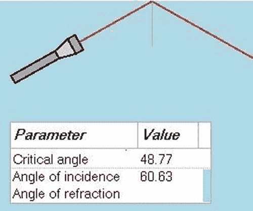

**图 7-60c** 入射角大于临界角时，发生全内反射

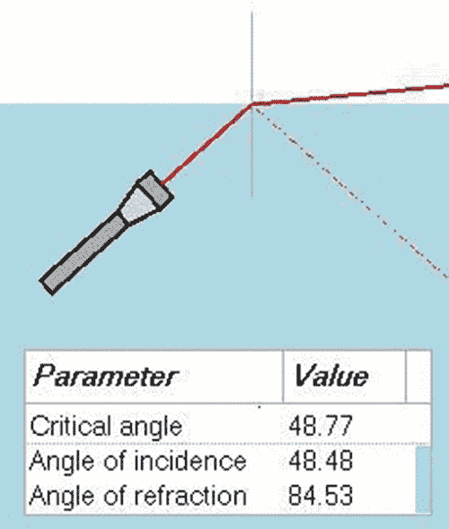

**图 7-60b** 当入射角接近临界角时，折射光线几乎沿界面传播

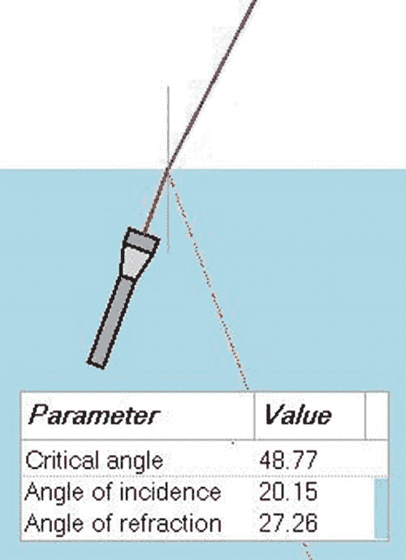

**图 7-60a** 入射角小于临界角时，根据斯涅尔定律发生正常折射

图 7-59 中的情况很容易解释和理解，因为它在我们一生中多次发生，我们非常熟悉透过水面看到的物体扭曲现象。图 7-60 中的情况很容易解释，但不太容易理解，因为我们并不生活在水下，在这种情况下，我们只能依靠数学而非感觉。让我们再看一个熟悉的情况。

当光线穿过窗户玻璃时（图 7-61），在两个边界都会发生折射。首先，空气-玻璃边界使光线向法线方向弯曲。然后，这条光线到达玻璃-空气边界，在那里使用相同的一对折射率但顺序相反，使光线偏离法线。因为两个边界使用了相同的一对折射率但作用方向相反，所以第二个角度变化的结果与第一个相同但符号相反，因此出射光线与原始光线平行。只是在传播过程中发生了侧向位移；图 7-61 中清晰可见。这正是我们透过任何窗户看到的情况。

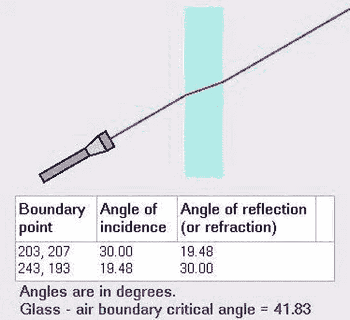

**图 7-61** 第二个边界上的折射使出射光线与原始光线平行

前面提到的两种情形——从岸边的视角和透过窗户的视角——对每个人来说都很熟悉，因此它们的解释从不会引起任何兴奋。这两种情形都包含在下一个示例中。尽管这个示例也涉及一个熟悉的情况，但我相信你会看到一些完全意想不到的结果。

## 水族馆示例

*   文件：`Form_Aquarium.cs`
*   菜单位置：`Applications ➤ From Geometric Optics ➤ Aquarium`

# 水族箱中的光线路径

假设你有一个大型水族箱（比如海洋馆）。玻璃墙的一侧是游客区，游客有机会从不同高度观察水族箱。在玻璃墙的另一侧，水总是填满一半的体积（图 7-62）。由于我更关注光学效果而非这类水族箱的实际构造，因此玻璃墙可以轻松地左右移动，并且其厚度也可以在合理范围内以同样简单的方式改变。厚度不会影响所讨论过程的物理原理，但会使光线路径的变化更加明显。光源——手电筒——可以放置在空气中或水中的任何位置；但是，不允许出现手电筒与玻璃重叠的任何情况。

## 光线路径变体

图 7-62 中的光线路径变体是最简单的，代表了图 7-61 和图 7-59 中情形的序列。在三个边界上发生了三种普通的折射情况。首先，光线接触到玻璃墙的垂直侧面；然后，在玻璃墙的相对侧发生折射。在这两点，外部都是空气，因此第二次折射后的光线角度等于原始角度；每个特殊点之前和之后的光线角度都显示在一个列表中。第三次折射发生在空气-水边界。

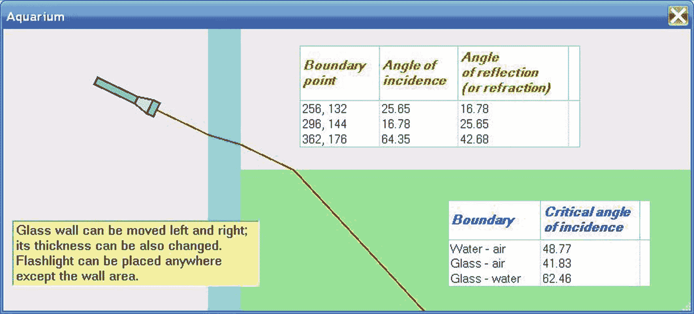

**图 7-62** 玻璃墙从底部延伸到顶部；水填满了右侧一半的体积

组织任何光线路径最简单的方法是将手电筒放置在感兴趣的点，并将其旋转到所需角度。光学的主要定律之一是光的可逆性。这意味着，如果在光线路径上的任何位置放置另一个手电筒，并将其朝向与光线相反的方向，那么第二个手电筒发出的光线将精确地到达第一个手电筒上的光源点。我们看到物体是因为光线从物体反射并进入我们的眼睛。在我们水族箱的例子中，这意味着如果一位游客从我们光源（手电筒）的位置出发，沿着发出的光线方向观察，那么这位游客会看到光线路径上的物体。

## 家庭参观的观察差异

假设一对父母带着小孩参观海洋馆；身高差对于后续讨论很重要。家庭成员站在玻璃墙附近，寻找另一侧的奇特生物。一个成年人看到前方有令人惊叹的东西（图 7-63a），并告诉孩子们往那里看。他们尝试了，但为了看到提到的那个生物，他们必须以完全不同的角度观看（图 7-63b）。也许他们会看到同一个生物，但由于光线在玻璃墙两侧的转向，他们很可能错过它。父母坚持认为前面确实有令人惊叹的东西，所以孩子们为了找到它，稍微改变了一下观看角度。他们没有看到紧靠玻璃墙的东西，反而有机会看到海洋馆底部远处角落的生物（由于页面限制，图 7-63c 未显示海洋馆的全尺寸，但你可以轻松延长光线路径的最后一段）。孩子们根本没有想到海洋馆的那个远处部分，但他们现在看到了。

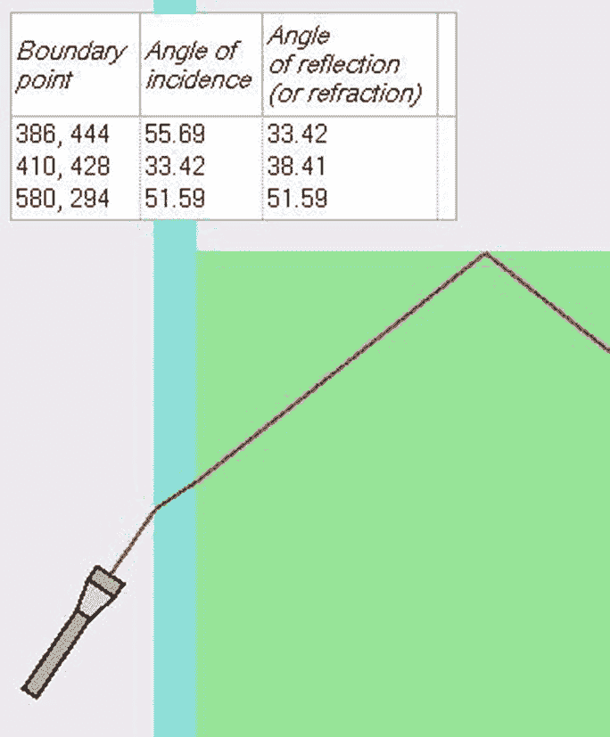

**图 7-63c** 这条光线到达了远离其初始方向的某处

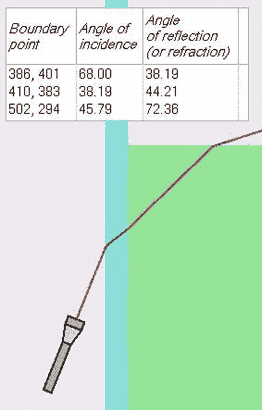

**图 7-63b** 在水中因折射而精确抵达同一位置并非易事。

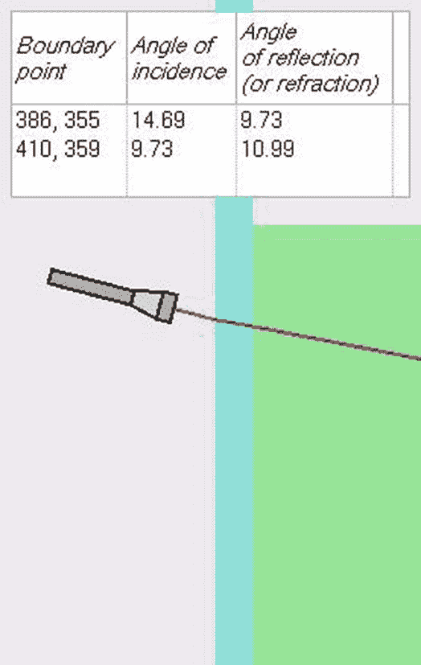

**图 7-63a** 这条光线几乎是笔直的。

这并非我为了增加文本趣味性而设想的人造情景。图 7-63c 让我想起了一个困扰我多年的未解之谜。童年时，我家有一个鱼缸放在书柜顶上。那书柜几乎是我当时身高的两倍。为了看鱼，我得仰起头，才能看到紧贴玻璃的鱼。如果我站在离书柜稍远的地方，以一个角度仰视，有时能看到鱼缸最远端的水下洞穴。我无法直接看到它，因为视线被书柜的上部挡住了。这种偶尔瞥见隐藏角落的情形让我困惑不已，但直到多年后我才了解到全内反射。如今多年过去，我能轻易解释童年那段插曲。那些隐藏在鱼缸角落的奇特画面，多年来一直深藏在我记忆深处，直到程序向我展示了图 7-63c 中的路径，它们才重新浮现。

借助这个程序，我试图证明：如果用户能完全控制所有屏幕元素，那么由用户发起的一个微小改变，就能让你从预期的结果转向意想不到的结果。在科学领域，这两种结果都可能具有价值。预期结果能让你证明实验前所作假设的正确性。非预期结果则表明，实验所依据的理论可能是部分错误，甚至是完全错误的。同样的实验（图 7-62）让我看到了其他结果，而在设计这个例子之前，我无法对此做出任何预测。

## 水下生物的视角

你能说出当水下生物从海洋馆内部向外看时，它们看到了什么吗？为了避免讨论非人类心智的问题，我们假设里面有美人鱼在表演，或者有科学家/维护人员在作业。它们能看到玻璃墙外的游客吗？我认为不会有太多游客费心去想这类问题。在我们的日常生活中，如果我们能看到某人，那么那个人通常也能看到我们。光的可逆性意味着，如果光线沿反方向发射，它会沿着相同的路径返回。如果我们靠近玻璃墙观看另一侧的各种生物，那么那些生物也能看到我们。这个定律在生物恰好沿着光线路径的反方向观察时总是成立，但如果角度不同呢？

图 7-64 展示了当有人从水下的同一位置，以不同角度看向玻璃墙时的路径变化。我得说，只有图 7-64a 中的结果是预期的，而其他三个都是非预期的。当生物以相对较小的入射角观察时（图 7-64a），在两个边界上会因折射产生一些畸变，但至少能看到外部的一些景物。当入射角增大时，水下生物就看不到游客了。图 7-64b、7-64c 和 7-64d 展示了入射角逐渐增大时的各种情况；我不知道有多少读者能预料到这样的结果。我原本也没想到这些结果，若非在当前示例中手电筒可以移动和旋转，你根本不可能看到它们。

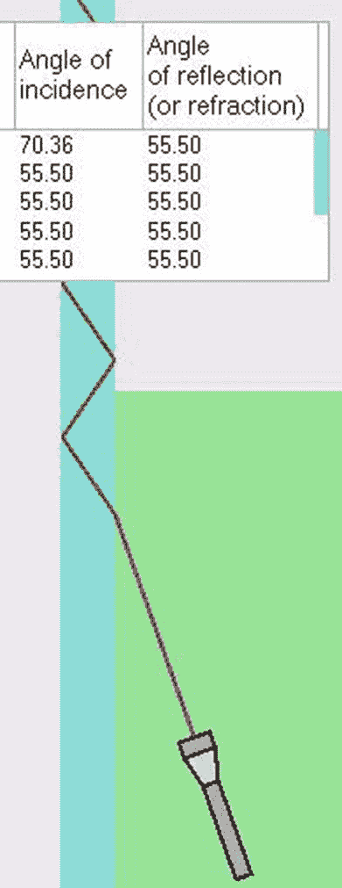

**图 7-64d** 首先是普通折射点，然后是一系列全内反射。

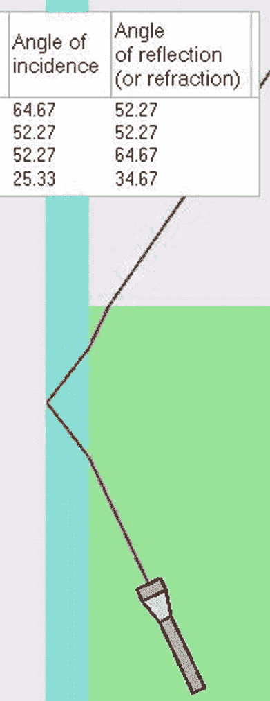

**图 7-64c** 相同的折射和全内反射序列，但最后一段光线贴到了玻璃上。

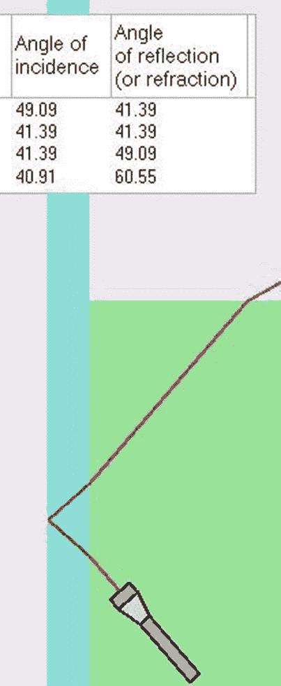

**图 7-64b** 三个普通折射点和一个全内反射点。

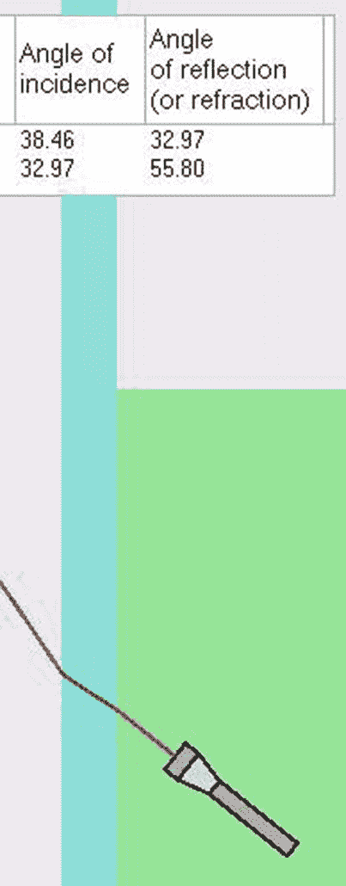

**图 7-64a** 两个普通折射点。

优秀的物理书不仅会给出解释，还会要求读者回答一些问题。在标准设计的书籍中，读者需要做一些计算来回答这些问题。本书附带了一个程序，让读者能够扮演实验者的角色。

假设你正在参观同一个海洋馆，你没有紧贴玻璃墙站立，而是站在远处地面最左边的角落里。（在图 7-62 中，这是黄色矩形左下角的位置。）从那里有可能看到最右边水面上方的东西吗？

*   如果可以，那么你需要看向哪里？
*   如果不行，你需要移动到何处，并从新位置看向哪里？

从编程的角度来看，这个例子与上一个例子同样简单。四个直线段描述了海洋馆内部的边界；还有八个标准线段用于描述手电筒的边界。我从未找到能返回手电筒的光线路径，所以这八个线段看起来是多余的，但我仍然把它们算上，以保持路径计算方法的一致性。在海洋馆内部的四条边界上，可能会发生折射或全内反射；这取决于每条特定边界和入射角。

这个例子完美地展示了标准设计程序与用户驱动应用程序之间的区别。为了解释折射，标准设计的程序会演示图 7-59（中间情况）、7-60a 和 7-60c 中的情况。而新设计能做的远多于此。它让你能轻松看到光线穿过窗玻璃以及光线射向水面的标准情况。如果学生对物理毫无兴趣，他们可以看看标准情况，然后就把程序抛之脑后。但对于那些想要摆弄光线和边界的人来说，这里有无数的机会。还有些有趣的结果我没有提及，甚至可能我自己都还没发现。可能结果的多样性取决于个人玩弄相关元素的意愿和能力。因此，实验者越熟练，得到的结果就可能越有趣。这就是用户驱动应用程序在科学和教育领域应用时的力量所在。

## 棱镜实验

让我们再试一个例子。

*   文件：`Form_Prism_RegularPolygon.cs`
*   菜单位置：应用程序 ➤ 几何光学 ➤ 棱镜（正多边形）

大约 350 年前，艾萨克·牛顿用三棱镜进行了他著名的实验，以解释光的起源。自那时起，一幅白色光线入射一个平面，然后从另一个平面射出七束彩色光线（或光锥）的三棱镜图像，出现在每一本几何光学书籍中。为了证明预期结果和非预期结果之间的差别微乎其微，我可以问一个简单的问题：“是否可能看到从第二个平面射出少于七束的彩色光锥？”（书中 [3] 关于三棱镜的例子能帮你找到答案。）

### 三角棱镜中射出的七色光锥

# 光的色散与彩虹

三角棱镜中射出的七色光锥是光的色散的完美展示。这种色散的另一个更著名的例子是彩虹。为了解释彩虹现象，我们使用光线在水滴中的传播过程。水滴是圆形的。一个圆形可以看作是一个具有无限多个顶点（或平面）的正多边形。因此，我们在三角棱镜中观察到光的色散，而借助具有无限多个平面的棱镜，我们观察到了色散（彩虹）。（准确地说，彩虹是光在一组水滴上发生色散的结果，每种颜色的光线来自不同的水滴。）当白光照射到具有三个以上平面的正多边形时会发生什么？当这个数字改变时又会发生什么？

进行真实实验需要准备整套棱镜，这并非易事；而用计算机建模会容易得多。屏幕上三角棱镜转变为具有可变平面数量的另一形状的过程很快。我最初看到的结果与三角棱镜相似，所以起初这种棱镜变换并没有产生任何出人意料的结果。接着我开始观察到一些截然不同的现象；过了一段时间，我意识到类似的结果在埃莉诺·H·波特所著的著名小说《波莉安娜》[6]中已有描述。

> *“波莉安娜还没在阳光照射的窗户上挂好三个吊坠，就开始略微明白将会发生什么。她兴奋得手指颤抖，几乎无法控制地挂好剩下的吊坠。但任务终于完成，她后退一步，发出了一声低低的欢呼。*
>
> *那间华丽却沉闷的卧室变成了仙境。到处都是舞动着的红色、绿色、紫色、橙色、金色和蓝色的光斑。墙壁、地板、家具，甚至床本身，都闪耀着波光粼粼的色彩。”*

这无疑是白光被分解成各色成分的过程，但这色散有点奇特，并非我们在彩虹或三角棱镜中看到的那种。在彩虹中，我们总能同时看到七种颜色并列出现；它们绝不会在天空的不同区域彼此分离。在等边三角棱镜的情况下，各色光锥也保持在一起，分散光线中红色和紫色部分之间的最大夹角大约为 10 度。从这样一个棱镜中射出的光会使彩色光斑彼此相邻排列。书中生动的描述则提到房间里到处都是彩色光斑，因此产生这种画面的原因必定有所不同；图 7-65 展示了这是如何发生的。为了避免将所有不同颜色混杂在一张图中，我针对不同光成分准备了三张不同的图。所涉及元素的几何结构对于三者来说是相同的。现在想象一下，太阳光以图中所示的方式照射到吊坠上。白光发生色散；然后每种成分将沿自己的路径传播，并以各自的角度射出。结果，我们在完全不同的位置得到了不同颜色的光斑。

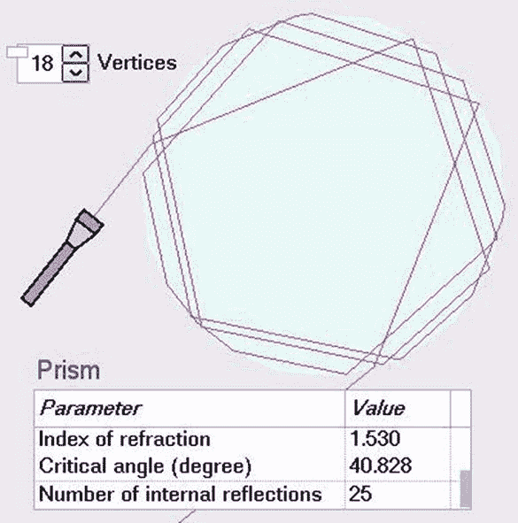

图 7-65c

紫色光在内部旋转近 4 圈，经过 25 次内反射后射出

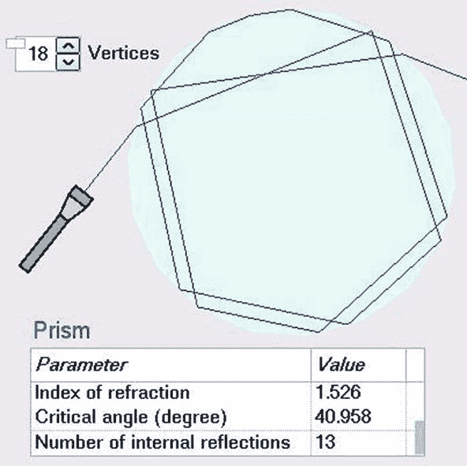

图 7-65b

蓝色光经过 13 次内反射后射出

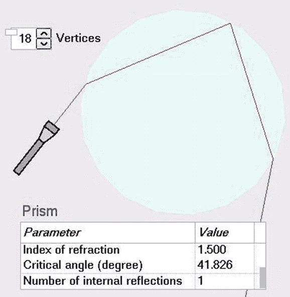

图 7-65a

红色光经过一次内反射点后射出

当我设计一个正多边形棱镜的例子时，我预料到这样的结果了吗？当然没有，尽管我知道宝石切割工艺已经使用了几个世纪。（我们可以跳过关于我预测结果能力的讨论，但至少我是诚实的。）幸运的是，该程序被设计成一个用户驱动的应用程序，因此用户（就是我！）可以对所涉及的元素做任何想做的事。像往常一样，这位用户决定摆弄屏幕上的元素，并在此过程中得到了设计者（也是我！）从未想到过的结果。这对于“科学程序是否可能产生意外结果？”这一基本问题给出了完美的答案。

脚注 1 2 3 4

# 索引

## A

- `AddBus()` 方法
- `AddConnection()` 方法
- `AddPerson()` 方法
- `AdjustCursorPosition()` 方法
- `AnotherEndOfNewBus()` 方法
- `Arc` 类
  - 角度
  - 边框
  - 封面
  - 封面变体
  - 设计思路
  - 特性
  - 头部
  - `InsideArea`
  - 跳跃
  - `MoveNode()` 方法
  - `NearestPointOnTrail()` 方法
  - 节点
  - 对象
  - `Press()` 方法
  - 半径 `rCursor`
  - `Ring_Adh` 类
  - `SetTriangles()` 方法
  - 特殊区域
  - `Spot_OnArc` 类
  - 点位置
  - 挤压
  - 尾部
  - 轨迹
- `Auxi_Drawing.ShowImage()` 方法
- `Auxi_Geometry.ClosedPolyline()` 方法
- `Auxi_Geometry.Polyline_NearestPoint()` 方法
- `Auxiliary` 窗体

## B

- 条形图
  - 添加条形图辅助调优窗体
  - `BarChart_Adh` 类
  - 条形颜色
  - 可更改的条形
  - 复选框
  - 彩色条形
  - 定义
  - 元素
  - 翻转
  - 翻转绘图方向
  - 翻转刻度命令
  - 临时信息的字体
  - 分组线条
  - 分组值
  - 水平
  - `Scale_Numbers` 对象
  - 内部值
  - 主区域菜单注释
  - 空白区域
  - 绘图区域刻度菜单命令
  - 移动/调整大小
  - 新建
  - 数字刻度
  - 元素对
  - 顺时针旋转
  - 逆时针旋转
  - 设计规则
  - 示例
  - 文本示例
  - 将条形图保存到文件
  - `Scale_Numbers` 对象
  - 刻度部件调优类型
  - `Scale_Texts` 对象
  - 科学/工程应用
  - 显示移动区域尺寸
  - 临时信息
  - 文本刻度
  - 用户驱动型应用
  - 可见性参数
- `Bus.AddConnection()` 方法
- `Bus.ChangePoint()` 方法
- `BusConnection.MoveNode()` 方法
- `BusConnection.Press()` 方法
- `BusConnection.RailChanged()` 方法
- `Bus.DefineCover()` 方法
- `Bus.Draw()` 方法
- `BusFromPerson()` 方法
- `Bus.InformConnections()` 方法
- `Bus.InsertPoint()` 方法
- `Bus.IntoMover()` 方法
- `Bus.MoveNode()` 方法
- `Bus.NearestPointOnSegment()` 方法
- `Button_GR.Press()` 方法

## C

- 复选框
  - `CheckBox_GR` 类
  - 角点
  - 元素按压
  - 可移动/不可移动元素
  - `MoveNode()` 方法
  - 节点
  - 部件
  - `Rectangle_Image` 类
  - 矩形
  - 选择/取消选择
  - `sideText` 字段
  - 方形/文本调优窗体
- `CheckBox_GR.MoveNode()` 方法
- 圆形
  - 辅助线
  - `Circle_Unicolored` 封面
  - 不可调整大小
  - 按压
  - 半径
  - 可调整大小
- `Click_miFix_All()` 方法
- `Click_miNewBus()` 方法
- 组合框
  - `ComboBox_DDList` 类
  - `ComboBox_DDList` 对象
  - `comboColors` 对象
  - 注释
  - 封面
  - `DefineCover()` 方法
  - 特征几何形状
  - 缺少焦点
  - 菜单命令
  - 节点编号
  - `OnMouseUp()` 方法
  - `ParentRect` 属性
  - 矩形
  - `SetParentRect()` 方法
  - 调优窗体
- `ComboBox_DDList.Press()` 方法
- `ComboBox_DDList.SelectByPoint()` 方法
- 注释
  - 自由注释关联控件
  - `Comment_ToRectangle` 类
  - 强制重新定位
  - 字体/颜色
  - `Mover.Release()` 方法
  - `OnMouseUp()` 方法
  - 参数
  - 行为规则
  - 用户操作
  - 有限定位
  - 控件 + 注释对
  - `Control_FixedComment` 类
  - `Control_FixedComment` 对象
  - `ListView` 控件
  - 菜单
  - `Textbox` 控件
  - 变体

## A, B, C

- `CommentToPieChartSector` 类

- `CommentToPieChartSector.Press()` 方法

- `Comment_ToRectangle` 类

- 复杂对象移动

  - `Rectangle_withComments` 类

  - 带注释的圆形

  - `Comment_Adh`

  - `Comment_ToRectangle`

  - 示例

  - 水平系数

  - 移动

  - `NameFont` 属性

  - 参数

  - `ParentRect` 属性

  - `ptsCorner[]` 数组

  - `Rectangle_withComments.IntoMover()`

  - 注册

  - 调整大小

  - 从属对象

- `ConnectedBus()` 方法

- 连接的总线

  - 行为

  - 蓝色总线变化

  - 闭合回路

  - 光标位置

  - 特性

  - 形式

  - 间隙

  - 绿色总线

  - 列表

  - 空参数

  - 连接点

  - 位置

  - 准随机

  - 三个

  - 更新

- `Control_FreeComment` 类

## D

- `DefaultPerson()` 方法

- `DefineCover()` 方法

## E

- 弹性多边形

  - 添加顶点

  - `AdjustCursorPosition()` 方法

  - 数组

  - 辅助窗体

  - 边框

  - 中心点

  - 圆形节点

  - 顶点补偿

  - 封面

  - 删除顶点

  - 不可见边框

  - 不可见顶点

  - 可移动

  - `MoveNode()` 方法

  - 节点

  - 不可配置参数

  - `Polygon_Elastic` 类

  - `Polygon_Elastic` 对象

  - `Polygon_RegChat_withCircles` 类

  - `Press()` 方法

  - 反应，按压

  - 重新配置

  - 旋转

  - 无限制更改

  - 顶点位置

- 工程/科学程序

## F

- 家谱应用

  - 布尔参数

  - 总线

  - 命令

  - 构造

  - 特性

  - 框架/线条

  - 菜单

  - 一个子女

  - 参数

  - 人

  - 规则

  - 生物学规则

  - 屏幕元素

  - 三个子女

  - 三代人

  - 调优窗体

  - 两代人

- 一次函数

- 一次多项式函数

- 自由总线

  - 行为

  - 颜色

  - 命令

  - 配置

  - 相关性

  - 声明

  - 元素

  - 限制

  - 菜单命令

  - 可移动线段/连接点

  - 特殊点

  - 调优

  - 不可移动

- 函数查看器

## G, H

- 几何光学

  - 设计

  - 镜子

  - 光线方向

  - 玻璃-空气边界

- 图形控件

- 图形元素

- `GraphicalObject` 类

- `GraphicalObject.IntoMover()` 方法

- 分组操作

  - 优点

  - 构造函数

  - 封面

  - 定义

  - 缺点

  - `ElasticGroup` 类

  - 框架

  - `Group_ArbitraryElements` 类

  - `Group_ArbitraryElements` 对象

  - 初始化

  - 内部元素

  - 对象

  - 矩形

  - 控制规则

  - 元素联合

- `Group_ArbitraryElements` 类

- `Group_ArbitraryElements.ParametersDialog()` 方法

- `Group_ArbitraryElements.Update()` 方法

- `GroupBox` 控件

- `Group_RadioBtnsLight` 类

- 组

  - `CommentedControl` 类

  - `CommentedControl` 对象

  - `CommentToRect` 类

  - `Control_FreeComment` 类

  - 默认视图

  - `DominantControl` 类

  - `DominantControl` 对象

  - `Form_PersonalData.cs`

  - `Form_YearsSelection.cs`

  - 隐藏/显示

  - 调节

  - 菜单

  - 鼠标技术

  - 可移动性

  - 保存/恢复

  - 选择

  - 年份

  - `SolitaryControl` 对象

  - 视觉参数

## I, J, K

- 折射率

- `Info_Resizable` 类

- `InformComment()` 方法

- `InformConnections()` 方法

- `InsertPoint()` 方法

- 内反射

- `IntoMover()` 方法

## L

- 标签

  - 定义

  - 高度/宽度

  - `Label_GR` 类

  - `Label_GR` 对象

  - 调优窗体

- 光色散

- 线条

  - `angleMouse`

  - 辅助圆形节点

  - 补偿角度

  - 封面

  - `Form_Tuning_Line.cs`

  - 线段长度

  - 菜单命令

  - `minLen`

  - 可移动性

  - `MoveNode()` 方法

  - 不可调整尺寸的线段

  - `OnMouseDown()` 方法

  - 折线

  - 旋转

  - 线段封面

  - 条形节点

  - 调优

- `Line_Segment` 类

- `Line_Segment.Press()` 方法

- `LinkBusBus()` 方法

- `LinkBusPerson()` 方法

- `LinkPeople()` 方法

- `LinkPersonPerson()` 方法

- 列表框

  - `DefineCover()` 方法

  - 字体大小

  - 高度/宽度

  - `listboxColors`

  - `ListBox_GR` 类

  - `ListBox_GR` 对象

  - `ListBox_GR.MaxHeightLimit` 属性

  - `OnMouseUp()` 方法

  - 参数

  - 选中行

- `ListBox_GR.SelectByPoint()` 方法

- `ListRect_HorLines()` 方法

- 列表视图

  - 封面视图

  - 识别

  - `listRect`

  - `listStates`

  - `ListView_GR` 类

  - `ListView_GR` 对象

  - 情况

  - 调优窗体

  - 与其它元素的比较

  - 新注释

  - 已按下的注释

  - 行

  - 字符串

- `ListView_GR.SelectByPoint()` 方法

- `ListView_GR.Subitem()` 方法

## M

- `MouseDoubleClick` 事件

- `MouseDown` 和 `MouseUp` 事件

- `Move()` 方法

- `MoveNode()` 方法

- `MoveNode(iNode, dy, ptMouse, catcher)`

- `Mover.CheckDominantsSubordinates()` 方法

- `Mover.Clipping` 属性

- `Mover.Insert()` 方法

- `Mover.Move()` 方法

- `Mover.PointInfoAll()` 方法

- `Mover.Release()` 方法

- `Mover.ReleasedObject` 属性

## N

- `NameFont` 属性

- `NewCouple()` 方法

- `NewPlotForSingleFunction()` 方法

- `NewSiblings()` 方法

- `NumericUpDown`

  - `DefineCover()` 方法

  - 启用/禁用状态

  - `MoveNode()` 方法

  - 节点编号

  - `NumericUpDown_GR` 类

  - `NumericUpDown_GR` 元素

  - `NumericUpDown_GR` 对象

  - `OnMouseUp()` 方法

  - `Press()` 方法

  - 滑块形状

  - 调优窗体

## O

- `OnMouseDown()` 方法

- `OnMouseUp()` 方法

- `OnPaint()` 方法

- `OptimalHeight()` 方法

- 普通控件

  - 优点/缺点

# 术语表

## 通用术语
- 定义
- `Enabled` 属性
- 类
- 启用/禁用
- 图形化模拟
- 用户驱动型应用
- 视图

## P, Q
- 参数函数
- `ParentRect` 属性
- `Person` 对象
  - 链接
- `Person.InformRelatedElements()` 方法
- `Person.IntoMover()` 方法
- `Person` 对象
  - 命令
  - 注释
  - 已连接的总线
  - 方向
  - 编辑家谱
  - 列表
  - 菜单
  - 移动
  - 正常情况
  - 参数
  - 位置
  - 定位系数
  - 保存与恢复
  - 标准视图
  - 从属元素
  - 调优窗体
  - 异常情况
- 饼图
  - 角度
  - 辅助窗体
  - 通用注释
  - 新建
  - `PieChart_Adh` 类
  - `PieChart_Adh` 对象
  - 旋转
  - 旋转扇形注释
  - 扇形文本组
  - 调优窗体
- 绘图
  - 模拟
  - 圆形节点
  - 类
  - 命令
  - 封面
  - `Cursors.NoMove2D`
  - `GraphicalObject`
  - 水平刻度
  - 绘图
  - 刻度/注释
- `Plot_analogue_advanced.CornersRelocated()` 方法
- `Plot_analogue_advanced.InformRelatedElements()` 方法
- `Plot_analogue.IntoMover()` 方法
- `PointsForLine()` 方法
- `Polyline.InsertPoint()` 方法
- 多项式函数
- `PrepareListString_listRect()` 方法
- `Press()` 方法
  - `ptMouse` 参数
- 按钮
  - `Button_Drawing` 类
  - `Button_Drawing` 元素
  - `Button_Drawing` 对象
  - `Button_GR` 类
  - `Button_GR.Move()` 方法
  - `Button_GR.MoveNode()` 方法
  - `Button_Image` 类
  - `Button_Image` 对象
  - `Button_Text` 类
  - `Button_Text` 元素
  - `Button_Text` 对象
  - 控件
  - 封面
  - 绘图
  - 图形
  - 高度
  - `OnMouseDown()` 方法
  - `OnMouseUp()` 方法
  - 情况
  - 调优窗体
  - 类型
  - 变体
  - 宽度

## R
- 单选按钮
  - `Form_RadioBtnsLight.cs`
  - 组菜单
  - 组参数
  - `Group_RadioBtnsLight` 类
  - `Group_RadioButtons` 类
  - 菜单
  - 鼠标按压
  - `MoveNode()` 方法
  - 节点封面
  - 节点顺序
  - `RadioButton` 类
  - `RadioButton` 控件
  - `RadioButton` 对象
  - `RadioButton_Light` 类
  - `RadioButton_Light` 对象
  - `RadioButtonType` 枚举
  - “随机顺序”命令
  - 限制
  - 选择
  - 调优窗体
  - 用户驱动型应用
  - 变体
- 矩形注释
  - `Comment_Adh` 类
  - `Comment_withMarks` 类
  - 封面
  - `MoveGraphLibrary.dll` 文件
  - 位置
  - 矩形框
  - `Text_Horizontal` 类
  - `Text_Rotatable` 类
- 矩形
  - 通用规则
  - `Form_Rectangle.cs` 文件
  - 菜单
  - `MovableObject.DrawCover()` 方法
  - `Mover` 对象
  - `OnMouseDoubleClick` 方法
  - `OnMouseDown` 方法
  - `OnMouseMove()` 方法
  - `OnMouseUp` 方法
  - 元素顺序
  - `RenewMover()` 方法
  - 封面/节点编号
  - 封面
  - 光标移动
  - 几何形状
  - `MoveNode()` 方法
  - 按压状态
  - 可调整大小/不可调整大小
  - 规则
  - 边/角
  - 移动器透明度 `Behaviour.Transparent` 参数
  - `Click_miTransparent`
  - `DefineCover()` 方法
  - 定义
  - 空白区域
  - `GraphicalObject` 类
  - `GraphicalObject.Movable` 属性
  - 菜单
  - `Mover.Catch()` 方法
  - 非透明对象
  - 宽度/高度比
- `Rectangle_Unicolored` 类
- `Rectangle_Unicolored.MoveNode()` 方法
- `Rectangle_Unicolored.Press()` 方法
- `Rectangle_withComments` 类
- `RectCornerPoints` 元素
- 正多边形
  - 封面
  - 节点
  - 不可调整大小
  - `Polygon_Regular` 类
  - `Press()` 方法
  - 半径
  - 可调整大小
  - `VerticesMinus/VerticesPlus`
- `RenewMover()` 方法
- 资源
  - 窗体索引
  - 程序/文档
  - 调优窗体
- 圆环
  - 封面
  - `Press()` 方法
  - 可调整大小
  - `Ring_Unicolored` 类
  - 透明节点
- 圆角条
  - 边框区域
  - `CaughtLine` 枚举
  - 封面
  - 曲线边框
  - `MoveNode()` 方法
  - 节点
  - `Press()` 方法
  - 调整大小
  - 特殊点
  - 直边框
  - `Strip_SimpleCoverAdh` 类
  - `Strip_Unicolored` 类
  - `Strip_Unicolored.MoveNode()` 方法
  - `Strip_Unicolored.Radius` 属性
  - 双节点封面

## S
- `Scale_Numbers` 类
- `Scale_Texts` 类
- 科学应用
- 屏幕对象
  - 任意形状
  - `Behaviour` 参数
  - 圆形节点
  - `CoverNode` 构造函数
  - 定义
  - `GraphicalObject`
  - 可移动性
  - 移动
  - `MoveNode`
  - `Mover` 类
  - `Mover.Clipping`
  - 节点参数
  - 部件
  - 多边形节点
  - 产品
- 二次多项式函数
- `SetGroup()` 方法
- `SmallSpotOnTrack` 类
- 独立控件
  - 复杂形式
  - `Control_Solitary` 类
  - `Control_Solitary` 构造函数
  - `Control_Solitary` 对象
  - `Form_Control_Solitary.cs`
  - `MinimumSize/MaximumSize`
  - 可移动/可调整大小
  - `Multiline` 属性
  - 节点
  - `NumericUpDown` 控件
  - 调整大小
  - `Resizing.Any` 参数
  - 尺寸
  - `Textbox`
  - 变体
- 点
  - `AdjustCursorPosition()` 方法
  - 封面
  - 光标位置
  - 声明坐标
  - `Form_Spot.cs`
  - `Info_Resizable` 对象
  - 在线段上 `m_center`
  - 菜单
  - 鼠标移动
  - 可移动/不可移动对象
  - `Form_SpotOnCommentedWay.cs`
  - 菜单
  - 可移动性
  - 状态
  - `m_shift`
  - 路径部件
  - 小/大圆
  - 技术

# 索引

- `MoveNode()` 方法
- `Mover.MouseTraced` 属性
- `Mover.Move()` 方法
- 对象移动
- `PointF Center`
- `Press()` 方法
- `ptPressed`
- 半径
- 移动顺序
- `Spot` 类
- `Spot` 对象
- `Spot.Center` 属性
- `Spot_OnCircle`
- 轨迹
- 调优窗体
- `Spot_OnLineSegment` 类
- `SystemColors` 类
- `SystemInformation` 类

## T

- 全内反射
- 轨迹条
  - `DefineCover()` 方法
  - 水平
  - 节点
  - `Trackbar_GR` 类
  - 调优窗体
  - 变体
  - 垂直

## U, V

- 不可移动总线
- 用户驱动型应用，科学/教育

## W, X, Y, Z

- Windows 计算器
  - 辅助窗体
  - 投诉
  - 默认视图
  - 函数组
  - 最新列表
  - 菜单
  - 可移动性
  - 数字组
  - 操作组
  - 元素定位
  - 首选视图
  - 第二版本
  - 设置菜单
  - 草图
  - 临时组
  - 文本颜色

脚注 1 2 3 4