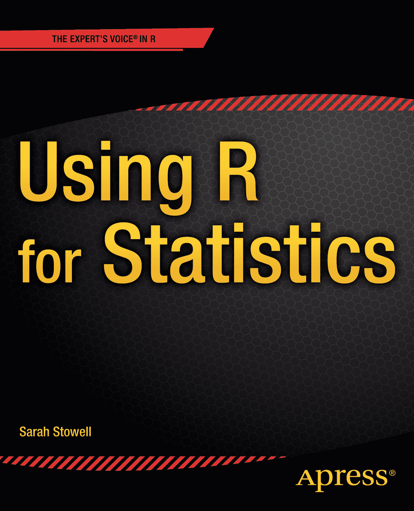
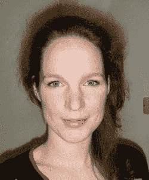

# 使用 R 进行统计

ISBN 978-1-4842-0140-4  
电子 ISBN 978-1-4842-0139-8  
DOI 10.1007/978-1-4842-0139-8  
© Apress 2014

总裁兼出版人：Paul Manning  
首席编辑：Steve Anglin  
开发编辑：Matthew Moodie 和 Chris Nelson  
技术审校：Myron Hlynka、Wen Sui Liu 和 Larry Pace  
编辑委员会：Steve Anglin、Mark Beckner、Ewan Buckingham、Gary Cornell、Louise Corrigan、Jim DeWolf、Jonathan Gennick、Jonathan Hassell、Robert Hutchinson、Michelle Lowman、James Markham、Matthew Moodie、Jeff Olson、Jeffrey Pepper、Douglas Pundick、Ben Renow-Clarke、Dominic Shakeshaft、Gwenan Spearing、Matt Wade、Steve Weiss  
协调编辑：Anamika Panchoo  
文字编辑：Laura Lawrie  
排版：SPi Global  
索引编制：SPi Global  
插图：SPi Global  
封面设计：Anna Ishchenko

本书通过 Springer Science+Business Media New York 在全球图书贸易中发行，地址：233 Spring Street, 6th Floor, New York, NY 10013。电话：1-800-SPRINGER，传真：(201) 348-4505，电子邮件：`orders-ny@springer-sbm.com`，或访问 [`www.springeronline.com`](http://www.springeronline.com/)。Apress Media, LLC 是加利福尼亚州的有限责任公司，其唯一成员（所有者）是 Springer Science + Business Media Finance Inc (SSBM Finance Inc)。SSBM Finance Inc 是特拉华州的一家公司。

如需了解翻译信息，请发送电子邮件至 `rights@apress.com`，或访问 [`www.apress.com`](http://www.apress.com/)。Apress 和 friends of ED 的书籍可批量购买用于学术、企业或促销用途。大多数图书也提供电子书版本和许可证。更多信息，请参考我们的特殊批量销售–电子书许可网页：[`www.apress.com/bulk-sales`](http://www.apress.com/bulk-sales)。

作者在本书中引用的任何源代码或其他补充材料，读者可在 [`www.apress.com/9781484201404`](http://www.apress.com/9781484201404) 获取。有关如何找到本书源代码的详细信息，请访问 [`www.apress.com/source-code/`](http://www.apress.com/source-code/)。

本作品受版权保护。出版商保留所有权利，无论涉及材料的全部或部分，特别是翻译、重印、重用插图、朗读、广播、以缩微胶片或任何其他物理方式进行复制，以及信息存储检索的传输、电子改编、计算机软件，或目前已知或未来开发的类似或不同方法的权利。与评论或学术分析相关的简短摘录，或专门为在计算机系统上输入和执行而提供的材料，仅供购买者独家使用，不受此法律保留的限制。仅当符合出版商所在地现行版权法的规定时，才允许复制本出版物或其部分内容，且必须始终从 Springer 获得使用许可。使用许可可通过版权清算中心的 RightsLink 获取。违反相应版权法将受到起诉。

书中可能出现商标名称、标识和图像。对于商标名称、标识或图像的每次出现，我们不使用商标符号，仅以编辑方式使用这些名称、标识和图像，以利于商标所有者，并无意侵犯商标权。

本出版物中使用的商品名称、商标、服务标志及类似术语，即使未被标识为商标，也不应被视为对这些术语是否受专有权利保护的看法表达。

尽管本书中的建议和信息在出版时被认为是真实和准确的，但作者、编辑和出版商均不对可能出现的任何错误或遗漏承担法律责任。出版商对本书所载内容不作任何明示或暗示的保证。

## 献词

## 关于作者

Sarah Stowell 是一位常驻英国的合同统计学家，曾与三菱制药欧洲公司、MDSL International 和葛兰素史克合作。她拥有统计学硕士学位。

## 关于技术审校

Larry Pace 博士是一位统计学作家、教育工作者和顾问。他居住在南卡罗来纳州北部安德森市。他是统计学、数学、心理学、管理和领导力教授。他使用多种语言和脚本语言进行编程，包括 `R`、Visual Basic、JavaScript、C##、PHP、APL，以及在久远的过去使用过的 Fortran IV。他撰写关于统计学、计算机和技术的书籍和教程。他还发表了许多学术论文，并进行了数十次演示和讲座。他曾为康柏电脑、AT&T、施乐公司、美国海军和国际纸业提供咨询。他曾在凯泽大学、阿戈西大学、卡佩拉大学、阿什福德大学、安德森大学（他曾担任行为科学系主任）、克莱姆森大学、路易斯安那理工大学、路易斯安那州立大学什里夫波特分校、田纳西大学、康奈尔大学、罗切斯特理工学院、伦斯勒理工学院和佐治亚大学任教。

## 引言

欢迎阅读《使用 R 进行统计》。本书是为任何希望使用 `R` 进行数据分析和创建统计图表的人编写的。它适合那些对 `R` 经验较少或没有经验的人，旨在让您快速上手并运行，而无需学习所有编程细节。

### 关于 R

`R` 是一个统计分析和图形环境，也是一种编程语言。它由命令驱动，与商业化的 S-Plus®软件非常相似。`R` 以其专业外观的图形而闻名，这些图形允许完全自定义。

`R` 是开源软件，可根据 GNU 通用公共许可证免费安装。它由一群被称为 `R` 核心团队的志愿者编写和维护。

基础软件由全球 `R` 用户开发的超过 5,000 个附加包补充，其中许多用户属于学术界。这些包涵盖了广泛的统计技术，包括一些最新开发的和特定用途的技术。任何人都可以贡献附加包，这些包在添加到集合之前会经过质量检查。

在撰写本文时，`R` 的当前版本是 3.1.0。

### 你将学到什么

本书旨在为在 `R` 中执行流行的统计方法提供直接、实用的指导。仅简要探讨 `R` 的编程方面。

阅读本书后，你将能够：

- 导航 `R` 系统
- 输入和导入数据
- 操作数据集
- 计算汇总统计量
- 创建统计图表并自定义其外观
- 执行假设检验，如 t 检验和方差分析
- 构建回归模型
- 通过使用附加包访问额外功能
- 创建自己的函数

## 预备知识

尽管本书包含对统计学方法的简要说明及使用示例，但本书并非旨在教授统计学。因此，你需要具备一定的先前知识。你应该能够根据自身目的选择最合适的统计方法，并解读分析结果。同时，你也需要对常见的统计术语和概念有所了解。如果你对自己正在使用的任何方法没有把握，建议将本书与更详细的统计学书籍配合使用。

本书不要求读者具备 `R` 语言或编程知识，因此对于更习惯使用点击式软件包的用户来说十分理想。你只需具备基本的计算机技能并熟悉自己的操作系统即可。

## 本书约定

本书采用以下排版约定：

*   等宽字体用于区分所有 `R` 命令及其输出与正文内容。
*   标准等宽字体用于内置 `R` 函数名、参数名、语法、特定数据集和变量名，以及可直接逐字复制的命令其他部分。
*   斜体等宽字体用于通用数据集和变量名，以及需替换为用户自定义值的命令其他部分。
*   由于页面宽度限制，有时无法在一行内完整显示命令。此时，命令将在下一行继续并以缩进形式呈现。遇到这种情况，你仍应在控制台中作为单行输入。
*   与正文分离的文本框包含对统计理论或方法的提示。
*   实操示例将以独立的编号章节呈现。

## 本书使用的数据集

`R` 附带大量示例数据集，打开软件后即可使用。本书将使用其中若干数据集进行演示说明。

此外，全书还使用了其他一些数据集，详情见附录 C。这些数据集可在[`www.apress.com/9781484201404`](http://www.apress.com/9781484201404)下载。

## 联系作者

如果你有任何建议或反馈，我期待你的来信。你可以发送邮件至`'s.stowell@instantr.com'`与我联系。

## 致谢

首先，我要感谢 Apress 团队，特别是：首席编辑 Steve Anglin，他让我有机会与 Apress 合作；协调编辑 Anamika Panchoo 和 Mark Powers，他们让我按时推进工作；发展编辑 Chris Nelson，他教会了我很多写作技巧；技术编辑 Larry Pace，他为提升本书质量提出了许多宝贵建议；以及许多我未曾谋面但亲眼见证他们为成品付出巨大努力的其他成员。

我还要感谢为示例提供数据的 Andrés Barnett、James Sedgwick 和 Therese Stukel，以及我的丈夫 Timothy Baldock 和朋友们——Jemma-Kay Johnstone、Christopher Gilmour、Nina Farrell、Chris Brown、Artur Kyral 和 Eddie Chung，他们在项目初期提供了各种帮助。