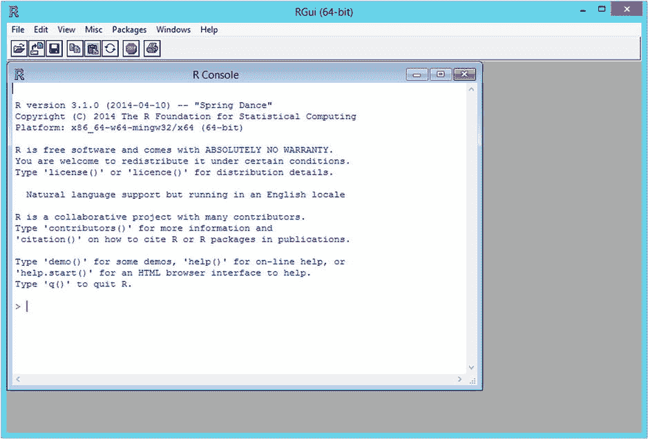
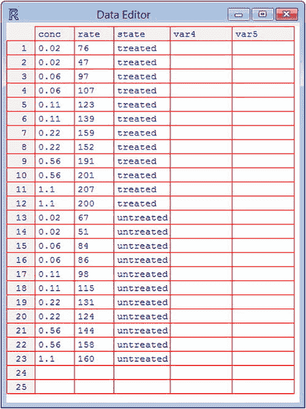
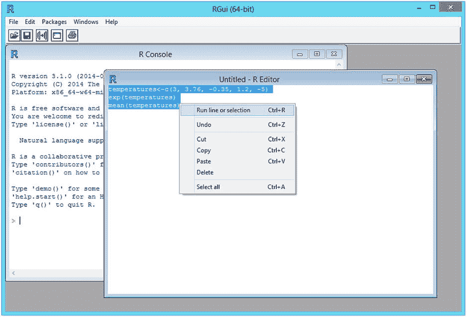
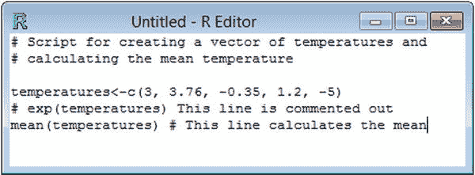

# 1. R 语言基础

R 是一个统计分析与图形处理环境，其功能范围可与 SAS、SPSS、Stata 和 S-Plus 等软件包相媲美。基础安装已涵盖所有最常用的统计技术，例如单变量分析、分类数据分析、假设检验、广义线性模型、多变量分析以及时间序列分析。它还具有出色的统计图形生成功能。基础安装未包含的任何功能，通常都能由数以千计的附加软件包之一来提供。

由于 R 是基于命令行操作的，掌握起来可能比点击式风格的软件需要更长的时间。然而，你付出的努力将换来软件更高的灵活性，以及使用最新开发方法的权限。

为了帮助你入门，本章将介绍 R 系统。你将学习以下内容：

-   下载并安装 R
-   熟悉界面
-   开始输入命令
-   了解不同类型的 R 文件
-   熟悉本书中将使用的所有重要技术术语

如果你是 R 语言新手，我建议你通读整章，这将为你打下坚实的基础。

## 下载与安装 R

R 软件可从 R 官方网站免费获取。Windows 和 Mac 用户应按照以下说明下载安装文件：

访问 R 项目网站 [`www.r-project.org`](http://www.r-project.org/)。点击 CRAN 链接（位于左侧）。你将看到一个托管 R 安装文件的站点列表（镜像站点）。选择一个离你较近的站点。选择你的操作系统。这里有适用于 Windows、Mac 和 Linux 操作系统的安装文件。如果下载 Windows 版 R，系统会要求你从基础版或贡献版中选择。请选择基础版。点击链接下载 R 安装文件，并将其保存到计算机上的合适位置。

要在 Windows 和 Mac OS 环境下安装 R，请打开安装文件并按照安装向导的说明进行操作。你可以选择自定义安装，但如果你是 R 新手，我建议你使用标准安装设置。如果你要在联网的计算机上安装 R，可能需要联系系统管理员获得许可后才能进行安装。

对于 Linux 用户，最简单的安装方式是通过包管理器。你可以通过搜索"r-base-core"来找到 R。详细的安装说明可在安装文件所在的同一位置找到。

如果你具备必要的技术知识，也可以从源代码编译该软件。详细的指南可在 [`www.stats.bris.ac.uk/R/doc/manuals/R-admin.pdf`](http://www.stats.bris.ac.uk/R/doc/manuals/R-admin.pdf) 找到。

## 界面熟悉

安装完软件并首次打开后，你将看到如图 1-1 所示的 R 界面。



图 1-1. R 界面

有多个下拉菜单和按钮，但与点击式统计软件包不同，你只会用它们来进行一些辅助操作，比如打开和保存 R 文件、设置偏好以及加载附加软件包。所有主要任务（如导入数据、执行统计分析和创建图表）都将通过向 R 输入命令来完成。

R 控制台窗口是你输入命令的地方。同时，输出结果和任何错误信息也会显示在此处。之后你还会使用其他窗口，如数据编辑器、脚本编辑器和图形设备。

## R 控制台与命令提示符

现在，请将注意力转向 R 控制台窗口。每次启动 R 时，控制台窗口中都会显示一些与版权及其他问题相关的文本，如图 1-1 所示。如果你觉得控制台中的文本难以阅读，可以通过选择"编辑"菜单中的"GUI 偏好设置"来进行调整。这将打开一个对话框，允许你更改控制台文本的大小和字体，以及其他选项。

在启动时控制台中显示的所有文本下方，你会看到命令提示符，它显示为红色，看起来像这样：

`>`

命令提示符告诉你 R 已准备好接收你的命令。

尝试在提示符后输入以下命令并按回车键：

`> 8-2`

R 会在控制台的下一行给出如下输出：

`[1] 6`

`>`

这里的`[1]`表示你正在查看的是输出的第几个分量，由于输出只有一个分量，所以现阶段这不重要。接着是计算结果，即 6。请注意，所有输出都以蓝色显示，以区别于你输入的命令。

输出之后会显示另一个提示符`>`，告诉你 R 已完成命令处理，准备接收下一条命令。如果在输入命令后没有看到命令提示符，可能是因为你输入的命令不完整。尝试在命令提示符后输入以下不完整的命令：

`> 8-`

R 会响应一个加号：

`+`

如果你看到加号，意思是需要输入命令的剩余部分并按回车键。或者，你可以按 Esc 键取消该命令并返回到命令提示符。

另一个看不到命令提示符的情况是 R 仍在执行任务。通常这段时间可以忽略不计，但对于更复杂的任务或涉及大型数据集的任务，可能需要一些等待时间。如果一个命令执行时间远超预期，你可以按 Esc 键取消它。

从现在开始，在展示输出时将省略命令提示符。

表 1-1 显示了用于表示基本算术运算的符号。

表 1-1. 算术运算符

| 运算 | 符号 |
| --- | --- |
| 加法 | `+` |
| 减法 | `-` |
| 乘法 | `*` |
| 除法 | `/` |
| 乘方 | `^` |

如果一个命令包含多个算术运算符，它们会按照通常的优先级顺序求值，即先计算乘方（幂）符号，然后是除法，接着是乘法，最后是加法和减法。如有必要，你也可以添加括号来控制优先级。例如，命令：

`> 3²+6/3+2`

给出的结果是：

`[1] 13`

而命令：

`> (3²+6)/(3+2)`

给出的结果是：

`[1] 3`

如果你想重复一个命令，可以使用键盘上的向上和向下箭头键滚动浏览之前输入的命令。你可以在按回车键之前编辑该命令。这意味着你无需为了纠正一个小错误而重新输入整个命令，当你开始使用更长、更复杂的命令时，你会发现这非常有用。

### 函数

为了执行除基本算术运算之外的任何操作，你都需要使用函数。函数是一组已被命名的命令，它们共同执行特定任务并产生某种输出。通常，函数还需要某种数据作为输入。

R 语言拥有许多内置函数，可用于执行各种任务，从简单的数值四舍五入到导入文件以及执行复杂的统计分析。你将在本书中全程用到这些函数。你也可以创建自己的函数，这在第 12 章中会简要介绍。

每当使用函数时，你需要输入函数名，后跟圆括号。函数所需的任何输入都放在括号内。

一个无需任何输入的函数示例是 `date` 函数，它会返回你计算机时钟的当前日期和时间。

```
> date()
[1] "Thu Apr 10 20:59:26 2014"
```

一个需要输入的简单函数示例是 `round` 函数，它用于对数字进行四舍五入。所需的输入是你想要四舍五入的数字。单个输入项称为一个参数。

```
> round(3.141593)
[1] 3
```

正如你所见，`round` 函数会将给定数字四舍五入到最接近的整数，但你也可以用它来将数字四舍五入到不同的精度级别。下面的命令将同一个数字四舍五入到两位小数：

```
> round(3.141593, digits=2)
[1] 3.14
```

通过添加一个指定所需小数位数的额外参数，我们就能改变 `round` 函数的行为。当你向一个函数提供多个参数时，必须用逗号将它们分隔开。每个参数都有一个名称。在这个例子中，指定小数位数的参数叫做 `digits`。通常你不需要指定参数的名称，因为 R 语言能够根据它们的值和排列顺序识别它们。因此，对于 `round` 函数，以下命令也是可接受的：

```
> round(3.141593, 2)
```

有些参数是可选的，而有些则是函数正常工作所必需的。对于 `round` 函数，要四舍五入的数字（本例中是 3.141593）是必需参数，没有它函数将无法工作。`digits` 参数是可选的。如果你不提供它，R 会假定其默认值为零。

R 语言中的每个函数都附带一个帮助文件，你可以通过输入以下命令来查看：

```
> help(函数名)
```

帮助文件会详细说明该函数的所有参数，包括它们是必需还是可选的，以及它们的默认值是什么。

表 1-2 展示了一些有用的数学函数。

表 1-2. 有用的数学函数

| 用途 | 函数 |
| --- | --- |
| 指数 | `exp` |
| 自然对数 | `log` |
| 以 10 为底的对数 | `log10` |
| 平方根 | `sqrt` |
| 余弦 | `cos` |
| 正弦 | `sin` |
| 正切 | `tan` |
| 反余弦 | `acos` |
| 反正弦 | `asin` |
| 反正切 | `atan` |
| 四舍五入 | `round` |
| 绝对值 | `abs` |
| 阶乘 | `factorial` |

### 对象

在 R 语言中，对象是被赋予名称并存储在内存中的一些数据。这些数据可以是任何东西，从一个单独的数字到一整个包含混合类型数据的表格。

#### 简单对象

你可以使用赋值运算符来创建对象，它看起来像这样：

```
<-
```

例如，要创建一个名为 `height` 的对象，用于保存值 `72.95`（一个人的身高，单位为英寸），可以使用以下命令：

```
> height<-72.95
```

创建新对象时，你必须选择一个对象名称，该名称必须：

# R 语言对象

R 语言中的对象名称必须满足以下条件：

*   仅由大写和小写字母、数字、下划线 (`_`) 和点号 (`.`) 组成
*   以大写或小写字母或点号 (`.`) 开头
*   不是 R 语言的保留字（输入 `help(reserved)` 可查看这些保留字列表）

R 语言是区分大小写的，因此 `height`、`HEIGHT` 和 `Height` 都是不同的对象名称。

如果你选择的名称已被使用，你将用新对象覆盖旧对象。R 语言在执行此操作时不会给出任何警告。

要查看已创建对象的内容，请输入该对象名称：

```
> height
[1] 72.95
```

一旦你创建了一个对象，就可以用它来代替其所包含的信息。例如，作为函数的输入：

```
> log(height)
[1] 4.289774
```

除了创建具有特定值的对象外，你还可以将函数或计算的结果直接保存到一个新对象中。例如，下面的命令将 `height` 对象的值从英寸转换为厘米，并将结果保存到一个名为 `heightcm` 的新对象中：

```
> heightcm<-round(height*2.54)
```

请注意，当你将函数或计算的输出赋值给一个对象时，R 语言不会显示该输出。要查看它，你必须通过输入对象名称来查看对象的内容。

要更改对象的内容，只需用一个新值覆盖它即可：

```
> height<-69.45
```

像这样的对象被称为数值对象，因为它们包含数字。你还可以创建其他类型的对象，例如字符对象，它包含任意键盘字符的组合，称为字符串。创建字符对象时，请将字符串用引号括起来：

```
> string1<-"Hello!"
```

你可以使用双引号或单引号来括起字符串，只要它们类型一致即可。要在字符串中包含引号，请在引号前加上反斜杠（这称为转义序列）：

```
> string2<-"I said \"Hello!\""
```

到目前为止，我们仅讨论了包含单个数据值的简单对象，但你也可以创建更复杂的对象类型。两种重要的类型是向量和数据框。向量是一个包含多个相同类型数据值的对象。数据框是一个用于保存整个数据集的对象。向量和数据框将在以下章节中更详细地讨论。

## 向量

向量是一个对象，它能容纳多个`同一数据类型`的值，并按特定顺序排列。你可以通过一个名为 `c` 的特殊函数来创建向量。例如，假设你在随机选择的五个地点测量了摄氏温度，并记录了数据：3, 3.76, -0.35, 1.2, -5。要将这些数据保存到一个名为 `temperatures` 的向量中，请使用以下命令：

```
> temperatures<-c(3, 3.76, -0.35, 1.2, -5)
```

你可以像查看其他对象一样，通过输入向量名来查看其内容。

```
> temperatures
[1]  3.00  3.76 -0.35  1.20 -5.00
```

向量中值的数量称为其长度。你可以使用 `length` 函数来检查向量的长度：

```
> length(temperatures)
[1] 5
```

向量中的每个数据值在向量内部都有一个位置，你可以使用方括号来引用该位置。这被称为中括号表示法。例如，你可以使用以下命令查看 `temperatures` 的第三个成员：

```
> temperatures[3]
[1] -0.35
```

如果你有一个大型向量（在显示时，向量的值会填满控制台窗口的多行），侧边的索引会告诉你每行从向量的第几个成员开始。例如，下面的向量包含二十七个值。侧边的索引显示，第二行从第十一个成员开始，第三行从第二十一个成员开始。这可以帮助你确定向量中每个值的位置。

```
[1]   0.077  0.489  1.603  2.110  2.625  1.019  1.100  1.729  2.469 -0.125
[11]  1.931  0.155  0.572  1.160 -1.405  2.868  0.632 -1.714  2.615  0.714
[21]  0.979  1.768  1.429 -0.119  0.459  1.083 -0.270
```

如果你将一个向量作为输入提供给一个设计用于处理单个数字的函数（例如 `exp` 函数），R 会将该函数分别应用于向量的每个成员，并输出另一个向量：

```
> exp(temperatures)
[1] 20.085536923 42.948425979  0.704688090  3.320116923  0.006737947
```

有些函数是专门为向量设计的，它们会共同使用向量中的所有成员来生成一个单一的值作为输出。一个例子是 `mean` 函数，它计算向量中所有值的平均值：

```
> mean(temperatures)
[1] 0.522
```

`mean` 函数和其他统计汇总函数将在第 5 章中详细讨论。

与基本对象一样，向量可以存储不同类型的数据值，例如数字或字符串。但是，向量中的所有成员必须是同一类型。如果你尝试创建一个同时包含数字和字符的向量，R 会将任何数值转换为字符。数字的字符表示形式会被视为文本，不能用于计算。

## 数据框

数据框是一种适合保存数据集的对象类型。数据框由几个长度相同的向量组成，这些向量垂直显示并并排排列。这形成了一个矩形网格，其中每一列都有一个名称，并包含一个向量。尽管数据框一列中的所有值必须类型相同，但不同列可以保存不同类型的数据（例如数字或字符串）。这使得它们成为存储数据集的理想工具，每一列保存一个变量，每一行保存一个观测值。

在第 2 章中，你将学习如何创建新的数据框来保存你自己的数据集。现在，R 附带了一些数据集供你实验。其中之一叫做 `Puromycin`，我们将在此用它来演示数据框的概念。你可以像查看任何其他对象一样，通过在命令提示符下输入其名称来查看 `Puromycin` 数据集的内容：

```
> Puromycin
```

R 输出数据框的内容：

```
conc     rate         state
1     0.02       76       treated
2     0.02       47       treated
3     0.06       97       treated
4     0.06      107       treated
5     0.11      123       treated
6     0.11      139       treated
7     0.22      159       treated
8     0.22      152       treated
9     0.56      191       treated
10    0.56      201       treated
11    1.10      207       treated
12    1.10      200       treated
13    0.02       67     untreated
14    0.02       51     untreated
15    0.06       84     untreated
16    0.06       86     untreated
17    0.11       98     untreated
18    0.11      115     untreated
19    0.22      131     untreated
20    0.22      124     untreated
21    0.56      144     untreated
22    0.56      158     untreated
23    1.10      160     untreated
```

该数据集有三个变量，分别名为 `conc`、`rate` 和 `state`，包含 23 个观测值。

了解如何引用数据框的不同组成部分非常重要。要通过名称引用数据集中的特定变量，可以使用美元符号（`$`）：

```
> Puromycin$rate
[1]  76  47  97 107 123 139 159 152 191 201 207 200  67  51  84  86  98 115 131
[20] 124 144 158 160
```

这很有用，因为它允许你将函数应用于该变量，例如，计算 `rate` 变量的平均值：

```
> mean(Puromycin$rate)
[1] 126.8261
```

除了使用美元符号按名称选择变量外，你还可以使用中括号表示法来引用数据框的各个部分。中括号表示法可以被视为数据框的坐标系统。你在方括号内提供行号和列号：

```
> dataset[ r , c ]
```

例如，要使用中括号表示法选择 `Puromycin` 数据集第二列第六行的值，请使用命令：

```
> Puromycin[6,2]
[1] 139
```

你可以通过将列号留空来选择整行。例如，选择 `Puromycin` 数据集的第六行：

## 数据选择与编辑

### 选择行列

类似地，要选择整列，请将行号留空。例如，选择 `Puromycin` 数据集的第二列：

```r
> Puromycin[,2]
[1]  76  47  97 107 123 139 159 152 191 201 207 200  67  51  84  86  98 115 131
[20] 124 144 158 160
```

在选择整列时，你也可以完全省略逗号，只给出列号。

```r
> Puromycin[2]
rate
1       76
2       47
3       97
4      107
5      123
6      139
7      159
8      152
9      191
10     201
11     207
12     200
13      67
14      51
15      84
16      86
17      98
18     115
19     131
20     124
21     144
22     158
23     160
```

请注意，命令 `Puromycin[2]` 生成一个单列的数据框，而命令 `Puromycin[,2]` 生成一个向量。

你可以使用减号（`-`）来排除数据框的一部分，而不是选择它。例如，排除第一列：

```r
> Puromycin[-1]
```

你可以使用冒号（`:`）来选择行或列的范围。例如，选择第六到第十行：

```r
> Puromycin[6:10,]
```

```r
conc    rate          state
6       0.11     139        treated
7       0.22     159        treated
8       0.22     152        treated
9       0.56     191        treated
10      0.56     201        treated
```

要选择非连续的行或列，请在括号内使用 `c()` 函数。例如，选择第一列和第三列：

```r
> Puromycin[,c(1,3)]
```

```r
conc          state
1       0.02        treated
2       0.02        treated
3       0.06        treated
4       0.06        treated
5       0.11        treated
6       0.11        treated
7       0.22        treated
8       0.22        treated
9       0.56        treated
10      0.56        treated
11      1.10        treated
12      1.10        treated
13      0.02      untreated
14      0.02      untreated
15      0.06      untreated
16      0.06      untreated
17      0.11      untreated
18      0.11      untreated
19      0.22      untreated
20      0.22      untreated
21      0.56      untreated
22      0.56      untreated
23      1.10      untreated
```

你也可以使用对象名称代替数字：

```r
> rownum<-c(6,8,14)
> colnum<-2
> Puromycin[rownum,colnum]
[1] 139 152  51
```

甚至可以使用函数：

```r
> Puromycin[sqrt(25),]
```

```r
conc    rate          state
5     0.11     123        treated
```

最后，你可以通过变量名和括号表示法的组合来引用特定条目。例如，选择 `rate` 变量的第十个观测值：

```r
> Puromycin$rate[10]
[1] 201
```

你可以使用 `help()` 函数查看关于 `Puromycin` 数据集（或 R 中包含的任何其他数据集）的更多信息：

```r
> help(Puromycin)
```

### 数据编辑器

作为在命令窗口中查看数据集的替代方案，R 提供了一个名为数据编辑器的电子表格风格查看器，允许你查看和编辑数据框。要在数据编辑器窗口中打开 `Puromycin` 数据集，请使用以下命令：

```r
> fix(Puromycin)
```

或者，你可以从“编辑”菜单中选择“数据编辑器”，然后在提示时输入要查看的数据集名称。数据集将在数据编辑器窗口中打开，如图 1-2 所示。你可以在此处对数据进行更改。完成后，关闭编辑器窗口以应用更改。



图 1-2. 数据编辑器窗口

虽然数据编辑器对于进行微小更改很有用，但通常有更高效的方法来操作数据集。这些将在第 3 章中介绍。

## 工作区管理

工作区是包含你在会话中创建的所有对象的虚拟区域。要查看工作区中所有对象的列表，请使用 `objects()` 函数：

```r
> objects()
```

你可以使用 `rm()` 函数从工作区中删除对象：

```r
> rm(height, string1, string2)
```

要删除工作区中的所有对象，请使用以下命令：

```r
> rm(list=objects())
```

你可以将工作区的内容保存到文件中，这允许你在其他时间恢复使用它们。

Windows 用户可以通过选择“文件”然后从下拉菜单中选择“保存工作区”，然后以常规方式命名并保存文件。请确保文件名具有 `.RData` 扩展名，因为它不会自动添加。

R 会在每个新会话开始时自动加载最近保存的工作区。你也可以通过选择“文件”，然后从下拉菜单中选择“打开工作区”，并以常规方式选择文件来打开之前保存的工作区。打开工作区后，其中的所有对象都可供你使用。

Mac 用户可以在“工作区”菜单中找到用于保存和加载工作区的选项。

Linux 用户可以通过输入以下命令来保存工作区：

```r
> save.image("`/home/Username/folder/filename.RData`")
```

文件路径可以是绝对路径，也可以是相对于主目录的路径。

要加载工作区，请使用以下命令：

```r
> load("`/home/Username/folder/filename.RData`")
```

## 错误与警告消息

有时 R 在尝试执行你的命令时会遇到问题。发生这种情况时，控制台窗口中会显示一条消息，通知你问题的相关信息。这些消息分为两种类型，即错误消息和警告消息。

错误消息以文本 `Error:` 开头，并且在 R 完全无法执行命令时显示。

错误消息最常见的原因之一是给出了无效的 R 命令，因为它包含 R 无法识别的符号，或者因为符号缺失或位置错误。这称为语法错误。在以下示例中，错误是由命令末尾多余的右括号引起的：

```r
> round(3.141592))
Error: unexpected ')' in "round(3.141592))"
```

错误的另一个常见原因是输错了对象名称，导致引用了不存在的对象。请记住，对象名称区分大小写：

```r
> log(object5)
Error: object 'object5' not found
```

同样的规则也适用于函数名称，它们也是区分大小写的：

```r
> Log(3.141592)
Error: could not find function "Log"
```

错误的第三个常见原因是向函数提供了错误的输入类型，例如，在需要向量的地方提供了数据框，或者在需要数字的地方提供了字符串：

```r
> log("Hello!")
Error in log("Hello!") : Non-numeric argument to mathematical function
```

警告消息以文本 `Warning:` 开头，并告知你一些没有阻止命令完成，但你应该注意的问题。例如，下面的命令计算了 `temperatures` 向量中每个值的自然对数。但是，并非所有值都能计算对数，因为其中一些是负数：

```
> log(temperatures)
[1] 1.0986123 1.3244190       NaN 0.1823216       NaN
Warning message:
In log(temperatures) : NaNs produced
```

尽管 R 仍然能够执行命令并生成输出，但它会显示一条警告消息，以提醒你注意此问题。

## 脚本文件

脚本文件是一种文本文件，允许你保存命令，以便轻松回顾、编辑和重复使用。

要创建新的脚本文件，请从`文件`菜单中选择`新建脚本`。Mac 用户应从`文件`菜单中选择`新建文档`。这将打开一个新的`R 编辑器`窗口，你可以在其中输入命令。Linux 版本的`R`不包含脚本编辑器，但可以使用许多外部编辑器。要查看这些编辑器的列表，请访问[`www.sciviews.org/_rgui/projects/Editors.html`](http://www.sciviews.org/_rgui/projects/Editors.html)。

若要在 Windows 环境下从`R 编辑器`运行命令，请将光标放在要运行的行上，右键单击并选择`运行当前行或所选内容`。你也可以使用快捷键`Ctrl+R`。或者，单击运行按钮，其外观如下：


要运行多条命令，请高亮选择一组命令，然后右键单击并选择`运行当前行或所选内容`，如图 1-3 所示。



图 1-3. 在 Windows 环境中从脚本文件运行命令

Mac 用户可以通过按下`Cmd+Return`来运行当前行或所选命令。

运行所选命令后，这些命令会被提交到命令窗口并逐一执行。

如果你的脚本文件将被他人使用，或者你可能会在很长时间后重新查看它，添加一些注释会很有帮助。注释是额外的文本，不属于命令本身，用于做笔记和解释命令。

通过在注释前输入井号（`#`）来为脚本文件添加注释。`R`会忽略同一行中井号后的所有文本。这意味着，如果你运行一段包含注释的命令，注释不会导致错误。图 1-4 展示了包含注释的脚本文件。



图 1-4. 包含注释的脚本文件

你可以通过选择`文件`，然后选择`保存`来保存脚本文件。如果`文件`菜单中没有显示`保存`选项，那是因为你没有将焦点放在脚本编辑器窗口上，需要先选中它。文件将以`.R`作为扩展名保存。类似地，你可以通过选择`文件`，然后选择`打开脚本`，再按常规方式选择文件来打开之前保存的脚本文件。

Mac 用户可以通过点击脚本编辑器窗口左上角的图标来保存脚本文件，并通过从`文件`菜单中选择`打开文档`来打开之前保存的脚本文件。

## 总结

本章的目的是让你熟悉 R 界面以及本书中会用到的一些编程术语。在继续之前，请确保你理解以下术语：

- `R 控制台` — 你输入命令并显示输出、错误或警告信息的窗口。

- `命令` — 对 R 的键入指令。

- `命令提示符` — `R`用于表示已准备好接收命令的符号，其外观为：`>`。

- `函数` — 一组被赋予名称并共同执行特定任务的命令。

- `参数` — 作为输入提供给函数的一个值或一段数据。

- `对象` — 已存储并赋予名称的一段数据或信息。

- `向量` — 包含多个相同类型数据值并按特定顺序排列的对象。

- `数据框` — 一种适合保存数据集的对象类型。

- `工作空间` — 包含会话中创建的所有对象的虚拟区域，可保存为扩展名为`.RData`的文件。

- `脚本文件` — 扩展名为`.R`的文件，用于保存命令和注释。

现在你已经熟悉了 R 界面，我们可以进入第 2 章，你将学习如何将数据导入 R。
