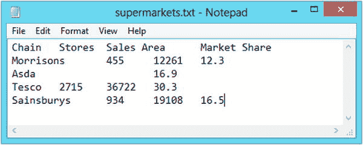
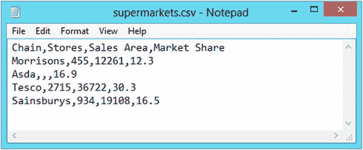
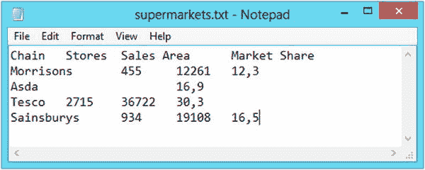
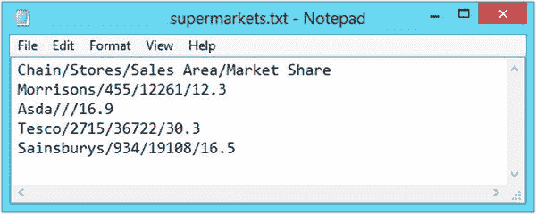
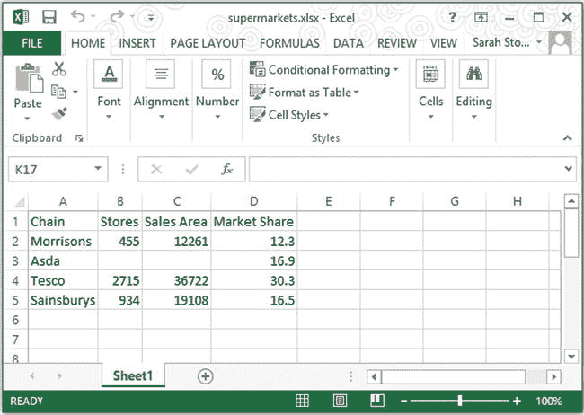
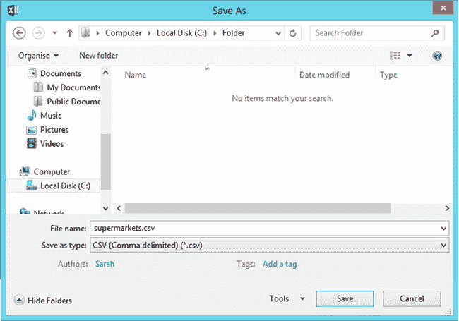

# 2. 处理数据文件

在开始任何统计分析之前，你需要学习处理外部数据文件，以便导入数据。`R`能够读取逗号分隔值（CSV）、制表符分隔和数据库交换格式（DIF）文件格式，这些是统计和数据库软件包之间传输数据常用的标准文件格式。借助一个名为`foreign`的附加包，可以导入更多类型的文件。

无论你是在纸上或电子表格中自行记录数据，还是从他人那里收到数据文件，本章将解释如何将数据导入 R。

你将学习如何：

- 通过直接输入值来录入数据
- 导入纯文本文件，包括 CSV、制表符分隔和 DIF 文件格式
- 先将 Excel 文件转换为 CSV 格式再导入
- 导入以其他软件包（如 SPSS 或 Stata）特定文件类型存储的数据集
- 使用相对文件路径
- 将数据集导出为 CSV 或制表符分隔文件

## 直接输入数据

如果你有一个尚未以电子形式记录的小数据集，你可能希望直接将数据输入到 R 中。

考虑表 2-1 中所示的数据集，它提供了英国四家超市连锁店的一些数据。这代表了一个典型数据集，其中列代表变量，每一行包含一个观测值。

表 2-1. 英国四大超市连锁店数据（2011 年）；更多详情请参见附录 C

| 连锁店 | 门店数 | 销售面积（千平方英尺） | 市场份额 % |
| --- | --- | --- | --- |
| Morrisons | 439 | 12261 | 12.3 |
| Asda | | | 16.9 |
| Tesco | 2715 | 36722 | 30.3 |
| Sainsbury’s | 934 | 19108 | 16.5 |

要将数据集输入 R，第一步是使用`c`函数为每个变量创建一个数据值向量，如第 1 章“向量”部分所述。因此，对于超市数据，输入四个变量：

```R
> Chain<-c("Morrisons", "Asda", "Tesco", "Sainsburys")
> Stores<-c(439, NA, 2715, 934)
> Sales.Area<-c(12261, NA, 36722, 19108)
> Market.Share<-c(12.3, 16.9, 30.3, 16.5)
```

每个向量的长度应相同，即包含相同数量的值。如果数据值缺失，请在其位置输入字符`NA`。请记住，为非数值的值加上引号，如`Chain`变量所示。

为每个变量创建向量后，使用`data.frame`函数将它们组合成一个数据框：

```R
> supermarkets<-data.frame(Chain, Stores, Sales.Area, Market.Share)
```

你可以通过输入数据框的名称来检查数据集是否正确输入：

```R
> supermarkets
        Chain   Stores   Sales.Area   Market.Share
1   Morrisons      439        12261           12.3
2        Asda       NA           NA           16.9
3       Tesco     2715        36722           30.3
4  Sainsburys      934        19108           16.5
```

创建数据框后，各个向量作为独立的对象仍存在于工作空间中。为避免混淆，你可以使用`rm`函数删除它们：

```R
> rm(Chain, Stores, Sales.Area, Market.Share)
```

## 导入纯文本文件

将数据传输到 R 最简单的方法是使用纯文本文件，有时也称为扁平文本文件。这类文件由无额外格式的纯文本组成，可以用记事本（Windows）、TextEdit（Mac）或 gedit（Linux）等纯文本编辑器读取。有多种标准格式可用于在文本文件中存储电子表格数据，这些格式使用特定符号来表示数据的布局，包括：

* 逗号分隔值或逗号定界（`.csv`）文件
* 制表符分隔（`.txt`）文件
* 数据交换格式（`.dif`）文件

这些文件格式非常有用，因为它们可以被所有主流的统计和数据库软件包读取，从而便于在不同软件之间轻松传输数据集。

以下小节将解释如何从这些标准文件格式将数据集导入到 R 中。

### CSV 和制表符分隔文件

逗号分隔值（CSV）文件是在纯文本文件中存储电子表格数据最流行的方法。在 CSV 文件中，数据值按每行一个观测值排列，并用逗号分隔每行内的数据值（因此得名）。有时，当数据本身包含逗号时，会使用分号代替逗号。制表符分隔文件格式与 CSV 格式非常相似，只是数据值使用水平制表符而非逗号进行分隔。图 2-1 和 2-2 展示了超市数据在 CSV 和制表符分隔格式下的显示效果。这些文件可在本书的下载资源中找到（`www.apress.com/9781484201404`）。



图 2-2. 以制表符分隔文件格式保存的超市数据集



图 2-1. 以 CSV 文件格式保存的超市数据集

你可以使用 `read.csv` 函数导入 CSV 文件：

```
> dataset1 <- read.csv("C:/folder/filename.csv")
```

此命令从文件路径 `C:/folder/filename.csv` 导入数据，并将其保存至名为 `dataset1` 的数据框。

请记住，在选择数据集名称时，需遵循常规的对象命名规则（参见第 1 章中的“对象”部分）。建议选择一个简短但有意义的名称来描述文件中的数据。

文件路径 `C:/folder/filename.csv` 是 CSV 文件在硬盘、网络驱动器或存储设备上的位置。注意，必须使用正斜杠（而非 Windows 使用的反斜杠）来表示目录，并且必须将文件路径括在引号内。对于 Mac 和 Linux 用户，文件路径将以正斜杠开头，例如 `/Users/username/folder/filename.csv`。

如果数据集成功导入，则没有输出信息，R 会在导入完成后显示命令提示符。否则，你将看到一条解释导入失败原因的错误消息。假设没有出现问题，你的数据将存储在名为 `dataset1` 的数据框中。你可以在命令提示符下输入数据集名称来查看和检查数据，或者使用数据编辑器打开它。

对于导入制表符分隔文件，有一个类似的函数叫 `read.delim`：

```
> dataset1 <- read.delim("C:/folder/filename.txt")
```

当使用 `read.csv` 或 `read.delim` 函数导入文件时，R 会默认文件第一行的条目是数据集的变量名称。有时 R 会调整变量名称以使其符合命名规则（参见第 1 章中的“对象”部分），并确保它们在数据集中是唯一的。

如果文件不包含任何变量名称，请将 `header` 参数设置为 `F`（表示假），如下所示。这可以防止 R 将数据的第一行用作变量名称：

```
> dataset1 <- read.csv("C:/folder/filename.csv", header=F)
```

当将 `header` 参数设置为 `F` 时，R 会分配通用的变量名称，如 `V1`、`V2` 等。或者，你也可以使用 `col.names` 参数提供自己的名称：

```
> dataset1 <- read.csv("C:/folder/filename.csv", header=F, col.names=c("Name1", "Name2", "Name3"))
```

使用 `col.names` 参数时，请确保提供的名称数量与文件中的变量数量相同。否则，你可能会看到错误消息，或者发现某些变量未被命名。

在 CSV 或制表符分隔文件中，缺失数据通常由空白字段表示。然而，有些文件可能使用符号或字符，例如小数点、数字 9999 或单词 `NULL` 作为占位符。如果是这种情况，请使用 `na.strings` 参数告诉 R 哪些字符应被解释为缺失数据：

```
> dataset1 <- read.csv("C:/folder/filename.csv", na.strings=".")
```

注意，R 会自动将字母 `NA` 解释为表示缺失数据。在数值变量（而非字符变量）中发现的空白也会被视为缺失数据。

在世界上的某些地区，数字中使用逗号代替点号来表示小数点。图 2-3 展示了一个包含此格式数字的制表符分隔文件。R 有两个专门处理此格式数据的函数，分别是 `read.csv2` 和 `read.delim2`，可以用来替代 `read.csv` 和 `read.delim` 函数。



### DIF 文件

要导入扩展名为`.dif`的数据交换格式（DIF）文件，请使用`read.DIF`函数：

```
> dataset1 <- read.DIF("C:/folder/filename.dif")
```

默认情况下，`read.DIF`函数假定文件中没有变量名称（与`read.csv`和`read.delim`函数不同）。如果文件确实包含变量名称，请将`header`参数设置为`T`（表示真），如下所示。否则，R会将变量名称视为数据值的一部分：

```
> dataset1 <- read.DIF("C:/folder/filename.dif", header=T)
```

与导入CSV和制表符分隔文件时一样，你可以使用`na.strings`参数告诉R任何应被解释为缺失数据的值：

```
> dataset1 <- read.DIF("C:/folder/filename.dif", na.string="NULL")
```

注意，如果你正在导入由Microsoft Excel创建的DIF文件，在尝试导入时可能会看到错误消息`'More rows than specified in header'; maybe use 'transpose=TRUE'`。出现此错误消息是因为某些版本的Microsoft Excel使用的是DIF文件格式的修改版本，而非标准版本。你可以通过将`transpose`参数设置为`T`来解决此问题：

```
> dataset1 <- read.DIF("C:/folder/filename.dif", transpose=T)
```

### 其他纯文本文件

除了所有可用于导入特定文件格式的函数外，R还提供了一个用于从纯文本文件导入数据的通用函数，名为`read.table`。它允许你导入任何纯文本文件，只要其中的数据按每行一个观测值的方式排列。

请考虑图2-4所示的文件，其数据按每行一个观测值的方式排列，并且数据值由正斜杠符号（`/`）分隔。



图2-4. 非标准文件类型中的超市数据

你可以使用以下命令导入该文件：

```
> dataset1 <- read.table("C:/folder/supermarkets.txt", sep="/", header=T)
```

默认情况下，`read.table`函数假定文件第一行不包含变量名（这与`read.csv`和`read.delim`函数不同）。如果文件的第一行包含变量名（如本例所示），请将`header`参数设置为`T`。

与其他导入函数一样，你可以使用`na.strings`参数告知R将哪些值解释为缺失数据：

```
> dataset1 <- read.table("C:/folder/filename.txt", sep="/", header=T, na.strings="NULL")
```

## 导入 Excel 文件

导入Microsoft Excel文件最简单的方法是先将Excel文件另存为CSV文件，然后按本章前面“CSV和制表符分隔文件”部分所述的方法进行导入。

首先在Excel中打开你的文件，确保电子表格中的数据排列正确，即每列为一个变量，每行为一个观测值。如果数据集包含变量名，则应将其放在电子表格的第一行。否则，数据值应从第一行开始。图2-5显示了超市数据在Excel文件中正确排列时的样子。



图2-5. 在Excel电子表格中正确排列数据集以便轻松转换为CSV文件格式的正确方法

为确保文件转换顺畅，请检查以下事项：

-   数据网格上方或左侧没有空单元格
-   没有合并单元格
-   列标题不超过一行
-   没有粗体、斜体或彩色文本、单元格边框或背景色等格式
-   数据值缺失的单元格保持为空
-   大数字中没有逗号（例如，1324157是可接受的，但1,324,157则不可）
-   如果使用指数（科学）记数法，格式必须正确（例如，0.00312可表示为3.12e-3或3.12E-3）
-   数值变量中没有货币、单位或百分比符号（分类变量或变量名中的符号是可以的）
-   使用减号表示负数（例如-5），而不是使用括号或红色文本
-   工作簿中只有一个工作表

数据准备好后，从“文件”菜单中选择“另存为”，将电子表格保存为CSV文件。出现“另存为”对话框时，从“保存类型”字段中选择`.csv`文件类型，如图2-6所示。然后像往常一样保存文件。Excel会提示你所有格式都将丢失，你可以接受该提示。



图2-6. 将Excel文件另存为CSV文件

现在，CSV文件已准备好，可以使用`read.csv`函数进行导入，如前文本章所述（参见“CSV和制表符分隔文件”）。

如果你无法使用Excel，也可以使用诸如`xlsx`或`xlsReadWrite`之类的附加包来直接导入Excel文件。有关使用附加包的更多详细信息，请参阅附录B。

## 从其他软件导入文件

有时你可能需要导入以其他统计软件包专用格式保存的数据集，例如SPSS或Stata数据文件。

如果你有该软件的使用权限，最简单的解决方案是使用该软件打开文件，并通过“文件”菜单中的“另存为”或“导出”选项将文件转换为CSV文件格式。文件转换为CSV格式后，你可以使用`read.csv`函数进行导入（参见本章前面的“CSV和制表符分隔文件”部分）。

如果你无法转换文件，则可以使用名为`foreign`的附加包，它允许你直接从一些流行的统计软件包生成的文件类型中导入数据。

附录A中会更详细地介绍附加包。目前，你只需知道附加包包含标准R安装中不包含的额外函数。要使用`foreign`包中的函数，你必须首先加载该包。

要加载`foreign`包，请从“包”菜单中选择“加载包”。当包列表出现后，选择“foreign”并按下“确定”。包加载后，其中的所有函数将在当前会话期间可供你使用。

表2-2列出了一些可用于导入外部文件类型的函数。

表2-2. `foreign`附加包中提供的一些函数

| 文件类型 | 扩展名 | 函数 |
| --- | --- | --- |
| 数据库格式文件 | `.dbf` | `read.dbf` |
| Stata 5至12版本数据文件 | `.dta` | `read.dta` |
| Minitab可移植工作表文件 | `.mtp` | `read.mtp` |
| SPSS数据文件 | `.sav` | `read.spss` |
| SAS传输格式 | `.xport` | `read.xport` |
| Epi Info数据文件 | `.rec` | `read.epiinfo` |
| Octave文本数据文件 | `.txt` | `read.octave` |
| 属性关系文件 | `.arff` | `read.arff` |
| Systat文件 | `.sys`, `.syd` | `read.systat` |

例如，要导入Stata数据文件，请使用以下命令：

```
> dataset1 <- read.dta("C:/folder/filename.dta")
```

你可能需要使用其他参数来确保文件被正确导入。有关使用`foreign`包中函数的更多信息，请使用`help`函数，或参考可从R项目网站`cran.r-project.org/web/packages/foreign/foreign.pdf`获取的包文档。

## 使用相对文件路径

到目前为止，我们只使用了绝对文件路径来描述数据文件的位置。绝对文件路径给出了文件的完整地址，在Windows环境中以驱动器名称（如`C:/`）开头。

你也可以使用相对文件路径，它描述的是文件相对于工作目录的位置。工作目录是R在给定相对文件路径时默认查找的目录。这在需要导入或导出大量文件且不想每次都键入完整文件路径时非常有用。要查看当前的工作目录，请使用以下命令：

```
> getwd()
```

如果你使用的是全新安装的R for Windows，工作目录将是你的“文档”文件夹，R会输出类似如下的内容：

```
[1] "C:/Users/Username/Documents"
```

对于Mac和Linux用户，默认工作目录将是你的主目录，看起来类似这样：

```
[1] "/Users/Username"
```

因此，要导入一个绝对文件路径为`C:/Users/Username/Documents/Data/filename.csv`的 CSV 文件，你可以使用以下命令：

```
> read.csv("Data/filename.csv")
```

要更改工作目录到你更喜欢的存储数据文件的位置，请使用`setwd`函数，如下所示。此更改将在当前会话的剩余时间内生效：

```
> setwd("C:/folder/subfolder")
```

## 导出数据集

R 允许您将 R 工作区中的数据集导出为 CSV 和制表符分隔的文件格式。

要将名为`dataset`的数据框导出为 CSV 文件，请使用`write.csv`函数：

```
> write.csv(dataset, "filename.csv")
```

例如，要将`Puromycin`数据集导出为名为`puromycin_data.csv`的文件，请使用以下命令：

```
> write.csv(Puromycin, "puromycin_data.csv")
```

此命令会创建文件并将其保存到您的工作目录（有关如何查找和设置工作目录，请参见上一节“使用相对文件路径”）。要将文件保存到工作目录以外的位置，请输入文件的完整路径：

```
> write.csv(dataset, "C:/folder/filename.csv")
```

如果指定位置已存在与您所选名称相同的文件，R 会直接覆盖原文件，且不会发出警告。您应事先检查目标文件夹中的文件，确保不会覆盖任何重要内容。

`write.table`函数允许您将数据导出到更广泛的文件格式中，包括制表符分隔的文件。使用`sep`参数来指定用于分隔值的字符。要将数据集导出为制表符分隔的文件，请将`sep`参数设置为`"\t"`（表示制表符）：

```
> write.table(dataset, "filename.txt", sep="\t")
```

默认情况下，`write.csv`和`write.table`函数会在文件中创建一个包含观测编号的额外列。要避免这种情况，请将`row.names`参数设置为`F`：

```
> write.csv(dataset, "filename.csv", row.names=F)
```

使用`write.table`函数时，您还可以通过`col.names`参数防止变量名出现在文件的第一行：

```
> write.table(dataset, "filename.txt", sep="\t", col.names=F)
```

### 总结

现在，您应该能够将数据导入 R 了，无论是直接输入还是从外部数据文件导入。您还应了解如何使用相对文件路径，并能够将数据集导出到外部文件。

下表总结了本章涉及的最重要的命令。

| 任务 | 命令 |
| --- | --- |
| 创建数据框 | `dataset <- data.frame(vector1, vector2, vector3)` |
| 导入 CSV 文件 | `dataset <- read.csv("filepath")` |
| 导入制表符分隔文件 | `dataset <- read.delim("filepath")` |
| 导入 DIF 文件 | `dataset <- read.DIF("filepath")` |
| 导入其他文本文件 | `dataset <- read.table("filepath", sep="?")` |
| 显示工作目录 | `getwd()` |
| 更改工作目录 | `setwd("C:/folder/subfolder")` |
| 将数据集导出为 CSV 文件 | `write.csv(dataset, "filename.csv")` |
| 将数据集导出为制表符分隔文件 | `write.table(dataset, "filename.txt", sep="\t")` |

既然您已经学会了如何将数据集导入 R，接下来我们可以进入第 3 章，该章将介绍如何为分析准备数据集。
