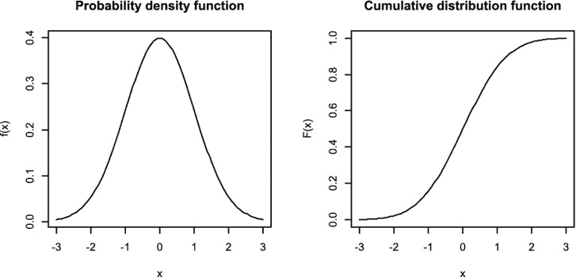

# 7. 概率分布

本章探讨概率分布主题，例如正态分布、指数分布、二项分布和泊松分布。描述概率分布有多种方式，包括给出其概率密度函数（或离散分布的概率质量函数）、累积分布函数或逆累积分布函数。这些函数的作用类似于一套统计表，因为它们允许你计算给定分布的概率和分位数。

本章还涵盖随机数生成。随机数允许你模拟数据，这对于在缺乏原始数据时尝试统计技术非常有用。

你将学习如何：

- 计算随机变量取给定值或落在给定区间内的概率
- 找到给定百分比的人口所落在的值范围
- 生成随机数

## R 语言中的概率分布

R 语言为所有常见概率分布都提供了相应的函数。对于每一种分布，都有以下四种函数：

-   概率密度函数或概率质量函数（前缀 `d`）对于离散分布，你可以使用概率质量函数来回答诸如“结果等于 x 的概率是多少？”这类问题。
-   累积分布函数（前缀 `p`）你可以使用累积密度函数来回答诸如“如果我们从给定总体中随机选择一个个体，其值小于 x，或介于 x 和 y 之间的概率是多少？”这类问题。
-   逆累积分布函数（前缀 `q`）使用逆累积分布函数来回答诸如“百分之 x 的总体成员低于哪个值？”或“百分之 x 的总体成员落在哪个值域范围内？”这类问题。
-   随机数生成器（前缀 `r`）使用随机数生成器来模拟给定分布的一个随机样本。

函数名由前缀（`d`、`p`、`q` 或 `r`）和表 7-1 中对应的分布后缀构成。例如，正态分布的累积分布函数称为 `pnorm`，指数分布的随机数生成器称为 `rexp`。

`表 7-1.` R 语言内置的标准概率分布。将分布后缀与以下前缀组合：`d` 表示概率密度函数；`p` 表示累积分布函数；`q` 表示逆累积分布函数；`r` 表示随机数生成器

| 分布 | 函数后缀 |
| --- | --- |
| Beta 分布 | `beta` |
| 二项分布 | `binom` |
| 柯西分布 | `cauchy` |
| 卡方分布 | `chisq` |
| 指数分布 | `exp` |
| F 分布 | `f` |
| 伽马分布 | `gamma` |
| 几何分布 | `geom` |
| 超几何分布 | `hyper` |
| Logistic 分布 | `logis` |
| 对数正态分布 | `lnorm` |
| 多项分布 | `multinom` |
| 负二项分布 | `nbinom` |
| 正态分布 | `norm` |
| 泊松分布 | `pois` |
| 学生 t 分布 | `t` |
| 均匀分布 | `unif` |
| 威布尔分布 | `weibull` |

### 概率密度函数与累积分布函数

概率密度函数和累积分布函数是指定随机变量概率分布的两种方式。

概率密度函数记为 `f(x)`，它给出了随机变量取值等于 x 的相对可能性。曲线下的总面积为 1。

累积分布函数记为 `F(x)`，它给出了随机变量取值小于或等于 x 的概率。在 x 处的累积分布函数值等于概率密度函数曲线下从负无穷到 x 的面积。累积分布函数的值介于 0 和 1 之间。

图 7-1 展示了标准正态分布的概率密度函数和累积分布函数。



`图 7-1.` 标准正态分布的概率密度函数和累积分布函数

### 概率密度函数与概率质量函数

对于离散分布，使用概率质量函数来求结果或观测值等于给定值 x 的概率。函数名由前缀 `d` 与表 7-1 中对应的后缀组合而成。

使用概率质量函数时，该函数所需的第一个参数始终是感兴趣的潜在结果（x），其后是分布相关的任何参数。你可以使用 `help` 函数查看这些参数。本节中的示例演示了如何使用二项分布和泊松分布的概率质量函数。

对于连续分布，概率密度函数给出 x 的相对可能性，这没有直接的解释意义。不过，你仍然可以像处理离散分布一样，通过相同的方式找到概率密度函数的值。

在第 8 章的“绘制函数”部分，你将学习如何使用 `curve` 函数来绘制概率分布的概率密度函数图。

#### 示例 7-1. 二项分布的概率质量函数

假设将一个公平的骰子掷 10 次。恰好掷出两次六点的概率是多少？

你可以使用 `dbinom` 函数来回答这个问题：

```
> dbinom(2, 10, 1/6)
[1] 0.29071
```

掷出两次六点的概率约为 0.29，即 29%。

#### 示例 7-2. 泊松分布的概率质量函数

已知某餐厅某天点龙虾的数量服从平均值为 20 的泊松分布。明天恰好有 18 只龙虾被点到的概率是多少？

你可以使用 `dpois` 函数来回答这个问题：

```
> dpois(18, 20)
[1] 0.08439355
```

恰好有 18 只龙虾被点到的概率是 8.4%。

#### 示例 7-3. 正态分布的概率密度函数

要找出均值为 5、标准差为 2 的正态分布中，`x = 2.5` 处的概率密度函数值，可以使用以下命令：

```
> dnorm(2.5, mean=5, sd=2)
[1] 0.09132454
```

在 `x = 2.5` 处的概率密度函数值为 0.091。

## 查找概率

要计算从总体中随机选取的一个成员其值小于或等于给定值 `x` 的概率，请使用相应分布的累积分布函数（`cdf`）。该函数的名称由前缀 `p` 与表 7-1 中的相关后缀组合而成。

对于正态分布，请使用 `pnorm` 函数。对于标准正态分布（均值为 0，标准差为 1），该函数无需任何额外参数。例如，要计算随机选取的值小于或等于 2.5 的概率，请使用命令：

```
> pnorm(2.5)
[1] 0.9937903
```

从输出中可以看到，概率为 0.9937903，约等于 99%。

要计算非标准正态分布的概率，请添加 `mean` 和 `sd` 参数。例如，如果一个随机变量已知服从均值为 5、标准差为 2 的正态分布，并且你想计算随机选取的一个成员其值不超过 6 的概率，请使用命令：

```
> pnorm(6, mean=5, sd=2)
[1] 0.6914625
```

要计算值大于 6 的互补概率，请将 `lower.tail` 参数设置为 `F`：

```
> pnorm(6, 5, 2, lower.tail=F)
[1] 0.3085375
```

这等同于命令：

```
> 1-pnorm(6, 5, 2)
[1] 0.3085375
```

你可以通过将 `norm` 替换为表 7-1 中相关分布的后缀，来计算其他分布的概率。你还需要根据分布的参数更改 `mean` 和 `sd` 参数。使用 `help` 函数检查所使用函数的参数。

`示例 7-4.` 查找正态分布的概率

假设英国男性的身高已知服从均值为 177 厘米、标准差为 10 厘米的正态分布。如果你从英国男性人口中随机选取一名男性，他身高超过 200 厘米的概率是多少？

要回答这个问题，请使用命令：

```
> pnorm(200, 177, 10, lower.tail=F)
[1] 0.01072411
```

从输出中可以看到，概率约为 0.011，即 1.1%。

他身高低于 150 厘米的概率是多少？

```
> pnorm(150, 177, 10)
[1] 0.003466974
```

概率为 0.0035，即 0.35%。

`示例 7-5.` 查找二项分布的概率

如果你掷一个公平的六面骰子 100 次，掷出 6 的次数不超过 10 次的概率是多少？

100 次掷骰子中掷出 6 的次数服从二项分布，因此你可以使用 `pbinom` 函数来回答这个问题：

```
> pbinom(10, 100, 1/6)
[1] 0.04269568
```

从输出中可以看到，掷出不超过 10 次 6 的概率为 0.043（4.3%）。

掷出 6 的次数超过 20 次的概率是多少？

```
> pbinom(20, 100, 1/6, lower.tail=F)
[1] 0.1518878
```

掷出超过 20 次 6 的概率约为 0.15，即 15%。

`示例 7-6.` 查找指数分布的概率

某种特定类型的电子设备的故障时间已知服从指数分布，平均故障时间为 24 个月。随机选取的一台设备在前 6 个月内发生故障的概率是多少？

你可以使用 `pexp` 函数来回答这个问题：

```
> pexp(6, 1/24)
[1] 0.2211992
```

六个月内发生故障的概率为 0.22（22%）。

随机选取的一台设备无故障使用超过 5 年（60 个月）的概率是多少？

```
> pexp(60, 1/24, lower.tail=F)
[1] 0.082085
```

它使用超过 5 年的概率约为 0.08，即 8%。

## 查找分位数

要查找总体中给定百分比的值高于或低于的数值，或者总体中给定百分比的值所在的范围，请使用相应分布的逆 `cdf`。该函数的名称由前缀 `q` 与表 7-1 中的相关后缀组合而成。

# 生成随机数

R 有一组函数，允许你从任何常见的概率分布中生成随机数。这对于模拟数据非常有用。

这些函数的名称由前缀 `r` 和表 `7-1` 中的相关后缀组成。这些函数所需的第一个参数是要生成的随机数数量。其后是任何与该分布相关的参数，你可以使用 `help` 函数查看这些参数。

例如，以下命令从一个标准正态分布中生成 100 个随机数，并将它们保存在名为 `vector1` 的对象中：

```
> vector1<-rnorm(100)
```

要从一个非标准正态分布中生成随机数，请添加 `mean` 和 `sd` 参数。例如，要从一个均值为 27.3、标准差为 4.1 的正态分布中生成 100 个随机数，请使用以下命令：

```
> vector2<-rnorm(100, 27.3, 4.1)
```

要从一个数字范围中生成一个简单的随机样本，你可以使用 `sample` 函数。例如，要从 1 到 100 中无放回地选取 20 个随机数，请使用以下命令：

```
> sample(1:100, 20)
```

```
[1] 58 76 87 14 95 68 98  2 47 96 12 49 44 21 23 34 84  6 29  5
```

要进行有放回抽样，请将 `replace` 参数设置为 `T`：

```
> sample(1:100, 20, replace=T)
```

### 示例 7-10. 从正态分布生成随机数

已知某一特定人群的手掌跨度服从正态分布，均值为 195 毫米，标准差为 17 毫米。要模拟随机选取的三个人的手掌跨度，请使用以下命令：

```
> rnorm(3, 195, 17)
```

```
[1] 186.376 172.164 195.504
```

### 示例 7-11. 从二项分布生成随机数

要模拟掷一个公平的骰子 10 次掷出 6 的次数，请使用以下命令：

```
> rbinom(1, 10, 1/6)
```

```
[1] 3
```

### 示例 7-12. 从泊松分布生成随机数

某餐厅每天订购的龙虾数量服从均值为 20 的泊松分布。要模拟七天期间订购的龙虾数量，请使用以下命令：

```
> rpois(7, 20)
```

```
[1] 19 10 13 23 21 13 25
```

### 示例 7-13. 从指数分布生成随机数

已知某特定类型的电子设备的故障时间服从指数分布，设备发生故障前的平均时间为 24 个月。

要模拟随机选取的十台设备的故障时间，请使用以下命令：

```
> rexp(10, 1/24)
```

```
[1]  7.7949626  1.4280596 63.6650676 33.3343910  0.5911718 46.2797640
[7] 16.4355239 38.1404491 12.2637182 10.9453535
```

### 总结

现在，你应该能够使用适当的概率密度函数或概率质量函数、累积分布函数和逆累积分布函数来计算所有常用分布的概率和分位数。你还应该能够从给定的分布中生成了一个随机样本。

下表以正态分布为例，展示了所涵盖的最重要的命令。

| 任务 | 命令 |
| --- | --- |
| 查找在值 `x` 处的密度函数值 | `dnorm(x, mean, sd)` |
| 得到 `P(X ≤ x)` | `pnorm(x, mean, sd)` |
| 得到满足 `P(X ≤ x)=p` 的 `x` | `qnorm(p, mean, sd)` |
| 从正态分布生成 `n` 个随机数 | `rnorm(n, mean, sd)` |

在下一章中，你将学习如何使用图表来可视化你的数据。
