# 8. 创建图表

在统计分析中包含图表总是一个好主意。图表可以让你更直观地理解数据，因此它们非常适合向没有统计专业知识的人展示你的结果。它们还使发现数据特征（如异常值或双峰分布）变得更加容易，而这些特征在使用其他方法时可能会被忽略。

R 的强项之一在于它能够轻松地创建高质量、完全可定制的图表和统计图形。本章将解释如何创建最流行的图表类型，它们是：

*   简单折线图
*   直方图
*   正态概率图
*   茎叶图
*   条形图
*   饼图
*   散点图
*   散点图矩阵
*   箱线图
*   函数图

本章重点介绍如何使用默认设置创建图表。在第 9 章中，你将学习如何通过更改标题、标签、颜色和图表外观的其他方面，使你的图表更具表现力。

本章使用了 `trees` 和 `iris` 数据集（包含在 R 中）、`people2` 数据集（可从网站获取）以及 `sexeyetable` 表对象（在第 6 章中创建）。

## 简单图表

要创建一个连续变量相对于观测编号的基本图表，请使用 `plot` 函数。例如，要绘制 `trees` 数据集中的 `Height` 变量，请使用以下命令：

```
> plot(trees$Height)
```

当你创建图表时，它会显示在一个名为图形设备的新窗口中（对于 Mac 用户，则是 Quartz 设备）。图 8-1 展示了图表的外观。

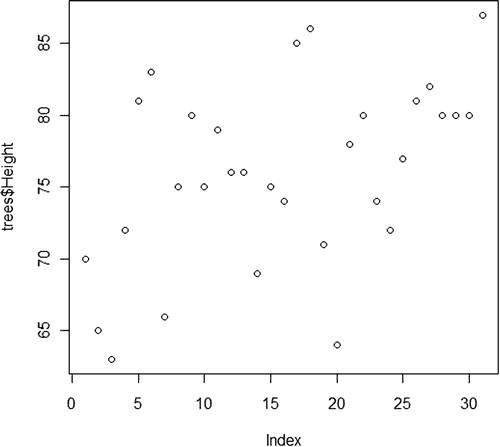

图 8-1. 使用 `plot` 函数创建的简单图表

`plot` 函数不仅仅创建简单的一维图表。创建的图表类型取决于你作为输入提供的变量的类型和数量。你将在本书的不同部分看到它被用于创建其他类型的图表，包括条形图和散点图。

默认情况下，R 使用符号来绘制数据值。要使用线条而不是符号，请将 `type` 参数设置为 `"l"`：

```
> plot(trees$Height, type="l")
```

`type` 参数的其他可能值包括 `"b"`（同时显示线条和符号）、`"h"`（垂直线）和 `"s"`（阶梯图）。图 8-2 展示了使用这些值时图表的外观。根据你的数据性质，这些选项中的一些会比其他的更合适。

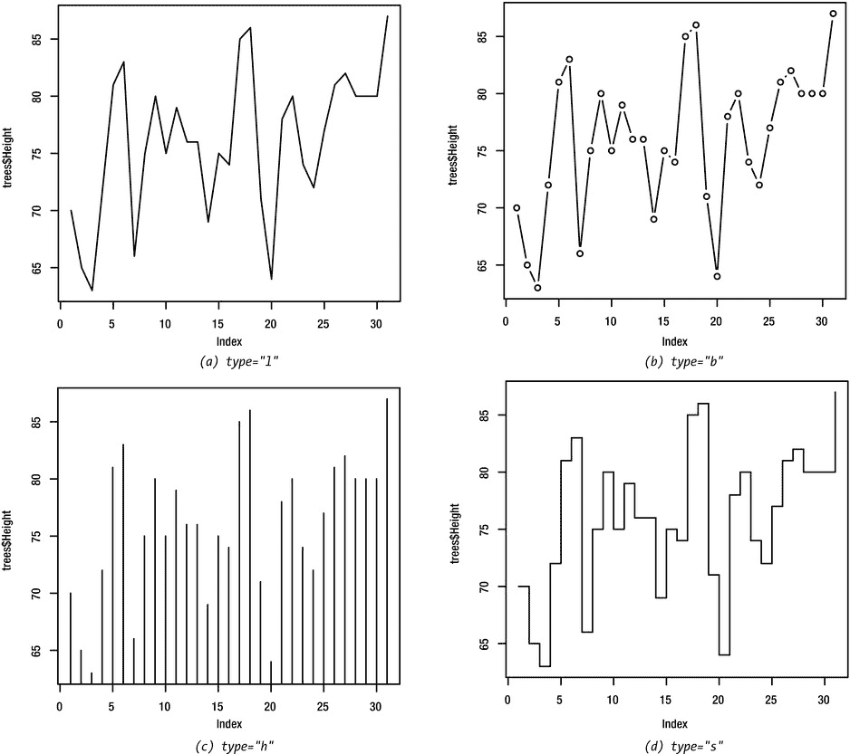

图 8-2. 展示了 `type` 参数部分选项的简单图表

## 直方图

直方图是一种针对连续变量的绘图，可让你评估其概率分布。要创建直方图，需将数据范围划分为若干区间，并统计落入每个区间的观测值数量。直方图可以直接显示每个区间的频数，也可以显示密度（即对频数进行缩放，使直方图的总面积等于 1）。

你可以使用 `hist` 函数创建直方图，如下所示，以 `Height` 变量为例。图 8-3 展示了结果。

```
> hist(trees$Height)
```

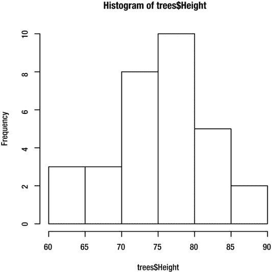

图 8-3. 来自 `trees` 数据集的 `Height` 变量的直方图

R 会自动为直方图选择合适的柱数。如果你愿意，也可以使用 `breaks` 参数指定柱数：

```
> hist(dataset$variable, breaks=15)
```

默认情况下，R 创建的是频数直方图。要创建密度直方图（使直方图的总面积等于 1），请将 `freq` 参数设置为 `F`：

```
> hist(dataset$variable, freq=F)
```

你可以使用 `curve` 函数为数据拟合一条正态分布曲线。这能让你观察数据与正态分布的拟合程度。在 `hist` 函数之后直接使用 `curve` 函数，此时直方图仍显示在图形设备中。添加密度曲线仅适用于密度直方图，因此请记得将 `freq` 参数设置为 `F`：

```
> hist(trees$Height, freq=F)
> curve(dnorm(x, mean(trees$Height), sd(trees$Height)), add=T)
```

结果如图 8-4 所示。

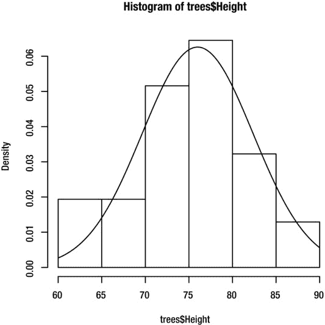

图 8-4. `Height` 变量的直方图，叠加了正态分布曲线

如果变量包含缺失数据值，请记得在 `mean` 和 `sd` 函数中将 `na.rm` 参数设置为 `T`：

```
> hist(dataset$variable, freq=F)
> curve(dnorm(x, mean(dataset$variable, na.rm=T), sd(dataset$variable, na.rm=T)), add=T)
```

`curve` 函数将在本章稍后的“绘制函数”一节以及第 9 章的“添加数学函数曲线”部分进行更详细的讨论。`dnorm` 函数将在第 7 章的“概率密度函数和概率质量函数”部分介绍。

## 正态概率图

正态概率图是一种针对连续变量的绘图，有助于判断样本是否来自正态分布。如果数据来自正态分布，数据点将大致落在一条直线上。如果数据点以任何系统性方式偏离直线，则表明数据并非来自正态分布。

你可以使用 `qqnorm` 函数创建正态概率图，如下所示，以 `Height` 变量为例：

```
> qqnorm(trees$Height)
```

你还可以在图中添加一条参考线，这有助于更轻松地判断数据点是否落成一条直线。要添加参考线，请在 `qqnorm` 函数之后直接使用 `qqline` 函数：

```
> qqnorm(trees$Height)
> qqline(trees$Height)
```

结果如图 8-5 所示。

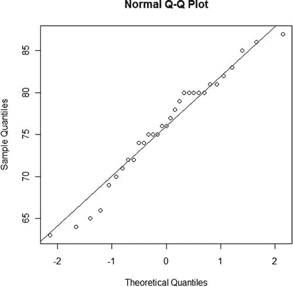

图 8-5. `Height` 变量的正态概率图

还有一个名为 `qqplot` 的函数，它允许你创建分位数图，用于将数据与正态分布以外的其他标准概率分布进行比较。输入 `help(qqplot)` 获取更多详细信息。

### 解读正态概率图

数据点围绕直线分布的方式，能告诉你关于数据分布形状相对于正态分布的一些信息。表 8-1 展示了一些你可能看到的模式以及如何解读它们。

表 8-1. 正态概率图中观察到的模式及其解读

| 正态概率图 | 对应的直方图 | 模式和解读 |
| --- | --- | --- |
| 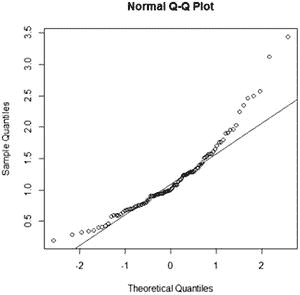 | 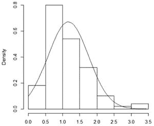 | 模式：数据点从直线上方弯向下方，再弯回上方。解读：数据呈正偏态（右偏）。 |
| 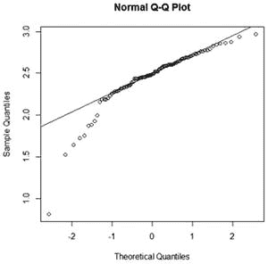 | 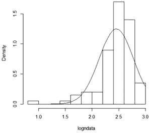 | 模式：数据点从直线下方弯向上方，再弯回下方。解读：数据呈负偏态（左偏）。 |
| 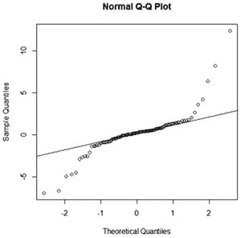 | 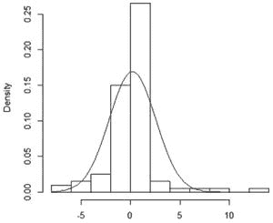 | 模式：数据点在左侧落在直线下方，在右侧落在直线上方。解读：与正态分布相比，数据具有更尖锐的峰和更厚的尾部（正超额峰度）。 |
| 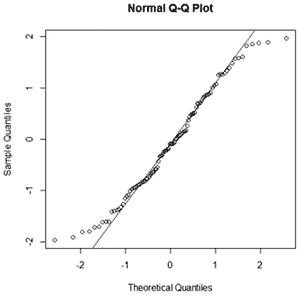 | 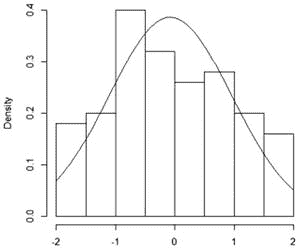 | 模式：数据点在左侧落在直线上方，在右侧落在直线下方。解读：与正态分布相比，数据具有更钝的峰和更细的尾部（负超额峰度）。 |

## 茎叶图

茎叶图是另一种针对连续变量的常用图形。它类似于直方图，但所有数据值都可以从图中读取。

你可以使用 `stem` 函数创建茎叶图，如下所示，以 `Volume` 变量为例：

```
> stem(trees$Volume)
```

在 R 中，茎叶图实际上是一种半图形技术，而非真正的图形。输出结果会显示在命令窗口中，而不是图形设备中。

# 条形图

条形图是一种用于汇总分类数据的图表。简单的条形图通过显示每个类别中的观测数量来汇总一个分类变量。分组条形图和堆叠条形图则通过显示每个类别组合的观测数量来汇总两个分类变量。

你可以使用 `plot` 和 `barplot` 函数创建条形图。如果你有原始数据，例如 `people2` 数据集中的 `Eye.Color` 变量，可以像下面这样使用 `plot` 函数。结果如图 8-6 所示。

```
> plot(people2$Eye.Color)
```

当从原始数据创建条形图时，该变量必须具有 `factor` 类。第 3 章 中的“变量类”部分说明了如何检查变量的类别并在必要时进行更改。

若要从先前保存的一维表对象（参见第 6 章 中的“频率表”）创建条形图，请使用 `barplot` 函数：

```
> barplot(tableobject)
```

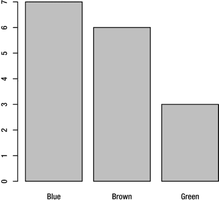

图 8-6. 来自 `people2` 数据集的 `Eye.Color` 变量条形图

对于如图 8-7 所示的水平条形图，请将 `horiz` 参数设置为 `T`。这适用于 `plot` 和 `barplot` 两个函数：

```
> plot(people2$Eye.Color, horiz=T)
```

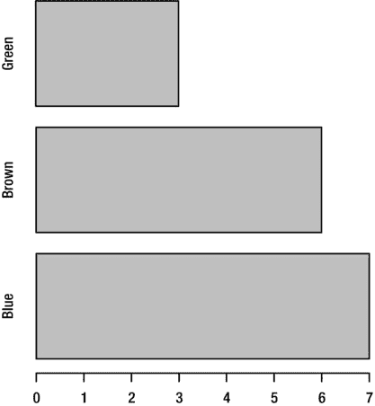

图 8-7. 来自 `people2` 数据集的 `Eye.Color` 变量水平条形图，通过设置 `horiz=T` 创建

`barplot` 函数也可以为两个分类变量创建条形图，这被称为多重条形图或分组条形图。多重条形图有两种样式，如图 8-8 所示。

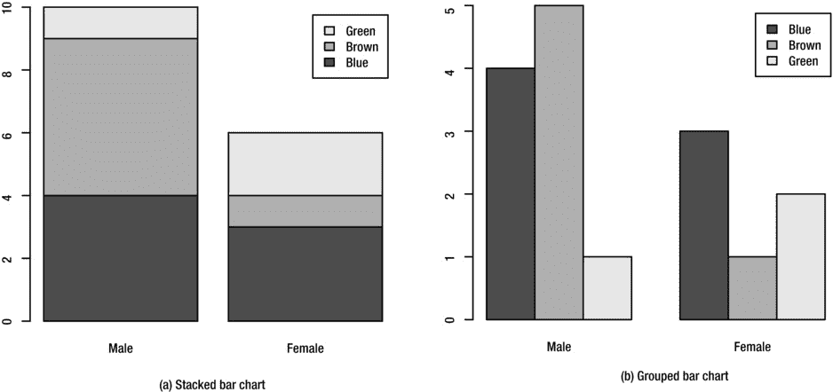

图 8-8. 按 `Sex` 分组的 `Eye.Color` 多重条形图的两种样式

### 堆叠样式

第一种是堆叠样式，你可以从二维表对象创建：

```
> barplot(sexeyetable, legend.text=T)
```

### 分组条形图

第二种样式是分组条形图，它将类别并排显示。通过将 `beside` 参数设置为 `T` 来创建此样式：

```
> barplot(sexeyetable, beside=T, legend.text=T)
```

要从原始数据创建多重条形图，请先创建一个二维表对象，如第 6 章 中的“频率表”部分所述。或者，你也可以将 `table` 函数嵌套在 `barplot` 函数内：

```
> barplot(table(people2$Eye.Color, people2$Sex), legend.text=T)
```

# 饼图

饼图是用于单个分类变量的图表，是条形图的一种替代形式。它将每个类别中的观测数量显示为总观测数量的一部分。

你可以使用 `pie` 函数创建饼图。如果你之前创建了一个一维表对象（参见第 6 章 中的“频率表”），可以直接使用该函数：

```
> pie(tableobject)
```

要从原始数据创建饼图，可以将 `table` 函数嵌套在 `pie` 函数内，如下所示。结果如图 8-9 所示。

```
> pie(table(people2$Eye.Color))
```

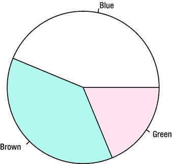

图 8-9. `Eye.Color` 变量的饼图

如果你的变量有缺失数据，并且你希望这些数据作为饼图中的一个额外扇区出现，请将 `useNA` 参数设置为 `"ifany"`：

```
> pie(table(dataset$variable, useNA="ifany"))
```

# 散点图

散点图是用于两个连续变量的图表，它可以让你检查它们之间的关系。

你可以通过提供两个数值变量作为输入，使用 `plot` 函数创建散点图。第一个变量显示在垂直轴上，第二个变量显示在水平轴上。例如，要为 `trees` 数据集绘制 `Volume` 相对于 `Girth` 的图表，使用以下命令：

```
> plot(Volume~Girth, trees)
```

输出如图 8-10 所示。

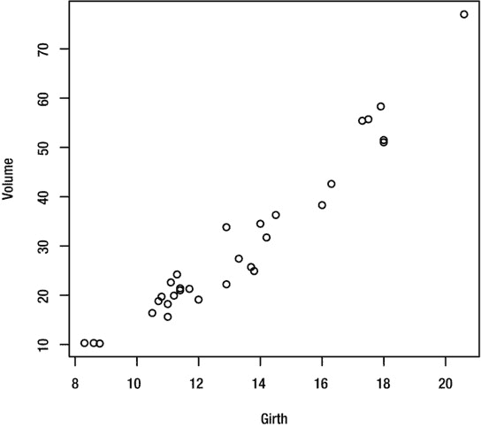

图 8-10. `trees` 数据集的 `Volume` 与 `Girth` 的散点图

要添加最佳拟合线（线性回归线），请在 `plot` 函数之后直接使用 `abline` 函数，如下所示。图 8-11 显示了结果。

```
> plot(Volume~Girth, trees)
> abline(coef(lm(Volume~Girth, trees)))
```

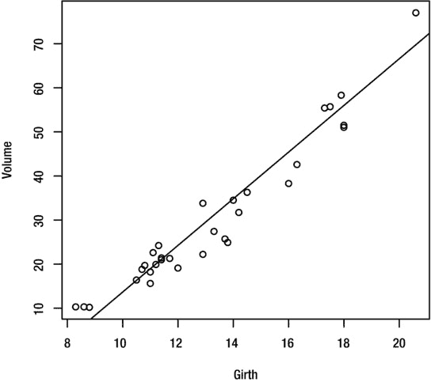

图 8-11. `trees` 数据集的 `Volume` 与 `Girth` 的散点图，并叠加了最佳拟合线

你将在第 9 章 的“添加额外的直线”部分了解更多关于 `abline` 函数的信息，并在第 11 章 中了解 `lm` 和 `coef` 函数。

如果这对你的数据有意义，你可以通过将 `type` 参数设置为 `"l"` 来用线连接数据点。要创建一个同时包含符号和线的图，请将其设置为 `"b"`。效果展示在图 8-12 中。

```
> plot(Volume~Girth, trees, type="l")
```

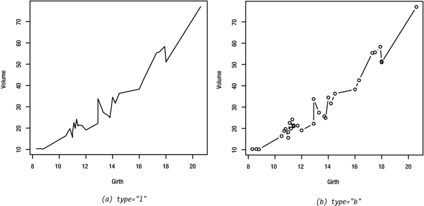

图 8-12. (a) 仅包含线条和 (b) 包含线条与符号的散点图

# 散点图矩阵

散点图矩阵是一组散点图的集合，显示了变量集中每对变量之间的关系。它允许你检查数据集的相关结构。

要创建数据集中变量的散点图矩阵，请使用 `pairs` 函数。例如，要为 `iris` 数据集创建散点图矩阵，使用以下命令：

```
> pairs(iris)
```

输出如图 8-13 所示。

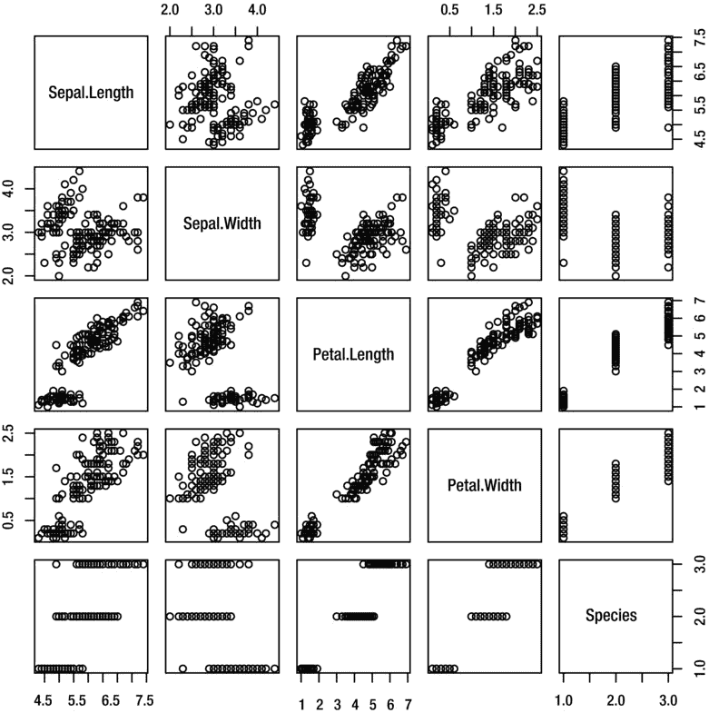

图 8-13. `iris` 数据集的散点图矩阵

你也可以选择要包含在矩阵中的变量子集。例如，要仅包含 `Sepal.Length`、`Sepal.Width` 和 `Petal.Length` 变量，使用以下命令：

```
> pairs(~Sepal.Length+Sepal.Width+Petal.Length, iris)
```

或者，你可以使用方括号表示法或 `subset` 函数从数据集中选择或排除变量，如第 1 章 的“数据框”部分和第 3 章 的“选择数据子集”部分所述。

# 箱线图

箱线图（或称盒须图）以图形方式呈现连续变量的汇总统计量。通常，会使用一个分类变量对观测值进行分组，从而使图形汇总每个类别的分布情况。这有助于理解分类变量与连续变量之间的关系。

你可以使用 `boxplot` 函数创建箱线图。例如，以下命令为 `iris` 数据集创建了按 `Species` 分组的 `Sepal.Length` 箱线图。图 8-14 展示了结果。

```
> boxplot(Sepal.Length∼Species, iris)
```

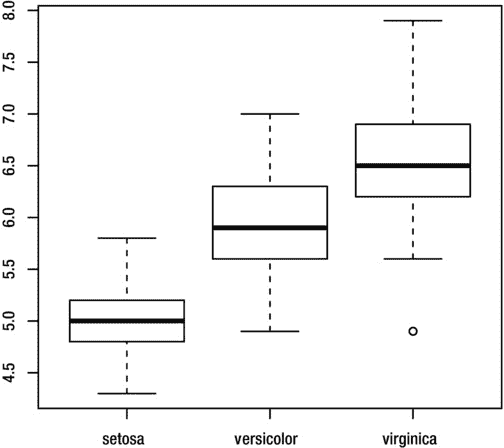

图 8-14. `iris` 数据集中按 `Species` 分组的 `Sepal.Length` 箱线图

解读箱线图时，请注意箱体内的粗线表示组中位数，箱体边界表示四分位距。须线显示数据的范围（不含异常值），异常值由小圆圈表示。

要创建如图 8-15 所示的水平箱线图，请将 `horizontal` 参数设置为 `T`：

```
> boxplot(Sepal.Length∼Species, iris, horizontal=T)
```

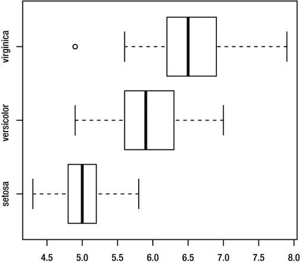

图 8-15. `iris` 数据集中按 `Species` 分组的 `Sepal.Length` 水平箱线图

你也可以为单个连续变量创建箱线图（无需分组）：

`> boxplot(iris$Sepal.Length)`

默认情况下，须线最多延伸至数据四分位距的 1.5 倍，超出此范围的值将显示为异常值。如果你希望须线延伸至最小值和最大值，请将 `range` 参数设置为 `0`：

`> boxplot(Sepal.Length∼Species, iris, range=0)`

图 8-16 显示了结果。

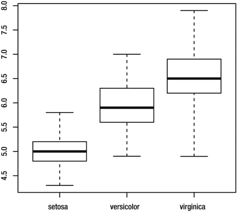

图 8-16. 按 `Species` 分组的 `Sepal.Length` 箱线图，须线显示数据的全距

## 绘制函数

你可以使用 `curve` 函数绘制数学函数，例如 `y=t³`。如下图所示，用 `x` 表示数学函数。图 8-17 显示了结果。

`> curve(x³)`

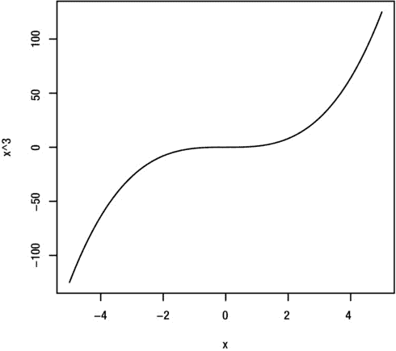

图 8-17. 使用 `curve` 函数绘制的 `y=x3` 函数图

注意：要显示曲线最相关的部分，你可能需要调整坐标轴，详见第 9 章的“坐标轴”部分。

要绘制标准概率分布的概率密度函数（pdf）曲线，请使用表 7-1 中的相关密度函数（见第 7 章）。例如，要绘制标准正态分布的 pdf，可使用以下命令：

`> curve(dnorm(x))`

结果如图 8-18 所示。

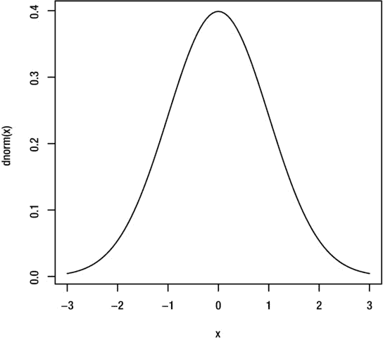

图 8-18. 正态分布密度函数图

## 导出和保存图形

在导出或保存图形之前，请调整图形设备窗口的大小，使图形具有所需尺寸。

对于 Windows 用户，导出图形最简单的方法是右键单击图形并选择“复制为位图”。图像会被复制到剪贴板，以便粘贴到 Microsoft Word 或 PowerPoint 文件或图形软件中。

此外，R 允许你将图像保存为多种文件类型，包括 `png`、`jpeg`、`bmp`、`pdf` 和 `eps`。在图形设备为活动窗口时，从“文件”菜单中选择“另存为”。你将看到多个保存图像的选项。

Mac 用户可以通过选择“编辑”然后“复制”来将图像复制到剪贴板，或者通过选择“文件”然后“保存”将图像保存为 `pdf` 文件。

Linux 用户可以通过输入以下命令保存当前图形：

`> savePlot("/home/Username/folder/filename.png", type="png")`

其他可能的文件类型包括 `bmp`、`jpeg` 和 `tiff`。

## 小结

本章探讨了如何为连续数据和分类数据创建最流行的图形类型。其中包括用于查看单个变量分布的图形，以及用于检查两个或多个变量之间关系的图形。你还学习了如何将图形保存为图像文件或将其粘贴到其他程序中。

下表总结了所涉及的主要命令。

| 图形类型 | 命令 |
| --- | --- |
| 基本图形 | `plot(dataset$variable)` |
| 折线图 | `plot(dataset$variable, type="l")` |
| 直方图 | `hist(dataset$variable)` |
| 正态概率图 | `qqnorm(dataset$variable)` |
| 茎叶图 | `stem(dataset$variable)` |
| 条形图 | `plot(dataset$factor1)` |
|  | `barplot(tableobject1D)` |
| 堆叠条形图 | `barplot(tableobject2D)` |
| 分组条形图 | `barplot(tableobject2D, beside=T)` |
| 饼图 | `pie(tableobject1D)` |
|  | `pie(table(dataset$factor1))` |
| 散点图 | `plot(yvar ∼ xvar, dataset)` |
| 散点图矩阵 | `pairs(dataset)` |
| 单个箱线图 | `boxplot(dataset$variable)` |
| 分组箱线图 | `boxplot(variable ∼ factor1, dataset)` |
| 函数图 | `curve(f(x))` |

在下一章中，你将学习如何自定义图形的外观，使其看起来更美观。
