# 11. 回归与一般线性模型

模型构建有助于你理解变量之间的关系，并对未来观测值进行预测。本章将讲解如何构建回归模型以及一般线性模型系列中的其他模型。

你将学习如何：

- 构建简单线性回归、多元线性回归和多项式回归模型
- 在模型中包含交互项、变换变量和因子变量
- 向现有模型添加或移除项
- 执行逐步、向前和向后模型选择程序
- 评估模型对数据的拟合程度
- 解释模型系数
- 使用最佳拟合线或曲线以图形方式表示模型
- 使用残差、偏差和库克距离等诊断方法检验模型的有效性
- 使用模型对新数据进行预测

本章将使用 `trees` 数据集（包含在 R 中）以及 `powerplant`、`concrete` 和 `people2` 数据集（这些数据集随本书下载提供，并在附录 C 中描述）。

## 一般线性模型

一般线性模型用于根据一个或多个解释变量来预测一个连续变量（称为响应变量）的值。一般线性模型的形式如下：

`y = β[0] + β[1]x[1] + β[2]x[2] + … … + β[n]x[n] + ε`

其中，`y` 是响应变量，`x[i]` 是解释变量，`β[i]` 是待估计的系数，`ε` 表示随机误差。

解释变量可以是连续变量或分类变量，并且可以包括其他变量的交叉乘积、多项式和变换。

随机误差被假定为独立，服从均值为零的正态分布，并且对于解释变量的所有值具有相同的方差。

简单线性回归、多元线性回归、多项式回归、方差分析、双因素方差分析、协方差分析和实验设计模型都属于一般线性模型的类型。

## 构建模型

你可以使用 `lm` 函数或 `glm` 函数来构建回归模型或一般线性模型。用于此目的时，这些函数执行相同的操作并给出类似的输出。在本书中，我们将使用 `lm` 函数来构建一般线性模型，但请注意，你可能会看到 `glm` 函数也在使用中。

### 简单线性回归

要构建一个包含名为 `var1` 的解释变量和名为 `resp` 的响应变量的简单线性回归模型，请使用以下命令：

```
> lm(resp ~ var1, dataset)
```

你不需要在模型中指定截距项（或常数项），因为 R 会自动包含一个。要构建一个不含截距项的模型，请使用以下命令：

```
> lm(resp ~ -1 + var1, dataset)
```

当你使用 `lm` 函数构建模型时，R 会显示系数估计值。然而，输出中还有更多未显示的内容，例如汇总统计量、残差和拟合值。你可以将所有输出保存到一个对象中，如下所示。在本章后面，你将学习如何访问模型输出的各个组成部分。

```
> modelname <- lm(resp ~ var1, dataset)
```

### 示例 11-1. 使用树木数据进行简单线性回归

在第 5 章的“皮尔逊相关系数”部分，我们看到了树木周长与树木体积之间存在相关性。假设你想要构建一个简单线性回归模型，根据树的周长来预测其体积。要构建该模型，请使用以下命令：

```
> lm(Volume ~ Girth, trees)
```

```
Call:
lm(formula = Volume ~ Girth, data = trees)

Coefficients:
(Intercept)        Girth
   -36.943        5.066
```

从输出中你可以看到模型公式为：

`Volume = -36.943 + 5.066 × Girth`

这意味着，一棵周长为 10 英寸的树木，其预期体积为 `-36.943 + 5.066 × 10 = 13.717` 立方英尺。周长每增加一英寸，预期体积增加 5.066 立方英尺。

要将模型输出保存为一个对象，请使用以下命令：

```
> treemodel <- lm(Volume ~ Girth, trees)
```

`treemodel` 对象将在本章后面部分使用。

### 多元线性回归

要在模型中包含多个解释变量，请用加号将它们分隔开：

```
> modelname <- lm(resp ~ var1 + var2 + var3, dataset)
```

### 示例 11-2. 使用发电厂数据进行多元线性回归

考虑 `powerplant` 数据集，该数据集在附录 C 中有描述，并随本书下载提供。该数据集包含三个变量。`Output` 变量给出了燃气轮机的输出功率（单位兆瓦）。`Pressure` 和 `Temp` 变量给出了轮机内部的温度和压力测量值。

要构建一个根据压力和温度来预测输出功率的多元线性回归模型，请使用以下命令：

```
> lm(Output ~ Pressure + Temp, powerplant)
```

```
Call:
lm(formula = Output ~ Pressure + Temp, data = powerplant)

Coefficients:
(Intercept)     Pressure         Temp
   -32.8620       0.1858      -0.9916
```

从输出中你可以看到模型为：

`Output = -32.8620 + 0.1858 × Pressure - 0.9916 × Temperature`

这告诉我们，压力每增加一毫巴，轮机的预期输出功率增加 0.1858 兆瓦。温度每升高一摄氏度，预期输出功率减少 0.9916 兆瓦。

### 交互项

要在模型中添加交互项，请使用冒号（`:`）。例如，`var1:var2` 表示两个变量 `var1` 和 `var2` 之间的交互作用。该命令会构建一个包含两个变量及其交互项的模型：

```
> modelname <- lm(resp ~ var1 + var2 + var1:var2, dataset)
```

你也可以使用冒号来表达三阶及更高阶的交互作用：

```
> modelname <- lm(resp ~ var1 + var2 + var3 + var1:var2 + var1:var3 + var2:var3 + var1:var2:var3, dataset)
```

正如你所见，对于包含许多变量的模型，这种表示法会变得冗长。R 为交互项提供了两种有用的速记符号，即星号（`*`）符号和 hat 符号（`^`）。

使用星号符号可以包含一组变量及其所有可能的交互作用。例如，命令：

```
> modelname <- lm(resp ~ var1 * var2 * var3, dataset)
```

会构建一个包含三个变量主效应（`var1`、`var2`、`var3`）、三个二阶交互作用（`var1:var2`、`var1:var3`、`var2:var3`）以及三阶交互作用（`var1:var2:var3`）的模型。这等同于之前那个非常冗长的公式。

hat 符号则包含一组变量以及最高至指定阶数的所有可能的交互作用。例如，要包含所有主效应和二阶交互作用（但不包含三阶交互作用），请使用命令：

```
> modelname <- lm(resp ~ (var1 + var2 + var3)², dataset)
```

这等同于以下命令：

```
> modelname <- lm(resp ~ var1 + var2 + var3 + var1:var2 + var1:var3 + var1:var2, dataset)
```

### 示例 11-3. 使用混凝土数据的因子实验

考虑 `concrete` 数据集，如图 11-1 所示，可从网站上获取。该数据集展示了一项实验的结果，旨在确定水泥类型（I 或 II）、添加剂类型（A 或 B）以及添加剂剂量（0.3%、0.4% 或 0.5%）对混凝土密度的影响。

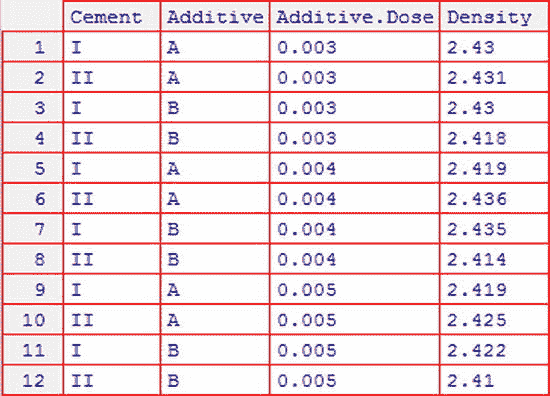

图 11-1. `concrete` 数据集（更多详情请参见附录 C）

要构建一个用于预测密度的模型，该模型包含所有解释变量（水泥类型、添加剂类型和添加剂剂量）及其交互作用项（二阶和三阶），请使用命令：

```
> concmodel <- lm(Density ~ Cement * Additive * Additive.Dose, concrete)
```

`concmodel` 对象将在本章后面使用。

### 多项式项

要构建一个包含 `var1`、`var1`² 和 `var1`³ 项的多项式回归模型，请使用命令：

```
> modelname <- lm(resp ~ var1 + I(var1²) + I(var1³), dataset)
```

请注意，`var1²` 和 `var1³` 项被嵌套在 `I()` 函数内。这是因为符号 `^`、`*` 和 `+` 在模型公式中具有特殊含义，容易与它们通常的算术含义（乘幂、乘法和加法）混淆。如果你想将这些符号用于其通常的算术含义，则必须将它们嵌套在 `I` 函数内。

### 示例 11-4. 使用树木数据集进行多项式回归

要构建一个预测树木体积的模型，该模型包含树围和树围²项，请使用命令：

```r
> lm(Volume ~ Girth + I(Girth²), trees)
Call:
lm(formula = Volume ~ Girth + I(Girth²), data = trees)

Coefficients:
(Intercept)        Girth   I(Girth²)
   10.7863      -2.0921       0.2545
```

从结果可以看出，模型公式为：

`Volume = 10.7863 - 2.0921×Girth + 0.2545×Girth²`

要将模型保存为一个对象，请使用命令：

```r
> polytrees <- lm(Volume ~ Girth + I(Girth²), trees)
```

`polytrees` 对象将在本章后面使用。

### 变换

简单的变量变换，如对数或平方根变换，可以通过在公式中直接使用相关函数应用于响应变量或解释变量：

```r
> modelname <- lm(log(resp) ~ var1, dataset)
```

对于使用星号、hat 符号或加号的变换，请将它们嵌套在 `I` 函数内：

```r
> modelname <- lm(I(resp²) ~ var1, dataset)
```

### 截距项

有时你可能想要构建一个不含截距项的模型。为此，请在模型中添加 `-1` 作为一项，如下所示。这会告诉 R 不要包含截距项，而默认情况下 R 会自动包含：

```r
> modelname <- lm(resp ~ -1 + var1 + var2 + var3, dataset)
```

你也可以创建一个只包含截距项的模型，这被称为零模型：

```r
> modelname <- lm(resp ~ 1, dataset)
```

## 包含因子变量

你可以像包含连续变量一样，将分类变量包含在模型中。在包含分类变量之前，请使用 `class` 函数检查其是否为 `factor` 变量类，如第 3 章中“处理因子变量”部分所述。

当你在模型中包含一个因子变量时，R 会将因子的第一个水平视为参考水平。因此，对于一个有 n 个水平的因子，模型将产生 n-1 个系数，用于表示其余 n-1 个水平相对于参考水平的影响。

要检查因子变量的第一个水平是哪个，请使用 `levels` 函数：

```r
> levels(dataset$variable)
```

你可以使用 `relevel` 函数更改因子变量的参考水平：

```r
> dataset$variable <- relevel(dataset$variable, "reflevel")
```

通过更改因子变量的对照（contrasts），可以改变 R 使用系数来表示因子影响的方式。每个因子变量都有一组与之关联的对照，你可以使用 `contrasts` 函数查看和更改这些对照。输入 `help(contrasts)` 可获取有关如何更改因子变量对照的更多详情，输入 `help(contr.treatment)` 可查看对照选项列表。

### 示例 11-5. 使用 `people2` 数据集的含因子变量模型

假设你想使用 `people2` 数据集构建一个模型，根据一个人的手跨和眼睛颜色来预测其身高。

你可以使用以下命令构建模型：

```r
> lm(Height ~ Hand.Span + Eye.Color, people2)
Call:
lm(formula = Height ~ Hand.Span + Eye.Color, data = people2)

Coefficients:
   (Intercept)       Hand.Span  Eye.ColorBrown  Eye.ColorGreen
         82.8902          0.4456         -3.6233         -4.1924
```

从输出中，我们可以看到公式有两个系数，用于表示棕色和绿色眼睛相对于蓝色眼睛对身高的影响。因此，对于蓝眼睛的人来说，模型公式为：

`Height = 82.8902 + 0.4456×Hand Span`

对于棕色眼睛的人来说，公式为：

`Height = 82.8902 + 0.4456×Hand Span - 3.6233`

对于绿色眼睛的人来说，公式为：

`Height = 82.8902 + 0.4456×Hand Span - 4.1924`

### 更新模型

构建模型后，你可能希望向模型中添加或删除某个项，以观察新模型与先前模型的对比情况。`update` 函数允许你通过向现有模型添加或删除项来构建新模型。这在处理包含多个项的模型时非常有用，因为这意味着你无需在每次添加或删除项时重新输入整个模型规格。

假设你已经构建了一个模型，并将其保存到名为 `model1` 的对象中：

```r
> model1 <- lm(resp ~ var1 + var2 + var3 + var4, dataset)
```

若要创建一个名为 `model2` 的新模型（通过向 `model1` 添加一个额外的项，例如交互项 `var1:var2`），可使用以下命令：

```r
> model2 <- update(model1, ~. + var1:var2)
```

类似地，你也可以从模型中删除一个项：

```r
> model2 <- update(model1, ~. - var4)
```

要检查新模型是否包含你期望的公式，可使用 `formula` 函数：

```r
> formula(model2)
```

### 示例 11-6. 更新 `concmodel` 模型

在示例 11-3 中，我们使用以下命令构建了 `concmodel` 模型：

```r
> concmodel <- lm(Density ~ Cement*Additive*Additive.Dose, concrete)
```

若要创建一个新模型（通过从 `concmodel` 模型中删除三阶交互项），可使用以下命令：

```r
> concmodel2 <- update(concmodel, ~. - Cement:Additive:Additive.Dose)
```

使用以下命令检查新模型的公式：

```r
> formula(concmodel2)
```

```
Density ~ Cement + Additive + Additive.Dose + Cement:Additive +
    Cement:Additive.Dose + Additive:Additive.Dose
```

你可以看到，三阶交互项（`Cement:Additive:Additive.Dose`）现在已从模型中删除。

### 逐步模型选择过程

逐步模型选择过程是一类算法，旨在简化寻找既能解释大量变异性、又包含尽可能少项的模型的过程。在处理具有许多潜在项的大型模型时，它们非常有用。常见的逐步选择过程包括前向选择、后向消除和通用逐步选择。

`step` 函数允许你在 R 中执行前向、后向和逐步模型选择。该函数接受一个 `lm` 或 `glm` 模型对象作为输入，该对象应为你要从中选择项子集的完整模型。

假设你已经创建了一个大型模型，如下所示，其中总共包含十五个项：四个主效应、六个二阶交互项、四个三阶交互项和一个四阶交互项：

```r
> model1 <- lm(resp ~ var1*var2*var3*var4, dataset)
```

创建模型后，使用以下命令执行逐步选择过程：

```r
> model2 <- step(model1)
```

默认情况下，`step` 函数使用通用逐步选择方法。若要使用后向或前向方法，可将 `direction` 参数设置为 `"backward"` 或 `"forward"`：

```r
> model2 <- step(model1, direction="backward")
```

新创建的模型对象可以像其他任何模型对象一样使用。若要查看新模型中保留了哪些项，可使用 `formula` 函数：

```r
> formula(model2)
```

### 示例 11-7. 使用混凝土数据进行逐步选择

在示例 11-3 中，我们使用以下命令构建了 `concmod` 模型：

```r
> concmodel <- lm(Density ~ Cement*Additive*Additive.Dose, concrete)
```

若要对这个模型执行逐步选择过程，可使用以下命令：

```r
> concmodel3 <- step(concmodel)
```

要查看最终模型的公式，可使用以下命令：

```r
> formula(concmodel3)
```

```
Density ~ Cement + Additive + Additive.Dose + Cement:Additive
```

从输出中，你可以看到逐步选择过程已从模型中删除了三阶交互项以及两个二阶交互项，保留了水泥类型、添加剂类型和添加剂剂量的主效应，以及水泥类型与添加剂类型之间的交互项。

## 评估模型的拟合度

在解释和使用模型之前，你需要确定它是否与数据良好拟合，并且是否包含一组良好的解释变量。你可能还在考虑多个备选模型来拟合数据，并希望比较它们。

### 模型拟合度

模型的拟合度通常通过几种不同的方式来衡量。这些包括：

-   决定系数（`R²`）：表明模型预测未来观测值的可能效果。它衡量了模型能够解释的数据总变异比例。其取值介于 0 和 1 之间。接近 1 的值表明模型预测效果良好，而接近 0 的值则表明模型预测效果较差。

-   调整后的 `R 平方`：与 `R²` 类似，但会根据模型中项的数量进行调整。

-   模型系数的显著性检验：告诉你单个系数估计值是否显著不为 0，从而判断这些系数是否对模型有贡献。考虑移除 `p` 值大于 0.05 的系数。

-   `F 检验`：告诉你模型是否比使用总体均值进行预测显著更好。对于良好的模型，`p` 值应小于 0.05。`F 检验` 也可用于比较两个模型。在这种情况下，`p` 值小于 0.05 表明更复杂的模型显著优于更简单的模型。

要查看模型的一些汇总统计量，请使用 `summary` 函数：

```
> summary(lmobject)
```

`summary` 函数会显示：

-   模型公式

-   残差的分位数

-   系数估计值及其标准误差和显著性检验

-   残差标准误差和自由度

-   `R²`（多重 R 平方和调整后的 R 平方）

-   用于模型拟合度的 `F 检验`

请注意，如果你使用 `glm` 函数而不是 `lm` 函数构建模型，输出将略有不同，并将使用广义线性模型的术语。

要查看模型的 ANOVA 表（该表展示了 `F 检验` 背后的计算过程），请使用 `anova` 函数：

```
> anova(lmobject)
```

你也可以使用 `anova` 函数执行 `F 检验` 来比较一个更复杂的模型和一个更简单的模型（模型的顺序不重要）：

```
> anova(model1, model2)
```

这仅适用于嵌套模型。也就是说，较简单模型中的所有项也必须在更复杂的模型中存在。

#### 示例 11-8：`treemodel` 模型的汇总统计量

在示例 11-1 中，我们创建了一个简单的线性回归模型，用树的周长预测树的体积，并将输出保存到一个名为 `treemodel` 的对象中。

要查看模型的汇总统计量，请使用命令：

```
> summary(treemodel)
```

这将给出以下输出：

```
Call:
lm(formula = Volume ~ Girth, data = trees)

Residuals:
   Min     1Q Median     3Q    Max
-8.065 -3.107  0.152  3.495  9.587

Coefficients:
            Estimate Std. Error t value Pr(>|t|)
(Intercept) -36.9435     3.3651  -10.98 7.62e-12 ***
Girth         5.0659     0.2474   20.48  < 2e-16 ***
---
Signif. codes:  0 '***' 0.001 '**' 0.01 '*' 0.05 '.' 0.1 ' ' 1

Residual standard error: 4.252 on 29 degrees of freedom
Multiple R-squared:  0.9353,    Adjusted R-squared:  0.9331
F-statistic: 419.4 on 1 and 29 DF,  p-value: < 2.2e-16
```

`R²` 值为 0.9353，告诉我们该模型解释了树的体积中大约 94% 的变异。这表明该模型在预测树的体积方面会非常出色。

模型系数的假设检验告诉我们，截距和周长系数显著不为 0。

`F 检验` 的 `p` 值小于 0.05，这告诉我们模型解释了树的体积中很大一部分变异。

要查看 ANOVA 表，请使用命令：

```
> anova(treemodel)
Analysis of Variance Table

Response: Volume
          Df Sum Sq Mean Sq F value    Pr(>F)
Girth      1 7581.8  7581.8  419.36 < 2.2e-16 ***
Residuals 29  524.3    18.1
---
Signif. codes:  0 '***' 0.001 '**' 0.01 '*' 0.05 '.' 0.1 ' ' 1
```

输出显示了 `F 检验` 背后的计算过程。

#### 示例 11-9：比较 `treemodel` 和 `polytrees` 模型

假设你想比较 `treemodel`（在示例 11-1 中创建的简单线性回归模型）和 `polytrees`（在示例 11-4 中创建的多项式回归模型），以确定 `polytrees` 模型中的额外多项式项是否显著改善了模型的拟合度。

要执行 `F 检验` 来比较这两个模型，请输入命令：

```
> anova(treemodel, polytrees)
Analysis of Variance Table

Model 1: Volume ~ Girth
Model 2: Volume ~ Girth + I(Girth²)
  Res.Df    RSS Df Sum of Sq      F    Pr(>F)
1     29 524.30
2     28 311.38  1    212.92 19.146 0.0001524 ***
---
Signif. codes:  0 '***' 0.001 '**' 0.01 '*' 0.05 '.' 0.1 ' ' 1
```

从结果可以看出，`p` 值 0.0001524 小于 0.05。这意味着 `polytrees` 模型对数据的拟合度显著优于 `treemodel` 模型。

### 系数估计值

系数估计值（或参数估计值）会在汇总输出中提供，但你也可以使用 `coef` 函数或与之相同的 `coefficients` 函数来查看它们：

```
> coef(lmobject)
```

要查看系数估计值的置信区间，请使用 `confint` 函数：

```
> confint(lmobject)
```

该函数默认给出 95% 的置信区间，但你可以通过 `level` 参数进行调整：

```
> confint(lmobject, level=0.99)
```

#### 示例 11-10：`treemodel` 模型的系数估计值

要查看 `treemodel` 模型的系数估计值，请使用命令：

```
> coef(treemodel)
(Intercept)       Girth
-36.943459    5.065856
```

要查看系数估计值的置信区间，请使用命令：

```
> confint(treemodel)
                2.5 %     97.5 %
(Intercept) -43.825953 -30.060965
Girth         4.559914   5.571799
```

从输出中可以看出，截距的 95% 置信区间为 –43.83 到 –30.06，`Girth` 系数的 95% 置信区间为 4.56 到 5.57。

## 绘制最佳拟合线

对于简单线性回归模型，你可以在数据上叠加一条最佳拟合线来创建散点图，以帮助可视化模型。使用 `plot` 和 `abline` 函数：

```
> plot(resp ∼ var1, dataset)
```

```
> abline(coef(lmobject))
```

有关使用 `plot` 函数创建散点图的更多详细信息，请参见第 8 章中的“散点图”部分；有关使用 `abline` 函数添加直线的更多信息，请参见第 9 章中的“添加直线”部分。

对于多项式回归模型，你可以在数据上叠加一条多项式曲线。使用 `curve` 函数（请参见第 8 章中的“绘制函数”部分）。

#### 示例 11-11：`treemodel` 模型带最佳拟合线的散点图

要为 `treemodel` 创建带最佳拟合线的散点图，请使用以下命令：

```
> plot(Volume∼Girth, trees)
```

```
> abline(coef(treemodel))
```

结果如图 11-2 所示。

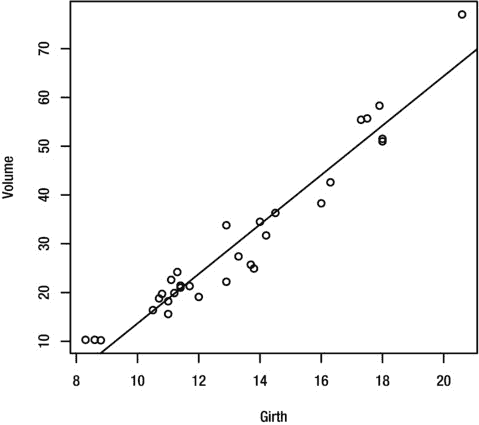

图 11-2. 叠加了简单线性回归模型的散点图

#### 示例 11-12：`polytrees` 模型带多项式曲线的散点图

在示例 11-4 中，我们创建了一个名为 `polytrees` 的多项式回归模型，用于根据树木周长预测树木体积。要查看 `polytrees` 模型的系数，请使用 `coef` 函数：

```
> coef(polytrees)
(Intercept)       Girth  I(Girth²)
10.7862655  -2.0921396   0.2545376
```

要创建叠加曲线的散点图，请使用 `curve` 函数：

```
> plot(Volume∼Girth, trees)
```

```
> curve(10.7863-2.0921*x+0.2545*x², add=T)
```

图 11-3 显示了结果。

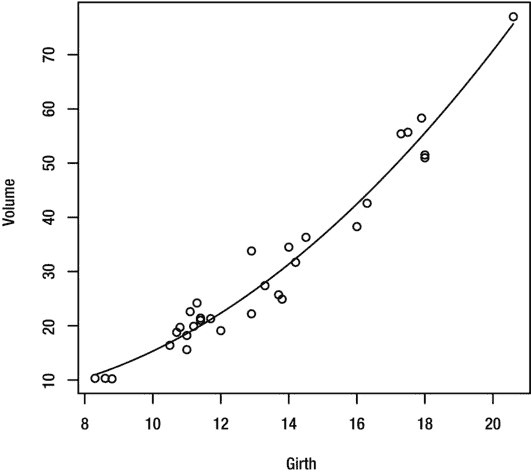

图 11-3. 叠加了多项式回归模型的散点图

## 模型诊断

本节讨论用于检查模型对数据的适用性以及系数估计可靠性的方法。这些方法包括检查模型残差，以及诸如杠杆值和每个观测值的 Cook 距离等影响度量。

### 残差分析

给定模型的残差是响应变量的观测值与模型预测值（拟合值）之间的一组差值。标准化残差和学生化残差是经过调整使其方差为 1 的残差类型。

检查模型的残差集有助于你确定模型是否合适。如果满足一般线性模型的假设，那么残差将呈正态分布并具有恒定方差。它们也将是独立的，并且不会遵循任何可观察到的模式。残差还能帮助你识别对模型影响较大的任何观测值。

要计算模型的原始残差，请使用 `residuals` 函数。还有一个相同的函数叫做 `resid`。要计算标准化残差，请使用 `rstandard` 函数；对于学生化残差，请使用 `rstudent` 函数：

```
> residuals(lmobject)
```

你可以将残差保存到数据集中的一个新变量中，如下所示。如果你想绘制残差与响应变量或解释变量的关系图，这会很有用：

```
> dataset$resids <- rstudent(lmobject)
```

类似地，你可以使用 `fitted` 函数创建一个包含拟合值的新变量：

```
> dataset$fittedvals <- fitted(lmobject)
```

绘制残差图是检查模型假设是否被违反的最简单方法。残差的正态概率图或直方图将帮助你确定残差是否呈正态分布。残差与拟合值的关系图以及残差与解释变量的关系图将允许你检查方差是否恒定。如果不是，你会看到一个类似图 11-4a 中所示的漏斗形状。这些图还能帮助你发现残差中的模式，如图 11-4b 所示。

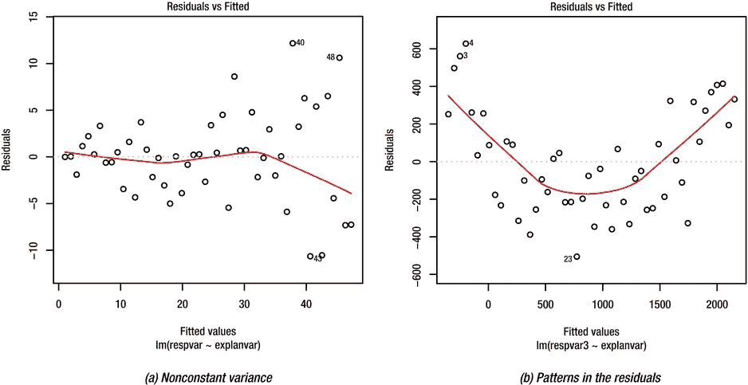

图 11-4. 提示模型存在问题的残差图

你可以使用 `plot` 函数为模型对象创建残差图：

```
> plot(lmobject, which=1)
```

使用 `which` 参数从以下图形中选择：

- 残差与拟合值

- 残差的正态概率图

- 尺度-位置图

- 残差与杠杆值

这里我省略了选择影响度量图的数字 4 和 6，因为你将在下一节中学习它们。

还可以创建其他一些有用的残差图：

- 用于检查正态性假设的残差直方图：

```
> hist(dataset$resids)
```

- 残差与响应变量的关系图：

```
> plot(resids ∼ resp, dataset)
```

- 残差与解释变量的关系图：

```
> plot(resids ∼ var1, dataset)
```

`示例 11-13. TREEMODEL 模型的残差图`

假设你希望分析 `treemodel` 模型的残差，以检查模型的假设是否得到满足。

首先，将学生化残差保存到 `trees` 数据集中：

```
> trees$Resids <- rstudent(treemodel)
```

接下来，按照第 9 章中“绘图区域中的多个图形”部分的说明，设置图形设备以显示六个图形：

```
> par(mfrow=c(3,2))
```

然后，使用相关命令创建以下图形：残差直方图；残差的正态概率图；残差与拟合值；残差与响应变量（`Volume`）；残差与解释变量（`Girth`）；残差与其他感兴趣的变量（`Height`）：

```
> hist(trees$Resids)
> plot(treemodel, which=2)
> plot(treemodel, which=1)
> plot(Resids∼Volume, trees)
> plot(Resids∼Girth, trees)
> plot(Resids∼Height, trees)
```

图 11-5 显示了结果。

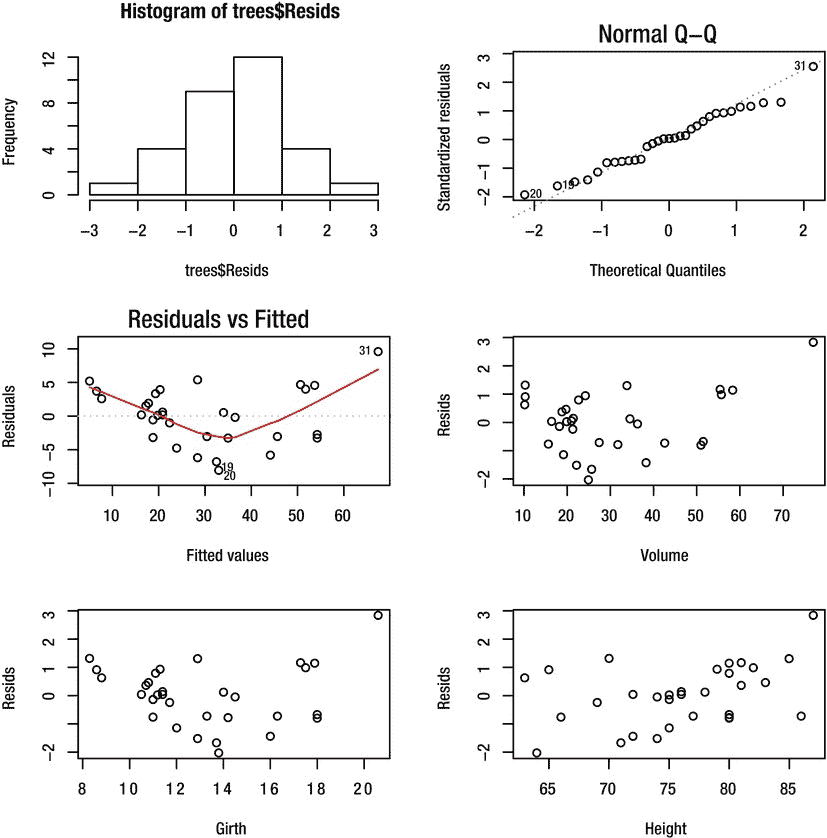

图 11-5. `treemodel` 模型的残差图

从直方图和正态概率图可以看出，残差近似正态分布。

在残差与拟合值的关系图以及残差与周长的关系图中，我们可以看到残差中存在轻微的模式。对于中等周长的树木，残差往往为负值；而对于周长非常小或非常大的树木，残差则为正值。这表明向模型添加多项式项可能会改善拟合效果。

残差与体积和高度的关系图中没有明显的模式。所有图中也没有明显的异常值。

### 杠杆值

杠杆值有助于识别解释变量中具有异常值或异常组合的观测值。较大的杠杆值表明该观测值可能对模型有很大影响。

要计算给定模型中每个观测值的杠杆值，请使用 `hatvalues` 函数：

```
> hatvalues(lmobject)
```

要创建残差与杠杆值的关系图，请使用命令：

```
> plot(lmobject, which=5)
```

要创建 Cook 距离与杠杆值的关系图，请使用命令：

```
> plot(lmobject, which=6)
```

### 库克距离

一个观测值的库克距离衡量了在模型估计前移除该观测值时，模型参数的变化程度。值越大表明该观测值对模型的影响越大。

要计算模型的库克距离，请使用 `cooks.distance` 函数：

```
> cooks.distance(lmobject)
```

你可以使用以下命令创建库克距离相对于观测序号的图：

```
> plot(lmobject, which=4)
```

以及使用以下命令创建库克距离相对于杠杆值的图：

```
> plot(lmobject, which=6)
```

`示例 11-14. 树模型的杠杆值与库克距离`

假设你想为 `treemodel` 回归模型创建一组图，以帮助识别可能对模型有较大影响的任何观测值。

首先设置图形设备以容纳四个图（参见第 9 章中的“在绘图区域绘制多个图”）：

```
> par(mfrow=c(2,2))
```

然后创建三个显示杠杆值和库克距离的图：

```
> plot(treemodel, which=4)
> plot(treemodel, which=5)
> plot(treemodel, which=6)
```

结果如图 11-6 所示。

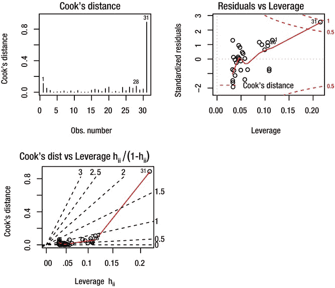

`图 11-6.` `treemodel` 模型的影响图

第二个图（残差 vs. 杠杆值）上的等高线划分了具有相似库克距离的区域。第三个图（库克距离 vs. 杠杆值）上的等高线划分了具有相似标准化残差的区域。

所有三个图都显示观测序号 31 具有较大的库克距离和杠杆值，同时标准化残差也相当大。这表明该观测值对模型有较大影响，应进一步调查。

### 进行预测

一旦你构建了一个满意的模型，你可能希望用它来对新数据进行预测。R 提供了一个便捷的预测函数，名为 `predict`。要使用此函数，新数据必须组织在数据框中（有关如何创建数据框，请参见第 2 章中的“直接输入数据”）。新数据集中的解释变量应使用与构建模型所用原始数据集相同的名称。变量的顺序不同或存在额外的变量都没有关系。

当你的新数据组织在数据框中后，就可以使用 `predict` 函数：

```
> predict(lmobject, newdata)
```

该命令会创建一个与数据框各行相对应的预测值向量。你可以将其作为一个新变量附加到数据框中：

```
> newdata$predictedvalues <- predict(lmobject, newdata)
```

你还可以使用 `predict` 函数来计算预测的置信区间或预测区间。回顾一下，置信区间仅考虑模型估计的不确定性，而预测区间还考虑了响应变量中自然的随机变异。

要计算置信区间，请将 `interval` 参数设置为 `"confidence"`；要计算预测区间，则将其设置为 `"prediction"`。你可以使用 `level` 参数调整区间的大小：

# 预测与模型总结

```r
> predict(lmobject, newdata, interval="confidence", level=0.99)
```

## 示例 11-15. 使用树模型进行预测

假设你想使用 `treemodel` 回归模型来估算三棵周长分别为 17.2、12.0 和 11.4 英寸的树的体积。

首先将新数据放入一个数据框中：

```r
> newtrees <- data.frame(Girth=c(17.2, 12.0, 11.4))
```

要生成预测并将其添加到 `newtrees` 数据框中，请使用以下命令：

```r
> newtrees$predictions <- predict(treemodel, newtrees, interval="prediction")
```

然后查看数据集的内容：

```r
> newtrees
  Girth predictions.fit predictions.lwr predictions.upr
1  17.2        50.18927        41.13045        59.24809
2  12.0        23.84682        14.98883        32.70481
3  11.4        20.80730        11.92251        29.69210
```

从输出中可以看出，对于周长为 17.2 英寸的树，预测体积为 50.2 立方英尺，预测区间为 41.1 至 59.2 立方英尺。

### 总结

现在，你应该能够构建包含因子变量、多项式项以及交互项（在适当情况下）的一般线性模型，并解释模型系数。你应该能够从现有模型中添加或删除项，并应用逐步模型选择程序。你应该能够评估模型与数据的拟合程度，并使用模型诊断来确定模型是否有效。对于简单线性回归和多项式回归模型，你应该能够以图形方式呈现模型。最后，你还应该能够使用你的模型对未来的观测值进行预测。

下表总结了所涉及的主要命令。

| 任务 | 命令 |
| --- | --- |
| 构建简单线性回归模型 | `lm(resp ~ var1, dataset)` |
| 构建多元回归模型 | `lm(resp ~ var1 + var2 + var3, dataset)` |
| 构建含交互项的模型 | `lm(resp ~ var1 + var2 + var1:var2, dataset)` |
| 构建含给定阶数交互项的模型 | `lm(resp ~ (var1 + var2 + var3)², dataset)` |
| 构建因子模型 | `lm(resp ~ var1 * var2 * var3, dataset)` |
| 构建多项式回归模型 | `lm(resp ~ var1 + I(var1²) + I(var1³), dataset)` |
| 构建响应变量对数变换的模型 | `lm(log(resp) ~ var1 + var2 + var3, dataset)` |
| 构建不含截距项的模型 | `lm(resp ~ -1 + var1 + var2 + var3, dataset)` |
| 构建空模型 | `lm(resp ~ 1, dataset)` |
| 更新模型 | `update(lmobject, .~. + var4)` |
| 逐步选择 | `step(lmobject)` |
| 汇总模型 | `summary(lmobject)` |
| 系数估计值 | `coef(lmobject)` |
| 系数估计值的置信区间 | `confint(lmobject)` |
| 绘制最佳拟合线 | `plot(resp ~ var1, dataset)` `abline(coef(lmobject))` |
| 原始残差 | `residuals(lmobject)` |
| 标准化残差 | `rstandard(lmobject)` |
| 学生化残差 | `rstudent(lmobject)` |
| 拟合值 | `fitted(lmobject)` |
| 残差及影响图 | `plot(lmobject, which=1)` |
| 杠杆值 | `hatvalues(lmobject)` |
| 库克距离 | `cooks.distance(lmobject)` |
| 预测值 | `predict(lmobject, newdata)` |

现在，你已经掌握了执行最常见类型统计分析所需的一切知识。对于好奇的读者，附录 A 将解释如何通过使用附加包来访问额外功能。

### 附加包

R 有超过五千个附加包可供使用，它们服务于各种不同的目的。附加包包含额外的函数，有时也包含如示例数据集等对象。本附录将解释如何找到符合你目的的包并进行安装。

### 查看可用附加包列表

要查看可用附加包的列表，请按照以下步骤操作：

访问 R 项目网站 [`www.r-project.org`](http://www.r-project.org/)。点击 `CRAN` 链接（位于页面左侧）。您将进入一个托管 R 安装文件的站点列表（镜像站点），如图 A-1 所示。选择一个离您较近的站点。从左侧菜单中选择 `Packages`。选择 `Table of available packages`（按名称排序）。

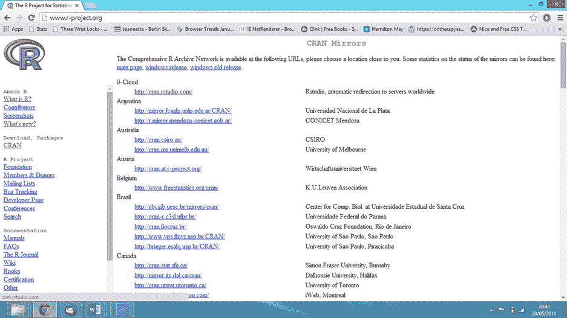

图 A-1. 镜像站点列表

页面会显示一个包含软件包及其用途描述的列表，如图 A-2 所示。您可以使用浏览器工具搜索该列表，通常通过按 `Ctrl+F` 或 `Cmd+F` 进行。

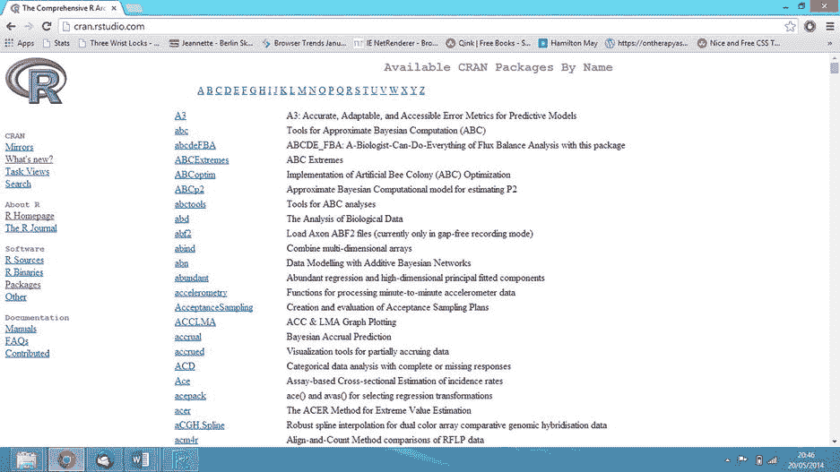

图 A-2. 按名称排序的可用软件包列表

选择适合的软件包后，您将看到软件包信息页面，如图 A-3 所示。在此页面上，您可以找到该软件包功能的说明，以及 PDF 格式的参考手册。您会注意到该软件包可供下载，但无需自行下载，因为从 R 环境内部安装更为简便。

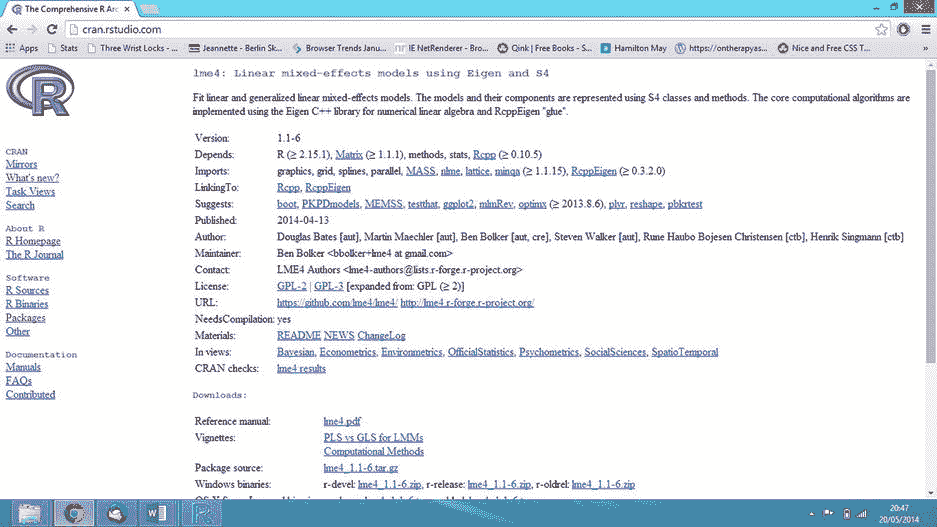

图 A-3. `lme4` 软件包信息页面

### 安装和加载附加包

要使用附加包，必须先安装它（只需安装一次）。R 基础安装中包含了许多软件包（例如我们在第 2 章中使用的 `foreign` 包），这些包无需安装。

软件包安装完成后，必须加载才能使用其中的函数。这些函数将在当前会话的剩余时间内可用，因此每次需要使用该包时，都需要在会话中加载它。

您可以在 R 环境内部安装和加载软件包，以下将分别为 Windows、Mac 和 Linux 用户进行说明。

#### Windows 用户

安装软件包：

从 `Package` 菜单中选择 `Install Package(s)`。首次安装软件包时，系统会提示选择一个镜像站点，如图 A-4 所示。选择一个离您较近的站点。根据提示，从列表中选择所需的软件包，如图 A-5 所示。

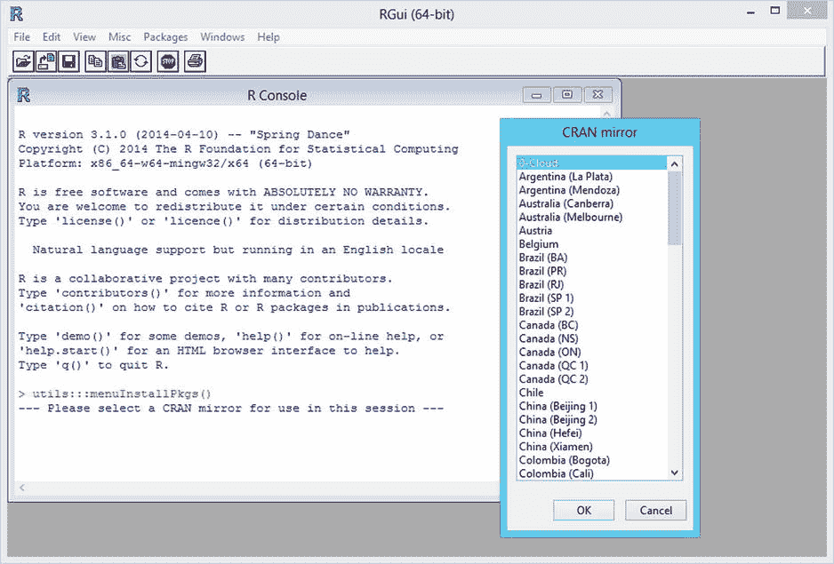

图 A-4. 选择镜像站点（Windows）

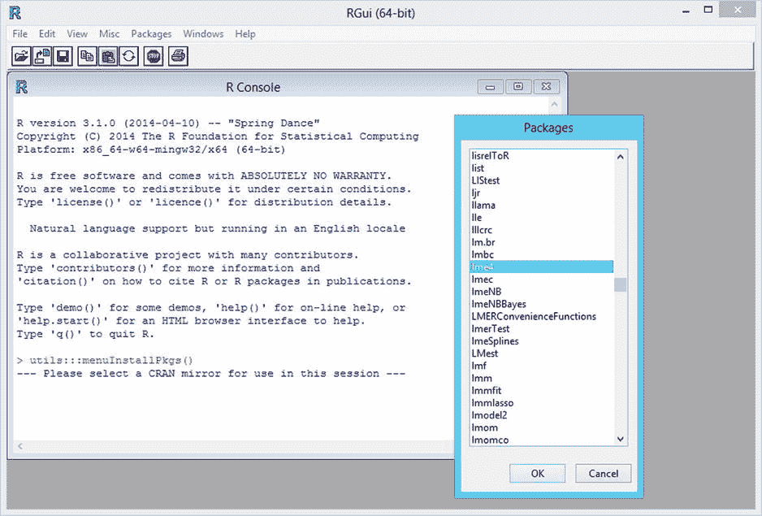

图 A-5. 选择要安装的软件包（Windows）

加载软件包：

从 `Packages` 菜单中选择 `Load Package`。根据提示，从列表中选择所需的软件包。

#### Mac 用户

安装软件包：

从 `Packages & Data` 菜单中选择 `R Package Installer`。当 `R Package Installer` 出现时，按下 `Get List`。软件包列表将显示出来。从列表中选择所需的软件包，然后勾选 `Install Dependencies` 复选框，并按下 `Install Selected`，如图 A-6 所示。关闭窗口。

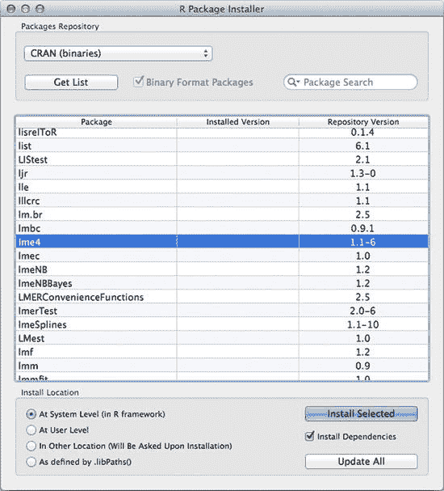

图 A-6. 选择要安装的软件包（Mac）

加载软件包：

从 `Packages & Data` 菜单中选择 `R Package Manager`。

> **注意**：Mac 版 R 3.1.0 存在一个问题，可能导致您无法打开 `Package Manager`。如果遇到此问题，可以从 [`http://r.research.att.com/`](http://r.research.att.com/) 下载修补版本。此问题应在 3.1.1 及更高版本中解决。

点击所需软件包旁边的 `Status` 框，将状态更改为 `Loaded`，如图 A-7 所示。

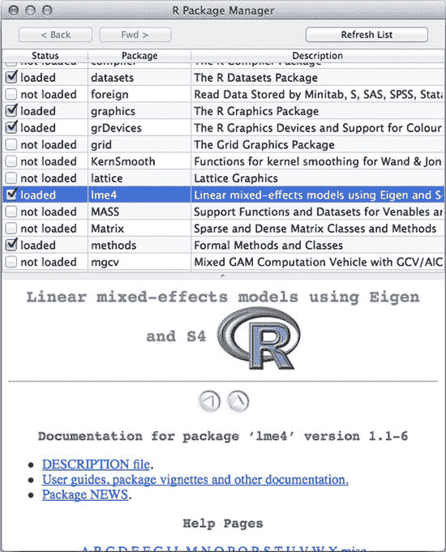

图 A-7. 加载软件包（Mac）

#### Linux 用户

安装软件包：

输入以下命令：

```
> download.packages(packagename, "/home/Username/folder")
```

文件路径指定保存软件包的位置。根据提示，选择一个离您较近的镜像站点。

加载软件包，输入以下命令：

```
> install.packages("packagename")
```
