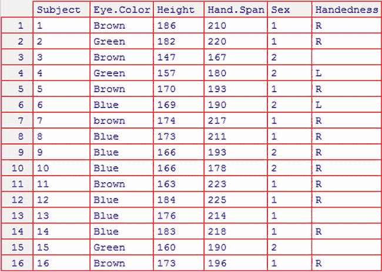
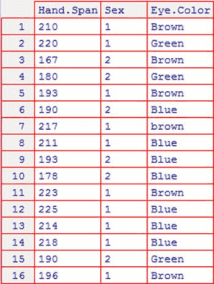
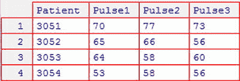
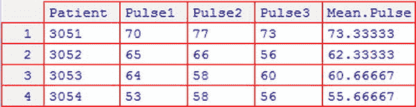
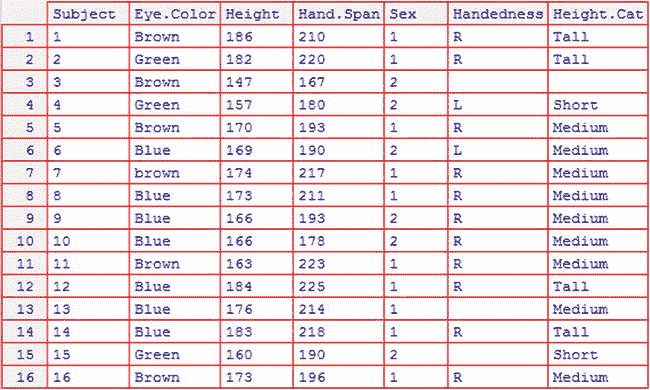
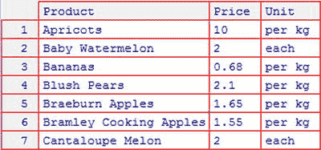
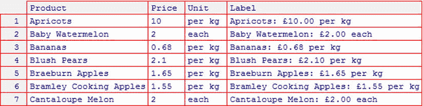
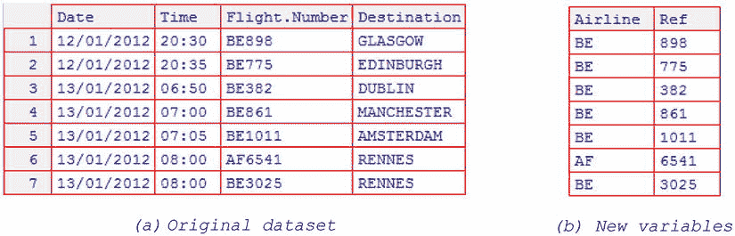
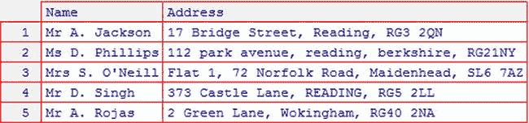
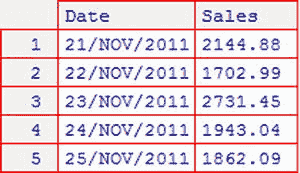

# 3. 准备与操作数据

在导入数据集后，很可能需要在开始任何统计分析之前做一些更改。您的分析可能需要一些新变量，或者可能需要删除一些无关数据。此外，您可能希望确保变量和类别名称正确无误，以便在您创建的任何统计输出中看起来更美观。本章将说明如何对数据集进行此类更改。

您将学习如何：

-   重命名、重新排列和删除变量
-   更改变量的数据类型
-   从旧变量计算新变量
-   将数值变量划分为类别
-   修改分类（因子）变量的类别名称
-   操作字符串
-   处理日期和时间
-   添加或删除观测值
-   选择数据子集（按类型或随机抽样）
-   对数据进行排序

更复杂的更改，例如合并两个数据集或更改数据结构，将在第 4 章中介绍。

本章以图 3-1 所示的 `people` 数据集为例进行演示。该数据集包含十六个人的眼睛颜色（棕色、蓝色或绿色）、身高（厘米）、手跨度（毫米）、性别（1 表示男性，2 表示女性）以及惯用手（L 表示左撇子，R 表示右撇子）。



图 3-1. `people` 数据集

本章还将使用 `pulserates`、`fruit`、`flights`、`customers` 和 `coffeeshop` 数据集，这些数据集均可以 CSV 格式或 R 工作区文件的形式随本书下载（[`www.apress.com/9781484201404`](http://www.apress.com/9781484201404)）。有关这些数据集的更多信息，请参见附录 C。

## 变量

如果数据集包含大量变量，您可以通过删除不必要的变量并以有意义的顺序排列剩余变量，使其更易于管理。您应检查每个变量是否具有适当的名称和适合其包含的数据类型的类别，具体说明见以下各节。

### 重新排列和删除变量

您可以使用 `subset` 函数重新排列或删除数据集中的变量。使用 `select` 参数选择要保留的变量及其顺序。通过将不需要的变量排除在列表之外来删除它们。

例如，以下命令从 `people` 数据集中删除了 `Subject`、`Height` 和 `Handedness` 变量，并重新排列了剩余变量，使 `Hand.Span` 位于首位，其后依次是 `Sex` 和 `Eye.Color`：

```
> people1 <- subset(people, select=c(Hand.Span, Sex, Eye.Color))
```

图 3-2 显示了应用更改后新数据集的样子。



图 3-2. 使用 `subset` 函数从 `people` 数据集中删除变量后创建的 `people1` 数据集

请注意，该命令创建了一个名为 `people1` 的新数据集，它是原始数据集的修改版本，并保持原始数据集不变。或者，您也可以用此修改版本覆盖原始数据集：

```
> people <- subset(people, select=c(Hand.Span, Sex, Eye.Color))
```

`subset` 函数不仅能删除和重新排列变量。您还可以使用它从数据集中选择观测的子集，这将在本章后面的“根据选择标准选择子集”部分中解释。

另一种从数据集中删除变量的方法是使用方括号表示法。当您的数据集包含大量变量而您只想删除少数几个时，这种方法尤其有用。例如，要从 `people` 数据集中删除第一、第三和第六个变量，请使用命令：

```
> people1 <- people[-c(1,3,6)]
```

类似地，要保留第二、第四和第一个变量并重新排序，请使用命令：

```
> people1 <- people[c(2,4,1)]
```

**注意：** 有关使用方括号表示法的更多详细信息，请参见第 1 章中的“数据框”部分。

### 重命名变量

`names` 函数会显示数据集中所有变量名称的列表：

```
> names(people)
[1] "Subject"    "Eye.Color" "Height"     "Hand.Span"  "Sex"        "Handedness"
```

你也可以使用 `names` 函数来重命名变量。以下命令将 `people` 数据集中的第五个变量重命名：

```
> names(people)[5]<-"Gender"
```

类似地，要重命名第二个、第四个和第五个变量：

```
> names(people)[c(2,4,5)]<-c("Eyes", "Span.mm", "Gender")
```

或者，你也可以一次性重命名数据集中的所有变量：

```
> names(people)<-c("Subject", "Eyes", "Height.cm", "Span.mm", "Gender", "Hand")
```

请确保你提供的变量名称数量与数据集中的变量数量相同。

### 变量类别

数据集中的每个变量都有一个类别，它描述了该变量包含的数据类型。你可以使用 `class` 函数查看变量的类别：

```
> class(dataset$variable)
```

要同时检查所有变量的类别，请使用以下命令：

```
> sapply(dataset, class)
```

变量的类别决定了你在统计分析或绘图中使用它时，R 将如何处理该变量。R 中有许多可能的变量类别，但你可能只会用到其中的几种：

*   `numeric` 变量包含实数，即正数或负数，可以包含小数点，也可以不含。它们也可以包含缺失数据符号（`NA`）。
*   `integer` 变量包含没有小数点的正数或负数。此类别行为上与 `numeric` 类别非常相似。如果包含一个带有小数部分的值，`integer` 变量会自动转换为 `numeric` 变量。
*   `factor` 变量适用于分类数据。`factor` 变量通常具有少量唯一值，这些值被称为水平（levels）。实际值可以是数字或字符串。
*   `date` 和 `POSIXlt` 变量以特殊格式包含日期或日期时间，方便处理。
*   `character` 变量包含字符串。字符串是 unicode 字符的任意组合，包括字母、数字和符号。此类别适用于不属于其他任何类别的数据，例如参考编号、标签，以及提供额外注释或信息的文本。

当你使用诸如 `read.csv` 之类的函数导入数据文件时，R 会根据变量的内容自动为每个变量分配一个类别。如果变量只包含数字，R 会分配 `numeric` 或 `integer` 类别。如果变量包含任何非数值，R 会分配 `factor` 类别。

由于 R 不知道你打算如何使用每个变量中包含的数据，因此它分配的类别可能并不总是合适的。举例来说，考虑 `people` 数据集中的 `Sex` 变量。因为该变量包含整数，R 在导入数据时会自动分配 `integer` 类别。但 `factor` 类别会更合适，因为这些值代表的是类别，而不是计数或测量值。

你可以使用 `as.factor` 函数将变量的类别更改为 `factor`：

```
> dataset$variable<-as.factor(dataset$variable)
```

如果你有一个包含数值但因某些原因被分配了其他类别的变量，你可以使用 `as.numeric` 函数来更改它。任何非数值都将被视为缺失数据，并替换为缺失数据代码（`NA`）：

```
> dataset$variable<-as.numeric(dataset$variable)
```

如果在导入数据集时 R 没有自动将某个变量识别为 `numeric`，那该变量至少包含一个非数值。明智的做法是找出原因，因为这可能是一个值被错误地输入，或者用于表示缺失数据的符号未被识别。

你可以使用 `as.character` 函数将变量的类别更改为 `character`：

```
> dataset$variable<-as.character(dataset$variable)
```

还有一个用于创建日期变量的 `as.Date` 函数，你将在本章后面的“处理日期和时间”中了解更多。

## 计算新的数值变量

你可以像创建任何其他新对象一样，使用赋值运算符（`<-`）在数据集中创建一个新变量。因此，要创建一个名为 `var2` 的新变量，它是现有变量 `var1` 的副本，请使用以下命令：

```
> dataset$var2<-dataset$var1
```

你可以通过组合现有的数值变量、算术运算符和函数来创建新的数值变量。例如，下面的命令在 `people` 数据集中添加了一个名为 `Height.Inches` 的新变量，该变量以英寸为单位给出受试者的身高，并四舍五入到最近的整数：

```
> people$Height.Inches<-round(people$Height/2.54)
```

你可以使用方括号标记法对变量进行条件修改。例如，要将所有小于 150 厘米的 `Height` 值设为缺失，请使用以下命令：

```
> people$Height[people$Height<150]<-NA
```

`注意：` 你将在本章后面的“根据选择标准选取子集”以及附录 B 中了解有关使用条件的更多信息。

你可能想要创建一个新变量，该变量是几个现有变量的统计汇总。`apply` 函数允许你做到这一点。

考虑图 3-3 中显示的 `pulserates` 数据集，它给出了四位患者的脉搏率数据。患者的脉搏率被测量三次并存储在变量 `Pulse1`，`Pulse2` 和 `Pulse3` 中。



`图 3-3.` `pulserates` 数据集提供了四位患者三次重复测量的脉搏率（更多细节见附录 C）

假设你想计算一个新变量，表示每个患者的平均脉搏率。你可以使用以下命令创建新变量（如图 3-4 所示）：

```
> pulserates$Mean.Pulse<-apply(pulserates[2:4], 1, mean)
```



`图 3-4.` 包含新变量 `Mean.Pulse` 的 `pulserates` 数据集

请注意，这里使用了方括号标记法选择了第 2 到第 4 列。（第 1 章的“数据框”部分提供了关于使用方括号标记法的更多细节。）

第二个参数允许你指定汇总计算是针对每一行（设为 `1`）还是每一列（设为 `2`）。要创建一个新变量，请将其设为 `1`。

你可以将 `mean` 函数替换为任何输出单个值的单变量统计汇总函数，例如 `sd` 或 `max`。表 5-1 列出了这些函数（请仅使用标有星号的函数）。

## 将连续变量划分为类别

有时你可能希望根据连续变量的值对观测进行分类，从而创建一个新的分类变量。

例如，考虑图 3-1 中展示的 `people` 数据集。假设你想创建一个名为 `Height.Cat` 的新变量，该变量根据身高将人群划分为“矮”、“中等”和“高”。身高小于 160 厘米的人被归类为“矮”，身高在 160 厘米到 180 厘米之间的人被归类为“中等”，身高大于 180 厘米的人被归类为“高”。

你可以使用 `cut` 函数创建新变量：

```
> people$Height.Cat<-cut(people$Height, c(150, 160, 180, 200), c("Short", "Medium", "Tall"))
```

图 3-5 展示了包含新变量 `Height.Cat` 的 `people` 数据集。



图 3-5. 包含新变量 `Height.Cat` 的 `people` 数据集

使用 `cut` 函数时，分组边界值的数量（此例中为四个）必须比分组的名称数量（此例中为三个）多一个。如果一个数据值等于某个边界值，它会被归入到该边界值对应的下一类别中。请确保你的类别覆盖了所有数据值的范围；否则，新变量中将出现缺失值。在此例中，有一个观测值（对象 3）不属于已定义的任何类别，因此其在 `Height.Cat` 变量中对应了一个缺失值。

如果你愿意，可以指定类别的数量，让 R 来决定边界的位置。R 会划分变量的范围以创建大小均匀的类别。例如，以下命令展示了如何将 `Height` 变量分割成三个均匀的类别：

```
> people$Height.Cat<-cut(people$Height, 3, c("Short", "Medium", "Tall"))
```

任何用 `cut` 函数创建的变量都会自动被赋予 `factor` 类。

`注意：` 始终要仔细考虑是否真的需要将一个数值变量划分为类别。数值变量包含的信息比分类变量更多，因此，在统计模型中尽可能直接纳入原始的数值变量通常是最明智的做法。

## 处理因子变量

正如在“变量类”中所解释的，因子变量适用于存储分类数据。要将变量的类更改为 `factor`，请使用 `as.factor` 函数：

```
> people$Sex<-as.factor(people$Sex)
```

一个因子变量具有多个水平，这些水平是该变量取值的所有唯一值（即所有可能的类别）。要查看因子变量的水平，请使用 `levels` 函数：

```
> levels(people$Sex)
[1] "1" "2"
```

由于水平名称会出现在你基于该变量创建的任何图表和统计输出中，因此，如果它们既具有意义又美观，将会很有帮助。你可以更改这些水平名称：

```
> levels(people$Sex)<-c("Male", "Female")
```

你必须提供与因子水平数量相同的名称，并按照对应的顺序输入新名称。

你也可以通过重命名来合并因子水平。考虑 `people` 数据集中的 `Eye.Color` 变量。使用 `levels` 函数，你可以看到由于拼写变体而产生了一个额外的水平：

```
> levels(people$Eye.Color)
[1] "Blue" "brown" "Brown" "Green"
```

要将第二个因子水平重命名为正确的拼写，请使用以下命令：

```
> levels(people$Eye.Color)[2]<-"Brown"
```

当再次查看因子水平时，你可以看到这两个水平已经合并：

```
> levels(people$Eye.Color)
[1] "Blue"  "Brown" "Green"
```

你可以使用 `relevel` 函数更改水平的顺序。例如，要将 `Brown` 设为 `Eye.Color` 变量的第一个水平，请使用以下命令：

```
> people$Eye.Color<-relevel(people$Eye.Color, "Brown")
```

因子水平的顺序很重要，因为如果你将因子纳入统计模型，R 会使用因子的第一个水平作为参考水平。你将在第 11 章中了解更多相关信息。

## 处理字符变量

R 有许多用于处理字符串的函数。其中最有用的三个是 `paste`（用于拼接字符串）、`substring`（用于提取子字符串）和 `grep`（用于搜索字符串）。以下小节将对它们进行演示。

### 拼接字符串

`paste` 函数允许你通过拼接现有变量（任何类）和其他字符来创建新的字符变量。

考虑图 3-6 中展示的 `fruit` 数据集，该数据集提供了一些精选水果的价格。



图 3-6. 提供 2012 年 8 月英国水果价格的 `fruit` 数据集（更多详情请参见附录 C）

假设你想创建一个新变量，为每种水果提供一个价格标签。该标签应包含产品描述、带英镑符号的价格以及销售单位。你可以使用以下命令创建新变量（如图 3-7 所示）：

```
> fruit$Label<-paste(fruit$Product, ": £", format(fruit$Price, trim=T, digits=2), " ", fruit$Unit, sep="")
```



图 3-7. 包含新变量 `Label` 的 `fruits` 数据集

默认情况下，`paste` 函数会在每个被拼接的组件之间插入一个空格。在此例中，添加了 `sep=""` 来防止这种情况，这样空格就不会被插入到不需要的地方，例如英镑符号和价格之间。相反，空格已在需要的位置手动插入，放在引号之间。你也可以使用 `sep` 参数来指定其他键盘符号作为分隔符。

请注意，已经使用了 `format` 函数来确保水果价格始终显示为两位小数。

### 提取子字符串

`substring` 函数允许你通过从现有变量中提取一部分字符来创建一个新变量。

考虑图 3-8a 中展示的 `flights` 数据集。`Flight.Number` 变量给出的航班号以两个字母的前缀开头，表示运营该航班的航空公司。假设你希望创建两个新变量，一个名为 `Airline`，给出两个字母的航空公司前缀；另一个名为 `Ref`，给出数字部分，如图 3-8b 所示。



图 3-8. 提供南安普敦机场航班详细信息的 `flights` 数据集（更多详情请参见附录 C）

使用 `substring` 函数时，要给出字符串中你想提取的第一个和最后一个字符的位置。因此，要从 `Flight.Number` 变量中提取前两个字符来创建 `Airline` 变量，请使用以下命令：

```
> flights$Airline<-substring(flights$Flight.Number, 1, 2)
```

你也可以只给出一个起始位置，此时会提取字符串的剩余部分。因此，要创建 `Ref` 变量，请使用以下命令：

```
> flights$Ref<-substring(flights$Flight.Number, 3)
```

请注意，尽管新的 `Ref` 变量包含数字，但它仍然具有 `character` 类，因为它是用 `substring` 函数创建的。如果你想将其用作数值变量，可以按照“变量类”中的描述，使用 `as.numeric` 函数进行转换。

### 搜索字符变量

`grep` 函数用于在字符串中搜索指定内容。

请参考图 3-9 中的 `customers` 数据集。假设您要识别出所有居住在雷丁市的客户。



图 3-9. `customers` 数据集（详见附录 C）

以下命令在 `Address` 变量中搜索“reading”一词：

```
> grep("reading", customers$Address)
```

```
[1] 2
```

R 输出数字 2，表示第 2 个观测值包含“reading”一词。

请注意，R 只返回了一个结果，因为搜索默认区分大小写，因此“Reading”和“READING”不被视为与搜索词“reading”匹配。要更改此设置，请将 `ignore.case` 参数设置为 `T`：

```
> grep("reading", customers$Address, ignore.case=T)
```

```
[1] 1 2 4
```

您可以将这些观测值编号保存到一个对象中，而不是直接显示出来。这样，您就可以创建一个仅包含匹配搜索词观测值的新数据集：

```
> matches<-grep("reading", customers$Address, ignore.case=T)
> reading.customers<-customers[matches,]
```

### 处理日期与时间

R 拥有专门的日期和日期时间变量类别，使得处理这类数据更加容易。当您导入数据集时，R 不会自动识别日期变量，而是根据其内容将其归入其他类别。您可以使用 `as.Date` 和 `strptime` 函数来转换这些变量。

对于仅包含日期（不含时间）的变量，请使用 `as.Date` 函数将其转换为 `date` 类别。命令格式如下：

```
> dataset$variable <- as.Date(dataset$variable, "format")
```

其中 `"format"` 告诉 R 如何解读日期。R 使用一套特殊的符号来指定日期格式，如表 3-1 所示。

表 3-1. 日期时间格式最常用的符号。输入 `help(strptime)` 可查看完整列表

| 符号 | 含义 | 可能值 |
| --- | --- | --- |
| `%d` | 月份中的日期 | 01 至 31, 或 1 至 31 |
| `%m` | 月份数字 | 01 至 12 |
| `%b` | 月份的三字母缩写 | Jan, Feb, Mar, Apr 等 |
| `%B` | 月份的完整名称 | January, February, March, April 等 |
| `%y` | 两位数的年份 | 00 至 99, 例如 10 代表 2010 |
| `%Y` | 四位数的年份 | 例如 2004 |
| `%H` | 24 小时制的小时 | 0 至 23, 例如 19 代表下午 7 点 |
| `%M` | 分钟 | 00 至 59 |
| `%S` | 秒 | 00 至 59 |
| `%I` | 12 小时制的小时 | 01 至 12 |
| `%p` | 上午或下午 | AM 或 PM |

请参考图 3-10 中 `coffeeshop` 数据集的 `Date` 变量。该变量的日期格式为 dd/mmm/yyyy。



图 3-10. `coffeeshop` 数据集（详见附录 C）

要转换该变量为 `date` 类别，请使用以下命令：

```
> coffeeshop$Date<-as.Date(coffeeshop$Date, "%d/%b/%Y")
```

格式 `%d/%b/%Y` 告诉 R，期望看到的是日期（`%d`）、三字母的月份缩写（`%b`）和四位数的年份（`%Y`），各部分之间用斜杠分隔。该格式必须用引号括起来。

R 有两种无需指定格式即可识别的日期格式，即 yyyy-mm-dd 和 yyyy/mm/dd。如果您的日期属于这两种格式之一，那么在使用 `as.Date` 函数时无需提供格式。

对于包含日期和时间信息的变量，请使用 `strptime` 函数将其转换为 `POSIXlt` 类别。

例如，假设您想根据 `flights` 数据集中的 `Date` 和 `Time` 变量创建一个新的日期时间变量（参考图 3-6）。

在创建日期时间变量之前，您需要使用 `paste` 函数将这两个变量合并成一个单一的字符变量（请参考“连接字符串”部分）：

```
> flights$DateTime<-paste(flights$Date, flights$Time)
```

一旦日期和时间被组合在同一个字符串中，您就可以使用 `strptime` 函数来转换变量类别。`strptime` 函数的使用方法与 `as.Date` 函数相同：

```
> flights$DateTime<-strptime(flights$DateTime, "%d/%m/%Y %H:%M")
```

一旦您的变量属于 `date` 或 `POSIXlt` 类别，您就可以使用专为这些变量类别设计的函数执行多种与日期相关的操作。

例如，要计算两个日期或日期时间之间的时间间隔长度，请使用 `difftime` 函数：

```
> dataset$duration <- difftime(dataset$enddate, dataset$startdate, units="hours")
```

`units` 参数的可选值有 `secs`、`mins`、`hours`、`days`（默认值）和 `weeks`。

要将日期变量与当前日期进行比较（例如，计算年龄），请使用 `Sys.Date` 函数：

```
> dataset$age <- difftime(Sys.Date(), dataset$dob)
```

您可以使用算术运算符来增加或减少天数（针对日期变量）或秒数（针对 `POSIXlt` 变量）。例如，要计算给定日期前一周的日期：

```
> dataset$newdatevar <- dataset$datevar - 7
```

要确定某个日期是星期几，请使用 `weekdays` 函数。此外还有类似的函数，名为 `months` 和 `quarters`：

```
> coffeeshop$Day<-weekdays(coffeeshop$Date)
```

`round` 函数也可用于日期时间变量。指定时间单位之一：`secs`、`mins`、`hours` 或 `days`：

```
> round(flights$DateTime, units="hours")
```

您可以使用 `format` 函数从日期变量生成一个字符变量。使用表 3-1 中给出的格式符号，指定您希望 R 如何显示日期：

```
> dataset$charvar <- format(dataset$datevar, format="%d.%m.%Y")
```

## 添加和删除观测值

您可以使用数据编辑器向数据框添加新的观测值，并使用方括号符号删除特定的观测值。R 有一个名为 `unique` 的特殊函数用于删除重复值。

如果您想删除所有符合特定条件或属于特定分组的观测值，请使用 `subset` 函数，如本章后续“根据选择标准选取子集”部分所述。

### 添加新观测值

向数据集添加额外观测值最简单的方法是使用数据编辑器。您可以通过以下命令打开它：

```
> fix(dataset)
```

当编辑器窗口打开时，在现有数据下方的第一个空行中输入新观测值的值。如果有任何值缺失，请将相应的单元格留空。添加完新值后，关闭数据编辑器以应用更改。

### 删除特定观测值

从数据集中删除单个观测值的最简单方法是使用方括号表示法（参见第 1 章中的“数据框”部分）。例如，要删除观测值编号 2、4 和 7，请使用命令：

```
> dataset <- dataset[-c(2,4,7),]
```

请务必在右括号前包含逗号；否则，您将删除列而不是行。

请记住，您也可以使用冒号符号（`:`）来选择一个连续的观测值范围。例如，要删除观测值 2 到 10，请使用命令：

```
> dataset <- dataset[-c(2:10),]
```

## 移除重复观测值

要从数据集中移除重复的观测值，请使用 `unique` 函数。

```
> dataset <- unique(dataset)
```

若要在移除重复值前将其另存为单独的数据集，请使用 `duplicated` 函数：

```
> dups <- dataset[duplicated(dataset),]
```

## 选择数据子集

可以根据数据属性定义的筛选条件来选择观测值，也可以随机选择以形成随机样本。

### 根据筛选条件选择子集

有时你可能需要选择一个数据集的子集，其中仅包含符合特定条件的观测值，例如属于某个特定类别，或某个数值变量的值落在给定范围内。这可以通过 `subset` 函数实现。该命令的一般形式为：

```
> subset(dataset, condition)
```

例如，要从 `people` 数据集中选择 `Eye.Color` 变量值为 `Brown` 的所有观测值，请使用命令：

```
> subset(people, Eye.Color=="Brown")

Subject  Eye.Color  Height  Hand.Span  Sex  Handedness
1        1      Brown     186        210    1           R
3        3      Brown     147        167    2
5        5      Brown     170        193    1           R
11      11      Brown     163        223    1           R
16      16      Brown     173        196    1           R
```

注意，必须使用两个等号，而不是一个。

要将选定的观测值保存到新数据集，请将输出赋值给一个新的数据集名称：

```
> browneyes <- subset(people, Eye.Color=="Brown")
```

要选择变量值等于列表中任一值的所有观测值，请使用 `%in%` 运算符。例如，要选择 `Eye.Color` 为 `Brown` 或 `Green` 的所有观测值，请使用命令：

```
> subset(people, Eye.Color %in% c("Brown", "Green"))

Subject  Eye.Color  Height  Hand.Span  Sex  Handedness
1        1      Brown     186        210    1           R
2        2      Green     182        220    1           R
3        3      Brown     147        167    2
4        4      Green     157        180    2           L
5        5      Brown     170        193    1           R
11      11      Brown     163        223    1           R
15      15      Green     160        190    2
16      16      Brown     173        196    1           R
```

若要排除而非包含某些观测值，请将 `==` 替换为 `!=`（意为“不等于”）。例如，要排除 `Eye.Color` 值等于 `"Blue"` 的所有观测值，请使用命令：

```
> subset(people, Eye.Color!="Blue")
```

观测值也可以根据数值变量的值进行选择。例如，要从 `people` 数据集中选择 `Height` 变量等于 169 的所有观测值，请使用命令：

```
> subset(people, Height==169)

Subject  Eye.Color  Height  Hand.Span  Sex  Handedness
6         6       Blue     169        190    2           L
```

注意，数值不需要加引号。

对于数值变量，你还可以使用关系运算符来选择观测值。例如，要选择 `Height` 变量值小于 165 的所有观测值，请使用命令：

```
> subset(people, Height<165)

Subject  Eye.Color  Height  Hand.Span  Sex  Handedness
3          3      Brown     147        167    2
4          4      Green     157        180    2           L
11        11      Brown     163        223    1           R
15        15      Green     160        190    2
```

你可以使用的其他关系运算符包括 `>`（大于）、`>=`（大于或等于）和 `<=`（小于或等于）。

你可以使用 AND 运算符（表示为 `&`）和 OR 运算符（表示为 `|`）来组合两个或多个条件。当两个条件用 AND 运算符连接时，R 仅选择同时满足这两个条件的观测值。当它们用 OR 运算符连接时，R 选择满足任一条件或同时满足两个条件的观测值。

例如，要选择 `Eye.Color` 为 `Brown` 且 `Height` 小于 165 的观测值，请使用命令：

```
> subset(people, Eye.Color=="Brown" & Height<165)

Subject  Eye.Color  Height  Hand.Span  Sex  Handedness
3          3      Brown     147        167    2
11        11      Brown     163        223    1           R
```

除了选择数据集的观测值子集外，你还可以使用 `select` 参数来选择要保留的变量。

```
> subset(people, Height<165, select=c(Hand.Span, Height))

Hand.Span  Height
3          167     147
4          180     157
11         223     163
15         190     160
```

另一种对数据集取子集的方法是使用方括号符号。例如，此命令仅选择棕色眼睛的人：

```
> people[people$Eye.Color=="Brown",]
```

请注意，在进行分析之前，并非总需要对数据集进行子集划分。许多分析函数内部都有一个 `subset` 参数。这允许你针对数据的子集执行分析。例如，此命令创建了一个身高与手展的散点图，仅显示男性（即 `Sex` 等于 2 的情况）：

```
> plot(Height ~ Hand.Span, people, subset=Sex==2)
```

你将在第 8 章中了解更多关于散点图的信息。

### 从数据集中选取随机样本

要从数据集中选取随机样本的观测值，请使用 `sample` 函数。例如，以下命令从名为 `dataset` 的数据集中随机抽取 50 个观测值，并将其保存到名为 `sampledata` 的新数据集中：

```
> sampledata <- dataset[sample(1:nrow(dataset), 50),]
```

默认情况下，`sample` 函数进行无放回抽样，因此任何观测值都不会被选中超过一次。因此，样本大小必须小于数据集中的观测值数量。要进行有放回抽样，请将 `replace` 参数设置为 `T`：

```
> sampledata <- dataset[sample(1:nrow(dataset), 50, replace=T),]
```

## 对数据集排序

你可以使用 `order` 函数对数据集进行排序。例如，要按 `Hand.Span` 变量对 `people` 数据集排序，请使用命令：

## 总结

现在，您应该能够通过创建分析所需的新变量、删除无关数据以及整理最终数据集来准备数据集。

下表展示了本章中介绍的最重要的命令。

| 任务 | 命令 |
| --- | --- |
| 重命名变量 | `names(dataset)[n]<-"Newname"` |
| 查看变量类型 | `class(dataset$variable)` |
| 将变量类型改为数值型 | `dataset$var1<-as.numeric(dataset$var1)` |
| 将变量类型改为因子型 | `dataset$var1<-as.factor(dataset$var1)` |
| 将变量类型改为字符型 | `dataset$var1<-as.character(dataset$var1)` |
| 将变量类型改为日期型 | `dataset$var1<-as.Date(dataset$var1, "format")` |
| 复制变量 | `dataset$var2<-dataset$var1` |
| 将变量划分为类别 | `dataset$factor1<-cut(dataset$var1, c(1,2,3,4), c("Name1", "Name2","Name3"))` |
| 重命名因子水平 | `dataset$variable)[n]<-"Newname"` |
| 重新排序因子水平 | `dataset$variable, "Level1")` |
| 连接两个字符串 | `dataset$var3<-paste(dataset$var1, dataset$var2)` |
| 提取子字符串 | `dataset$var2<-substring(dataset$var1, first, last)` |
| 搜索字符变量 | `grep("search term", dataset$variable)` |
| 删除个案 | `dataset<-dataset[-c(2,4,7),]` |
| 删除重复项 | `dataset<-unique(dataset)` |
| 选择子集 | `subset(dataset, variable=="value")` |
| 选择随机样本 | `newdataset<-dataset[sample(1:nrow(dataset), samplesize),]` |
| 排序数据集 | `dataset<-dataset[order(dataset$variable),]` |

在第 4 章中，您将学习如何对数据集进行更复杂的修改，包括合并两个或多个数据集以及更改数据结构。

```r
> people <- people[order(people$Hand.Span),]

     Subject  Eye.Color  Height  Hand.Span  Sex  Handedness
3          3      Brown     147        167    2
10        10       Blue     166        178    2           R
4          4      Green     157        180    2           L
6          6       Blue     169        190    2           L
15        15      Green     160        190    2
5          5      Brown     170        193    1           R
9          9       Blue     166        193    2           R
16        16      Brown     173        196    1           R
1          1      Brown     186        210    1           R
8          8       Blue     173        211    1           R
13        13       Blue     176        214    1
7          7      Brown     174        217    1           R
14        14       Blue     183        218    1           R
2          2      Green     182        220    1           R
11        11      Brown     163        223    1           R
12        12       Blue     184        225    1           R
```

若要按降序而非升序排序，请将 `decreasing` 参数设置为 `T`：

```r
> people <- people[order(people$Hand.Span, decreasing=T),]
```

你也可以按多个变量进行排序。要首先按 `Sex` 然后按 `Height` 对数据集排序，请使用命令：

```r
> people <- people[order(people$Sex, people$Height),]
```