# 4. 合并与重构数据集

本章解释如何对数据集的结构进行重大修改。您可能需要将来自两个或多个不同来源的数据合并到一个数据集中。这可能简单如将一个数据集附加到另一个数据集的底部或侧面（称为追加或连接），也可能涉及使用共同变量来匹配观测值（称为合并）。或者，您可能需要将多个变量的值合并到一个变量中（堆叠）或将一个变量拆分为多个变量（拆分）。最后，您可能需要重塑数据集，使得原本保存在不同变量中的数据现在保存在不同的观测中，反之亦然（也称为旋转或转置）。

您将学习如何：

- 追加行
- 追加列
- 使用共同变量合并两个数据集
- 堆叠数据集
- 拆分数据集
- 重塑数据集

本章使用了 `CIAdata1`、`CIAdata2`、`WHOdata`、`CPIdata`、`bigcats`、`endangered`、`grades1`、`resistance` 和 `vitalsigns` 数据集，这些数据集可通过本书的下载资源获取（`www.apress.com/9781484201404`）。有关这些数据集的更多详细信息，请参阅附录 C。本章还使用了 R 自带的 `iris` 数据集。要查看关于该数据集的更多信息，请输入 `help(iris)`。

## 追加行

`rbind` 函数允许您将一个数据集附加到另一个数据集的底部，这被称为追加或连接数据集。当您想要合并两个包含相同变量但不同观测值的数据集时，这非常有用，例如图 4-1a 和 b 中显示的 `CIAdata1` 和 `CIAdata2` 数据集。

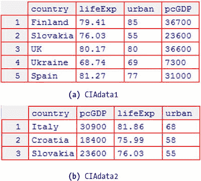

图 4-1. 来自 CIA 世界概况的数据（更多详细信息请参见附录 C）

在使用 `rbind` 函数之前，请确保每个数据集包含相同数量的变量，并且所有变量名称匹配。您可能需要先删除或重命名某些变量，如第 3 章前两节所述。变量在数据集中的排列顺序不必相同，因为 `rbind` 函数会自动按名称匹配它们。

一旦数据集准备好，就可以使用 `rbind` 函数追加它们，如下所示针对 `CIAdata1` 和 `CIAdata2` 数据集：

```
> CIAdata<-rbind(CIAdata1, CIAdata2)
```

新的 `CIAdata` 数据集如图 4-2 所示。请注意，新数据集包含了原始顺序中的所有原始数据，包括斯洛伐克的两份数据副本。`rbind` 函数不会识别重复项或对数据进行排序。您可以使用 `unique` 和 `order` 函数来完成此操作，如第 3 章（“删除重复观测”和“排序数据集”部分）所述。

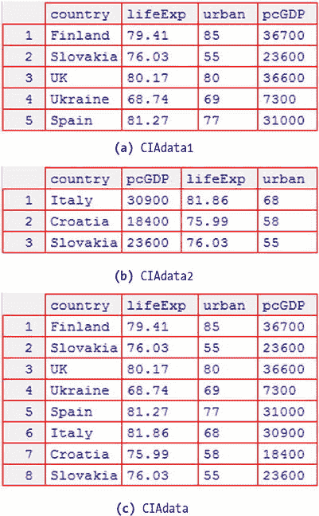

图 4-2. 追加 `CIAdata1` 和 `CIAdata2` 数据集以创建 `CIAdata` 数据集的结果

您可以用类似的方式追加三个或更多数据集：

```
> newdataset<-rbind(dataset1, dataset2, dataset3)
```

## 追加列

`cbind` 函数将一个数据集粘贴到另一个数据集的侧面。如果每个数据集对应行的数据属于同一个观测值，这非常有用，如图 4-3a,b 中显示的 `CIAdata1` 和 `WHOdata` 数据集的情况。

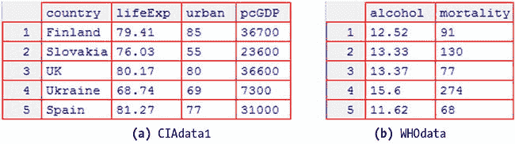

图 4-3. 来自 CIA 世界概况和世界卫生组织的数据（更多详细信息请参见附录 C）

您只能使用 `cbind` 函数来合并具有相同行数的数据集。如果您的数据集有一个或多个可用于匹配观测值的共同变量，请使用 `merge` 函数合并数据集，如下一节所述。

此命令合并 `CIAdata1` 和 `WHOdata` 数据集以创建一个名为 `CIAWHOdata` 的新数据集；结果如图 4-4c 所示：

```
> CIAWHOdata<-cbind(CIAdata1, WHOdata)
```

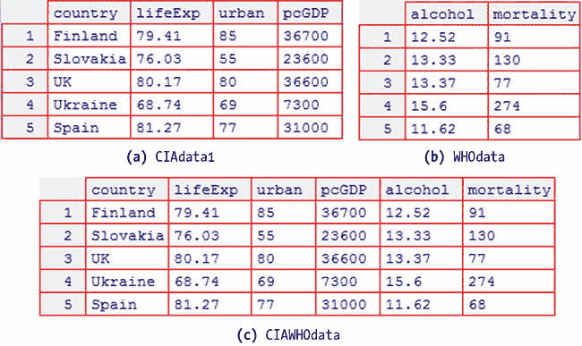

图 4-4. 追加 `CIAdata1` 和 `WHOdata` 数据集以创建 `CIAWHOdata` 数据集的结果

您可以用类似的方式合并三个或更多数据集：

```
> newdataset<-cbind(dataset1, dataset2, dataset3)
```


好的，作为高级文档工程师和翻译员，我将遵循您的指示，完成以下翻译任务。


## 通过公共变量合并数据集

`merge` 函数允许您通过根据公共变量的值匹配观测值，来合并两个数据集。

考虑图 4-5 中所示的 `CIAdata1` 和 `CPIdata` 数据集。这两个数据集有一个名为 `country` 的公共变量，可用于匹配相应的观测值。

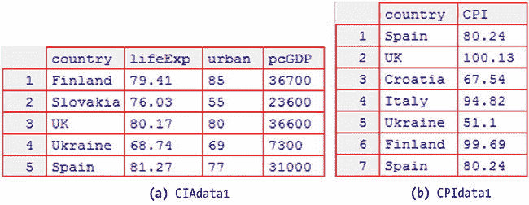

图 4-5.

来自 CIA《世界概况》和 Numbeo 的数据（更多详情见附录 C）

以下命令展示了如何合并 `CIAdata1` 和 `CPIdata` 数据集；结果如图 4-6 所示：

```
> CIACPIdata<-merge(CIAdata1, CPIdata)
```

`merge` 函数会识别名称相同的变量，并使用它们来匹配观测值。在这个例子中，两个数据集都包含一个名为 `country` 的变量，因此 R 会自动使用这个变量来匹配观测值。如果您的数据集有多个公共变量，R 会根据所有公共变量的唯一组合来匹配观测值。

如果两个数据集中公共变量的名称不完全相同，最简单的解决方案是重命名变量，如 第 3 章（参见“重命名变量”）所述。或者，您可以使用 `by.x` 和 `by.y` 参数来指定用于匹配观测值的变量。例如，要合并两个数据集，其中公共变量在第一个数据集中名为 `var1`，在第二个数据集中名为 `VAR1`，请使用以下命令：

```
newdataset <-merge(dataset1, dataset2, by.x="var1", by.y="VAR1")
```

当您使用 `merge` 函数合并两个数据集时，R 会自动排除仅出现在一个数据集中的任何不匹配的观测值。在图 4-6 中，您可以看到斯洛伐克（仅出现在 `CIAdata1` 中）以及意大利和克罗地亚（仅出现在 `CPIdata` 中）都被排除在合并后的数据集之外。

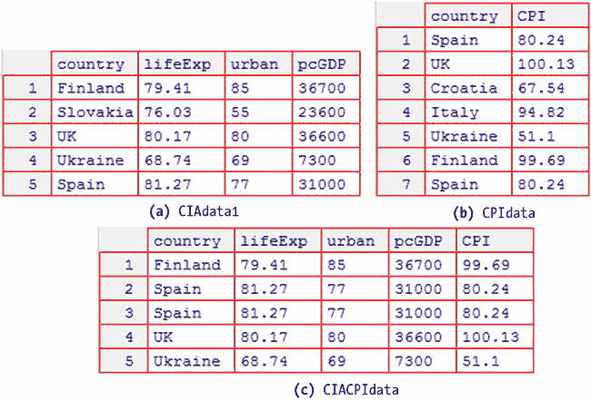

图 4-6.

合并 `CIAdata1` 和 `CPIdata` 数据集以创建 `CIACPIdata` 数据集的结果

`all`、`all.x` 和 `all.y` 参数允许您控制 R 如何处理任何不匹配的观测值。要保留所有不匹配的观测值，请将 `all` 参数设置为 `T`：

```
> allCIACPIdata<-merge(CIAdata1, CPIdata, all=T)
```

结果如图 4-7 所示。请注意，斯洛伐克、意大利和克罗地亚现在已被包含在内，并且在相应数据缺失的地方，已替换为缺失数据符号 `NA`。

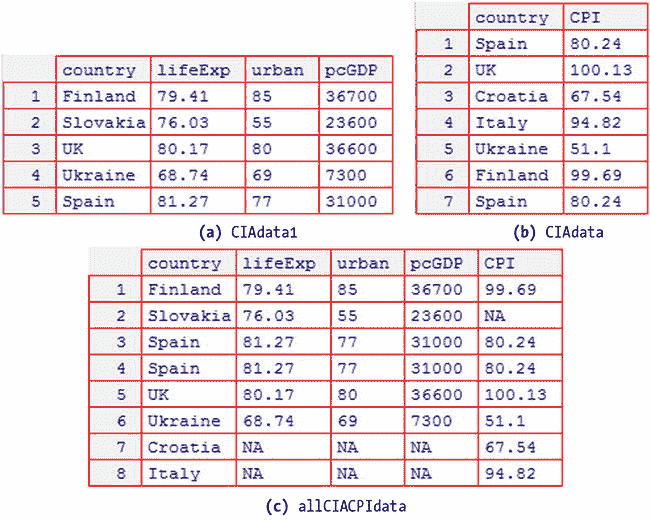

图 4-7.

使用 `all=T` 合并 `CIAdata` 和 `CPIdata` 数据集以创建 `allCIACPIdata` 数据集的结果

或者，您可以使用 `all.x` 和 `all.y` 参数来仅包含来自其中一个数据集的未匹配个案，而非两者。因此，命令：

```
> allCIAGPIdata<-merge(CIAdata1, CPIdata, all.x=T)
```

会包含斯洛伐克的数据，但不包含意大利和克罗地亚的数据；而命令：

```
> allCIAGPIdata<-merge(CIAdata1, CPIdata, all.y=T)
```

会包含意大利和克罗地亚的数据，但不包含斯洛伐克的数据。

当一个观测值存在多个匹配项时，R 会在最终数据集中为每个可能的匹配项创建一个观测值。这被称为笛卡尔积。考虑图 4-8a 和 b 中所示的 `bigcats` 和 `endangered` 数据集。两个数据集都有两个名称为“Leopard”的观测值。当这两个数据集通过 `Name` 变量合并时，最终数据集（如图 4-8c 所示）包含了四行关于 Leopard 的数据。

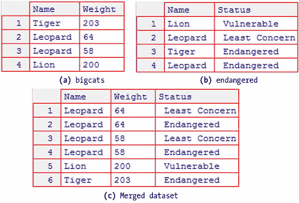

图 4-8.

提供四种大型猫科动物信息的数据集（更多详情见附录 C）

为确保从合并操作中获得所需结果，请确保您使用的公共变量能让 R 正确识别匹配项。您可能还需要事先移除重复的观测值，如 第 3 章（参见“移除重复观测值”）所述。

R 会自动按用于匹配观测值的相同变量对合并后的数据集进行排序。如果您想阻止此行为，请将 `sort` 参数设置为 `F`：

```
> newdataset <-merge(dataset1, dataset2, sort=F)
```

## 堆叠与拆堆数据集

堆叠数据集是指将其从非堆叠形式转换为堆叠形式，而拆堆数据集则是相反的过程，即将数据集从堆叠形式转换为非堆叠形式。为了说明这两种形式的区别，请考虑图 4-9 中所示的 `grades1` 和 `grades2` 数据集。`grades1` 数据集是非堆叠形式。它给出了十五名学生的测试结果，按照他们所属的班级分别排列在不同的列中。`grades2` 数据集以堆叠形式给出了相同的数据。这里的数据排列在两列中，第一列给出测试结果，第二列标识学生所属的班级。

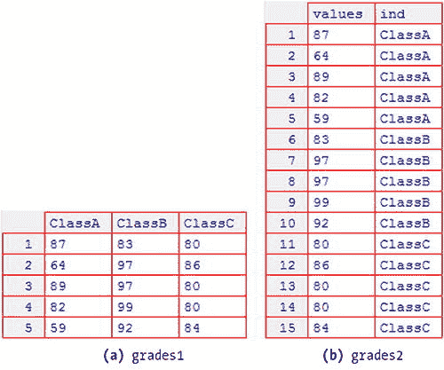

图 4-9.

同样数据的堆叠形式与非堆叠形式

如果您想汇总所有数据值，或者想要根据分组变量对数值进行建模，那么以堆叠形式存储数据会很方便。当您想要分别分析每个组中的值时，以非堆叠形式存储数据是作为将数据拆分为子集的替代方案。

许多常用的 R 函数，例如 `aov`（用于方差分析）、`lm`（用于回归和一般线性模型）和 `glm`（用于广义线性模型），都需要数据采用堆叠形式。大多数 R 的假设检验函数（例如 `t.test`）能够处理堆叠或非堆叠形式的数据。

仅当数值是数值型、没有特定顺序，并且各组数值之间不存在对应关系时，您才应该堆叠或拆堆数据集。对于更复杂的情况，例如存在一个额外变量指示每组中的哪些数值相互对应时，请参考“重塑数据集”。

### 堆叠数据

要将数据集从非堆叠形式转换为堆叠形式，请使用 `stack` 函数：

```
> grades2<-stack(grades1)
```

要仅堆叠数据集中的某些列，请使用 `select` 参数。例如，要仅堆叠 `grades1` 数据集中的 `ClassA` 和 `ClassC` 变量，请使用以下命令：

```
> newdataset<-stack(grades1, select=c("ClassA", "ClassC"))
```

如果您的数据集中有任何非数值变量，R 会将其从堆叠数据集中排除。

`stack` 函数会自动将新变量命名为 `values` 和 `ind`，但您可以使用 `names` 函数将它们更改为更具信息性的名称：

```
> names(grades2)<-c("Result", "Class")
```

图 4-10 显示了最终的堆叠数据集。

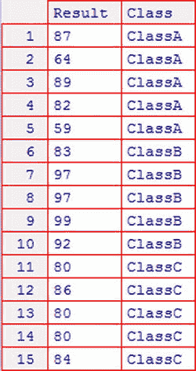

图 4-10.

变量名称更改后的 `grades2` 数据集


### 解堆叠数据

您可以使用`unstack`函数对数据集进行解堆叠。如果您的数据集只有两个变量，其中第一个变量提供数据值，第二个变量标识观测值所属的组（例如`grades2`数据集），请使用以下函数：

```
> grades1 <- unstack(grades2)
```

如果您的数据集包含两个以上变量，或者变量顺序相反，则必须指定要解堆叠的变量：

```
> unstackeddata <- unstack(stackeddata, values ~ groups)
```

在此，`values`是包含数据值的变量名称，`groups`是标识观测值所属组的变量名称。

例如，要解堆叠`iris`数据集（随 R 附带）中的`Sepal.Width`列，为每个鸢尾花物种创建一个包含该列的新数据集，请使用以下命令：

```
> sepalwidths <- unstack(iris, Sepal.Width ~ Species)
```

如果您解堆叠的变量在每个组中的值数量不相等，R 将无法排列这些值以创建新的数据框。在这种情况下，R 会创建一个列表对象，而非数据框。不过，您仍然可以通过美元符号来访问新对象中的每个组的值：

```
> unstackeddata$groupA
```

## 重塑数据集

重塑数据集也称为旋转或转换数据集。它通常适用于重复测量值的数据集，但在其他情况下也很有用。重塑是在**长格式**（重复测量值位于不同列中）和**宽格式**（重复测量值位于同一列中）之间进行转换的过程。

为了说明长格式和宽格式之间的区别，请考虑图 [4-11a]中所展示的`resistance`数据集，该数据集提供了四种混凝土配方在凝结后三天、七天和十四天的立方体电阻测量值。此数据集为宽格式。图 [4-11b]展示了相同数据集的**长格式**，所有测量值位于一个变量中，另一个变量则提供测量值对应的天数。

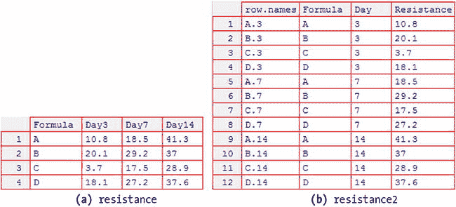

图 4-11. 长格式和宽格式下的`resistance`数据集（更多详情请参见附录 C）

如果您想构建一个将时间点作为解释变量的模型，将数据集转换为长格式会很有用。例如，将`resistance`数据集转换为长格式，允许您将电阻值建模为自混凝土凝结以来经过的天数的函数。

`reshape`函数允许您将数据集从宽格式转换为长格式。例如，要将`resistance`数据集转换为长格式，请使用以下命令：

```
> resistance2 <- reshape(resistance, direction="long", varying=list(c("Day3", "Day7", "Day14")), times=c(3, 7, 14), idvar="Formula", v.names="Resistance", timevar="Day")
```

使用`varying`参数指定要合并到一个列中的变量。使用`times`参数为这些变量中的每一个指定新的时间值或重复编号。请注意，`times`可以是字符值而不是数值。使用`idvar`参数指定将记录分组在一起的变量。`v.names`和`timevar`参数是可选的，用于为新变量指定名称。

新的数据集如图 [4-11b]所示。

您也可以使用`reshape`函数执行相反的过程，即将数据集从长格式转换为宽格式。

考虑图 [4-12a]中展示的`vitalsigns`数据集，该数据集提供了四位患者的收缩压、舒张压和脉搏测量值。所有测量值都保存在`result`变量中，而`test`变量则标识参数。

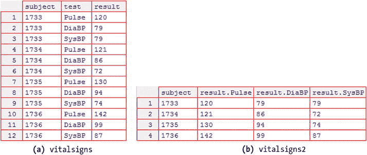

图 4-12. 长格式和宽格式下的`vitalsigns`数据集（更多详情请参见附录 C）

如果您想比较两个或多个时间点或参数的数据，或者将它们作为不同的变量包含在同一模型中，将数据集转换为宽格式会很有用。例如，重塑`vitalsigns`数据集允许您计算收缩压和舒张压之间的相关性。

要将不同类型的测量值拆分为单独的列，请使用以下命令：

```
> vitalsigns2 <- reshape(vitalsigns, direction="wide", v.names="result", timevar="test", idvar="subject")
```

使用`v.names`参数指定要拆分为不同列的变量。使用`timevar`参数指定指示该值属于哪一列的变量（即，给出记录的时间点、重复编号或类别的变量）。使用`idvar`参数指定用于将记录分组在一起的变量。

图 [4-12b]展示了新的宽格式数据集。请注意，R 会自动为新变量生成名称。或者，您可以使用`varying`参数指定新名称：

```
> vitalsigns2 <- reshape(vitalsigns, direction="wide", v.names="result", timevar="test", idvar="subject", varying=list(c("SysBP", "DiaBP", "Pulse")))
```

### 总结

您现在应该能够合并两个或多个数据集，无论是通过追加它们，还是通过使用公共变量合并它们。您应该理解堆叠格式与解堆叠格式之间的区别，并能够根据需要堆叠和解堆叠数据集。您还应该理解长格式和宽格式之间的区别，并能够在两者之间进行转换。

下表总结了本章中涵盖的最重要的命令。

| 任务 | 命令 |
| :--- | :--- |
| 垂直追加数据集 | `rbind(dataset1, dataset2)` |
| 水平追加数据集 | `cbind(dataset1, dataset2)` |
| 合并数据集 | `merge(dataset1, dataset2)` |
| 堆叠数据集 | `stack(dataset, select=c("var1", "var2", "var3"))` |
| 解堆叠数据集 | `unstack(dataset, values ~ groups)` |
| 重塑（宽到长） | `reshape(dataset, direction="long", varying=list(c("var1", "var2", "var3")), times=c(t1, t2, t3), idvar="identifier")` |
| 重塑（长到宽） | `reshape(dataset, direction="wide", v.names="values", timevar="groups", idvar="identifier")` |

在下一章中，我们将继续讨论数据的汇总，从连续变量开始。


