# 9. 自定义图形

在上一章中，你学习了如何创建最流行的图形类型。本章将解释如何自定义其外观。恰当使用标题、标签和图例，对于让你的图形对他人有用且信息丰富至关重要，而精心选择的颜色和样式将有助于打造更精致的外观。

你将学习如何：

-   添加标题和坐标轴标签
-   调整坐标轴
-   指定颜色
-   更改绘图线型
-   更改绘图符号
-   调整阴影区域的阴影样式
-   添加直线、函数曲线、文本、网格和箭头等元素
-   将多组数据叠加到同一张图形上
-   添加图例
-   在一张图中显示多个图形
-   更改默认的图形设置

对图形外观的大多数更改是通过向绘图函数提供额外参数来实现的。本章以 `plot` 函数为例进行说明。然而，大多数参数也可以用于其他绘图函数，例如 `hist` 和 `boxplot`。

本章使用 R 自带的 `trees` 和 `iris` 数据集、`CIAdata` 数据集（创建于第 4 章），以及本书配套下载资源中的 `people2` 和 `fiveyearreport` 数据集。


## 标题与标签

每当创建图形时，R 都会添加默认的坐标轴标签，有时还会添加默认标题。你可以使用自定义的标题和坐标轴标签覆盖这些默认内容。

你可以使用 `main` 参数为图形添加标题：

`> plot(` `数据集` `$` `变量` `, main="` `这是标题` `")`

若要添加显示在图形下方的副标题，请使用 `sub` 参数：

`> plot(` `数据集` `$` `变量` `, sub="` `这是副标题` `")`

如果你的标题或副标题很长，需要显示在两行或更多行，请使用转义序列 `\n` 来告诉 R 在哪里换行。下面的命令为树木高度图添加了一个两行标题，如图 9-1 所示。

`> plot(` `trees` `$Height, main="` `这是标题的第一行` `\n` `这是第二行` `")`

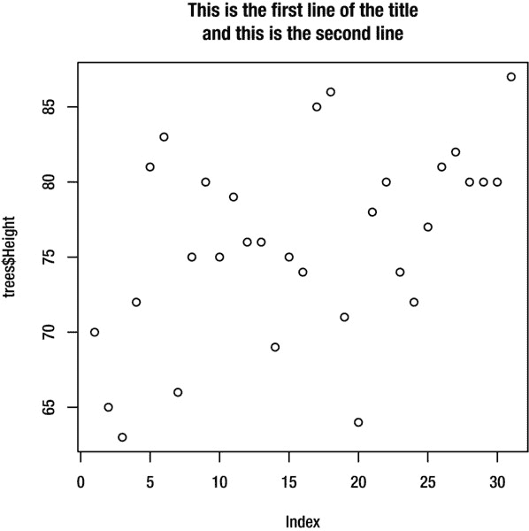

图 9-1. 带有两行标题的图形

要更改 x 轴和 y 轴的标签，请使用 `xlab` 和 `ylab` 参数：

`> plot(` `数据集` `$` `变量` `, xlab="` `x 轴标签` `", ylab="` `y 轴标签` `")`

你还可以添加其他参数来控制标题、副标题、坐标轴标签和坐标轴刻度数字中文本的外观。表 9-1 列出了这些参数。

表 9-1. 用于自定义标题和标签字体的附加参数

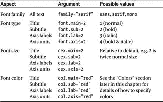

例如，以下命令添加了一个标题，将字体系列设置为 `serif`，并将标题字体设置为灰色、斜体，大小为通常的三倍。结果显示在图 9-2 中。

`> plot(trees$Height, main="这是标题", family="serif", col.main="grey80", cex.main=3, font.main=3)`

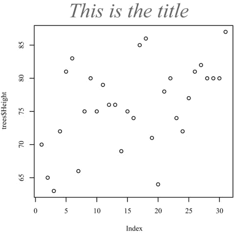

图 9-2. 使用衬线字体并带有大号灰色斜体标题的图形

对于包含分类变量的图形，如条形图、饼图和箱线图，你也可以自定义类别标签。如果你计划创建多个图形，那么更简单的方法是更改数据集中因子变量的水平名称，如第 3 章中“使用因子变量”部分所述。这意味着你不必在每次绘制变量时都修改标签。但是，也可以在绘图时修改标签。

对于饼图，请使用 `labels` 参数：

`> pie(table(` `数据集` `$` `变量` `), labels=c("` `标签 1` `", "` `标签 2` `", "` `标签 3` `"))`

对于条形图，请使用 `names.arg`：

`> plot(` `数据集` `$` `变量` `, names.arg=c("` `标签 1` `", "` `标签 2` `", "` `标签 3` `"))`

对于箱线图，请使用 `names`：

`> boxplot(` `变量` `∼` `因子` `,` `数据集` `, names=c("` `标签 1` `", "` `标签 2` `", "` `标签 3` `"))`

##### 坐标轴

当绘制连续变量时，R 会自动为你的数据选择合理的坐标轴范围。但是，如果你想更改它们，可以使用 `xlim` 和 `ylim` 参数。例如，要将水平轴的范围改为 0–30，垂直轴的范围改为 0–100，请使用以下命令：

`> plot(Volume∼Girth, trees, xlim=c(0, 30), ylim=c(0, 100))`

图 9-3 显示了结果。

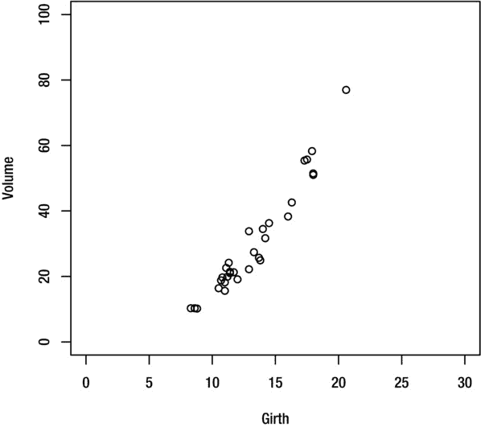

图 9-3. 调整了坐标轴范围的图形

要旋转垂直轴的数字，使其竖直显示而非与垂直轴对齐，请将 `las` 参数设置为 `1`。结果显示在图 9-4 中。

`> plot(Volume∼Girth, trees, las=1)`

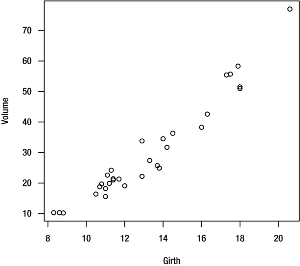

图 9-4. 旋转了坐标轴数字的图形

##### 颜色

R 允许你更改图形中每个组件的颜色。最重要的参数是 `col` 参数，它允许你更改绘图颜色。这是用于表示数据值的线条或符号的颜色。对于直方图、条形图、饼图和箱线图，它指的是形状所包围区域的颜色。

有三种指定颜色的方法。第一种是给出颜色的名称：

`> plot(` `数据集` `$` `变量` `, col="red")`

`colors` 函数会显示一个可识别的颜色名称列表（英式拼写 `colours` 同样有效）：

`> colors()`

第二种指定颜色的方法是使用 1 到 8 之间的数字，它们对应表 9-2 中显示的一组基本颜色。

表 9-2. 基本绘图颜色；请注意，这些颜色在某些平台上可能有所不同；输入 `palette()` 可查看你当前平台的颜色

| 值 | 名称 |
| --- | --- |
| `1` | `black` |
| `2` | `red` |
| `3` | `green3` |
| `4` | `blue` |
| `5` | `cyan` |
| `6` | `magenta` |
| `7` | `yellow` |
| `8` | `gray` |

例如，要将红色指定为绘图颜色，请使用以下命令：

`> plot(` `数据集` `$` `变量` `, col=2)`

最后，如果你需要更精确地控制图形外观，可以使用十六进制 RGB 格式指定颜色。以下命令使用十六进制颜色表示法将绘图颜色更改为红色：

`> plot(` `数据集` `$` `变量` `, col="#FF0000")`

**十六进制颜色表示法**

十六进制颜色表示法（有时称为十六进制颜色或 HTML 颜色）允许你对图形中的颜色进行精细控制。

在十六进制颜色表示法中，每种颜色都被视为三种原色（红、绿、蓝）的独特组合，每种颜色的强度介于 00 和 FF 之间。这种组合以 #RRGGBB 的格式书写。例如，亮红色写为 #FF0000，白色写为 #FFFFFF，黑色写为 #000000。

要识别图像中颜色的十六进制代码，可以使用图形包或诸如 [`http://imagecolorpicker.com/`](http://imagecolorpicker.com/) 之类的网站。如果你想使图形的元素与你的幻灯片或公司标志相匹配，这会很有用。

要从头开始设计一个十六进制颜色的配色方案，可以尝试 [`http://colorschemedesigner.com/`](http://colorschemedesigner.com/) 。

除了指定单一的绘图颜色，你还可以提供一个颜色列表供 R 使用。这对于饼图和条形图特别有用，其中每个类别都会从列表中获得不同的颜色：

`> plot(` `数据集` `$` `变量` `, col=c("red", "blue", "green"))`

数字表示法在此目的下也很有用：

`> plot(` `数据集` `$` `变量` `, col=1:8)`

还有一些函数，比如 `rainbow`，可以轻松创建一组视觉上吸引人的颜色。以下命令创建了五种沿光谱均匀分布的颜色：

`> plot(` `数据集` `$` `变量` `, col=rainbow(5))`

其他的配色方案函数包括 `heat.colors`、`terrain.colors`、`topo.colors` 和 `cm.colors`。

你可以使用表 9-3 中给出的参数，以类似的方式更改图形其他元素的颜色。

表 9-3. 用于更改图形组件颜色的参数（* 背景色必须使用 `par` 函数更改）

| 组件 | 参数 |
| --- | --- |
| 绘图符号、线条或区域 | `col` |
| 前景（坐标轴、刻度线和其它元素） | `fg` |
| 背景色 | `bg*` |
| 标题文本 | `col.main` |
| 副标题文本 | `col.sub` |
| 坐标轴标签文本 | `col.lab` |
| 坐标轴数字 | `col.axis` |

请注意，背景色不能直接在绘图函数内更改，而必须使用 `par` 函数更改：

```
> par(bg="red")
> plot(dataset$variable)
```

通过 `par` 函数所做的更改将应用于当前会话中剩余的所有图形，直到被覆盖为止。


关于使用`par`函数的更多详情，请参阅本章后面的“更改默认绘图设置”，或者输入`help(par)`。

## 绘图符号

本节仅适用于使用符号表示数据值的绘图，例如散点图。

您可以使用`pch`参数更改绘图符号。数字 1 到 25 对应表 9-4 中给出的符号。

```
> plot(dataset$variable, pch=5)
```

**表 9-4.** 用于`pch`参数的绘图符号

| 数字 | 符号 | 数字 | 符号 | 数字 | 符号 |
| --- | --- | --- | --- | --- | --- |
| 1 | 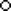 | 10 | 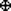 | 19 | 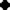 |
| 2 | 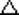 | 11 | 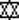 | 20 | 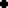 |
| 3 | 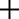 | 12 |  | 21 | 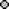 |
| 4 | 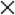 | 13 | 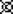 | 22 | 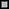 |
| 5 | 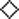 | 14 |  | 23 | 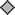 |
| 6 | 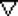 | 15 |  | 24 | 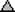 |
| 7 |  | 16 | 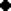 | 25 | 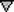 |
| 8 | 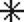 | 17 |  |   |   |
| 9 | 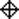 | 18 | 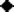 |   |   |

符号编号 21 到 25 允许您为符号的边框和填充指定不同的颜色。边框颜色由`col`参数指定，填充颜色由`bg`参数指定：

```
> plot(dataset$variable, pch=21, col="red", bg="blue")
```

> **注意：** 有关绘图符号的更多信息，请输入命令`help(points)`。

或者，您可以选择任何单个键盘字符作为绘图符号，只需将其放在引号内，如下所示（以美元符号为例）：

```
> plot(dataset$variable, pch="$")
```

您可以使用`cex`参数调整绘图符号的大小。该大小是相对于正常大小指定的。例如，要使绘图符号大小变为正常的 5 倍，请使用以下命令：

```
> plot(dataset$variable, cex=5)
```

## 绘图线条

本节仅适用于包含线条的绘图，例如使用`plot`函数创建且`type`参数设置为使用线条的选项（如`"l"`或`"b"`）的散点图和基本绘图。它也适用于向现有绘图添加额外线条的函数，例如`abline`、`curve`、`segments`和`lines`，这些将在本章后面的“向绘图添加项目”和“叠加绘图”部分中介绍。

您可以使用`lty`参数更改线条类型。数字 1 到 6 对应表 9-5 中给出的线条类型。

**表 9-5.** 绘图线条类型

| 数字 | 名称 | 线条样式 |
| --- | --- | --- |
| 1 | `solid` |  |
| 2 | `dashed` |  |
| 3 | `dotted` | 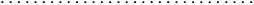 |
| 4 | `dotdash` |  |
| 5 | `longdash` |  |
| 6 | `twodash` |  |

例如，您可以将线条类型更改为虚线：

```
> plot(dataset$variable, type="l", lty=2)
```

您也可以按名称选择线条类型：

```
> plot(dataset$variable, type="l", lty="dashed")
```

您可以使用`lwd`参数调整线条的粗细。线条粗细是相对于标准线条粗细指定的。例如，要使线条粗细变为通常的 3 倍，请使用以下命令：

```
> plot(dataset$variable, type="l", lwd=3)
```

##### 阴影区域

本节仅适用于具有阴影区域的绘图，例如条形图、饼图和直方图。

阴影区域的密度是指用于阴影的每英寸线条数。您可以使用`density`参数更改阴影区域的密度，并使用`angle`参数更改阴影的角度：

```
> barplot(tableobject, density=20, angle=30)
```

作为参考，密度值在 5 到 80 之间会产生可辨别的变化，而值为 150 则与纯色无法区分。

您也可以提供一个密度列表，R 会使用列表中的不同密度来为饼图或条形图的每个部分添加阴影。图 9-5 展示了以下代码的结果：

```
> pie(table(people2$Eye.Color), density=c(10, 20, 40))
```

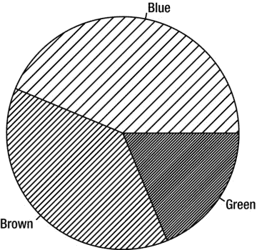

**图 9-5.** 每个类别具有不同阴影密度的饼图

## 向绘图添加项目

本节介绍一些向绘图添加额外项目的函数。您可以将它们与任何类型的绘图一起使用。首先，使用`plot`或另一个绘图函数创建绘图。当绘图仍显示在图形设备中时，输入本节中的相关命令。该项目将添加到当前绘图中。

### 添加直线

您可以使用`abline`函数向绘图添加直线。

要在 x=5 处添加一条垂直线，请使用以下命令：

```
> abline(v=5)
```

要在 y=2 处添加一条水平线，请使用：

```
> abline(h=2)
```

要添加一条截距为 2、斜率为 3 的对角线（即直线 y=2+3x），请使用以下命令：

```
> abline(a=2, b=3)
```

要绘制一条线段（从一个点延伸到另一个点的线），请使用`segments`函数。例如，下面的命令绘制一条从坐标(12, 20)到坐标(18, 55)的直线：

```
> segments(12,20,18,55)
```

结果如图 9-6 所示。

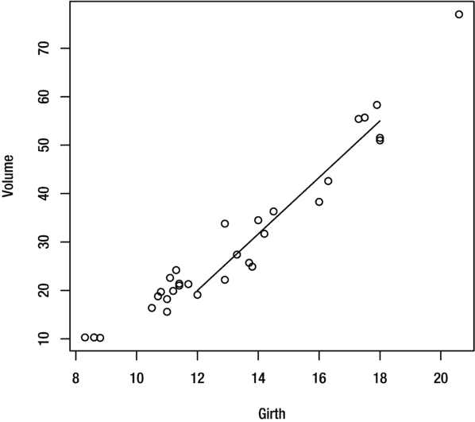

**图 9-6.** 添加了线段后的绘图

您可以使用`col`、`lty`和`lwd`参数更改线条的颜色、类型和粗细，如本章前面所述。

### 添加数学函数曲线

要添加数学函数曲线到您的绘图，请使用`curve`函数（在第 8 章的“绘制函数”下介绍）。默认情况下，`curve`函数会创建一个新绘图。要将曲线叠加到当前绘图上，请将`add`参数设置为`T`：

```
> curve(x², add=T)
```


### 添加标签与文本

你可以使用 `text` 函数向绘图添加文本。例如，要在坐标 (3, 4) 处居中添加文本"Text String"，请使用以下命令：

`> text(3, 4, "Text String")`

**注意：** 如果需要知道绘图上某个位置的坐标，`locator` 函数可以为你提供这些信息。当图形显示在图形设备中时，请输入以下命令：

`> locator(1)`

R 将等待你使用鼠标指针在图形设备中选择一个位置，然后返回所选位置的坐标。

你可以使用 `family`、`font`、`cex` 和 `col` 参数调整文本的外观。例如，要添加一个红色、斜体且大小为默认大小两倍的文本，请使用以下命令：

`> text(3, 4, "Text String", col="red", font=3, cex=2)`

如果你想使用来自第三个变量或数据集行名的文本为散点图中的所有点添加标签，`text` 函数会非常有用。例如，以下命令创建了一个人均 GDP 与城市人口的散点图，每个观测点都使用国家名称进行标记（使用了第 4 章中"Appending Rows"部分展示的`CIAdata`数据集）：

```
> plot(pcGDP～urban, CIAdata, xlim=c(50, 100), ylim=c(0,40000))
> text(pcGDP～urban, CIAdata, CIAdata$country, pos=1)
```

图 9-7 显示了结果。

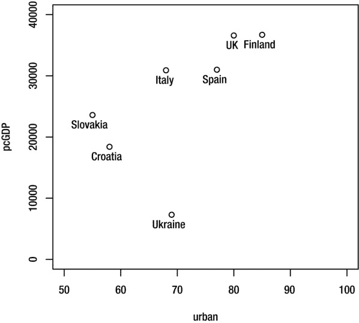

**图 9-7.** 使用 `text` 函数添加标签的结果

`pos` 参数告诉 R 标签相对于坐标的位置：1 表示下方；2 表示左侧；3 表示上方；4 表示右侧。你也可以使用 `offset` 参数调整坐标与标签之间的距离（相对于字符宽度）。下面的命令创建了图 9-8 所示的结果。

`> text(pcGDP～urban, CIAdata, CIAdata$country, pos=4, offset=0.3)`

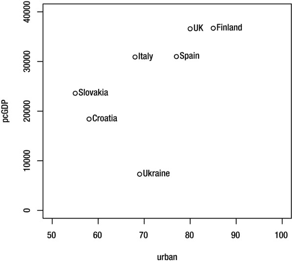

**图 9-8.** 文本位于数据点右侧的绘图

如果你只想标记几个特定的数据点（例如任何异常值），可以在绘图函数后使用 `identify` 函数：

```
> plot(pcGDP～urban, CIAdata, xlim=c(50, 100), ylim=c(0,40000))
> identify(CIAdata$urban, CIAdata$pcGDP, label=CIAdata$country)
```

输入命令后，R 将允许你使用鼠标指针在绘图上选择点，并标记你所选择的任何点。选择完所有要标记的点后，请按 Esc 键。

## 添加网格

要为绘图添加网格（如图 9-9 所示），请使用 `grid` 函数：

`> grid()`

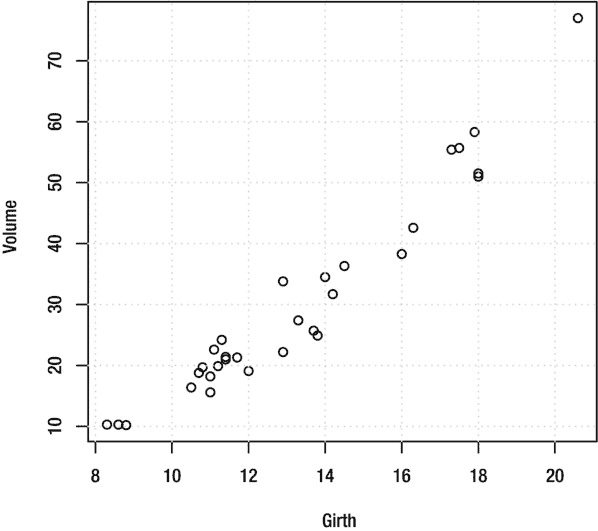

**图 9-9.** 带有网格线的绘图

默认情况下，网格线与坐标轴刻度标记对齐。或者，你可以指定每个坐标轴上显示的网格线数量：

`> grid(3, 3)`

要仅添加水平网格线（如图 9-10 所示），请使用以下命令：

`> grid(nx=NA, ny=NULL)`

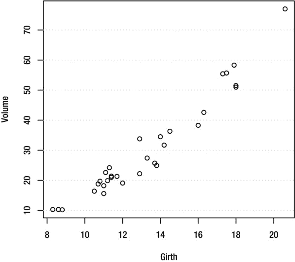

**图 9-10.** 带有水平网格线的绘图

要仅添加垂直网格线，请使用：

`> grid(ny=NA)`

默认情况下，R 使用灰色虚线作为网格线，但你可以使用 `col`、`lty` 和 `lwd` 参数调整线型，如本章前面所述。

## 添加箭头

你可以使用 `arrows` 函数向当前绘图添加箭头。例如，要绘制一个从点 (10, 50) 指向点 (12.7, 35) 的箭头，请使用以下命令：

`> arrows(10,50,12.7,35)`

结果如图 9-11 所示。

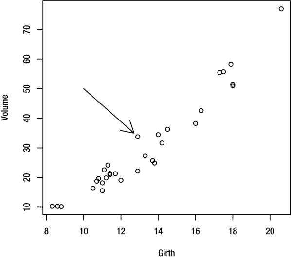

**图 9-11.** 带有箭头的绘图

对于双端箭头，请将 `code` 参数设置为 `3`：

`> arrows(10,50,12.7,35, code=3)`

你可以使用 `col`、`lty` 和 `lwd` 调整线型，如本章前面所述。你可以使用 `length` 参数指定箭头头的长度（以英寸为单位），并使用 `angle` 参数指定箭头头与箭身之间的角度（以度为单位）。以下命令添加了图 9-12 所示的箭头：

`> arrows(10,50,12.7,35, angle=25, length=0.1)`

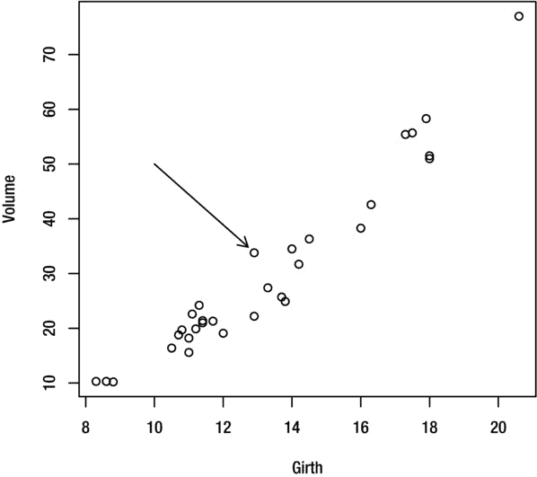

**图 9-12.** 包含调整后箭头头的绘图


## 叠加图

R 语言中有两个函数，`points` 和 `lines`，允许你将一组数据值叠加在另一组之上。

`points` 函数与 `plot` 函数非常相似。不过，它不会创建新图，而是将数据点添加到当前在图形设备中显示的图形上。`lines` 函数与 `points` 函数非常相似，区别在于它使用线而不是符号来绘制数据（即，`type` 参数的默认值是 `"l"`）。

当你希望在同一坐标轴上绘制两个或多个变量（如示例 9-1 所示），或使用不同的绘图符号来表示不同类别时（如示例 9-2 所示），这些函数非常有用。

### 示例 9-1. 使用 `fiveyearreport` 数据的叠加图

考虑图 9-13 中显示的 `fiveyearreport` 数据集，该数据集给出了三家超市连锁店在五年期间内的英国销售额。假设你想在同一张图中显示 Tesco、Sainsburys 和 Morrisons 的销售数据。

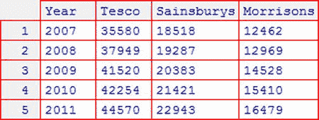

图 9-13. `fiveyearreport` 数据集（更多详情见附录 C）

要创建此图，首先按常规方式绘制 Tesco 的数据，确保设置好坐标轴范围，使其足够宽以容纳 Sainsburys 和 Morrisons 的数据：

```
> plot(Tesco∼Year, fiveyearreport, type="b", ylab="英国销售额（百万英镑）", ylim=c(0, 50000))
```

一旦图形在图形设备中显示，你就可以使用 `lines` 函数添加 Sainsburys 和 Morrisons 的数据，该函数会将数据叠加到当前图形上。使用 `pch` 和 `lty` 参数来更改符号和线型，以便区分不同连锁店的数据。或者，你也可以使用 `col` 参数为每个连锁店赋予不同的颜色：

```
> lines(Sainsburys∼Year, fiveyearreport, type="b", pch=2, lty=2)
> lines(Morrisons∼Year, fiveyearreport, type="b", pch=3, lty=3)
```

图 9-14 显示了结果。该图需要一个图例来标识各个连锁店，你可以使用 `legend` 函数添加图例，具体说明见“添加图例”部分。

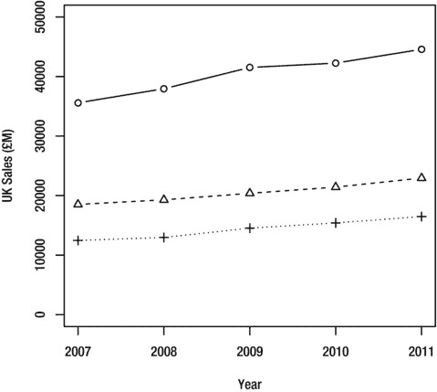

图 9-14. `fiveyearreport` 数据集的叠加图

### 示例 9-2. 使用 `iris` 数据的叠加图

假设你想为 `iris` 数据创建一个花萼长度与花萼宽度的散点图，并使用不同的绘图符号来代表每种鸢尾花品种。要创建此图，你需要使用 `points` 函数分别绘制每个品种的数据，并将它们叠加到同一张图上。

首先使用 `plot` 函数绘制原始（完整）数据，并添加你需要的任何标签或标题。将 `type` 参数设置为 `"n"`，以防止数据值被添加到图形中。这将创建一个空的坐标轴，其大小恰好能容纳所有三个品种的全部数据：

```
> plot(Sepal.Length∼Sepal.Width, iris, type="n")
```

接下来，使用 `points` 函数分别绘制每个品种的数据。使用 `subset` 参数依次选择每个品种。使用 `pch` 参数为每个品种选择不同的绘图符号。或者，你也可以使用 `col` 参数为每个品种赋予不同颜色的符号：

```
> points(Sepal.Length∼Sepal.Width, iris, subset=Species=="setosa", pch=10)
> points(Sepal.Length∼Sepal.Width, iris, subset=Species=="versicolor", pch=16)
> points(Sepal.Length∼Sepal.Width, iris, subset=Species=="virginica", pch=1)
```

结果如图 9-15 所示。图例使用 `legend` 函数添加，具体说明见下一节。

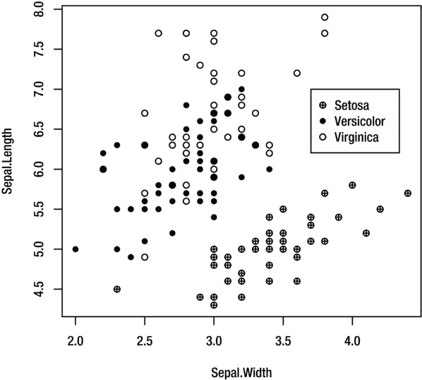

图 9-15. `iris` 数据集的叠加图

## 添加图例

你可以使用 `legend` 函数为图形添加图例。该函数会将图例添加到当前在图形设备中显示的图形上。

以下命令创建了图 9-15 中显示的图例：

```
> legend(3.7, 7, legend=c("Setosa", "Versicolor", "Virginica"), pch=c(10, 16, 1))
```

前两个参数（`3.7` 和 `7`）是图例左上角的 x 和 y 坐标。除了使用坐标，还有其他两种方式来指定图例的位置。第一种是使用位置名称之一：`"top"`、`"bottom"`、`"left"`、`"right"`、`"center"`、`"topright"`、`"topleft"`、`"bottomright"` 或 `"bottomleft"`。以下命令将图例定位在图形的右上角：

```
> legend("topright", legend=c("Setosa", "Versicolor", "Virginica"), pch=c(10, 16, 1))
```

第二种是使用 `locator(1)`。这允许你通过鼠标手动选择图例左上角的位置：

```
> legend(locator(1), legend=c("Setosa", "Versicolor", "Virginica"), pch=c(10, 16, 1))
```

`legend` 参数给出要在图例上显示的标签。`pch` 参数给出与每个标签对应的绘图符号。

你可以根据图形的具体情况，用 `lty`、`lwd`、`col`、`cex`、`fill`、`density` 或 `angle` 参数替换 `pch` 参数。你可能需要使用其中两个或多个参数。

请注意，你不需要使用 `legend` 函数为条形图添加图例，因为 `barplot` 函数内置了图例选项（参见 第 8 章 中的“条形图”）。

### 示例 9-3. 图例类型与效果

以下三个示例演示了如何创建一些不同类型的图例。结果如图 9-16 所示。接着我们将看另一个示例，演示如何显示跨越多个列的图例（如图 9-17 所示）。

#### 显示不同密度阴影区域的图例

要创建如图 9-16a 所示的、用于不同密度阴影区域的图例，请使用以下命令：

```
> legend(locator(1), legend=c("标签 1", "标签 2", "标签 3"), density=c(10,20,40))
```

#### 显示不同线型和符号类型的图例

要创建如图 9-16b 所示的、用于不同线型和符号类型的图例，请使用以下命令：

```
> legend(locator(1), legend=c("标签 1", "标签 2", "标签 3"), lty=1:3, pch=1:3)
```

#### 具有不同颜色和类型线条的图例

要创建如图 9-16c 所示的、用于不同类型和颜色线条的图例，请使用以下命令：

```
> legend(locator(1), legend=c("标签 1", "标签 2", "标签 3"), col=c("black", "grey40", "grey70"), lty=1:3)
```

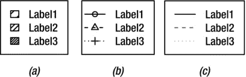

图 9-16. 不同类型的图例

#### 跨越多列的图例

要显示跨越多列的图例，请使用 `ncol` 参数指定列数。以下命令创建了一个两列的图例，如图 9-17 所示：

```
> legend(x, y, legend=c("标签 1", "标签 2", "标签 3"), lty=c(1,2,3), ncol=2)
```

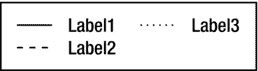

图 9-17. 两列图例


## 绘图区域中的多图

除了创建单个图形外，R 还允许你创建一个由多个较小图形组成的图像，这些图形以网格形式排列。

要设置图形设备以显示多个图形，请使用以下命令：

`> par(mfrow=c(R, C))`

其中 `R` 和 `C` 是网格的行数和列数。你随后创建的任何图形将按从左到右的顺序填充第一行的位置，接着是第二行，以此类推。

例如，要将四个图形排列成一个两行两列的网格，请使用以下命令：

`> par(mfrow=c(2,2))`

然后，你可以创建最多四个任意类型的图形来填充每个位置，如图 9-18 所示：

```
> hist(iris$Sepal.Length)
> qqnorm(iris$Sepal.Length)
> pie(summary(iris$Species))
> plot(Petal.Length~Sepal.Length, iris)
```

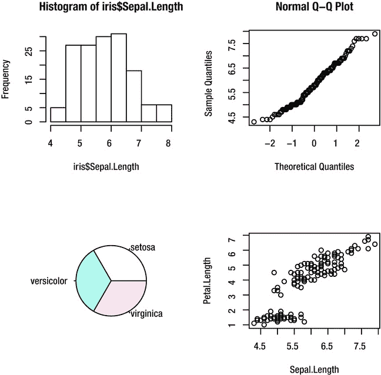

图 9-18. 多图

当你创建第五个图形时，将会开始一个新图像。图形设备将在本次会话的剩余时间内继续显示多图，或者直到你使用以下命令恢复原状：

`> par(mfrow=c(1,1))`

## 更改默认绘图设置

到目前为止，本章已经解释了如何对特定图形进行修改。然而，你可能希望更改设置，使其应用于所有图形。

`par` 函数允许你更改默认的绘图样式。例如，要将默认绘图符号改为三角形，并将默认标题颜色改为红色，请使用以下命令：

`> par(pch=2, col.main="red")`

你随后创建的任何图形都将具有红色的标题文本，并使用三角形作为绘图符号（如果适用）。这些更改将在本次会话的剩余时间内生效，或者直到它们被覆盖。

R 允许对图形的几乎每个方面进行自定义。输入命令 `help(par)` 可查看完整的设置列表。一些不能通过 `par` 函数更改的参数包括 `main`、`sub`、`xlab`、`ylab`、`xlim` 和 `ylim`，这些参数仅适用于单个图形。

### 总结

现在，你应该能够通过添加适当的标题、标签、文本、图例和其他元素，使你的图形更具信息性。你还应该能够通过调整线条和符号的颜色、样式等方面，使图形在视觉上更具吸引力。如有必要，你应该能够将多组数据叠加到一张图形上，或将多个图形显示在一张图像中。

下表总结了本章介绍的最重要的参数和命令。

| 任务 | 参数或命令 |
| --- | --- |
| 添加标题 | `main="标题文本"` |
| 添加副标题 | `sub="副标题文本"` |
| 添加坐标轴标签 | `xlab="X 轴标签", ylab="Y 轴标签"` |
| 更改坐标轴范围 | `xlim=c(x 最小值, x 最大值), ylim=c(y 最小值, y 最大值)` |
| 更改绘图颜色 | `col="red"` |
| 更改绘图符号 | `pch=2` |
| 更改绘图符号大小 | `cex=2` |
| 更改线条类型 | `lty=2` |
| 更改线条宽度 | `lwd=2` |
| 更改阴影密度 | `density=20` |
| 向图形添加垂直线 | `abline(v=2)` |
| 向图形添加水平线 | `abline(h=2)` |
| 向图形添加直线 | `abline(a=截距, b=斜率)` |
| 向图形添加线段 | `segments(x1, y1, x2, y2)` |
| 向图形添加曲线 | `curve(x³, add=T)` |
| 向图形添加文本 | `text(x, y, "文本字符串")` |
| 向图形添加网格 | `grid()` |
| 向图形添加箭头 | `arrows(x1, y1, x2, y2)` |
| 向图形添加点 | `points(dataset$variable)` |
| 向图形添加线 | `lines(dataset$variable)` |
| 向图形添加图例 | `legend(x, y, legend=c("标签 1", "标签 2", "标签 3"), ...)` |
| 显示多个图形 | `par(mfrow=c(行数, 列数))` |
| 更改默认绘图设置 | `par(...)` |

在下一章中，我们将告别绘图，转而讨论假设检验。

