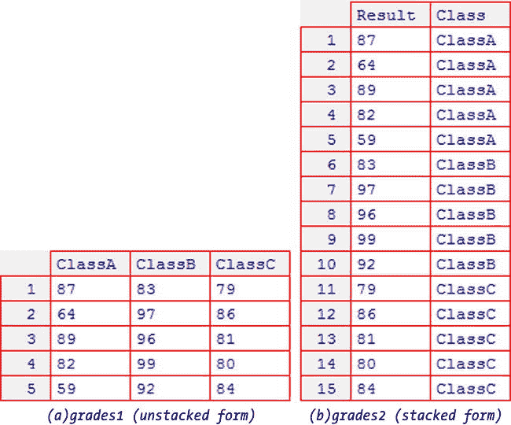
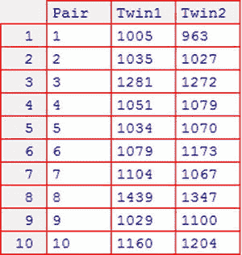
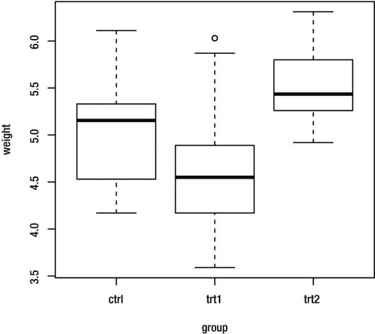
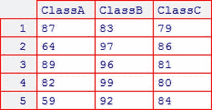

# 10. 假设检验

假设检验非常有用，因为它允许你利用数据作为证据来支持或反驳某个论断，并帮助你做出决策。本章将解释如何执行一些最常用的假设检验类型。

本章讨论的大多数检验用于比较样本均值，但我们也会讨论比较样本方差的检验。涵盖参数检验和非参数检验。参数检验对数据的分布做出一些假设，通常假设数据遵循正态分布。非参数检验不做此类假设，因此适用于更广泛的情况。

你将学习如何：

- 使用 t 检验比较两个样本的均值，或将一个样本与一个固定值进行比较
- 执行 Wilcoxon 秩和检验（t 检验的非参数替代方法）
- 使用方差分析比较三个或更多样本的均值
- 执行 Kruskal-Wallis 检验（方差分析的非参数替代方法）
- 使用多重比较方法（如 Tukey 的 HSD、Bonferroni 和成对 Wilcoxon 秩和检验）进行成对比较
- 使用 F 检验或 Bartlett 检验比较两个或多个样本的方差

其他章节也涵盖了几种假设检验。相关性假设检验以及用于检验分布拟合的 Shapiro-Wilk 检验和 Kolmogorov-Smirnov 检验在第 5 章中讨论。用于分类数据的检验（如卡方检验和 Fisher 检验）可在第 6 章中找到。

本章使用 `iris`、`PlantGrowth` 和 `sleep` 数据集（包含在 R 中）以及 `bottles`、`brains` 和 `grades1` 数据集（随本书的下载文件提供）。要查看 R 自带数据集的更多详细信息，请输入 `help(datasetname)`。有关所有其他数据集的更多详细信息，请参阅附录 C。

**假设检验**

假设检验利用样本来检验关于该样本所来自总体的假设。这有助于你对总体做出决策或得出结论。一个假设检验包含以下组成部分：

- **零假设**（记为 `H[0]`）是关于一个或多个样本所来自总体的假设。它通常是关于一个未知参数（如总体均值或方差）值的假设，例如 `H[0]`：总体均值等于 5。除非被证明为假，否则接受零假设。

- **备择假设**（记为 `H[1]` 或 `H[A]`）是当有足够证据拒绝零假设时将被接受的假设。这通常是零假设的反面，例如 `H[1]`：总体均值不等于 5。

- **检验统计量**是根据样本值计算出的统计量，其在零假设下具有已知分布。它因检验类型而异，且没有直接的解释意义。

- **p 值**给出了在假定零假设为真的情况下，观察到当前检验统计量或更极端结果的概率。如果这个值非常小，则表明零假设不可行，从而为支持备择假设提供了证据。

- **显著性水平**（记为 `α`）是决定拒绝零假设的临界点。显著性水平应在开始检验前确定。通常使用显著性水平 `0.05`，但 `0.01` 和 `0.1` 也是常用的选择。如果使用显著性水平 `0.05`，则只有当 p 值小于 `0.05` 时，我们才拒绝零假设，转而支持备择假设。否则，不做出任何结论。选择显著性水平 `0.05` 意味着，如果零假设为真，则会有 `5%` 的概率错误地拒绝它（即犯第一类错误）。


### 学生 t 检验

学生 t 检验用于检验关于一个或两个总体均值的假设。如果数据被认为来自正态分布，则 t 检验是合适的。如果样本足够大（即每个样本至少包含 30 个值），那么即使数据不呈正态分布，也可以使用 t 检验。这是因为，即使随机变量不呈正态分布，只要样本足够大，从该分布中抽取的一系列样本的均值将趋向于围绕总体均值呈正态分布（中心极限定理）。如果您的数据不满足上述任一条件，则应改用本章后面介绍的 Wilcoxon 秩和检验。

t 检验有三种类型：

- **单样本 t 检验**用于比较样本的均值与一个常量值 `μ[0]`。其原假设为总体均值等于 `μ[0]`，备择假设为总体均值不等于 `μ[0]`。
- **双样本 t 检验**用于比较两个独立样本的均值，以确定它们是否来自均值相等的总体。其原假设为两个均值相等，备择假设为两个均值不相等。
- **配对 t 检验**用于比较两个样本的均值，其中一个样本中的每个值与另一个样本中的特定值相对应。其原假设为两个均值相等，备择假设为两个均值不相等。

t 检验也可以使用单侧备择假设进行，这被称为单尾检验。对于单样本 t 检验，单侧备择假设可以是均值大于 `μ[0]` 或均值小于 `μ[0]`。对于双样本或配对 t 检验，单侧备择假设可以是第一个总体的均值大于第二个总体的均值，或者第一个总体的均值小于第二个总体的均值。

以下各节将说明如何在 R 中执行每种类型的 t 检验。

#### 单样本 t 检验

您可以使用 `t.test` 函数执行单样本 t 检验。要将样本均值与常量值 `mu0` 进行比较，请使用以下命令：

```
> t.test(dataset$sample1, mu=mu0)
```

`mu` 参数给出了您要与样本均值进行比较的值。它是可选参数，默认值为 0。

默认情况下，R 执行双尾检验。要执行单尾检验，请将 `alternative` 参数设置为 `"greater"` 或 `"less"`：

```
> t.test(dataset$sample1, mu=mu0, alternative="greater")
```

输出结果中包含总体均值的 95% 置信区间。要调整区间的大小，请使用 `conf.level` 参数：

```
> t.test(dataset$sample1, mu=mu0, conf.level=0.99)
```

示例 10-1. 使用瓶子数据的单尾、单样本 t 检验

一台瓶子灌装机被设置为向瓶子中灌装 500 毫升的软饮料。已知实际灌装量服从正态分布。制造商认为机器存在灌装不足的情况。抽取了 20 个瓶子作为样本，并测量了其中的液体体积。结果在 `bottles` 数据集中给出，该数据集可从网站获取。

要计算样本均值，请使用以下命令：

```
> mean(bottles$Volume)
[1] 491.5705
```

假设您想使用单样本 t 检验来确定瓶子是否持续灌装不足，或者样本的低平均体积是否可能是随机变异的结果。由于制造商特别关心体积是否小于 500 毫升，因此单侧检验是合适的。该检验的原假设为平均灌装体积等于 500 毫升，备择假设为平均灌装体积小于 500 毫升。将使用 0.01 的显著性水平。

要执行该检验，请使用以下命令：

```
> t.test(bottles$Volume, mu=500, alternative="less", conf.level=0.99)
```

这将产生以下输出：

```
        One Sample t-test

data:  bottles$Volume
t = -1.5205, df = 19, p-value = 0.07243
alternative hypothesis: true mean is less than 500
99 percent confidence interval:
     -Inf 505.6495
sample estimates:
mean of x
491.5705
```

从输出结果中，我们可以看到样本的平均瓶子体积为 491.6 毫升。单侧 99% 置信区间告诉我们，平均灌装体积很可能小于 505.6 毫升。p 值为 0.07243，这表明如果机器的平均灌装体积为 500 毫升，那么抽取一个平均体积小于或等于该样本的样本的概率约为 7%。

由于 p 值不小于显著性水平 0.01，我们不能拒绝平均灌装体积等于 500 毫升的原假设。这意味着没有证据表明瓶子存在灌装不足的情况。


### 双样本 T 检验

你可以使用 `t.test` 函数对堆叠格式或非堆叠格式的数据执行双样本 t 检验。如果所有数据值都存储在一个变量中，且第二个变量给出每个观测值所属样本的名称或编号，则你的数据为堆叠格式。如果每个样本的值分别存放在不同的变量中，则你的数据为非堆叠格式。如果你不确定数据属于哪种格式，请参考图 10-1，该图展示了同一数据集在堆叠格式和非堆叠格式下的示例。



图 10-1. 同一数据集的堆叠格式和非堆叠格式

要对堆叠格式的数据执行双样本 t 检验，请使用以下命令：

`> t.test(values ∼ groups, dataset)`

其中 `values` 是包含数据值的变量名，`groups` 是包含样本名称的变量名。如果分组变量具有两个以上的水平，则必须指定要比较哪两个组：

`> t.test(values ∼ groups, dataset, groups %in% c("Group1", "Group2"))`

如果你的数据是非堆叠格式，请使用以下命令：

`> t.test(dataset$sample1, dataset$sample2)`

默认情况下，R 在执行双样本和配对 t 检验时使用单独的方差估计。如果你认为两个组的方差相等，则可以使用合并方差估计。*F 检验*或*巴特利特检验*（参见本章后面的“方差的假设检验”）有助于判断情况是否如此。要使用合并方差估计，请将 `var.equal` 参数设置为 `T`：

`> t.test(values ∼ groups, dataset, var.equal=T)`

要执行单侧检验，请将 `alternative` 参数设置为 `"greater"` 或 `"less"`：

`> t.test(values ∼ groups, dataset, alternative="greater")`

当 `alternative` 参数设置为 `"greater"` 时，检验的备择假设是第一个组的均值大于第二个组的均值。如果你使用的是堆叠数据，可能需要使用 `levels` 函数来检查哪一个是第一个组和第二个组（参见第 3 章中的“使用因子变量”）。类似地，将其设置为 `"less"` 则给出备择假设：第一个组的均值小于第二个组的均值。

输出中包含均值差异的 95% 置信区间。你可以使用 `conf.level` 参数调整此区间的范围：

`> t.test(values ∼ groups, dataset, conf.level=0.99)`

**示例 10-2. 使用鸢尾花数据的双样本 T 检验**

假设你想使用双样本 t 检验来确定变色鸢尾和维吉尼亚鸢尾的花萼宽度均值是否存在真实差异。你可以假设花萼宽度服从正态分布，并且两个组的方差相等。检验的原假设是这两个物种的花萼宽度均值没有真实差异，备择假设是存在差异。

数据是堆叠格式，因此使用以下命令执行检验：

`> t.test(Sepal.Width∼Species, iris, Species %in% c("versicolor", "virginica"), var.equal=T)`

输出如下所示。

```
Two Sample t-test

data:  Sepal.Width by Species
t = -3.2058, df = 98, p-value = 0.001819
alternative hypothesis: true difference in means is not equal to 0
95 percent confidence interval:
 -0.33028246 -0.07771754
sample estimates:
mean in group versicolor  mean in group virginica
2.770                    2.974
```

差异的 95% 置信区间为 –0.33 到 –0.08，这意味着变色鸢尾的平均花萼宽度估计比维吉尼亚鸢尾小 0.08 到 0.33 厘米。

_p_ 值为 0.001819，小于显著性水平 0.05，因此我们可以拒绝原假设（变色鸢尾和维吉尼亚鸢尾的平均花萼宽度相同），转而支持备择假设（这两个物种的平均花萼宽度不同）。

此示例在示例 10-9 中继续，其中使用 **F 检验**来检验方差相等的假设（参见“F 检验”）。

### 配对 T 检验

你可以通过将 `paired` 参数设置为 `T` 来执行配对 t 检验。如果你的数据是堆叠格式，请使用以下命令：

`> t.test(values ∼ groups, dataset, paired=T)`

你的数据必须在每个组中具有相同数量的观测值，以便样本之间存在一一对应关系。R 会将第一个样本的第一个值与第二个样本的第一个值进行匹配。

对于非堆叠格式的数据，请使用以下命令：

`> t.test(dataset$sample1, dataset$sample2, paired=T)`

与双样本检验一样，你可以使用 `alternative`、`conf.level` 和 `var.equal` 参数调整检验。因此，要执行备择假设为第一个组的均值小于第二个组的均值，并使用合并方差估计的检验，请使用以下命令：

`> t.test(values ∼ groups, dataset, paired=T, alternative="less", var.equal=T)`

**示例 10-3. 使用大脑数据的配对 T 检验**

考虑图 10-2 中显示的 `brains` 数据集，该数据集给出了十对同卵双胞胎中头胎和二胎的大脑体积（以立方厘米为单位）。



图 10-2. `brains` 数据集，提供来自 Tramo 等人文章《同卵双胞胎的大脑大小、头围与智商》的大脑体积数据（更多详情请参见附录 C）

假设你想使用 t 检验来确定大脑体积是否与出生顺序有关。假设大脑体积服从正态分布。数据自然是配对的，因为同一对双胞胎中的头胎与二胎相对应，因此配对 t 检验是合适的。由于对任一方向的差异都感兴趣，因此使用双尾检验。检验的原假设是头胎和二胎双胞胎的平均大脑体积没有差异，备择假设是头胎双胞胎的平均大脑体积与二胎双胞胎不同。

要执行检验，请使用以下命令：

`> t.test(brains$Twin1, brains$Twin2, paired=T)`

输出如下所示。

```
        Paired t-test

data:  brains$Twin1 and brains$Twin2
t = -0.4742, df = 9, p-value = 0.6466
alternative hypothesis: true difference in means is not equal to 0
95 percent confidence interval:
 -49.04566  32.04566
sample estimates:
mean of the differences
                   -8.5
```

平均大脑体积差异估计为 –8.5，这意味着头胎双胞胎的大脑体积平均比其二胎兄弟姐妹小 8.5 立方厘米。差异的置信区间为 –49 到 32 立方厘米。

_p_ 值为 0.6466 告诉我们，如果头胎和二胎双胞胎的平均大脑体积相同，那么在我们样本中观察到相等或更大差异的概率为 65%。由于 _p_ 值不小于显著性水平 0.05，因此不能拒绝原假设。这意味着没有证据表明双胞胎的大脑体积与出生顺序有关。


### 威尔科克森秩和检验

威尔科克森秩和检验（也称为曼-惠特尼 U 检验）允许你检验关于一个或两个样本均值的假设。它是学生 t 检验的一种非参数替代方法，即使数据分布未知且样本量较小，也同样适用。与 t 检验类似，它也有单样本、双样本和配对形式。备择假设可以是双尾或单尾。

你可以使用 `wilcox.test` 函数执行威尔科克森秩和检验。其命令与执行 t 检验的命令相似。

要执行单样本检验，请使用以下命令：

`> wilcox.test(dataset$sample1, mu=mu0)`

要以堆叠形式对数据进行双样本检验，请使用命令：

`> wilcox.test(values∼groups, dataset)`

如果分组变量有两个以上的水平，则必须指定要比较的两个水平：

`> wilcox.test(values∼groups, dataset, groups %in% c("Group1", "Group2"))`

如果你的数据是非堆叠形式（每个样本的值保存在单独的变量中），请使用命令：

`> wilcox.test(dataset$sample1, dataset$sample2)`

对于配对检验，请将 `paired` 参数设为 `T`：

`> wilcox.test(values∼groups, dataset, paired=T)`

要执行单尾检验，请将 `alternative` 参数设置为 `"greater"` 或 `"less"`：

`> wilcox.test(values∼groups, dataset, alternative="greater")`

默认情况下，输出结果不包含置信区间。要计算总体均值（对于单样本检验）或均值差（对于配对检验和双样本检验）的置信区间，请将 `conf.int` 参数设为 `T`。置信区间的默认大小为 95%，但你可以通过 `conf.level` 参数进行调整：

`> wilcox.test(values∼groups, dataset, conf.int=T, conf.level=0.99)`

### 例 10-4：基于睡眠数据的配对威尔科克森秩和检验

考虑 `sleep` 数据集，该数据集包含在 R 中。该数据给出了一个实验的结果，在该实验中，10 名患者分别接受了两种不同的治疗方法，并记录了他们在接受每种治疗期间经历的额外睡眠时间（与平时相比）。`extra` 变量给出了睡眠的增加量（每小时每晚计），`group` 变量给出了治疗编号（1 或 2），`ID` 变量给出了患者编号（1 到 10）。

假设你想确定两种治疗在平均睡眠增加量上是否存在真实差异。威尔科克森秩和检验是合适的，因为额外睡眠时间的分布未知，且样本量较小。使用配对检验是因为患者编号 x 在服用药物 1 时经历的额外睡眠与同一患者在服用药物 2 时经历的额外睡眠相对应。该检验的原假设是两种治疗方法的平均额外睡眠没有差异。备择假设是两种治疗方法的平均额外睡眠不同。将使用显著性水平 0.05。

由于数据是堆叠形式的，你可以使用以下命令执行检验：

`> wilcox.test(extra∼group, sleep, paired=T)`

这将给出结果：

```
Wilcoxon signed rank test with continuity correction

data:  extra by group
V = 0, p-value = 0.009091
alternative hypothesis: true location shift is not equal to 0

Warning messages:
1: In wilcox.test.default(x = c(0.7, -1.6, -0.2, -1.2, -0.1, 3.4, 3.7,  :
  cannot compute exact p-value with ties
2: In wilcox.test.default(x = c(0.7, -1.6, -0.2, -1.2, -0.1, 3.4, 3.7,  :
  cannot compute exact p-value with zeroes
```

p 值为 0.009091 告诉我们，如果两种药物的效果相同，那么观察到平均睡眠增加量差异达到数据中如此大程度的概率将低于 1%。由于这个值小于我们的显著性水平 0.05，我们可以拒绝原假设，即两种治疗方法的额外睡眠时间相同。这意味着有证据表明两种治疗方法在有效性上存在差异。

R 给出了一个警告，提示数据中存在结。这意味着某些观测值在感兴趣的变量上具有完全相同的值，因为测量值只保留了一位小数。出于这个原因，R 无法计算精确的 p 值，因此应谨慎解读结果。关于结数据对威尔科克森秩和检验影响的更深入解释，可参见 S. Siegel 和 N.J. Castellan 所著《行为科学的非参数统计学》第二版（McGraw-Hill 1988）第 134 页。


## 方差分析

方差分析（ANOVA）允许您比较三个或更多独立样本的均值。当数据值来自正态分布且每组的方差大致相同时，此方法适用。您可以使用巴特利特检验来检验方差相等的假设（请参阅本章后面的“方差假设检验”）。该检验的零假设是所有组的均值相同，备择假设是至少有一对组的均值不同。

更复杂的模型（如双向方差分析或协方差分析）将在第 11 章中介绍。

您可以使用`aov`函数进行方差分析。由于方差分析是一种广义线性模型，您也可以使用第 11 章中介绍的`lm`或`glm`函数。不过，`aov`函数呈现结果更为便捷。

该命令的形式如下：

```
> aov(数值 ∼ 分组, 数据集)
```

其中`数值`是保存数据值的变量名，`分组`是标识每个观测值所属样本的变量。如果您的数据是非堆叠形式（每个样本的值保存在单独的变量中），那么您需要先堆叠数据，如第 4 章中“堆叠数据”部分所述。

分析结果包含许多 R 不会自动显示的组成部分。如果您将结果保存到一个对象中（如下所示），则可以使用其他函数来提取输出的各个元素：

```
> aov 对象 <- aov(数值 ∼ 分组, 数据集)
```

将结果保存为对象后，您可以使用`anova`函数查看方差分析表：

```
> anova(aov 对象)
```

要查看模型系数，请使用`coef`函数：

```
> coef(aov 对象)
```

要查看系数的置信区间，请使用`confint`函数：

```
> confint(aov 对象)
```

**示例 10-5. 使用`PlantGrowth`数据进行方差分析**

考虑`PlantGrowth`数据集（已包含在 R 中），该数据集包含三组（每组 10 批）植物的干燥重量，每组 10 批植物接受了不同的处理。`weight`变量表示每批植物的重量，`group`变量表示接受的处理。图 10-3 显示了按处理组分组的重量箱线图。



图 10-3. `PlantGrowth`数据集中按处理组分组的重量箱线图

从箱线图中可以看出，三组之间的植物生长（以每批重量衡量）存在一些差异。假设您希望进行方差分析，以确定这些差异是否具有统计显著性。您可以假设植物生长服从正态分布，并且所有三种处理的方差相同。使用显著性水平 0.05。

要执行方差分析并将结果保存到名为`plantanova`的对象中，请使用以下命令：

```
> plantanova <- aov(weight ~ group, PlantGrowth)
```

要查看方差分析表，请使用以下命令：

```
> anova(plantanova)
```

这将输出以下结果：

```
Analysis of Variance Table

Response: weight
          Df  Sum Sq Mean Sq F value  Pr(>F)
group      2  3.7663  1.8832  4.8461 0.01591 *
Residuals 27 10.4921  0.3886
---
Signif. codes:  0 '***' 0.001 '**' 0.01 '*' 0.05 '.' 0.1 ' ' 1
```

我们可以看到`group`效应的 p 值为 0.01591。这意味着，如果所有三种处理的效果相同，我们观察到各组间差异达到如此之大或更大的概率将低于 2%。由于 p 值小于显著性水平 0.05，我们可以拒绝所有处理平均生长量相同的零假设，转而支持至少有一对处理组的平均生长量不同的备择假设。

要查看处理效应的大小，请使用以下命令：

```
> coef(plantanova)

(Intercept)   grouptrt1   grouptrt2
     5.032      -0.371       0.494
```

输出告诉我们，对照处理的平均重量为 5.032。处理 1（`trt1`）的效果是，与对照方法相比，平均重量减少了 0.371 个单位；处理 2（`trt2`）的效果是，与对照方法相比，平均重量增加了 0.494 个单位。

本示例将在示例 10-7（参见“图基 HSD 检验”）中继续，其中将使用成对 t 检验进一步研究处理差异；并在示例 10-10 中继续，其中将使用巴特利特检验来检验方差相等的假设。请保存`plantanova`对象，因为它在这些示例中将很有用。

### 克鲁斯卡尔-沃利斯检验

克鲁斯卡尔-沃利斯检验允许您比较三个或更多样本的均值。它是方差分析的非参数替代方法，当数值的分布未知时可以使用。

您可以使用`kruskal.test`函数进行克鲁斯卡尔-沃利斯检验。要对堆叠数据执行检验，请使用以下命令：

```
> kruskal.test(数值 ∼ 分组, 数据集)
```

其中`数值`变量包含数据值，`分组`变量指示每个观测值属于哪个样本。

对于非堆叠数据（样本存放在单独的变量中），请将变量嵌套在`list`函数内：

```
> kruskal.test(list(数据集$样本 1, 数据集$样本 2, 数据集$样本 3))
```

**示例 10-6. 使用`grades1`数据进行克鲁斯卡尔-沃利斯检验**

考虑`grades1`数据集，如图 10-4 所示。该数据集显示了来自三个不同班级的 15 名学生的测试成绩（满分 100 分）。



图 10-4. `grades1`数据集（更多详细信息请参见附录 C）

假设您想使用克鲁斯卡尔-沃利斯检验来确定这三个班级各自使用的教学方法在有效性上是否存在差异，以学生的平均测试成绩来衡量。使用显著性水平 0.05。

由于数据是非堆叠形式，您可以使用以下命令执行检验：

```
> kruskal.test(list(grades1$ClassA, grades1$ClassB, grades1$ClassC))
```

这将输出以下结果：

```
        Kruskal-Wallis rank sum test

data:  list(grades1$ClassA, grades1$ClassB, grades1$ClassC)
Kruskal-Wallis chi-squared = 6.6796, df = 2, p-value = 0.03544
```

从输出中可以看出 p 值为 0.03544。由于该值小于显著性水平 0.05，我们可以拒绝所有班级平均分数相等的零假设。这意味着有证据表明三个班级所使用的教学方法在有效性上存在差异。

本示例将在示例 10-9 中继续，其中将使用成对威尔科克森秩和检验来进一步研究三个班级之间的差异。


#### 多重比较方法

在执行方差分析并发现组均值之间存在一些差异后，您可能希望执行一系列两两 t 检验，以识别特定组对之间的差异。然而，当执行大量 t 检验时，至少错误地拒绝一个检验的原假设（I 类错误）的整体概率会高于用于单个检验的显著性水平。多重比较方法允许您对三个或更多样本执行两两 t 检验，同时控制整体 I 类错误。

有多种方法可以进行多重比较。其中一些最流行的方法是 **图基的诚实显著性差异（HSD）检验** 和 **邦费罗尼检验**。

以下部分介绍如何在 R 中执行几种主要的多重比较方法。

##### 图基 HSD 检验

您可以使用 `TukeyHSD` 函数执行图基 HSD 检验。如果您之前使用 `aov`、`lm` 或 `glm` 函数执行了方差分析，并将结果保存到一个对象中（如“方差分析”之前所述），请直接使用该函数：

`> TukeyHSD(aovobject)`

如果您没有 `aov` 对象并且使用的是原始数据，请将 `aov` 函数嵌套在 `TukeyHSD` 函数中：

`> TukeyHSD(aov(values ∼ groups, dataset))`

默认的总体置信水平是 0.95，但您可以使用 `conf.level` 参数进行调整：

`> TukeyHSD(aovobject, conf.level=0.99)`

**示例 10-7. 使用 PlantGrowth 数据的图基 HSD 检验**

在示例 10-5 中，使用了方差分析来帮助确定三个处理组之间的平均植物生长量（通过批次重量测量）是否存在差异。结论是至少有一对处理组之间的植物生长存在差异。

假设您希望通过使用两两 t 检验来继续此分析，以确定哪些处理组在植物生长上存在差异。使用 0.05 的整体显著性水平。

如果您仍然拥有示例 10-5 中创建的 `plantanova` `aov` 对象，您可以使用以下命令执行检验：

`> TukeyHSD(plantanova)`

如果您不再拥有该模型对象，您可以从原始数据执行检验：

`> TukeyHSD(aov(weight∼group, PlantGrowth))`

输出如下所示：

```
  Tukey multiple comparisons of means
    95% family-wise confidence level
Fit: aov(formula = weight ∼ group, data = PlantGrowth)
$group
            diff        lwr       upr     p adj
trt1-ctrl -0.371 -1.0622161 0.3202161 0.3908711
trt2-ctrl  0.494 -0.1972161 1.1852161 0.1979960
trt2-trt1  0.865  0.1737839 1.5562161 0.0120064
```

`diff` 列显示了两组样本均值的差异，`lwr` 和 `upr` 列给出了该差异的 95% 置信区间。`p adj` 列给出了两组之间 t 检验的 p 值，并对多重 t 检验进行了调整。

将 p 值与我们的显著性水平 0.05 进行比较，我们可以看到 `trt2-trt1` 的比较在统计上显著。这意味着处理组 1 的植物生长量与处理组 2 的生长量存在显著差异。处理组 1 和处理组 2 与对照组相比均无显著差异。

估计处理组 2 比处理组 1 多产生 0.865 个单位的生长量。生长差异的 95% 置信区间为 0.174 到 1.556。

### 其他两两 t 检验

`pairwise.t.test` 函数允许您使用多种其他多重比较方法执行两两 t 检验。要使用邦费罗尼校正执行两两 t 检验，请使用以下命令：

`> pairwise.t.test(dataset$values, dataset$groups, p.adj="bonferroni")`

`p.adj` 参数的其他可能选项包括 `holm`（默认方法）、`hochberg` 和 `hommel`。输入 `help(p.adjust)` 可查看完整列表。

**示例 10-8. 使用 PlantGrowth 数据和邦费罗尼校正的两两比较**

继续 `PlantGrowth` 示例，假设您希望尝试使用邦费罗尼校正进行两两 t 检验以进行比较：

`> pairwise.t.test(PlantGrowth$weight, PlantGrowth$group, p.adj="bonferroni")`

结果如下所示：

```
        Pairwise comparisons using t tests with pooled SD
data:  PlantGrowth$weight and PlantGrowth$group
     ctrl  trt1
trt1 0.583 -
trt2 0.263 0.013
P value adjustment method: bonferroni
```

输出显示了每个比较的 p 值。从输出中，我们可以看到处理组 1（`trt1`）和处理组 2（`trt2`）的比较的 p 值为 0.013，这在 0.05 水平上具有统计显著性。对照组与处理组 1 之间以及对照组与处理组 2 之间的比较在统计上不显著。这与前一个示例中图基 HSD 检验的结果一致。

### 两两 Wilcoxon 秩和检验

还有一个名为 `pairwise.wilcox.test` 的函数，它允许您执行两两 Wilcoxon 秩和检验。这在执行 Kruskal-Wallis 检验（本章前面已介绍）后，用于识别各组间个体对之间的差异非常有用。

要执行检验，请使用以下命令：

`> pairwise.wilcox.test(dataset$values, dataset$groups)`

与执行两两 t 检验时一样，您可以使用 `p.adj` 参数调整多重比较方法。

## 方差的假设检验

方差的假设检验允许您比较两个或多个样本的方差，以确定它们是否来自具有相等方差的总体。这些检验的原假设是方差相等，备择假设是方差不相等。这些检验对于检查 t 检验或方差分析的假设非常有用。

本节涵盖两种类型的方差检验：

*   **F 检验** 允许您比较两个样本的方差。它适用于正态分布的数据。
*   **巴特利特检验** 允许您比较两个或多个样本的方差。它适用于正态分布的数据。

以下部分说明如何在 R 中执行 F 检验和巴特利特检验。


### F 检验

你可以使用`var.test`函数进行 F 检验。如果数据是堆叠格式，请使用以下命令：

```r
var.test(values ~ groups, dataset)
```

如果`groups`变量包含两个以上的水平，则必须指定要比较的两个水平：

```r
var.test(values ~ groups, dataset, groups %in% c("Group1", "Group2"))
```

对于非堆叠格式的数据（样本存储在单独的变量中），请使用以下命令：

```r
var.test(dataset$sample1, dataset$sample2)
```

#### 示例 10-10：使用鸢尾花数据集进行 F 检验

在示例 10-2 中，我们使用了 t 检验，并采用合并方差估计来比较弗吉尼亚鸢尾和杂色鸢尾的萼片宽度均值。该检验的一个假设前提是两种鸢尾的萼片宽度方差相等。

假设你想使用 F 检验来帮助判断这两个物种的萼片宽度方差是否相等。将使用显著性水平 0.05。

执行检验，请使用以下命令：

```r
var.test(Sepal.Width ~ Species, iris, Species %in% c("versicolor", "virginica"))
```

输出结果如下所示：

```
F test to compare two variances

data:  Sepal.Width by Species
F = 0.9468, num df = 49, denom df = 49, p-value = 0.849
alternative hypothesis: true ratio of variances is not equal to 1
95 percent confidence interval:
 0.5372773 1.6684117
sample estimates:
ratio of variances 
         0.9467839
```

p 值为 0.849，不小于显著性水平 0.05，因此我们不能拒绝两组方差相等的原假设。没有证据表明弗吉尼亚鸢尾和杂色鸢尾的萼片宽度方差存在差异。

#### 巴特利特检验

你可以使用`bartlett.test`函数进行巴特利特检验。如果数据是堆叠格式，请使用以下命令：

```r
bartlett.test(values ~ groups, dataset)
```

与 F 检验不同，巴特利特检验允许你比较两个以上组的方差。不过，如果需要，你仍然可以选择一个子集进行比较：

```r
bartlett.test(values ~ groups, dataset, groups %in% c("Group1", "Group2"))
```

如果你有非堆叠格式的数据（样本存储在单独的变量中），请将变量嵌套在`list`函数中：

```r
bartlett.test(list(dataset$sample1, dataset$sample2, dataset$sample3))
```

#### 示例 10-11：使用 PlantGrowth 数据进行巴特利特检验

在示例 10-5 中，我们使用方差分析比较了三个处理组植物批次的平均重量。该检验的一个假设前提是所有处理组的重量方差相等。

假设你想使用巴特利特检验来判断所有处理组的重量方差是否相等。将使用显著性水平 0.05。

执行检验，请使用以下命令：

```r
bartlett.test(weight ~ group, PlantGrowth)
```

这将输出：

```
Bartlett test of homogeneity of variances

data:  weight by group
Bartlett's K-squared = 2.8786, df = 2, p-value = 0.2371
```

从输出中可以看出，p 值为 0.2371，不小于显著性水平 0.05。这意味着我们不能拒绝所有处理组方差相等的原假设。这表明，没有证据表明三个处理组的植物生长方差存在差异。

### 总结

现在，你应该能够使用 t 检验或 Wilcoxon 秩和检验来比较两个样本的均值，并使用方差分析或 Kruskal-Wallis 检验来比较三个或更多样本的均值。你应该能够使用适当的方法对三个或更多组进行两两比较。最后，你应该能够使用 F 检验或巴特利特检验来比较两个组的方差。

下表总结了涵盖的最重要的命令。

| 检验类型 | 命令 |
| --- | --- |
| 单样本 t 检验 | `t.test(dataset$sample1, mu=mu0)` |
| 双样本 t 检验 | `t.test(values ~ groups, dataset)` |
| | `t.test(dataset$sample1, dataset$sample2)` |
| 配对 t 检验 | `t.test(values ~ groups, dataset, paired=T)` |
| | `t.test(dataset$sample1, dataset$sample2, paired=T)` |
| 单样本 Wilcoxon 秩和检验 | `wilcox.test(dataset$sample1, mu=mu0)` |
| 双样本 Wilcoxon 秩和检验 | `wilcox.test(values ~ groups, dataset)` |
| | `wilcox.test(dataset$sample1, dataset$sample2)` |
| 配对 Wilcoxon 秩和检验 | `wilcox.test(values ~ groups, dataset, paired=T)` |
| | `wilcox.test(dataset$sample1, dataset$sample2, paired=T)` |
| 方差分析 | `aov(values ~ groups, dataset)` |
| Kruskal-Wallis 检验 | `kruskal.test(values ~ groups, dataset)` |
| | `kruskal.test(list(dataset$sample1, dataset$sample2, dataset$sample3))` |
| 图基 HSD 检验 | `TukeyHSD(aovobject)` |
| | `TukeyHSD(aov(values ~ groups, dataset))` |
| 两两 t 检验 | `pairwise.t.test(dataset$values, dataset$groups, method="bonferroni")` |
| 两两 Wilcoxon 秩和检验 | `pairwise.wilcox.test(dataset$values, dataset$groups)` |
| F 检验 | `var.test(values ~ groups, dataset)` |
| | `var.test(dataset$sample1, dataset$sample2)` |
| 巴特利特检验 | `bartlett.test(values ~ groups, dataset)` |
| | `bartlett.test(list(dataset$sample1, dataset$sample2))` |

在下一章中，我们将学习如何构建回归模型和其他类型的广义线性模型。


