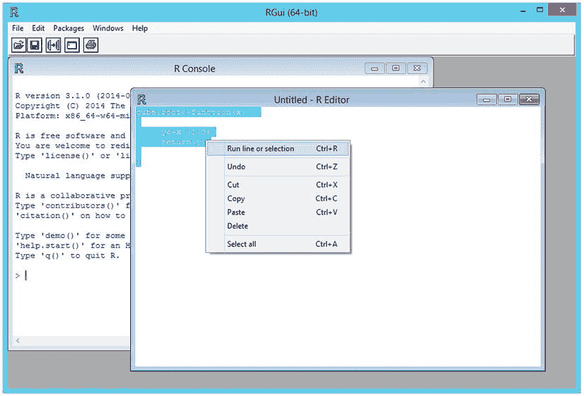
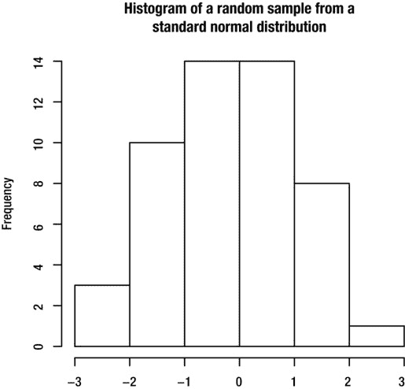

# R 基础编程

R 不仅是一个统计计算环境，也是一门编程语言。R 编程的主题超出了本书的范围。不过，本章将简要介绍基础编程和编写自定义函数。

编程时，请使用脚本文件，以便轻松编辑代码。记得使用井号（`#`）添加充分的注释，以便您的脚本能被他人或未来的自己理解。


### 创建新函数

在本书中，你将使用到许多 R 语言的内置函数，但你也可以创建自己的函数。创建自定义函数可以让你将一组执行特定任务、且需要重复使用的命令整洁地打包在一起。

要创建新函数，脚本通常遵循以下通用格式：

```
functionname <- function(arg1name, arg2name, ..., argNname) {
  command(s)
  return(outputvalue)
}
```

所有的缩进和额外的空行都是可选的，但它们有助于展示程序的层级结构，并且被认为是良好的编程习惯。

第一行决定了函数名称以及输入参数的名称。你可以根据需要包含任意数量的参数，也可以不包含任何参数。此外，你还可以为参数赋默认值：

```
functionname <- function(arg1name = value1, arg2name = value2, ..., argNname = valueN) {
  command(s)
  return(outputvalue)
}
```

脚本的第一行以左花括号结尾。在此之后，函数的主体内容开始。通常，这是一组以某种方式操作输入参数或基于它们执行计算，从而生成输出值的命令。这些命令可以利用现有函数，包括你自己编写的任何函数。请注意，在函数内部创建的任何对象仅存在于函数内部，并不会保存到工作空间中。

`return` 函数决定了函数的输出值，该值要么显示在控制台中，要么在函数被调用时赋值给一个对象。它可以是字面量值（如数字或字符串），也可以是向量、数据框或任何其他类型的对象。

你还可以在最后一个命令中使用 `print` 函数来代替 `return` 函数，该函数始终会将输出显示在控制台窗口中，即使输出被赋值给了某个对象。另一种情况是，你可能希望创建一个用于生成图表的函数，而不是返回一个输出值。在这种情况下，最后的命令将是 `plot` 或其他绘图函数。

最后，脚本以右花括号结束。

当你编写好函数并运行脚本后，该函数会作为对象保存到工作空间中，并在当前工作空间加载期间随时可用。你可以像使用内置函数一样使用它：

```
> functionname(value1, value2, ..., valueN)
```

#### 示例 B-1：计算一个数值立方根的函数

以下脚本创建了一个简单的函数，它接受单个数值作为输入，并计算其立方根：

```
cube.root <- function(x) {
  y <- x^(1/3)
  return(y)
}
```

尝试将函数输入到脚本文件中并运行程序。请注意，在 Windows 环境下运行脚本文件时，需要高亮你想要运行的文本，然后右键点击并选择“运行行或选定内容”（Run line or selection），如图 B-1 所示。或者，你也可以高亮文本后点击“运行”（Run）按钮。Mac 用户应高亮文本，然后按下 Cmd+Return。



图 B-1. 在脚本文件中输入程序并运行（Windows 环境）

编写好函数并运行脚本后，`cube.root` 函数即可使用：

```
> cube.root(5)
[1] 1.709976
```

#### 示例 B-2：计算三角形斜边长的函数

以下脚本创建了一个简单的函数，它根据三角形另外两条边的长度计算斜边长（公式为 c² = a² + b²）：

```
hypot <- function(a=2, b=3) {
  c <- sqrt(a² + b²)
  return(c)
}
```

编写好函数并运行脚本后，你可以使用它：

```
> hypot(6, 7)
[1] 9.219544
```

由于参数已经被赋予了默认值，即使缺少一个或两个参数，函数也能正常工作：

```
> hypot(b=2)
[1] 2.828427
```

#### 示例 B-3：生成随机数直方图的函数

以下脚本创建了一个函数，该函数从标准正态分布中生成指定数量的随机数，并将它们绘制成直方图：

```
randhist <- function(n) {
  vector1 <- rnorm(n)      # 生成 n 个随机数
  # 将随机数绘制成直方图，添加标题并移除 x 轴标签：
  hist(vector1, main="来自标准正态分布的随机样本直方图", xlab="")
}
```

编写好函数并运行脚本后，你可以使用它：

```
> randhist(50)
```

结果应类似于图 B-2。



图 B-2. 由 `randhist` 函数创建的直方图

#### 条件语句

回顾示例 B-1 中创建的 `cube.root` 函数。如果你尝试输入一个负数，会得到如下结果：

```
> cube.root(-5)
[1] NaN
```

如果函数能够返回一条错误信息，向用户解释问题所在，那就好了。为了实现这一点，函数需要根据用户输入的是正数还是负数，表现出不同的行为。这正是条件语句可以做到的。

条件语句允许你仅在特定条件满足时执行某个命令或一组命令。条件语句为函数增加了灵活性，因为它们允许函数根据不同的输入表现出不同的行为。

有几种类型的条件语句可以实现略有不同的功能。在了解它们之前，你需要先理解条件以及它们在 R 中是如何构建的。


#### 条件

在编程中，条件是一个可以为真或假的表达式。例如，条件 `4 < 5`（4 小于 5）为真，而条件 `5 == 8`（5 等于 8）为假。

如果你在命令提示符下输入一个条件，R 会告诉你它是真还是假：

```
> 6 > 8
[1] FALSE
```

一个条件必须至少包含一个比较运算符（也称为关系运算符）。在前面的例子中，比较运算符是 `>`（大于）。表 B-1 列出了可用于构成条件的比较运算符。

**表 B-1. 比较运算符**

| 运算符 | 含义 |
| --- | --- |
| `==` | 等于 |
| `<` | 小于 |
| `<=` | 小于或等于 |
| `>` | 大于 |
| `>=` | 大于或等于 |
| `%in%` | 属于 |

`%in%` 运算符将一个单一值与向量的所有成员进行比较：

```
> vector1 <- c(4, 2, 1, 6)
> 2 %in% vector1
[1] TRUE
```

只包含常量的条件用处不大，因为我们事先已经知道它们是真还是假。更有用的是包含对象的条件，例如 `object1 < 5`（`object1` 的值小于 5）。该条件是否为真取决于 `object1` 的值：

```
> object1 <- 4
> object1 < 5
[1] TRUE
```

你可以使用 OR 和 AND 运算符将两个或多个条件连接起来，形成一个更大的条件。

AND 运算符用 `&` 表示。当两个表达式用 AND 运算符连接时，必须两者都为真，整个条件才为真。例如，以下条件为假，因为只有一个表达式为真：

```
> 3 < 5 & 7 < 5
[1] FALSE
```

这个语句为真，因为两个表达式都为真：

```
> 3 < 5 & 7 > 5
[1] TRUE
```

OR 运算符用 `|` 表示。当两个表达式用 OR 运算符连接时，只要其中一个或两个表达式为真，整个条件就为真。例如，以下条件为真，因为其中一个表达式为真：

```
> 3 < 5 | 7 < 5
[1] TRUE
```

当两个表达式都为真时，条件也为真：

```
> 3 < 5 | 7 > 5
[1] TRUE
```

你可以使用 `!` 运算符对条件取反。这会将条件的结果反转：

```
> !3 < 5
[1] FALSE
```

如果条件很复杂，你可以使用括号对整个条件取反：

```
> !(3 < 5 & 7 < 5)
[1] TRUE
```

##### If 语句

条件语句最简单的形式是 if 语句。if 语句由一个条件和一个命令组成。当 R 运行 if 语句时，它首先检查条件是真还是假。如果条件为真，则运行该命令；如果条件为假，则不运行。该语句的一般形式如下所示：

```
if (condition) command
```

你也可以通过在 if 语句中将一组命令放在大括号内来包含它们：

```
if (condition) {
     commands to be performed if condition is true
}
```

if 语句作为函数的一部分非常有用，如下面的示例所示。

**示例 B-4. 计算一个值的立方根的函数（更新版）**

此脚本创建了示例 B-1 中 `cube.root` 函数的更新版本，如果用户输入负数，该函数会返回一条警告消息。请注意，它使用了 `warning` 函数来打印警告消息。R 也有一个名为 `stop` 的函数，该函数会导致函数中止并打印错误消息：

```
cube.root <- function(x) {
     y <- x^(1/3)                      # 计算立方根
     # 如果用户输入负数，打印警告消息：
     if (x < 0) warning("Cannot calculate cube root of negative number")
     return(y)
}
```

更新后的函数仅在用户输入负数时返回警告消息：

```
> cube.root(5)
[1] 1.709976
> cube.root(-5)
[1] NaN
Warning message:
In cube.root(-5) : Cannot calculate cube root of negative number
```

**示例 B-5. 一个计算身体质量指数的函数**

一个人的身体质量指数（BMI）是根据其身高（米）和体重（千克）使用公式计算的：BMI = 体重 / 身高²。如果使用英制单位（身高以英寸计，体重以磅计），公式为：BMI = 体重 × 702 / 身高²。

此脚本创建一个根据身高和体重计算 BMI 的函数。默认情况下，该函数假定使用了公制测量值来计算 BMI。如果用户将 `units` 参数设置为 `"imperial"`，则该函数会进行相应的调整以适用于英制测量值。请注意使用 if 语句来控制是否进行此调整：

```
bmi <- function(height, weight, units = "metric") {
     bmi <- weight / height²                  # 计算 BMI
     if (units == "imperial") bmi <- bmi * 702   # 调整为英制测量值
     return(bmi)
}
```

脚本运行后，你可以使用该函数使用公制测量值计算 BMI：

```
> bmi(1.7, 70)
[1] 24.22145
```

或使用英制测量值：

```
> bmi(66, 125, "imperial")
[1] 20.17332
```

##### If/else 语句

if/else 语句扩展了 if 语句，如果条件为假，则执行第二个命令（或命令集）。一般形式如下所示：

```
if (condition) command1 else command2
```

你可以将命令组放在大括号之间：

```
if (condition) {
     commands to be performed if condition is true
} else {
     commands to be performed if condition is false
}
```

你也可以扩展 if/else 语句以适应三个或更多可能的结果：

```
if (condition1) command1 else if (condition2) command2 else command3
```

当运行该语句时，R 首先检查第一个条件是真还是假。如果为真，则运行第一个命令。如果第一个条件为假，则 R 继续检查第二个条件。如果第二个条件为真，则运行第二个命令。否则，运行最后一个命令。

**示例 B-6. 一个对日期进行分类的函数**

此脚本创建一个函数，用于将日期（以 ddmmmyyyy 格式给出）分类为周末或工作日：

```
day.type <- function(date) {
     date1 <- as.Date(date, "%d%b%Y")     # 将日期转换为日期格式
     # 判断日期是周末还是工作日并打印结果：
     if (weekdays(date1) %in% c("Saturday", "Sunday")) return ("Weekend") else return("Weekday")
}
```

该函数根据输入的日期是周末还是工作日给出不同的输出：

```
> day.type("27JUN2014")
[1] "Weekday"
> day.type("28JUN2014")
[1] "Weekend"
```

**示例 B-7. 一个对身高进行分类的函数**

此脚本创建一个函数，该函数以厘米为单位的身高作为输入，并给出身高类别作为输出。140 厘米以下的身高归类为“矮”，140 厘米到 180 厘米之间的身高归类为“中等”，180 厘米以上的身高归类为“高”。

```
heightcat <- function(height) {
     if (height < 140) return("Short") else if (height < 180) return("Medium")
else return("Tall")
}
```

脚本运行后，你可以使用该函数：

```
> heightcat(136)
[1] "Short"
> heightcat(187)
[1] "Tall"
```


##### `switch` 函数

在某些情况下，当存在多个可能的结果时，你可以使用`switch`函数作为`if/else`语句的紧凑替代方案。`switch`函数在一系列备选命令中进行选择，每个命令必须返回单个值。R 将输入与一个选项列表进行比较，如果找到匹配项，则执行相应的命令。如果输入与任何选项都不匹配，则执行最后一个命令（可选）：

```
> switch(input, option1 = command1, option2 = command2, option3 = command3, command4)
```

`switch`函数还有另一种用法，它接受一个整数值作为输入，并输出值列表中对应的值：

```
> switch(input, value1, value2, value3, value4)
```

**示例 B-8. 用两个数字执行选定计算的函数**

此脚本创建了一个函数，允许用户提供两个数字和一个计算类型。`switch`函数用于根据用户选择的选项从多个命令中进行选择：

```
calculator<-function(number1, number2, calctype="add") {

     result<-switch(calctype,

          "multiply"=number1*number2,

          "divide"=number1/number2,

          "add"=number1+number2,

          "subtract"=number1-number2,

          "exponent"=number1^number2,

          "Invalid calculation type"    # 涵盖所有其他可能性

     )

     return(result)

}
```

脚本运行后，你可以使用该函数：

```
> calculator(2, 3, "divide")
[1] 0.6666667
> calculator(2, 3, "mean")
[1] "Invalid calculation type"
```

**示例 B-9. 返回星期名称的函数**

此脚本创建了一个名为`week.day`的函数，该函数接受一个 1 到 7 之间的数字作为输入，并返回一个表示对应星期几的字符串：

```
week.day<-function(daynum) {

     dayname<-switch(daynum,

          "Monday",

          "Tuesday",

          "Wednesday",

          "Thursday",

          "Friday",

          "Saturday",

          "Sunday"

     )

     return(dayname)

}
```

脚本运行后，你可以使用它：

```
> week.day(2)
[1] "Tuesday"
```

### 循环

思考以下脚本，它创建了一个函数，该函数接受一个数字作为输入，将其分别乘以 1 到 10，并在控制台窗口中显示结果：

```
times.table<-function(x) {

     result<-x*1                                   # 计算 x*1 的结果

     text<-paste(x, "times 1 equals", result)      # 创建包含结果的字符串

                                                   # 输出结果

     print(text)                                   # 打印结果

     # 对数字 2 到 10 重复：

     Result<-x*2

     text<-paste(x, "times 2 equals", result)

     print(text)

     result<-x*3

     text<-paste(x, "times 3 equals", result)

     print(text)

     # 一直继续到 x*10

}
```

该函数将相同的三个命令重复了 10 次。如果你能只编写一次命令，然后告诉 R 对 1 到 10 的每个数字重复执行它们，效率会高得多。这就是循环发挥作用的地方。

循环允许你将一个命令（或一组命令）重复执行多次。两种最重要的循环类型是`for`循环和`while`循环。

#### For 循环

`for`循环允许你将一个命令或一组命令重复执行预先指定的次数。`for`循环的一般形式如下：

```
for (i in startvalue : endvalue) command
```

你不必使用`i`来表示重复次数。可以使用任何有效的对象名称；不过，习惯上使用`i`。`startvalue`和`endvalue`可以是常量值，也可以是对象名称。R 会为从`startvalue`到`endvalue`的每个值重复执行该命令。

或者，你也可以像下面这样提供一个非顺序的向量，甚至可以提供一个字符串向量。R 会为向量中的每个值重复执行该命令一次。

```
for i in c(5,7,8,2,11) command
```

你还可以将要重复执行的一组命令用花括号括起来：

```
for (i in startvalue : endvalue) {

     commands to be repeated

}
```

**示例 B-10. 计算乘法表的函数**

此脚本创建了一个函数，该函数接受一个数字作为输入，将其分别乘以 1 到 10，并在控制台窗口中显示结果。`for`循环（以粗体显示）用于对 1 到 10 的每个数字重复计算：

```
times.table<-function(x) {

     for (i in 1:10) {

          result<-x*i                                   # 计算结果

          # 创建包含结果的字符串：

          text<-paste(x, "times", i, "equals", result)

          print(text)                                   # 打印结果

     }

}
```

脚本运行后，你可以使用该函数：

```
> times.table(5)
[1] "5 times 1 equals 5"
[1] "5 times 2 equals 10"
[1] "5 times 3 equals 15"
[1] "5 times 4 equals 20"
[1] "5 times 5 equals 25"
[1] "5 times 6 equals 30"
[1] "5 times 7 equals 35"
[1] "5 times 8 equals 40"
[1] "5 times 9 equals 45"
[1] "5 times 10 equals 50"
```

#### While 循环

当你想要重复一个命令或一组命令直到满足给定条件，但事先不知道需要重复多少次才能达到此目的时，`while`循环是合适的。`while`循环的一般形式如下所示：

```
while (condition) command
```

要包含一组命令，请使用花括号：

```
while (condition) {

     commands to be repeated

}
```

循环内的命令应该执行一些会影响条件是否为真的操作。例如，以下脚本将持续打印`i`的值，直到它达到 10，此时它将退出循环：

```
i<-1
while (i<10) {

     print(i)

     i<-i+1

}
```

如果循环内的命令不影响条件是否为真，R 将无限期地持续处理这些命令。考虑以下示例：

```
b<-2
while (b<3) {

     print(b)

     a<-4

}
```

由于循环内的命令与条件无关，因此每次重复循环时条件都为真。这会导致 R 无限地重复循环并停止响应。如果你发现 R 卡在重复执行某个循环，请按`Esc`键取消命令。

**示例 B-11. 模拟掷骰子的函数**

以下脚本创建了一个模拟掷骰子的函数。该函数持续掷虚拟骰子，直到掷出六点为止：

```
die.rolls<-function() {

     roll<-0                   # 在循环中使用之前创建该对象

     while (roll!=6) {

          roll<-sample(1:6, 1) # 生成一个介于 1 和 6 之间的随机数

          print(roll)

     }

}
```

脚本运行后，你可以使用该函数：

```
> die.rolls()
[1] 1
[1] 1
[1] 5
[1] 6
> die.rolls()
[1] 1
[1] 3
[1] 3
[1] 1
[1] 3
[1] 6
```


### 总结

现在您应该已经掌握了 R 语言编程的基础知识，并能创建简单的函数来执行日常任务。您应该能够通过使用适当的语句来执行条件判断，从而使程序更灵活，并使用循环来重复执行一组命令。

下表总结了所涵盖的主要语句。

| 任务 | 常规形式 |
| --- | --- |
| 创建函数 | `functionname <- function(arguments) { command(s) return(output) }` |
| `if` 语句 | `if (condition) command` |
| `if/else` 语句 | `if (condition) command1 else command2` |
| `if/else` 语句 (扩展) | `if (condition1) command1 else if (condition2) command2 else command3` |
| `switch` 函数 | `switch(input, value1, value2, valueN)` |
|  | `switch(input, option1 = command1, option2 = command2, optionN = commandN)` |
| `for` 循环 | `for (i in startval:endval) command` |
| `while` 循环 | `while (condition) command` |

### 数据集

本附录提供了本书中使用的每个示例数据集的详细信息和相关来源。这些数据集可作为 R 工作区文件或单独的 csv 文件随本书下载获取（`www.apress.com/9781484201404`）。

### `apartments`

| 描述 | 2012 年 10 月在英国赫特福德郡毕晓普斯托福德五英里半径范围内广告出租的 32 套一居室公寓的详细信息。 |
| 变量 | `Town` | 公寓地点 |
| `Furnished` | 提供家具（是或否） |
| `Price.Cat` | 租金价格类别（每历月） |
| 来源 | `www.rightmove.co.uk` |
| 使用章节 | 第六章 |

### `bigcats`

| 描述 | 四种大型猫科动物的平均体重 |
| 变量 | `Name` | 物种名称。注意，第一个 Leopard 实例指的是 Pantera Pardus，第二个实例指的是 Unica unica（雪豹） |
| `Weight` | 该物种雄性的平均体重（千克） |
| 来源 | 网址：`dialspace.dial.pipex.com/agarman/facts1.htm` |
| 使用章节 | 第四章 |

### `bottles`

| 描述 | 从生产线上随机选择的 30 瓶软饮料中液体体积的数据集。此为虚构数据 |
| 变量 | `Volume` | 体积（毫升） |
| 使用章节 | 第五章、第十章 |

### `brains`

| 描述 | 10 对同卵双胞胎的脑容量，使用磁共振成像和基于计算机的图像分析技术测量 |
| 变量 | `Pair` | 配对标识符 |
| `Twin1` | 双胞胎中先出生者的总脑容量（立方厘米） |
| `Twin2` | 双胞胎中后出生者的总脑容量（立方厘米） |
| 来源 | 此数据取自文章“Brain Size, Head Size, and IQ in Monozygotic Twins”，作者为 Tramo, M. J. 等，发表于《Neurology》1998; 50:1246-1252。经许可转载。网址：`lib.stat.cmu.edu/datasets/IQ_Brain_Size` |
| 使用章节 | 第十章 |

### `CIAdata1`，`CIAdata2`

| 描述 | 七个欧洲国家的人口统计数据 |
| 变量 | `country` | 国家名称 |
| `lifeExp` | 预期寿命（年） |
| `urban` | 居住在城市地区的人口比例（%） |
| `pcGDP` | 人均国内生产总值（美元） |
| 来源 | 收集自 2012 年 8 月 5 日的美国中情局世界概况 网址：`https://www.cia.gov/library/publications/the-world-factbook/` |
| 使用章节 | 第四章、第九章 |

### `coffeeshop`

| 描述 | 某咖啡店五天内的总销售额。此为虚构数据 |
| 变量 | `Date` | 日期，格式为 dd/mmm/yyyy |
| `Sales` | 当日销售额（英镑） |
| 使用章节 | 第三章 |

### `concrete`

| 描述 | 确定最佳混凝土配比的实验结果 |
| 变量 | `Cement` | 水泥类型（I 或 II） |
| `Additive` | 添加剂（A 或 B） |
| `Additive.Dose` | 添加剂剂量（0.3%、0.4%或 0.5%） |
| `Density` | 密度（克/立方厘米） |
| 来源 | 该实验于 2007 年在智利圣地亚哥进行 |
| 使用章节 | 第十一章 |

#### `CPIdata`

| 描述 | 六个国家的消费者价格指数数据（2012 年） |
| 变量 | `country` | 国家名称 |
| `CPI` | 消费者价格指数（以纽约为 100） |
| 来源 | 网址：`www.numbeo.com/cost-of-living/rankings_by_country.jsp` |
| 使用章节 | 第四章 |

#### `customers`

| 描述 | 居住在英国伯克郡雷丁地区的五名客户的姓名和地址。此为虚构数据 |
| 变量 | `Name` | 表示客户全名的字符串 |
| `Address` | 表示客户完整地址的字符串 |
| 使用章节 | 第三章 |

### `endangered`

| 描述 | 四种大型猫科动物的保护状况 |
| 变量 | `Name` | 物种名称 |
| `Status` | 保护状况 |
| 来源 | 网址：`www.bigcats.com/redlist.php` |
| 使用章节 | 第四章 |

#### `fiveyearreport`

| 描述 | Tesco、Sainsburys 和 Morrisons 超市连锁店 2007 年至 2011 年英国销售额（含增值税） |
| 变量 | `Year` | 年份（2007–2011） |
| `Tesco` | Tesco 的英国销售额（含增值税，单位：百万英镑） |
| `Sainsburys` | Sainsburys 的英国销售额（含增值税，单位：百万英镑） |
| `Morrisons` | Morrisons 的英国销售额（含增值税，单位：百万英镑） |
| 来源 | 数据收集自各公司 2007–2011 年的年度报告 网址：`www.tescoplc.com/files/pdf/reports/tesco_annual_report_2011.pdf`，`www.tescoplc.com/files/pdf/reports/annual_report_2010.pdf`（第 16 页），`www.tescoplc.com/files/pdf/reports/annual_report_2009.pdf`（第 34 页），`www.tescoplc.com/files/pdf/reports/annual_report_2008.pdf`（第 5 页），`www.tescoplc.com/files/pdf/reports/annual_report_2007.pdf`（第 3 页），`www.j-sainsbury.co.uk/investor-centre/financial-performance/5-year-summary/`，`www.morrisons.co.uk/corporate/2011/annualreport/investor-information/five-year-summary-results/` |
| 使用章节 | 第九章 |

#### `flights`

| 描述 | 2012 年 1 月 12 日至 13 日期间从南安普敦机场出发的七个航班的航班数据 |
| 变量 | `Date` | 日期，格式为 dd/mm/yyyy |
| `Time` | 时间，格式为 hh:mm |
| `Flight.Number` | 包含字母数字的航班号 |
| `Destination` | 目的地城市名称 |
| 来源 | 网址：`www.southamptonairport.com` |
| 使用章节 | 第三章 |

### `fruit`

| 描述 | 2012 年 8 月英国水果价格数据集 |
| 变量 | `Product` | 产品名称 |
| `Price` | 售价（英镑） |
| `Unit` | 销售单位 |
| 来源 | 网址：`www.sainsburys.co.uk` |
| 使用章节 | 第三章 |

### `grades1`

| 描述 | 关于 15 名分别属于 A、B、C 三个班级的学生成绩的虚构数据集。 |
| 变量 | `ClassA` | A 班学生的成绩（百分比） |
| `ClassB` | B 班学生的成绩（百分比） |
| `ClassC` | C 班学生的成绩（百分比） |
| 使用章节 | 第四章、第十章 |


```markdown

### 人员

| 描述 | 样本为 16 人的身体特征数据。采用非随机方法选取样本。数据为自我报告。 |
| --- | --- |
| 变量 | `Subject` | 受访者编号 |
| | `Eye.Color` | 眼睛颜色（蓝色、绿色或棕色） |
| | `Height` | 身高（厘米） |
| | `Hand.Span` | 左手手展（毫米） |
| | `Sex` | 性别（1=男性, 2=女性） |
| | `Handedness` | 用手习惯（L=左撇子, R=右撇子） |
| 用于 | 第 3 章 |

### 人员 2

| 描述 | 该数据集是`people`数据集的清理版本。 |
| --- | --- |
| 变量 | `Subject` | 受访者编号 |
| | `Eye.Color` | 眼睛颜色（蓝色、绿色或棕色） |
| | `Height` | 身高（厘米） |
| | `Hand.Span` | 左手手展（毫米） |
| | `Sex` | 性别（男性或女性） |
| | `Handedness` | 用手习惯（左手或右手） |
| | `Height.Cat` | 身高类别（高、中等或矮） |
| 用于 | 第 6、8、11 章 |

### 发电站

| 描述 | 燃气轮机的 30 组压力、温度和输出测量值 |
| --- | --- |
| 变量 | `Pressure` | 涡轮机内部压力（毫巴） |
| | `Temp` | 涡轮机内部温度（摄氏度） |
| | `Output` | 涡轮机输出功率（兆瓦） |
| 来源 | 2010 年从英国某发电站的燃气轮机收集 |
| 用于 | 第 11 章 |

### 脉搏率

| 描述 | 四人的脉搏数据。采用非随机方法选取样本。数据为自我报告。 |
| --- | --- |
| 变量 | `Patient` | 患者标识符 |
| | `Pulse1` | 第一次脉搏读数（次/分钟） |
| | `Pulse2` | 第二次脉搏读数（次/分钟） |
| | `Pulse3` | 第三次脉搏读数（次/分钟） |
| 用于 | 第 3 章 |

### 抗压强度

| 描述 | 提供一个简单实验的结果，用于比较四种混凝土配方在凝固后三天、七天和十四天的立方体抗压强度 |
| --- | --- |
| 变量 | `Formula` | A（韦丘拉巴骨料 + 添加剂 A） B（韦丘拉巴骨料 + 添加剂 B） C（毛罗骨料 + 添加剂 A） D（毛罗骨料 + 添加剂 B） |
| | `Day3` | 立方体抗压强度（千克/平方米），凝固后三天测量 |
| | `Day7` | 立方体抗压强度（千克/平方米），凝固后七天测量 |
| | `Day14` | 立方体抗压强度（千克/平方米），凝固后十四天测量 |
| 来源 | 2007 年在智利圣地亚哥进行的实验 |
| 用于 | 第 4 章 |

### 超市

| 描述 | 英国四大连锁超市的数据 |
| --- | --- |
| 变量 | `Chain` | 连锁品牌名称 |
| | `Stores` | 英国境内门店数量 |
| | `Sales.Area` | 销售面积（千平方英尺） |
| | `Market.Share` | 市场份额（%） |
| 来源 | 门店数量和总销售面积数据来自 2011 年各公司年报： [`www.tescoplc.com/media/417/tesco_annual_report_2011_final.pdf`](http://www.tescoplc.com/media/417/tesco_annual_report_2011_final.pdf) [`www.j-sainsbury.co.uk/investor-centre/reports/2011/annual-report-and-financial-statements-2011/`](http://www.j-sainsbury.co.uk/investor-centre/reports/2011/annual-report-and-financial-statements-2011/) [`www.morrisons.co.uk/Documents/Morrisons-Annual-Report-2011.pdf`](http://www.morrisons.co.uk/Documents/Morrisons-Annual-Report-2011.pdf) 市场份额数据来自凯度消费者指数： [`www.kamcity.com/namnews/mktshare/2011/kantar-march11.htm`](http://www.kamcity.com/namnews/mktshare/2011/kantar-march11.htm) |
| 用于 | 第 2 章 |

### 生命体征

| 描述 | 四名患者的收缩压、舒张压和脉搏率测量值。此为虚构数据。 |
| --- | --- |
| 变量 | `subject` | 患者标识符 |
| | `test` | 参数名称（SysBP, DiaBP, Pulse） |
| | `result` | 收缩压（mmHg）、舒张压（mmHg）或脉搏（次/分钟） |
| 用于 | 第 4 章 |

### 世界卫生组织数据

| 描述 | 五个国家的酒精消费量及死亡率数据 |
| --- | --- |
| 变量 | `alcohol` | 15 岁以上成年人酒精消费量（每人每年纯酒精升数） |
| | `mortality` | 成人死亡率（15 岁至 60 岁之间死亡的概率，每 1000 人） |
| 来源 | 从世界卫生组织网站收集：`apps.who.int/ghodata` |
| 用于 | 第 4 章 |

```


## 索引 A

##### `addmargins` 函数
### 附加包
### 信息页面
#### Linux 用户
#### Mac 用户
#### 镜像站点
#### Windows 用户
#### `aggregate` 函数
#### 方差分析 (ANOVA)
##### `anova` 函数
### `as.data.frame` 函数
#### 关联
#### 卡方检验
##### `cov` 函数
#### 费希尔精确检验
##### 皮尔逊相关系数
#### 斯皮尔曼相关系数

