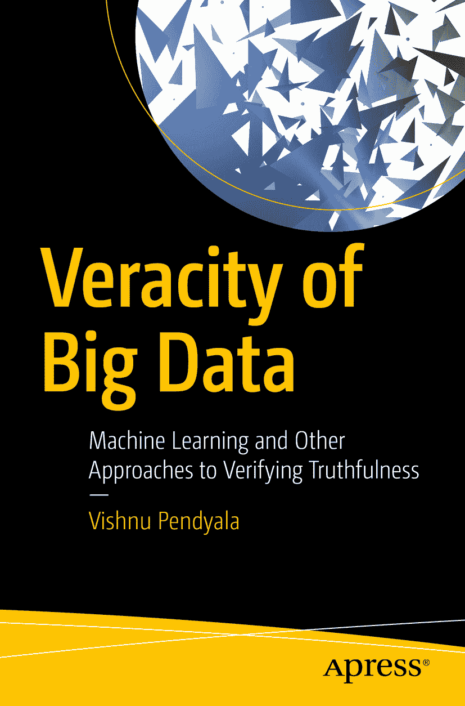

维什努·彭迪亚拉

# 大数据的真实性

机器学习及其他验证真实性的方法

作者在本书中引用的任何源代码或其他补充材料，读者均可通过图书产品页面在 GitHub 上获取，页面地址为 [www.apress.com/978-1-4842-3632-1](http://www.apress.com/978-1-4842-3632-1)。如需更详细信息，请访问 [`www.apress.com/source-code`](http://www.apress.com/source-code)。

ISBN 978-1-4842-3632-1

电子书 ISBN 978-1-4842-3633-8

[`doi.org/10.1007/978-1-4842-3633-8`](https://doi.org/10.1007/978-1-4842-3633-8)

美国国会图书馆控制号：2018945464

© 维什努·彭迪亚拉 2018

本作品受版权保护。出版者保留所有权利，无论是整体还是部分内容，具体包括翻译、重印、使用插图、朗诵、广播、微缩胶卷复制或以任何其他物理形式复制，以及信息存储与检索的传输、电子改编、计算机软件，或目前已知或未来开发的任何类似或不同方法。

本书中可能出现商标名称、标识和图像。我们未在每个商标名称、标识或图像出现时使用商标符号，而是仅以编辑方式使用这些名称、标识和图像，以维护商标所有者的利益，并无意侵犯商标权。

本出版物中使用的商品名称、商标、服务标志及类似术语，即使未明确标识，也不应被视为对它们是否受专有权利保护的看法。

尽管本书中的建议和信息在出版时被认为是真实和准确的，但作者、编辑和出版者均不对可能出现的任何错误或疏漏承担法律责任。出版者对本书所含内容不作任何明示或暗示的保证。

本书由 Springer Science+Business Media New York 在全球图书贸易中发行，地址：233 Spring Street, 6th Floor, New York, NY 10013。电话：1-800-SPRINGER，传真：(201) 348-4505，电子邮箱：orders-ny@springer-sbm.com，或访问 www.springeronline.com。

Apress Media, LLC 是一家加利福尼亚有限责任公司，其唯一成员（所有者）是 Springer Science + Business Media Finance Inc (SSBM Finance Inc)。SSBM Finance Inc 是一家特拉华州公司。

谨以此书献给我敬爱的父亲彭迪亚拉·斯里尼瓦萨·拉奥，以作纪念。
