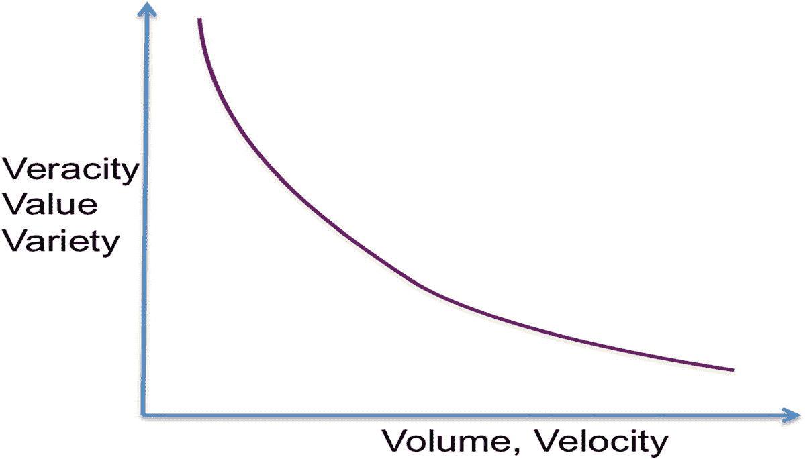
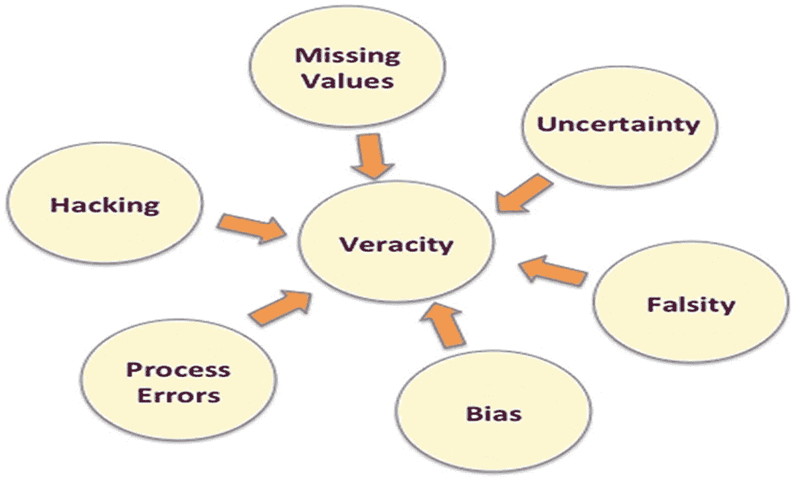
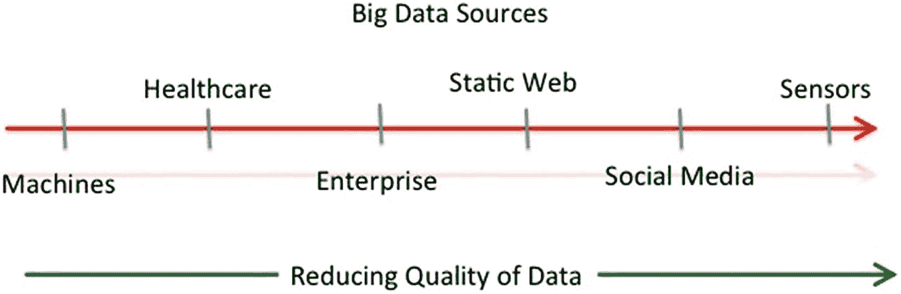

# 1. 大数据现象

为何称为“大”数据 大数据的“V”特征 真实性——第四个“V” 本章小结

我们正被数据淹没。来自 Twitter 微博、YouTube 和监控视频、Instagram 图片、SoundCloud 音频、企业应用程序以及许多其他来源的数据，已成为我们日常生活的一部分。计算技术已发展成熟，能够促进机器可读数据的普及，并利用其推动人类进步。这一大数据现象是新的信息革命，任何 IT 专业人士都不能错过参与其中。事实证明，大数据分析已经改变了企业提供服务的模式。商业模式日益优化，运营愈发智能，收入流也在不断增长。

不确定性大概是人类经济演化过程中最大的阻碍因素。幸运的是，大数据有助于应对不确定性。我们对一个实体了解得越多，就越能进一步认识它，从而减少不确定性。例如，分析顾客购买模式的连续数据，使商店能够预测需求变化并进行相应备货。大数据正在帮助企业更好地理解顾客，从而为他们提供更优质的服务。通过分析来自在线社交网络、移动应用使用记录和购买交易记录等多源消费者数据，企业能够实现个性化推荐。计算统计学和机器学习算法能够从大数据中假设出模式，从而帮助实现这种个性化。

`Web 2.0`（包括在线社交网络）是大数据的一个重要来源。另一主要贡献者是物联网。数十亿连接互联网的设备产生了拍字节（PB）级别的数据。众所周知，企业会尽可能多地收集消费者的数据——他们的偏好、交易记录、观点、个人特征、浏览习惯等等。消费者自身也在生成大量数据，包括评论、评分、直接反馈、视频记录、图片、演示的详细文档、故障排除教程以及产品使用方法等，这些都是利用了`Web 2.0`的表现力，从而为大数据做出了贡献。

从数据来源列表可以看出，收集数据的成本相对较低。此外，还有其他一些技术趋势也在推动大数据现象。高可用性系统和存储、硬件成本的急剧下降、任务执行中的大规模并行处理、高速网络、云计算等新型计算范式、高性能计算、分析与机器学习算法的创新、非结构化数据存储的新方式，以及智能手机和笔记本电脑等计算设备的普及，都在共同推动着大数据革命。

人类之所以智能，是因为我们的大脑能够从各种来源收集信息，将它们联系起来，并进行分析以寻找模式。大数据及其相关算法借助计算能力实现了同样的功能。融合来自不同来源的数据，可以对所涉及的实体产生惊人的洞察。例如，如果在某个特定地理位置的在线社交网络上，有大量流感症状的报告，并且根据该地区的信用卡交易显示，流感药物的购买量激增，那么很可能是流感爆发的前兆。鉴于没有用来收集、整合和分析数据的工具，大数据就毫无意义，一些支持者甚至认为大数据并非真正意义上的数据，而是一种由工具和技术组成的技术，旨在从海量数据集中提取价值。

注意

## 从大数据中创造价值

从大数据中创造价值可被视为包含两大功能：**融合**，即汇聚来自不同来源的数据；以及**裂变**，即对这些数据进行分析。

关于人体及其健康的数据浩如烟海。基因组数据科学是一门日益受欢迎的学术专业。它有助于研究疾病机制，从而实现更好的诊断和药物反应。用于分析大数据的算法也正在改变基因组研究领域的游戏规则。这类数据量极其庞大，以至于国际著名科学期刊《自然》曾刊登一篇报道¹，提到基因组研究人员担心计算基础设施可能无法应对其研究产生的日益增长的数据量。

科学可从大数据的发展中受益匪浅。社会科学家可以利用在线社交网络（OSN）的数据来识别微观和宏观层面的细节，例如个人层面的精神状况或宏观层面的群体动态。同样的在线社交网络数据也可用于检测医疗紧急情况和流行病。在金融领域，来自股票市场、商业新闻和在线社交网络的数据也能揭示宝贵的洞察，帮助改善贷款实践、制定宏观经济战略并避免经济衰退。

大数据应用在众多其他领域也有各种用途。住房与房地产业、精算行业，以及国家安全、国防、教育、疾病控制、执法和能源等政府部门，这些领域都以数据量庞大为特征，预计都将从大数据现象中获益。

> **注意**

> 哪里存在海量数据并应用了合适的算法，哪里就会有财富、价值和繁荣。

### 为何是“大”数据

一个常见的问题是：“为什么是大数据，而不是仅仅数据？”要使数据有用，我们需要能够识别模式，并对尚未知晓的未来数据预测这些模式。一个典型的类比是根据给定样本预测一袋大米的品牌。袋子中的大米对我们来说是未知的。我们只得到一个样本，以及已知品牌大米的样本。已知样本在机器学习语言中称为训练数据。未知大米的样本就是测试数据。

常识告诉我们，样本越大，对品牌的预测就越准确。如果训练数据中每个品牌只给两粒米，我们的结论可能完全基于这两粒米的特征，从而忽略了其他特征。用机器学习的术语来说，这被称为过拟合。如果我们有更大的样本，就能识别出众多特征以及这些特征可能的取值范围：换句话说，就是数值的概率分布，并在尚未知晓的数据中寻找类似的分布。因此，我们需要的是海量数据，即大数据，而不仅仅是数据。

事实上，许多在分析大数据时流行的算法早已存在。例如，朴素贝叶斯技术自 18 世纪就已出现，支持向量机模型则发明于 20 世纪 60 年代初期。由于前面解释的原因，它们随着大数据革命的到来而变得举足轻重。

区分“大数据”与传统数据字节的一个常用启发式标准是：大数据量大到无法装入传统的关系型数据库管理系统。随着物联网雄心勃勃地计划将世界上的每个实体都连接到其他一切，传统的关系型数据库管理系统（`RDBMS`）将无法应对数据激增。事实上，`希捷公司`²预测，世界在几年内将无法满足存储需求。根据他们的观点，“制造容量比生成数据更难”。存储行业能否以及如何满足大数据现象中“数据量”这一维度带来的容量需求，这将是非常有趣的问题，而这便引出了大数据的“V”字特征。

> **注意**

> 需要大量数据才能看到统计模式，这些模式要足够普遍以适用于庞大群体，并能从数据中自动生成有意义的假设。

## 大数据的 V 字特性

在互联网上搜索带双引号的`"特朗普总统"`，在他就职典礼后的短短两周内（1 月 20 日至 2 月 5 日）就返回了约 4560 万条结果。这揭示了大数据众所周知的四个 V 字特性：**数量（Volume）、速度（Velocity）、多样性（Variety）和真实性（Veracity）**。这些搜索结果同时具备上述所有特征。4560 万条页面结果构成的语料库，体现了搜索引擎索引的庞大**数量**。关于该主题的实际数据可能更多。考虑到该话题仅有两周的历史，这些结果也反映了数据生成的**速度**。**速度**同样指代数据分析以及从中得出的推论被投入使用（有时是实时、瞬间）的速率。

搜索结果存在于各种**多样**的媒介中：文本、视频、图像等——其中一些是结构化的，一些并非如此——并且涵盖了关于特朗普总统的各个方面。其中有多少信息是真实的？又有多少结果实际上是关于`"特朗普总统"`，而非`"总统候选人特朗普"`？快速浏览会发现，相当多的结果可以追溯到 2016 年，表明这些文章并非真正关于`"特朗普总统"`，而可能是关于`"总统候选人特朗普"`。这引出了大数据**真实性**的问题。**真实性**指的是数据的质量。我们在多大程度上可以信赖大数据？最初，大数据的定义只包含前三个 V。像 `IBM` 这样富有远见的企业后来扩展了定义，将**真实性**作为大数据的一个重要方面。

还有更多的 V 字特性正逐渐与大数据关联起来。`Elder Research` 提出了与大数据和数据科学相关的 42 个 V。虽然我们不会在此逐一探讨，但将介绍其中重要的几个，并引入一个新特性——**估值（Valuation）**。下一个 V 是**易变性（Variability）**。数据的含义可能因上下文而异。例如，测量一个人身高时 0.01 英寸的误差，与在人脸识别算法中测量两眼瞳孔间距时相同的 0.01 英寸误差，其意义截然不同。即使两者都用于同一识别人的应用中，这 0.01 英寸的误差数据在两个不同的上下文中具有不同的含义。这一点对于语音数据通常也是如此。语音的解释很大程度上取决于语境。这个概念被称为大数据的**易变性**。因此，大数据分析在解读数据时，需要意识到大数据的**易变性**。

**易变性**为从大数据中获取价值带来了巨大挑战。数据本身是无用的。我们需要通过分析数据、得出结论或预测结果来从中获取**价值（Value）**。为了让管理者看到大数据的价值，必须以他们能理解的方式呈现。**可视化（Visualization）** 就是使用图表、图形和投影来更易理解地呈现大数据，以便实现其价值。据信，大数据 95%的价值来自于其 5%的属性或特征。因此，只有 5%的属性是真正**可行的（Viable）**。**可行性（Viability）** 指的是并非大数据的全部都是有用的。需要评估可用属性的可行性，只选择那些有助于获取价值的属性。

迄今为止阐述的这些 V 字特性忽略了大数据的另一个非常重要的方面——使用算法从数据中提取价值。我们称其为**估值（Valuation）**，从而引入了一个新的 V，或许是最重要的一个。没有估值过程，数据是无用的。数据挖掘、机器学习以及计算统计学的其他方法，构成了大数据估值的工具集。这个工具集的效率和有效性对于大数据现象的成功至关重要。**估值**不应与**价值**混淆。前者是一个过程，后者是产出物。**估值**是从大数据中提取价值的过程。

> **注**

> 大数据通常关联着几个 V：数量、速度、多样性、真实性、价值、易变性、可视化及可行性。我们引入一个新的 V——估值——即使用算法从大数据中提取价值的过程。

这些不同的 V 是相互关联的（图 1-1）。以社交媒体为例，可以说其`真实性`与`速度`成反比。博客和微博发布得越快，其背后的思考和实证就越少。当视频首次被发布以供在线观看时，大数据的数据量以极快的速度大幅增长。因此，`多样性`促进了所生成数据的`数量`和`速度`。

**图 1-1** 大数据各 V 之间的关系

`多样性`也影响着信息的`真实性`。例如，包含视频或图片的社交媒体帖子比仅含文本的帖子更可能是真实的。`数量`与`真实性`成反比，因为更多的数据点可能意味着较低的准确性。对于信息和数据而言，噪音会随着信号一同增加。在某些情况下，噪音实际上比信号增长得更快，从而影响了数据的效用。在电影院中虚假地高喊"着火了"比"这部电影不值得看"的真实评价传播得更快。这一点同样适用于网络信息，当噪音比信号传播得更快时。因此，`价值`与`真实性`成正比，而与`数量`和`速度`成反比。然而，高质量的数据并不能自动保证高价值。我们还需要用于`估值`过程的高效算法。所有这些观点都总结在图 1-1 中。

从上述以 V 来描述的这些特征来看，现在应该很清楚了：大数据与通常驻留在数据库和其他结构化框架中的传统数据方案截然不同。主要区别在于，前者大多是非结构化的、原始的、实时的。在应对包罗万象的大数据时，传统的数据仓库、业务流程管理和商业智能工具严重不足。许多几十年前的技术（主要作为人工智能和机器学习的一部分被发现），如今在大数据的背景下变得具有相关性。这些工具、技术和算法能够应对大数据独一无二的特征。

> **注** 表征大数据的这些 V 特性，使得传统的`ETL`（提取、转换、加载）功能难以扩展。`ETL` 方法既无法应对数据生成的速度，也无法处理数据的真实性问题。因此，大数据分析的需求应运而生。

## 真实性 —— 大数据的第四个“V”

在前面的章节中，我们看到了大数据的多种用途。所有这些应用都依赖于数据的底层质量。基于低质量数据构建的模型会对其有效性产生不利影响。不幸的是，大数据革命面临的障碍之一就是数据本身的质量。我们之前提到过大数据处理不确定性的方式。然而，大数据本身也具有不确定性特征。并非所有大数据都完全真实到可以确定性地加以处理。当基础事实不可靠时，即使在其之上构建了质量最高的模型，也无法取得良好的表现。这就是真实性问题，即大数据的第四个“V”。真实性是理解大数据并从中获取价值的关键方面。

价值常被吹捧为大数据的第五个“V”。数据质量差会导致分析质量差，并遵循“垃圾进，垃圾出”的原则难以从中获取价值。由于真实性问题处理不当，已经出现过重大失败。谷歌流感趋势（`GFT`）³的惨败就是一个例子。谷歌的算法在得出结论时忽略了真实性的几个关键方面，预测结果偏差高达 140%。如果医疗行业基于此类预测进行准备，必然会遭受重大损失。

> **注意** 大数据的真实性可以定义为所考虑数据的内在准确性或其缺失程度，特别影响从中提取可操作见解和价值的能力。

导致数据质量低下的原因有很多。现实世界中的不确定性、故意造假、对部分领域的忽视、缺失值、人类偏见、不精确的测量、处理错误以及黑客攻击都会降低数据质量。图 1-2 展示了影响数据真实性的因素。来自物联网的传感器数据常因测量不准确和数值缺失而受影响。近期，在线社交网络已成为黑客攻击日益增多的目标。现实世界中的不确定性是不可避免的。与其忽视它，我们需要建模和处理不确定性的方法。机器学习提供了这样的方法。

**图 1-2** 影响数据真实性的因素

为了构建有效的模型并使用这些方法，数据集需要具有代表性，并能全面呈现应用领域的情况。例如，政府（尤其是印度等发展中国家）越来越依赖 `Twitter` 等微博网站来制定决策。虽然这在某些情况下可能有效，但该数据集并不能全面代表政府的服务目标群体，因为它排除了因各种原因在社交媒体上没有存在的相当一部分公民。基于代表性不足的数据集构建的模型注定会失败。

> **注意** 数据集的选择对大数据模型的真实性因素和成功与否至关重要。数据集必须是应用领域的全面代表；并且应避免偏见、错误和被篡改的数据点。

机器学习是现代化的新粘合剂。许多新发明现在都在使用机器学习算法。它们也可用于解决真实性问题，不仅限于不确定性的情况，还包括其他情况，例如当某些数据点缺失时。我们将在后续章节中看到这一点。真理是昂贵的——历史告诉我们，它需要付出金钱、婚姻甚至生命的代价。确立真理或限制谎言同样代价高昂。在软件世界，也已被证明，遏制虚假信息是 `NP` 难问题，这意味着该问题不太可能由能在多项式时间内运行的软件解决。计算机解决一个已被证明是 `NP` 难的问题需要异常长的时间，使得解决方案不可行。`NP` 难问题通常使用近似方法解决。机器学习提供的算法有助于近似解决遏制虚假信息的问题。

> **注意** 遏制虚假信息是 `NP` 难问题，不太可能由在合理时间内完成的算法精确解决。

微博是大数据的重要组成部分，受低质量和不可靠性问题的影响尤其严重。根据 Business Insider 的估计⁴，仅在 2014 年 8 月，`Twitter` 上平均每天就发布了 6.61 亿条微博。以如此速度发布的那么多推文，其中投入了多少谨慎和小心，不得而知。数字世界主要由消费者而非企业构建。这意味着数字世界中的大部分数据并未经过充分验证，也不像企业数据那样有机构的背书。

即使是据称来自企业的大量数据也不完全真实。2017 年 2 月 17 日，在互联网上简单搜索“super shuttle coupon”，返回的第一页结果中就出现了来自 `http://www.couponokay.com/us/super-shuttle-coupon` 的结果，宣称有 77%的折扣，但点击链接后却跳转到一个模糊页面。我们知道接送服务公司负担不起 77%的折扣，但互联网搜索仍然将该网址呈现在结果中。如果搜索引擎能量化其对所显示结果的置信度，并至少剔除那些明显虚假的结果，那将会好得多。

读者或许也能联想到自己在企业背书的数据和信息真实性问题上的一些经历。我们都曾被 `Yelp`、亚马逊或其他商店网站上的误导性评论所困扰。这个问题实际上对企业的影响比对消费者更大。如果某个产品收到许多错误的正面评价，像亚马逊这样的企业可能会备更多该产品，当真相被顾客发现时，就可能无法售出那么多，从而遭受损失。

不过，总体而言，如图 1-3 所示，所生成数据的质量从企业端到传感器端是逐渐下降的。机器数据，如来自日志、点击流、核心转储和网络跟踪的数据，通常相当准确。可以假设医疗数据已经过拯救生命所需的尽职调查，因此在准确性方面可以排得相对较高。静态网页内容与网站的声誉和问责制相关，因此可以认为是相当准确的。社交媒体的性质仍然比较随意，具有开放访问和有限的身份验证方案，因此其质量较差。传感器在低能量、有损耗和噪声多的环境中运行，因此传感器的读数通常不准确或不完整。

**图 1-3** 大数据源按真实性递减顺序排列

然而，传感器数据有时可能至关重要。以特斯拉 Model S 致命事故为例。⁵ 据媒体报道，该事故是由于雷达传感器数据与基于计算机视觉的车辆检测系统的推断不一致所致。因此，碰撞规避系统未能启动，最终酿成人员伤亡的悲剧。虽然可以通过使用更好的硬件来改进传感器读数，但同样需要算法来适应来自传感器低质量的数据，从而避免类似车祸的灾难发生。

用数学来表述世界的复杂性，通常是科学建模的第一步。数学有助于加深对事物的理解。因此，我们尽可能运用数学来增强对主题的认识。然后在需要时，可以从数学推导出算法。

> **注意** 数学旨在化繁为简，而非增加难度。

## 总结

大数据正以多种重要方式改变着世界。在本章中，我们审视了这一现象，并涵盖了与之相关的重要理念。我们回顾了适用于大数据的各类“V”特性，并引入了一个新的“V”——价值（`Valuation`）。真实性（`Veracity`）是一个重要的“V”特性。社交媒体处于真实性光谱的低端。在下一章中，我们将更深入地探讨这一问题，研究社交媒体和网络信息不准确所带来的一些后果。

### 练习题

1.  绘制一幅概念图，呈现本章中提出的各种理念。
2.  思考适用于大数据的其他“V”特性，并讨论其潜在价值。

## 脚注

¹ Hayden, Erika C.; “基因组研究人员对大数据敲响警钟：生物学家警告，存储和处理基因组数据将超过运行 YouTube 和 Twitter 的计算挑战”，《自然》，2015 年 7 月 7 日，[`www.nature.com/news/genome-researchers-raise-alarm-over-big-data-1.17912`](http://www.nature.com/news/genome-researchers-raise-alarm-over-big-data-1.17912)

² Athow, Desire; “希捷警告：世界可能在两年内‘耗尽存储容量’：归咎于数据容量差距”，《TechradarPro》，2014 年 12 月 22 日，[`www.techradar.com/news/internet/data-centre/world-could-run-out-of-storage-capacity-within-2-years-warns-seagate-vp-1278040/2`](http://www.techradar.com/news/internet/data-centre/world-could-run-out-of-storage-capacity-within-2-years-warns-seagate-vp-1278040/2)

³ Lazer, David 和 Kennedy, Ryan; “我们能从谷歌流感趋势的惨痛失败中学到什么”，2015 年 10 月 1 日，《连线》，[`www.wired.com/2015/10/can-learn-epic-failure-google-flu-trends/`](https://www.wired.com/2015/10/can-learn-epic-failure-google-flu-trends/)

⁴ Edwards, Jim; “泄露的 Twitter API 数据显示推文数量严重下降”，《商业内幕》，2016 年 2 月 2 日，[`www.businessinsider.com/tweets-on-twitter-is-in-serious-decline-2016-2`](http://www.businessinsider.com/tweets-on-twitter-is-in-serious-decline-2016-2)

⁵ Singhvi, Anjali 和 Russell, Karl; “深入剖析特斯拉自动驾驶致命事故”，《纽约时报》，2016 年 7 月 12 日，[`www.nytimes.com/interactive/2016/07/01/business/inside-tesla-accident.html`](https://www.nytimes.com/interactive/2016/07/01/business/inside-tesla-accident.html)
