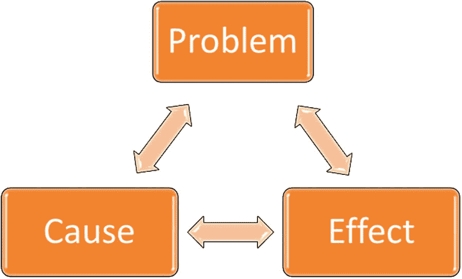

# 2. 网络信息的真实性

问题 成因 影响 对策 可信网站的特征 总结

大数据真实性问题，可以从大数据的一大来源——网络（Web）中得到最佳理解。网络信息拥有数十亿的索引页面和艾字节级别的规模，构成了大数据的重要组成部分。它在影响人们日常生活中的观点、决策和行为方面起着关键作用。网络或许提供了成本最低、力量最强大的出版媒介。任何人只要能上网，就能成为记者。这固然是好事，因为它让许多真相和许多原本默默无闻的人得以崭露头角。然而，正是让网络变得强大的这些原因，也使其容易遭受恶意活动的攻击。网络中相当一部分内容充斥着虚假信息。网络的开放性有时使得我们甚至难以准确识别信息的来源。

即便在过去，电子媒体也曾被用来误导人们。1938 年 10 月 30 日，电台播出了一部 62 分钟的广播剧，改编自 H.G.威尔斯（H. G. Wells）的科幻小说《世界大战》（*The War of the Worlds*），其中逼真的报道吓坏了纽约的许多人，他们相信这座城市正遭受外星人攻击。在网络时代，信息传播得更广、更快。在微秒之间，即使是世界最偏远的角落也能收到警报。信息以近乎光速传播，谎言和说谎的倾向也是如此。由于网络提供匿名和非个人化的界面，其无与伦比的覆盖范围和人们对它的依赖正越来越多地被用来传播谎言。

我们目睹了许多人通过社交媒体声名鹊起。在最近一段时间，许多推文（tweet）已成为热议的新闻话题。网络独特之处在于，它能让少数人影响、操纵和监控多数人的思想。话题标签、点赞、分析工具和其他技术产物有助于进行监控。来自这些技术产物的反馈随后可用于微调影响力并操纵人们。网络确实为促进公共利益提供了绝佳工具。但网络的这种力量同样可以被用来损害公共利益，偏袒少数掌握了网络操纵技巧的人。在本章中，我们将探讨网络信息真实性的问题：其影响、成因、对策以及识别特征。

> **注意**
> 网络是大数据的重要贡献者，并且特别容易出现真实性问题。

## 问题

当美国弗吉尼亚州里士满附近发生地震时，生活在约 350 英里外纽约市的人们，在他们实际感受到地震的**30 秒前**，就已通过流行的微博网站推特（Twitter）阅读到了相关消息。政府利用推特在危急时刻定位公民，以便提供服务。网络在多国政府与民众互动及管理舆论的战略中占据显著地位。本书本身在一定程度上也依赖于网络信息的真实性，这可以从脚注引用中看出。世界各地的人们日益依赖网络进行日常活动，例如在地图上查找地点路线、根据在线点评选择餐厅，或通过浏览微博对热门话题形成观点。所有这些活动以及更多其他事情，都可能因所依赖内容的失实而受到不利影响。

谎言本身代价高昂，而网络上的谎言则使这种代价成倍增加。例如，2013 年 1 月¹，关于几家公司正接受调查的虚假推文，导致相关公司市值分别蒸发 28%和 16%——这对投资者来说是巨大损失。这些是公然的企图。此外，网络还被用来以微妙的方式操纵观点和认知。第 4 章“变化检测技术”讨论了网络认知操纵如何被成功用于改变南美洲国家总统选举结果的案例。**认知黑客**指的就是这种出于不可告人目的的认知操纵。认知黑客是对网络信息真实性的严重威胁，因为它会导致用户行为发生错误的改变。2018 年 4 月 10 日，脸书（Facebook）的马克·扎克伯格在美国国会作证时承认，在防止外国干预美国选举方面做得不够。社交媒体和认知黑客在当今治理中扮演着如此重要的角色。

所有出于不可告人目的、与普世人类价值观相冲突而发布在网络上的信息，都可以被视为真实性受损。有许多网站模式符合这一描述。常见的领域存在于股市领域，那里涉及巨大的金钱利益。美国证券交易委员会（SEC）已发布多项警报和信息公告²，详细说明欺诈手段并保护投资者。还有其他微妙的方式损害了网络的完整性。在**垃圾索引**或“黑帽搜索引擎优化”中，搜索引擎以多种方式被欺骗，从而显示不正确的搜索结果。这些伎俩包括发布与背景颜色匹配的无关文本，使其对搜索引擎可见但对用户不可见，以及使用空`div`将无关文本隐藏在 HTML 代码中。

这个问题以多种形式表现出来。几乎每一个有用的工具都有被滥用的可能。例如，像 LinkedIn 和 Twitter 这样的不少网站，为了方便使用，会缩短用户发布的长 URL。像 Tinyurl.com 这样的网站免费提供这种缩短 URL 的服务。缩短后的 URL 通常没有目标页面的任何提示，这一特性已被滥用来诱使轻信的用户访问他们原本不会访问的网站。缩短后的 URL 通过电子邮件发送，并带有误导性强但吸引人的标题，诱使收件人点击，最终将他们引向晦涩的网站。皮尤研究中心估计，推特上分享的 URL 中有 66%来自机器人，这些机器人是在互联网上运行的软件程序，用于自动执行通常预期由人类完成的任务。

与此类似的是**伪装 URL**技术，它看起来真实，但可能包含隐藏的控制字符，或使用域名转发来隐藏 URL 所打开网站的实际地址。自网络诞生之初，以这些及其他方式进行的**网站欺骗**就几乎从未间断。不法分子创建与原始真实网站外观完全相同、URL 也很相似的网站，但内容却具有误导性并包含虚假新闻。一种更严重的欺骗形式是**网络钓鱼**，当用户访问一个与对应真实网站几乎一模一样的虚假网站时，会被诱导分享其敏感信息，如密码、社会保险号和信用卡详情。

> **注意**  
> 网络欺诈问题形式多样。从技术和社会学角度来看，这个问题都相当复杂。

### 原因

Web 2.0 从全球各地的人们那里产生了数拍字节的数据，以至于如今数字世界主要由消费者和普通用户而非企业构建而成。自网络 2.0 版本诞生以来，消费者生成的数据已成倍增长。这意味着大部分数据并未经过验证，也不像商业数据那样有机构背书。网络在许多情况下作为唯一真实来源的作用，已被滥用于服务不可告人的目的。尽管网络具有拟人化的作用，但与人类不同，它没有良知。然而，人们往往更依赖网络而非口头言语。

正如原子能等许多发明一样，在构想网络时，对其预期合理应用的兴奋之情似乎压倒了防止滥用的谨慎态度。一方面，如果网络只允许经过身份验证的、真实的、高质量的内容，它可能确实无法发展到今天这般规模。另一方面，网络的宽松特性导致其对自身贡献的庞大数据集完全缺乏控制。创建网络的初衷显然是为了促进世界各地人民之间和平、互利的交流。然而，宽松的控制不仅让人类，还让成群伪装成用户的机器人，能够出于恶意动机在网络上自动发布误导信息。

当作者在一次会议上展示其关于判断网络微博信息真实性的研究成果时，一位在场的研究生表示，网络是一种用于信息交流的随意媒介，不应以其真实性来评判。她认为，坚持要求网络信息真实会使其变得枯燥乏味，使用率大打折扣。这反映了相当一部分网络内容贡献者的普遍看法。用户发布信息时的随意态度，是导致网络信息缺乏真实性的主要原因之一。允许发布建设性内容与限制有害信息之间的灰色界限难以厘清。监管恶意网络行为绝非易事。

在网络上有大量动机驱使欺诈行为长期存在。正如我们将在后续章节中看到的，甚至一个国家的总统选举也受到网络上发布信息的冲击，有时还是错误信息的影响。舆论最大的影响可能在于政治家。政治议程或许是利用网络进行操纵的最重要原因。下一个驱动因素是金钱，正如我们在股价操纵案例中看到的那样。金钱回报还以在伪造和虚假新闻网站投放广告的形式体现。报复和公开羞辱也是常见原因，以至于美国绝大多数州都已通过法律，禁止在网上发布报复式色情内容。

认知黑客攻击在网络上的效果尤为显著，因为这种互动缺乏许多有助于判断口头言辞真实性的要素。例如，如果说话者在面前，其言辞的真实性会通过肢体语言、眼神交流、语调以及说话者与听者之间持续的反馈循环反映出来。如图 2-1 所示。随着生活日益个人化，人们越来越依赖网络获取信息，从而缺失了图 2-1 中双向箭头所示的部分真实性情态要素，而这些要素在面对面交流中是存在的。许多案例表明，网站被利用这种状况，出于不可告人的动机误导公众，且往往是非法行为。

**图 2-1** 网络上的交流缺乏面对面交流所具备的部分真实性情态要素或反馈循环

一个日益增长的趋势是，软件不仅被编写来执行指令，还被设计成根据训练数据和预期结果自行制定行动方案。这一趋势也助长了虚假数据量的增长。例如，语音合成软件如今已能模仿人的声音。生产此类软件的 Lyrebird³ 公司，允许用户录制一个人一分钟内的声音。利用这段录音，该公司的软件会生成一个独特的密钥，类似于这个人声音的 DNA。使用这个密钥，软件便能以该人的声音生成任何语音内容。

斯坦福大学的 Face2Face⁴ 技术可以获取一个人的面部信息，并重新渲染另一个人的视频，使其看起来就像这个新人的视频。该软件用获取到的面部替换原始面部，并生成伪造面部的表情，使视频中的人看起来像是那个新人。有趣的是，像这样的项目最初是为了检测视频篡改而启动的，但最终却被更多地用于实际篡改视频。结合上一段描述的语音合成软件，可以制作出看似真实的视频。完全从头生成虚假视频的那一天，或许已为期不远。

生成欺诈性内容的成本也很低廉，这进一步加剧了真实性问题。存在多种业务，以低得惊人的成本在网络上制造虚假新闻并从事欺诈性操纵。一家名为 Xiezuobang 的中国营销公司，撰写一篇 800 字的虚假新闻文章仅收费 `15` 美元。还有许多公司提供类似的欺诈性服务，用于操纵网络数据。在社交媒体上购买粉丝、`+1` 和点赞；不当提升网站或视频在搜索结果中的排名；以及对“按点击付费”广告进行欺诈性点击，不仅可能，而且价格实惠。事实上，在网络上造假的成本通常远低于推广真实内容的成本。一些恶意黑客行为，例如影响点击流数据（大数据的重要组成部分）的“点击欺诈”，已通过技术手段得到遏制。但新的、更实惠的破坏大数据完整性的机制却不断涌现。

> **注** 在网络平台上误导他人远比面对面交流容易得多。

## 影响

欺诈在互联网上造成的后果十分严重，在某些情况下甚至是致命的。关于虚假信息在网络上引发的连锁反应，已有大量文献记载。难以置信的是，网络基础设施的宽容使得一些网站得以公然提供诸如谋杀和致残等犯罪服务。这些服务通常建立在谎言和欺诈信息之上。就连 `Craigslist` 和 `Facebook` 这类最受欢迎的网站也曾被用来寻找职业杀手。有个案例是，`Facebook` 上出现了一个帖子，内容是以 500 美元悬赏“现在就干掉这个女孩”⁵。关于“暗网”中更加恶劣的情形，更是有着数不胜数的未公开故事——它们同样运行在互联网上，但更为隐蔽，需要特殊软件、配置和授权才能访问。

欺诈在互联网上的影响程度，与我们之前讨论的欺诈类型密切相关。例如，在股价操纵骗局中，常见的一种模式是“拉高出货”：先通过网络发布关于某公司的误导性、错误且乐观的信息来“拉高”股价，然后以虚高的价格将操纵者手中的股票“抛售”给市场。从长远来看，这种炒作会影响众多投资者和该公司本身。然而，当网络被用于反民主活动，通过操纵舆论来改变国家总统选举结果时，其影响可能是最为深重的。

与我们之前讨论的网站仿冒类似，**域名抢注**或**URL 劫持**是指：在输入知名网站 URL 时，一个拼写错误就会跳转到一个完全不同的网站，这些网站要么显示烦人的广告，要么以其他方式对用户造成恶意影响。`Whitehouse.com` 时至今日似乎也与美国总统官邸毫无关系，反而曾被用来宣传无关内容。至少现在，该网站包含了一则小字声明，称其“与美国政府无关联或未经其认可”，而一年前情况并非如此。如果用户本想输入 `whitehouse.gov` 却误输入了 `whitehouse.com`，就会进入这个宣称已成立 20 周年的意外网站。还存在一些出于恶意而注册域名的**网络域名占用**案例。例如，域名 `madonna.com` 被一位与著名流行歌手麦当娜无关的人注册，该网站被用来展示色情内容，而非歌手信息。此类情况的影响范围从单纯的令人烦恼到严重的名誉损失不等。

早在 1995 年，致力于“**人**道**对待动物**”的组织 **PETA**，就因域名 `peta.org` 被用于调侃“**人**道**食用美味动物**”而蒙羞。我们不断听说知名网站被黑客攻击和篡改的事件。过去，一个名为“Lizard Squad”的黑客组织曾篡改了包括联想和谷歌（越南版）在内的多家公司的主页。还有一次，英国《Vogue》杂志的网站被篡改，主页显示的是戴着帽子的恐龙。不少政治网站也曾遭此厄运，例如 2001 年，激进组织哈马斯的网站被黑客攻击，并被重定向至色情网站。即便那些对网络拥有极大控制权的互联网公司，也未能幸免于这些攻击。前文提到过，谷歌的越南主页曾被“Lizard Squad”篡改。2013 年和 2014 年，雅虎的数百万用户账户相继被黑，对其净资产造成了不利影响。

在其 2016 年的《网站安全状况报告》⁶中，谷歌警告称，被黑客攻击的网站数量已增长 32%，这一数字令人震惊。黑客们正变得愈发狡猾，利用先进技术实施犯罪。曾有案例显示，黑客利用 Facebook 照片进行 3D 渲染，试图欺骗使用面部识别的认证系统以获取访问权限。移动虚拟现实技术能够根据某人面部的 2D 照片，生成认证系统所需的 3D 细节。众所周知，系统安全漏洞会带来严重后果。

网络上的不准确性会对其依赖真实性的应用程序产生连锁效应。随着物联网领域越来越多的设备开始利用网络，问题变得愈发复杂。如果连接到网络的设备不够安全，就可能被利用来以各种方式攻击网站，甚至使其瘫痪。

> **注**  
> 当下的网络及其滋生的虚假信息，足以改变国家乃至数十亿人的命运轨迹。

## 补救措施

大数据真实性问题的因果形成了一个恶性循环，如图 2-2 所示，两者相互助长。有效的补救措施需要打破这个恶性循环。消除原因、减轻影响，或双管齐下，有助于控制问题。削弱动机、实施惩罚和预防发生，是各机构打击网络欺诈所采用的一些有效策略。

鉴于网络欺诈的后果与深远影响，多个国家已将解决这一问题列为国家优先事项。像俄罗斯政府这样的机构会维护一些包含虚假新闻的网站。⁷有趣的是，欧盟也会审查并发布虚假信息，⁸但仅限于那些亲俄罗斯政府的内容。还有许多独立组织和网站，如`snopes.com`，持续致力于揭穿网络上流传的虚假信息。社交媒体提供商也积极参与遏制其平台上的虚假内容。暂停虚假账户、开展宣传活动、增强软件功能以标记新闻推送中的欺诈信息，以及允许用户提供可信度评级，都是互联网公司正在尝试的一些措施。各国政府也时常通过立法来打击网络犯罪。

**图 2-2** 真实性问题的因果恶性循环

前一节中强调的许多犯罪行为，都受到本国法律各条款的约束。例如，发布关于两家公司的虚假推文，导致其股价大幅下跌的人，被依据《1934 年证券交易法》第 10(b)条及规则 10b-5 提起诉讼。该犯罪行为还导致美国证券交易委员会（SEC）在 2015 年 11 月发布了投资者警报。⁹然而，法律或警报并未阻止证券市场中的网络欺诈行为。新的案件仍在不断被发现并起诉。联邦调查局（FBI）在其互联网犯罪投诉中心（IC3）设立了一个用于举报网络犯罪的表格¹⁰，并每年发布相关主题报告。¹¹然而，作者本人曾使用该表格举报一起严重犯罪，但未收到 FBI 的回复，甚至未获得案件编号，这表明法律补救措施并不充分。此外，对于网络上的许多恶意行为，要么法律尚不存在，要么处罚过于宽松。因此，必须不仅从法律层面，还需结合其他学科，特别是技术手段，来解决这一问题。

技术本身在解决多项法律谜题中发挥了重要作用，但远未获得所需的可信度。贝叶斯定理的简单应用在众多法律案件中扮演了关键角色，其中一些案例列在`https://sites.google.com/site/bayeslegal/legal-cases-relevant-to-bayes`。截至目前，该网站列出了 81 个此类案例。然而，正如多本书籍和针对字符串"并以百分比形式表达某事件发生概率"的网络搜索所揭示的那样，英国上诉法院禁止了贝叶斯定理的使用。我们需要通过强化方法，为技术解决方案注入信心，以应对真实性问题。

> **注**  
> 高中数学中学到的贝叶斯定理的简单应用，帮助解开了众多法律案件的谜团。

隐私保护使得起诉网络犯罪变得困难，尤其是当犯罪行为跨越国界时。即使起诉成功，所造成的损害往往也无法弥补，损失的时间和物质也无法挽回。肇事者通常没有资源来支付损害赔偿，例如，因少数个人的“拉高出货”行为导致公司净资产损失的情况。因此，预防比惩罚更为重要。技术在预防方面远比法律补救措施更有效。后续章节将更深入地探讨有助于预防网络欺诈的技术。

当前技术也需要革新以应对数据的真实性问题。例如，像 PageRank 这样的搜索算法在显示搜索结果时优先考虑流行度而非可信度，从而忽视了这一问题。根据可信度对检索到的信息进行排序，远比当前搜索算法所关注的递归计算页面链接数量要困难得多。诸如 Facebook、谷歌和 Twitter 等互联网公司一直在设法打击虚假和恶意内容。例如，谷歌在 2016 年第四季度从其广告网络中封禁了 200 家发布误导性内容的公司。Facebook 在 2018 年的前 90 天内，除了每天阻止数百万次创建虚假账户的尝试外，还删除了 5.83 亿个虚假账户和 8.658 亿条帖子。

现实世界一直是许多工程解决方案的源泉。计算机科学中的不少概念，如面向对象范式，都受到现实世界现象的启发。真实性问题在现实世界中同样是一个主要问题。那里是如何处理的呢？执法人员如何判断一个人是否在说实话？正是通过审问涉及各种案件的大量人员所积累的经验，他们才能辨别真相。软件世界中一个类似的概念是机器学习。通过分析大量案例（训练数据）中的模式，机器学习算法能够得出结论。其中一个结论可以是数据是真是假。我们将详细探讨如何使用机器学习技术来解决大数据真实性问题。

`生物特征`识别、双因素认证、强密码等基本安全功能或许能够防止数据泄露、黑客攻击和信息盗窃。但正如我们所见，就像窃贼总是技高一筹一样，黑客的方法更为巧妙。我们能否开发一个类似中央情报局（CIA）的平台来检测黑客威胁？威胁情报平台（TIP）就与此类似。就像 CIA 一样，TIP 旨在从各种来源收集威胁信息，对这些信息进行关联和分析，并基于分析结果采取行动。该领域仍在发展中，洛克希德·马丁等公司正在研究稳健的解决方案。

> **注**  
> 现实世界一直是许多工程解决方案的灵感来源，包括应对大数据真实性问题的方法。

尽管网络存在脆弱性，但仍有一小部分网站在相当程度上保持着其完整性。维基百科的页面不仅被个人信赖，也被搜索引擎公司所依赖。尽管允许匿名编辑，但除了少数几起争议性和“报复性”编辑事件外，维基百科在其贡献者的帮助下，极大地受益于内容完整性和高标准的维护。与现实中“厨师多了烧坏汤”的例子不同，协作编辑出人意料地取得了巨大成功。协作编辑是否是解决真实性问题的灵丹妙药还有待观察，但总的来说，是什么让一个网站值得信赖？在下一节中，我们将探讨那些看起来相对更可靠的网站的构成要素。

### 可信网站的特征

可信网站具有某些特征。可信网站类似于一个可信的人。当一个人客观、没有隐藏目的或别有用心的动机、代表一家成熟的公司、说话清晰正式、表现出专业性、乐于助人、受到可信赖者的推荐、易于接触、整体上显得正式且真实、并能与时俱进时，我们就会信任他。网站也是如此。我们通常不会怀疑天气预报网站，因为其信息是客观的。几乎没有什么动机去篡改天气信息。这些信息简单且易于理解。判断信息是否真实并不难，因为温度和湿度可以通过实际感受并与网页发布的内容进行对比。任何预测也可以与真实事件进行历史关联。所有名副其实的天气网站都会经常更新，以保持其业务运转。

信息与既定事实的关联性也是衡量真实性的良好指标。例如，如果网页引用了大量期刊文章，那么它很可能更值得信赖。网站的来源，例如政府或知名出版商，也是决定网站可信度的一个因素。所使用的语言的语气、风格、清晰度和正式程度也是判断信息真实性的良好指标。网页上出现的大量广告，尤其是那些烦人的弹出窗口、遮挡内容或强制点击的广告，会降低网站的可信度。其中一些广告甚至可能注入间谍软件或病毒。

正规网站往往会提供联系方式，例如电话号码和电子邮件地址。外观、一致性、语言质量、社区参与和支持、易懂性、简洁性、粒度、结构良好的分层组织、时效性和信息的实用性等因素，也都有助于提升网站上所呈现信息的真实性。另一方面，缺少任何个人姓名或联系信息、拼写错误、不专业的样式与布局、模糊的引用、侵入式广告等，都是欺诈网站的标志性特征。我们将在后续章节中看到其中一些以及其他特征如何帮助解决真实性问题。

> **注意**
>
> 一个可信的网站通常表现出许多一个可信的人所具有的特征。

## 总结

本章我们讨论了真实性问题因果关系的恶性循环，并探讨了几种可能的补救措施。下一章将从技术角度进一步探索这些补救措施，并讨论处理信息真实性问题的通用方法。本章还回顾了可靠网站的特征。其中一些特征，例如存在有效联系信息、无效链接或基于`PageRank`等指标的流行度，可以通过软件程序自动检测。然而，像信息的客观性、完整性或更新程度这样的特征，则只能通过人工参与来确认。下一章将探讨建立信息可信度的一些方法。

## 练习

1.  列出尽可能多的在现实世界中影响可信度的因素。检查其中哪些因素适用于网络信息的真实性。
2.  本章主要关注网络信息，这是当前大数据的主要组成部分。针对大数据其他来源（例如物联网传感器产生的数据或地理空间数据）的真实性问题，提出类似关于原因、影响和补救措施的讨论。

## 脚注

1.  美国证券交易委员会；SEC 指控：虚假推文导致两只股票在市场操纵中暴跌，2015 年 11 月 5 日，新闻稿，[`https://www.sec.gov/news/pressrelease/2015-254.html`](https://www.sec.gov/news/pressrelease/2015-254.html)
2.  美国证券交易委员会；SEC 指控：互联网欺诈，2011 年 2 月 1 日，投资者出版物，[`https://www.sec.gov/reportspubs/investor-publications/investorpubscyberfraudhtm.html`](https://www.sec.gov/reportspubs/investor-publications/investorpubscyberfraudhtm.html)
3.  Lyrebird，测试版，用你自己的声音生成句子，最后检索日期：2018 年 4 月 6 日，[`​lyrebird.​ai/​`](https://lyrebird.ai/)
4.  斯坦福大学，Face2Face：RGB 视频的实时面部捕捉与重演，最后检索日期：2018 年 4 月 6 日，[`​www.​graphics.​stanford.​edu/​~niessner/​papers/​2016/​1facetoface/​thies2016face.​pdf`](http://www.graphics.stanford.edu/%7Eniessner/papers/2016/1facetoface/thies2016face.pdf)
5.  Black, Caroline；Facebook 买凶杀人阴谋：宾夕法尼亚州少年 Corey Adams 承认利用该网站追查强奸指控者，CBS 新闻，2011 年 2 月 14 日，[`​www.​cbsnews.​com/​news/​facebook-murder-for-hire-plot-pa-teen-corey-adams-admits-he-used-site-to-go-after-rape-accuser/​`](http://www.cbsnews.com/news/facebook-murder-for-hire-plot-pa-teen-corey-adams-admits-he-used-site-to-go-after-rape-accuser/)
6.  谷歌，#NoHacked：年度回顾，站长中心博客，2017 年 3 月 20 日，[`https://webmasters.googleblog.com/2017/03/nohacked-year-in-review.html`](https://webmasters.googleblog.com/2017/03/nohacked-year-in-review.html)
7.  俄罗斯联邦外交部，复制关于俄罗斯不可靠信息的出版物示例，新闻稿，最后检索日期：2018 年 4 月 6 日，[`http://www.mid.ru/nedostovernie-publikacii`](http://www.mid.ru/nedostovernie-publikacii)
8.  欧盟，虚假信息评论，对外行动署，2016 年 9 月 2 日，[`https://eeas.europa.eu/headquarters/headquarters-homepage_en/9443/Disinformation%20Review`](https://eeas.europa.eu/headquarters/headquarters-homepage_en/9443/Disinformation%20Review)
9.  美国证券交易委员会，社交媒体与投资——股票谣言，投资者警示与公告，2015 年 11 月 5 日，[`https://www.sec.gov/oiea/investor-alerts-bulletins/ia_rumors.html`](https://www.sec.gov/oiea/investor-alerts-bulletins/ia_rumors.html)
10. 美国联邦调查局，提交投诉，互联网犯罪投诉中心，最后检索日期：2018 年 4 月 6 日，[`https://www.ic3.gov/complaint/default.aspx`](https://www.ic3.gov/complaint/default.aspx)
11. 美国司法部，2015 年互联网犯罪报告，互联网犯罪投诉中心，最后检索日期：2018 年 4 月 6 日，[`https://pdf.ic3.gov/2015_IC3Report.pdf`](https://pdf.ic3.gov/2015_IC3Report.pdf)

