# 3. 大数据真实性验证方法

机器学习 变化检测 优化技术 自然语言处理 形式化方法 模糊逻辑 信息检索技术 区块链 总结

真实性对于许多研究领域都至关重要。哲学、逻辑学和法律都在深入探讨“何为真”。因此，判定真相往往是多学科交叉的。计算机科学将现实生活及其他学科中的许多现象进行建模。在本章中，我们将广泛审视那些有潜力检测数据真实性层面的框架和技术。这些技术大致可分为以下几类：机器学习、变化检测（用于最小化谎言成本的优化技术）、自然语言处理、形式化方法、模糊逻辑、协同过滤、相似度度量，当然还有区块链技术的应用前景。我们首先从机器学习开始，它常被称为“现代化的砂浆”，有时也被比作在 19 世纪末 20 世纪初彻底改变世界的电力。

## 机器学习

正如我们所见，数据的真实性是一个棘手的问题——用软件行业的术语来说，是 NP 难问题。NP 代表非确定性多项式时间，这意味着我们无法为该问题找到一个运行时间可以用多项式表示的方法。即使我们找到了一个解决 NP 难问题的算法，它也需要耗费极其漫长的时间，以至于这种方法根本不切实际。研究文献中有充分证据表明，虚假信息遏制（MC）是 NP 难的。幸运的是，当涉及到生活的复杂问题时，数学总是能伸出援手。数学是事物的核心。一旦用数学表达出来，问题便会迎刃而解，就如同触动人心的对话能化解矛盾一样。但在深入探讨数学抽象概念之前，让我们先思考一下在现实世界中是如何做到这一点的。在现实生活中，我们如何得知某件事是真的？如前所述，许多计算机科学解决方案都源自现实世界或受到现实世界现象的启发。人们常说，数据就像人一样——只要你足够用力地审问它，它就会告诉你任何你想听的话。在重大犯罪案件中，执法人员正是通过这种方式对嫌疑人进行审问以获取真相。我们需要构建合适的框架来审问大数据——这正是大数据分析的全部意义所在。

> **注意**  
> 大数据真实性问题与执法中的相同问题非常相似。区别在于，前者使用的是数据和工具，而非人。

确立真相是法律斗争的症结所在。我们如何判断某人是否在说实话？我们会检查相关的细节——即场景的某些特征。例如，测谎仪会检测脉搏率、血压、呼吸频率等特征。类似地，大数据也拥有一些分析软件将检测的特征。分析软件中使用的机器学习算法依赖于从现实世界中提取的特征来对数据进行分类。这些特征指示了数据所属的类别。因此，特征对于构建检测真相的模型至关重要。现在让我们来审视评估真实性过程中的步骤。

> **注意**  
> 就像人一样，数据也拥有能够揭示真相的特征。

为了建立一个数学模型，我们以一个水果摊贩为例。假设我们是没有任何先验知识或直觉的机器。我们如何知道摊贩卖的苹果真的是苹果，橙子确实是橙子，而他并没有说谎？这是通过观察它们的一系列特征得出的，例如颜色、形状、大小、果皮质地、硬度和气味。在此过程中，我们之前已经观察过大量被标记并已知类别的苹果、橙子和其他水果。这些特征并非恒定不变——它们的值不是二元的，而是变化的。我们不能确信任何特征，比如形状或颜色。例如，我们无法肯定地断言所有橙子都是完美的球形，或者所有苹果都是红色的。橙子也可能是椭圆形的，苹果则可能有栗色或其它深浅不一的红色。对这种不确定性进行建模的最佳工具是概率。每个特征（如形状和颜色）都可以被视为一个具有概率分布的随机变量。我们也可以称它们为预测变量（因为它们有助于预测）或自变量，就像坐标系中的自变量 `x`。

> **注意**  
> 概率是用于对数据不确定性特征进行建模的主要工具。


我们大致知道水果特征的概率分布——通过观察一组苹果样本，我们了解了苹果通常的形状和大小。我们将这组数据称为“训练集”，因为通过检查该集合中苹果的特征，我们训练自己识别苹果。依赖于这些特征的变量是水果的类别，在这个例子中就是苹果。给定一个新水果的特征，问题便在于确定其类别——它是苹果、橙子、梨，还是其他水果。我们需要从训练集中构建一个模型，该模型将根据新水果的特征帮助预测其类别。可以将模型视为一个黑盒、一种数学抽象，它接收新水果作为输入，并判断该水果是苹果、橙子还是其他水果。这个黑盒本质上基于训练集中它观察到的带标签的水果，计算关于苹果、橙子等想法的模型。我们将从中抽取新水果的集合称为“测试集”，因为该集合中的水果用于测试我们从训练集构建的模型。我们可以将上述讨论用以下方程表示：

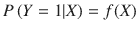

(1) 其中

*   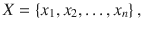 随机变量`x[i]`的集合
*   `x[i]` 是表示水果特征的随机变量。
*   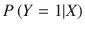 是指在给定特征`X`的条件下，一个水果是苹果（例如）的概率。

> 注意：数据特征在概率分布中被表示为随机变量。

现在让我们继续构建模型。很容易看出，并非所有特征都同等重要。例如，在确定类别时，形状不如颜色或表皮纹理重要，因为橙子和苹果大致都可以是球形的。因此，并非所有特征都具有相同的重要性或权重。我们需要在决定水果类别时对每个特征进行加权。权重越大，该特征对我们的决策就越重要。在上述方程（1）中，`f(X)` 用权重表示为：

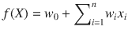

(2)

> 注意：数据特征（如同所有真实事物的特征）的重要性只是相对的，因此在做出决策时需要对其进行加权。

在我们将方程（2）代入方程（1）之前，需要意识到方程（1）的左侧（L.H.S.）作为概率，其值总是在 0 和 1 之间。因此，我们需要想出一些方法，使得右侧（R.H.S）也始终在 0 和 1 之间。有几种方法可以实现这一点，其中之一是使用“逻辑函数”，表示如下：

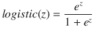

(3)

上述函数始终保证为正但小于 1，非常适合我们的使用。在方程（1）中使用逻辑函数将得到一个模型，该模型有助于识别水果的真实分类。以这种方式使用逻辑函数构建的模型称为“逻辑回归”模型。方程（1）现在转变为：

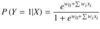

(4)

> 注意：权重（有时也称为特征参数）在确定数据的真实性方面起着关键作用。

现在，确定真实性的问题归结为在上述方程（4）中找到权重`w[0]`、`w[1]`、…、`w[i]`、…、`w[n]`。很容易理解，权重的目标是减少观测值与使用上述方程估计值之间不匹配所产生的误差。在上述方程（4）中，产生最高估计概率的水果类别就是观测水果被选定的类别。如果我们使用上述方程估计一个水果是苹果，我们希望观测到的水果确实是苹果。如果它结果是橙子，那么估计就出错了。我们使用所谓的“最大似然”来减少这种误差的机会，从而通过将上述方程应用于训练集来确定权重。“最大”一词应该让人回想起微积分课程中的“极大值和极小值”。确实，在计算权重时，使用相同的方法和原则。

> 注意：选择权重的目标是减少我们在确定数据真实性时出错的机会。

当我们拿到一个具有给定特征的新水果时，我们将从训练集中推导出的权重以及从新水果中提取的特征代入上述方程（4），以确定该水果是否确实是商家试图销售的那种水果。上述类比适用于任何大数据集。该过程总结如下方的图 3-1 所示。大数据可以是社交媒体帖子（如推文）、物联网设备传感器的测量值或其他包含有价值数据的记录。特征可以被提取，结果可以通过手动或自动过程进行标注（打标签）。需要注意的是，训练模型和测试模型必须使用同一组特征。诸如`Amazon Mechanical Turk`之类的众包工具通常用于手动标注和特征提取。特征提取通常由本书未涉及的方法自动完成。提出特征的过程（正式称为“特征工程”）本身就是一个研究领域。事实上，机器学习算法的效率在很大程度上取决于提取的特征。对于本书中的示例，我们假设特征是手动提取的。

> 注意：机器学习中的一个重要步骤是对训练数据进行标注。

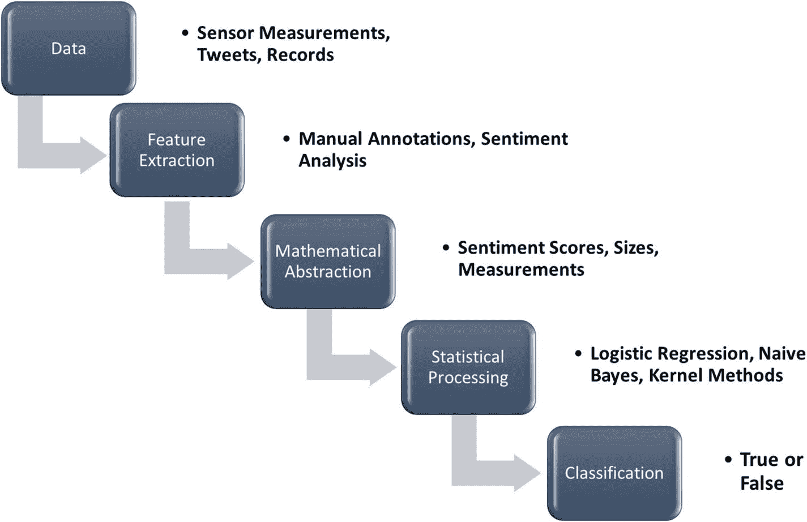

图 3-1 确定大数据真实性的机器学习过程

自动特征提取的一个例子，比如对于像推文这样的社交媒体帖子，是使用情感分析，它为每条推文输出情感分数。

一旦特征（如情感分数）用数学表示出来，我们就无需再处理原始数据了。我们可以使用统计技术，如上述示例中使用的逻辑回归，对这种数学抽象进行分类，从而得出分类结果。整个流程如图 3-1 所示。

> 注意：使用机器学习技术确定大数据的真实性，就像解决数学问题一样，是一个循序渐进的过程。


### 变化检测

正如我们在机器学习部分所见，数据具有特征。特征在验证事实真伪中起着关键作用。以人类说谎为例，他们的心跳、呼吸、排汗、脉率及其他压力反应生命体征等特征会发生变化，从而表明此人在说谎。测谎仪本质上就是通过检测这些变化来判断说话内容的真实性。同样的原理也适用于某些类别的数据。无正当理由的变化表明可能存在虚假或欺诈行为。例如，如果传感器测量值在某个时间段内出现异常，则可能存在恶意攻击。本书后面关于此主题的章节将讨论如何通过分析微博帖文中情感波动来检测对微博网站的恶意攻击。

**注意**  
监测变化有助于检测谎言。

数学在这类技术中也发挥着作用。本书讨论的一些变化检测技术包括序列概率比检验（`SPRT`）、`CUSUM`技术以及有时被誉为 20 世纪最伟大发明的`卡尔曼滤波器`。这些变化检测技术背后的原理很简单。数据通常遵循某种模式，或者或多或少保持恒定。例如，在持续监护患者时，测量其生命体征的传感器数据通常不会超出特定范围。脉搏率、心率、血压、动脉血氧饱和度、体温和呼吸频率通常恒定或仅有轻微波动。

在这种情况下，对下一个数据点的良好估计通常是当前的观测值，代表维持现状。为了适应波动，需要将后续观测值纳入估算方案中。因此，我们从第一个值作为估计值开始。下一个估计值可以是前一个估计值与当前观测值的平均值，以此类推。在此过程中，我们观察数值相对于估计值的变化，并分析这些变化以确定是否存在完整性丧失的可能性。例如，如果观测值比估计值高出某个阈值，则可能存在异常。

并非所有变化都是异常导致的，因此变化检测比简单地寻找与前一个值相差特定阈值的变化要复杂得多。需要更深入地分析这些变化才能获得更准确的结果。许多变化检测技术，如`卡尔曼滤波器`、`CUSUM`和`SPRT`，都可以用于以更可靠的方式分析变化。此方案的总体概览如图 3-2 所示。使用估计或其他统计技术对观测到或给定的数据进行变化分析。`卡尔曼滤波器`使用估计，而`CUSUM`使用累积和来分析变化。根据分析结果，数据可能被标记为虚假或真实。

**注意**  
与机器学习一样，在某些变化检测技术中，估计或预测真实值是关键。

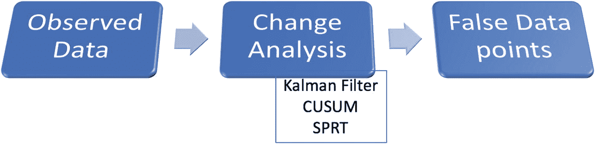  
**图 3-2** – 用于大数据真实性检测的变化检测方法概览

上述通过使用估计值与观测值的平均值进行估算的简单方案忽略了从错误中学习。通常需要一个反馈循环来提高估计的准确性。像`卡尔曼滤波器`这样的技术除了在得出估计值方面进行其他改进外，还包含一个反馈循环来改进估计。下一章将详细讨论这些内容。反馈循环本质上是一种测量更新——基于观测值或测量值对估计值进行更新。反馈循环如图 3-3 所示。

**注意**  
根据性能反馈调整行为是一个关键的系统概念，是一些算法（如可用于变化检测的`卡尔曼滤波器`）的特征。

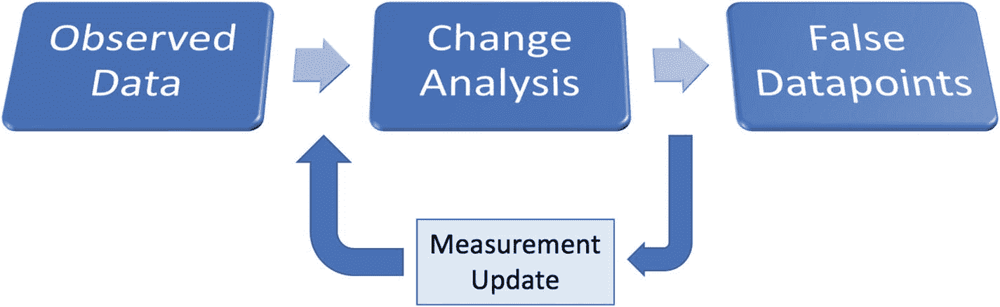  
**图 3-3** – 插入反馈循环以改进估计

尽管像`卡尔曼滤波器`这样的技术有助于检测变化，但并非所有被算法标记为虚假的数据都是真的虚假。算法会受到误报的影响。像`CUSUM`这样的算法在离线数据上表现最佳。由于这些原因，单一的变化检测算法有时不足以准确发现异常。在这种情况下，为了获得更好的准确性，会使用一种或多种算法的集成。每种算法都可以通过调整其内置的特定参数来进行微调，以提高准确性。就像机器学习一样，这些微调参数是使用数据的“训练集”预先确定的。然后，这些参数可以应用于输入的实时数据。

**注意**  
`卡尔曼滤波器`实际上是一种也可以用于变化检测的估计算法。

确定微调参数的过程如图 3-4 所示。在训练数据上依次运行这些算法以获得参数。训练数据中的数据点已经标注了真实和虚假。用多种可能的参数值运行算法；其中，与标注的训练数据匹配度最高的参数组合被保留下来，用于后续对实时数据（也称为“测试数据”）的处理。

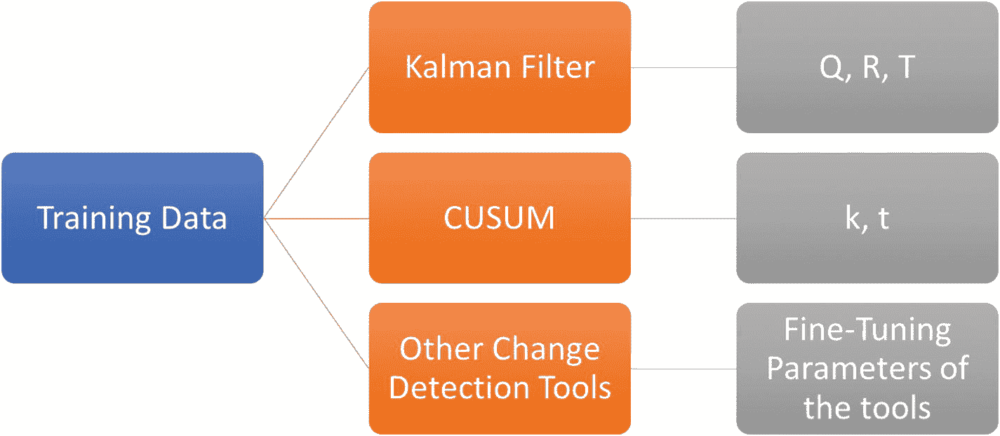  
**图 3-4** – 在训练数据上获取算法的微调参数

然后，可以使用算法的集成来克服彼此的局限性。例如，`CUSUM`在离线数据上效果最佳，但受误报影响较小。另一方面，`卡尔曼滤波器`受误报影响，但适用于实时数据。当作为集成使用时，这两种算法可以相互补充。集成方法如图 3-5 所示。输入的实时数据首先由`卡尔曼滤波器`算法处理。如果该算法表明数据完整性可能受损，则对到目前为止已接收的数据调用`CUSUM`算法。如果`CUSUM`未指示数据被篡改，处理将停止，这意味着`卡尔曼滤波器`算法产生了误报。否则，可以进一步利用其他变化检测方案来评估数据是否确实受到了不利质量的影响。

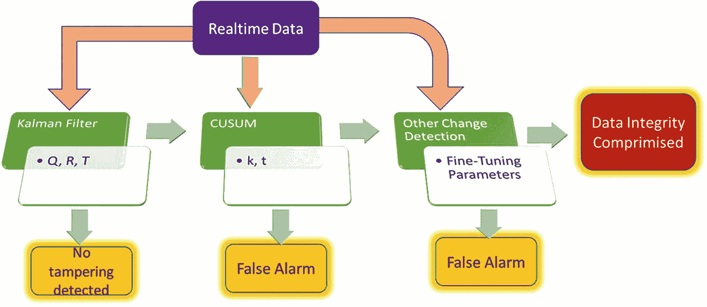  
**图 3-5** – 使用变化检测技术确定大数据真实性的集成方法

集成算法的另一种方法是实现一个简单的投票机制，即由不同算法独立处理数据，并且只有当大多数算法指示篡改时，才认为数据已受损。我们将在后面的章节中更详细地研究变化检测方案和集成方法。


### 优化技术

在上述关于变化检测技术的讨论中，我们看到微调参数是通过在训练数据上对算法进行多次试验获得的，而这些训练数据已被标注为真或假。粗暴地遍历大量可能的取值是低效的。我们需要优化寻找参数的方式。只要有改进的空间，优化技术就会发挥作用。优化的目标是尽量减少与做事方式相关的低效或“成本”。从数学上讲，成本可以抽象为多个变量的函数。许多问题当被表述为优化问题时就能得到解决。真实性验证问题也不例外。

在讨论机器学习方法时，我们已经粗略地谈到了最小化成本。我们试图最小化的成本是估算水果种类时的出错概率。我们选择权重或参数的方式是为了使这种成本或出错概率最小化。对于变化检测算法，选择次优参数是有成本的。这个成本就是因选择次优参数而导致的错误分类数量。在这种情况下，成本函数可以是由所谓的“混淆矩阵”推导出的一个表达式。

> **注意**  
> 谎言和受损的数据是有成本的——即虚假成本。优化技术有助于选择算法和方法，通过解决朝着此目标的子问题来最小化这种成本。

混淆矩阵，有时也称为“误差矩阵”，是一个简单的二维表格，其中观测值作为行，估计值作为列。查看该表格，我们可以了解我们用于判断真实性的算法有多“困惑”。如果算法表现良好，预测值（列）应与观测值（行）匹配。混淆矩阵能直观地展示算法的表现。混淆矩阵有助于可视化真正例、假正例、真负例和假负例。这些术语如图 3-6 所示。假正例也称为第一类错误，假负例称为第二类错误。

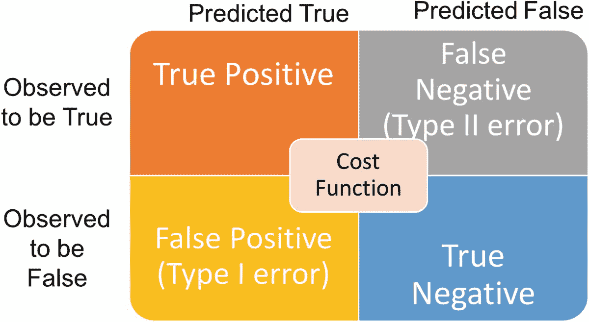

**图 3-6** 可以从各种性能指标计算出成本函数

假负例条件或第二类错误的一个例子是，当发生火灾时火警没有响。假正例则是没有火灾时火警响了。就像火警的情况一样，数据的真实性本质上是一个分类问题——数据需要被分类为真或假。错误的分类具有随领域而变化的成本。成本中一个常用的组成部分是错误率，其定义如下面的公式(5)所示：

```
ξ = (FP + FN) / (TP + TN + FP + FN)
```

(5)

```
其中：
      FP = 假正例数量；
      FN = 假负例数量；
      TP = 真正例数量；
      TN = 真负例数量
```

对于某些领域如健康领域，可以理解的是，在某些情况下假正例或第一类错误的成本比假负例高出许多倍。例如，如果诊断测试错误地显示患者的血糖水平偏高，并基于此假设给予胰岛素，这可能是致命的。另一方面，如果测试错误地显示血糖水平不高，而实际上血糖确实高，患者可能仍能忍受这种状况，直到症状恶化并进行另一次测试。在其他一些情况下，比如未能及早识别恶性肿瘤，这可能是致命的。在这种情况下，假正例的成本可能不高，因为它可能只会导致进一步的检查，而这些检查最终可能得出这是假正例的结论。或者，它可能导致不必要的手术切除良性肿瘤，这成本也不高。

另一种不同类型的例子是我们之前考虑的火警。在这种情况下，假负例比假正例更具灾难性。通常（但并非总是），维持现状比得出错误结论的成本更低。在确定成本函数时，需要考虑这些因素。简单的错误率可能并不总是合适的。反映领域特征的参数需要包含在成本函数中。从我们之前讨论的关于机器学习方法的水果商贩例子和逻辑回归模型中可以很容易地看出，成本随我们为特征选择的权重而变化。

> **注意**  
> 假正例通常具有更高的成本。

例如，如果我们对水果形状的权重高于对其表皮纹理的权重，那么橙子也有可能被归类为苹果，从而增加模型的成本。应该选择权重以最小化成本。实际上，机器学习模型会选择在应用于训练数据时使模型成本最小化的参数或权重。训练数据已经具有正确的分类或观测值，因为它已被标注，因此我们可以计算上面讨论的错误率。机器学习模型本质上用参数或权重（通常用`θ`表示）来表示成本，并试图找到使成本最小的`θ`。

在试图找到最小化成本的参数时，通常需要满足一些约束条件。一个典型的约束可能是参数或权重大于 0。即使成本函数和约束函数是“平滑的”，求解优化问题也相当困难。平滑函数在绘制时具有直观的连续含义，没有任何突变。从数学上讲，这意味着该函数在给定域内具有连续导数（斜率）。尽管求解困难，但存在有效的方法来解决优化问题。

机器学习模型是优化框架的一个特例。优化技术的应用范围远远超过机器学习模型所能解决的问题。优化实际上是一个普遍存在的问题。从原子结合成分子以优化能量，到在生活中实现和平与繁荣，优化在大多数宇宙现象中都扮演着角色。因此，在优化问题中，被最小化的并不总是成本。被优化的函数更通用的术语是“目标函数”。一旦我们有了目标函数和定义参数约束的函数，优化框架的工作就是最小化或最大化目标函数。如果目标函数是成本，我们选择参数来最小化它。

> **注意**  
> 根据领域的不同，可能需要使用超出典型机器学习模型范围的优化技术来解决真实性验证问题。


### 自然语言处理

大量大数据以英语和中文等自然语言形式存在。数据真实性问题在这种数据形式中尤为普遍，这要归功于 Web 2.0——社交媒体。讽刺的是，同样的数据也可用于验证其他领域数值数据的真实性，例如纳税申报。最近，印度中央直接税局将价值 1 亿美元的项目授予 L&T Infotech 公司，旨在根据社交媒体帖子检测逃税行为。该公司计划根据网络上可获取的个人及其家庭信息，建立“个人的系统化网络”。随后，该“系统化网络”将被用于识别表明逃税的模式。

文本数据的真实性问题比数值数据更为棘手。处理文本数据的一种方法是从中生成数值，例如通过情感分析。有趣的是，文本本身已被证明具有某些统计特性。例如，任何语言的文本都遵循齐普夫定律，该定律指出：在大型语料库（如书籍）中，单词出现的频率与其在频率表中的排名成反比。这一统计特性有一个有趣的推论：任何语言的相当大一部分都由少量词汇组成。例如，在英语中，仅“the”和“be”等 10 个单词就占据了语料库——即世界上所有英语文本的普遍集合——的 25%。因此，大型语料库中词汇的统计分布遵循所谓的幂律分布，即一个变量随另一个变量的幂次变化。

统计学和概率论可用于检测独特的语言风格，从而识别谎言，因为欺诈性语言通常遵循某些特定风格。语言模型对此很有用，它是词语序列的概率分布。给定一个词语序列`w[1]`、`w[2]`、……`w[i]`、……、`w[n]`，语言模型可以给出这些词语按顺序出现的概率`P(w[1], w[2], … w[i], …, w[n])`。有了被分类为真实或欺诈的训练文本数据的语言模型，机器学习分类技术可用于判断给定测试文本数据的语言模型是否指向虚假信息。

> **注意**  
> 文本数据展现出数值属性，并且出人意料地适合进行数值和计算处理。

一个相关的工具是`PCFG`，即概率上下文无关文法。文法是一套构建某种语言句子的规则。上下文无关文法（`CFG`）是指这些语言规则可以不考虑上下文而使用。上下文是除表达式本身之外有助于我们理解表达式的所有信息。`CFG`忽略上下文，只关注生成语言所用的规则。`PCFG`则是每条规则都关联一个概率的文法。`PCFG`在分析给定文本的句法风格方面非常高效。将概率引入`CFG`使得推导语言模型时更加灵活。`PCFG`可以使用被标记为真实或欺诈的训练文本集进行训练。对于新的文本集，可以将`PCFG`生成的解析器与训练集生成的解析器进行比较，以判断文本真实性。

> **注意**  
> 解决真实性问题的多种技术中，一个共同的主题是概率。

真实性的特征之一是正式性。人们在会见陌生人、处理重要事务或发表演讲时会穿着西装、领带等正式服装。即使在语言中，正式性也一直是可信赖的标志。就表达所施加的严谨性而言，语言正式性与逻辑或数学的正式性密切相关。有许多 NLP 工具可以衡量给定文本片段的正式性。正式性得分可作为文本真实性的一项指标。

当文本以适当格式表示时，可以进行风格和结构上的比较。其中一种表示方式是解析丛（Parse Thicket）。解析丛是一个捕获给定文本片段句法细节的图。解析是分析句子并将其句法结构捕获到数据结构（如树）中的活动，该数据结构使得句子能够被计算处理。Thicket（丛）在英语中意为茂密的树丛。因此，解析丛是文本片段中每个句子的解析树的密集集合。解析丛可以多种方式应用于解决现实世界问题，其中之一就是真实性。例如，可以通过搜索两个文本片段之间的公共子图来检测抄袭。通过将给定文本的解析丛与已知为真实的文本的解析丛进行比较，可以确定给定文本的真实性。

以上是句法工具。一种可用于确定给定文本真实性的良好语义语言学技术是文本蕴含——分析给定句子是否在语义上遵循其他句子。当一个句子从真实句子推导出来时，它更可能是真实的。类似地，从已知为假的句子蕴含出的句子可以被推定为假。有许多工具用于识别文本蕴含（`RTE`）。这里的关键仍然是对文本进行可计算处理的表示。我们将在后续章节研究一些工具和表示方法。

> **注意**  
> 知识表示是计算处理以及验证知识内在真实性的关键。


### 形式化方法

我们能否为真实信息设定一套语法？很多人最初会明确回答“不能”。但正如我们将看到的，在数理逻辑中，确定一个陈述的真实性是一个句法处理问题。因此，这个问题并非完全离谱，并且很可能是未来建立真实世界研究的关键。正如我们之前所说，数学是事物的核心。一旦用数学表达，问题便迎刃而解。形式化方法恰恰帮助我们做到这一点。它们为我们提供了将现实世界系统表示为数学实体的工具集。当被表示为数学实体时，这些系统可以在更深层次和更细微的层面上得到客观评估，其属性也能得到验证。

形式化方法以有助于推理的方式简洁地描述系统的行为。系统使用具有标准化语法和精确定义语义的语言进行规约，以支持形式化推理，即从一组其他真实陈述中推断出一个陈述。机器学习接受了不精确性和模糊性。我们在这里需要转换思路，要求像布尔逻辑这样的形式化方法要有效工作，已知为真的知识必须清晰明确地表达，不能有任何模糊或不确定性。还有一种布尔逻辑的扩展，称为模糊逻辑，它可以处理不精确性和模糊性。形式化方法可以分为形式化规约、证明、模型检验和抽象化。

与真实性问题特别相关的是形式化方法中的逻辑规约类别。逻辑是数学的一个分支，帮助我们推理系统、其规约和属性。命题演算，也称为零阶逻辑，是一个基本的规约系统，允许我们表达陈述；陈述之间的关系；并利用这些关系计算复合陈述的真值。真值可以通过真值表逐行检查。

如果一个逻辑句子有 `n` 个命题符号（可以把它们想象成英文语句），通过像 `or` 和 `and` 这样的运算符连接起来，那么要检查该句子的真实性，需要 `2^n` 行来处理这 `n` 个符号各自可以取的两个值（真和假）的所有排列组合。这在计算上是显然不可行的。实际上，这是第一个被证明是 `NP-Complete` 的问题——`NP` 代表非确定性多项式时间，我们之前也讨论过。此外，利用命题演算系统有限的表达能力，我们能够实现的目标非常有限。因此，我们考虑下一阶的逻辑，即 `First-Order-Logic`（一阶逻辑，FOL）系统。

`FOL` 比命题演算更具表达能力。它允许对变量进行量化。`FOL` 中使用的量化运算符是全称量词，写作 `∀`，以及存在量词 `∃`。这些额外的运算符使得处理所有或某些实体成为可能。在 `FOL` 中，可以通过使用‘证明’形式的推理规则来推导真值。一个证明是一个陈述序列，能够成功地论证给定陈述的真实性或其缺失。在这种证明中使用的一个规则示例称为‘假言推理’。该规则简单陈述为：如果 `p` 则 `q`，并且 `p` 为真，那么 `q` 为真。无论这听起来多么直观和基础，这个规则都非常强大，整个名为 Prolog 的语言就是基于这个基本规则。

一个可靠的逻辑系统是指：如果一个句子是可证明的，那么它也必定是真的。一个可靠的系统永远不会证明一个不真的句子。另一方面，一个完备的系统能够证明所有真的句子。如果一个句子在完备系统中是真的，那么它就是可证明的。在一个可靠且完备的 `FOL` 中，真值的推理已被证明是难以处理的，在计算上不可行。因此，在推理系统中只使用了 `FOL` 的一个小子集。例如，在 Prolog 中，推理主要就是像前面指出的那样，仅使用假言推理规则来完成。

> **注意**  
> 逻辑在很大程度上对计算机来说是难以处理的。在逻辑等较为软性的方面，人类思维远远优于机器。

系统已知为真的知识库包含了事实和规则。例如，Prolog 中一个简单事实的例子是：

```
female(Mary)
parent(Mary, Ann)
female(Coco)
parent(Coco, Mary)
```

而规则的例子是：

```
mother(X, Y) :- parent(X, Y), female(X)
grandmother(X, Y) :- mother(X, Z), parent(Z, Y)
```

现在，如果我们被问及 Coco 是否是 Ann 的祖母，写成：

```
grandmother(Coco, Ann)?
```

通过应用假言推理规则以及知识库中的上述两条规则，可以推断出该陈述确实是真。从上面可以看出，只要系统被适当地规约，推断真值就变成了一个句法处理问题。因此，在大数据真实性问题中，知识表示或规约起着关键作用。


## 模糊逻辑

如上所述，使用可靠且完备的逻辑系统进行推理，即便表征精确且无歧义，对计算机而言也是难以处理的。与系统被完整且精确地描述时相比，歧义性、不确定性和不精确性使得人类处理系统变得更加复杂。令人惊讶的是，得益于该领域的众多发明，机器处理不精确性的能力远超我们的预期。最早为处理不精确性和不确定性而发明的科学之一被称为**模糊逻辑**。它更契合人类在非理想化世界中的思考和行为方式。例如，假设第一位主讲人拉曼今天抵达的可能性为 60%，第二位主讲人威廉今天抵达的可能性为 20%，那么关于拉曼和威廉今天都抵达的可能性，我们能得出什么结论？常识告诉我们，两人都今天抵达的可能性是 20%，因为这是两者中可能性最小的百分比值。

在模糊逻辑中，上述常识推理被抽象为模糊`与`运算符。使用模糊逻辑的符号表示，上述内容可写成：

```
{\mathrm{m}}_{R\cap W}(today)=\min \left({\mathrm{m}}_R(today),{\mathrm{m}}_W(today)\right)
```

其中`{\mathrm{m}}_{R\cap W}(today)`是今天属于拉曼可能抵达的天数集合与威廉可能抵达的天数集合之交集时的隶属函数。利用类似的常识，我们可以写出：

```
{\mathrm{m}}_{R\cup W}(today)=\max \left({\mathrm{m}}_R(today),{\mathrm{m}}_W(today)\right)
```

这里，`{\mu}_{R\cup W}`是拉曼或威廉今天抵达的可能性。推理过程类似于我们在“形式化方法”部分讨论的传统逻辑，但结合了上述的隶属函数计算。使用模糊逻辑进行推理是近似的，因此被称为*近似推理*。事实上，使用传统逻辑进行推理可以看作是近似推理的一个边界情况，即所有隶属函数都等于 1 或 0 的情况。

从以上描述可以看出，在不确定条件下推断真值是一个可能性的问题。模糊逻辑只能推断出一定程度的真值。在上述会议主讲人的例子中，它只能推断出拉曼和威廉今天抵达的可能性为 20%，而传统逻辑如果能拥有进行预测所需的 100% 准确信息，则会推断出两人都抵达的可能性为 100% 或 0%。可以通过将隶属函数代入为 1 或 0，并确保其行为与传统逻辑系统等价，来确认模糊逻辑系统的正确性。传统逻辑系统只能处理隶属函数为 1 或 0 这一种完美情况，而模糊逻辑提供了处理这些情况以及介于两者之间所有情况的工具。

> 注：模糊逻辑可以被视为清晰逻辑（也称为布尔逻辑）的超集或扩展。

### 信息检索技术

寻找真相有时会涉及信息检索。当我们对一个新陈述不确定时，大脑会从过去检索信息来与之进行比较和对比。信息检索科学提供了许多计算工具，利用机器来完成大脑的相同任务。其中两个工具是向量空间模型（VSM）和协同过滤。为了发现两个文档之间的相似性，我们再次求助于数学，更具体地说，是向量代数，当然，也依赖于使用向量代数原理表示信息。

在用于文本挖掘的向量空间模型（VSM）中，每个文档被表示为多维空间中的一个向量。多维空间中的每个轴代表一个词，在信息检索的术语中也称为一个*术语*。如果语料库包含 10,000 个术语，那么我们的多维向量空间中就会有 10,000 个轴。要在这种高维向量空间中表示一个文档，我们需要该文档在每个维度上的一个值，就像笛卡尔平面上的坐标一样。这个值通常是某个术语的`TF.IDF`。`TF`代表词频，`IDF`代表逆文档频率。`TF`是术语（即词）在给定文档中出现的次数。`IDF`表示该术语的独特程度。`IDF`由以下表达式给出：

```
{\displaystyle \begin{array}{l}\kern19.75em ID{F}_t=\log \left(\frac{N}{d{f}_t}\right)\\ {} where\\ {}\kern4.75em N\kern0.5em is\kern0.5em the\kern0.5em number\kern0.5em of\kern0.5em documents\kern0.5em in\kern0.5em the\kern0.5em collection\kern0.5em and\\ {}\kern4.25em d{f}_t\kern0.5em is\kern0.5em the\kern0.5em number\kern0.5em of\kern0.5em documents\kern0.5em in\kern0.5em which\kern0.5em the\kern0.5em term,\kern0.5em t\kern0.5em appears\end{array}}
```

`TF.IDF`就是`TF`和`IDF`的乘积。当今的计算设备功能强大，即使语料库相当庞大，也能在瞬间计算出这些值。一旦针对某个给定文档获得了每个术语的`TF.IDF`，就可以将其绘制成高维空间中的一个向量。一旦被绘制成向量，寻找文档相似性的问题就简化为寻找向量之间的接近度。寻找向量接近度有多种方法，其中流行的是余弦相似度，它测量两个给定向量之间的夹角。向量空间模型（VSM）对于解决诸如抄袭之类的真实性问题以及通过将新文档与已知的真实信息源进行比较来建立信息的可信度特别有用。

> 注：即使在处理真实性问题的信息检索方法中，解决方案也在于使用数学结构表示数据并高效地处理它们。

推荐系统中一种广泛使用的技术是协同过滤（CF）。我们在日常生活中以多种方式使用这种技术：从图书馆的“近期归还”书架上选书，而不是进去搜索；收听其他人喜欢的 Top 10 歌曲；在树林中沿着有人走过的小径徒步；在我们自己的论文中引用高质量的研究论文，等等。所有这些例子中的共同点是，我们依赖他人的品味、工作或研究来从事与他们相似的活动。协同过滤（CF）是一种依赖他人判断来过滤信息并做出自己选择的行为，从而间接地与他们协作。CF 的经典应用传统上是根据一组其他用户对某个产品的评价，预测一个用户是否会喜欢一个她从未评价过的物品。

显而易见，CF 如何有助于解决真实性问题。举个简单的例子，一个供应商的可信度可以通过将其价格与其他供应商的价格进行比较来确定。CF 可以有效地用于信任传播。正如我们根据他人的判断形成意见并塑造我们的工作一样，可信度也可以基于他人的意见来确定。必须注意，CF 与投票机制截然不同。正如我们将在后续章节中看到的，CF 使用了相似度度量，例如我们上面讨论的余弦相似度。


### 区块链

近年来出现的一种全新信任范式是区块链技术，它是革命性加密货币的基础。鉴于对加密货币的投资以及它在全球赢得的信任，区块链显然是一项有望在很大程度上解决真实性问题的前景技术。Facebook 最近宣布将利用区块链技术打击假新闻。还有其他一些公司正在利用区块链解决这一问题。这项技术本身能够成为无需任何中介或政府干预的重要货币的基础，这恰恰证明了其在解决真实性问题上的可信度与潜力。

区块链本质上就是一条由区块组成的链条——类似于链表数据结构，但具有一些特殊特性。在区块链技术中，通过使用加密哈希函数确保历史记录的不可篡改性。所使用的哈希链有一个有趣的特性：若不改变链中的每一个其他元素，就无法更改其中任何一个元素。区块链作为所有参与者共享的分布式账本。交易中出现的任何分歧都通过共识机制来解决。在某种程度上，区块链技术具备维基百科的一些要素，这使其值得信赖。然而，它们有着根本性的不同：维基百科的数据库是中心化的，而区块链基于点对点（`P2P`）网络。

**注：** 区块链技术带来了一种构建系统和流程的机制，这些系统和流程可以完全值得信赖，达到完美的程度。

## 总结

真实性在许多领域都是一个难题，可以通过多种方式加以解决。在本章中，我们介绍了可用于解决该问题的一些方法。本章的内容必然会激发读者的好奇心，同时也留下了一些未解答的问题。在后续章节中，我们将更详细地探讨每种方法，并回答本章可能引发的疑问。下一章将从变更检测技术开始。

### 练习题

1. 在本章中，我们提到了印度政府授予了一份价值 1 亿美元的合同，用于从社交媒体数据中检测逃税迹象。请搜索更多类似示例，说明大数据如何帮助解决真实性问题。
2. 还有其他更多用于验证信息完整性的方法，已在其他应用中使用。分布式计算领域的一个例子是拜占庭将军模型。请描述如何将其用于大数据真实性问题的背景中。
3. 研究将区块链技术用于不同类型大数据的可行性。

