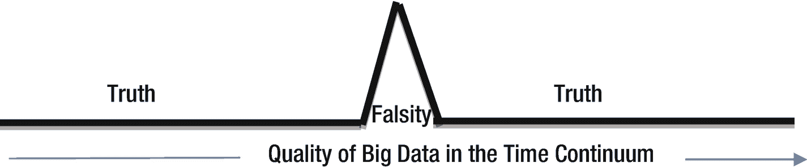

# 变更检测技术

序贯概率比检验 (SPRT) | CUSUM 技术 | 卡尔曼滤波器 | 总结

大数据的虚假性和不准确性表现为不同形式。在本章中，我们将探讨其中一种表现形式，并考虑识别它的方法。这种表现在网络上发布的信息中尤为常见。通过网络上发布的信息以某种方式影响在线好友和关注者的情况并不少见。当这种影响带有隐藏目的、基于谎言、意图恶毒并波及大量人群时，就成为了一个问题。本章介绍的技术正是针对这种虚假性表现。这些技术也可应用于其他场景，例如物联网中传感器数据质量在短时间内下降的情况。

唯有真理长存。其余一切终将湮没。谎言无法长久。真理是纯粹的。它是人类沟通、共存乃至文明本身的基础。真理可被视为现状、常态。那么，虚假则可被视为一种变化、一种杂质、一种对预期的偏离。借用电气工程的类比，真理是信号，谎言是噪声。因此，可以通过使用变化和噪声检测技术，从真理中辨别出谎言。举个简单的例子：考虑一个分析学校作文的软件程序。如果所有作文都把大象描述为一种四足动物，而有一篇作文把大象描述成鸟，那么后者可以被判定为虚假。如果该程序将不同作文中对大象的描述制成表格，那篇把大象描述成鸟的作文中的虚假说法就会凸显出来，表现为一种变化或噪声。

变更检测是许多工程、生物和金融流程中常用的常规方法。这些技术本质上主要是统计性的。我们将在从量化过程获得的数据点时间序列上使用这些技术，正如第三章“建立大数据真实性的方法”中所述。在微博客的情况下，时间序列包括从情感分析中获得的分数。通过部署黑客手段来影响和操纵公众舆论的微博客，其情感分数必然异常，因此可以使用本章描述的一些技术来检测它们。

**注：** 谎言是对常态的偏离。真理经得起时间的考验。没有谎言能瞒过时间。不真实就像一次尖峰、一阵炒作，无法持久。

事实证明，微博客对公众舆论有重大影响。我们从美国大选中就看到了它们的影响力，最早可追溯到 2008 年巴拉克·奥巴马首次参选之时。在像 Twitter 这样的微博客网站上发布虚假、破坏性的信息，无异于在电影院大喊“着火 了”。安德烈斯·塞普尔韦达意识到了微博客在总统选举等重要社会进程中的作用。“当我意识到人们更相信互联网上说的话而非现实时，我发现自己拥有了让人们相信几乎任何事情的能力，”他说。

**图 4-1** 大数据时间序列中不真实性的图形化描述

近十年来，正如他所坚信的那样，人们一直相信他在某微博网站上实施的内容注入攻击。这种注入式影响左右了南美国家总统选举的结果长达十年之久，而其始作俑者安德烈斯·塞普尔维达（Andrés Sepúlveda）目前正因该罪行服刑十年。这个故事再次有力地证明了大数据真实性的重要性。如果微博网站当时设有检测此类注入式影响攻击的机制，那么安德烈斯·塞普尔维达所左右的总统选举结果或许会截然不同。正如本章将要探讨的，实施这些检测机制并非难事。

> **注**  
> 微博网站上的注入式影响攻击可定义为：发布蓄意的、恶意的微博内容的行为（通常（但并非总是）借助自动化手段和黑客技术），以影响其他用户的观点。

图 4-1 是对大数据中虚假性的一种解读。图中的线条并非刻意画得笔直，因为数据质量确实会随时间波动。但与存在大量不实信息时相比，这些波动是微乎其微的。为了检测诸如图中所示的不准确、不确定数据点的时间序列变化，我们需要一种方法来捕捉截至任何给定时间点所有数据点的代表性状态。这是能完整且递归地总结给定系统所有先前状态的最小构件。这种代表性状态应能累积截至某个时间点的状态相关方面。监控这种代表性状态将有助于检测可疑的变化。

打个比方，就像一个人陷入抑郁。负面情绪、失败经历以及各种其他影响个人心理的因素会随时间累积，最终导致抑郁。当一个通常快乐积极的人变得悲伤时，我们能够察觉到这种变化并试图加以预防。快乐是常态或“信号”，而悲伤则是可被检测到的变化或“噪音”。这个人的精神状态代表了时间线上所有发生过的事情。如果我们监控精神状态，就有可能检测到心理抑郁的进展。当心理状态悲伤和抑郁超过某个临界点，就意味着发生了不良变化，需要采取纠正措施。

> **注**  
> 要使变化检测生效，我们需要一种方法来为大数据值的时间序列建立代表性状态模型。

本章描述的技术，正是将上述类比中的过程应用于数据。这些技术是统计性的，因此只能处理数字。因此，如果数据（如微博内容）是非数值型的，量化就至关重要。即使数据是数值型的，确保数据值本身的准确性也很重要。因此，我们在第一章中介绍的价值评估也扮演着重要角色。本章介绍的变化检测技术也对底层数据的某些统计特性做出了假设。

一个常见的假设是“高斯假设”，即数据符合正态概率分布。高斯分布的均值、众数和中位数都相等。这个假设并不苛刻，因为大多数自然科学和社会科学的数据通常都会收敛于正态分布，尤其是当数据样本量足够大时（正如大数据所呈现的那样）。感兴趣的读者可以参考中心极限定理了解更多细节。经典统计学在不少价值评估方案中也扮演着重要角色。因此，大数据理论需要相当扎实的理论概率论和统计学基础。

本章所介绍技术的一个优势是，它们相关性较弱，并且对底层数据的概率分布不太敏感。我们无需严格确保数据是正态分布才能应用这些技术。此外，研究表明，诸如来自微博的大数据具有某些统计特性，通过对微博进行情感分析可以实现意见挖掘。例如，美国语言学家乔治·金斯利·齐夫（George Kingsley Zipf，1902–1950）的一个惊人发现是，在任何一个大型语料库中，英语单词（或任何自然语言的单词）的出现频率与该词在频率降序排列中的排名成反比。

举个例子，在当代美国英语语料库（COCA）中，单词“the”是最常用的词，其次是单词“be”。根据齐夫的发现，“the”在 COCA 中出现的频率应该是“be”的两倍左右，而令人惊讶的是，事实确实如此。当语料库遵循齐夫定律时，我们称其近似于齐夫概率分布，这是一种幂律分布。幂律分布的特点是图形具有长尾特征，只有少数值主导着分布。正是基于这一特性，在布朗美国英语文本语料库中发现，仅 135 个单词就占据了语料库的一半，而许多单词只被使用了几次，这使得分布对于那些使用较少的众多单词呈现出一条长尾。研究已证明，微博数据符合齐夫定律，展现出齐夫分布的统计特征。在这些发现的保证下，我们现在可以继续检视一些用于变化检测的技术。

> **注**  
> 令人惊讶的是，我们周围看似混乱的数据中存在着秩序，尤其是当数据像大数据那样庞大时。

既然我们已经确信大数据具有某些统计特性，接下来就要探讨监控数据以识别虚假性的方法。一种粗暴、粗略且简单的变化检测方法是监控数值是否存在任何异常模式，并根据观察结果得出数据被篡改的结论。但这样做，我们忽略了问题中涉及的不确定性成分。如果这些异常模式实际上是真实的，而非任何篡改的结果，该怎么办呢？例如，一个人变得易怒和极度悲伤，并不一定意味着他正在陷入抑郁。偶尔的情绪波动并不罕见。因此，仅仅监控时间序列值（或本例中的情绪状态）是不够的。我们需要监控截至当时整个时间序列的代表性状态。因此，我们需要稳健的算法。

我们无法确定某个特定的变化是否真的意味着虚假。我们需要引入概率来处理这种不确定性。正如我们将在以下章节中看到的，使用统计学和概率论来监控数据流，也能使变化检测更快。算法对变化会更加敏感。事实上，与需要观察一段时间异常模式才能得出相同结论相比，通过使用概率，我们或许能够在篡改或虚假行为刚开始时就检测到不良变化。我们将首先从一项自 1945 年发明以来就非常流行的检验开始。

