# 5. 机器学习算法

在上一章中，我们学习了如何在更精细的数据粒度层面运用技术，处理单个数据值。在本章中，我们将从更宏观的层面批量处理数据，以提取特征、模式及其相对权重。有趣的是，机器学习是一把双刃剑，它既能用于创建虚假内容，也能用于检测虚假内容。谷歌的“DeepDream”项目便是一个很好的例子。该项目最初旨在构建图像识别软件，但如今，该软件更多因能生成宛如机器幻觉般的虚构图像而闻名。在本章中，我们将重点介绍有助于检测欺诈和虚假信息的机器学习算法。

机器学习的灵感源于人类学习的概念。例如，一个孩子是如何学会识别猫的呢？她的父母或其他长辈会向她展示大量狗、猫和其他宠物的样本，并反复向孩子指出每种宠物。换句话说，父母为孩子提供了大量带有标签的数据用于训练，这些数据也被称为训练数据。孩子开始识别这些宠物的诸多特征——脸型、皮肤纹理、躯干长度、耳朵大小、眼睛颜色等。孩子识别的特征越多，看到的带标签样本越多，她识别猫的本领就学得越好。

这种确定特征、特征相对重要性并据此得出结论的学习过程，并不仅限于识别猫和狗。几乎任何事情，包括区分真话与谎言，都是通过类似方法从经验中习得的。长辈们常有“逗弄”孩子的习惯。很快，随着经验积累，孩子们就能学会辨别长辈何时在“开玩笑”，何时在说真话。尽管问题在于判断真伪，但确定性的方法并不适用于此目的。“真相”并没有被确定性地定义出来，从而向孩子提供一套规则来描述猫，或判断长辈是否在开玩笑。用软件术语来说，这个过程是难以处理的，或者说属于 NP 难问题。相反，孩子是通过大量样本来进行经验性学习的。让我们更详细地审视这一过程。

> `注意`
>
> 精确定义什么是“真相”是棘手的。真相如同信仰，最好通过经验来领悟，而非通过确定性定义来理解。

当孩子看到一只新的四足动物，而附近又没有长辈可以指认时，她关于宠物的学习成果就要接受新数据的检验。这将以多种方式之一启动其思维过程。其中一种方法是频率学派（Frequentist）方法——孩子看到圆脸、绿眼睛、小耳朵、短躯干等的猫的频率越高，她就越可能得出结论：这只新的圆脸、绿眼睛、小耳朵、短躯干的动物也是一只猫。这种方法被形式化为朴素贝叶斯方法，这是频率学派方法的一个例子。

我们也可以构建一棵决策树——这只动物是圆脸吗？如果是，眼睛是绿色的吗？耳朵小吗？等等。我们提出这些问题的“智能”程度越高，得出结论的速度就越快。在这种情况下，“智能”的目标是选择那些能使两个类别之间分离度最大的问题。例如，如果我们在检查脸型之前，先询问关于躯干长度的问题，那么我们构建的决策树必定是次优的，因为有些狗的躯干可能和猫一样短。因此，关于躯干长度的问题对类别的区分能力不如脸型问题。后者的问题应优先于前者。

> `注意`
>
> 像机器学习算法这样的经验方法倾向于融入智能，以快速得出最佳答案，而非通过蛮力穷尽所有可能性。

一种常用的探寻真相的方法是“剥洋葱法”——逐层深入。我们从手头已有的信息输入开始，逐层进行质询。问题越复杂，需要提问的层次就越多。所有这些问题答案都需要联系起来，才能得出结论。在大脑中，这种通过神经元层收集并连接答案的过程，可以在机器上使用神经网络进行模拟。神经网络接收输入，通过一系列层级，计算出分类结果为真或假。

本章中我们考虑的所有学习过程或算法的最终目标，都是划分或分类解空间。划分得越好、越清晰，算法就越有效。虽然拥有带标签的样本供学习是好事，但时常也会遇到没有此类数据的情况。在这种情况下，学习过程是在无监督下进行的——没有长辈通过展示样本并为其打标签来监督学习过程。例如，孩子从装有许多不同玩具的玩具箱里挑出所有芭比娃娃，就是一个例子。她学会了将最喜欢的芭比娃娃聚类在一起，而无需任何人告诉她该怎么做。

> `注意`
>
> 学习可以在有监督或无监督的方式下进行。就真实性判断而言，这两种方式的最终目标都是将问题空间划分为两类——真实的和不真实的。

聚类同样基于特征。面对并非完全真实的数据和信息，无监督学习方法会根据数据或信息的特征，将其分组到真实和虚假两个类别中。在本章中，我们将研究有监督学习方法（如神经网络）和无监督学习方法（如`k-means`），以解决数据真实性判断问题。但首先，让我们考虑一个合适的例子来说明这些概念。

## 微博客示例

诸如 Twitter 之类的微博客网站已发展成为能够产生重大影响的强大媒体。在第二章中，我们看到了 Twitter 如何被用来抬高股价然后抛售以获取非法利润，并且其上发布的谎言导致公司市值损失高达 28%。在第四章中，我们看到了安德烈斯·塞普尔维达如何利用 Twitter 甚至改变了总统选举的结果。还有许多类似的例子，其中微博客网站上的欺诈行为造成了重大损害。因此，我们以 Twitter 为例，来说明如何使用机器学习来检测虚假推文。

问题如图 5-1 所示。给定大量推文，我们需要提出一个分类器，它表现为一条曲线，将图中星号所示的真实推文与圆圈所示的虚假推文分隔开。可以看出，我们仍然使用数学来表达问题，使其易于处理。该图是一个笛卡尔平面，推文被表示为点。乍一看，该图提出了三个问题：

1.  我们如何将推文绘制在图中所示的空间中？

2.  在这样的空间中，坐标轴应该代表什么？

3.  我们如何提出分类器？

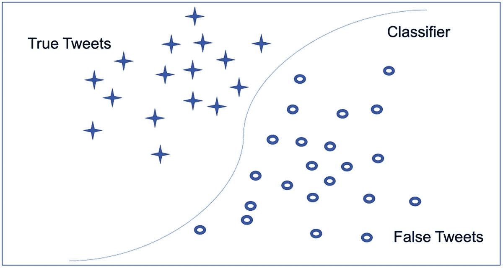

**图 5-1** 示例问题说明：区分真实推文与虚假推文

在第三章和第四章中，我们学习了量化、特征提取以及使用数学抽象的概念。在回答上述问题时，这些概念会派上用场。

微博，例如推文，具有特征。其中一些特征可能如下：

*   转发、回复、点赞的数量

*   推文中话题标签的数量

*   使用的话题标签被列为（全球）热门趋势

*   是否存在 URL 及其页面排名，以及诸如 NIMH、WHO、NCI 等可信实体

*   是否存在对其他用户的引用

*   推文语气的正式程度（不使用‘d’、‘n’等缩写）

*   使用肯定、确定、绝对的词语，而非“可能”

*   多媒体内容（照片、视频、音频）

*   是否存在数字、引号

*   该推文是否被置顶

这些特征表明了推文的真实性。例如，如果一条推文有很多点赞和回复，那么它更可能是真实的。一条引用了其他用户的推文不太可能撒谎，因为被引用用户的声誉也会受到影响。同样，有图片和音频佐证的推文更有可能是真实的。每个这样的特征都可以在坐标轴上表示，并且每个推文对应的特征值可以绘制出来，从而为我们提供一个包含所有推文的多维空间。对于熟悉向量代数的人来说，可以将这个多维空间想象成一个向量空间，而点就是向量。图 5-1 是这个多维空间的二维投影，而分类器实际上是该多维空间中的一个超曲面。由于当空间维度超过三维时很难可视化超曲面，因此像图 5-1 所示的正交投影非常有帮助。

超曲面将多维空间一分为二。在一个 n 维空间中，超曲面具有 (n-1) 维。例如，在图 5-1 所示的二维空间中，超曲面是一个一维表面，即一条线（可以是曲线或直线）。如果空间是三维的，那么超曲面就是一个二维平面或曲面。超曲面的方程是线性的。对于二维情况，我们知道一条直线的方程形式为

```
y = mx + c
```

更一般地表达，我们可以将方程写为

```
θ₀ + θ₁x₁ + θ₂x₂ = 0
```

其中 y 是 x₂，x 是 x₁，m 是 -θ₁/θ₂ 而 c 是 -θ₀/θ₂。

将上述方程扩展到 n 维空间，超曲面的方程可以写为

```
θ₀ + θ₁x₁ + θ₂x₂ + ... + θₙxₙ = 0
或简写为, Σθᵢxᵢ = 0
```

(5.0)

我们稍后将不断地遇到不同形式的(5.0)。上述方程将多维空间分割成两个空间，如下面方程所示。

## 超平面分类原理


给定一条新推文的特征 `X = {x1, ..., xi, ..., xn}`，并且从训练集计算出参数 `Θ = {θ0, θ1, θ2, ..., θi, ..., θn}`（具体方法我们稍后会看到），基于上述不等式，我们可以轻松确定一个新的数据点将落在哪一侧。我们从训练数据集中确定权重或参数，并将它们用于测试数据集，以对新的数据点进行分类，就像孩子识别猫一样。当然，算法应确保学习不会过度依赖训练数据集——这种情况称为过拟合。我们不希望孩子只认识与她之前见过的某些非常相似的猫的子集。我们希望她学会从总体上识别猫。

> **注意** 机器学习算法可以看作是将数据视为多维空间中的一组点，每个维度代表数据的一个特征。

## 用于判断推文真实性的用户特征

下面列出了与用户相关的其他一些有助于确定推文真实性的特征。

*   粉丝数、用户被列入的列表数、一段时间内的推文数量、个人资料和推文中的照片和视频
*   社会地位：用户是名人吗？
*   用户名中是否存在“dr”、“prof”、“governor”、“mayor”等头衔，以及是否为认证账户
*   用户个人资料的可信特征：真实姓名、照片、职业、教育背景、所属机构、注册日期、电子邮件地址中的域名（如`stanford.edu`）等
*   其个人资料中 URL 的 PageRank
*   用户被列入的列表类别数量
*   被转发、收藏、回复的帖子数量
*   其他用户推文中对该用户的引用次数（推文中的`@用户`）
*   该用户推文中`@用户`引用的数量；这些用户的质量
*   一段时间内其帖子中 URL 的数量（知识传播者）
*   以其粉丝的粉丝等加权的粉丝数量——一种 PageRank

> **注意** 用户的可信度越高，其推文越有可能是真实的。

# 这些特征的含义不言自明，很容易就能看出它们代表了推文的真实性。借助这些特征，我们现在有了一个多维空间，推文在其中被绘制成点。本章大部分内容致力于推导出分类器，即那条（实际上是超平面）将真实推文与虚假推文分隔开的界线。但在此之前，让我们先简要了解一下机器学习算法的一个重要方面——收集训练数据集。

## 收集真实数据

孩子看到的样本越多，他就能越了解真相。因此，用于训练的标注数据集越多，我们就越能学习如何判断真相。训练集在学习过程中充当了真实数据的角色。如果是 Twitter 数据集，训练集的大小通常包含数千条推文。Twitter 等微博网站提供了流式 API，通过它帖子、事件和其他数据会被自动推送，从而避免了客户端昂贵的轮询操作。人们也可以使用 REST API 从这些网站收集静态数据。一些论文的作者也会提供一些静态数据集，他们可能在自己的已发表项目中使用过这些数据。

收集完训练数据集后，下一步是对数据进行分类或标注。如果不进行标注，除非我们使用无监督或半监督学习算法，否则数据集将无法用于训练。标注数据需要有人逐一检查每个样本，并在仔细检查后应用标签。这通常通过众包完成——即利用互联网让大量人员完成任务的过程。假设有 30 万个样本，我们或许可以众包给 3000 人，每人处理 100 个样本。其金钱成本取决于任务本身以及接受任务的人员。

在我们的微博示例中，如果我们只考虑与健康相关的推文（这些推文若不完全真实，会造成严重的负面影响），这个过程可能会昂贵得令人望而却步。将健康相关推文标注为真实或虚假需要大量的医学专业知识，而我们知道这类专业知识既稀缺又昂贵。即使假设美国的护士等医疗专业人员每小时薪酬约为 `$50`，并且每小时能标注 30 条推文，那么 30 万个样本将需要 1 万小时，以及高达 50 万美元的惊人费用！

**注意**

收集训练数据可能是一项成本极其高昂的工作。

上面的例子清楚地表明，迫切需要自动化真实数据的收集过程。一种方法是收集我们确信为真实的推文，以及另一组我们确信为虚假的推文。对于后者而言，举例来说，许多人会基于某些已确立的谣言发推。一个这样的谣言是“微波炉加热会杀死营养成分”。令人惊讶的是，大量实时推文都基于这个已被证实为假的谣言。我们可以找到诸如“我打赌你们都不知道，用微波炉加热食物会减少营养”、“烤箱和炉子效果也一样。炉子的热量和烤箱的干热也会杀死营养，但不如微波炉严重”或者“快节奏的生活压力和‘方便’食品。用微波炉烹饪会杀死所有营养”之类的推文，它们还获得了点赞、转发和回复。

**注意**

谣言和被误解的真相仍然是公共话语中虚假信息的主要来源。

可以通过搜索这类基于谣言的帖子来收集虚假推文。只需搜索流行谣言中的短语，例如“微波炉营养”，即可完成此操作。这为我们提供了数据集的一个类别。对于真实推文，我们同样搜索那些已知肯定为真实的模式。例如，引用知名医学期刊并带有引号的推文通常是真实的。同样，辟谣的推文也已知肯定是真实的。作者在 Twitter 上找到的此类推文包括：“经常用微波炉加热蔬菜？这样做，你可能在保留重要营养”和“关于土豆的冷知识：保留烤土豆营养的最佳方法是用微波炉加热。有真正的科学依据 [#EatWellForLess](https://twitter.com/hashtag/EatWellForLess?src=hash)。”收集完所有此类自动标注的推文后，我们可能需要人工检查其中一部分，以剔除任何误报。

因此，通过一些创造性思考，我们可以在相当多的情况下实现真实数据收集的自动化。必须指出的是，推文仅作为讨论算法的示例。这些技术同样适用于其他形式的数据——只是特征不同，且取决于数据领域。现在我们有了训练集，就可以进入下一步——寻找分类器。有许多机器学习算法及其变体可以完成这项任务。我们只讨论其中的一部分，以了解其基本内容。

**注意**

创造性思考是自动化的核心，包括真实数据的收集。

## 逻辑回归

我们在第 3 章曾简要提及逻辑回归，现在让我们从该算法入手，深入探讨更多细节。在我们的推特示例中，推文具有许多特征，这些特征可以作为自变量在多维空间的坐标轴上表示。我们将这个特征向量称为 `X`。

```
X = (x_0, x_1, x_2, ..., x_n)
```

(5.1)

我们知道，并非所有这些特征都同等重要。例如，我们发现基于谣言的推文也能获得点赞、回复和转发。在判断推文真实性时，点赞数、回复数和转发数显然重要性不高 —— 与推文是否被置顶等特征相比，其权重更低。用户通常不会置顶一条已知为假的推文。显然，需要对这些特征进行加权，以得出推文真实性的评分。我们按如下方式计算评分 `s`：

```
s = Σ_{i=0}^n w_i x_i
```

(5.2)

其中 `w_i` 是分配给第 `i` 个特征 `x_i` 的权重。

可以看出，(5.2) 与 (5.0) 相似。实际上，两者完全相同，权重正是需要估计的参数。

但我们真正需要的是推文为真的估计概率，而上述评分 `s` 并不保证介于 0 和 1 之间，而概率值必须在此区间。我们使用一种称为逻辑函数的特殊函数，将此评分转换为概率。我们将为解决方案采用的参数统计模型称为“逻辑回归”。逻辑函数的定义如下：

```
logistic(z) = e^z / (1 + e^z)
```

(5.3)

该函数如图 5-2 所示。可以看出，其值范围从 0 到 1。更具体地说，从图 5-2 中可以看出：

```
logistic(-∞) = 0
logistic(0) = 0.5
logistic(∞) = 1
logistic(-z) = 1 - logistic(z)
```

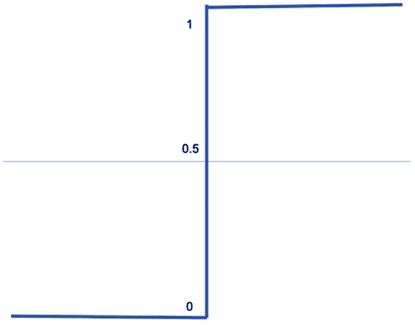

图 5-3 – 阶跃函数

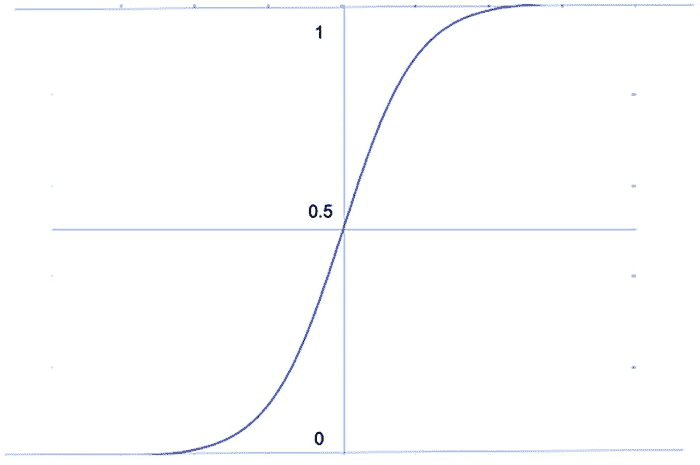

图 5-2 – 逻辑函数图像

从图 5-2 中还可以观察到，逻辑函数的图像呈字母 S 形。图像呈 S 形的函数类别通常称为 S 形函数。

图 5-3 展示了一个阶跃函数。逻辑函数图像在形状上与阶跃函数非常相似，但具有几个显著且有用的特征：它平滑、连续且单调。许多现实世界中的现象都符合此模型，其值连续变化，而非像阶跃函数那样离散变化。逻辑函数还与优势比有关。如我们所知，“优势”一词指的是事件发生的可能性。如果 `p` 是事件发生的概率，则优势由 `p / (1 - p)` 给出。逻辑函数的反函数，称为 Logit 函数，本质上就是这些优势的对数。

**注：** 逻辑函数与概率密切相关，在概率论、统计学和机器学习中应用极为广泛。

```
logit(p) = log(p / (1 - p))
```

(5.4)

```
logit^{-1}(p) = logistic(p) = e^p / (1 + e^p)
```

(5.5)

可以看出，逻辑函数在多个方面都非常适合我们的目的。因此，我们使用此函数，通过取评分的逻辑函数值，将真实性评分表示为概率，如下所示：

```
P(推文 = 真 | X) = e^{Σ_{i=0}^n w_i x_i} / (1 + e^{Σ_{i=0}^n w_i x_i})
```

(5.6)

其中 `X` 是特征 `x_i` 的集合。

我们刚刚将评分表达式 (5.2) 代入逻辑函数 (5.3) 中的 `z` 位置。现在，机器学习问题简化为：根据训练数据中推文的特征 `x[i]` 及其各自的概率（1 或 0），找到权重 `w[i]`。一旦我们从训练数据中获知权重，就可以使用相同的权重，通过 (5.6) 为任何新推文确定 `P(推文 = 真 | X)`。此操作如图 5-4 所示。

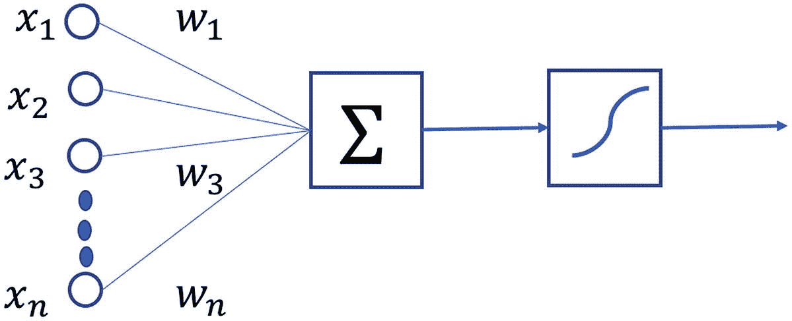

图 5-4 – 公式 (5.6) 的图解，展示了特征、权重、乘积之和，最后代入 S 形函数的过程

一个值得注意的观察点是对 (5.6) 进行如下重排得到 (5.7)，这重申了逻辑函数的反函数是对数优势比这一事实。

```
由 (5.6) 得：
P(推文 = 真 | X) * (1 + e^{Σ_{i=0}^n w_i x_i}) = e^{Σ_{i=0}^n w_i x_i}
因此：
P(推文 = 真 | X) = e^{Σ_{i=0}^n w_i x_i} (1 - P(推文 = 真 | X))
并且：
P(推文 = 真 | X) / (1 - P(推文 = 真 | X)) = e^{Σ_{i=0}^n w_i x_i}
```

(5.7)

我们很容易认出 (5.7) 的左边就是优势比。

寻找权重的问题，也称为参数估计，可以通过使用所谓的极大似然估计（MLE）来解决，其目标是最大化关于权重的似然函数。MLE 是统计学中用于估计参数的基本概念。从数学上讲，我们找到权重 `w[i]`，使得以下表达式给出的所有概率的乘积最大。

```
Π P(推文的真实性，给定其特征及其相应权重) = Π P(Y | X, W)
```

更明确地说，`Π` 表示对后续 `P` 项进行连乘，`P` 表示推文真实性的概率；`Y` 表示推文的标记值（真或假）；“|” 表示“给定”；`X` 是该推文的特征集合；`W` 是需要确定的权重集合。

出于最大化目的，即使我们对上述表达式取对数（称为对数似然），结果也更容易且等效。通过最大化对数似然，我们得到相同的结果。能够最大化 (5.7) 中表达式对数的相同权重，也同样能最大化函数本身。取对数（`log`）很有用，因为对数函数将上述乘积转换为求和，注意到：

```
log(ab) = log(a) + log(b)
```

由于 `Y` 只能取两个值（1 或 0），这进一步简化了最大化问题的求解。可以使用优化技术来确定使 (5.7) 最大化的权重。利用从训练数据中获得的权重，对于一条新推文，我们可以计算：

```
P(推文 = 真 | 其特征集合 X)
```

机器学习的复杂问题通常被简化为寻找所选模型（在此为逻辑回归）的权重或参数这一看似简单的问题。

## 朴素贝叶斯分类器

到目前为止，在我们对真实性问题的讨论中，概率一直扮演着关键角色。概率研究的核心是贝叶斯定理。本节将探讨如何直接应用贝叶斯定理来解决真实性问题。

在逻辑回归中，我们假设逻辑函数有助于区分真实推文和虚假推文。我们直接估计推文真实性得分（这也被称为条件概率的指示），作为特征在公式 (5.2) 中的线性函数。我们没有学习什么构成真实推文，什么构成虚假推文。我们只关心如何区分两者。这被称为机器学习的判别式方法。如果我们只需要区分两个类别，这是一种更实用的方法。例如，如果必须区分两种口语（比如英语和中文），更实际的做法是根据单词的发音来区分，而不是学习每种语言。然而，在某些情况下，我们确实会学习语言以确定给定句子属于哪种语言。这被称为生成式方法。朴素贝叶斯技术属于生成式算法这一类。

一方面，生成式方法之所以得名，是因为我们能够自己生成数据点。例如，如果我们学习中文和英文来区分二者，我们也能生成自己的句子——而不仅仅是区分二者。另一方面，判别式方法只能区分两个类别，但无法生成新的数据点。用概率术语来说，生成式模型从训练数据中学习先验概率和条件概率分布，而在像逻辑回归这样的判别式模型中，我们并不尝试计算这些概率。在概率世界中，“学习”一个类别（如英语）本质上就是计算与该类别相关的概率分布函数。

> **注意**：机器学习算法可以分为判别式或生成式，后者具有生成数据点的能力。

学习语言的例子仅用于说明生成式与判别式方法之间的区别，不应从字面上理解。事实上，生成式方法的结果通常不如判别式方法准确，而在学习语言的例子中，直觉上生成式方法应该产生更好的结果，因为语言是经过学习的。因此，这个类比仅用于说明，并非精确对应。

在我们的推文真实性问题中，对于特征集 `X`，涉及以下几个概率：

- `p(X|Y)`：给定推文为真（或假）时，该推文具有特征 `X` 的概率。
- `p(X,Y)`：给定特征的推文为真（或假）的联合概率。
- `p(Y) = Σ_X p(X,Y)`：数据集中出现真实（或虚假）推文的概率。
- `p(Y|X)`：具有特征 `X` 的推文为真（或假）的条件概率。
- `p(X)`：具有特征 `X` 的推文出现的概率。

真实性问题旨在计算 `p(Y|X)`。一条真实（或虚假）推文具有特征 `X` 的概率是 `p(X|Y)`。在频率主义方法中，`p(Y)` 告诉我们真实（或虚假）推文在给定数据集中出现的频率。`p(X)` 实际上无关紧要，因为无论对真实推文还是虚假推文，它的值相同，但如下文所述，它仍然用于计算我们的目标 `p(Y|X)`。

熟悉概率的读者会记得 18 世纪英国统计学家托马斯·贝叶斯给出的基本定理，如下方公式 (5.8) 所示。

贝叶斯定理：`p(X,Y) = p(X|Y) * p(Y) = p(Y|X) * p(X)`

(5.8)

我们可以利用上述贝叶斯定理 (5.8) 来实现我们的目标：根据特征找出推文为真的概率，如下方公式 (5.9) 所示。

`p(Y|X) = p(X|Y) * p(Y) / p(X)`

(5.9)

大多数算法都基于某些假设。朴素贝叶斯分类器的一个基本假设是，所有特征相互独立。这意味着，例如，拥有更多的转推次数与拥有更多的点赞次数无关。在现实世界中，这不一定完全成立，但在大多数情况下是一个合理的近似。独立性假设导出了下方公式 (5.10)。

`p(X|Y) = p(x₁|Y) * p(x₂|Y) * p(x₃|Y) * ... * p(xₙ|Y)`

(5.10)

示例：`p`(推文包含多媒体内容，被置顶，引用其他用户 | 推文被标记为真)
= `p`(推文包含多媒体内容 | 推文被标记为真) *
`p`(推文被置顶 | 推文被标记为真) *
`p`(推文引用其他用户 | 推文被标记为真)

类似地：

`p(X) = p(x₁) * p(x₂) * ... * p(xₙ)`

(5.11)

> **注意**：过去的事件频率（计为出现次数）可以转换为概率，而概率有助于预测未来。

公式 (5.10) 右侧的概率可以通过统计训练数据中各自事件的出现频率来计算。例如，训练数据可以告诉我们，有多少条被标记为真的推文是被置顶的。那么，条件概率就是这些事件的数量与数据集中真实推文总数的比值。因此，我们可以使用公式 (5.10) 计算出 `p(X|Y)`。类似地，`p(X)` 可以使用公式 (5.11) 计算。`p(x[i])` 就是具有特定特征的推文数量除以推文总数的比值。我们将每个特征对应的这些概率相乘，即可得到 `p(X)`。

### 朴素贝叶斯

在计算公式 (5.9) 左侧目标之前，右侧唯一需要计算的项是 `p(Y)`。这本质上是在给定数据集中，随机找到一条真实（或虚假）推文的概率。它类似于计算从一个装有 `m` 个红球和 `n` 个绿球的袋子中摸到红球的概率。对于训练数据而言，`p(Y)` 就是训练数据集中被标记为真实（或虚假）的推文数量与推文总数量的比值。现在，既然我们已经得到了右侧的所有项，就可以轻松计算出左侧的值，从而得到一条具有给定特征的新推文为真实的期望概率。

> **注：** 这个复杂的机器学习问题，有时可以通过简单应用贝叶斯定理来解决，只需做一个朴素假设：在给定标签的条件下，各特征之间是条件独立的。

## 支持向量机

一种相对较新的机器学习算法，在上世纪九十年代因分类任务（在我们的案例中，是将数据点分类为真实和虚假）而流行起来，被称为`支持向量机（SVM）`。SVM 的核心思想是：以最大化已分离训练数据的间隔为目标，来绘制图 5-1 中的分类器。间隔是指分类器两侧最接近的数据点之间的距离。让我们通过推特示例来进一步探讨细节。

如同本章开头所讨论的，假设训练数据已经绘制完成，如图 5-5 所示。左侧绘制的是真实推文，右侧是虚假推文。

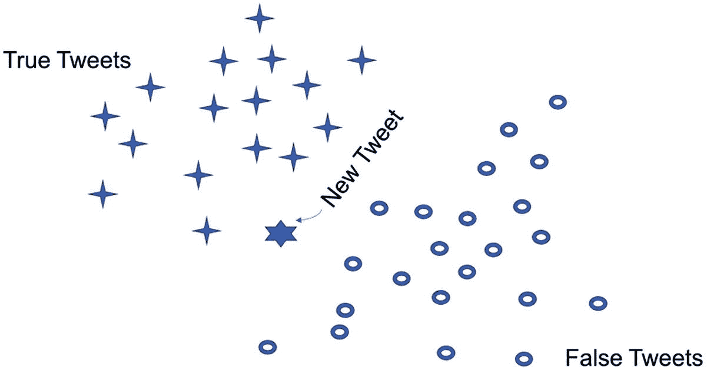

*图 5-5* – 一条新推文落在真实推文和虚假推文之间

现在我们希望判断一条落在图中真实和虚假推文之间的新推文的真实性，如图 5-5 所示。有几种方法可以构建一个分类器，将训练集中的真实和虚假推文分开。我们先将自己限制在线性分类器的范围内。图 5-6 展示了一些可能的线性分类器。根据我们选择的分类器不同，新推文可能被标记为真实或虚假。例如，选择图中的分类器 2 或分类器 5 会导致新推文被标记为虚假，而选择其他任何分类器则会导致新推文被标记为真实。

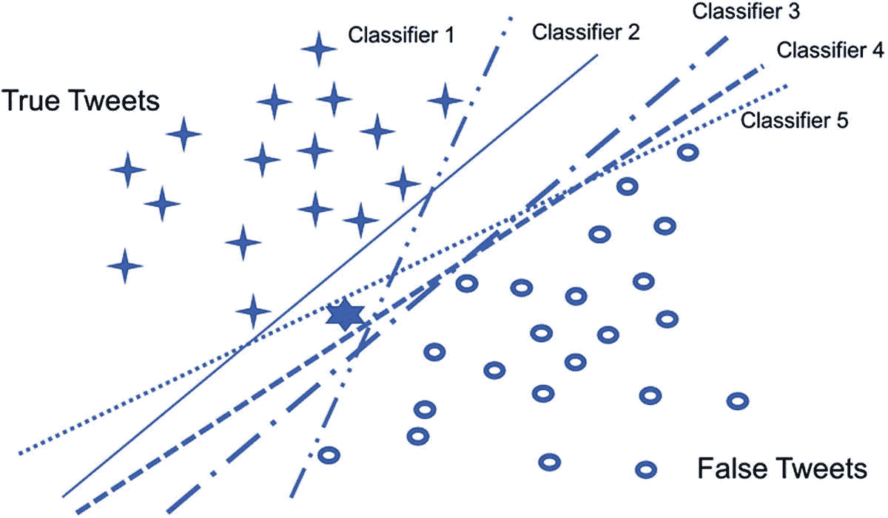

*图 5-6* – 我们可以选择的各种分类器会对新推文产生不同的分类结果

我们显然需要一种更具决定性的方法来选择分类器。理想情况下，分类器应尽可能地将真实推文与虚假推文分离开来。这种尽可能分离推文的问题可以用数学方式更清晰地表达如下：我们希望找到一个分类器，使得最接近的真实推文与最接近的虚假推文之间的距离尽可能宽。为此，我们识别出位于分隔两个类别边界上的点（更精确地说是向量）。在图 5-7 中，这些点或向量被称为`支持向量`。我们希望能找到一个距这些向量最远的超曲面。图 5-8 展示了这样一个超曲面，也称为`最大间隔分类器`。之所以这样称呼，是因为它最大化了两个类别边界之间的间隔。

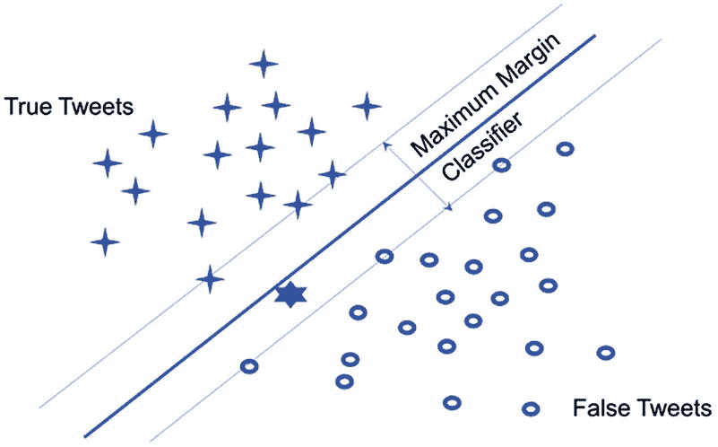

*图 5-8* – 距离两个边界最远的超曲面

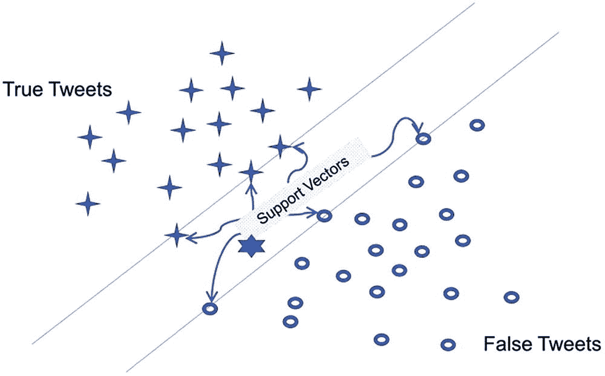

*图 5-7* – 位于边界上的向量

图 5-9 解释了为什么边界上的向量被称为`支持向量` —— 它们可以被视为支撑着分类超曲面。如果这些向量稍有移动，超曲面也必须随之移动。相关的一点是，超曲面只依赖于这些点，而不依赖于训练集中的任何其他数据点，除非那些点越过边界成为了支持向量。

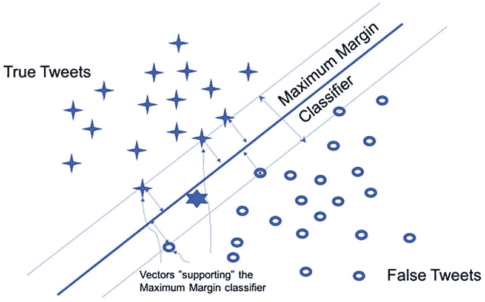

*图 5-9* – 边界上的向量可以被视为“支撑”着最大间隔分类器超曲面

> **注：** 仅凭过去数据集中的几个数据点，就能帮助预测所有未来数据点的类别。

最大间隔分类器的数学方程仍然采用公式 (5.0) 的形式。只是参数的求解方式不同，使用了与逻辑回归等方法不同的标准。然而，必须指出的是，我们为了简化讨论，只考虑了线性分类器。情况并非总是如此。例如，在图 5-10 中，决策边界远非线性。此时，公式 (5.0) 中的超曲面方程不再适用。在这种情况下，我们使用所谓的**核函数**来建模分类器。寻找最大间隔所需的数学方法涉及二次规划，这超出了本书的范围。不过，即使不了解二次规划的复杂细节，也可以掌握实现 SVM 的软件。


*图 5-10* – 类别边界并不总是线性的，如图所示

## 人工神经网络

我们的大脑通过连接大量神经元，并利用这些连接在神经元之间传递信号来运作。学习过程通过神经元、它们之间的连接以及传递的信号逐步推进。让我们更深入地了解学习是如何在我们的算法中实现的。图 5-11 展示了在逻辑回归等机器学习算法中发生的过程。我们从训练数据集中提取若干特征，并将其作为输入 `x[i]`。每个输入 `x[i]` 通过对应的权重进行加权处理。权重与输入结合后，通过逻辑函数等函数进行处理，最终将输出分类为真或假。

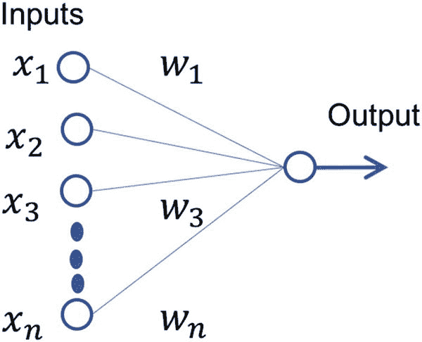

**图 5-11** 多个输入节点连接到输出节点，输出节点进行一些处理后，将新的数据点分类为真或假

类比人脑，每个输入都可以被视为一个神经元，更准确地说，是接收输入的人工神经元。每个输入神经元连接到另一个神经元，该神经元进行一些处理后产生输出。产生输出的节点称为输出神经元。这是一种简单的学习方式。直观上，通过在输入层和输出层之间引入更多神经元、更多连接以及更复杂的处理，可以使输出更加精确。这些神经元的功能是中介性的——它们既不从外部来源收集输入，也不向外部来源输出。因此，它们对外部世界是隐藏的。据此，它们可以被称为隐藏节点。图 5-12 展示了人工神经元的这样一种排列。在此例中，隐藏层有三个节点。回到我们的推特示例，假设这三个隐藏节点分别回答以下三个问题：a) 发布推文的用户有多高的声誉？b) 这篇推文是否吸引了大量关注？c) 推文内容的真实性如何？这三个答案是从输入层的节点中获得的，而这些节点实际上代表了特征。为了回答第一个问题，与用户相关的特征所对应的权重预计会很高，而其他权重则较低。

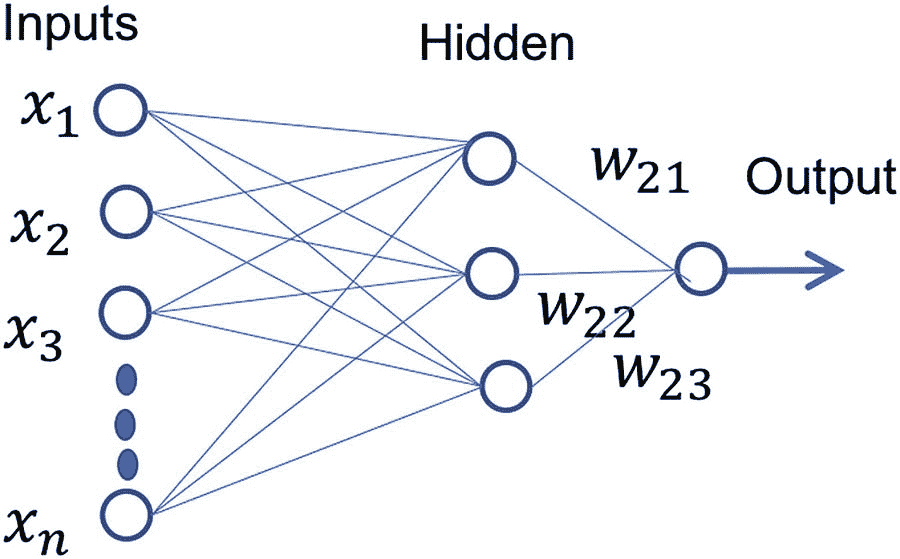

**图 5-12** 引入神经元的“隐藏层”以实现更精细的处理

> **注** 人工神经网络展示了机器学习与人类学习的生物过程有多么接近。

类似地，为了回答第二个和第三个问题，与用户相关的特征的权重被赋值为较低的值。为了避免混乱，图中未显示这些权重。对于第二个问题，与转发数、点赞数和回复数相关的特征的权重被赋值为较高的值。第三个问题则需要与内容相关的特征（例如是否包含多媒体内容，或是否引用其他用户、期刊等）的权重较高。这三个隐藏节点的值与其各自的权重（图中表示为 `w[21]`、`w[22]` 和 `w[23]`）相结合，最终得出真或假的分类结果。如图 5-12 所示的网络被称为人工神经网络（`ANN`）。它们可以包含任意数量的隐藏层。隐藏层和输出节点的数量是通过经验确定的。在我们的案例中，输出节点当然只有一个，因为分类是二元的——要么是真，要么是假。

隐藏层数量越多，学习就越深入，从而引出深度学习。上述讨论可能会引发一个问题：逻辑回归与神经网络的处理方式有何不同？实际上，图 5-11 是逻辑回归的一种表示，类似于图 5-4。从这个意义上说，逻辑回归可以被视为最简单的人工神经网络（`ANN`）。人工神经网络中隐藏层和输出节点所进行的处理与逻辑回归中的处理类似。这些节点的处理过程涉及使用 `sigmoid` 函数（通常就是逻辑函数本身）对加权特征进行变换。多层人工神经网络中的神经元本身也可以被视为逻辑回归单元。因此，当特征集非常庞大，并且在最终分类之前需要解决许多中间问题时，神经网络就显得非常有用。

> **注** 人工神经网络比某些其他机器学习算法（如逻辑回归）强大数倍。因此，基于神经网络的深度学习日益受到关注。

## K 均值聚类

到目前为止，我们一直假设给定一个带标签的数据集，可用于训练模型以计算权重。然而，如前所述，获取训练数据集并非总是易事，我们需要仅凭无标签数据对数据分类。这是无监督学习的任务之一。一种广泛使用的无监督学习方法是 `K 均值聚类`，它能将数据项自动分组为不同簇。最终数据集被划分为 `K` 个簇或子集，每个子集中的数据共享共同特征。针对我们的真实性判断问题，`K=2`，因为我们的分类是二元的，两个簇分别为真和假。

注意这里使用“簇”而非“类”。类是人为定义的，而簇是无需任何人工干预自动确定的。但对于我们的微博问题，我们希望簇能代表人为定义的类，即真实推文或虚假推文。这可以通过恰当选择特征来实现，使得所有真实推文具有相似特征，所有虚假推文也具有相似特征但不同于真实推文。在图表上绘制时，所有真实推文彼此接近，虚假推文也彼此接近，但与真实推文分开。正如我们在图 5-1 中所见，情况确实如此。`K 均值`算法无需像图 5-1 那样构建分类器，就能找到这两个分组。

在没有任何带标签训练数据的情况下，图 5-1 看起来就像图 5-13——空间中代表推文的点或向量起初看起来完全相同，属于同一类。现在的问题是将它们分为两类：真实推文和虚假推文，每类因其特征性质而聚集在一起。正如我们在支持向量机（`SVM`）中看到的，目标是让识别出的两个集合尽可能远离。与支持向量机一样，分离过程需要使用距离的概念。有多种方法可以测量两个点、向量或数据点之间的距离，其中包括堪培拉度量、相关系数、余弦相似度和曼哈顿距离。为了使讨论直观且与常用方法一致，我们仅使用欧氏距离，即两点之间常见的几何距离概念。

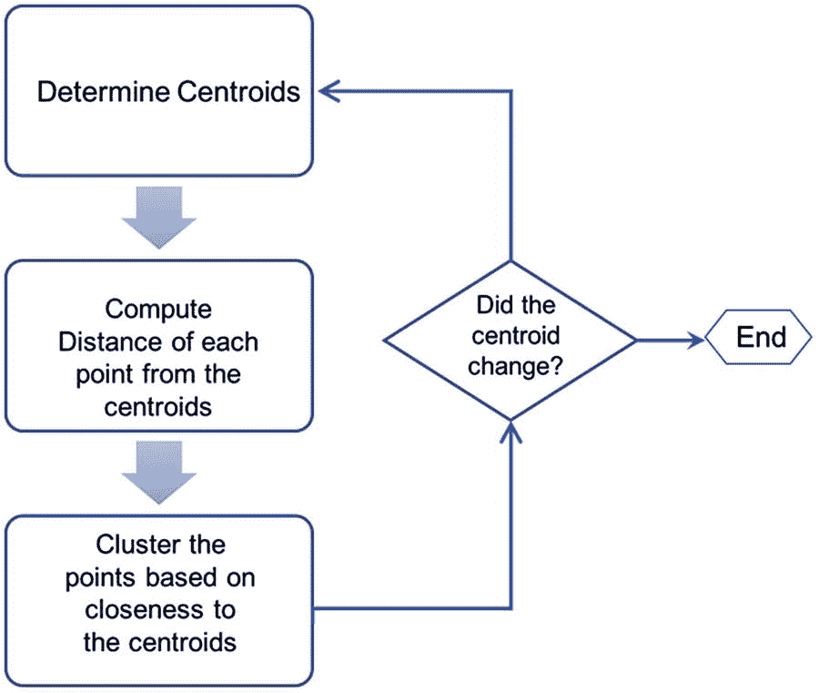

图 5-14: K 均值算法流程图


图 5-13: 无监督学习：所有推文一开始都无标签且无法区分

`K 均值`是一种迭代算法。聚类基于质心概念，质心可视为簇的中心。数学上，

```
\mu(C) = \frac{\Sigma \vec{x}_i}{|C|}
其中 \mu(C) 是簇 C 的质心（均值）
|C| 是簇 C 中点的数量，且
x_i 是簇 C 中各点特征的值
```

在我们的例子中，`K=2`，因此初始时随机选择两个点作为两个簇的质心。对于每个其他点，计算两个距离：a) 距离质心 1 的距离，b) 距离质心 2 的距离。如果该点更接近质心 1，则归入簇 1，否则归入簇 2。经过这种新的分组，质心必然发生变化。为新簇计算新质心。计算新质心和重新分组点的过程持续进行，直到所有点都留在上一轮迭代中分配的簇中，且质心不再变化。

`K 均值`算法保证收敛，其证明超出了本书范围。它属于坐标下降算法类别。我们可以确信，经过若干次迭代后，当算法停止时，质心不再变化。整个过程如图 5-14 所示。围绕这些质心的簇就是真实推文组和虚假推文组。

**注**：将数据点分类为真和假可以在无监督情况下进行。

## 总结

学习区分真相与谎言是一个有趣的机器学习问题。我们看到了几种有助于实现这一目标的算法。这些算法要么通过提供带标签的训练数据来进行监督学习，要么是无监督学习。除此之外，算法可以是生成式的或判别式的，前者能够在学习概率分布后合成数据点。判别式方法的一个关键要素是参数估计。模型参数的估计方式需要能够优化算法的准确性。在下一章中，我们将转换方向，探讨逻辑和形式化方法如何帮助我们解决真实性判断领域的问题。

### 练习题

1.  诸如逻辑函数之类的 Sigmoid 函数在本章的讨论中发挥了重要作用。还有哪些其他函数可能替代 Sigmoid 函数并有助于机器学习？

2.  本章介绍了几种可用于解决真实性判断问题的机器学习算法。探索其他算法，如随机森林和线性判别分析，评估其对真实性判断问题的适用性。

3.  `K 均值`算法假设均值能代表簇。然而在现实世界中，通常是最“能言善辩”、最“有影响力”、最“富有”或其他“最 ____”的人当选为代表选民的议员。研究一种基于“众数”而非“均值”的聚类算法在准确性和应用实用性方面的表现。

4.  实现一个人工神经网络来解决本章讨论的推文真实性判断问题。

5.  比较本章讨论的各种算法在解决微博真实性判断问题时的性能和适用性。
