# 序贯概率比检验（`SPRT`）

`SPRT` 由亚伯拉罕·瓦尔德（Abraham Wald）发明，并于 1945 年 6 月发表在他的论文《统计假设的序贯检验》中。他证明，在速度与精度的权衡（`SAT`）中，该检验是最优的，并且只要数据点是独立同分布的（一个常见的假设，缩写为 i.i.d.），它只需要很少的数据点就能检测到变化。

与统计假设检验一样，`SPRT` 提出两个假设，并在这两个假设的背景下评估时间序列数据：

- `H[0]`：数据质量未受损，且可接受为真；
- `H[1]`：数据为假，触发警报；

`H[0]` 称为零假设——即现状或常态，而 `H[1]` 称为备择假设，表示发生了某种变化。

在序贯概率比检验中，对于每个数据点，我们计算对数似然比（`LLR`）。`LLR` 是似然比的对数。`LLR` 包含四个组成部分：

1.  在 `H[1]` 为真且数据已被操纵的情况下，从估值过程获得该数据点的似然性
2.  在 `H[0]` 为真且数据未受损的情况下，从估值过程获得该数据点的似然性
3.  上述 (a) 和 (b) 两者的比率
4.  (c) 中比率的对数

用方程形式表示：

`LLR = log(p(x_k | H[1]) / p(x_k | H[0]))`，其中 `x_k` 是第 `k` 个时间点的数据值。

(4.1)

分子和分母中的似然性取决于基础数据的分布。例如，如果基础数据符合正态分布，则概率密度函数（`PDF`）由下式给出：

`p(x | μ, σ) = (1 / sqrt(2πσ)) * e^((- (x - μ)²) / (2σ²))`

(4.2) 其中 `μ` 是分布的均值，`σ` 是标准差，对于给定的总体可以很容易地推断出来。对于每个数据值，`LLR` 被累加到累积的对数似然比 `CLLR[i]` 中，如下方方程 (4-3) 所示：

`CLLR[i] = CLLR[i - 1] + LLR[i]`

(4.3)

我们现在明白了为什么该技术被称为 `SPRT`——这个过程是序贯（Sequential）的，并使用概率（Probability）比（Ratios）来检验（Test）变化。累积 `LLR`（`CLLR`）代表了到目前为止收集到的数据的状态。监控累积 `LLR` 可以帮助我们检测到变化。我们使用 `CLLR` 来决定以下三种结果之一：

1.  接受 `H[0]` 并停止监控数据，得出结论数据质量完好
2.  接受 `H[1]` 并停止监控数据，得出结论发生了伪造
3.  推迟决定并继续监控

上述每个决定在何时触发，取决于两种常见且直观的错误类型：

1.  第一类错误：在 `H[0]` 为真时接受了 `H[1]`，导致误报
2.  第二类错误：在 `H[1]` 为真时接受了 `H[0]`，导致漏报

我们需要事先决定系统可以容忍的第一类和第二类错误的程度。令 `α` 表示预先确定的遭遇第一类错误的可接受概率，`β` 表示遭遇第二类错误的可接受概率。可以证明，决策边界如下：

`A = log(β / (1 - α))` 和 `B = log((1 - β) / α)`

(4.4)

以下是基于上述边界的决策，如图 4-2 所示：


1.  如果 `CLLR < A`，接受 `H[0]` 并停止
2.  如果 `CLLR > B`，接受 `H[1]`，得出结论存在伪造并停止
3.  如果 `CLLR` 位于 \( A \) 和 \( B \) 这两个值之间，则推迟决定并继续监控

**注意：** 序贯概率比检验正是一种对序贯计算出的似然累积比进行检验的方法。

正如我们所看到的，将概率引入解决方案会使其稍微复杂，因为监控现在取决于基础数据的分布，并且以更复杂的方式使用了数学。我们需要一种更简单的技术，将指数运算（如方程 (4.2) 中的形式）从算法中剥离出来。正如我们将在下一节中看到的，`CUSUM` 解决了这一复杂性，使算法变得更加简单。

必须指出的是，`SPRT` 旨在判断数据是由两个假设中的哪一个生成的，而从根本上来说并非用于检测变化。可以通过引入一个“阈值”对其进行修改以实现变化检测。当 `LLR` 超过这个预定阈值时，我们停止监控并得出结论检测到了变化。由此产生的技术被称为 `CUSUM`，将在下一节中讨论。


## CUSUM 技术

`CUSUM`是“Cumulative Sum”（累积和）的缩写。它是一种由 E. S. Page 于 1954 年提出的简单、巧妙且直观的技术。该技术常用于金融领域的股票投资组合监控和工程领域的过程控制，以检测被监控值的变化，从而聚焦于可能出现问题的产品。尽管其数学推导假设了底层数据具有一定的统计特性，但该技术在很大程度上对数据的统计和概率特性不敏感。它是已知的检测变化（哪怕是微小变化）最快的技术。与 `SPRT`（如方程(4.2)中那样计算涉及指数的移动平均）相比，其性能要好得多。

虽然实现起来比 `SPRT` 简单得多，但 `CUSUM` 实际上是一种 `SPRT` 的形式。不像 `SPRT` 中有两个边界 A 和 B，我们只有一个停止点，即当代表状态超过某个阈值时停止。这里的代表状态是每个数据点处的累积残差。残差可以简单地理解为数据值与目标值之间的差值。直观地看，目标值就是到目前为止数据值的均值。因此，该算法是简单的算术运算，无需处理概率密度函数(`PDF`)和指数移动平均。

`CUSUM` 既简单又复杂。我们刚刚看到 `CUSUM` 的应用是简单的算术。我们将采取一种中间路线，提供足够多的细节来理解简洁背后的数学原理。让我们从给出 `CUSUM` 算法中代表状态 `r[k]` 的方程开始：

```
r_k = max(r_{k-1} + log(p(x_k | H_1) / p(x_k | H_0)), 0)
```

```
其中：
    x_k 是第 k 个时间点的数据值
    r_k 是第 k 个时间点的代表状态
```

上述方程中的对数比率可以立即被识别为我们在 `SPRT` 中使用的`对数似然比`(`LLR`)。这里使用的假设也与之前相同。`CUSUM` 的改进在于我们正在累积`对数似然比`(`LLR`)，并为累积值设置了一个下界。当数据分布是高斯分布或正态分布时（这是常见情况），我们可以将以下概率密度函数(`PDF`)代入方程：

```
p(x_k | H_1) = 1 / (sqrt(2 * pi * sigma)) * e^(-(x_k - mu_1)² / (2 * sigma²))
p(x_k | H_0) = 1 / (sqrt(2 * pi * sigma)) * e^(-(x_k - mu_0)² / (2 * sigma²))
```

均值 `mu_0` 和 `mu_1` 分别对应于两个假设。代表状态 `r[k]` 的方程现在简化为：

```
r_k = max(r_{k-1} + (x_k - mu_0 - (mu_1 - mu_0) / 2), 0)
```

并进一步简化为：

```
r_k = max(r_{k-1} + (x_k - mu_0 - rho / 2), 0)
```

其中 `rho` 是一个决定 `CUSUM` 算法灵敏度的常数。`rho` 的值越小，算法对变化越敏感。上述方程就是我们之前描述的简单算术。我们本质上是在监控数据值不断变化的均值，并累积新数据值相对于该均值的差值或残差。我们现在需要知道何时停止监控数据流并判定数据已被破坏。为此，我们引入一个阈值 `tau`。当代表状态 `r[k]` 超过阈值 `tau` 时，我们就停止监控。此时 `rho` 的值被称为停止时间。还必须指出，尽管我们通过代入高斯概率密度函数(`PDF`)推导出了简化方程，但已有证明表明，即使数据分布不是高斯分布，该简化方程也适用良好。

> 注：世界上所有的复杂性都是为了简化生活。`CUSUM` 的推导就是一个例子。

通常，我们并不希望在检测到虚假情况后立即停止。我们希望继续监控并检测所有欺诈发生的情况。我们不希望仅确定停止时间，而是希望检测数据被破坏的所有时间区间。`CUSUM` 可以很容易地扩展到实现这一目标。之前的“停止时间”现在变成了可疑区间的“开始时间”。该区间的结束时间是代表状态达到峰值的时间点。回到一个人陷入抑郁的类比，当一个人的精神状态开始恶化或超过某个阈值时，我们判定抑郁症发作。我们判定一个人即将走出抑郁，是在其精神状态最糟糕并开始好转之后不久。同样的原理也适用于用于检测所有可疑区间的扩展 `CUSUM` 算法。

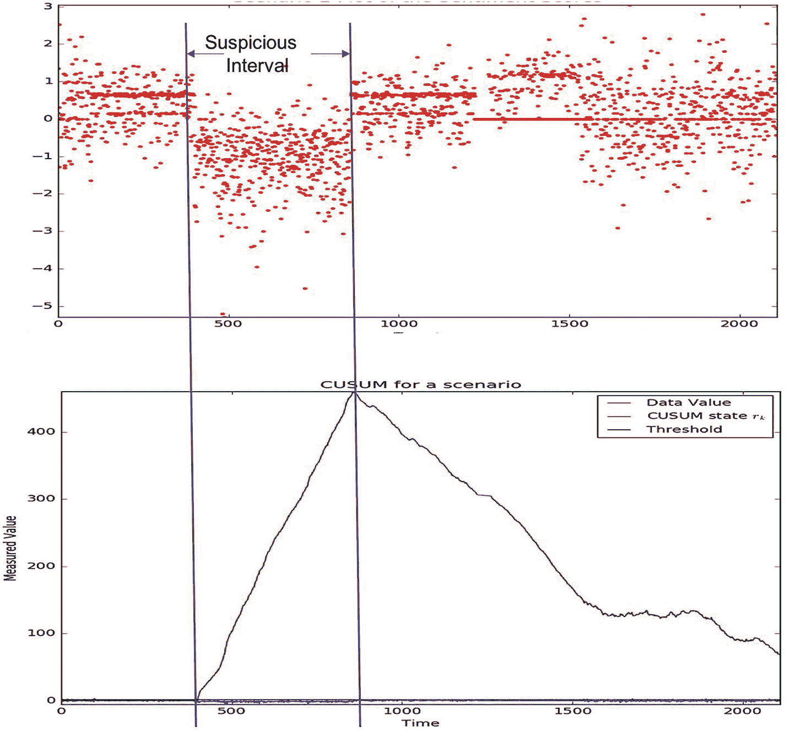

**图 4-3**：用于检测可疑区间的扩展 `CUSUM`；上图中的点代表数据值

图 4-3 是对刚刚讨论过程的说明。本例中的数据值在 -5 到 +5 之间变化。上图将数值绘制为离散点。这里大约有两千个数据值。x 轴代表时间，显示了两千个时间索引，代表了数据收集的顺序。从上图的前半部分可以看出，即使有可能，仅通过观察数据值也很难判断数据是否被破坏。当我们在下方的图表中绘制 `CUSUM` 代表状态 `r[k]`（以较浅的绿色阴影显示）时，可疑区间几乎变得显而易见，如图所示。在整个可疑区间内，曲线都在上升。

区间从 `CUSUM` 超过阈值时开始，在 `CUSUM` 值达到峰值并开始下降后不久结束。阈值被设定为接近于零，因此也接近于数据值，这使得它在以稍深色（蓝色）阴影绘制并与数据值的折线图混合在一起时不太明显。`CUSUM` 算法累积每个数据值相对于预期平均值的残差，从图中可以看出，对于数值上不超过 5 的数值，其累积和可以一直上升到接近 500。上图中的点模式存在差异，但除非像下图那样绘制出 `CUSUM` 代表状态，否则我们无法真正确定。右侧的不少点也形成了某种类似的模式，但下图显示它们实际上并不可疑。

> 注：除非通过统计过程方法进行评估，否则数据可能具有欺骗性。

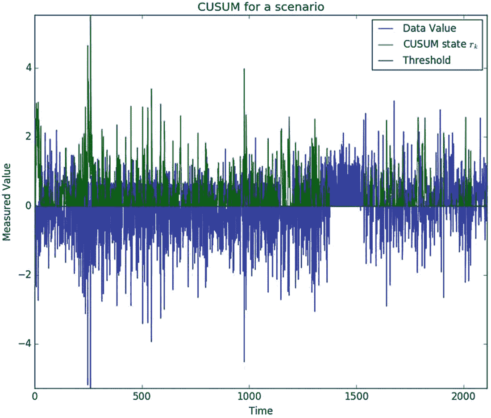

**图 4-4**：当虚假值间歇性出现时的扩展 `CUSUM`。彩色图显示在源代码文件和电子书中。


在图 4-3 中，所有异常数据一次性出现在一个较大的时间间隔内。然而，也存在可疑值偶尔出现的情况。图 4-4 展示了当虚假数据值间歇性出现时，用较浅色（绿色）绘制的 CUSUM 状态。在这种情况下，可疑间隔内仅包含一个虚假值，但同样的逻辑仍然适用。CUSUM 技术在这种情况下效果不佳，因为残差的累积会受到间隔中真实值的影响。图 4-3 中的最大累积残差接近 500，而在图 4-4 中仅为 5。CUSUM 算法在这种情况下显然不太敏感。

这正是卡尔曼滤波更具优势之处。它基于先前状态递归地估计下一个值，因此虚假值之前的真实值越多，对下一个值的估计就越准确。先前状态中真实值所占比重越大，估计效果就越好。下一节将讨论这项广泛应用于众多实际场景的重要技术。

### 卡尔曼滤波

M. S. Grewal 等人是这一领域最热门书籍的作者之一，他们将卡尔曼滤波称为“20 世纪最伟大的发现”。这是一种线性状态空间方法，应用范围从预测天体的不可控轨迹到控制制造过程和航空领域。简而言之，给定一系列数据点，卡尔曼滤波会计算出下一个数据点的最佳猜测值。当信号被高斯白噪声干扰时，它本质上是对线性动态系统下一状态的估计。如前所述，高斯假设在许多随机过程中相当常见，并且在大多数情况下至少近似成立。由于它能预测信号，卡尔曼滤波自然被视作滤除噪声的方法。噪声是卡尔曼滤波检测到的变化，因此从这个意义上说，我们将其用作一种变化检测技术。可以理解的是，它在电气工程、电信工程和信号处理领域得到了广泛应用。

正如本章开篇所述，谎言本质上是在一个主要依赖诚实生存的文明中的噪声。大数据中的虚假信息可以被视为统计噪声，并且可以通过与信号处理系统中滤除噪声相同的方式来检测。这正是卡尔曼滤波的用武之地。通过一个直观的例子，比如股票价格，可以理解这一强大技术背后的复杂数学原理。假设我们今天预期某只股票的价格为``，但实际观察到的价格是`z[k]`。给定这两个值，对明天价格的最佳估计是这两个值的平均值：

```
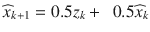
```

但股市中的传言和影响使情况并非如此理想，我们可能需要给予它们比自身预期更高的权重。让我们将这一权重称为`w[k]`。那么上述方程变为：

```
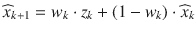
```

这本质上就是线性情况下卡尔曼滤波的状态方程。方程右侧包含一个观测分量和一个预期分量。我们计算出一个预期值的猜测，然后根据现实世界的观测或测量进行更新。比例项或权重`w[k]`在卡尔曼滤波术语中被称为“卡尔曼增益，`K[k]`”，以纪念其发明者——麻省理工学院毕业生鲁道夫·卡尔曼。权重`w[k]`代表了噪声——即股市中的传言和其他影响。

可以理解的是，权重`w[k]`或卡尔曼增益`K[k]`不能仅凭直觉估计，还需要一些数学上的严谨性。它是通过另一组前向递归方程进行估计的，这些方程涉及另一个状态方差变量`P[k]`以及两个噪声方差常数`Q`和`R`。方差是一种常用的统计指标，用于表示变量偏离其平均值的程度。`Q`是估计值的噪声方差，`R`是观测值的噪声方差。实际上，`Q`和`R`可能随状态或观测值变化，但为简化起见，在大多数情况下假设它们是常数。如前所述，`z[k]`是观测值。综合以上讨论，在时间序列数据值的线性情况下，卡尔曼滤波的方程组如下所示。

```
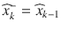
```

```
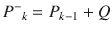
```

```
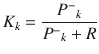
```

```
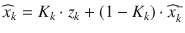
```


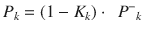

在通用形式中，上述方程中的项均为矩阵，`P[k]`、`Q` 和 `R` 是协方差矩阵。但为简化并应用于单一维度的数据值时间序列，我们可以将它们视为标量和方差。尽管它们的取值取决于具体领域，但为简化起见，初始估计均值 `x̂₀` 的初始值设为零，先验状态方差 `P[0]` 可设为一或凭直觉确定。随后，上述方程中的其他变量可递归计算。假设常数 `Q` 和 `R` 的最优值，可通过将算法应用于机器学习术语中所称的“训练数据”来获得。在训练数据或真实数据中，我们已知哪些值是真值、哪些是假值。因此，我们利用这一已知数据样本校准常数，以实现高准确率。

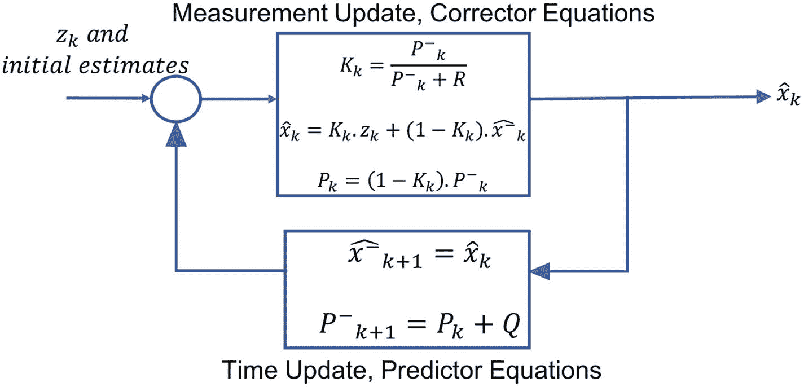

**图 4-5**  
卡尔曼滤波器解释为反馈控制系统

卡尔曼滤波器是最优的，因为可以证明它能使估计值的均方误差最小化。均方误差（MSE）是用于确定预测或估计算法准确性的常用指标。必须指出，卡尔曼滤波方程有多种形式，它们在代数上均可证明彼此等价。这些方程本质上实现了一个反馈控制系统。通过观测值将先前估计的反馈纳入下一次估计。从这个意义上说，前两个方程可归类为“时间更新”方程，后三个为“测量更新”方程。后者用于纳入反馈，前者用于将当前表征状态投影到未来。因此，时间更新方程也可称为预测方程，而后者称为校正方程。图 4-5 阐释了这些概念。

这些方程均具有直观解释，并基于概率论。例如，当观测值不准确性的方差 `R` 趋近于零时，卡尔曼增益 `K[k]` 趋近于一，表明观测值 `z[k]` 可被越来越多地信任。在这种情况下，也意味着估计分量的权重越来越小。当初始状态方差 `P⁻ₖ` 趋近于零时，卡尔曼增益 `K[k]` 也趋近于零，表明对估计值的依赖多于对观测值的依赖。卡尔曼滤波器的概率或贝叶斯解释是：给定观测值后，递归方程本质上传播了数据流中信号的条件概率分布。

还必须注意，`Q` 和 `R` 会随时间收敛到稳态值。这些稳态值可事先利用训练数据获得。`R` 基于测量值，因此比 `Q` 更容易获得，因为 `Q` 基于估计过程。卡尔曼滤波过程的准确性取决于噪声方差 `Q` 和 `R` 的估计准确度。

> **注意**  
> 卡尔曼滤波器利用一组数学方程，结合截至当前时刻的所有可用信息，递归计算下一个数据值的最佳估计值。之前的估计值和观测值都会被纳入新估计值的权重。

图 4-6 展示了卡尔曼滤波器如何帮助将虚假值与真值分离。这些数据来自注入负面情绪后的微博情感得分。使用前述方程递归计算出的估计值以蓝色线条显示。如图所示，它大致呈直线并接近于零值。由于我们不能总是期望真实数据值与估计值完全匹配，因此我们允许一个容差范围，即一个固定偏移量，在图中以蓝色线条下方的红色线条显示。所有低于红色容差线的数据值都被卡尔曼滤波算法判定为虚假值。由于数据来自注入负面情绪后的微博情感得分，我们只考虑容差线以下的数据。在其他情况下，我们可以设置上下两条线来界定容差区间。区间外的数据值被视为虚假值。在此情感得分案例中，虚假值用红色“+”标记，真值用深绿色“*”显示在上方。容差范围（即距预期值的固定偏移量）再次通过将算法应用于训练数据进行校准，以最大化准确性。

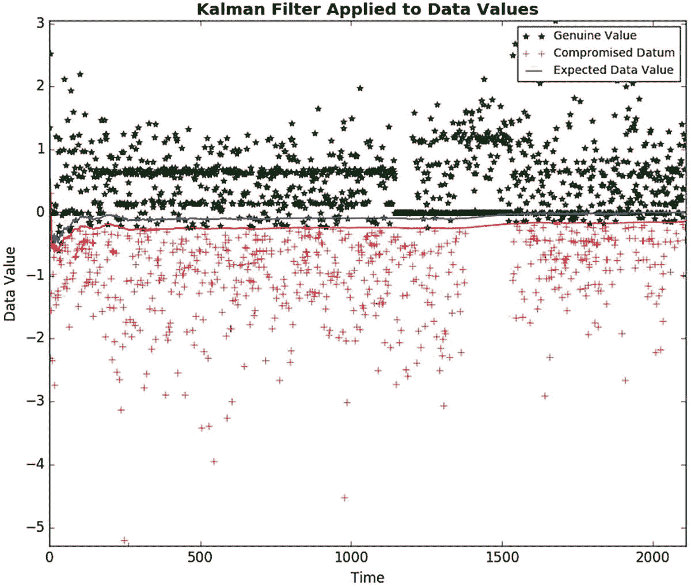

**图 4-6**  
卡尔曼滤波器应用于与图 4-4 相同的数据

卡尔曼滤波器正确工作的一个前提是信号应远强于噪声，这通常是成立的。在图 4-6 的示例中，深绿色星号的数量大约是红色叉号的四倍。大多数值为正值且真实，因此低于某一容差范围的负值被判定为虚假值，这在当前情况下基本正确。

## 总结

不真实性是对常态的一种偏离。在大数据原本真实的价值评估中，它可以被视为噪声。因此，我们可以应用变化检测技术来确立大数据的真实性。在本章中，我们研究了三种有趣且重要的变化检测技术。SPRT 展示了似然比的简单应用如何在检测中发挥作用。CUSUM 进一步推进并简化了这一思想，利用累积残差的简单算术来识别数据流中发生前所未有变化的虚假区间。关于卡尔曼滤波器的讨论展示了如何将与预测相反的噪声或虚假信息从信号或正常数据中滤除。我们了解到训练数据有助于校准算法或模型的重要参数。在下一章中，我们将扩展利用训练数据学习模型本身的思想。在此过程中，我们将研究多种机器学习算法，并将其应用于真实性领域。

## 练习

1.  现实世界中有哪些检测变化的方式？其中哪些可以应用于大数据真实性问题？还能想到其他有助于解决该问题的现实世界过程吗？
2.  研究卡尔曼滤波器在各种应用中的使用方式。你是否相信卡尔曼滤波器是“二十世纪最伟大的发现”？
3.  根据本章给出的卡尔曼滤波方程，从向量形式的状态空间表示中推导出这些方程（该状态空间表示可见于任何相关主题的书籍）。


