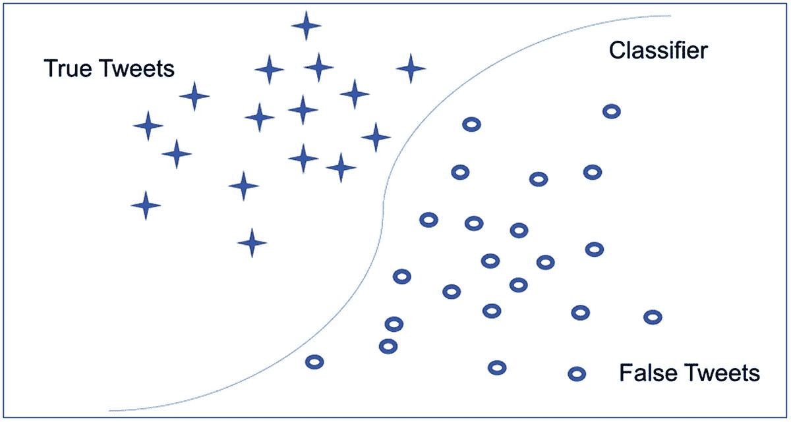
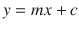
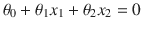
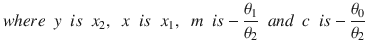
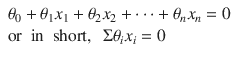

# 5. 机器学习算法

微博示例 收集真实数据 逻辑回归 朴素贝叶斯分类器 支持向量机 人工神经网络 K 均值聚类 总结

在上一章中，我们学习了如何在更精细的数据粒度层面运用技术，处理单个数据值。在本章中，我们将从更宏观的层面批量处理数据，以提取特征、模式及其相对权重。有趣的是，机器学习是一把双刃剑，它既能用于创建虚假内容，也能用于检测虚假内容。谷歌的“DeepDream”项目便是一个很好的例子。该项目最初旨在构建图像识别软件，但如今，该软件更多因能生成宛如机器幻觉般的虚构图像而闻名。在本章中，我们将重点介绍有助于检测欺诈和虚假信息的机器学习算法。

机器学习的灵感源于人类学习的概念。例如，一个孩子是如何学会识别猫的呢？她的父母或其他长辈会向她展示大量狗、猫和其他宠物的样本，并反复向孩子指出每种宠物。换句话说，父母为孩子提供了大量带有标签的数据用于训练，这些数据也被称为训练数据。孩子开始识别这些宠物的诸多特征——脸型、皮肤纹理、躯干长度、耳朵大小、眼睛颜色等。孩子识别的特征越多，看到的带标签样本越多，她识别猫的本领就学得越好。

这种确定特征、特征相对重要性并据此得出结论的学习过程，并不仅限于识别猫和狗。几乎任何事情，包括区分真话与谎言，都是通过类似方法从经验中习得的。长辈们常有“逗弄”孩子的习惯。很快，随着经验积累，孩子们就能学会辨别长辈何时在“开玩笑”，何时在说真话。尽管问题在于判断真伪，但确定性的方法并不适用于此目的。“真相”并没有被确定性地定义出来，从而向孩子提供一套规则来描述猫，或判断长辈是否在开玩笑。用软件术语来说，这个过程是难以处理的，或者说属于 NP 难问题。相反，孩子是通过大量样本来进行经验性学习的。让我们更详细地审视这一过程。

> **注意**
>
> 精确定义什么是“真相”是棘手的。真相如同信仰，最好通过经验来领悟，而非通过确定性定义来理解。

当孩子看到一只新的四足动物，而附近又没有长辈可以指认时，她关于宠物的学习成果就要接受新数据的检验。这将以多种方式之一启动其思维过程。其中一种方法是频率学派（Frequentist）方法——孩子看到圆脸、绿眼睛、小耳朵、短躯干等的猫的频率越高，她就越可能得出结论：这只新的圆脸、绿眼睛、小耳朵、短躯干的动物也是一只猫。这种方法被形式化为朴素贝叶斯方法，这是频率学派方法的一个例子。

我们也可以构建一棵决策树——这只动物是圆脸吗？如果是，眼睛是绿色的吗？耳朵小吗？等等。我们提出这些问题的“智能”程度越高，得出结论的速度就越快。在这种情况下，“智能”的目标是选择那些能使两个类别之间分离度最大的问题。例如，如果我们在检查脸型之前，先询问关于躯干长度的问题，那么我们构建的决策树必定是次优的，因为有些狗的躯干可能和猫一样短。因此，关于躯干长度的问题对类别的区分能力不如脸型问题。后者的问题应优先于前者。

> **注意**
>
> 像机器学习算法这样的经验方法倾向于融入智能，以快速得出最佳答案，而非通过蛮力穷尽所有可能性。

一种常用的探寻真相的方法是“剥洋葱法”——逐层深入。我们从手头已有的信息输入开始，逐层进行质询。问题越复杂，需要提问的层次就越多。所有这些问题答案都需要联系起来，才能得出结论。在大脑中，这种通过神经元层收集并连接答案的过程，可以在机器上使用神经网络进行模拟。神经网络接收输入，通过一系列层级，计算出分类结果为真或假。

本章中我们考虑的所有学习过程或算法的最终目标，都是划分或分类解空间。划分得越好、越清晰，算法就越有效。虽然拥有带标签的样本供学习是好事，但时常也会遇到没有此类数据的情况。在这种情况下，学习过程是在无监督下进行的——没有长辈通过展示样本并为其打标签来监督学习过程。例如，孩子从装有许多不同玩具的玩具箱里挑出所有芭比娃娃，就是一个例子。她学会了将最喜欢的芭比娃娃聚类在一起，而无需任何人告诉她该怎么做。

> **注意**
>
> 学习可以在有监督或无监督的方式下进行。就真实性判断而言，这两种方式的最终目标都是将问题空间划分为两类——真实的和不真实的。

聚类同样基于特征。面对并非完全真实的数据和信息，无监督学习方法会根据数据或信息的特征，将其分组到真实和虚假两个类别中。在本章中，我们将研究有监督学习方法（如神经网络）和无监督学习方法（如`k-means`），以解决数据真实性判断问题。但首先，让我们考虑一个合适的例子来说明这些概念。

## 微博客示例

诸如 Twitter 之类的微博客网站已发展成为能够产生重大影响的强大媒体。在第二章中，我们看到了 Twitter 如何被用来抬高股价然后抛售以获取非法利润，并且其上发布的谎言导致公司市值损失高达 28%。在第四章中，我们看到了安德烈斯·塞普尔维达如何利用 Twitter 甚至改变了总统选举的结果。还有许多类似的例子，其中微博客网站上的欺诈行为造成了重大损害。因此，我们以 Twitter 为例，来说明如何使用机器学习来检测虚假推文。

问题如图 5-1 所示。给定大量推文，我们需要提出一个分类器，它表现为一条曲线，将图中星号所示的真实推文与圆圈所示的虚假推文分隔开。可以看出，我们仍然使用数学来表达问题，使其易于处理。该图是一个笛卡尔平面，推文被表示为点。乍一看，该图提出了三个问题：

1.  我们如何将推文绘制在图中所示的空间中？
2.  在这样的空间中，坐标轴应该代表什么？
3.  我们如何提出分类器？

**图 5-1** 示例问题说明：区分真实推文与虚假推文

在第三章和第四章中，我们学习了量化、特征提取以及使用数学抽象的概念。在回答上述问题时，这些概念会派上用场。

微博，例如推文，具有特征。其中一些特征可能如下：

*   转发、回复、点赞的数量
*   推文中话题标签的数量
*   使用的话题标签被列为（全球）热门趋势
*   是否存在 URL 及其页面排名，以及诸如 NIMH、WHO、NCI 等可信实体
*   是否存在对其他用户的引用
*   推文语气的正式程度（不使用‘d’、‘n’等缩写）
*   使用肯定、确定、绝对的词语，而非“可能”
*   多媒体内容（照片、视频、音频）
*   是否存在数字、引号
*   该推文是否被置顶

这些特征表明了推文的真实性。例如，如果一条推文有很多点赞和回复，那么它更可能是真实的。一条引用了其他用户的推文不太可能撒谎，因为被引用用户的声誉也会受到影响。同样，有图片和音频佐证的推文更有可能是真实的。每个这样的特征都可以在坐标轴上表示，并且每个推文对应的特征值可以绘制出来，从而为我们提供一个包含所有推文的多维空间。对于熟悉向量代数的人来说，可以将这个多维空间想象成一个向量空间，而点就是向量。图 5-1 是这个多维空间的二维投影，而分类器实际上是该多维空间中的一个超曲面。由于当空间维度超过三维时很难可视化超曲面，因此像图 5-1 所示的正交投影非常有帮助。

超曲面将多维空间一分为二。在一个 n 维空间中，超曲面具有 (n-1) 维。例如，在图 5-1 所示的二维空间中，超曲面是一个一维表面，即一条线（可以是曲线或直线）。如果空间是三维的，那么超曲面就是一个二维平面或曲面。超曲面的方程是线性的。对于二维情况，我们知道一条直线的方程形式为

更一般地表达，我们可以将方程写为

将上述方程扩展到 n 维空间，超曲面的方程可以写为

(5.0)

我们稍后将不断地遇到不同形式的(5.0)。上述方程将多维空间分割成两个空间，如下面方程所示。

给定一条新推文的特征 `X = {x1, ..., xi, ..., xn}`，并且从训练集计算出参数 `Θ = {θ0, θ1, θ2, ..., θi, ..., θn}`（具体方法我们稍后会看到），基于上述不等式，我们可以轻松确定一个新的数据点将落在哪一侧。我们从训练数据集中确定权重或参数，并将它们用于测试数据集，以对新的数据点进行分类，就像孩子识别猫一样。当然，算法应确保学习不会过度依赖训练数据集——这种情况称为过拟合。我们不希望孩子只认识与她之前见过的某些非常相似的猫的子集。我们希望她学会从总体上识别猫。

> **注意** 机器学习算法可以看作是将数据视为多维空间中的一组点，每个维度代表数据的一个特征。

下面列出了与用户相关的其他一些有助于确定推文真实性的特征。

*   粉丝数、用户被列入的列表数、一段时间内的推文数量、个人资料和推文中的照片和视频
*   社会地位：用户是名人吗？
*   用户名中是否存在“dr”、“prof”、“governor”、“mayor”等头衔，以及是否为认证账户
*   用户个人资料的可信特征：真实姓名、照片、职业、教育背景、所属机构、注册日期、电子邮件地址中的域名（如`stanford.edu`）等
*   其个人资料中 URL 的 PageRank
*   用户被列入的列表类别数量
*   被转发、收藏、回复的帖子数量
*   其他用户推文中对该用户的引用次数（推文中的`@用户`）
*   该用户推文中`@用户`引用的数量；这些用户的质量
*   一段时间内其帖子中 URL 的数量（知识传播者）
*   以其粉丝的粉丝等加权的粉丝数量——一种 PageRank

> **注意** 用户的可信度越高，其推文越有可能是真实的。

