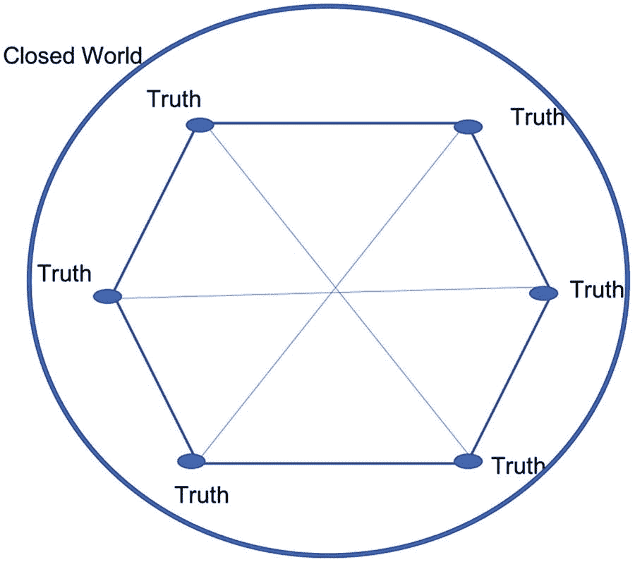
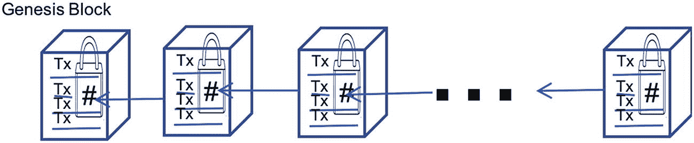
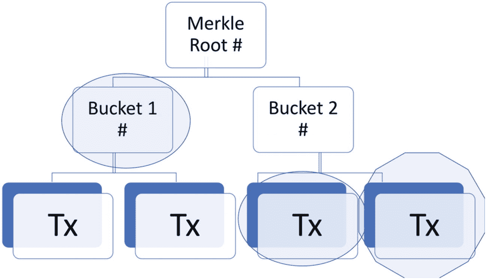

# 8. 未来：区块链与更远的前景

区块链详解 面向大数据真实性的区块链 未来方向 总结

据一句梵语谚语所言，这个世界的根基在于金钱。当世界将金钱的信任完全寄托于一项技术——既无政府支持，亦无人力担保——这项技术本身必须完全值得信赖。区块链正是这样一门技术，它正在革新全球交易的方式，并显著提升数据的真实性。基于区块链技术的加密货币正迅速在全球获得认可。以比特币为例，作为最流行的加密货币之一，其在 2017 年底的市值超过 3000 亿美元，堪比 Facebook 等公司。截至 2016 年初，包括比特币在内的所有加密货币的总市值约为 70 亿美元。显然，其迅猛的增长有力地证明了该技术所蕴含的巨大潜力。鉴于加密货币缺乏政府的支撑或背书，它们所享有的信任几乎完全归功于其底层技术——区块链。

在第六章“形式化方法”中，我们解释了如何将信息的底层表示转换为逻辑形式，以提高其可验证性，从而提升真实性。一方面，这是大数据应用方式的一个根本性转变。而另一方面，区块链则可以推动大数据生成方式的根本性变革。当生成大数据的数据源通过区块链技术进行追踪时，数据的真实性便得到了显著增强。区块链构建了一个无需信任的网络，网络参与者之间互不信任，但由于底层技术的存在，他们之间的交易依然可以完全信赖。

假设有一个小世界——一个封闭的世界，其中任何新信息只有在被世界内所有成员认可为真时，才被认为是真实的。这个封闭世界里的每个人都知晓每一个事实。如此一来，谎言便无处遁形。区块链试图构建一个完全数字化的理想世界。这个概念类似于我们在第六章“形式化方法”中提到的封闭世界假设（CWA）。我们看到 Prolog 程序如何包含一个由事实和规则组成的知识库（`KB`），任何新的陈述都必须与现有的`KB`保持一致，这一点通过推理过程来验证。如果新声明与当前`KB`中的事实不符或无法由其推导而出，那么它就不能被加入`KB`。图 8-1 阐释了这一概念。封闭世界中的每个参与者都知道所有事实，只有达成共识，声明才为真。

**注意：** 区块链是一种纯粹的技术解决方案，用以解决“说谎”这一主要的社会问题。

然而，区块链并非基于逻辑的方法。相反，它利用数据库、密码学和对等网络（`P2P`），为交易及其产生的海量数据构建一个真实、可信且防篡改的封闭世界系统。区块链有助于减少对公证人等中间人的需求，这些中间人通常被用来为交易建立信任，或需要中央机构来认证其有效性。它还有许多其他优势，例如提高交易效率、实现透明度以及自动支付的潜力。这项技术的重大贡献主要体现在提升由交易循环生成的数据的真实性上。交易数据是大数据演变过程中的重要组成部分。考虑到大多数大数据分析都基于交易数据，区块链有望开启一个数据质量无可妥协的新时代。

**图 8-1** 封闭世界中基于共识的真相

区块链的普及归功于其在加密货币中的应用。区块链填补了传统金融体系中的许多空白。它消除了集中控制的需求，并减少了系统中的低效率、成本和漏洞。不少区块链概念借用于金融世界。财务会计的真实性围绕着分类账本的概念展开。资金的流动和资产的转移在分类账中被详尽地追踪。分类账中的每一笔记录都是一次交易。支配这些交易的规则构成了合同。任何后续信息都可以通过与分类账核对来确认或反驳。

分类账构成了真相的基础，正如形式化方法中的知识库（`Knowledge Base`）一样。迄今为止，分类账主要用于金融信息的记录保存，并由银行和其他金融机构等可信权威机构集中维护。区块链使分类账变得更加普及，并极大地扩展了其应用范围，尤其是在物联网（`IoT`）的交易领域。我们之前讨论的“封闭世界”中的每个参与者都拥有一份相同的分类账副本。从这个意义上说，区块链可以被描述为一种分布式账本。分类账可以被视为一个没有修改功能的数据库。它为被追踪的任何事物都提供了可信的追踪记录。

**注意：** 区块链有潜力成为大数据不可变、防篡改、无处不在的分类账，从而从根本上解决数据的真实性问题。

## 区块链详解

图 8-2 展示的简单方案存在一些问题。如何确保封闭世界中的某一方不会恶意否认某笔交易，从而阻止共识的达成？如何防止有人篡改那些已被所有人遗忘的真相？如果某个参与者拒绝接受新数据又该如何应对？因此，我们需要增加更多要求来完善设计方案。这些要求可能包括：

*   交易应在**无信任环境**中运作，即无人信任他人，但交易本身仍需完全可信。

*   每位参与者手中的数据必须**不可篡改**，且与其他参与者的数据保持一致，这需要实现集体记账和透明度。

*   对于所涉及的数据是否真实，参与者之间必须达成**共识**。

*   为了广泛适用，数据必须具有足够的通用性，不能局限于某一种计量单位。

*   为了扩展应用范围，参与者不必一定是人类。

根据以上要求，衍生出一些实现上的必要条件：

*   每位参与者的信息必须**数字化**，从而形成数字账本。

*   过程应尽可能实现**完全自动化**，避免人为因素介入，以消除主观性。

*   为确保数据**防篡改**，需要引入密码校验和，或者更优的密码哈希函数（下文将解释）。

*   数据必须按**时间顺序**记录，并且为保持时序，数据块必须像链条一样链接起来。

*   必须有**复制流程**，确保分布在各参与者手中的数字账本副本保持一致。

*   为防止恶意的黑客攻击和添加虚假信息块，添加区块的过程必须**具备一定难度**。

*   由于我们处理的是大数据，需要采用高效的数据结构来处理信息，以减少带宽、存储和计算资源消耗。

> **注意**
>
> 区块链解决方案的新颖之处在于，它将一系列已知的解决方案整合在一起来解决一个重要问题。

### 密码哈希函数

`安全哈希算法`（`SHA`）值正越来越多地被用作标识对象和确保数据段完整性的签名。流行的版本控制系统 Git 就严重依赖`SHA`值（读作“sha”）来存储数据和后续识别数据。`哈希`是一种将值映射到其标识符的数据结构，就像标签标识包裹一样。哈希函数是一种数学函数，它能够从任意大小的数据中生成固定大小的标识符。一个简单的例子是，将全名映射为由姓氏和名字的首字母组成的缩写。全名的长度可以是任意的，但哈希函数始终只生成两个字母。

密码哈希函数对哈希函数施加了更多限制。最重要的是**抗碰撞性**。当哈希函数对两个不同的数据段返回相同的标识符时，我们就说发生了哈希碰撞。例如，在前一个例子中，`Vishnu Pendyala` 和 `Victor Peng` 的哈希值就发生了碰撞。密码哈希函数能确保碰撞极难发生。例如，使用美国国家标准与技术研究院（`NIST`）发布的 `SHA-1` 函数，发生碰撞的概率是 `2⁸⁰` 分之一——这意味着需要进行这么多次暴力破解迭代，才能产生一次碰撞，而这需要消耗巨大的计算能力和高昂的货币成本。

密码哈希函数的另一个重要特性是，即使对数据做非常微小的改动，也会导致哈希值发生巨大变化，以至于改动前后的值之间没有任何相似性或关联性。密码哈希函数的这一特性以及其他特性，使得几乎不可能通过哈希值反推出原始数据，并且即使对原始数据进行轻微篡改，也会导致哈希值变得完全无法识别。因此，哈希值成为了其所代表数据的真实且唯一的签名。

很容易看出密码哈希函数如何帮助实现区块链。当数据块通过其签名哈希值链接在一起时，除非改变链中所有区块的签名，否则就无法篡改数据。

从以上要求可以清楚地看出，我们需要一种类似于链表的数据结构，且该结构必须防篡改。这种数据结构就是**区块链**。它是一条由数据块组成的链，按时间顺序记录，并使用密码哈希函数在时间上“封存”。它充当了记录持续交易活动的账本。该数据结构在**点对点**（`P2P`）网络**上共享，没有单点故障**。因此，区块链中的数据可以由 `P2P` 网络上的任何实体进行审计。该实体可以是一个自主代理。这种数据结构可用于跟踪任何有跟踪价值的事物，而不仅仅是金钱或资产，尽管它在金融应用中可以发挥更大的作用。区块链也可以被视为一个**操作系统**，像加密货币这样的应用程序就在其上运行。

区块链构成了所有参与者都拥有的分布式账本。理解区块链的一个很好的类比是在线**大富翁**游戏。每位玩家都必须拥有一份当前游戏状态的副本。所有玩家必须同意棋盘上的每一步棋和每一笔交易。这些移动和交易是不可更改的——过去是不可变的。每位远程玩家都有一个棋盘副本，就像区块链账本一样。每一步棋都可以触发一条规则，即执行一个**智能合约**——之所以说“智能”，是因为合约的实现是在软件中自动完成的。智能合约功能可以在**自主系统**（无需任何人工干预即可运行）的发展中发挥关键作用。

> **注意**
>
> 有多种方式可以理解区块链——它可以被看作一个数据库、一个操作系统、一个账本、一个软件数据结构，或是一个棋盘游戏。

*图 8-2 – 区块链示意图*

尽管区块链用于跟踪任何实体，但我们将区块链跟踪的实体称为`资产`。区块链中的资产通过其哈希值（类似于签名——一个唯一标识符）进行跟踪。一个`区块`是账本中的一系列交易，以及前一个区块的密码哈希值和其他一些元数据。图 8-2 展示了其示意图。每个区块包含许多在图中记为 `Tx` 的交易，这些交易由其密码哈希值“封存”，该哈希值被保存在下一个区块中。正是对前一个区块哈希值的引用，形成了按时间顺序链接的效果。区块之间的箭头表示对前一个区块哈希值的引用。

哈希值是根据区块内容（即交易列表）生成的，并唯一标识该内容，如“加密哈希函数”方框中所解释的那样。正如上文所指出的，`SHA-1`中的碰撞极为罕见，且在`SHA-2`算法集中至今尚未发现。因此，我们可以合理安全地假设哈希值唯一代表了区块中包含的信息。对内容的任何微小改动（例如篡改）都会显著改变哈希值。这被称为`雪崩效应`。第一个区块称为创世区块，由于没有前一个区块，因此不存储任何引用。

这种简单的链式结构确保了区块内容无法被篡改。对任何区块中信息的篡改都会显著改变其哈希值。由于该哈希值存储于下一个区块中，因此下一个区块的哈希值也会随之改变，并依次传递。除非改变区块链中的每一个后续区块，否则无法更改任何区块的内容。还必须注意的是，加密哈希值具有另一个称为`原像抗性`的属性，这意味着即使我们知道哈希值，也无法生成其所代表的信息。加密哈希值的所有这些特性使其非常适合在区块链中使用。

> **注意**
>
> 根据设计，区块链会随着时间推移和区块数量的增加而变得愈发不可篡改。

区块中存储的交易也被表示为一个加密哈希树，称为`默克尔树`。默克尔树是一种软件数据结构，其中信息记录（此处为交易）作为图的叶节点存储并相互连接。它是一个看起来像倒置树的图，根在顶部，并在每一级分支。它是一个二叉树，任何节点下都有两个子节点，每个节点由其两个子节点的哈希值标记。此加密哈希值是对单个交易篡改的进一步防护。

图 8-3 展示了一个区块中交易的默克尔树。交易被分为两个一组。如果交易数量为奇数，则最后一个交易被复制以使数量变为偶数。每个两个节点组的哈希值存储在父节点中。树自底向上生长，计算每一级各组的哈希值，直到顶部最终得到一个单一的根。图 8-3 只有四个交易，因此三个层级就足以构建默克尔树。如果再多两个交易，我们就需要在较低层级之上新增一个节点层级，用于存储各组的哈希值。默克尔树数据结构通过追踪树中的哈希值，进一步帮助验证交易的完整性。

> **注意**
>
> 密码学是贯穿众多安全解决方案的共同主题。

除了哈希值，每个区块还包含更多元数据。它包含时间戳，即区块以 Unix 纪元形式创建的秒数。凭借加密哈希值，此时间戳也变得不可篡改，并进一步保护时间顺序不受任何篡改。交易默克尔树顶部的默克尔根哈希值也存储在元数据中。将默克尔根哈希存储在元数据中极大地简化了验证过程。这使得轻量级实体也能够加入区块链的 P2P 网络。轻量级实体无需保存整个交易树（可能达到数吉字节），它们只需存储默克尔根。只有全服务实体才存储整个默克尔树。

为了验证一个交易记录是否存在于某个区块中，P2P 网络上的轻量级实体只需要元数据，通常每个区块 80 字节，其中包含默克尔根哈希。它可以查询区块链上的任何全服务节点，以返回交易的默克尔路径，该路径包含从交易叶节点到达根节点所需的节点。在图 8-3 中，为了验证多边形中的交易是否在区块内，所需的默克尔路径仅包含两个圈出的节点——与该交易相邻的节点以及标记为“Bucket 1 #”的节点。如果任何全服务实体提供了这两个节点，就可以验证该默克尔路径是否确实通向元数据中的根。在此过程中，轻量级节点需要计算“Bucket 2 #”。

**图 8-3**
区块中的交易默克尔树及默克尔路径

当交易数量增加时，默克尔树极为有用。在图 8-3 的例子中，只有四个交易，我们需要默克尔路径中的两个节点才能到达根。通常，我们需要 `ceil(log[2]N)` 个节点用于默克尔路径，其中 `N` 是交易数量。例如，如果我们有 16,777,216 笔交易，我们只需要 `log[2]16777216 = 24` 个节点，这在网络带宽、计算能力和存储空间方面是巨大的节省。

> **注意**
>
> 默克尔树证明了表示方式带来的巨大差异，也说明了为什么形式化方法和知识表示是解决真实性问题的关键。

发送垃圾邮件通常是因为发送垃圾邮件的成本不高。为了避免类似情况发生在向区块链添加区块上，想要添加区块的竞争者需要解决一个耗时 10 分钟的数学难题。这个难题是生成一个小于给定值的哈希值。回到我们的垄断棋盘游戏例子，这就像要求在线玩家在移动之前先掷骰子，得到一个小于特定值的数字。数字越低，难度越大。如果目标是得到一个小于 12 的数字，那么除了两个骰子都显示 6 的情况外，所有投掷结果都有效。满足要求可能不需要一分钟。但如果目标是得到一个小于 3 的数字，则可能需要反复掷骰子几分钟才能得到 2。

哈希值对于给定的消息是唯一的。那么，我们如何生成一个小于给定值的哈希值呢？要生成新的哈希值，它所代表的信息需要改变。区块中的信息通过添加一个 `nonce` 值来改变。`Nonce` 是一个 4 字节的数字，它会改变计算出的哈希值。由于哈希算法的雪崩效应，对 `nonce` 值的微小改动会导致加密哈希值的巨大差异。与英文单词的本意相符，`nonce` 只使用一次来为加密哈希生成新值。如果生成的哈希值符合条件并解决了难题，该 `nonce` 就会被记录在区块头中，并且该区块会被提交以加入链中。然而，如果 `nonce` 未能帮助生成符合条件的新哈希值，它就会被丢弃并分配一个新的值。因此，改变 `nonce` 类似于掷骰子以获得一个新值。

谜题的目标通常是生成一个具有指定数量前导零的加密哈希值。换句话说，生成的哈希值必须小于一个给定值。例如，如果目标是在 32 字节的十六进制哈希值中生成 60 个前导零，这可以转化为一个约束条件：生成的哈希值必须小于`0x10000000`。前导零的数量越多，生成它的难度就越大。因此，这里涉及一个难度系数，该系数也被记录在区块头中。破解谜题的节点就被认为生成了工作量证明。这种破解谜题的高计算量过程被称为挖矿。

破解谜题的试错过程基本是以蛮力方式进行的。`nonce`值在每次迭代中简单地递增，并针对这个新的`nonce`计算哈希值。一旦哈希值具备所需数量的前导零，迭代过程便停止。区块链算法确保解决谜题总是需要 10 分钟。这个时间取决于计算能力和难度系数。随着计算能力随时间增长，难度系数也需要增加，以将时间恒定保持在 10 分钟。难度系数会针对固定数量的区块进行调整。

> **注意：** 区块链是多种成熟技术的集合体，旨在确保在一个完全无需信任的环境中也能完全信任的安全交易。

## 区块链与大数据真实性

区块链最大的贡献在于提供了一种可信的方式来追踪数据的生成。区块链技术在物联网和大数据时代尤其有用。这可以通过联网汽车的例子来理解，预计这类汽车每小时会产生数千兆字节的数据。这些数据被发送到云端进行处理。自动驾驶和联网汽车由于对数据的过度依赖，容易受到黑客攻击。但是，当汽车生成的每一比特数据都被追踪并对审计开放时，黑客攻击的可能性就会大大降低或完全消除。

区块链可以实现大数据源的去中心化控制。得益于智能合约特性，数据源自主运行的可能性越来越大，从而减少了主观性、人为错误和欺诈的空间。区块链所依托的点对点网络可以跨越国界，并且由于共识机制，可以消除特定国家的偏见和篡改行为。共识机制确保不正确的区块无法进入系统。任何攻击都可能导致拒绝服务，但无法篡改区块，尤其是那些位置靠后的区块，因为篡改意味着要修改被篡改区块之后的每一个区块。

## 未来方向

很少有技术能够催生改变世界的应用。区块链对涉及价值实体的交易所产生的影响，可能类似于 TCP/IP 对信息流所产生的影响。TCP/IP 成就了互联网。区块链则正在赋能信任和真实性。区块链仍在不断发展。随着时间的推移，将会有许多区块链投入使用。物联网的爆发必将确保区块链的广泛应用。制定互操作性和实现方面的标准势在必行。开发工作需要工具支持。需要广泛提供 API 和工具来协助构建区块链的过程。

目前，区块添加的速度似乎无法扩展到区块链的预期用途。对于大规模应用，交易处理速度需要大幅提升。在广泛应用的场景下，所涉及的成本也相当可观。鉴于当前的成本，对于许多能够从精确追踪中受益的事情来说，使用区块链并不划算。尽管有各种保障和安全措施，区块链仍然容易受到攻击，例如拒绝服务攻击。随着区块链应用的增长和演变，更多的问题可能会被发现和解决。从长远来看，最大的影响可能在于大数据真实性，而非其他方面。越来越多产生大数据的数据源将加入区块链，从而提高它们生成数据的质量。

> **注意：** 区块链是一项关键赋能技术，也是未来重要的商业驱动力。

## 总结

区块链技术实现了安全校验的完美组合，用于追踪和审计，极大地提升了大数据真实性的维度。在本章中，我们研究了构成区块链特征的多种技术，并简要探讨了区块链如何帮助提高大数据的真实性。时间顺序、信息的不可篡改性、无处不在的元数据，以及自动执行规则的智能合约，都使区块链成为解决影响大数据真实性问题的有前景方案。

### 练习题

1.  如果我们使用区块链技术的唯一目的是确保数据真实性，我们能否进一步简化它？如果可以简化，那么它能否应用到除交易之外的更多场景？

2.  社交媒体构成了大数据的重要组成部分。评估区块链技术在解决社交媒体真实性问题上的适用性。
