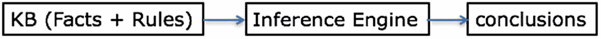
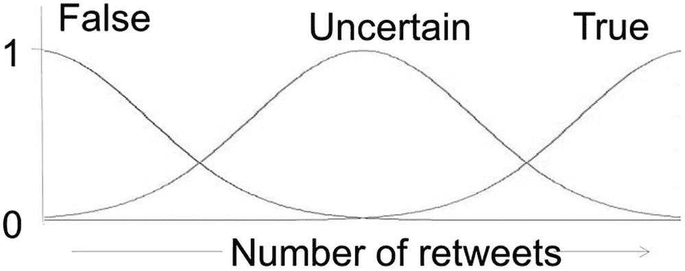
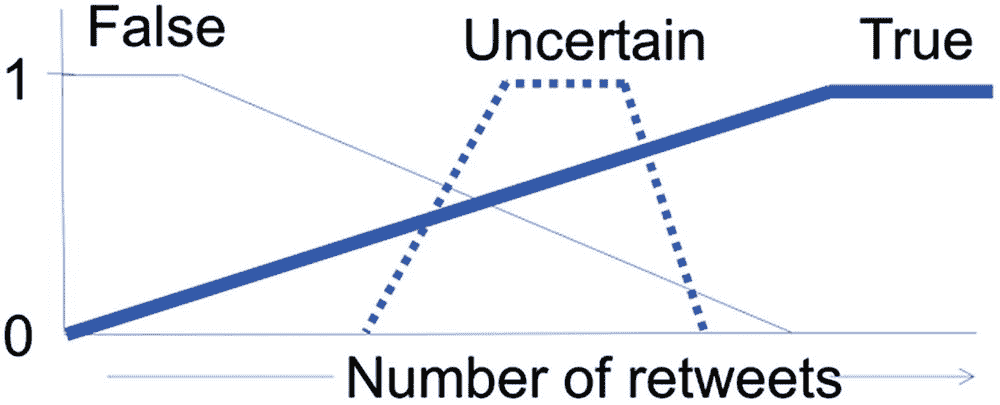

# 6. 形式化方法

术语 命题逻辑 谓词演算 模糊逻辑 小结

我们能否为真实信息设定一套语法？当作者在一些会议上向听众提出这个问题时，答案绝大多数是“不能”。确实，常识告诉我们，真实性更多与语义相关，而非语法。处理语义，尤其是自然语言的语义，远比处理语法复杂得多，这使得真实性发现成为一项艰巨的任务。数学再次伸出援手，这次以不同的形式出现。本章中的数学直击问题的核心——信息表示。信息的表示在处理信息的算法中起着关键作用。表示越精确、越形式化，信息就越适合进行自动化处理。

表示在日常生活中的影响也很大。当思想以攻击性、好斗、对抗性的语言表达时，问题往往会升级。同样的思想，如果用有益、真实、支持性的句子表达，实际上可以解决问题。熟悉计算机科学中数据结构的人很容易理解，将数据表示为链表、栈或哈希表，如何对解决问题产生巨大影响。在本章中，我们将研究用逻辑符号表示数据，并利用这种表示来解决真实性问题。在语义网中使用的三元组存储是大数据中运用逻辑的一个很好示例。三元组存储使用资源描述框架（`RDF`）进行数据表示。本章介绍的技术要求对大数据表示方式进行类似的转变。

之前的方法是事后追溯式的——我们检查已经发生过的事情并判断其真实性。迄今为止的方法无法直接用于预防错误信息。它们只能帮助控制错误信息。如果我们能为真实信息施加一套语法，或许就能防止错误信息甚至进入系统。毕竟，信息最初的形式只有真理。只有当思想、互动和行为开始被扭曲后，人们才发明了语言结构来表达错误信息。

如果表示可以被再次限制为一套严格有效的结构，就有可能构建完全可靠的系统，而不给不精确和虚假信息留有任何空间。这些想法并不像看起来那样遥不可及。上一章讨论的区块链技术，就是一个接近构建完全可靠、可信任系统理念的例子。通过利用表示结构，可能很快就能构建出完全可靠的系统。当然，表示必须由定义清晰的语义来支持，这些语义有助于推导真实性或非真实性。

> **注**
> 知识和信息表示在系统演进中始终发挥着重要作用，并将继续如此。

形式化方法是用于对计算系统进行严格表示的数学技术，以帮助进行系统设计和验证。这些方法是形式化的，因为其规范和操作是精确的并且符合规则。关于系统行为和属性的数据，以便于推导的简洁语法被捕获。数学逻辑是形式化方法的组成部分之一。正如我们将看到的，逻辑完全关乎语法以及用于对语法进行操作的公理和规则。验证、推理或证明真实性，变成了策略性地应用公理和规则，将信息转化为蕴含真实性或非真实性的过程。当数据使用逻辑结构表示时，它通过将真实性问题转化为逻辑推理问题来帮助解决该问题。

> **注**
> 形式化方法提供了强大的技术，能够使用标准化语法将关于系统的一般描述转化为精确的规范语言，并以日益自动化的方式进行推理。

形式化规范有助于检查一致性，但可以理解的是，它并不能保证是完备的。不可能捕捉到与系统相关的每一个细节以使规范完备。因此，通常的假设是，如果一个语句在系统中未被证明为真，则假定它为假。这被称为封闭世界假设。直观上，句法操作（如同在自动推理中使用的那样）不太可能使用领域特定的规则和知识；因此它被认为是一种弱方法。然而，有些软件程序（如专家系统）基于逻辑，能够将领域知识捕获到规则库中，从而提供更强的推理方法。

系统需求和描述有时是模糊且不一致的。将它们转化为形式化规范会揭示出任何此类不精确性并将其消除。因此，知识表示在防止错误信息进入系统方面大有可为。任何需要成为系统一部分的新语句都需要经历蕴含验证过程，这确保了被接受的语句是真实的。`IBM`、`微软`和`英特尔`等许多公司已成功将形式化方法用于软件和硬件验证。

我们在第 3 章中简要介绍过基于形式化方法的一些方法。以下各节将更形式化地论述这一主题。

## 术语

在前言以及本章开头，我们已经使用了形式化方法领域中的一些术语。现在，让我们使用更精确、更严格的术语来正式定义更多的概念。这些术语及其定义紧密遵循现实世界的现象，因此，正如我们在第 3 章和本章开头几段所看到的，它们不需要过多的解释。首先，`proof`是最有用的概念。`证明`是一种论证形式，由一系列遵循少量推理规则的步骤组成。这些规则有助于从前述陈述中得出结论。`证明`的目标是证明某事物为真。如果目标失败且无法被证明为真，则在封闭世界假设（`CWA`）中，它被假定为假。

通过形式证明被证明为真的陈述称为`theorem`。有时，定理的证明会变得非常长。在这种情况下，`lemma`被用作中间定理，用于另一个定理的证明过程中。一个定理通常会引出其他结论，称为`corollaries`。这些也是定理，可以从已经证明的其他定理中推导出来。在现实世界中，我们发现许多事实是不证自明的，不需要证明。这些是作为起点的基本真理。用来表示这种始终被假定为真的基本真理的术语是`axiom`。

如果我们不能同时证明一个定理及其逆命题，则称该系统是一致的。一个相同的概念是可靠性，它要求所有可证明的陈述都为真。通常，研究论文会因工作不具可靠性而被拒稿。为了急于发表更多论文，一些研究人员试图证明他们的假设，而这些假设可能并非为真。编辑委员会会将此类论文退回，并附上评论称该工作不可靠。在所有可能的解释中均为真的表达式称为`tautology`。另一方面，始终为假的陈述称为`contradiction`。不属于这两类的陈述称为`contingents`。

正如我们将看到的，定理证明是如此机械化，以至于构建证明的过程可以被编写成计算机编程语言。这种自动定理证明（`ATP`）广泛应用于数学、软件设计与验证以及硬件验证的各种应用中。目前有许多成功的`ATP`系统在使用中。还有许多其他术语，其中一些将在我们学习本章的过程中逐步介绍。目前，我们已经掌握了足够的专业术语，可以开始讨论当我们的数据以逻辑符号表示时，如何解决真实性问题。

> **注意**
> 形式化方法包含许多定义明确的术语，这些术语本身也是形式化陈述的，没有任何歧义。

## 命题逻辑

一个`proposition`是可以为真或假的陈述。命题可以通过逻辑连接词进行连接。命题逻辑提供了连接或改变命题以构建其他命题的方法。通过使用 `and`、`or` 组合自然语言句子的常见方式同样适用于命题逻辑。命题可以使用诸如 `and` 和 `or` 之类的运算符进行组合。同样，就像使用 `not` 来改变英语句子的含义一样，它在命题逻辑中也被用作具有相同语义的运算符。所有这些听起来都像英语和其他自然语言。那么，逻辑在处理真实性问题时如此有用的不同之处是什么呢？正是数学抽象赋予了这些概念将真值问题转化为数学推理问题的能力。

数学需要符号。表 6-2 至表 6-5 展示了我们在上一段讨论的运算符的语义。`negation` 运算符只是将真命题的值改为假，反之亦然。这些语义解释非常直观，并且紧密遵循现实世界的解释。例如，两个由 `and` 运算符连接的真陈述会产生一个真陈述。如果这两个陈述中的任意一个为假，则 `and` 合取产生的陈述将为假。例如，如果“约翰英语成绩为 A”和“约翰科学成绩为 A”是真陈述，那么组合陈述“约翰英语成绩为 C 且科学成绩为 A”直观上是假的，并且根据表 6-2 的真值表判断，它也是假的。表中的 `T` 代表真，`F` 代表假。

运算符可以在一个句子中任意多次使用。例如，`(p → q) ∧ (q → p)` 是一个有效的句子。事实上，如果为这个表达式绘制真值表，可以验证它等同于 `(p ↔︎ q)`。真值表同样用于确定不同表达式的等价性。使用真值表，可以确定 `(p ∨ ¬p)` 是一个永真式，而 `(p ∧ ¬p)` 是一个始终为假的矛盾式。还可以确定 `(p → q)` 等同于 `(¬p ∨ q)`，并且 `¬(p ∨ q)` 等同于 `(¬p ∧ ¬q)`。

**表 6-2** 合取 `and` 运算符的语义

| 命题 p | 命题 q | `p ⋎ q` |
| --- | --- | --- |
| `T` | `T` | `T` |
| `T` | `F` | `T` |
| `F` | `T` | `T` |
| `F` | `F` | `F` |

**表 6-3** 析取 `or` 运算符的语义

| 命题 p | 命题 q | `p ⋎ q` |
| --- | --- | --- |
| `T` | `T` | `T` |
| `T` | `F` | `T` |
| `F` | `T` | `T` |
| `F` | `F` | `F` |

**表 6-4** 蕴含运算符的语义

| 命题 p | 命题 q | `p → q` |
| --- | --- | --- |
| `T` | `T` | `T` |
| `T` | `F` | `F` |
| `F` | `T` | `T` |
| `F` | `F` | `T` |

**表 6-5** 等价运算符的语义

| 命题 p | 命题 q | `p ↔︎ q` |
| --- | --- | --- |
| `T` | `T` | `T` |
| `T` | `F` | `F` |
| `F` | `T` | `F` |
| `F` | `F` | `T` |

**表 6-6** 蕴含式的逆命题、否命题和逆否命题

| 符号 | 含义 |
| --- | --- |
| `p → q` | 如果 `p` 则 `q` |
| `q → p` | 第一行的逆命题（如果 `q` 则 `p`） |
| `¬p → ¬q` | 第一行的否命题（如果非 `p` 则非 `q`） |
| `¬q → ¬p` | 第一行的逆否命题（如果非 `q` 则非 `p`） |

## 命题逻辑基础

| 命题 p | 命题 q | `p ⋏ q` |
| --- | --- | --- |
| `T` | `T` | `T` |
| `T` | `F` | `F` |
| `F` | `T` | `F` |
| `F` | `F` | `F` |

**表 6-1** 命题逻辑符号

| 符号 | 含义 |
| --- | --- |
| `⋏` | 且（合取） |
| `⋎` | 或（析取） |
| `→` | 如果（蕴含） |
| `¬` | 非（否定） |
| `↔︎` | 当且仅当（等价） |

表 6-6 展示了术语 `converse`、`inverse` 和 `contrapositive` 的语义，这些术语在构造引理、定理的证明以及推导推论时有时会派上用场。其解释同样非常直观。假设 `p` 代表“约翰成绩为 A”，`q` 代表“约翰学习努力”。那么它们蕴含式的 `逆否命题` 就是“如果约翰不努力学习，那么约翰成绩不会为 A”。

可以看出，随着我们围绕信息表示发展出更多数学工具，我们用来判断复杂陈述真伪的手段也越来越多。真值表就是其中一种工具。然而，如果表达式中有 `n` 个命题，表中就需要 `2^n` 行和相应数量的计算。显然，这种计算将变得难以处理。因此，大多数逻辑系统依赖于推理规则。真伪可以通过真值表逐行检查，或运用推理规则来判断。我们在第 3 章中看到了一个名为 `modus ponens` 的推理规则示例。表 6-7 列出了更多此类规则。请注意，表格中的 `c` 代表矛盾。如果第二列中给出的命题为真，则第三列中的命题也可以推断为真。因此，给定的表达式可以被转化为推断出的表达式。

> **注意**
>
> 推理规则！

**表 6-7** 命题逻辑的推理规则；`c` 代表矛盾

| 推理规则 | 已知前提 | 推断结论 |
| --- | --- | --- |
| 肯定前件 | `p`, `p → q` | `q` |
| 否定后件 | `¬ q`, `p → q` | `¬ p` |
| 一般化 | `p` 或 `q` | `p ∨ q` |
| 特殊化 | `p ∧ q` | `p` 或 `q` |
| 合取引入 | `p`, `q` | `p ∧ q` |
| 替换 | `p → q` | `¬ p ∨ q` |
| 选言三段论 | `p ∨ q`, `¬ p` | `q` |
| 选言三段论 | `p ∨ q`, `¬ q` | `p` |
| 传递性 | `p → q`, `q → r` | `p → r` |
| 矛盾 | `¬ p →` | `p` |
| 情况分析 | `p ∨ q`, `p → r`, `q → r` | `r` |

与 `modus ponens` 的情况类似，这些规则是相当直观的。以表 6-7 中描述的 `Disjunction Syllogism` 为例。设 `p` 代表“约翰很聪明”，`q` 代表“约翰考试不及格”。如果我们知道 `¬p` 和 `p ∨ q` 为真，意味着“约翰不聪明”且“要么约翰很聪明，要么约翰考试不及格”，那么直观上，“约翰考试不及格”必然为真。表 6-7 中 `Disjunction Syllogism` 一行实质上确认了这一点。同样，`transitivity` 规则也可以直观理解。如果约翰很聪明，那么约翰会通过考试；如果约翰会通过考试，那么约翰会毕业。根据前面这些蕴含式，可以推断出：如果约翰很聪明，那么约翰会毕业。表 6-8 给出了一个逻辑恒等式列表，其中 `LHS` 与 `RHS` 相同。这些恒等式可以通过为 `LHS` 和 `RHS` 构建真值表来验证。这些逻辑恒等式在展开证明时也很有用。

表 6-7 中的规则也有不同的名称。例如，`Generalization` 规则也称为 `or introduction`，有时记作 `∨I`——第一个符号代表“或”，第二个代表“引入”。这是因为我们从前提开始，然后在 `RHS` 上引入 `or`。类似地，`Specialization` 等同于 `and Introduction`，记作 `∧I`。必须注意，所有推理规则都可以被证明是可靠的。

> **注意**
>
> 推理所需的语义被封装在命题逻辑的语法中，因此定理证明或推导真伪的任务就简化为句法操作。

**表 6-8** 命题逻辑恒等式

| 恒等式名称 | 左边 L.H.S. | 右边 R.H.S. |
| --- | --- | --- |
| 同一律 | `p ∧ T` 和 `p ∨ F` | `p` 和 `p` |
| 幂等律 | `p ∨ p` 和 `p ∧ p` | `p` 和 `p` |
| 德摩根律 | `¬(p ∧ q)` 和 `¬(p ∨ q)` | `¬p ∨ ¬q` 和 `¬p ∧ ¬q` |
| 交换律 | `p ∨ q` 和 `p ∧ q` | `q ∨ p` 和 `q ∧ p` |
| 吸收律 | `p ∨ (p ∧ q)` 和 `p ∧ (p ∨ q)` | `p` 和 `p` |
| 否定律 | `¬(p → q)` 和 `¬(p ↔ q)` | `p ∧ ¬q` 和 `¬p ↔ q` |
| 分配律 | `p ∧ (q ∨ r)` 和 `p ∨ (q ∧ r)` | `(p ∧ q) ∨ (p ∧ r)` 和 `(p ∨ q) ∧ (p ∨ r)` |
| 结合律 | `(p ∨ q) ∨ r` 和 `(p ∧ q) ∧ r` | `p ∨ (q ∨ r)` 和 `p ∧ (q ∧ r)` |
| 双重否定律 | `¬(¬p)` | `p` |
| 蕴含律 | `p → q` 和 `p → q` | `¬p ∨ q` 和 `¬q → ¬p` |
| 双条件律 | `p ↔ q` 和 `p ↔ q` | `¬q ↔ ¬p` 和 `(p → q) ∧ (q → p)` |

利用推理规则、给定公理和逻辑恒等式，证明通过用推断表达式替换给定表达式机械地进行。因此，证明变成了一系列句法替换，每次替换都保持了真值不变。让我们考虑一个示例问题。在约翰的学校，要注册 `COEN498`，他必须先完成 `COEN490` 以及 `COEN200` 或 `COEN220` 中的一门。`COEN498`、`COEN490`、`COEN200` 和 `COEN220` 是该学校提供的不同课程。我们知道约翰没有完成 `COEN200`，但完成了 `COEN498`。约翰声称他完成了 `COEN220`。他说的是真话吗？

使用命题逻辑查找真值的第一步是，利用我们刚学过的记号将问题转化为命题。我们首先建立以下命题：

- `p` 代表“约翰完成了 `COEN498`”
- `q` 代表“约翰完成了 `COEN490`”
- `r` 代表“约翰完成了 `COEN200`”
- `s` 代表“约翰完成了 `COEN220`”

现在，问题是在给定以下前提的情况下证明 `s`：

```
p → q ∧ (r ∨ s)
```

(6.1)

```
p
```

(6.2)

```
¬r
```

(6.3)

我们从证明的前两条公理开始，依次应用基于推理规则的代换，并在适当时使用第三条公理。该证明见表 6-9，它证实了约翰的主张是正确的，并且他确实完成了 `COEN220` 课程。从表中可以看出，该证明纯粹是句法层面的，这进一步佐证了我们在本章开头提出的问题。从公理出发，逐步应用规则以达成目标的方法称为 `正向链接`。另一方面，从目标出发反向推导至公理的方法称为 `反向链接`。这两种算法都可以被证明是可靠且完备的，其复杂度为 `O(n)`，其中 `n` 是由给定的前提集合构成的知识库的大小。

> **注**
>
> 正向链接是数据驱动的，而反向链接是目标驱动的。

### 表 6-9 约翰完成 COEN220 课程的证明

| 序号 | 变换 | 应用的规则 |
| --- | --- | --- |
| 1 | `p → q ∧ (r ∨ s)` | 给定公理 |
| 2 | `p` | 给定公理 |
| 3 | `q ∧ (r ∨ s)` | 对 1 和 2 应用假言推理 |
| 4 | `r ∨ s` | 特化规则 |
| 5 | `¬r` | 给定公理 |
| 6 | `s` | 对 4 和 5 应用选言三段论 |

在上述例子中，我们从若干前提（6.1）、（6.2）、（6.3）出发，并由此推断出 `s`。通常，当数据使用逻辑符号表示时，真值验证问题可以转化为：给定若干前提 `p[1]`、`p[2]`、`p[3]`、…、`p[n]`，推导出结论 `s`。这可以表示为：

```
p1, p2, p3, ..., pn ⊢ s
```

(6.4)

像 (6.4) 这样，从一组给定前提推导出结论的表达式称为 `sequent`。用于此类证明的逻辑系统称为 `sequent 演算`。

一种成功运用了上述部分概念的语言是`Prolog`。一个`Prolog`程序包含用户提供的知识库（`KB`），该知识库由一组事实和规则组成。`Prolog`的推理引擎主要基于单一的推理规则——假言推理。利用用户提供的`KB`和推理引擎，`Prolog`能够得出结论并判断某个主张为真还是为假。图 6-1 对此进行了说明。`KB`中的事实和规则以子句的形式存在。子句是通过析取（或运算）连接的字面量。字面量是原子命题或其否定形式。`Prolog`程序中的事实和规则称为`霍恩子句`，以逻辑学家阿尔弗雷德·霍恩的名字命名。



**图 6-1** 在 Prolog 中判定真值

如今，`Prolog`甚至以意想不到的方式被应用于诸如代码审查工具`Gerrit`等应用程序中。它曾在欧洲和日本被广泛使用，特别是在 20 世纪 80 年代至 90 年代初期的第五代计算机项目中。`Prolog`程序是一组霍恩子句，并附加了一些增值功能，例如对算术函数的支持以及用于防止回溯的截断（cut）等结构。对新主张真伪的评估通过前面描述的反向链接进行。在反向链接过程中，回溯是指当当前子目标失败时，返回之前的分支点以查看是否存在其他解决方案的过程。

`Prolog`中的目标搜索以深度优先、从左到右的方式进行，这由以下两个子句中的递归表示。

```
dfs(X):- goal(X)
```

```
dfs(X):- successor(X, Subgoal), dfs(SubGoal)
```

`Prolog`中的运算符`:–`表示“如果”的意思。在上述两行中，`X`是一个变量。给定一个需要证明为真或假的目标，`Prolog`以如上递归方式进行。第一行是递归的终止条件。如果我们已有前提表明变量`X`代表了知识库，则第一个条件匹配，程序终止并针对给定目标返回`True`值。否则，第二条规则生效。`Prolog`会以深度优先搜索的方式遍历知识库，继续尝试该目标。根据前面讨论的封闭世界假设（`CWA`），如果`Prolog`无法证明该目标，则假定其为假。

> **注**

> 逻辑令人惊奇地将验证真理的问题转化为对符号的机械操作。

命题逻辑也称为`零阶逻辑`。其表达能力和功能是有限的。高阶逻辑（`HOL`）系统则更具表达能力和更强大。例如，一阶逻辑（`FOL`）允许对变量进行量化，二阶逻辑允许对变量集合进行量化，三阶逻辑允许对集合的集合进行量化，以此类推。利用量化，我们可以对数量进行操作，例如一个实体的所有实例或至少一个实例。对于大多数目的而言，一阶逻辑（也称为`一阶谓词演算`或简称为`谓词演算`）通常在复杂性限制内就足够了。我们将在下一节中探讨这种重要的逻辑阶，它是强大逻辑系统的基础。

## 谓词演算

到目前为止，我们还没有使用变量的概念。每个实体都是常量。想象一下没有变量概念的数学！我们仍然在没有使用任何占位变量的情况下做了很多工作。当我们谈论大数据时，我们应该能够表示许多变体，因此需要变量。现实世界的数据主要涉及实体的数量，这一点此前也未被使用。将两者结合，一阶逻辑（`FOL`）提供了对变量的量化能力，这是命题逻辑所不具备的。变量的数量方面通常在英语等自然语言中通过“存在”（there exists）和“对所有”（for all）等短语表达。这些短语表明了实体的数量；因此在逻辑中它们被称为量词。

命题要么为真，要么为假。它们的真值不会变化。例如，命题“玛丽是安的母亲”要么为真，要么为假。如果它为真，那么它始终保持为真。而谓词，例如“`x`是安的母亲”，则可以根据变量`x`的值而变为真或假。在这里，玛丽和安是常量符号，是现实世界中的实体。谓词表示一种关系。前面的谓词可以符号化地写为

```
Mother(x, Ann)
```

(6.4)

在上述 (6.4) 的谓词中，`x`和`Ann`被称为项，表示对象。上述谓词是二元的，因为它包含两个项。谓词可以使用我们在命题逻辑中使用的算子进行组合。例如，(6.5) 中的句子可以表示“玛丽是安的母亲，并且安是可可的母亲”。

```
Mother(Mary, Ann) ∧ Mother(Ann, Coco)
```

(6.5)

```
Mother(Mary, Ann) → Female(Mary)
```

(6.6)

句子 (6.6) 使用“如果”算子组合谓词，意思是“如果玛丽是安的母亲，那么玛丽是女性”。可以看出，在用一阶逻辑构建句子方面，它在表示数据和通过推理确定断言真实性方面起着关键作用。

如前所述，`FOL`提供了两个额外的算子：全称量词`∀`，意为“对所有”；以及存在量词`∃`，意为“存在”。使用全称量词，(6.6) 可以推广为下面的 (6.7) 和 (6.8)。(6.7) 可以解释为“对所有实体`x`，如果`x`是任何其他实体`y`的母亲，那么`x`是女性。”另一方面，(6.8) 可以解释为“存在一个实体`x`，使得如果另一个实体`y`是活着的，那么`x`是`y`的母亲。”

```
∀x Mother(x, y) → Female(x)
```

(6.7)

```
∃x IsLiving(y) → Mother(x, y)
```

(6.8)

从真实性的角度来看，我们主要关注推理真值。新的连接词将需要新的推理规则。就像在命题逻辑中一样，我们有两个量词的引入规则和消去规则。同样像在命题逻辑中一样，这些规则可以被证明是可靠的。让我们从最简单的开始——全称量词的消去。我们可以通过用特定实例实例化变量来消去`∀`算子。例如，在 (6.7) 中，我们可以用特定值“玛丽”实例化`x`，并消去全称量词。结果句子如下面的 (6.9) 所示。

```
Mother(Mary, y) → Female(Mary)
```

(6.9)

在 (6.9) 中，我们用常量“玛丽”替换了`x`。我们也可以用函数来实例化变量，例如`MotherOf(Ann)`，它看起来很像谓词，但非常不同。谓词要么为真，要么为假，没有其他情况。另一方面，函数在一个域中返回一个值。例如，`MotherOf(Ann)`可能返回“玛丽”，而`Mother(Mary, Ann)`只能返回`true`或`false`。我们也可以通过将 (6.7) 转换为下面的 (6.10) 来消去全称量词。

```
Mother(MotherOf(Ann), y) → Female(MotherOf(Ann))
```

(6.10)

必须注意，实例化必须在整个句子中一致地发生。因此，在 (6.9) 中，我们不能在左侧（LHS）用“玛丽”实例化`x`，而在右侧（RHS）用其他值实例化。全称量词消去规则记为`∀E`。

下一个更简单的规则是存在量词引入`∃I`，有时称为存在泛化。它很简单，因为如果一个句子对一个实例为真，那么我们可以泛化得出存在一个实体使得该句子为真。使用此规则，(6.9) 可以泛化为下面的 (6.11)。

```
∃x Mother(x, y) → Female(x)
```

(6.11)

我们在句子 (6.9) 中用变量`x`替换了“玛丽”，并引入了存在量词。

在一阶逻辑中构建证明有时需要引入全称量词，记为`∀I`。其目标是将像 (6.10) 这样的句子转换为像 (6.7) 这样的泛化形式。这只有在能够证明 (6.9) 中的值“玛丽”没有什么特殊性使得该句子仅对该实例为真，并且该句子对可以替换“玛丽”的其他值也为真时，才能做到。对于 (6.10) 的情况，这很容易证明，因为 (6.10) 是从 (6.7) 进行全称消去的结果。因此，在对同一句子进行全称消去后的一系列句子之后，可以很容易地对一个句子进行全称引入。

现在来看最难的规则，存在量词消去`∃E`。它可以用于将像 (6.11) 这样包含存在量词的句子转换为消去该量词的 (6.9)，方法是将变量`x`替换为一个特定值。但我们如何知道实例化的特定值使句子为真呢？因此，只有当能够证明特定实例在替换变量后，在整个句子中满足该句子时，才能进行存在量词消去。

让我们考虑一个例子。根据已知事实“班上有一名学生获得了 A 等”和“班上的每个学生都毕业了”，我们想知道老师声称的“毕业了的学生获得了 A 等”是否为真。与之前的命题逻辑示例一样，我们首先构建以下前提：

*   `Student(x)`表示“`x`是班上的学生”

*   `Agrade(x)`表示“`x`获得了 A 等”

*   `Graduated(x)`表示“`x`毕业了”

这里的论域，更正式地称为论域或话语域，是班上所有学生的集合。给定的前提可以写为下面的 (6.12) 和 (6.13)。

```
∃x (Student(x) ∧ Agrade(x))
```

(6.12)

```
∀x (Student(x) → Graduated(x))
```

(6.13)

需要评估其真实性的老师声称可以写为下面的 (6.14)。

```
∃x (Graduated(x) ∧ Agrade(x))
```

(6.14)

从表 6-10 的证明来看，老师声称 (6.14) 确实是真命题。

**表 6-10** 老师声称是真命题的证明

| 序号 | 转换 | 应用的规则 |
| --- | --- | --- |
| 1 | `$ \exists x\left( Student(x)\wedge Agrade(x)\right) $` | 给定前提 (6.12) |
| 2 | `$ \left( Student(joe)\wedge Agrade(joe)\right) $` | `$ \exists E\, from\, \#1, assuming\, joe\, satisfies\, (6.12) $` |
| 3 | `Student(joe)` | 对上面第 2 条的特化 |
| 4 | `$ \forall x\Big( Student(x)\to Graduated(x) $` | 给定前提 (6.13) |
| 5 | `$ Student(joe)\to Graduated(joe) $` | `$ \forall E\, from\, \#4\, above $` |
| 6 | `Graduated(joe)` | 对第 3 条和第 5 条应用肯定前件规则 |
| 7 | `Agrade(joe)` | 对第 2 条的特化 |
| 8 | `$ Graduated(joe)\wedge Agrade(joe) $` | 对第 6 条和第 7 条应用合取引入 |
| 9 | `$ \exists x\left( Graduated(x)\wedge Agrade(x)\right) $` | `$ \exists I\, into\, \#8\, above $` |

### 注意

逻辑是真理的语言。真理或其缺失，在经受逻辑检验时便得以显现。

## 模糊逻辑

前述讨论假设数据可以精确地表示，不带有任何歧义或不确定性。然而，这种精度对现实世界的要求过于苛刻——我们无法总是以绝对的真假或 1 和 0 来谈论事物。在机器学习的章节（第 5 章）中的 Twitter 示例里，我们看到无法确定地表达依赖关系。例如，我们不能因为一条推文包含多媒体内容就断定它是真的。我们只能得出结论：它有很大的概率是真的。显然，这种不精确的讨论领域无法用布尔逻辑来建模，因为布尔逻辑只有“真”或“假”两种可能结果。此外，神经网络等机器学习算法可能会变得计算密集且难以处理。我们显然需要一种在不确定性条件下进行推理的方法。

模糊逻辑由洛特菲·扎德在 20 世纪 60 年代提出，将布尔逻辑的概念扩展到涵盖不精确性。它更接近于现实世界以及人们的思维方式。事实上，布尔逻辑是模糊逻辑的一个边界情况。我们不再进行精确建模，而是使用弹性约束来定义场景。这些弹性约束会贯穿整个推理过程。弹性约束是主观的，基于观点而非频率或精确测量。类别之间的边界是柔性的，其过渡是平滑的。一个很好的类比是：教授有时会对学生宽松一些，给答案部分分数，而不是直接给零分。像模糊逻辑这样类别边界柔性的技术，属于所谓的“软计算”范畴。

### 注意

模糊逻辑比理想化的布尔逻辑更贴近现实世界。

在经典集合论中，元素的归属是明确的——要么在集合中，要么不在。在模糊理论中，元素在集合`A`中的归属是模糊的，由隶属函数`μ[A]`给出，该函数取值在 0 到 1 之间。隶属函数表示元素属于某个集合的程度。图 6-2 和图 6-3 展示了我们在第 5 章讨论的推文示例的两种隶属函数。隶属函数根据推文获得的转发次数，将每条推文划分为三个类别（图中由细线、粗线和虚线围成的区域）：a) 假，b) 真，c) 不确定。可以看出，这些类别之间的界限并不清晰。实际上，类别之间存在相当大的重叠。这意味着，拥有特定转发次数的推文可能为真、可能为假，或者我们无法判断其真伪。这种情况更接近现实世界。仅仅因为一条推文有特定数量的转发，并不能断定它是真还是假。因此，我们成功地建模了一个在布尔逻辑中无法实现的现实情境。



图 6-3 高斯隶属函数



图 6-2 梯形隶属函数