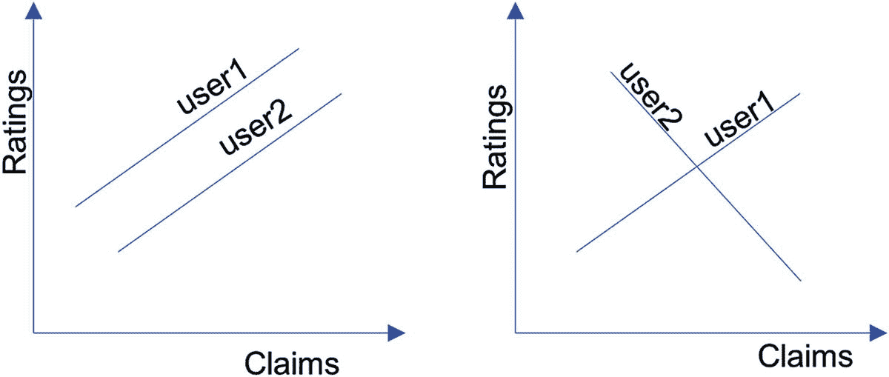
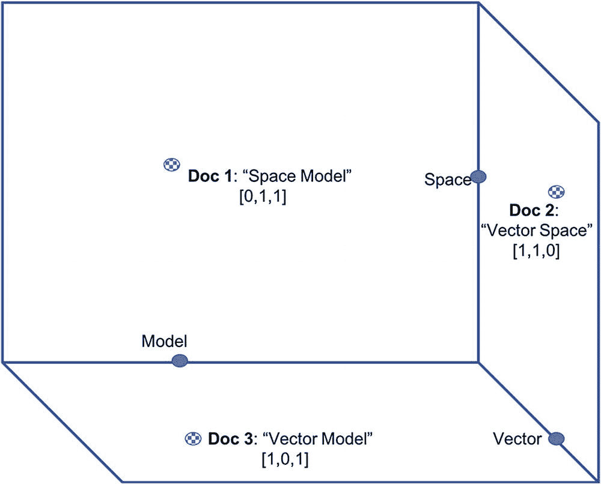
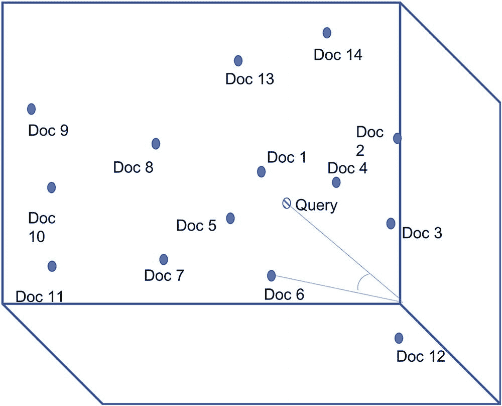

# 7. 更多方法的大杂烩

协同过滤 | 向量空间模型 | 小结

大数据有多种类型——文本、视频、音频、结构化、非结构化、传统数据、来自新来源的数据，等等。大数据中体现的多样性方面也刻画了真实性问题。因此，我们需要多种方法来解决真实性问题的不同表现形式。这些方法的广泛类别将在其余章节中介绍。本章旨在介绍那些不属于本书描述的任何其他大类，并且无法归纳为单一类别的方法。因此，我们将这些方法的集合称为大杂烩。我们在第 3 章中简要介绍过它们。在本章中，我们将更详细地研究它们。

## 协同过滤

谣言工厂依赖于非正式的合作。谣言在非正式传播过程中愈演愈烈。同样，在正式场合中，真相也通过合作逐渐演变。谷歌学术的标语是“站在巨人的肩膀上”，这体现了研究工作的高度合作性质。研究人员借助谷歌学术等平台相互协作，去发现最细微的真相。在大多数正式场合，真相以及基于真相的工作成果都是通过合作发展而来的。人们会以相互关联的方式对主张的真实性得出结论。我们常常能根据相似之人的行为来推测某个人的行动。协同过滤（`CF`）正是这些概念的数学化、程序化抽象，它利用人们的判断力来处理不确定性和信息不完整的问题。协同过滤是一个重要领域，运用了多种概率性和非概率性算法。本章将采用非概率性方法来介绍这一主题。

协同过滤主要用于根据相似用户和相似物品的个人偏好来推荐物品。本章将这些理念拓展到真实性领域。在真实性领域运用`CF`，可能有助于搜索引擎提供更贴合用户信念、价值观和直觉的结果。搜索引擎可以从用户视角分配一个真实性指数。一个问答（`QA`）系统可以基于相似用户的视角，判断用户所提出主张的真实性。回到我们微博的例子，根据用户帖子与其他用户帖子相关系数的变化，可以判断该用户的账户是否被盗。微博用户也能找到与自己信念相似的其他用户。例如，对于一位发布“全球变暖是真的”这一内容的用户，推特可以推荐其他对全球变暖真实性持有类似看法的用户，以促进未来的合作与互动。

> **注意**
> 由于互动、教养、文化及其他社会原因，个人判断往往是相互关联的。

协同过滤是基于人类判断对信息进行过滤的过程。假设存在 `n` 个主张，记为 `v[1]`、`v[2]`、……、`v[n]`。这些主张已被 `m` 个人或用户（记为 `u[1]`、`u[2]`、……、`u[m]`）通过赋予评分 `r[1]`、`r[2]`、……、`r[n]` 来判断为可能真实。例如，用户乔（记为 `u[1]`）认为“全球变暖是真的”这个主张（`v[1]`）有 90%的真实性，因此他按 10 分制给该主张打了 9 分。另一位用户唐（`u[2]`）根本不相信全球变暖，所以打了 0 分。第三位用户比尔（`u[3]`）的想法与 `u[1]` 相当一致，也给这个主张打了 9 分。通常，由于数据不足，部分评分可能会缺失。协同过滤旨在以数学上严谨的方式预测这些缺失的评分。

当我们拥有所有评分后，可以通过对数据进行统计处理，得出主张为真或假的结论。表 7-1 利用上述简单示例，说明了`CF`试图解决的问题。表中显示了三位用户对三个不同主张的评分，但用户 `u[3]` 对主张 `v[3]` 的评分尚缺。`CF` 的任务就是从所谓的“真实性矩阵”中找出这个缺失的评分。直观来看，表中第一位和第三位用户（乔和比尔）判断相似，因此比尔很可能像乔一样给第三个主张打 7 分。协同过滤通过使用相似度度量，用数学方式得出了同样的结论。

**表 7-1**
协同过滤问题：真实性矩阵

| | `v[1]`: 全球变暖是真的 | `v[2]`: 飞车将在 2020 年前出现 | `v[3]`: 爱因斯坦是个风流人物 |
| --- | --- | --- | --- |
| `u[1]`: 乔 | 9 | 7 | 7 |
| `u[2]`: 唐 | 0 | 9 | 9 |
| `u[3]`: 比尔 | 9 | 7 | ? |

> **注意**
> 评分可以由用户明确给出，也可以通过大数据分析从其在线行为中推断得出。

协同过滤可以是基于用户的，也可以是基于主张的。上一段的示例以及表 7-1 所示的就是基于用户的协同过滤（user-based CF）。基于用户的协同过滤的理念是：判断相似的用户会始终在其它主张上也保持这种一致性。基于这一前提，我们根据那些判断相似之人的评分，来预测某个用户对一个主张真实性的评分。在统计学中，相似度由相关性来衡量。衡量统计相关性的方法有多种，但其核心思想是量化两个用户之间判断的重叠程度。一个简单的相似度（或非相似度）度量可以是两个用户评分之间的平均绝对差，如下方公式(7.1)所示。公式中，`n` 是 `u[1]` 和 `u[2]` 均有评分的主张数量，`ri` 和 `ri` 分别是这两位用户对第 `i` 个主张（且该主张被两人都评过分）的评分。这实质上是一个距离度量，与相似度成反比，它表示非相似性。

```
dist(u1, u2) = (∑i |ri(u1) - ri(u2)|) / n
```

(7.1)

对上述公式(7.1)的一个改进是皮尔逊相关系数，如下方公式(7.2)所示。在该公式中，`r̄(u1)` 和 `r̄(u2)` 分别是相应用户对所有主张评分的平均值。

```
sim(u1, u2) = (∑i (ri(u1) - r̄(u1)) (ri(u2) - r̄(u2))) / (√(∑i (ri(u1) - r̄(u1))²) * √(∑i (ri(u2) - r̄(u2))²))
```

(7.2)

皮尔逊相关系数的取值范围在 -1 到 +1 之间。值为 +1 表示用户之间完全一致，值为 -1 则表示完全相反。这些概念在图 7-1 中作了说明。皮尔逊相关系数为 0 表示用户之间无相关性。由于我们有一个初始数据集来训练预测模型，与机器学习方法相比，`CF` 更像是有监督学习。



**图 7-1**
用户相关性：相似用户（左图）的评分趋势线是平行的，而不相似用户（右图）的趋势线是正交的。

> **注意**
> 对于熟悉向量代数的人来说，可以识别出公式(7.2)与两个向量之间余弦相似度的公式是类似的。

利用公式(7.2)，我们可以计算任意两个用户之间的接近程度。我们通常会选取离给定用户最近的 `k` 个用户，来预测该用户的观点。`k` 的值通常通过经验确定，以平衡较高 `k` 值带来的计算强度与较低 `k` 值导致的次优准确性之间的权衡。这种方法被称为 k-最近邻算法，或简称为 k-NN 算法。利用公式(7.2)和 k-NN 算法，给定用户 `u` 对给定主张 `i` 的评分，可以通过下方公式(7.3)进行预测。

## 协同过滤与向量空间模型

在以上公式（7.3）中，`x`表示用户`u`的`k`个最近邻之一，`sim(u, x)`由公式（7.2）为每个`x`计算得出。

到目前为止，我们只讨论了基于用户的协同过滤（User-based CF）。有时，新用户可能没有足够的评分数据来确定其`k`个最近邻，这被称为**冷启动问题**。在这种情况下，我们可以使用基于声明的协同过滤（Claim-based CF）。公式（7.2）和（7.3）保持不变，我们仍然可以使用`k-NN`算法进行基于声明的协同过滤。唯一的变化是，我们计算的是声明之间的相似度，而非用户之间的相似度。

与基于用户的协同过滤类似，在基于声明的协同过滤中，如果两个声明的评分相似，则它们被视为相似。这在基于用户的协同过滤中有语义上的合理性，即观点相似的用户可能在思维上确实相似。但在基于声明的协同过滤中，这并不总是合理的。

例如，两个声明“全球变暖是真实的”和“爱因斯坦是个花花公子”在语义上可能完全不相似。但如果许多用户对它们的评分相似，那么出于基于声明的协同过滤的目的，它们会被视为相似。我们查看特定用户对与给定声明相似的`k`个声明的评分，并使用与公式（7.2）和（7.3）类似的方程来预测新声明的评分。例如，参考表 7-1，“v[2]：飞车将在 2020 年出现”和“v[3]：爱因斯坦是个花花公子”具有相似的评分。直观地，可以预测“v[3]：爱因斯坦是个花花公子”缺失的评分将与`v[2]`相同，即 7 分。以下两个方程也会给出相同的结果。

```
sim(i,j) = (Σ_u(r_i(u) - r̄_i)(r_j(u) - r̄_j)) / (√(Σ_u(r_i(u) - r̄_i)²) √(Σ_u(r_j(u) - r̄_j)²))
```

(7.4)

```
r_i(u) = r̄_i + (Σ_{x∈NN(i)} sim(i, x) · (r_x(u) - r̄_i)) / (Σ_{x∈NN(u)} sim(i, x))
```

(7.5)

在上述公式（7.4）和（7.5）中，声明`i`的平均评分为`r̄_i`，声明`j`的平均评分为`r̄_j`，声明`x`的平均评分为`r̄_x`。在公式（7.4）中，求和遍历所有对声明`i`和`j`均进行评分的用户；而在公式（7.5）中，求和遍历`k`个相似的声明。如果用户相对较新且只对一个相似声明进行了评分，则`k`为 1。

> **注意**：协同过滤中的相似性是其现实世界解释的高度简化抽象。

### 向量空间模型

# 向量空间模型

沿着协同过滤的思路，另一种基于相似度工作的模型是向量空间模型（Vector Space Model, `VSM`）。它可以用于对文档进行分组，并根据它们与已知真实或欺诈文档的相似度来判断其真实性。它还可以基于相似度度量来检测抄袭。向量空间模型的概念非常简单，但影响深远。与协同过滤一样，向量空间模型的主要用途并不在真实性领域。除了抄袭检测，`VSM` 也被用于在修辞结构层面检测真实性。因此，我们将在本章中探讨 `VSM` 涉及的概念。一些向量代数的知识可能有助于更好地理解这个主题，但并非必需。向量可以看作是原点出发具有特定方向和距离的一个点。其他概念将在引入时加以解释。

正如我们在第 3 章中所见，`VSM` 的思想是将每个文档表示为多维空间中的一个向量，每个坐标轴代表语料库中的一个词。让我们从一个简单的例子开始。假设我们的语料库只有三个词：`vector`、`space` 和 `model`。图 7-2 将这些词绘制在一个三维空间中，其中 `x` 轴代表词“`vector`”，`y` 轴代表词“`space`”，`z` 轴代表词“`model`”。图中显示了三个文档，分别命名为 `Doc 1`、`Doc 2` 和 `Doc 3`。这些文档分别包含“`Space Model`”、“`Vector Space`”和“`Vector Model`”。由于每个词在文档中最多出现一次，因此如果文档中包含该词，则对应向量在该词轴上的值为 1，否则为 0。如图所示，`Doc 1` 由坐标为 `[0,1,1]` 的向量表示，`Doc 2` 由坐标为 `[1,1,0]` 的向量表示，`Doc 3` 由坐标为 `[1,0,1]` 的向量表示。



**图 7-2** 三词语料库的向量空间模型

以上是一个由向量空间模型表示的有限语料库的简单方案。在包含数千个词的典型语料库中，维度也达到数千个。每个文档都被建模为这个多维空间中的一个向量。正如我们在第 3 章中所见，每个维度上的值不是简单的词频，而是 `TF-IDF` 值。到现在您可能已经理解，我们并不关心文档的句法或语义结构。我们将文档视为一个 `词袋`。因此，`VSM` 是一种 `词袋` 表示。一旦文档被表示为向量，寻找文档之间的相似度就变成了应用向量代数运算的问题。

简单的欧几里得距离（或简称为距离）可能效果不佳。这可以通过一个例子来说明。假设将文档 `d1` 自身拼接以生成 `d2`。即使它们非常相似，对应向量之间的欧几里得距离也会很长。

更好的相似度度量是测量向量之间的夹角。在上面的例子中，`d1` 和 `d2` 之间的夹角为 0。因此，我们经常使用向量夹角的余弦值（一种三角比值）来衡量对应文档之间的相似度。必须注意，余弦函数在 `[0, 180]` 度区间内是单调递减函数。这意味着，角度越大，余弦值越小，文档越不相似。余弦相似度如图 7-3 所示。我们将被查询的文档称为“查询”（Query）。图中展示了它与名为 `Doc 6` 的文档的相似度。同样，为了更好的可视化，向量被绘制在三维空间中，但实际上，维度可能有数千个——与语料库中唯一词的数量一样多。可以将三维可视化视为正交投影。



**图 7-3** 查询与文档 Doc 6 的余弦相似度

诸如向量夹角的余弦值之类的相似度度量可以指示抄袭。在我们的微博例子中，如果某个用户在一段时间内发布的帖子文本形成的文档，与同一时间段内其他用户关于相同主题的帖子形成的文档相比，差异很大（表现为两个文档之间的余弦相似度值很低），那么该用户很有可能是虚假用户，或者有其个人目的来引导舆论方向。

## 总结

本章我们研究了两种基于相似度度量的方法，它们可在真实性领域发挥作用。下一章将带来关于区块链的精彩讨论——这项技术正被誉为一见 21 世纪无需信任的计算革命。

### 练习题

1.  本章仅列举了协同过滤和向量空间模型在真实性领域的少数应用场景。请思考其他应用场景，尽可能多地列出并简要描述。

2.  研究参数 `k` 的选择对 `k-NN` 算法准确性的影响。请随意使用该算法的开源实现进行实验。

3.  计算图 7-2 中三篇文档之间的余弦相似度。