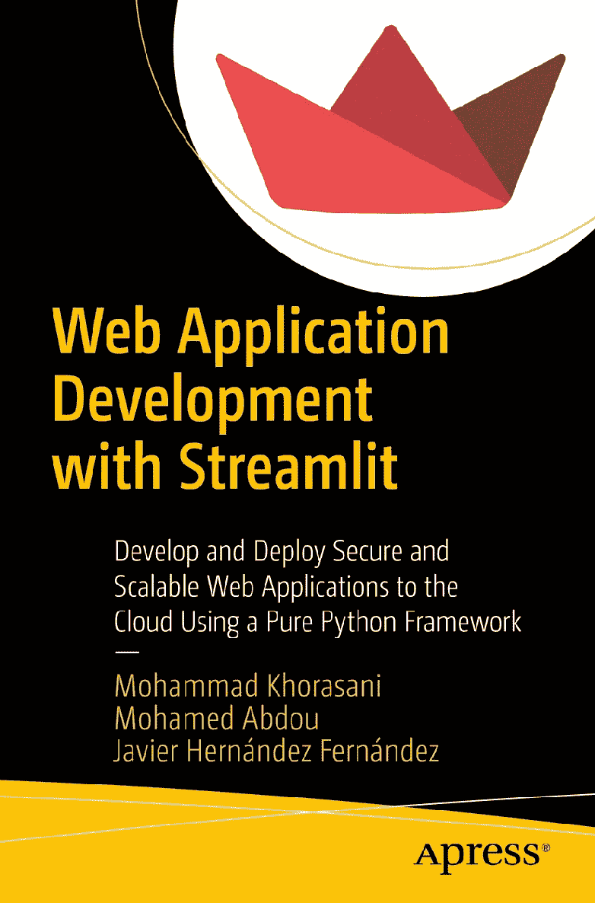

好的，作为高级文档工程师，我已经根据您提供的规则和示例，对给定的文本进行了排版。以下是处理后的 Markdown 内容：

**Web 应用开发**

**使用**

**Streamlit**

**使用纯 Python 框架**

**为云端开发并部署安全**

**且可扩展的 Web 应用**

**默罕默德·霍拉萨尼**

**穆罕默德·阿卜杜**

**哈维尔·埃尔南德斯·费尔南德斯**

***使用 Streamlit 进行 Web 应用开发：使用纯 Python 框架为云端开发并部署安全***

***且可扩展的 Web 应用***

默罕默德·霍拉萨尼

穆罕默德·阿卜杜

卡塔尔多哈

英国剑桥

哈维尔·埃尔南德斯·费尔南德斯

卡塔尔多哈

ISBN-13 (平装): 978-1-4842-8110-9

ISBN-13 (电子书): 978-1-4842-8111-6

[`doi.org/10.1007/978-1-4842-8111-6`](https://doi.org/10.1007/978-1-4842-8111-6)

版权所有 © 2022 默罕默德·霍拉萨尼、穆罕默德·阿卜杜、哈维尔·埃尔南德斯·费尔南德斯

本作品受版权保护。出版商保留所有权利，无论是涉及全部还是部分材料，具体包括翻译、重印、重用插图、朗诵、在缩微胶卷或以任何其他物理方式复制、传输或信息存储与检索、电子改编、计算机软件，或目前已知或以后开发的类似或不同方法的权利。

本书中可能出现商标名称、标识和图像。我们不在每次出现商标名称、标识或图像时使用商标符号，仅以编辑方式使用这些名称、标识和图像，以惠及商标所有者，无意侵犯商标权。

本出版物中使用的商品名称、商标、服务标志和类似术语，即使未被标识为此类术语，也不应被视为对其是否受专有权利约束的意见表达。

尽管本书中的建议和信息在出版时被认为是真实准确的，但作者、编辑和出版商均不对可能出现的任何错误或疏漏承担法律责任。出版商对本书所含材料不作任何明示或暗示的保证。

Apress Media LLC 总经理：威尔莫德·斯帕尔

收购编辑：詹姆斯·罗宾逊-普赖尔

开发编辑：詹姆斯·马卡姆

协调编辑：杰西卡·瓦基利

本书由 Springer Science+Business Media New York, 233 Spring Street, 6th Floor, New York, NY 10013 向全球图书贸易发行。电话：1-800-SPRINGER，传真：(201) 348-4505，电子邮件：orders-ny@springer-sbm.com，或访问 www.springeronline.com。Apress Media, LLC 是一家加利福尼亚有限责任公司，其唯一成员（所有者）是 Springer Science + Business Media Finance Inc (SSBM Finance Inc)。SSBM Finance Inc 是特拉华州的一家公司。

有关翻译信息，请发送电子邮件至 booktranslations@springernature.com；有关重印、平装本或音频版权，请发送电子邮件至 bookpermissions@springernature.com。

Apress 图书可批量购买，用于学术、企业或促销目的。大多数图书也提供电子书版本和许可证。有关更多信息，请参阅我们的印刷版和电子版批量销售网页：http://www.apress.com/bulk-sales。

本书作者引用的任何源代码或其他补充材料，均可通过 Github 仓库获取：https://github.com/Apress/Web- Application-Development- with- Streamlit。如需更详细的信息，请访问 http://www.apress.com/source- code。

印刷于无酸纸上

*献给我的父母叶加内和达里乌什，以及*
*我逝去的祖父母加马尔和雷扎。*
*——默罕默德·霍拉萨尼*

*献给我的家人、朋友和开源社区。*
*——穆罕默德·阿卜杜*

*献给我的家人和朋友，感谢他们的支持。*
*——哈维尔·埃尔南德斯·费尔南德斯*

**目录**

关于作者 ������������������������������������������������������������������������������xiii
关于技术审阅者 ��������������������������������������������������������������xv
致谢 ��������������������������������������������������������������������������������xvii
前言 ����������������������������������������������������������������������������������xix
缩写词 ����������������������������������������������������������������������������xxi
目标读者 �������������������������������������������������������������������������xxiii
附加资料 �������������������������������������������������������������������������xxvii

[第一章：](https://doi.org/10.1007/978-1-4842-8111-6_1) [Streamlit 入门 ������������������������������������������������1](https://doi.org/10.1007/978-1-4842-8111-6_1)

[1.1 为什么选择 Streamlit？ ................................................................................................1](https://doi.org/10.1007/978-1-4842-8111-6_1#Sec1)
[1.1.1 本地 vs. 云端 .................................................................................2](https://doi.org/10.1007/978-1-4842-8111-6_1#Sec2)
[1.1.2 云计算趋势 ...........................................................................................3](https://doi.org/10.1007/978-1-4842-8111-6_1#Sec3)
[1.1.3 Python Web 框架的历史 ...................................................................5](https://doi.org/10.1007/978-1-4842-8111-6_1#Sec4)
[1.1.4 Flask .......................................................................................................6](https://doi.org/10.1007/978-1-4842-8111-6_1#Sec5)
[1.1.5 Django ....................................................................................................6](https://doi.org/10.1007/978-1-4842-8111-6_1#Sec6)
[1.1.6 Dash .......................................................................................................7](https://doi.org/10.1007/978-1-4842-8111-6_1#Sec7)
[1.1.7 Web2Py ...................................................................................................7](https://doi.org/10.1007/978-1-4842-8111-6_1#Sec8)
[1.1.8 对纯 Python Web 框架的需求 .........................................8](https://doi.org/10.1007/978-1-4842-8111-6_1#Sec9)
[1.1.9 学术意义 ...........................................................................................8](https://doi.org/10.1007/978-1-4842-8111-6_1#Sec10)
[1.2 启动 Streamlit .......................................................................................................9](https://doi.org/10.1007/978-1-4842-8111-6_1#Sec11)
[1.2.1 技术要求 .................................................................................9](https://doi.org/10.1007/978-1-4842-8111-6_1#Sec12)
[1.2.2 使用 Anaconda 安装环境 ..............................................10](https://doi.org/10.1007/978-1-4842-8111-6_1#Sec13)
[1.2.3 下载并安装 Streamlit ...................................................................15](https://doi.org/10.1007/978-1-4842-8111-6_1#Sec16)
[1.2.4 Streamlit 控制台命令 ......................................................................17](https://doi.org/10.1007/978-1-4842-8111-6_1#Sec20)
[1.2.5 运行演示应用 .................................................................................19](https://doi.org/10.1007/978-1-4842-8111-6_1#Sec22)
[1.2.6 使用 PyCharm 编写和测试代码 ...............................................21](https://doi.org/10.1007/978-1-4842-8111-6_1#Sec23)
[1.3 Streamlit 的工作原理 .....................................................................................25](https://doi.org/10.1007/978-1-4842-8111-6_1#Sec24)
[1.3.1 Streamlit 架构 ............................................................................26](https://doi.org/10.1007/978-1-4842-8111-6_1#Sec25)
[1.3.2 Streamlit 中的 ReactJS .............................................................................29](https://doi.org/10.1007/978-1-4842-8111-6_1#Sec26)
[1.4 本章小结 .......................................................................................................30](https://doi.org/10.1007/978-1-4842-8111-6_1#Sec27)

[第二章：](https://doi.org/10.1007/978-1-4842-8111-6_2) [Streamlit 基础 ����������������������������������������������������������������31](https://doi.org/10.1007/978-1-4842-8111-6_2)

[2.1 创建基本应用 .................................................................................31](https://doi.org/10.1007/978-1-4842-8111-6_2#Sec1)
[2.1.1 生成用户输入表单 ................................................................32](https://doi.org/10.1007/978-1-4842-8111-6_2#Sec2)
[2.1.2 引入条件流程 ................................................................34](https://doi.org/10.1007/978-1-4842-8111-6_2#Sec3)
[2.1.3 管理和调试错误 ..................................................................36](https://doi.org/10.1007/978-1-4842-8111-6_2#Sec6)
[2.2 变更数据框 ....................................................................................40](https://doi.org/10.1007/978-1-4842-8111-6_2#Sec9)
[2.2.1 筛选 .....................................................................................................41](https://doi.org/10.1007/978-1-4842-8111-6_2#Sec10)
[2.2.2 选择 ...................................................................................................42](https://doi.org/10.1007/978-1-4842-8111-6_2#Sec11)
[2.2.3 排列 .................................................................................................44](https://doi.org/10.1007/978-1-4842-8111-6_2#Sec12)
[2.2.4 变更 ..................................................................................................46](https://doi.org/10.1007/978-1-4842-8111-6_2#Sec13)
[2.2.5 分组 ...............................................................................................48](https://doi.org/10.1007/978-1-4842-8111-6_2#Sec14)
[2.2.6 合并 ...................................................................................................49](https://doi.org/10.1007/978-1-4842-8111-6_2#Sec15)
[2.3 渲染静态和交互式图表 ...............................................................52](https://doi.org/10.1007/978-1-4842-8111-6_2#Sec16)
[2.3.1 静态柱状图 ....................................................................................52](https://doi.org/10.1007/978-1-4842-8111-6_2#Sec17)
[2.3.2 静态折线图 ...................................................................................53](https://doi.org/10.1007/978-1-4842-8111-6_2#Sec18)
[2.3.3 交互式折线图 ...........................................................................55](https://doi.org/10.1007/978-1-4842-8111-6_2#Sec19)
[2.3.4 交互式地图 .....................................................................................57](https://doi.org/10.1007/978-1-4842-8111-6_2#Sec20)
[2.4 开发用户界面 ...............................................................................58](https://doi.org/10.1007/978-1-4842-8111-6_2#Sec21)
[2.5 本章小结 .......................................................................................................62](https://doi.org/10.1007/978-1-4842-8111-6_2#Sec22)

[第三章：](https://doi.org/10.1007/978-1-4842-8111-6_3) [构建用户界面架构 �����������������������������������������63](https://doi.org/10.1007/978-1-4842-8111-6_3)

[3.1 设计应用程序 .................................................................................64](https://doi.org/10.1007/978-1-4842-8111-6_3#Sec1)
[3.1.1 配置页面 ............................................................................64](https://doi.org/10.1007/978-1-4842-8111-6_3#Sec2)
[3.1.2 开发主题和配色方案 ...............................................77](https://doi.org/10.1007/978-1-4842-8111-6_3#Sec7)
[3.1.3 组织页面 .................................................................................81](https://doi.org/10.1007/978-1-4842-8111-6_3#Sec11)
[3.2 显示动态内容 .................................................................................85](https://doi.org/10.1007/978-1-4842-8111-6_3#Sec17)
[3.2.1 创建实时进度条 ......................................................87](https://doi.org/10.1007/978-1-4842-8111-6_3#Sec18)
[3.3 提供多页面应用 .............................................................................88](https://doi.org/10.1007/978-1-4842-8111-6_3#Sec19)
[3.3.1 创建页面 .....................................................................................88](https://doi.org/10.1007/978-1-4842-8111-6_3#Sec20)
[3.3.2 创建子页面 ...............................................................................91](https://doi.org/10.1007/978-1-4842-8111-6_3#Sec22)
[3.4 模块化应用开发 .........................................................................94](https://doi.org/10.1007/978-1-4842-8111-6_3#Sec23)
[3.4.1 示例：开发社交网络应用 .............................95](https://doi.org/10.1007/978-1-4842-8111-6_3#Sec24)
[3.4.2 文件夹结构的最佳实践 .................................................101](https://doi.org/10.1007/978-1-4842-8111-6_3#Sec25)
[3.5 本章小结 .....................................................................................................104](https://doi.org/10.1007/978-1-4842-8111-6_3#Sec26)

[第四章：](https://doi.org/10.1007/978-1-4842-8111-6_4) [数据管理和可视化 ����������������������������������������������105](https://doi.org/10.1007/978-1-4842-8111-6_4)

[4.1 数据管理 .......................................................................................106](https://doi.org/10.1007/978-1-4842-8111-6_4#Sec1)
[4.1.1 处理字节数据 ........................................................................106](https://doi.org/10.1007/978-1-4842-8111-6_4#Sec2)
[4.1.2 缓存大数据 ................................................................................108](https://doi.org/10.1007/978-1-4842-8111-6_4#Sec6)
[4.1.3 实时变更数据 ........................................................................111](https://doi.org/10.1007/978-1-4842-8111-6_4#Sec7)
[4.1.4 高级和交互式数据变更 ............................................113](https://doi.org/10.1007/978-1-4842-8111-6_4#Sec9)
[4.2 探索 Plotly 数据可视化 ............................................................120](https://doi.org/10.1007/978-1-4842-8111-6_4#Sec10)
[4.2.1 在 Streamlit 中渲染 Plotly ......................................................120](https://doi.org/10.1007/978-1-4842-8111-6_4#Sec11)
[4.2.2 基础图表 .......................................................................................121](https://doi.org/10.1007/978-1-4842-8111-6_4#Sec12)
[4.2.3 统计图表 ................................................................................125](https://doi.org/10.1007/978-1-4842-8111-6_4#Sec18)
[4.2.4 时间序列图表 .............................................................................127](https://doi.org/10.1007/978-1-4842-8111-6_4#Sec21)
[4.2.5 地理空间图表 ...............................................................................128](https://doi.org/10.1007/978-1-4842-8111-6_4#Sec22)
[4.2.6 动画可视化 ......................................................................128](https://doi.org/10.1007/978-1-4842-8111-6_4#Sec23)
[4.3 本章小结 .....................................................................................................131](https://doi.org/10.1007/978-1-4842-8111-6_4#Sec26)

[第五章：](https://doi.org/10.1007/978-1-4842-8111-6_5) [数据库集成 �������������������������������������������������������133](https://doi.org/10.1007/978-1-4842-8111-6_5)

[5.1 关系型数据库 ..................................................................................133](https://doi.org/10.1007/978-1-4842-8111-6_5#Sec1)
[5.1.1 SQL 简介 .............................................................................134](https://doi.org/10.1007/978-1-4842-8111-6_5#Sec2)
[5.1.2 将 PostgreSQL 数据库连接到 Streamlit ...............................136](https://doi.org/10.1007/978-1-4842-8111-6_5#Sec3)
[5.1.3 在 Streamlit 中显示表格 ............................................................141](https://doi.org/10.1007/978-1-4842-8111-6_5#Sec4)
[5.2 非关系型数据库 .............................................................................144](https://doi.org/10.1007/978-1-4842-8111-6_5#Sec5)
[5.2.1 MongoDB 简介 ....................................................................145](https://doi.org/10.1007/978-1-4842-8111-6_5#Sec6)
[5.2.2 配置云数据库 ...................................................................146](https://doi.org/10.1007/978-1-4842-8111-6_5#Sec7)
[5.2.3 全文索引 ...............................................................................150](https://doi.org/10.1007/978-1-4842-8111-6_5#Sec8)
[5.2.4 查询数据库 .......................................................................152](https://doi.org/10.1007/978-1-4842-8111-6_5#Sec9)
[5.2.5 在 Streamlit 中显示表格 ............................................................157](https://doi.org/10.1007/978-1-4842-8111-6_5#Sec10)
[5.3 本章小结 .....................................................................................................160](https://doi.org/10.1007/978-1-4842-8111-6_5#Sec11)

[第六章：](https://doi.org/10.1007/978-1-4842-8111-6_6) [利用后端服务器 ������������������������������������������161](https://doi.org/10.1007/978-1-4842-8111-6_6)

[6.1 后端服务器的必要性 ...................................................................161](https://doi.org/10.1007/978-1-4842-8111-6_6#Sec1)
[6.2 前后端通信 ............................................................................162](https://doi.org/10.1007/978-1-4842-8111-6_6#Sec2)
[6.2.1 HTTP 方法 ....................................................................................163](https://doi.org/10.1007/978-1-4842-8111-6_6#Sec3)
[6.3 使用 JSON 文件 .................................................................................164](https://doi.org/10.1007/978-1-4842-8111-6_6#Sec4)
[6.4 配置后端服务器 ...................................................................165](https://doi.org/10.1007/978-1-4842-8111-6_6#Sec5)
[6.4.1 API 构建 ........................................................................................166](https://doi.org/10.1007/978-1-4842-8111-6_6#Sec6)
[6.4.2 API 测试 ..........................................................................................170](https://doi.org/10.1007/978-1-4842-8111-6_6#Sec7)
[6.5 多线程和多进程请求 ...............................................171](https://doi.org/10.1007/978-1-4842-8111-6_6#Sec8)
[6.6 将 Streamlit 连接到后端服务器 .................................................174](https://doi.org/10.1007/978-1-4842-8111-6_6#Sec9)
[6.7 本章小结 .....................................................................................................177](https://doi.org/10.1007/978-1-4842-8111-6_6#Sec10)

[第七章：](https://doi.org/10.1007/978-1-4842-8111-6_7) [实现会话状态 �������������������������������������������179](https://doi.org/10.1007/978-1-4842-8111-6_7)

[7.1 原生实现会话状态 .........................................................................179](https://doi.org/10.1007/978-1-4842-8111-6_7#Sec1)
[7.1.1 使用会话状态构建应用 ........................................182](https://doi.org/10.1007/978-1-4842-8111-6_7#Sec2)
[7.2 引入会话 ID ..................................................................................185](https://doi.org/10.1007/978-1-4842-8111-6_7#Sec3)
[7.3 持久化实现会话状态 ...................................................186](https://doi.org/10.1007/978-1-4842-8111-6_7#Sec4)
[7.4 用户洞察 ...............................................................................................191](https://doi.org/10.1007/978-1-4842-8111-6_7#Sec5)
[7.4.1 可视化用户洞察 .....................................................................195](https://doi.org/10.1007/978-1-4842-8111-6_7#Sec6)
[7.5 Cookie 管理 .......................................................................................198](https://doi.org/10.1007/978-1-4842-8111-6_7#Sec7)
[7.6 本章小结 .....................................................................................................202](https://doi.org/10.1007/978-1-4842-8111-6_7#Sec8)

[第八章：](https://doi.org/10.1007/978-1-4842-8111-6_8) [认证与应用安全 ����������������������������������������203](https://doi.org/10.1007/978-1-4842-8111-6_8)

[8.1 开发用户账户 ..........................................................................203](https://doi.org/10.1007/978-1-4842-8111-6_8#Sec1)
[8.1.1 哈希化 ..............................................................................................204](https://doi.org/10.1007/978-1-4842-8111-6_8#Sec2)
[8.1.2 加盐 ................................................................................................205](https://doi.org/10.1007/978-1-4842-8111-6_8#Sec3)
[8.2 验证用户凭证 ...............................................................................207](https://doi.org/10.1007/978-1-4842-8111-6_8#Sec4)
[8.3 机密管理 ..................................................................................224](https://doi.org/10.1007/978-1-4842-8111-6_8#Sec5)
[8.4 使用 SQLAlchemy 防止 SQL 注入 ..........................................225](https://doi.org/10.1007/978-1-4842-8111-6_8#Sec6)
[8.5 配置 Gitignore 变量 .......................................................................226](https://doi.org/10.1007/978-1-4842-8111-6_8#Sec7)
[8.6 本章小结 .....................................................................................................227](https://doi.org/10.1007/978-1-4842-8111-6_8#Sec8)

[第九章：](https://doi.org/10.1007/978-1-4842-8111-6_9) [本地部署与云端部署 ���������������������������������229](https://doi.org/10.1007/978-1-4842-8111-6_9)

[9.1 将 Streamlit 暴露到万维网 .................................................................230](https://doi.org/10.1007/978-1-4842-8111-6_9#Sec1)
[9.1.1 网络网关上的端口转发 ..........................................230](https://doi.org/10.1007/978-1-4842-8111-6_9#Sec2)
[9.1.2 使用 NGROK 进行 HTTP 隧道传输 .............................................................232](https://doi.org/10.1007/978-1-4842-8111-6_9#Sec3)
[9.2 部署到 Streamlit Cloud ...................................................................235](https://doi.org/10.1007/978-1-4842-8111-6_9#Sec4)
[9.2.1 一键部署 ........................................................................235](https://doi.org/10.1007/978-1-4842-8111-6_9#Sec5)
[9.2.2 Streamlit 机密 ................................................................................238](https://doi.org/10.1007/978-1-4842-8111-6_9#Sec6)
[9.3 部署到 Linux .......................................................................................240](https://doi.org/10.1007/978-1-4842-8111-6_9#Sec7)
[9.3.1 在 Linux 机器上原生部署 .............................................240](https://doi.org/10.1007/978-1-4842-8111-6_9#Sec8)
[9.3.2 使用 Linux Docker 容器部署 .........................................243](https://doi.org/10.1007/978-1-4842-8111-6_9#Sec9)
[9.4 部署到 Windows 服务器 ..........................................................................246](https://doi.org/10.1007/978-1-4842-8111-6_9#Sec10)
[9.4.1 建立远程桌面连接 ...............................................247](https://doi.org/10.1007/978-1-4842-8111-6_9#Sec11)
[9.4.2 打开 TCP/IP 端口 ..........................................................................249](https://doi.org/10.1007/978-1-4842-8111-6_9#Sec12)
[9.4.3 Anaconda 离线包安装 ...............................................253](https://doi.org/10.1007/978-1-4842-8111-6_9#Sec13)
[9.4.4 将 Anaconda 添加到系统路径 .......................................................254](https://doi.org/10.1007/978-1-4842-8111-6_9#Sec14)
[9.4.5 将应用作为可执行批处理文件运行 ...............................256](https://doi.org/10.1007/978-1-4842-8111-6_9#Sec15)
[9.4.6 将应用作为持久化 Windows 服务运行 ......................257](https://doi.org/10.1007/978-1-4842-8111-6_9#Sec16)
[9.5 本章小结 .....................................................................................................261](https://doi.org/10.1007/978-1-4842-8111-6_9#Sec17)

[第十章：构建 Streamlit 组件 ������������������������������������263](https://doi.org/10.1007/978-1-4842-8111-6_10)

[10.1 Streamlit 自定义组件简介 .........................................263](https://doi.org/10.1007/978-1-4842-8111-6_10#Sec1)
[10.2 使用 ReactJS 创建 Streamlit 自定义组件 ..........................264](https://doi.org/10.1007/978-1-4842-8111-6_10#Sec2)
[10.2.1 制作 ReactJS 组件 .................................................................265](https://doi.org/10.1007/978-1-4842-8111-6_10#Sec3)
[10.2.2 在 Streamlit 中使用 ReactJS 组件 .........................................268](https://doi.org/10.1007/978-1-4842-8111-6_10#Sec4)
[10.2.3 向自定义组件发送数据 ..........................................270](https://doi.org/10.1007/978-1-4842-8111-6_10#Sec5)
[10.2.4 从自定义组件接收数据 ...................................273](https://doi.org/10.1007/978-1-4842-8111-6_10#Sec6)
[10.3 将组件发布为 Pip 包 .................................................276](https://doi.org/10.1007/978-1-4842-8111-6_10#Sec7)
[10.4 重点组件：Extra-Streamlit- Components ..................................280](https://doi.org/10.1007/978-1-4842-8111-6_10#Sec8)
[10.4.1 步骤条 ......................................................................................280](https://doi.org/10.1007/978-1-4842-8111-6_10#Sec9)
[10.4.2 弹跳图片 ................................................................................286](https://doi.org/10.1007/978-1-4842-8111-6_10#Sec10)
[10.4.3 标签栏 ..............................................................................................290](https://doi.org/10.1007/978-1-4842-8111-6_10#Sec11)
[10.4.4 Cookie 管理器 ................................................................................295](https://doi.org/10.1007/978-1-4842-8111-6_10#Sec12)
[10.4.5 路由器 ...............................................................................................302](https://doi.org/10.1007/978-1-4842-8111-6_10#Sec13)
[10.5 本章小结 ...................................................................................................307](https://doi.org/10.1007/978-1-4842-8111-6_10#Sec14)

[第十一章：Streamlit 用例 ������������������������������������������������������309](https://doi.org/10.1007/978-1-4842-8111-6_11)

[11.1 仪表盘和实时应用 ..................................................309](https://doi.org/10.1007/978-1-4842-8111-6_11#Sec1)
[11.1.1 温度数据记录器应用 ...........................................310](https://doi.org/10.1007/978-1-4842-8111-6_11#Sec2)
[11.1.2 电机命令与控制应用 .........................................316](https://doi.org/10.1007/978-1-4842-8111-6_11#Sec3)
[11.2 时间序列应用 ..........................................................................321](https://doi.org/10.1007/978-1-4842-8111-6_11#Sec4)
[11.2.1 日期时间筛选应用 .............................................................321](https://doi.org/10.1007/978-1-4842-8111-6_11#Sec5)
[11.2.2 时间序列热图应用 ....................................................324](https://doi.org/10.1007/978-1-4842-8111-6_11#Sec6)
[11.2.3 时间同步应用 .................................................................328](https://doi.org/10.1007/978-1-4842-8111-6_11#Sec7)
[11.3 数据管理与机器学习应用 ............................................332](https://doi.org/10.1007/978-1-4842-8111-6_11#Sec8)
[11.3.1 数据仓库应用 .............................................................332](https://doi.org/10.1007/978-1-4842-8111-6_11#Sec9)
[11.3.2 高级应用开发：机器学习即服务 ......................................344](https://doi.org/10.1007/978-1-4842-8111-6_11#Sec10)
[11.4 本章小结 ...................................................................................................361](https://doi.org/10.1007/978-1-4842-8111-6_11#Sec16)

[第十二章：Streamlit 实战 ����������������������������������������������������������363](https://doi.org/10.1007/978-1-4842-8111-6_12)

[12.1 Streamlit 在清洁能源领域：*Iberdrola* .........................................................363](https://doi.org/10.1007/978-1-4842-8111-6_12#Sec1)
[12.1.1 可视化风电场运营绩效 ........................365](https://doi.org/10.1007/978-1-4842-8111-6_12#Sec2)
[12.1.2 风力发电机功率曲线 ..............................................................366](https://doi.org/10.1007/978-1-4842-8111-6_12#Sec3)
[12.1.3 风玫瑰图 .......................................................................................369](https://doi.org/10.1007/978-1-4842-8111-6_12#Sec4)
[12.1.4 热力图 ........................................................................................371](https://doi.org/10.1007/978-1-4842-8111-6_12#Sec5)
[12.1.5 结语 ...............................................................................372](https://doi.org/10.1007/978-1-4842-8111-6_12#Sec6)
[12.2 Streamlit 在工业领域的应用：*maxon Group* ..........................................................373](https://doi.org/10.1007/978-1-4842-8111-6_12#Sec7)
[12.2.1 为微创腹腔镜手术开发新型外科内窥镜适配器系统 ...............................374](https://doi.org/10.1007/978-1-4842-8111-6_12#Sec8)
[12.2.2 Streamlit 命令与控制仪表盘 ........................................377](https://doi.org/10.1007/978-1-4842-8111-6_12#Sec9)
[12.2.3 结语 ...............................................................................378](https://doi.org/10.1007/978-1-4842-8111-6_12#Sec10)
[12.3 本章小结 ...................................................................................................379](https://doi.org/10.1007/978-1-4842-8111-6_12#Sec11)

附录 A：Streamlit 应用程序接口��������������������������������������381

A.1

好的，作为一名高级文档工程师和翻译员，我将遵循您提供的注意事项和示例，将给定的英文文本翻译成中文。

