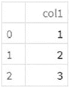
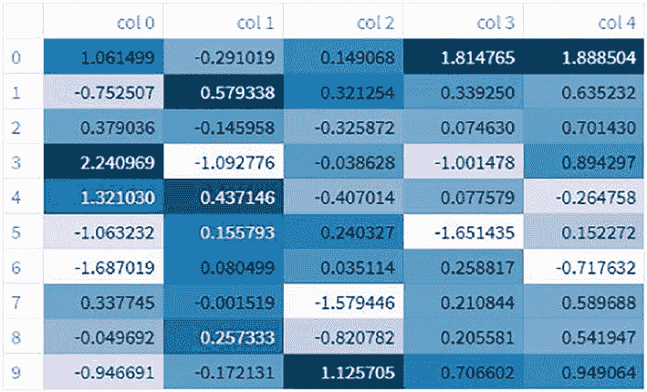
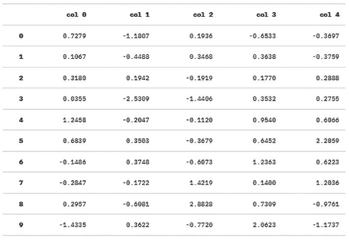
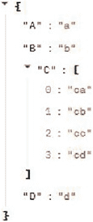

# 你好，世界

## 你好，世界

### 你好，世界

#### 你好，世界

##### 你好，世界

###### 你好，世界

## 附录 A STREAMLIT 应用程序编程接口

-   文本样式可用于生成**粗体**、*斜体*和~~删除线~~文本：

```
st.markdown('**Hello world**')
st.markdown('_Hello world_')
st.markdown('~~Hello world~~')
```

-   列表可用于生成项目符号列表、编号列表和复选框列表：

```
st.markdown(
"'
- *Hello world*
*- Hello world*
*- Hello world*
"'
)
```

```
st.markdown(
"'
*1\. Hello world*
*2\. Hello world*
*3\. Hello world*
"'
)
```

```
st.markdown(
"'
*- [x] Hello world*
*- [ ] Hello world*
"'
)
```

-   代码可用于根据指定的编程语言显示无高亮和高亮的代码：

```
st.markdown(
"'
"'
*def hello_world():*
*print('Hello world')*
"'
"'
)
```

```
st.markdown(
"'
*"'python*
*def hello_world():*
*print('Hello world')*
"'
"'
)
```

-   超链接可用于显示带超链接的文本：

```
st.markdown('Check out [Streamlit](https://streamlit.io/)')
```

-   引用可用于显示引用的文本：

```
st.markdown('> Hello world')
```

-   图像可用于显示图像：

```
st.markdown('')
```

-   表格可用于显示表格：

```
st.markdown(
"'
*Name | Score 1 | Score 2*
*------------ | ------------- | -------------*
*Jessica | 77 | 76*
*John | 56 | 97*
*Alex | 87 | 82*
"'
)
```

## 标题、标头和副标题

在 Streamlit 中，排版可以通过标题、标头和副标题的三级层次结构进行管理。这些命令遵循相同的命名规则并接受相同的参数化：`st.title(body, anchor=None)`，`st.header(body, anchor=None)` 和 `st.subheader(body, anchor=None)`。

**表 A-4.** `st.title`，`st.header` 和 `st.subheader` 参数

| 参数 | 描述 |
|-----------|-------------|
| `body` (`str`) | 要显示的字符串。 |
| `anchor` (`str`) | 标题/标头/副标题的锚点名称，可以通过 URL 中的 `#anchor` 进行访问。如果未调用锚点，Streamlit 将使用`body`文本自动生成一个锚点。 |

Streamlit 用于这三种层级排版的格式如下：

```
st.title('Title')
st.header('Header')
st.subheader('Subheader')
```

#### 标题说明

Streamlit 使用 `st.caption(str)` 命令以小号文本显示标题说明。

**表 A-5.** `st.caption` 参数

| 参数 | 描述 |
|-----------|-------------|
| `body` (`str`) | 要显示的字符串。 |

在需要使用副标题或替代标题的情况下，可以使用标题说明 API 来显示更小的文本：

```
st.title('Title')
st.header('Header')
st.subheader('Subheader')
st.text('Text')
st.caption('Caption')
```

#### 代码

Streamlit 使用 `st.code(body, language='python')` 命令渲染带有语法高亮的代码。

**表 A-6.** `st.code` 参数

| 参数 | 描述 |
|-----------|-------------|
| `body` (`str`) | 要作为代码显示的字符串。 |
| `language` (`str`) | 编写代码所用的编程语言（用于渲染和语法高亮）。如果未设置语言，代码将不应用任何样式。 |

以下示例显示了一段 Python 代码块：

```
code = """*def hello_world(input)*:
*print(input)*"""
st.code(code, language='python')
```

#### LaTeX

Streamlit 可以使用 `st.latex(body)` 命令显示格式化为 LaTeX 的数学函数。

**表 A-7.** `st.latex` 参数

| 参数 | 描述 |
|-----------|-------------|
| `body` (`str` 或 `SymPy 表达式`) | 要显示的字符串和/或 SymPy 表达式。有关支持的 LaTeX 函数的更多信息，[请参阅 https://katex.org/docs/supported.html](https://katex.org/docs/supported.html)。 |

例如，LaTeX 可用于显示数学公式：

```
st.latex(r"'
```


x = \frac{{ - b \pm \sqrt {bˆ2 - 4ac} }}{{2a}}

**魔法命令**

魔法命令是 Streamlit 特有的一些函数，能让开发者以一种非常简洁易懂的方式，将 Markdown 和数据渲染到应用中。当 Streamlit 在独立的一行中检测到一个变量或字面值时，它会自动使用 `st.write` 函数将该变量写入应用。此外，魔法命令会忽略位于脚本和函数开头的文档字符串。

直接使用魔法命令编写文本，无需调用任何 Streamlit 预定义函数，如下所示：





**附录 A Streamlit 应用程序编程接口**

显示文本：

```
# Hello world
Hello _world_
```

渲染数据帧：

```
df = pd.DataFrame({'col1': [1,2,3]})
df # <-- 绘制数据帧
```

写入变量值：

```
x = 10
'x', x # <-- 绘制字符串 'x' 以及变量 x 的值
```

如果需要，你可以通过修改 `/~/.streamlit/config.toml` 文件并设置以下内容来关闭魔法命令：

```
[runner]
magicEnabled = false
```

**附录 A Streamlit 应用程序编程接口**

### A.1.2 显示数据

Streamlit 可以无缝地渲染各种类型的数据。通过使用一系列原生命令，你可以显示 Pandas 数据帧、表格、JSON 文档、指标、列表以及其他杂项数据类型。

**数据帧**

Streamlit 使用 `st.dataframe(data=None, width=None, height=None)` 命令将数据帧显示为格式化后的交互式表格。

**表 A-8.** `st.dataframe` 参数

| 参数 | 描述 |
| --- | --- |
| `data` ( `pandas.DataFrame`, `pandas.Styler`, `pyarrow.Table`, `numpy.ndarray`, `Iterable`, `dict` 或 `None` ) | 要显示的数据： • Pandas.Styler：将对数据帧应用 pandas 样式，包括最常见的单元格值和颜色。目前不支持诸如悬停、标题或图表等增强功能。对 Styler 的支持是实验性的。 • PyArrow 表：必须通过设置 `config.dataframeSerialization = "arrow"` 来启用 PyArrow 表。Streamlit 的旧版数据帧序列化（例如，使用 `config.dataframeSerialization = "legacy"` 时）默认不支持 PyArrow 表。 |
| `width` ( `int` 或 `None` ) | UI 元素的宽度，以像素为单位。默认值 none 会将宽度设置为其所在页面的宽度。 |
| `height` ( `int` 或 `None` ) | 如果高度设置为 none，它将等于其所在页面的高度。 |



**附录 A Streamlit 应用程序编程接口**

以下示例使用热图显示一个数据帧，该热图使用预定义的 Matplotlib 绿色颜色映射，并以固定宽度 1000 像素来着色显示与其他值相比的数值强度：

```
df = pd.DataFrame(
    np.random.randn(10, 5),
    columns=('col %d' % i for i in range(5)))
st.dataframe(df.style.background_gradient(), width=1000)
```

**附录 A Streamlit 应用程序编程接口**

**表格**

使用 `st.table(data=None)` 命令显示静态表格。

**表 A-9.** `st.table` 参数

| 参数 | 描述 |
| --- | --- |
| `data` ( `pandas.DataFrame`, `pandas.Styler`, `pyarrow.Table`, `numpy.ndarray`, `Iterable`, `dict` 或 `None` ) | 表格数据。必须通过设置 `config.dataframeSerialization = "arrow"` 来启用 PyArrow 表。Streamlit 的旧版数据帧序列化（例如，使用 `config.dataframeSerialization = "legacy"` 时）默认不支持 PyArrow 表。 |

沿用数据帧示例，静态表格以相同方式显示：

```
df = pd.DataFrame(
    np.random.randn(10, 5),
    columns=('col %d' % i for i in range(5)))
st.table(df)
```



**附录 A Streamlit 应用程序编程接口**

**JSON**

可以使用 `st.json(body)` 命令在 Streamlit 中显示 JSON 文件的交互式表示。

**表 A-10.** `st.json` 参数

| 参数 | 描述 |
| --- | --- |
| `body` ( `Object` 或 `str` ) | 要作为 JSON 打印的对象。引用的对象或字符串必须可序列化为 JSON。 |


### `expanded( *bool*)`

将该参数设置为 `True` 将把 JSON 元素的初始状态设为展开。默认值为 `True`。



