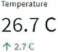
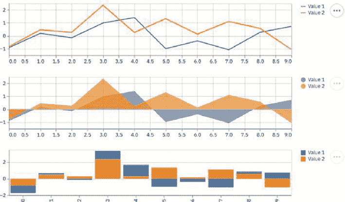
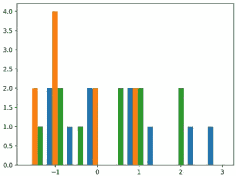
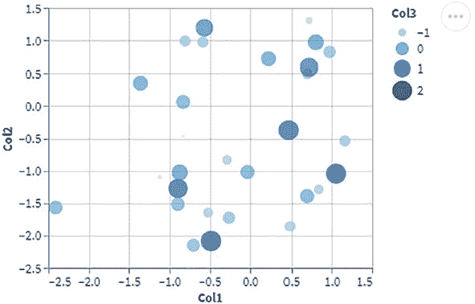
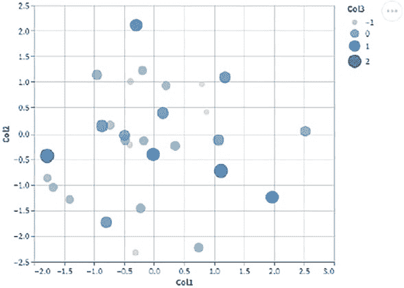
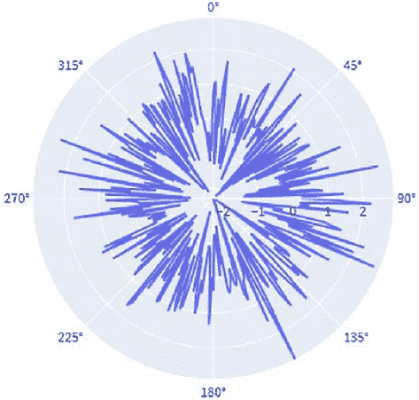

# 附录 A：Streamlit 应用程序接口

以下示例展示了 JSON 对象的一种简单表示。Streamlit 的交互式可视化功能允许对分支进行折叠和展开。

```
st.json({
'A': 'a',
'B': 'b',
'C': [
'ca',
'cb',
'cc',
'cd',
],
'D': 'd',
})
```

## `Metric`

`st.metric(label, value, delta=None, delta_color='normal')` 命令以仪表板样式的大号粗体字体显示指标、指示器或变量。可以添加一个可选的变更状态指示器。



#### 表 A-11. `st.metric` 参数

| 参数 | 描述 |
|-----------|-------------|
| `label` (`str`) | 指标的标题。 |
| `value` (`int`, `str`, 或 `None`) | 赋予指标的值。`None` 将呈现为长破折号。 |
| `delta` (`int`, `str`, 或 `None`) | 主指标下方的小型子指示器，显示相对于上次状态的变化。对于负数（`int` 或 `float`），或以减号开头的字符串，箭头将呈红色并向下指向；所有其他选项将显示为绿色并向上指向。如果 delta 设置为 `None`（默认选项），则不会显示此子指示器。 |
| `delta_color` (`str`) | 此属性默认反转正负值的颜色和箭头方向。适用于那些负向变化可能被视为好事的情况，反之亦然。如果设置为 `"off"`，则所有情况下 delta 都将显示为灰色。 |

以下示例展示了一个不带 delta 的温度指标指示器。然后通过 delta 选项调整该指示器，以反映相对于上一个值的变化。

```
st.metric('Temperature', '26.7 C', '2.7 C')
```

## A.1.3 显示图表

Streamlit 另一个擅长的领域是数据可视化。无论是使用其原生命令渲染图表，还是显示来自 Matplotlib、Altair、Vega-Lite、Plotly、Bokeh、PyDeck 或 Graphviz 的第三方图表，Streamlit 都能让你轻松集成可视化。

### 折线图、面积图和柱状图

可以使用 `st.line_chart`、`st.area_chart` 和 `st.bar_chart` 命令渲染简单的折线图、面积图和柱状图。要显示图表，可以使用以下命令：`st.line_chart / st.area_chart / st.bar_chart(data, width, height, use_container_width)`。

#### 表 A-12. `st.line_chart`、`st.area_chart` 和 `st.bar_chart` 参数

| 参数 | 描述 |
|-----------|-------------|
| `data` (`pandas.DataFrame`, `pandas.Styler`, `pyarrow.Table`, `numpy.ndarray`, `Iterable`, `dict`, 或 `None`) | 要绘制的数据。Streamlit 的旧版数据框序列化不支持 PyArrow 表（即 `config.dataframeSerialization = 'legacy'`）。要使用 PyArrow 表，请将配置设置更改为 `config.dataframeSerialization = 'arrow'`。 |
| `width` (`int`) | 图表宽度尺寸，单位为像素。如果为零，则自动确定宽度。 |
| `height` (`int`) | 图表高度尺寸，单位为像素。如果为零，则自动确定高度。 |
| `use_container_width` (`bool`) | 当为 `True` 时，图表宽度将调整为列宽。此参数优先于 `width` 参数。 |



以下示例展示了三种图表选项的堆叠使用，并限制了高度：

```
chart_data = pd.DataFrame(
np.random.randn(10, 2),
columns=['Value 1', 'Value 2'])
st.line_chart(chart_data, height=125)
st.area_chart(chart_data, height=125)
st.bar_chart(chart_data, height=125)
```

### `Pyplot`

可以使用以下命令渲染 Matplotlib 图表：`st.pyplot(fig, clear_figure, **kwargs)`。

#### 表 A-13. `st.pyplot` 参数

| 参数 | 描述 |
|-----------|-------------|
| `fig` (`Matplotlib Figure`) | 要绘制的图形对象。 |
| `clear_figure` (`bool`) | 当为 `True` 时，图形在渲染后将被清除。 |


当设为 `false` 时，渲染后图形不会被清除。若未指定，则根据 `fig` 的值选择默认行为：

- 如果设置了 `fig`，则默认值为 `false`。
- 如果未设置 `fig`，则默认值为 `True`。这与 Jupyter 处理 Matplotlib 渲染的方式类似。

`**kwargs` (`any`)

Matplotlib 的 savefig 函数参数。

以下示例展示了如何在 Streamlit 中显示 Matplotlib 柱状图：

```
import numpy as np
import matplotlib.pyplot as plt

data = np.random.randn(10, 3)
fig, ax = plt.subplots()
ax.hist(data, bins=10)
st.pyplot(fig)
```



## 附录 A Streamlit 应用程序接口

### Altair

可以通过以下命令显示 Altair 图表：`st.altair_chart(altair_chart, use_container_width)`。

**表 A-14.** `st.altair_chart` 参数

| 参数 | 描述 |
|---|---|
| `altair_chart` (`altair.vegalite.v2.api.Chart`) | 需要渲染的 Altair 图形对象。 |
| `use_container_width` (`bool`) | 如果此参数设置为 `True`，图表宽度将设置为列宽。 |

以下示例展示了如何在 Streamlit 中显示 Altair 散点图：

```
import pandas as pd
import numpy as np
import altair as alt

df = pd.DataFrame(np.random.randn(30, 3), columns=['Col1', 'Col2', 'Col3'])
fig = alt.Chart(df).mark_circle().encode(
    x='Col1', y='Col2', size='Col3',
    color='Col3',
    tooltip=['Col1', 'Col2', 'Col3']
)
st.altair_chart(fig)
```



### Vega-Lite

可以通过以下命令显示 Vega-Lite 图表：`st.vega_lite_chart(data, spec, use_container_width, **kwargs)`。

**表 A-15.** `st.vega_lite_chart` 参数

| 参数 | 描述 |
|---|---|
| `data` (`pandas.DataFrame`, `pandas.Styler`, `pyarrow.Table`, `numpy.ndarray`, `Iterable`, `dict` 或 `None`) | 要绘制的数据。Streamlit 的传统数据帧序列化不支持 pyarrow 表（即 `config.dataframeSerialization = 'legacy'`）。要使用 PyArrow 表，请将配置设置更改为 `config.dataframeSerialization = 'arrow'`。 |
| `spec` (`dict` 或 `None`) | Vega-Lite 图表的规范。如果之前已设置此参数，则必须将其设置为 `None`。更多信息请参考 [`vega.github.io/vega-lite/docs/`](https://vega.github.io/vega-lite/docs/)。 |
| `use_container_width` (`bool`) | 当设为 `True` 时，图表宽度将调整到列宽。此参数优先级高于 VegaLite 原生参数。 |
| `**kwargs` (`any`) | `spec` 参数的关键字版本。 |

以下示例展示了如何在 Streamlit 中显示 Vega-Lite 散点图：

```
import pandas as pd
import numpy as np

df = pd.DataFrame(np.random.randn(30, 3), columns=['Col1', 'Col2', 'Col3'])
st.vega_lite_chart(df, {
    'mark': {'type': 'circle', 'tooltip': True},
    'encoding': {
        'x': {'field': 'Col1', 'type': 'quantitative'},
        'y': {'field': 'Col2', 'type': 'quantitative'},
        'size': {'field': 'Col3', 'type': 'quantitative'},
        'color': {'field': 'Col3', 'type': 'quantitative'},
    },
}, width=500, height=400)
```



### Plotly

可以通过命令 `st.plotly_chart(figure_or_data, use_container_width, sharing, **kwargs)` 显示 Plotly 图表。

**表 A-16.** `st.plotly_chart` 参数

| 参数 | 描述 |
|---|---|
| `figure_or_data` (`plotly.graph_objs.Figure`, `plotly.graph_objs.Data`) | 需要渲染的 Plotly 图形对象。关于 Plotly Python 图表的更多信息，请参考 [`plot.ly/python/`](https://plot.ly/python)。 |
| `use_container_width` (`bool`) | 如果此参数设置为 `True`，图表宽度将设置为列宽。 |
| `sharing` (`{'streamlit', 'private', 'secret', 'public'}`) | 此参数指定渲染模式。如果设置为 `"streamlit"`，图表将以 Plotly 离线模式显示。其他模式需要 |


需拥有 Plotly 图表工作室账户；更多信息请参考[`plotly.com/chart-studio/`](https://plotly.com/chart-studio/)。

`**kwargs` ( `*null*` )

此处可提供 Plotly 的`plot()`函数所接受的任何参数。

以下示例展示了如何在 Streamlit 中显示 Plotly 雷达图：

```python
import pandas as pd
import numpy as np
import plotly.express as px

df = pd.DataFrame(np.random.randn(360, 1), columns=['Col1'])
fig = px.line_polar(df, r=df['Col1'], theta=df.index, line_close=True)
st.plotly_chart(fig)
```



