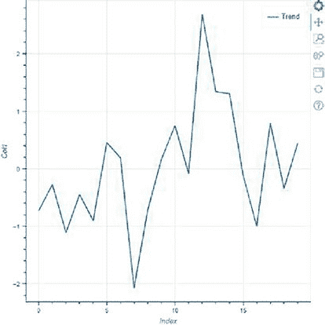
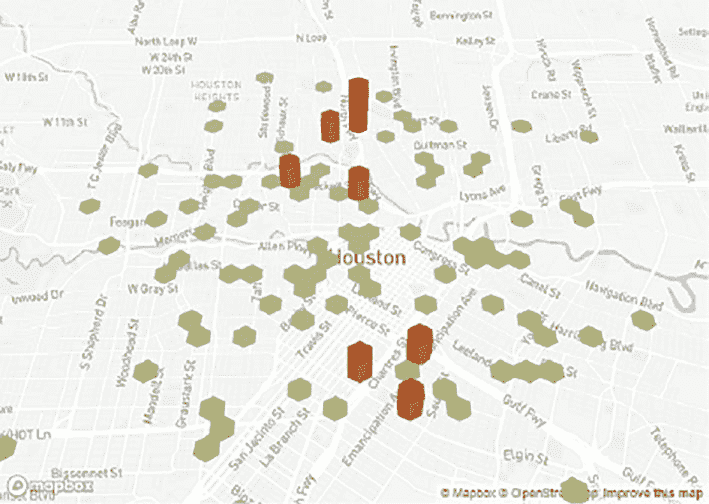
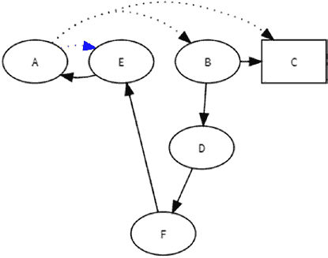
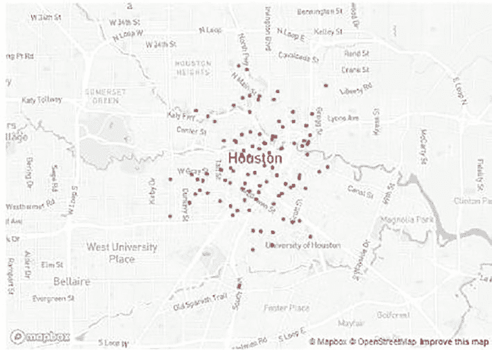

# 附录 A Streamlit 应用程序编程接口

## Bokeh

使用命令`st.bokeh_chart(figure, use_container_width)`可显示 Bokeh 图表。

### 表 A-17. `st.bokeh_chart`参数

| 参数 | 描述 |
|-----------|-------------|
| `figure` (`bokeh.plotting.figure.Figure`) | 要渲染的 Bokeh 图形对象。 |
| `use_container_width` (`bool`) | 若设为`True`，图表宽度将设为列宽。 |

以下示例展示了如何在 Streamlit 中显示 Bokeh 折线图：

```python
import pandas as pd
import numpy as np
from bokeh.plotting import figure

df = pd.DataFrame(np.random.randn(10, 1), columns=['Col1'])
fig = figure(x_axis_label='Index', y_axis_label='Col1')
fig.line(df.index, df['Col1'], legend_label='Trend', line_width=2)
st.bokeh_chart(fig)
```



## PyDeck

使用命令`st.pydeck_chart(pydeck_obj, use_container_width)`可显示 PyDeck 地理空间地图。

### 表 A-18. `st.pydeck_chart`参数

| 参数 | 描述 |
|-----------|-------------|
| `spec` (`pydeck.Deck` 或 `None`) | 要渲染的 PyDeck 图形对象。 |

以下示例展示了如何在 Streamlit 中显示 PyDeck 地理空间地图：

```python
import pandas as pd
import numpy as np
import pydeck as pdk

df = pd.DataFrame(
    np.random.randn(100, 2)/[50, 50] + [29.76, -95.37],
    columns=['latitude', 'longitude']
)

st.pydeck_chart(pdk.Deck(
    map_style='mapbox://styles/mapbox/light-v9',
    initial_view_state=pdk.ViewState(
        latitude=29.76,
        longitude=-95.37,
        zoom=12,
        pitch=40,
    ),
    layers=[
        pdk.Layer(
            'HexagonLayer',
            data=df,
            get_position='[longitude, latitude]',
            radius=200,
            elevation_scale=2,
            elevation_range=[0, 500],
            pickable=True,
            extruded=True,
        ),
    ],
))
```



## Graphviz

使用命令`st.graphviz_chart(figure_or_dot, use_container_width)`可渲染 Graphviz 图表。

### 表 A-19. `st.graphviz_chart`参数

| 参数 | 描述 |
|-----------|-------------|
| `figure_or_dot` (`graphviz.dot.Graph`, `graphviz.dot.Digraph`, `str`) | 要渲染的 Graphviz 图形对象。 |
| `use_container_width` (`bool`) | 若设为`True`，图表宽度将设为列宽。 |



以下示例展示了如何在 Streamlit 中显示 Graphviz 图形：

```python
import graphviz as graphviz

st.graphviz_chart("""
digraph {
    A -> {B C} [style=dotted, shape=box]
    B -> C
    D -> F
    F -> E
    E -> A
    B -> D
    subgraph {
        rank = same; A; B; C [shape=box];
        A -> E [color=blue, style=dotted]
    }
}
""")
```

## 地图

使用命令`st.map(data, zoom, use_container_width)`可显示 Streamlit 地理空间地图。

### 表 A-20. `st.map`参数

| 参数 | 描述 |
|-----------|-------------|
| `data` (`pandas.DataFrame`, `pandas.Styler`, `numpy.ndarray`, `Iterable`, `dict`) | 要在地图上渲染的点的`latitude`（纬度）和`longitude`（经度）。 |
| `zoom` (`int`) | 地图首次渲染时的缩放级别。更多信息请参考[`wiki.openstreetmap.org/wiki/Zoom_levels`](https://wiki.openstreetmap.org/wiki/Zoom_levels)。 |

以下示例展示了如何在 Streamlit 中显示地理空间地图：

```python
import pandas as pd
import numpy as np

df = pd.DataFrame(
    np.random.randn(100, 2)/[50, 50] + [29.76, -95.37],
    columns=['latitude', 'longitude']
)

st.map(df)
```

