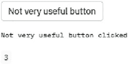
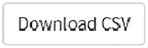
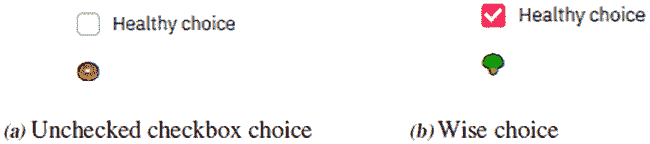
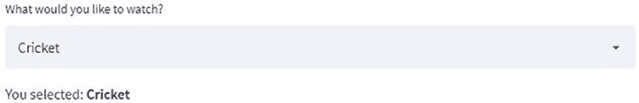

# 附录 A STREAMLIT 应用程序编程接口

## A.1.4 输入组件

Streamlit 提供了一系列丰富多样的输入组件，使开发者能够满足各种使用场景。从简单的按钮、滑块和表单，到颜色选择器、文件上传器和选择框，Streamlit 涵盖了所有类型的输入组件。

### 按钮

通用按钮可以通过命令 `st.button(label, key, help, on_click, args, kwargs, disabled=False) -> bool` 为任何需求创建。



**表 A-21.** `st.button` 参数

| 参数 | 描述 |
| :--- | :--- |
| `label` ( `str` ) | 按钮上显示的标签。 |
| `key` ( `str` 或 `int` ) | 用于在代码中引用该按钮的唯一键，可以是字符串或整数。该参数为可选参数，若未提供将自动生成。 |
| `help` ( `str` ) | 光标悬停在组件上时显示的工具提示。 |
| `on_click` ( `callable` ) | 按钮被点击时调用的回调函数。 |
| `args` ( `tuple` ) | 传递给回调函数的参数元组。 |
| `kwargs` ( `dict` ) | 传递给回调函数的关键字参数字典。 |
| `disabled` ( `bool` ) | 用于禁用该组件的布尔参数。 |

以下示例展示了当按钮被点击时，如何显示一个简单算术计算的结果：

```python
def addition(a,b):
    result = a + b
    return result

if st.button('不太有用的按钮', key='b1'):
    st.text('不太有用的按钮已点击')
    st.write(addition(1,2))
```

### 下载按钮

可以使用以下命令将下载按钮添加到我们的网站中：`st.download_button(label, data, file_name, mime, key, help, on_click, args, kwargs, disabled=False) -> bool`。

**表 A-22.** `st.download_button` 参数

| 参数 | 描述 |
| :--- | :--- |
| `label` ( `str` ) | 说明按钮用途的标签。 |
| `data` ( `str` 或 `bytes` 或 `file` ) | 要下载的文件内容。使用缓存以避免每次重新运行时重复计算。 |
| `file_name` ( `str` ) | 要下载的文件名称。如果未指定，将自动创建名称。 |
| `mime` ( `str` 或 `None` ) | 数据的 MIME 类型。文本文件默认为 `"text/plain"`，二进制文件默认为 `"application/octet-stream"`。 |
| `key` ( `str` 或 `int` ) | 用于在代码中引用该按钮的唯一键，可以是字符串或整数。该参数为可选参数，若未提供将自动生成。 |
| `help` ( `str` ) | 光标悬停在组件上时显示的工具提示。 |
| `on_click` ( `callable` ) | 按钮被点击时调用的回调函数。 |
| `args` ( `tuple` ) | 传递给回调函数的参数元组。 |
| `kwargs` ( `dict` ) | 传递给回调函数的关键字参数字典。 |
| `disabled` ( `bool` ) | 用于禁用该组件的布尔参数。 |



以下示例展示了如何使用下载按钮将 Pandas 数据框下载为 CSV 文件：

```python
import pandas as pd

data = pd.DataFrame({'a':[1,2,3],'b':[4,5,6]}).to_csv().encode('utf-8')
st.download_button(
    label='下载 CSV',
    data=data,
    file_name='data.csv',
    mime='text/csv'
)
```

### 复选框

可以使用以下命令将复选框添加到我们的网站中：`st.checkbox(label, value, key, help, on_change, args, kwargs, disabled=False) -> bool`。

**表 A-23.** `st.checkbox` 参数

| 参数 | 描述 |
| :--- | :--- |
| `label` ( `str` ) | 复选框的标签。 |
| `value` ( `bool` ) | 选择首次渲染时复选框是否默认预选。内部会将其转换为 `bool` 类型。 |
| `key` ( `str` 或 `int` ) | 用于在代码中引用该按钮的唯一键，可以是字符串或整数。该参数为可选参数，若未提供将自动生成。 |
| `help` ( `str` ) | 光标悬停在组件上时显示的工具提示。 |

*(续)*



**表 A-23.** *(续)*

| 参数 | 描述 |
| :--- | :--- |


`on_change( *callable*)` 当控件值发生变化时调用的回调函数。

`args( *tuple*)` 传递给回调函数的参数元组。

`kwargs( *dict* )` 传递给回调函数的关键字参数字典。

`disabled( *bool* )` 用于禁用控件的布尔参数。

复选框控件选中与未选中的行为如下所示：

```
choice = st.checkbox('Healthy choice')
if choice:
    st.write(':broccoli:')
else:
    st.write(':doughnut:')
```

### 单选按钮

我们可以使用以下命令为网页添加单选按钮：`st.radio(label, options, index, format_func=special_internal_function, key, help, on_change, args, kwargs, disabled=False)` ➤ `any`。

## 附录 A Streamlit 应用程序接口

#### 表 A-24. `st.radio` 参数

| 参数 | 说明 |
|---|---|
| `label( *str* )` | 单选按钮组的标签。 |
| `options( *Sequence, numpy.ndarray, pandas.Series, pandas.DataFrame, or pandas.Index* )` | 单选按钮选项的标签。将自动转换为 `str`。使用 `pandas.DataFrame` 时，默认选择第一列作为数据源。 |
| `index( *int* )` | 首次渲染时预设选中的选项索引。 |
| `format_func( *function* )` | 用于修改单选按钮选项标签的辅助函数。标签的 `str` 值作为参数传入，并根据函数逻辑返回修改后的 `str`。此选项仅用于外观美化，不影响单选按钮控件的操作或返回值。 |
| `key( *str or int* )` | 用于在代码中引用该控件的唯一键，可以是字符串或整数。该参数为可选参数，若未提供则自动生成。 |
| `help( *str* )` | 当光标悬停在控件上时显示的工具提示。 |
| `on_change( *callable* )` | 当控件值发生变化时调用的回调函数。 |
| `args( *tuple* )` | 传递给回调函数的参数元组。 |
| `kwargs( *dict* )` | 传递给回调函数的关键字参数字典。 |
| `disabled( *bool* )` | 用于禁用控件的布尔参数。 |


## 附录 A Streamlit 应用程序接口

以下示例展示了一个包含两个选项的单选按钮，并显示选择结果：

```
sport_selection = st.radio("What's the best football club in the World",
                           ('Real Madrid', 'Other team'))
if sport_selection == 'Real Madrid':
    st.write('That was easy :soccer:.')
else:
    st.write('You are clearly wrong.')
```

### 选择框

我们可以使用以下命令为网页添加一个选择框控件：`st.selectbox(label, options, index, format_func=special_internal_function, key, help, on_change, args=None, kwargs, disabled=False)` ➤ `any`。

#### 表 A-25. `st.selectbox` 参数

| 参数 | 说明 |
|---|---|
| `label( *str* )` | 控件的标签。 |
| `options( *Sequence, numpy.ndarray, pandas.Series, pandas.DataFrame, or pandas.Index* )` | 选择选项的标签。将自动转换为 `str`。使用 `pandas.DataFrame` 时，默认选择第一列作为数据源。 |
| `index( *int* )` | 首次渲染时预设选中的选项索引。 |
| *(续上表)* | |



## 附录 A Streamlit 应用程序接口

#### 表 A-25. (续)

| 参数 | 说明 |
|---|---|
| `format_func( *function* )` | 用于修改选项选择标签的辅助函数。标签的 `str` 值作为参数传入，并根据函数逻辑返回修改后的 `str`。此选项仅用于外观美化，不影响控件的操作或返回值。 |
| `key( *str* or *int* )` | 用于在代码中引用该控件的唯一键，可以是字符串或整数。该参数为可选参数，若未提供则自动生成。 |
| `help( *str* )` | 当光标悬停在控件上时显示的工具提示。 |
| `on_change( *callable* )` | 当控件值发生变化时调用的回调函数。 |
| `args( *tuple* )` | 传递给回调函数的参数元组。 |
| `kwargs( *dict* )` | 传递给回调函数的关键字参数字典。 |
| `disabled( *bool* )` | 用于禁用控件的布尔参数。 |

以下示例展示了一个包含两个选项的选择框控件：

```
option = st.selectbox('What would you like to watch?',
                      ('Cricket', 'Baseball'))
```


```python
st.write('您选择了：**%s**' % option)
```

## 附录 A STREAMLIT 应用程序接口

### 多选下拉框

通过以下命令可在网站中添加多选下拉部件：

`st.multiselect(label, options, default=None, format_func=special_internal_function, key=None, help=None, on_change=None, args=None, kwargs=None, disabled=False)` → `str`

**表 A-26.** `st.multiselect` 参数

| 参数 | 说明 |
|---|---|
| `label` (`str`) | 多选下拉部件的标签。 |
| `options` (`Sequence`, `numpy.ndarray`, `pandas.Series`, `pandas.DataFrame` 或 `pandas.Index`) | 选择选项标签。会自动转换为 `str`。使用 `pandas.DataFrame` 时，将选择第一列作为数据源。 |
| `index` (`int`) | 首次渲染时预选选项的索引。 |
| `default` (`[str]` 或 `None`) | 默认值。 |
| `format_func` (`function`) | 用于修改选择标签的辅助函数。标签的 `str` 值作为参数传入，并根据函数逻辑返回修改后的 `str`。此选项仅用于外观显示，不影响部件的操作或返回值。 |
| `key` (`str` 或 `int`) | 在代码中引用该按钮的唯一键，可以是字符串或整数。该参数为可选，若不提供将自动生成。 |
| `help` (`str`) | 当鼠标悬停在部件上时显示的工具提示。 |
| `on_change` (`callable`) | 当部件值发生变化时调用的回调函数。 |
| `args` (`tuple`) | 传递给回调函数的参数元组。 |
| `kwargs` (`dict`) | 传递给回调函数的关键字参数字典。 |
| `disabled` (`bool`) | 用于禁用部件的布尔参数。 |

``

以下示例展示了一个包含四个选项的多选下拉部件：

```python
options = st.multiselect('您最喜欢的季节是哪些？', ['春季', '夏季', '秋季', '冬季'])
st.write('您选择了：%s' % ', '.join(options))
```

### 滑块

通过以下命令可在网站中添加滑块部件：

`st.slider(label, min_value, max_value, value, step, format, key, help, on_change, args, kwargs, disabled=False)` → `value`

**表 A-27.** `st.slider` 参数

| 参数 | 说明 |
|---|---|
| `label` (`str`) | 说明滑块用途的标签。 |
| `min_value`（支持的类型 或 `None`） | 允许的最小值。对于 `int` 和 `float`，默认为 `0` 或 `0.0`；对于日期/日期时间值，默认为 `value – timedelta(days=14)`；对于时间值，默认为 `time.min`。 |
| `max_value`（支持的类型 或 `None`） | 允许的最大值。对于 `int` 和 `float`，默认为 `100` 或 `1.0`；对于日期/日期时间值，默认为 `value + timedelta(days=14)`；对于时间值，默认为 `time.max`。 |
| `value`（支持的类型 或 支持类型的元组/列表 或 `None`） | 部件首次渲染时使用的默认值。如需使用预定义范围，应传入包含最小值和最大值的元组/列表。默认为 `min_value`。 |
| `step` (`int`/`float`/`timedelta` 或 `None`) | 步进间隔。对于 `int` 和 `float`，默认设置为 `1` 和 `0.01`；对于日期/日期时间值，默认为 `timedelta(days=1)`；对于时间值（或当 `max_value – min_value < 1 天` 时），默认为 `timedelta(minutes=15)`。 |
| `format` (`str` 或 `None`) | 自定义格式字符串，用于指定界面如何以 printf 样式格式化数字显示。返回值不受该转换影响。支持 `%d`、`%e`、`%f`、`%g` 和 `%i` 用于格式化 `int`/`float` 值。对于日期/时间/日期时间格式化，请使用 Moment.js 语法：[`momentjs.com/docs/#/displaying/format/`](https://momentjs.com/docs/#/displaying/format/)。 |
| `key` (`str` 或 `int`) | 在代码中引用该按钮的唯一键，可以是字符串或整数。该参数为可选，若不提供将自动生成。 |
| `help` (`str`) | 当鼠标悬停在部件上时显示的工具提示。 |
| `on_change` (`callable`) | 当部件值发生变化时调用的回调函数。 |
| `args` (`tuple`) | 传递给回调函数的参数元组。 |
| `kwargs` (`dict`) | 传递给回调函数的关键字参数字典。 |
| `disabled` (`bool`) | 用于禁用部件的布尔参数。 |
| `key` (`str` 或 `int`) | 在代码中引用该按钮的唯一键，可以是字符串或整数。该参数为可选，若不提供将自动生成。 |
| `help` (`str`) | 当鼠标悬停在部件上时显示的工具提示。 |
| `on_change` (`callable`) | 当部件值发生变化时调用的回调函数。 |
| `args` (`tuple`) | 传递给回调函数的参数元组。 |
| `kwargs` (`dict`) | 传递给回调函数的关键字参数字典。 |
| `disabled` (`bool`) | 用于禁用部件的布尔参数。 |


