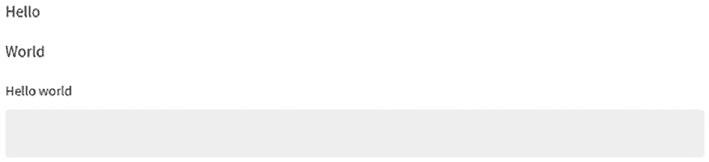
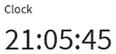
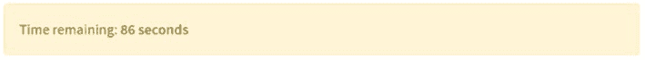
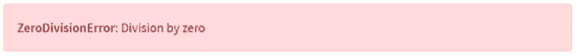
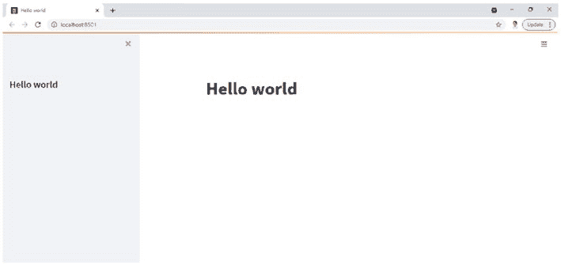
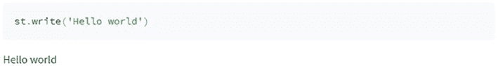
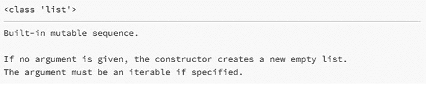

# Streamlit 组件回调与表单

`on_change(*可调用对象*)` - 当组件值发生变化时调用的回调函数。

`args(*元组*)` - 传递给回调函数的参数元组。

`kwargs(*字典*)` - 传递给回调函数的关键字参数字典。

`disabled(*布尔值*)` - 用于禁用组件的布尔参数。

以下代码展示了颜色选择组件的实现，默认选择为黑色（十六进制值 `#000000`）。

```
color = st.color_picker(label = '选择一个颜色', value = '#000000')
```

## 表单

你可以使用 Streamlit 的 `st.form(key, clear_on_submit=False)` 命令将多个组件封装到一个表单中。使用表单的额外好处是，Streamlit 不会像通常那样在你与表单内任何一个组件交互时重新运行整个脚本。相反，Streamlit 只会在你使用 `st.form_submit_button(label='Submit', help=None, on_click, args, kwargs)` ➤ `bool` 命令点击相关按钮时，才会重新运行脚本。

### 表 A-37. `st.form` 参数

| **参数** | **描述** |
| --- | --- |
| `key(*字符串*)` | 用于标识表单的唯一字符串。 |
| `clear_on_submit(*布尔值*)` | 如果此参数设置为 true，则在表单提交组件的值发生变化后，表单内的所有组件都将重置为其默认值。 |

### 表 A-38. `st.form_submit_button` 参数

| **参数** | **描述** |
| --- | --- |
| `label(*字符串*)` | 按钮上显示的标签。 |
| `help(*字符串或 None*)` | 光标悬停在组件上时显示的工具提示。 |
| `on_click(*可调用对象*)` | 点击按钮时调用的回调函数。 |
| `args(*元组*)` | 传递给回调函数的参数元组。 |
| `kwargs(*字典*)` | 传递给回调函数的关键字参数字典。 |

以下示例展示了一个 Streamlit 表单和表单提交按钮如何一起使用：

```
with st.form('form_1'):
    radio = st.radio('单选按钮', ['你好','世界'])
    checkbox = st.checkbox('你好世界')
    if st.form_submit_button('提交表单'):
        st.write('单选: %s' % radio, '复选框:', checkbox)
```

## A.1.5 显示交互式组件

Streamlit 使得渲染多媒体内容变得相当简单，无论其来源如何。无论是保存在磁盘上的本地图像、通过 URL 访问的视频，还是包含声音文件原始数据的数组，你都可以使用 Streamlit 的原生命令来显示和播放多媒体，无需你再做任何额外工作。

### 显示图像

我们可以使用以下命令轻松插入图像：`st.image(image, caption, width, use_column_width, clamp, channels='RGB', output_format='auto')`。

#### 表 A-39. `st.image` 参数

| **参数** | **描述** |
| --- | --- |
| `image(*numpy.ndarray, [numpy.ndarray], BytesIO, str, 或 [str]*)` | 以下类型的一个或多个：单色图像 (w,h) 或 (w,h,1)，彩色图像 (w,h,3)，RGBA 图像 (w,h,4)，图像的 URL，本地图像的路径，VG XML 字符串。 |
| `caption(*字符串或字符串列表*)` | 图像标题。如果显示多张图像，应使用标题列表（每张图像对应一个标题）。 |
| `width(*整数或 None*)` | 图像宽度。`None` 表示使用图像原始尺寸，只要不超过列的宽度。SVG 图像必须使用此选项，因为它们没有默认图像宽度。 |
| `use_column_width(*'auto' 或 'always' 或 'never' 或布尔值*)` | `"auto"` 使用图像的自然尺寸，但不超过列的宽度。`True` 或 `"always"` 将使用列的宽度。`False` 或 `"never"` 使用图像的原始尺寸。注意：`use_column_width` 优先于 `width` 参数。 |
| `clamp(*布尔值*)` | 仅适用于字节数组图像，对图像 URL 忽略。Clamp 会将像素值设定在有效范围（每个通道 `[0–255]`）内。如果需要但未设置，图像将包含超出范围的值，并会抛出错误。 |
| `channels(*'RGB' 或 'BGR'*)` | 对于 `nd.array`，此参数表示颜色信息。默认为 `"RGB"`，即 `[:, :, 0]` 表示红色，`[:, :, 1]` 表示绿色，`[:, :, 2]` 表示蓝色。 |


```markdown
`[:, :, 1]` 对应绿色通道，`[:, :, 2]` 对应蓝色通道。某些库可能采用不同的编码方式，例如 openCV 使用的是“BGR”编码。

`output_format('JPEG', 'PNG', 或 'auto')`

用于指定图像传输格式的参数。JPEG 适用于照片，采用有损压缩；PNG 适用于图表，采用无损压缩。默认选项 `auto` 会根据图像类型自动选择压缩格式。

``

## 附录 A STREAMLIT 应用程序编程接口

以下示例展示了如何显示一张静态 PNG 图片：

```python
st.image('elmo.png')
```

### 显示音频播放器

通过以下命令可以显示音频播放器：`st.audio(data, format='audio/wav', start_time)`。

**表 A-40.** `st.audio` 参数

| 参数 | 说明 |
| --- | --- |
| `data(str, bytes, BytesIO, numpy.ndarray, 或通过` | 使用标准的 `io.open()` 函数，接受原始音频数据、文件名或音频文件的 URL。原始数据格式和 numpy 数组必须包含其类型所需的最小结构及数值。 |
| `start_time(int)` | 用于设置微件滑块默认开始播放的时间（以秒为单位）。 |
| `format(str)` | 音频文件的 MIME 类型，默认为 `audio/wav`。更多信息请参阅 [`tools.ietf.org/html/rfc4281`](https://tools.ietf.org/html/rfc4281)。 |

``

插入音频文件只需一行代码即可完成，示例如下：

```python
st.audio('snoring.mp3', start_time=10)
```

### 显示视频

通过命令 `st.video(data, format='video/mp4', start_time)` 可以向网页中添加视频。

**表 A-41.** `st.video` 参数

| 参数 | 说明 |
| --- | --- |
| `data(str, bytes, BytesIO, numpy.ndarray, 或通过` | 使用标准的 `io.open()` 函数，接受原始视频数据、文件名或 YouTube 视频文件的 URL。原始数据格式和 numpy 数组必须包含其类型所需的最小结构及数值。 |
| `format(str)` | 视频文件的 MIME 类型，默认为 `audio/mp4`。更多信息请参阅 [`tools.ietf.org/html/rfc4281`](https://tools.ietf.org/html/rfc4281)。 |
| `start_time(int)` | 用于设置微件滑块默认开始播放的时间（以秒为单位）。 |

以下是一个简单的视频插入示例：

```python
st.video('https://www.youtube.com/watch?v=m0h7ESBEf3U')
```

``

## A.1.6 页面结构

使用 Streamlit，您可以通过四种方式组织网页，即：侧边栏、多列布局、可折叠面板和容器，或将它们组合使用以自定义用户体验。此外，您还可以使用占位符有效预留网页空间，以便在需要时按需使用。

### 侧边栏

Streamlit 通过 `st.sidebar` 命令提供一个侧边栏，该侧边栏可根据页面大小展开、收缩或自动部署。您可以通过追加函数的方式向其添加任何其他微件或元素（`st.echo` 和 `st.spinner` 除外）。

以下示例展示了如何配合另一个 Streamlit 元素使用侧边栏：

```python
st.sidebar.title('Hello world')
```

``

### 多列布局

使用多列布局时，您可以通过命令 `st.columns(spec)` ➤ `list` 将网页垂直划分为指定宽度的列。该命令返回一个列列表，随后可使用 `with` 语句调用。

**表 A-42.** `st.columns` 参数

| 参数 | 说明 |
| --- | --- |
| `spec(int 或数字列表)` | 若为整数，则指定创建相同宽度的列数。若使用数字列表，则会为每个数字创建一列，其宽度与该数字成比例。 |

``

以下示例展示了如何在 Streamlit 应用程序中使用多列布局：

```python
col1, col2 = st.columns([1,2])

with col1:
    st.text_input('Hello')

with col2:
    st.text_input('World')
```

### 可折叠面板

Streamlit 通过 `st.expander(label,`
```


#### `st.expander`

`st.expander()` 是一个可展开或收缩的命令，它可以通过`with`语句来容纳所有其他小部件或元素。

***表 A-43.** `st.expander` 参数*

| 参数 | 描述 |
|------|------|
| `label` (`str`) | 展开器小部件的显示名称。 |
| `expanded` (`boolean`) | 将此参数设置为 `True` 将使小部件在启动时处于展开状态。 |




以下示例展示了如何将展开器与另一个 Streamlit 元素一起使用：

```
with st.expander('Hello world'):
    st.title('Hello world')
```

### `st.container`

使用 Streamlit 的`st.container()`命令，您可以将多个元素组合到一个不可见的容器中。可以使用`with`语句或将 Streamlit 元素附加到容器名称后面来将元素添加到容器中。元素可以按需且不按顺序添加到容器中。

以下示例展示了如何在 Streamlit 应用程序中使用容器：

```
container_1 = st.container()
container_1.write('Hello')
st.text_input('Hello world')
container_1.write('World')
```



### `st.empty` (占位符)

Streamlit 允许您通过使用占位符（可通过`st.empty()`命令调用）在网页中预留位置。您可以使用`with`语句或简单地将元素附加到占位符名称后面，将任何单个元素（或容器中的一组元素）添加到占位符中。您可以随时更新元素或用另一个元素替换它，完成后，您可以通过附加`empty()`来清空占位符。占位符对于生成需要定期更新的动态或动画内容特别有用。

```
import datetime

clock = st.empty()
while datetime.datetime.now() < datetime.datetime(2022, 1, 12):
    clock.metric(label='Clock', value=datetime.datetime.now().strftime('%H:%M:%S'))
clock.empty()
```

## A.1.7 显示状态和进度

根据您的应用程序，您可能需要向用户显示某个活动的状态和/或进度。使用 Streamlit，我们有多种原生方法可以向用户传达操作所处的确切阶段。


### `st.progress` (进度条)

使用 Streamlit 的`st.progress(value)`命令，您可以实时显示任何活动的进度。

***表 A-44.** `st.progress` 参数*

| 参数 | 描述 |
|------|------|
| `value` (`int` 或 `float`) | 进度条渲染时的值。`int` 类型的值范围为 0 到 100，`float` 类型的值范围为 0.0 到 1.0。 |

```
import time

timer = st.progress(0)
for i in range(0,100):
    timer.progress(i)
    time.sleep(1)
```

### `st.spinner` (旋转加载器)

使用 Streamlit 的`st.spinner(text)`命令，您可以在可执行代码块中显示临时消息。

***表 A-45.** `st.spinner` 参数*

| 参数 | 描述 |
|------|------|
| `text` (`str`) | 在执行代码块期间临时渲染的消息。 |




```
import time

for i in range(0,100):
    with st.spinner('剩余时间：**%s 秒**' % (100-i)):
        time.sleep(1)
```

### `st.success`, `st.info`, `st.warning`, `st.error` (消息)

使用命令`st.success(body)`、`st.info(body)`、`st.warning(body)`和`st.error(body)`，您可以分别显示带有绿色、蓝色、黄色和红色封装框的消息。

***表 A-46.** `st.success`、`st.info`、`st.warning` 和 `st.error` 参数*

| 参数 | 描述 |
|------|------|
| `body` (`str`) | 要渲染的消息。 |

```
col1, col2, col3, col4 = st.columns(4)

with col1:
    st.success('Hello world')
with col2:
    st.info('Hello world')
with col3:
    st.warning('Hello world')
with col4:
    st.error('Hello world')
```



### `st.exception` (异常)

使用 Streamlit 的`st.exception(exception)`命令，您可以显示异常类型和相应的消息。


#### 表格 A-47. `st.exception` 参数

| 参数 | 描述 |
|------|------|
| `exception( *Exception*)` | 要渲染的异常类型。 |

```python
a = 1
b = 0
try:
    a / b
except:
    st.exception(ZeroDivisionError('Division by zero'))
```

### `Balloons`

`st.balloons()` 命令允许您在绝对必要时渲染漂浮的气球：

```python
st.balloons()
```


### `Snow`

最后，`st.snow()` 命令允许您渲染漂浮的雪花，以纪念 Streamlit 被 Snowflake 收购：

```python
st.snow()
```

## A.1.8 实用工具

Streamlit 还提供了许多其他函数和附加实用工具，例如通过编程方式配置网页、渲染代码片段以及在需要时提供对象文档。

### 页面配置

您可以使用 `st.set_page_config(page_title, page_icon, layout, initial_sidebar_state, menu_items)` 命令配置 Streamlit 应用程序的标题、图标、布局、侧边栏状态和菜单选项。

#### 表格 A-48. `st.set_page_config` 参数

| 参数 | 描述 |
|------|------|
| `page_title( *str or None*)` | 将出现在浏览器标签页上的标题；如果未调用，将使用脚本名称作为页面标题。 |
| `page_icon( *image, icon, str, or None*)` | 将显示在浏览器标签页上的网站图标；也可以使用短代码作为图像的替代。 |
| `layout( *'centered' or 'wide'*)` | 页面的布局；如果未调用，页面将默认居中。 |
| `initial_sidebar_state( *'auto', 'expanded', or 'collapsed'*)` | 页面启动时侧边栏的状态；如果未调用，将默认为`auto`。 |
| `menu_items( *dict*)` | 汉堡菜单中“获取帮助”、“报告错误”或“关于”页面的配置。有关更多信息，请参阅第 3.1 节。 |

```python
st.set_page_config(
    page_title='Hello world',
    page_icon=icon,
    layout='centered',
    initial_sidebar_state='auto',
    menu_items={
        'Get Help': 'https://streamlit.io/',
        'Report a bug': 'https://github.com',
        'About': 'About your application: **Hello world**'
    }
)
```





### 代码回声

您可以使用 `st.echo(code_location)` 命令同时渲染和执行代码。

#### 表格 A-49. `st.echo` 参数

| 参数 | 描述 |
|------|------|
| `code_location( *'above' or 'below'*)` | 决定代码是在其执行位置的上方还是下方渲染。 |

```python
with st.echo():
    st.write('Hello world')
```




### 文档

您可以使用 `st.help(obj)` 命令显示与某个对象关联的帮助文档。

#### 表格 A-50. `st.help` 参数

| 参数 | 描述 |
|------|------|
| `obj( *Object*)` | 应显示其帮助文档的对象。 |

```python
lst = [1, 2, 3]
st.help(lst)
```

### 停止执行

要停止 Streamlit 应用程序在脚本中特定点的执行，您可以使用 `st.stop()` 命令来防止其余代码被执行：

```python
st.write('Hello world')
st.stop()
st.write('Bye world')
```

## A.1.9 会话状态管理

实现有状态架构对于许多 Web 应用程序来说至关重要。从存储用户凭证等会话特定数据到其他变量，缺乏这种能力对许多开发者来说可能是一个决定性因素。请想象一下，在您的应用程序中尝试实现逻辑流程，在一个页面上的用户输入用于在另一个页面上生成可视化。如果不将输入存储为会话变量，一旦您导航到另一个页面或简单地重新运行脚本，它就会被重置，导致您无法获得可视化。幸运的是，Streamlit 提供了一种原生且高度直观的方式来无缝管理会话状态，使开发者能够提供增强的用户体验。

### 初始化会话状态变量


