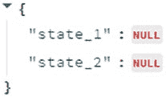
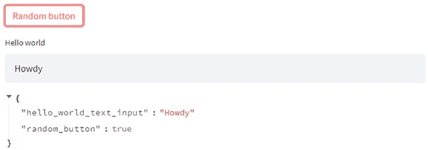

# Streamlit 会话状态

Streamlit 的会话状态字典由键值对组成，其中每个键必须先初始化才能调用，每个值可以是字符串、整数、列表、字典、数据框、对象或其他变量。要将变量初始化到会话状态中，请按如下步骤操作：

```python
if 'state_1' not in st.session_state:
    st.session_state['state_1'] = None
```

## 访问会话状态变量

随后，要访问在同一会话中初始化的变量，只需按如下方式调用：

```python
state_1 = st.session_state['state_1']
```

要访问所有会话状态变量，请使用以下命令：

```python
st.write(st.session_state)
```



## 附录 A Streamlit 应用程序编程接口

这将返回包含所有已存储键值对的会话状态字典，具体示例如下：

## 更新会话状态变量

要更新会话状态变量的值，请按如下步骤操作：

```python
st.session_state['state_1'] = 'Hello world'
```

## 删除会话状态变量

要删除特定的会话状态变量，请使用以下方法：

```python
del st.session_state['state_1']
```

要一次性删除所有会话状态变量，可以使用以下方法：

```python
for variable in st.session_state:
    del st.session_state[variable]
```

## 组件会话状态

Streamlit 中的每个组件都会自动关联其自身的会话状态变量，其中键与作为参数传递给组件的键相同，如下所示：

```python
st.button('随机按钮', key='random_button_1')
st.text_input('Hello world', key='hello_world_input')
st.write(st.session_state)
```



请注意，在组件实例化后修改其会话状态的值是不允许的，如果尝试这样做，将会抛出 `StreamlitAPIException` 错误。但是，允许在组件实例化之前设置其状态，不过如果组件的默认值已作为参数设置，将会显示一次性警告信息。

此外，对于包含按钮的组件（如 `st.button`、`st.download_button` 和 `st.file_uploader`），其会话状态值不可修改；默认情况下，它们被设置为 `False`，点击时会切换为 `True`。

## A.1.10 数据管理

对于 Web 服务器而言，管理数据以实现计算资源的最优使用至关重要。考虑到我们面对的数据规模庞大，通常需要缓存数据、函数和其他对象，以便在需要时及时复用。为此，Streamlit 提供了一种内置功能，可以在应用程序中缓存和重用数据，并产生显著积极的效果。此外，Streamlit 还提供了在需要时无需任何第三方库即可原生修改数据的能力。

### 缓存数据

Streamlit 允许您使用 `st.cache(func, persist, allow_output_mutation, show_spinner, suppress_st_warning, hash_funcs, max_entries, ttl)` 命令持久缓存函数的结果和数据以供后续使用。如果您处理的是需要长时间下载或处理的大型数据集，此功能尤其有用。启用此功能后，您可以通过调用写在 `st.cache` 装饰器下方的函数将数据存入缓存，然后在需要时按需重新调用，而无需重新执行该函数，即使在脚本重新运行后也不例外。

**表 A-51.** `st.cache` 参数

| 参数 | 描述 |
| :--- | :--- |
| `func`（可调用对象） | 要缓存的函数。 |
| `persist`（布尔值） | 该参数指定是否持久保留缓存的数据。 |
| `allow_output_mutation`（布尔值） | 将该参数设置为 `True` 将允许您覆盖缓存的数据，而不会收到 Streamlit 的警告。 |
| `show_spinner`（布尔值） | 如果设置为 `True`，则在缓存未命中时会显示一个加载动画。 |
| `suppress_st_warning`（布尔值） | 将该参数设置为 `True` 将抑制任何 |