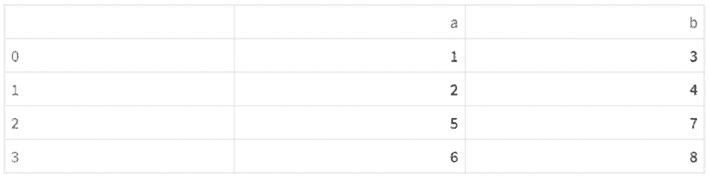

# 附录 A Streamlit 应用程序编程接口

## 使用 `st.experimental_singleton` 进行缓存

```python
@st.experimental_singleton
def load_nlp(lang):
    nlp = spacy.load('%s_core_news_sm' % (lang))
    return nlp
```

```python
##### 首次调用以缓存对象
nlp = load_nlp('es')
##### 后续调用将访问已缓存的对象，无需重新执行函数
nlp = load_nlp('es')
##### 由于输入参数修改，将重新执行函数并缓存新对象
nlp = load_nlp('de')
```

## 数据修改

Streamlit 允许您通过使用 `st.add_rows(data, **kwargs)` 命令将数据帧添加到表格末尾，从而实时修改数据和图表。

**表 A-54.** `st.add_rows` 参数

| 参数 | 描述 |
|-----------|-------------|
| `data`（Pandas 数据帧或样式器、PyArrow 表、Numpy 数组、字典、None 或可迭代对象） | 要追加到现有表格的数据帧。如果使用 PyArrow 表，必须在配置文件中设置 `dataFrameSerialization = 'arrow'`；更多信息请参见第 3.1 节。 |
| `**kwargs`（Pandas 数据帧、Numpy 数组、字典、None 或可迭代对象） | 如有需要，您可以将要追加的数据帧作为命名对象传递，例如 `'dataset' = df`。 |



### 使用 `st.add_rows` 修改表格

```python
table = st.table(pd.DataFrame(data={'a':[1,2], 'b':[3,4]}))
df = pd.DataFrame(data={'a':[5,6], 'b':[7,8]})
table.add_rows(df)
```

## A.1.11 汉堡菜单

Streamlit 默认在网页右上角配备了一个汉堡菜单。该菜单提供了一系列可能对用户和开发者都有用的附加功能。表 A-55 总结了可用的功能。

**表 A-55.** 汉堡菜单功能

| 功能 | 描述 |
|---------|-------------|
| 重新运行 | 点击后，Streamlit 将从头到尾重新运行脚本。 |
| 设置 | 打开一个窗口，用户可在其中自定义主题的外观、颜色、字体及其他相关设置。更多信息请参见第 3.1 节。 |
| 录制屏幕录像 | 顾名思义，此功能允许您录制浏览器窗口中的视频和音频流，并以 `webm` 格式保存。 |
| 报告错误 | 此选项会打开一个 GitHub 页面链接，您可以在其中报告错误。或者，您也可以选择将此选项链接到第 3.1 节所示的任何其他所需 URL。 |
| 获取帮助 | 同样，此选项会将您带到 Streamlit 讨论页面，您可以在其中提出问题和疑虑。如果需要，可将其链接到第 3.1 节所示的另一个 URL。 |
| 关于 | 此选项会显示一个模态窗口，其中包含您正在使用的 Streamlit 版本。如有需要，您可以按照第 3.1 节所示自定义显示的文本。 |
| 清除缓存 | 此功能将清除由 `st.cache` 命令存储的所有数据。更多信息请参见第 4.1 节。 |
| 部署此应用 | Streamlit 允许您通过此选项直接将应用程序部署到其名为 Streamlit Cloud 的服务器。 |
| Streamlit Cloud | 此链接将带您进入 Streamlit Cloud 的主页，该页面提供有关其托管服务的更多信息。 |
| 报告 Streamlit 错误 | 与“报告错误”功能相同，此选项将带您进入 GitHub 页面，您可以在其中报告错误和问题。 |
| 访问 Streamlit 文档 | 此链接将直接带您进入 Streamlit 的 API。 |
| 访问 Streamlit 论坛 | 同样，此链接将带您进入 Streamlit 的论坛。 |

## 参考文献

[1] A. A. Sutchenkov and A. I. Tikhonov, Active Investigation and Publishing of Calculation Web Based Applications for Studying Process, Journal of Physics 7 (2020).

[2] D. Karade and V. Karade, AIDrugApp: Artificial Intelligence-Based Web-App for Virtual Screening of Inhibitors against SARS-COV-2, 59 (n.d.).

[3] D. M. A. Raheem, S. Tabassum, S. K. Nahid, and S. A. Anzer, A Deep Learning Approach for the Automatic Analysis and Prediction 用于组织病理学图像乳腺癌检测的 Web 应用程序，《国际工程研究杂志》第 10 卷，第 7 期（无日期）。

[4] A. N. Habowski、T. J. Habowski 和 M. L. Waterman，《GECO：用于非线性数据模式可视化的基因表达聚类优化应用》，《BMC 生物信息学》第 22 卷，第 29 期（2021 年）。

[5] F. M. Torun、S. V. Winter、S. Doll、F. M. Riese、A. Vorobyev、J. B. Mueller-Reif、P. E. Geyer 和 M. T. Strauss，《透明探索用于蛋白质组学和组学数据生物标志物发现的机器学习》，第 11 页（无日期）。

[6] R. Shigapov、P. Zumstein、J. Kamlah、L. Oberlander、J. Mechnich 和 I. Schumm，《Bbw：通过元查找将 CSV 匹配到维基数据》，第 10 页（无日期）。

[7] A. R. Kashyap 和 M.-Y. Kan，《SciWING——一个用于科学文档处理的软件工具包》，《arXiv:2004.03807》[计算机科学]（2020 年）。

© Mohammad Khorasani、Mohamed Abdou、Javier Hernández Fernández 2022

M. Khorasani 等人，《使用 Streamlit 进行 Web 应用程序开发》，[`doi.org/10.1007/978-1-4842-8111-6`](https://doi.org/10.1007/978-1-4842-8111-6)

## 参考文献

[8] J. Vig、W. Kryściński、K. Goel 和 N. F. Rajani，《SummVis：用于文本摘要的模型、数据和评估的交互式可视化分析》，《arXiv:2104.07605》[计算机科学]（2021 年）。

[9] Pournaki, A.、Felix Gaisbauer、Sven Banisch 和 E. Olbrich。“Twitter 探索器：一个通过交互网络观察 Twitter 的框架。”《arXiv》abs/2003.03599（2020 年）。

[10] A. Saxena、M. Dhadwal 和 M. Kowsigan，《印度作物产量：使用机器学习和 Streamlit 进行预测与模型部署》，第 13 页（无日期）。

[11] S. F. N. Islam、A. Sholahuddin 和 A. S. Abdullah，《使用极端梯度提升（XGBoost）方法制作美元兑卢比汇率的预测应用程序与分析》，《物理学杂志：系列会议》第 1722 卷，012016（2021 年）。

[12] A. Aboah、M. Boeding 和 Y. Adu-Gyamfi，《用于交通领域多用途应用的移动传感》，第 16 页（无日期）。

[13] Ticlo, I.，载于《Windows 10 云解决方案提供商计划指南》，Insight。检索于 2021 年 9 月 18 日，来自 [www.insight.com](https://www.insight.com/en_US/content-and-resources/2016/12222016-your-guide-to-the-windows-10-cloud-solution-provider-program.html)。

[14] Iberdrola S.A，载于《Wikinger：巩固德国作为战略市场的项目》。检索于 2021 年 11 月 7 日，来自 [www.iberdrola.com](https://www.iberdrola.com/about-us/lines-business/flagship-projects/wikinger-offshore-wind-farm)。

[15] 风力涡轮机功率曲线定义，载于《稳定风速下的风力涡轮机功率输出》。检索于 2021 年 11 月 2 日，来自 [`wind-power-program.com/popups/powercurve.htm`](https://wind-power-program.com/popups/powercurve.htm)。

[16] Veena, R.、Mathew, S. 和 Petra, M.I.，《用于风力涡轮机特定地点性能的人工智能模型》，《国际能源与环境工程杂志》第 11 卷，第 289–297 页（2020 年）。[`doi.org/10.1007/s40095-020-00352-2`](https://doi.org/10.1007/s40095-020-00352-2)。

[17] GE 可再生能源公司，载于《GE 可再生能源公司的 Haliade-X 原型机以 14 MW 功率开始运行》。检索于 2021 年 9 月 14 日，来自 [www.ge.com](https://www.ge.com/news/press-releases/ge-renewable-energy-haliade-x-prototype-starts-operating-at-14-mw)。

## 参考文献

- [GE 可再生能源 Haliade-X 原型机以 14 兆瓦功率开始运行](https://www.ge.com/news/press-releases/ge-renewable-energy-haliade-x-prototype-starts-operating-at-14-mw)
- Michelle Lewis, *GE 巨大的 Haliade-X 14 兆瓦海上风力涡轮机现已投入运行*。检索自 2021 年 9 月 14 日，[electrek.co/2021/10/05/ge-huge-haliade-x-14-mw-offshore-wind-turbine-is-now-operational](https://electrek.co/2021/10/05/ge-huge-haliade-x-14-mw-offshore-wind-turbine-is-now-operational)
- Khorasani, M. (2021 年 10 月 7 日). 如何使用 Python 和 Arduino 构建实时 SCADA 系统. Medium. 检索自 2021 年 12 月 31 日，[towardsdatascience.com/how-to-build-a-real-time-scada-system-using-python-and-arduino-7b3acaf86d39](https://towardsdatascience.com/how-to-build-a-real-time-scada-system-using-python-and-arduino-7b3acaf86d39)
- Cornelam, & Instructables. (2017 年 10 月 6 日). Arduino 伺服电机. Instructables. 检索自 2021 年 12 月 30 日，[www.instructables.com/Arduino-Servo-Motors/](https://www.instructables.com/Arduino-Servo-Motors/)
- Learning, U. C. I. M. (2016 年 10 月 6 日). 皮马印第安人糖尿病数据库. Kaggle. 检索自 2022 年 1 月 5 日，[www.kaggle.com/uciml/pima-indians-diabetes-database](https://www.kaggle.com/uciml/pima-indians-diabetes-database)
- 人均 GDP. 我们的数据世界. (n.d.). 检索自 2022 年 1 月 9 日，[ourworldindata.org/grapher/gdp-per-capita-worldbank](https://ourworldindata.org/grapher/gdp-per-capita-worldbank)

## 索引

### A

- 聚合，116, 152, 156, 157
- `AgGrid()` 命令，113
- API 构建，166, 167, 169, 170
- Altair 图表，405
- API 测试，170, 171
- 动画条形图，130
- 环境，161
- 动画气泡图，129
- Streamlit 连接，174, 176
- 防 SQL 注入，225
- 应用程序
  - 条件流程，34–36
  - 设计
    - 页面配置，64–77
    - 页面组织，81–85
    - 主题和配色方案，77–81
  - 管理和调试错误，36–40
  - 用户输入表单，32, 34
- `Arduino IDE`，310, 311, 316, 317
- Arduino 微控制器和红外温度计接线示意图，311
- 身份验证，226
  - 用户账户开发，203–207
  - 用户凭据验证，207–224

### B

- 后端服务器
  - 环境，161
  - Streamlit 连接，174, 176
- Bcrypt 哈希，205, 216
- Bokeh 图表，410
- 弹跳图像，286–290
- 宽带配置网站，230, 231
- 按钮，33, 182, 192, 290, 317, 416, 417, 419, 442

### C

- 缓存大数据，108–110
- 缓存对象，465, 466
- 摄像头输入组件，438, 439
- 图表显示
  - Altair，405
  - Bokeh，410
  - Graphviz，413
  - 折线图、面积图和条形图，402, 403
  - 地图，415
  - Plotly，408, 409
  - Pydeck，411
  - Pyplot，403
  - Vega-Lite，406, 408
- 复选框，61, 248, 387, 419, 420
- 云计算，2–4, 235
- 云端数据库，146–150
- 颜色选择器组件，440–441
- 条件流程，34–36
- 控制台命令，17, 18
- 内容类型标头值，163
- 数据变更，104, 113–118
  - 高级和交互式数据变更，113–118
    - 缓存大数据，108–110
    - 缓存数据，461, 463
    - 缓存函数，463–465
    - 缓存对象，465, 466
    - 变更数据，111, 112, 466
    - 处理字节数据，106–108
- 数据可视化，52
  - 动画可视化，128

---

© Mohammad Khorasani, Mohamed Abdou, Javier Hernández Fernández 2022

M. Khorasani 等人，*使用 Streamlit 进行 Web 应用程序开发*，[`doi.org/10.1007/978-1-4842-8111-6`](https://doi.org/10.1007/978-1-4842-8111-6)

### Cookie 管理，198–201

条形图，123

`Cookie Manager`，199，201，295–301

图表布局，124

`Curl`，163

地理空间图表，128

`Custom components`，264

折线图，121

作为 pip 包，276–279

饼图，124

`ReactJS` 应用程序，265–270

渲染 plotly，120

接收数据，273–275

散点图，122

发送数据，270–272

统计图表，125，126

`Customized footer`，68，77

时间序列图表，127

### D

`Data warehouse`

应用程序，332–343

`Date-time filter`

应用程序，321–324

`Dash`，7，30

`Data displaying`

数据框，396，397

`Delta generator`，25

`Deployment`

JSON，399

`Linux Docker`

指标，400

容器，243–246

本地 Linux 机器，240，241

`Dataframe demo` 应用程序，22，59，61，62

# 术语索引

## D

`Direct pip installation`，15

`Django`，6，7，30，165，166

`Dataframes`，40，48，49，61，107–108，142，182，383，396，397

`Data management`

`Download buttons`，418–419

`Dynamic content display`，85–88

`Dynamic time warping` (DTW)，328

## E

### Environment installation with Anaconda

图形化，12–15

编程式，10–12

`Expander widget`，449

`Extra-Streamlit-Components`，198

弹跳图像，286–290

cookie 管理器，295–301

路由器，302–306

步进条，280–286

标签栏，290–295

## F

`File uploader`，416，437，438

`Flask`，6，30，165–167，171，177，224，226

`Folder structuring`，101，103

`Foreign key`，136，137

`Forms`，32，34，321，441

`Frontend-backend communication`，162，164

`Full-text indexing`，145，146，150，151，155，156

## G

`Geospatial charts`，105，128

`Git`，226，227，240

`GitHub repository`，235，261，265

`Graphviz chart`，402，413，414

## H

`Hamburger Menu`，64，67，68，77，467，468

`Hardware requirements`，9

`Hashing`，204，205，207，227

`Heat map`，368，371，372

`Host’s public IP address`，231

`HTTP methods`，97，163，167

`HTTP tunneling`，NGROK，232–234

## I

### Iberdrola

热力图，368，371，372

可再生能源业务，364

风电场，365，366

风玫瑰图，369–371

风力发电机功率曲线，366–369

`Identifiers`，135，162，163，185，207

`Input form`，32–34

### Input widgets

按钮，416

摄像头输入，438，439

复选框，419，420

颜色选择器，440

日期输入，434，435

下载按钮，418，419

文件上传器，437，438

表单，441，442

多选下拉框，424，425

数字输入，431，432

单选按钮，420，422

下拉选择框，422

区间选择滑块，427，428

滑块，425，427

文本区域，432，433

文本输入，429，430

时间输入，436

`Integrated development environment (IDE)`，7，24，36，101，366

`Integration testing`，21

`Interactive geospatial map`，57，58

`Interactive line chart`，55，56

### Interactive widgets

音频播放器，445

图像，443，445

视频，446

`Interfaces`，31，59，140，366

## J，K

`JSON`，152，164，177，216，291，396，399–400

`JSON Web Token (JWT)`，207，208，211，224，227，345

## L

`Lambda` 函数，46

`Laparoscopy`，374

`Logistic regression classifier`，352–361

## M

### Machine learning as a service

配置脚本，349

主脚本，350，352

无需后端服务器的用户认证，344，346

工具脚本，346，348，349

`Magic commands`，394，395

`Markdown`，386–391

`Matplotlib chart`，403

### maxon 集团

布局，373

高精度与前沿应用，373

新型手术内窥镜适配器系统，374，376

Streamlit 命令与控制仪表盘，377，378

`Middleware`，98，207，210

`MongoDB`，133，144–146，148–150，152，157，160

`Motor command and control application`，316–321，361

`Multimedia`，31，105–107，381，443

`Multipage Streamlit application`，90，94

`Multiple selection widget`，424，425

`Multiprocessing`，171–174

`Multithreading`，171–174

`Mutating data`，111，112

### Mutating Pandas dataframes

排序，44，46

筛选，41，42

分组，48，49

合并，49，51

变形，46，48

选择，42，44

## N，O

`Native data mutation`，111

`Network requirements`，10

`Ngrok`，232–234

### Nonrelational databases

云数据库，146–150

展示表格，157–159

全文索引，150，151

MongoDB，145

查询，152–156

`Numeric input widget`，431，432

## P

`Page configuration`，64

### Page organizing

列，82

容器，83，84

折叠器，82

占位符，85

侧边栏，82

`Pages creation`，88–90

### Page structure

列，448

容器，450

折叠器，449

占位符，451

侧边栏，447

`Pagination and scalability`，88

`Pandas dataframe`，142

`Persistent Windows service`，257

`Placeholder`，85

`Plotly chart`，408，409

`Port forwarding`，230，231

`Port mapping`，230

`PostgreSQL`，133，136，137

`Primary key`，135

`Progress bar`，452

`PyCharm`，24

`PyDeck geospatial map`，411

`Python web framework`，8

## Q

`Query parameters`，302

## R

`Radio button`，420，422

`ReactJS component`，29，30，265–268，296

`Real-time progress bar`，87

### Relational databases

展示表格，141–144

PostgreSQL 数据库连接，136–141

SQL，134–136

`Remote Desktop Connection (RDP)`，247–249

`Router`，302–306

## S

`Secrets and keys`，224

`Secrets management`，224，238–240

`Select box widget`，422

`Select slider widget`，427，428

`Session IDs`，185，186，192，207

### Session states

应用程序，182–184

数据显示与操作，181

原生实现，179–181

持久化，186–188

值，179

### Session state variables

访问，459

删除，460

初始化，459

更新，460

`Single-line text input box`，429，430

`Slider`，182，273，425–427

`Social network application`，95–101

`Software requirements`，9

`Spinner`，452–453

`SQLAlchemy`，167，169，205，225

`SQL queries`，140，167，225，332

`Static bar chart`，52，53

`Static line chart`，53–55

`Static tables`，398

# T

## `TCP/IP ports`
249–253

## `Temperature data recorder application`
310–315

## `Text displaying`
### LaTeX
394
### 魔法命令
394，395
### Markdown
386–388，391
### 文本
385
### 标题、页眉与副页眉
391，393
### `write` 函数
382–385

## `Theme color settings`
78

## `Themes customizing`
### 自定义组件
80，81
### 图形化
77–79
### 编程式
79，80

## `Time-series applications`
### 日期时间筛选器应用
321–324
### 时间同步应用
328–331

## `Time-series charts`
60，127

## `Time-series heatmap application`
324–327

## `Time synchronization application`
328–331

## `Tokens`
145，150，153，156，162，207，208，210，211，217，218

## `Tunneling`
232–234

# U

## `Unit testing`
21

## `URL paths`
90，91，302

## `User accounts`
### 哈希化
204，205
### 加盐
205，207

## `User credentials verification`
207–224

## `User insights`
### 可变参数
193
### 记录
191
### 更新函数
192
### 可视化
195–197

## `User interface (UI)`
5，58–62，265，290

## `Utilities`
### 代码回显
457
### 文档
458
### 页面配置
456，457
### 停止执行
458

# V

## `Vega-Lite chart`
406–408

# W，X，Y，Z

## `Web2Py`
7，30

## `Web frameworks in Python`
### Dash
7
### Django
6
### Flask
6
### Web2Py
7

## `Wind farms`
365，366，379

## `Windows Server deployment`
### Anaconda 离线包安装
253
### 应用程序运行可执行批处理文件
256
### 持久化 Windows 服务
257，261
### 远程桌面连接
247–249
### 系统路径
254–256
### `TCP/IP` 端口
249，251–253

## `Wind rose`
369–371

## `Wind turbines`
366–372