# 附录 A：Streamlit 应用程序接口
[381]

# 你好，世界

## 你好，世界

### 你好，世界

## 附录 A STREAMLIT 应用程序编程接口

-   文本样式可用于生成**粗体**、*斜体*和~~删除线~~文本：

```
st.markdown('**Hello world**')
st.markdown('_Hello world_')
st.markdown('~~Hello world~~')
```

-   列表可用于生成项目符号列表、编号列表和复选框列表：

```
st.markdown(
"'
- *Hello world*
*- Hello world*
*- Hello world*
"'
)
```

```
st.markdown(
"'
*1\. Hello world*
*2\. Hello world*
*3\. Hello world*
"'
)
```

```
st.markdown(
"'
*- [x] Hello world*
*- [ ] Hello world*
"'
)
```

-   代码可用于根据指定的编程语言显示无高亮和高亮的代码：

```
st.markdown(
"'
"'
*def hello_world():*
*print('Hello world')*
"'
"'
)
```

```
st.markdown(
"'
*"'python*
*def hello_world():*
*print('Hello world')*
"'
"'
)
```

-   超链接可用于显示带超链接的文本：

```
st.markdown('Check out [Streamlit](https://streamlit.io/)')
```

-   引用可用于显示引用的文本：

```
st.markdown('> Hello world')
```

-   图像可用于显示图像：

```
st.markdown('')
```

-   表格可用于显示表格：

```
st.markdown(
"'
*Name | Score 1 | Score 2*
*------------ | ------------- | -------------*
*Jessica | 77 | 76*
*John | 56 | 97*
*Alex | 87 | 82*
"'
)
```

## 标题、标头和副标题

在 Streamlit 中，排版可以通过标题、标头和副标题的三级层次结构进行管理。这些命令遵循相同的命名规则并接受相同的参数化：`st.title(body, anchor=None)`，`st.header(body, anchor=None)` 和 `st.subheader(body, anchor=None)`。

**表 A-4.** `st.title`，`st.header` 和 `st.subheader` 参数

| 参数 | 描述 |
|-----------|-------------|
| `body` (`str`) | 要显示的字符串。 |
| `anchor` (`str`) | 标题/标头/副标题的锚点名称，可以通过 URL 中的 `#anchor` 进行访问。如果未调用锚点，Streamlit 将使用`body`文本自动生成一个锚点。 |

Streamlit 用于这三种层级排版的格式如下：

```
st.title('Title')
st.header('Header')
st.subheader('Subheader')
```

### 标题说明

Streamlit 使用 `st.caption(str)` 命令以小号文本显示标题说明。

**表 A-5.** `st.caption` 参数

| 参数 | 描述 |
|-----------|-------------|
| `body` (`str`) | 要显示的字符串。 |

在需要使用副标题或替代标题的情况下，可以使用标题说明 API 来显示更小的文本：

```
st.title('Title')
st.header('Header')
st.subheader('Subheader')
st.text('Text')
st.caption('Caption')
```

### 代码

Streamlit 使用 `st.code(body, language='python')` 命令渲染带有语法高亮的代码。

**表 A-6.** `st.code` 参数

| 参数 | 描述 |
|-----------|-------------|
| `body` (`str`) | 要作为代码显示的字符串。 |
| `language` (`str`) | 编写代码所用的编程语言（用于渲染和语法高亮）。如果未设置语言，代码将不应用任何样式。 |

以下示例显示了一段 Python 代码块：

```
code = """*def hello_world(input)*:
*print(input)*"""
st.code(code, language='python')
```

### LaTeX

Streamlit 可以使用 `st.latex(body)` 命令显示格式化为 LaTeX 的数学函数。

**表 A-7.** `st.latex` 参数

| 参数 | 描述 |
|-----------|-------------|
| `body` (`str` 或 `SymPy 表达式`) | 要显示的字符串和/或 SymPy 表达式。有关支持的 LaTeX 函数的更多信息，[请参阅 https://katex.org/docs/supported.html](https://katex.org/docs/supported.html)。 |

例如，LaTeX 可用于显示数学公式：

```
st.latex(r"'
x = \frac{{ - b \pm \sqrt {bˆ2 - 4ac} }}{{2a}}
```

### 魔法命令

魔法命令是 Streamlit 特有的一些函数，能让开发者以一种非常简洁易懂的方式，将 Markdown 和数据渲染到应用中。当 Streamlit 在独立的一行中检测到一个变量或字面值时，它会自动使用 `st.write` 函数将该变量写入应用。此外，魔法命令会忽略位于脚本和函数开头的文档字符串。

直接使用魔法命令编写文本，无需调用任何 Streamlit 预定义函数，如下所示：


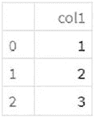


**附录 A Streamlit 应用程序编程接口**

显示文本：

```
# Hello world
Hello _world_
```

渲染数据帧：

```
df = pd.DataFrame({'col1': [1,2,3]})
df # <-- 绘制数据帧
```

写入变量值：

```
x = 10
'x', x # <-- 绘制字符串 'x' 以及变量 x 的值
```

如果需要，你可以通过修改 `/~/.streamlit/config.toml` 文件并设置以下内容来关闭魔法命令：

```
[runner]
magicEnabled = false
```

## A.1.2 显示数据

Streamlit 可以无缝地渲染各种类型的数据。通过使用一系列原生命令，你可以显示 Pandas 数据帧、表格、JSON 文档、指标、列表以及其他杂项数据类型。

### 数据帧

Streamlit 使用 `st.dataframe(data=None, width=None, height=None)` 命令将数据帧显示为格式化后的交互式表格。

**表 A-8.** `st.dataframe` 参数

| 参数 | 描述 |
| --- | --- |
| `data` ( `pandas.DataFrame`, `pandas.Styler`, `pyarrow.Table`, `numpy.ndarray`, `Iterable`, `dict` 或 `None` ) | 要显示的数据： • Pandas.Styler：将对数据帧应用 pandas 样式，包括最常见的单元格值和颜色。目前不支持诸如悬停、标题或图表等增强功能。对 Styler 的支持是实验性的。 • PyArrow 表：必须通过设置 `config.dataframeSerialization = "arrow"` 来启用 PyArrow 表。Streamlit 的旧版数据帧序列化（例如，使用 `config.dataframeSerialization = "legacy"` 时）默认不支持 PyArrow 表。 |

# 附录 A Streamlit 应用程序编程接口

| `width` (`int` 或 `None`) | UI 元素的宽度，以像素为单位。默认值 `none` 会将宽度设置为其所在页面的宽度。 |
| --- | --- |
| `height` (`int` 或 `None`) | 如果高度设置为 `none`，它将等于其所在页面的高度。 |

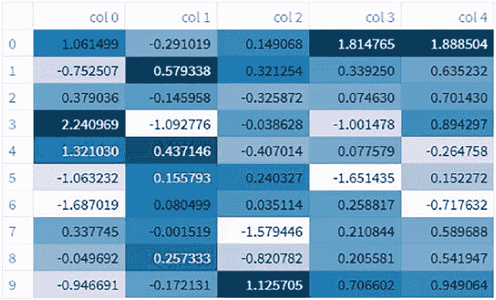

以下示例使用热图显示一个数据帧，该热图使用预定义的 Matplotlib 绿色颜色映射，并以固定宽度 1000 像素来着色显示与其他值相比的数值强度：

```python
df = pd.DataFrame(
    np.random.randn(10, 5),
    columns=('col %d' % i for i in range(5)))
st.dataframe(df.style.background_gradient(), width=1000)
```

## 表格

使用 `st.table(data=None)` 命令显示静态表格。

**表 A-9.** `st.table` 参数

| 参数 | 描述 |
| --- | --- |
| `data` (`pandas.DataFrame`, `pandas.Styler`, `pyarrow.Table`, `numpy.ndarray`, `Iterable`, `dict` 或 `None`) | 表格数据。必须通过设置 `config.dataframeSerialization = "arrow"` 来启用 PyArrow 表。Streamlit 的旧版数据帧序列化（例如，使用 `config.dataframeSerialization = "legacy"` 时）默认不支持 PyArrow 表。 |

沿用数据帧示例，静态表格以相同方式显示：

```python
df = pd.DataFrame(
    np.random.randn(10, 5),
    columns=('col %d' % i for i in range(5)))
st.table(df)
```

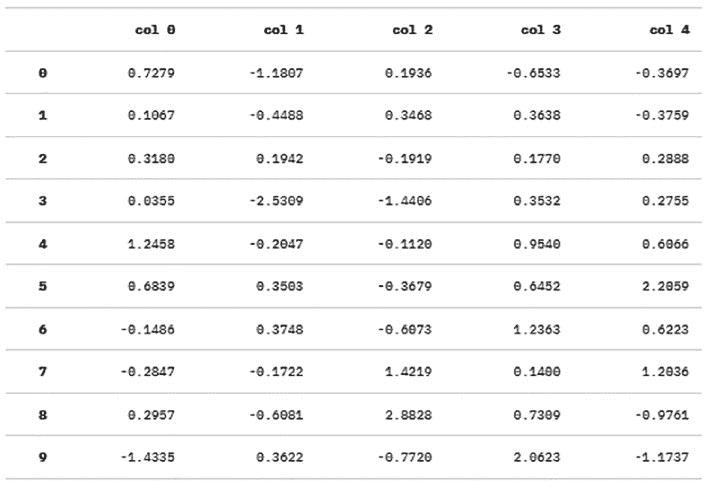

## JSON

可以使用 `st.json(body)` 命令在 Streamlit 中显示 JSON 文件的交互式表示。

**表 A-10.** `st.json` 参数

| 参数 | 描述 |
| --- | --- |
| `body` (`Object` 或 `str`) | 要作为 JSON 打印的对象。引用的对象或字符串必须可序列化为 JSON。 |

### `expanded(*bool*)`

将该参数设置为 `True` 将把 JSON 元素的初始状态设为展开。默认值为 `True`。

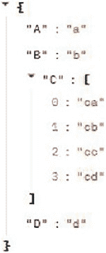

# 附录 A：Streamlit 应用程序接口

以下示例展示了 JSON 对象的一种简单表示。Streamlit 的交互式可视化功能允许对分支进行折叠和展开。

```
st.json({
'A': 'a',
'B': 'b',
'C': [
'ca',
'cb',
'cc',
'cd',
],
'D': 'd',
})
```

## Metric

`st.metric(label, value, delta=None, delta_color='normal')` 命令以仪表板样式的大号粗体字体显示指标、指示器或变量。可以添加一个可选的变更状态指示器。

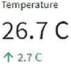

### 表 A-11. `st.metric` 参数

| 参数 | 描述 |
|---|---|
| `label` (`str`) | 指标的标题。 |
| `value` (`int`, `str`, 或 `None`) | 赋予指标的值。`None` 将呈现为长破折号。 |
| `delta` (`int`, `str`, 或 `None`) | 主指标下方的小型子指示器，显示相对于上次状态的变化。对于负数（`int` 或 `float`），或以减号开头的字符串，箭头将呈红色并向下指向；所有其他选项将显示为绿色并向上指向。如果 `delta` 设置为 `None`（默认选项），则不会显示此子指示器。 |
| `delta_color` (`str`) | 此属性默认反转正负值的颜色和箭头方向。适用于那些负向变化可能被视为好事的情况，反之亦然。如果设置为 `"off"`，则所有情况下 `delta` 都将显示为灰色。 |

以下示例展示了一个不带 `delta` 的温度指标指示器。然后通过 `delta` 选项调整该指示器，以反映相对于上一个值的变化。

```
st.metric('Temperature', '26.7 C', '2.7 C')
```

## A.1.3 显示图表

Streamlit 另一个擅长的领域是数据可视化。无论是使用其原生命令渲染图表，还是显示来自 Matplotlib、Altair、Vega-Lite、Plotly、Bokeh、PyDeck 或 Graphviz 的第三方图表，Streamlit 都能让你轻松集成可视化。

### 折线图、面积图和柱状图

可以使用 `st.line_chart`、`st.area_chart` 和 `st.bar_chart` 命令渲染简单的折线图、面积图和柱状图。要显示图表，可以使用以下命令：`st.line_chart / st.area_chart / st.bar_chart(data, width, height, use_container_width)`。

### 表 A-12. `st.line_chart`、`st.area_chart` 和 `st.bar_chart` 参数

| 参数 | 描述 |
|---|---|
| `data` (`pandas.DataFrame`, `pandas.Styler`, `pyarrow.Table`, `numpy.ndarray`, `Iterable`, `dict`, 或 `None`) | 要绘制的数据。Streamlit 的旧版数据框序列化不支持 PyArrow 表（即 `config.dataframeSerialization = 'legacy'`）。要使用 PyArrow 表，请将配置设置更改为 `config.dataframeSerialization = 'arrow'`。 |
| `width` (`int`) | 图表宽度尺寸，单位为像素。如果为零，则自动确定宽度。 |
| `height` (`int`) | 图表高度尺寸，单位为像素。如果为零，则自动确定高度。 |
| `use_container_width` (`bool`) | 当为 `True` 时，图表宽度将调整为列宽。此参数优先于 `width` 参数。 |

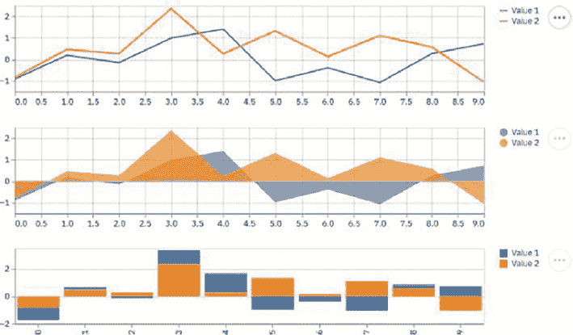

以下示例展示了三种图表选项的堆叠使用，并限制了高度：

```
chart_data = pd.DataFrame(
np.random.randn(10, 2),
columns=['Value 1', 'Value 2'])
st.line_chart(chart_data, height=125)
st.area_chart(chart_data, height=125)
st.bar_chart(chart_data, height=125)
```

### Pyplot

可以使用以下命令渲染 Matplotlib 图表：`st.pyplot(fig, clear_figure, **kwargs)`。

### 表 A-13. `st.pyplot` 参数

| 参数 | 描述 |
|---|---|
| `fig` (`Matplotlib Figure`) | 要绘制的图形对象。 |
| `clear_figure` (`bool`) | 当为 `True` 时，图形在渲染后将被清除。 |

当设为 `false` 时，渲染后图形不会被清除。若未指定，则根据 `fig` 的值选择默认行为：
- 如果设置了 `fig`，则默认值为 `false`。
- 如果未设置 `fig`，则默认值为 `True`。这与 Jupyter 处理 Matplotlib 渲染的方式类似。

`**kwargs` (`any`)
Matplotlib 的 `savefig` 函数参数。

以下示例展示了如何在 Streamlit 中显示 Matplotlib 柱状图：

```
import numpy as np
import matplotlib.pyplot as plt

data = np.random.randn(10, 3)
fig, ax = plt.subplots()
ax.hist(data, bins=10)
st.pyplot(fig)
```

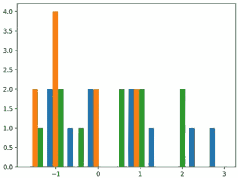

## 附录 A Streamlit 应用程序接口

### Altair

可以通过以下命令显示 Altair 图表：`st.altair_chart(altair_chart, use_container_width)`。

### 表 A-14. `st.altair_chart` 参数

| 参数 | 描述 |
|---|---|
| `altair_chart` (`altair.vegalite.v2.api.Chart`) | 需要渲染的 Altair 图形对象。 |
| `use_container_width` (`bool`) | 如果此参数设置为 `True`，图表宽度将设置为列宽。 |

以下示例展示了如何在 Streamlit 中显示 Altair 散点图：

```
import pandas as pd
import numpy as np
import altair as alt

df = pd.DataFrame(np.random.randn(30, 3), columns=['Col1', 'Col2', 'Col3'])
fig = alt.Chart(df).mark_circle().encode(
    x='Col1', y='Col2', size='Col3',
    color='Col3',
    tooltip=['Col1', 'Col2', 'Col3']
)
st.altair_chart(fig)
```

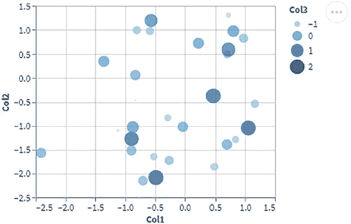

### Vega-Lite

可以通过以下命令显示 Vega-Lite 图表：`st.vega_lite_chart(data, spec, use_container_width, **kwargs)`。

### 表 A-15. `st.vega_lite_chart` 参数

| 参数 | 描述 |
|---|---|
| `data` (`pandas.DataFrame`, `pandas.Styler`, `pyarrow.Table`, `numpy.ndarray`, `Iterable`, `dict` 或 `None`) | 要绘制的数据。Streamlit 的传统数据帧序列化不支持 pyarrow 表（即 `config.dataframeSerialization = 'legacy'`）。要使用 PyArrow 表，请将配置设置更改为 `config.dataframeSerialization = 'arrow'`。 |
| `spec` (`dict` 或 `None`) | Vega-Lite 图表的规范。如果之前已设置此参数，则必须将其设置为 `None`。更多信息请参考 [`vega.github.io/vega-lite/docs/`](https://vega.github.io/vega-lite/docs/)。 |

| `use_container_width` (`bool`) | 当设为 `True` 时，图表宽度将调整到列宽。此参数优先级高于 VegaLite 原生参数。 |
| `**kwargs` (`any`) | `spec` 参数的关键字版本。 |

以下示例展示了如何在 Streamlit 中显示 Vega-Lite 散点图：

```python
import pandas as pd
import numpy as np

df = pd.DataFrame(np.random.randn(30, 3), columns=['Col1', 'Col2', 'Col3'])
st.vega_lite_chart(df, {
    'mark': {'type': 'circle', 'tooltip': True},
    'encoding': {
        'x': {'field': 'Col1', 'type': 'quantitative'},
        'y': {'field': 'Col2', 'type': 'quantitative'},
        'size': {'field': 'Col3', 'type': 'quantitative'},
        'color': {'field': 'Col3', 'type': 'quantitative'},
    },
}, width=500, height=400)
```

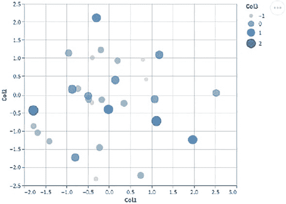

### Plotly

可以通过命令 `st.plotly_chart(figure_or_data, use_container_width, sharing, **kwargs)` 显示 Plotly 图表。

**表 A-16.** `st.plotly_chart` 参数

| 参数 | 描述 |
|---|---|
| `figure_or_data` (`plotly.graph_objs.Figure`, `plotly.graph_objs.Data`) | 需要渲染的 Plotly 图形对象。关于 Plotly Python 图表的更多信息，请参考 [`plot.ly/python/`](https://plot.ly/python)。 |
| `use_container_width` (`bool`) | 如果此参数设置为 `True`，图表宽度将设置为列宽。 |
| `sharing` (`{'streamlit', 'private', 'secret', 'public'}`) | 此参数指定渲染模式。如果设置为 `"streamlit"`，图表将以 Plotly 离线模式显示。其他模式需要需拥有 Plotly 图表工作室账户；更多信息请参考 [`plotly.com/chart-studio/`](https://plotly.com/chart-studio/)。 |
| `**kwargs` (`*null*`) | 此处可提供 Plotly 的 `plot()` 函数所接受的任何参数。 |

以下示例展示了如何在 Streamlit 中显示 Plotly 雷达图：

```python
import pandas as pd
import numpy as np
import plotly.express as px

df = pd.DataFrame(np.random.randn(360, 1), columns=['Col1'])
fig = px.line_polar(df, r=df['Col1'], theta=df.index, line_close=True)
st.plotly_chart(fig)
```

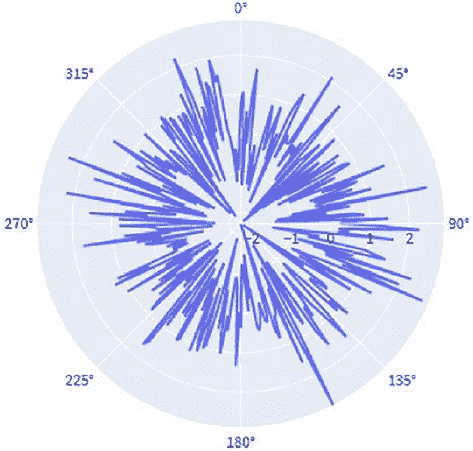

# 附录 A Streamlit 应用程序编程接口

## Bokeh

使用命令`st.bokeh_chart(figure, use_container_width)`可显示 Bokeh 图表。

### 表 A-17. `st.bokeh_chart`参数

| 参数 | 描述 |
|-----------|-------------|
| `figure` (`bokeh.plotting.figure.Figure`) | 要渲染的 Bokeh 图形对象。 |
| `use_container_width` (`bool`) | 若设为`True`，图表宽度将设为列宽。 |

以下示例展示了如何在 Streamlit 中显示 Bokeh 折线图：

```python
import pandas as pd
import numpy as np
from bokeh.plotting import figure

df = pd.DataFrame(np.random.randn(10, 1), columns=['Col1'])
fig = figure(x_axis_label='Index', y_axis_label='Col1')
fig.line(df.index, df['Col1'], legend_label='Trend', line_width=2)
st.bokeh_chart(fig)
```

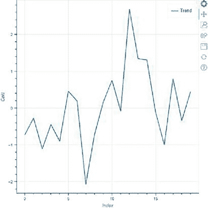

## PyDeck

使用命令`st.pydeck_chart(pydeck_obj, use_container_width)`可显示 PyDeck 地理空间地图。

### 表 A-18. `st.pydeck_chart`参数

| 参数 | 描述 |
|-----------|-------------|
| `spec` (`pydeck.Deck` 或 `None`) | 要渲染的 PyDeck 图形对象。 |

以下示例展示了如何在 Streamlit 中显示 PyDeck 地理空间地图：

```python
import pandas as pd
import numpy as np
import pydeck as pdk

df = pd.DataFrame(
    np.random.randn(100, 2)/[50, 50] + [29.76, -95.37],
    columns=['latitude', 'longitude']
)

st.pydeck_chart(pdk.Deck(
    map_style='mapbox://styles/mapbox/light-v9',
    initial_view_state=pdk.ViewState(
        latitude=29.76,
        longitude=-95.37,
        zoom=12,
        pitch=40,
    ),
    layers=[
        pdk.Layer(
            'HexagonLayer',
            data=df,
            get_position='[longitude, latitude]',
            radius=200,
            elevation_scale=2,
            elevation_range=[0, 500],
            pickable=True,
            extruded=True,
        ),
    ],
))
```

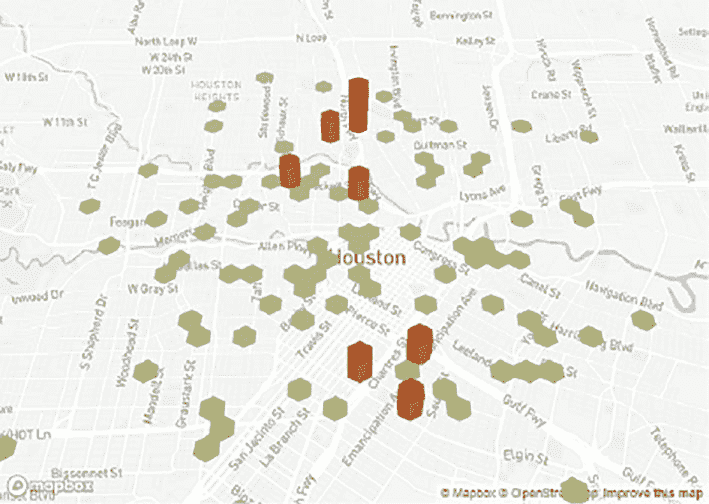

## Graphviz

使用命令`st.graphviz_chart(figure_or_dot, use_container_width)`可渲染 Graphviz 图表。

### 表 A-19. `st.graphviz_chart`参数

| 参数 | 描述 |
|-----------|-------------|
| `figure_or_dot` (`graphviz.dot.Graph`, `graphviz.dot.Digraph`, `str`) | 要渲染的 Graphviz 图形对象。 |
| `use_container_width` (`bool`) | 若设为`True`，图表宽度将设为列宽。 |

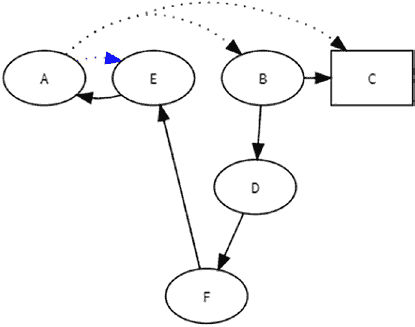

以下示例展示了如何在 Streamlit 中显示 Graphviz 图形：

```python
import graphviz as graphviz

st.graphviz_chart("""
digraph {
    A -> {B C} [style=dotted, shape=box]
    B -> C
    D -> F
    F -> E
    E -> A
    B -> D
    subgraph {
        rank = same; A; B; C [shape=box];
        A -> E [color=blue, style=dotted]
    }
}
""")
```

## 地图

使用命令`st.map(data, zoom, use_container_width)`可显示 Streamlit 地理空间地图。

### 表 A-20. `st.map`参数

| 参数 | 描述 |
|-----------|-------------|
| `data` (`pandas.DataFrame`, `pandas.Styler`, `numpy.ndarray`, `Iterable`, `dict`) | 要在地图上渲染的点的`latitude`（纬度）和`longitude`（经度）。 |
| `zoom` (`int`) | 地图首次渲染时的缩放级别。更多信息请参考[`wiki.openstreetmap.org/wiki/Zoom_levels`](https://wiki.openstreetmap.org/wiki/Zoom_levels)。 |

以下示例展示了如何在 Streamlit 中显示地理空间地图：

```python
import pandas as pd
import numpy as np

df = pd.DataFrame(
    np.random.randn(100, 2)/[50, 50] + [29.76, -95.37],
    columns=['latitude', 'longitude']
)

st.map(df)
```

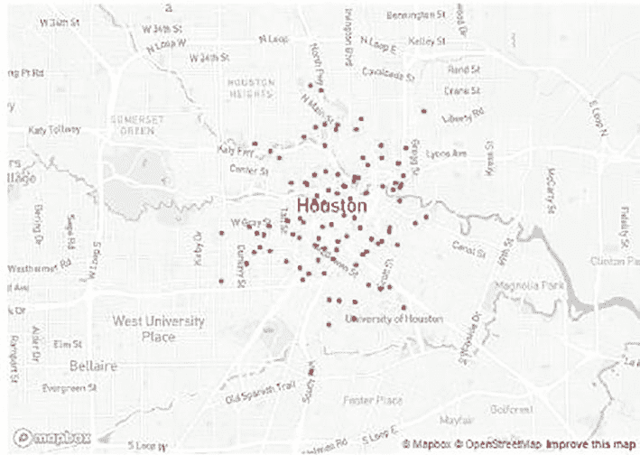

# 附录 A STREAMLIT 应用程序编程接口

## A.1.4 输入组件

Streamlit 提供了一系列丰富多样的输入组件，使开发者能够满足各种使用场景。从简单的按钮、滑块和表单，到颜色选择器、文件上传器和选择框，Streamlit 涵盖了所有类型的输入组件。

### 按钮

通用按钮可以通过命令 `st.button(label, key, help, on_click, args, kwargs, disabled=False) -> bool` 为任何需求创建。

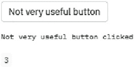

**表 A-21.** `st.button` 参数

| 参数 | 描述 |
| :--- | :--- |
| `label` (`str`) | 按钮上显示的标签。 |
| `key` (`str` 或 `int`) | 用于在代码中引用该按钮的唯一键，可以是字符串或整数。该参数为可选参数，若未提供将自动生成。 |
| `help` (`str`) | 光标悬停在组件上时显示的工具提示。 |
| `on_click` (`callable`) | 按钮被点击时调用的回调函数。 |
| `args` (`tuple`) | 传递给回调函数的参数元组。 |
| `kwargs` (`dict`) | 传递给回调函数的关键字参数字典。 |
| `disabled` (`bool`) | 用于禁用该组件的布尔参数。 |

以下示例展示了当按钮被点击时，如何显示一个简单算术计算的结果：

```python
def addition(a,b):
    result = a + b
    return result

if st.button('不太有用的按钮', key='b1'):
    st.text('不太有用的按钮已点击')
    st.write(addition(1,2))
```

### 下载按钮

可以使用以下命令将下载按钮添加到我们的网站中：`st.download_button(label, data, file_name, mime, key, help, on_click, args, kwargs, disabled=False) -> bool`。

**表 A-22.** `st.download_button` 参数

| 参数 | 描述 |
| :--- | :--- |
| `label` (`str`) | 说明按钮用途的标签。 |
| `data` (`str` 或 `bytes` 或 `file`) | 要下载的文件内容。使用缓存以避免每次重新运行时重复计算。 |
| `file_name` (`str`) | 要下载的文件名称。如果未指定，将自动创建名称。 |
| `mime` (`str` 或 `None`) | 数据的 MIME 类型。文本文件默认为 `"text/plain"`，二进制文件默认为 `"application/octet-stream"`。 |
| `key` (`str` 或 `int`) | 用于在代码中引用该按钮的唯一键，可以是字符串或整数。该参数为可选参数，若未提供将自动生成。 |
| `help` (`str`) | 光标悬停在组件上时显示的工具提示。 |
| `on_click` (`callable`) | 按钮被点击时调用的回调函数。 |
| `args` (`tuple`) | 传递给回调函数的参数元组。 |
| `kwargs` (`dict`) | 传递给回调函数的关键字参数字典。 |
| `disabled` (`bool`) | 用于禁用该组件的布尔参数。 |

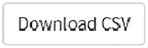

以下示例展示了如何使用下载按钮将 Pandas 数据框下载为 CSV 文件：

```python
import pandas as pd

data = pd.DataFrame({'a':[1,2,3],'b':[4,5,6]}).to_csv().encode('utf-8')
st.download_button(
    label='下载 CSV',
    data=data,
    file_name='data.csv',
    mime='text/csv'
)
```

### 复选框

可以使用以下命令将复选框添加到我们的网站中：`st.checkbox(label, value, key, help, on_change, args, kwargs, disabled=False) -> bool`。

**表 A-23.** `st.checkbox` 参数

| 参数 | 描述 |
| :--- | :--- |
| `label` (`str`) | 复选框的标签。 |
| `value` (`bool`) | 选择首次渲染时复选框是否默认预选。内部会将其转换为 `bool` 类型。 |
| `key` (`str` 或 `int`) | 用于在代码中引用该按钮的唯一键，可以是字符串或整数。该参数为可选参数，若未提供将自动生成。 |
| `help` (`str`) | 光标悬停在组件上时显示的工具提示。 |
| `on_change` (`callable`) | 当控件值发生变化时调用的回调函数。 |
| `args` (`tuple`) | 传递给回调函数的参数元组。 |
| `kwargs` (`dict`) | 传递给回调函数的关键字参数字典。 |
| `disabled` (`bool`) | 用于禁用控件的布尔参数。 |

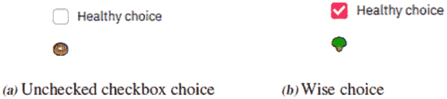

复选框控件选中与未选中的行为如下所示：

```python
choice = st.checkbox('Healthy choice')
if choice:
    st.write(':broccoli:')
else:
    st.write(':doughnut:')
```

### 单选按钮

我们可以使用以下命令为网页添加单选按钮：`st.radio(label, options, index, format_func=special_internal_function, key, help, on_change, args, kwargs, disabled=False)` ➤ `any`。

**表 A-24.** `st.radio` 参数

| 参数 | 说明 |
| :--- | :--- |
| `label` (`str`) | 单选按钮组的标签。 |
| `options` (`Sequence`, `numpy.ndarray`, `pandas.Series`, `pandas.DataFrame`, or `pandas.Index`) | 单选按钮选项的标签。将自动转换为 `str`。使用 `pandas.DataFrame` 时，默认选择第一列作为数据源。 |
| `index` (`int`) | 首次渲染时预设选中的选项索引。 |
| `format_func` (`function`) | 用于修改单选按钮选项标签的辅助函数。标签的 `str` 值作为参数传入，并根据函数逻辑返回修改后的 `str`。此选项仅用于外观美化，不影响单选按钮控件的操作或返回值。 |
| `key` (`str` or `int`) | 用于在代码中引用该控件的唯一键，可以是字符串或整数。该参数为可选参数，若未提供则自动生成。 |
| `help` (`str`) | 当光标悬停在控件上时显示的工具提示。 |
| `on_change` (`callable`) | 当控件值发生变化时调用的回调函数。 |
| `args` (`tuple`) | 传递给回调函数的参数元组。 |
| `kwargs` (`dict`) | 传递给回调函数的关键字参数字典。 |
| `disabled` (`bool`) | 用于禁用控件的布尔参数。 |

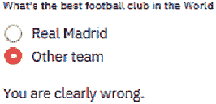

以下示例展示了一个包含两个选项的单选按钮，并显示选择结果：

```python
sport_selection = st.radio("What's the best football club in the World",
                           ('Real Madrid', 'Other team'))
if sport_selection == 'Real Madrid':
    st.write('That was easy :soccer:.')
else:
    st.write('You are clearly wrong.')
```

### 选择框

我们可以使用以下命令为网页添加一个选择框控件：`st.selectbox(label, options, index, format_func=special_internal_function, key, help, on_change, args=None, kwargs, disabled=False)` → `any`。

#### 表 A-25. `st.selectbox` 参数

| 参数 | 说明 |
|---|---|
| `label` (`str`) | 控件的标签。 |
| `options` (`Sequence`, `numpy.ndarray`, `pandas.Series`, `pandas.DataFrame`, or `pandas.Index`) | 选择选项的标签。将自动转换为 `str`。使用 `pandas.DataFrame` 时，默认选择第一列作为数据源。 |
| `index` (`int`) | 首次渲染时预设选中的选项索引。 |
| *(续上表)* | |

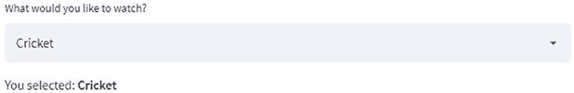

## 附录 A Streamlit 应用程序接口

#### 表 A-25. (续)

| 参数 | 说明 |
|---|---|
| `format_func` (`function`) | 用于修改选项选择标签的辅助函数。标签的 `str` 值作为参数传入，并根据函数逻辑返回修改后的 `str`。此选项仅用于外观美化，不影响控件的操作或返回值。 |
| `key` (`str` or `int`) | 用于在代码中引用该控件的唯一键，可以是字符串或整数。该参数为可选参数，若未提供则自动生成。 |
| `help` (`str`) | 当光标悬停在控件上时显示的工具提示。 |
| `on_change` (`callable`) | 当控件值发生变化时调用的回调函数。 |
| `args` (`tuple`) | 传递给回调函数的参数元组。 |
| `kwargs` (`dict`) | 传递给回调函数的关键字参数字典。 |
| `disabled` (`bool`) | 用于禁用控件的布尔参数。 |

以下示例展示了一个包含两个选项的选择框控件：

```python
option = st.selectbox('What would you like to watch?',
                      ('Cricket', 'Baseball'))
```

```python
st.write('您选择了：`%s`' % option)
```

### 多选下拉框

通过以下命令可在网站中添加多选下拉部件：

`st.multiselect(label, options, default=None, format_func=special_internal_function, key=None, help=None, on_change=None, args=None, kwargs=None, disabled=False)` → `str`

**表 A-26.** `st.multiselect` 参数

| 参数 | 说明 |
|---|---|
| `label` (`str`) | 多选下拉部件的标签。 |
| `options` (`Sequence`, `numpy.ndarray`, `pandas.Series`, `pandas.DataFrame` 或 `pandas.Index`) | 选择选项标签。会自动转换为 `str`。使用 `pandas.DataFrame` 时，将选择第一列作为数据源。 |
| `index` (`int`) | 首次渲染时预选选项的索引。 |
| `default` (`[str]` 或 `None`) | 默认值。 |
| `format_func` (`function`) | 用于修改选择标签的辅助函数。标签的 `str` 值作为参数传入，并根据函数逻辑返回修改后的 `str`。此选项仅用于外观显示，不影响部件的操作或返回值。 |
| `key` (`str` 或 `int`) | 在代码中引用该按钮的唯一键，可以是字符串或整数。该参数为可选，若不提供将自动生成。 |
| `help` (`str`) | 当鼠标悬停在部件上时显示的工具提示。 |
| `on_change` (`callable`) | 当部件值发生变化时调用的回调函数。 |
| `args` (`tuple`) | 传递给回调函数的参数元组。 |
| `kwargs` (`dict`) | 传递给回调函数的关键字参数字典。 |
| `disabled` (`bool`) | 用于禁用部件的布尔参数。 |

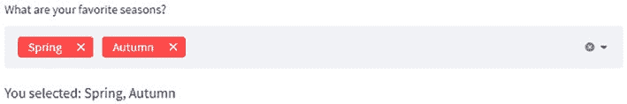

以下示例展示了一个包含四个选项的多选下拉部件：

```python
options = st.multiselect('您最喜欢的季节是哪些？', ['春季', '夏季', '秋季', '冬季'])
st.write('您选择了：%s' % ', '.join(options))
```

### 滑块

通过以下命令可在网站中添加滑块部件：

`st.slider(label, min_value, max_value, value, step, format, key, help, on_change, args, kwargs, disabled=False)` → `value`

**表 A-27.** `st.slider` 参数

| 参数 | 说明 |
|---|---|
| `label` (`str`) | 说明滑块用途的标签。 |
| `min_value`（支持的类型 或 `None`） | 允许的最小值。对于 `int` 和 `float`，默认为 `0` 或 `0.0`；对于日期/日期时间值，默认为 `value – timedelta(days=14)`；对于时间值，默认为 `time.min`。 |
| `max_value`（支持的类型 或 `None`） | 允许的最大值。对于 `int` 和 `float`，默认为 `100` 或 `1.0`；对于日期/日期时间值，默认为 `value + timedelta(days=14)`；对于时间值，默认为 `time.max`。 |
| `value`（支持的类型 或 支持类型的元组/列表 或 `None`） | 部件首次渲染时使用的默认值。如需使用预定义范围，应传入包含最小值和最大值的元组/列表。默认为 `min_value`。 |
| `step` (`int`/`float`/`timedelta` 或 `None`) | 步进间隔。对于 `int` 和 `float`，默认设置为 `1` 和 `0.01`；对于日期/日期时间值，默认为 `timedelta(days=1)`；对于时间值（或当 `max_value – min_value < 1 天` 时），默认为 `timedelta(minutes=15)`。 |
| `format` (`str` 或 `None`) | 自定义格式字符串，用于指定界面如何以 printf 样式格式化数字显示。返回值不受该转换影响。支持 `%d`、`%e`、`%f`、`%g` 和 `%i` 用于格式化 `int`/`float` 值。对于日期/时间/日期时间格式化，请使用 Moment.js 语法：[`momentjs.com/docs/#/displaying/format/`](https://momentjs.com/docs/#/displaying/format/)。 |
| `key` (`str` 或 `int`) | 在代码中引用该按钮的唯一键，可以是字符串或整数。该参数为可选，若不提供将自动生成。 |
| `help` (`str`) | 当鼠标悬停在部件上时显示的工具提示。 |
| `on_change` (`callable`) | 当部件值发生变化时调用的回调函数。 |
| `args` (`tuple`) | 传递给回调函数的参数元组。 |
| `kwargs` (`dict`) | 传递给回调函数的关键字参数字典。 |
| `disabled` (`bool`) | 用于禁用部件的布尔参数。 |

# 附录 A Streamlit 应用程序编程接口

以下代码实现了一个滑块，用于选择 9:00 至 16:00 之间的时间：

```python
from datetime import time

meeting_time = st.slider('Select time:', value=time(11, 00),
                         max_value=time(16, 00), min_value=time(9, 00),
                         format='hh:mm')
```

`st.write('You are scheduled for: %s' % meeting_time)`

## 选择滑块

可以使用以下命令将选择滑块部件添加到我们的网站：`st.select_slider(label, options, value, format_func, key, help, on_change, args, kwargs)` → `value`。

### 表 A-28. `st.select_slider`参数

| 参数 | 描述 |
|------|------|
| `label`（`str`） | 解释滑块用途的标签。 |
| `options`（`Sequence`, `numpy.ndarray`, `pandas.Series`, `pandas.DataFrame`, 或 `pandas.Index`） | 单选按钮选项标签。它会自动转换为`str`。当使用`pandas.DataFrame`时，第一列将被选为数据源。 |
| `value`（支持的类型或`tuple`/`list`类型或`None`） | 首次显示时滑块的值。如果在此处提供包含两个值的`tuple`/`list`，则会创建一个具有下限和上限的范围滑块。默认为第一个选项。 |
| `format_func`（`function`） | 用于修改单选按钮选项标签的辅助函数。标签的`str`值作为参数传递，并根据函数逻辑返回修改后的`str`。此选项纯粹是装饰性的，对单选按钮部件的操作或返回值没有影响。 |
| `key`（`str`或`int`） | 用于在代码中引用按钮的唯一键（字符串或整数）。此参数是可选的，如果未提供，将自动生成。 |
| `help`（`str`） | 鼠标悬停在部件上时显示的工具提示。 |
| `on_change`（`callable`） | 当部件值发生变化时调用的回调函数。 |
| `args`（`tuple`） | 传递给回调函数的参数元组。 |
| `kwargs`（`dict`） | 传递给回调函数的关键字参数字典。 |
| `disabled`（`bool`） | 用于禁用部件的布尔参数。 |

选择滑块是滑块部件的一种版本，适用于非数值、日期或时间值。以下示例复制了简单滑块中的示例，但使用了分类值：

```python
start_time, end_time = st.select_slider('Select time',
                                        options=['nine', 'ten', 'eleven', 'twelve', 'one', 'two',
                                                 'three', 'four'],
                                        value=('eleven', 'twelve'))
```

`st.write('You are scheduled from %s to %s' % (start_time, end_time))`

## 文本输入

可以使用以下命令将单行文本输入框添加到我们的网站：`st.text_input(label, value, max_chars, key, type='default', help, autocomplete, on_change, args, kwargs, placeholder, disabled=False)` → `str`。

### 表 A-29. `st.text_input`参数

| 参数 | 描述 |
|------|------|
| `label`（`str`） | 解释此输入用途的标签。 |
| `value`（`any`） | 选择复选框在首次渲染时是否默认选中。内部会将其转换为`str`。 |
| `max_chars`（`int`或`None`） | 文本输入中允许的最大字符数。 |
| `key`（`str`或`int`） | 用于在代码中引用按钮的唯一键（字符串或整数）。此参数是可选的，如果未提供，将自动生成。 |
| `type`（`str`） | 文本输入类型：常规文本输入（“default”选项）或掩码文本（用于“password”类型输入）。 |
| `help`（`str`） | 鼠标悬停在部件上时显示的工具提示。 |
| `autocomplete`（`str`） | `autocomplete`属性是 HTML 5 新增的方法，适用于希望用户能够自动完成输入的网站。 |

在无需提供用户名和密码的情况下完成一项任务。一个可选值将被提供给 `<input>` 元素的 `autocomplete` 属性。对于 `"password"` 输入类型，该值将设置为 `"new-password"`；对于 `"default"` 输入类型，该值将设置为空字符串。更多详情请参阅 [`developer.mozilla.org/en-US/docs/Web/HTML/Attributes/autocomplete`](https://developer.mozilla.org/en-US/docs/Web/HTML/Attributes/autocomplete)。

`on_change`（`callable`）当部件值发生变化时调用的回调函数。

`args`（`tuple`）传递给回调函数的参数元组。

`kwargs`（`dict`）传递给回调函数的关键字参数字典。

`placeholder`（`str or None`）当没有文本输入时显示的可选字符串。

`disabled`（`bool`）用于禁用部件的布尔参数。

以下示例展示了如何在单行文本框中遮罩文本：

```python
password = st.text_input('请输入您的密码：', value='1234',
                         max_chars=24,
                         type='password')
st.write('您输入的密码是', password)
```

# 附录 A Streamlit 应用程序编程接口

## 数值输入

我们可以使用以下命令向网站添加一个数值输入部件：`st.number_input(label, min_value, max_value, value=0.0, step=1, format, key, help, on_change, args, kwargs, disabled=False)` ➤ `int` 或 `float`。

**表 A-30.** `st.number_input` 参数

| 参数 | 说明 |
|-----------|-------------|
| `label( *str*)` | 数值输入部件的标签。 |
| `min_value( *int or float or None*)` | 接受的最小值。 |
| `max_value( *int or float or None*)` | 接受的最大值。 |
| `value( *int or float or None*)` | 此部件的首次渲染值。默认为 `min_value`，如果 `min_value` 为无，则默认为 `0.0`。 |
| `step( *int or float or None*)` | 步进间隔。默认情况下，整数设置为 1，其他所有选项设置为 0.01。对于未指定的值，将默认使用 `format` 参数。 |
| `format( *str or None*)` | 一个自定义格式字符串，指定界面如何以 printf 样式格式渲染数字。返回值不受转换影响。支持 `%d`、`%e`、`%f`、`%g` 和 `%i` 用于格式化整数/浮点数值。对于日期/时间/日期时间格式化，请使用 Moment.js 语法：[`momentjs.com/docs/#/displaying/format/`](https://momentjs.com/docs/#/displaying/format/)。 |
| `key( *str or int*)` | 用于在代码中引用按钮的唯一键，可以是字符串或整数。该参数为可选项，如果未提供，将自动生成。 |
| `help( *str*)` | 当光标悬停在部件上时显示的工具提示。 |
| `on_change( *callable*)` | 当部件值发生变化时调用的回调函数。 |
| `args( *tuple*)` | 传递给回调函数的参数元组。 |
| `kwargs( *dict*)` | 传递给回调函数的关键字参数字典。 |
| `disabled( *bool*)` | 用于禁用部件的布尔参数。 |

一个简单的 1 到 100 选择，步长为 1，数值输入命令的代码片段实现如下所示：

```python
selection = st.number_input('请从 1 到 100 中选择一个数字：',
                            min_value=0, max_value=100, value=50, step=1)
st.write('当前数字是 ', selection)
```

## 文本区域

我们可以使用以下命令向网站添加一个多行文本输入：`st.text_area(label, value, height, max_chars, key, help, on_change, args, kwargs, placeholder, disabled=False)` ➤ `str`。

**表 A-31.** `st.text_area` 参数

| 参数 | 说明 |
|-----------|-------------|
| `label( *str*)` | 说明输入部件用途的标签。 |
| `value( *any*)` | 部件首次渲染时显示的默认文本。在内部，这将被转换为 `str`。 |
| `height( *int or None*)` | UI 元素的高度（像素）。 |
| `max_chars( *int or None*)` | 文本区域允许的最大字符数。 |
| `key( *str or int*)` | 用于在代码中引用按钮的唯一键，可以是字符串或整数。该参数为可选项，如果未提供，将自动生成。 |

# Streamlit 应用程序编程接口

## 日期输入

可使用以下命令向我们的网站添加一个日期显示输入小部件：`st.date_input(label, value, min_value, max_value, key, help, on_change, args, kwargs, disabled=False)` ➤ `value`。

**表 A-32.** `st.date_input` 参数

| 参数 | 描述 |
|-----------|-------------|
| `label( str )` | 用于说明日期选择意图的标签。 |
| `value( datetime.date 或 datetime.datetime 或包含 datetime.date 或 datetime.datetime 的列表/元组 或 无值 )` | 此小部件在首次渲染时显示的值。如果提供的列表/元组包含零到两个日期/日期时间值，则会被视为一个范围。如果未选择任何值，默认值为今天。 |
| `min_value( datetime.date 或 datetime.datetime )` | 默认的最小可选日期。如果该值是一个日期，则将其设置为从现在起前推 10 年。对于区间 [start, finish]，默认值为 start - 10 年。 |
| `max_value( datetime.date 或 datetime.datetime )` | 最大可选日期。如果该值是一个日期，则将其更新为当前值加上 10 年。如果该值是区间 [start, end]，则将其更新为 end + 10 年。 |
| `key( str 或 int )` | 用于在代码中引用此按钮的唯一键，可以是字符串或整数。此参数是可选的，如果未提供，将自动生成。 |
| `help( str )` | 当光标悬停在小部件上时显示的工具提示。 |
| `on_change( callable )` | 小部件值发生变化时调用的回调函数。 |
| `args( tuple )` | 传递给回调函数的参数元组。 |
| `kwargs( dict )` | 传递给回调函数的关键字参数字典。 |
| `disabled( bool )` | 用于禁用此小部件的布尔参数。 |

以下代码行使用日期输入小部件实现了一个简单的按天计算年龄的计算器，并将最小日期限制为 1920 年之后出生的人：

```python
birth_date = st.date_input('出生日期：', value = datetime.date(2018,12,29), min_value = datetime.date(1920,1,1))
st.write('您的年龄（天）：', datetime.date.today() - birth_date)
```

## 时间输入

可使用以下命令向我们的网站添加一个时间输入小部件：`st.time_input(label, value, key, help, on_change, args, kwargs, disabled=False)` ➤ `value`。

**表 A-33.** `st.time_input` 参数

| 参数 | 描述 |
|-----------|-------------|
| `label( str )` | 小部件的标签。 |
| `value( datetime.time / datetime.datetime )` | 此小部件在首次渲染时显示的值。内部会转换为字符串。默认为当前时间。 |
| `key( str 或 int )` | 用于在代码中引用此按钮的唯一键，可以是字符串或整数。此参数是可选的，如果未提供，将自动生成。 |
| `help( str )` | 当光标悬停在小部件上时显示的工具提示。 |
| `on_change( callable )` | 小部件值发生变化时调用的回调函数。 |
| `args( tuple )` | 传递给回调函数的参数元组。 |
| `kwargs( dict )` | 传递给回调函数的关键字参数字典。 |
| `disabled( bool )` | 用于禁用此小部件的布尔参数。 |

此示例展示了时间输入的使用，其渲染时的默认值为上午 7:00：

```python
sleep_time = st.time_input('睡几个小时就够了？', ...)
```

# 附录 A Streamlit 应用程序编程接口

## 文件上传器

可以使用以下命令将文件上传器添加到我们的网站：

`st.file_uploader(label, type=None, accept_multiple_files=False, key, help, on_change, args, kwargs, disabled=False)` ➤ `list`

上传文件的默认大小为 200MB。该值可通过 `server.maxUploadSize` 配置选项进行配置。

**表 A-34.** `st.file_uploader` 参数

| 参数 | 描述 |
|------|------|
| `label` (`str`) | 用于解释期望上传何种文件的小部件标签。 |
| `type` (`str` 或 `str` 列表，或 `None`) | 允许的扩展名数组，例如 `['gif', 'jpg']`。要允许所有扩展名，请使用 `none`。 |
| `accept_multiple_files` (`bool`) | 当为 `True` 时，允许用户同时上传多个文件，并返回上传文件的列表。默认选项为 `false`。 |
| `key` (`str` 或 `int`) | 用于在代码中引用按钮的唯一键（字符串或整数）。该参数是可选的，如果未提供，将自动生成。 |
| `help` (`str`) | 当光标悬停在小部件上时显示的工具提示。 |
| `on_change` (`callable`) | 小部件值发生更改时调用的回调函数。 |
| `args` (`tuple`) | 传递给回调函数的参数元组。 |
| `kwargs` (`dict`) | 传递给回调函数的关键字参数字典。 |
| `disabled` (`bool`) | 用于禁用小部件的布尔参数。 |

以下代码可用于一起上传多个文件：

```python
files_to_upload = st.file_uploader(label = 'Upload photos:',
                                   accept_multiple_files=True)
```

## 摄像头输入

可以使用以下命令从用户的网络摄像头返回静态画面：

`st.camera_input(label, key, help, on_change, args, kwargs, disabled=False)` ➤ `any`

**表 A-35.** `st.time_input` 参数

| 参数 | 描述 |
|------|------|
| `label` (`str`) | 小部件的标签。 |
| `key` (`str` 或 `int`) | 用于在代码中引用小部件的唯一键（字符串或整数）。该参数是可选的，如果未提供，将自动生成。 |
| `help` (`str`) | 当光标悬停在小部件上时显示的工具提示。 |
| `on_change` (`callable`) | 小部件值发生更改时调用的回调函数。 |
| `args` (`tuple`) | 传递给回调函数的参数元组。 |
| `kwargs` (`dict`) | 传递给回调函数的关键字参数字典。 |
| `disabled` (`bool`) | 用于禁用小部件的布尔参数。 |

以下示例展示了如何使用摄像头输入命令通过网络摄像头拍照，并使用光学字符识别读取图像中的文本：

```python
import pytesseract
from PIL import Image

pytesseract.pytesseract.tesseract_cmd = r'C:\Program Files\Tesseract-OCR\tesseract.exe'
photo = st.camera_input('Take a photo')
if photo is not None:
    st.subheader('Your text:')
    text = pytesseract.image_to_string(Image.open(photo))
    st.write(text)
```

## 颜色选择器

可以使用以下命令将颜色选择器小部件添加到我们的网站：

`st.color_picker(label, value, key, help, on_change, args, kwargs, disabled=False)` ➤ `str`

**表 A-36.** `st.color_picker` 参数

| 参数 | 描述 |
|------|------|
| `label` (`str`) | 解释小部件用途的标签。 |
| `value` (`str`) | 首次渲染时该小部件显示的十六进制值。如果为 `none`，则默认为黑色。 |
| `key` (`str` 或 `int`) | 用于在代码中引用按钮的唯一键（字符串或整数）。该参数是可选的，如果未提供，将自动生成。 |
| `help` (`str`) | 当光标悬停在小部件上时显示的工具提示。 |

# Streamlit 组件回调与表单

`on_change(*可调用对象*)` - 当组件值发生变化时调用的回调函数。

`args(*元组*)` - 传递给回调函数的参数元组。

`kwargs(*字典*)` - 传递给回调函数的关键字参数字典。

`disabled(*布尔值*)` - 用于禁用组件的布尔参数。

以下代码展示了颜色选择组件的实现，默认选择为黑色（十六进制值 `#000000`）。

```python
color = st.color_picker(label = '选择一个颜色', value = '#000000')
```

## 表单

你可以使用 Streamlit 的 `st.form(key, clear_on_submit=False)` 命令将多个组件封装到一个表单中。使用表单的额外好处是，Streamlit 不会像通常那样在你与表单内任何一个组件交互时重新运行整个脚本。相反，Streamlit 只会在你使用 `st.form_submit_button(label='Submit', help=None, on_click, args, kwargs)` ➤ `bool` 命令点击相关按钮时，才会重新运行脚本。

### 表 A-37. `st.form` 参数

| **参数** | **描述** |
| --- | --- |
| `key(*字符串*)` | 用于标识表单的唯一字符串。 |
| `clear_on_submit(*布尔值*)` | 如果此参数设置为 true，则在表单提交组件的值发生变化后，表单内的所有组件都将重置为其默认值。 |

### 表 A-38. `st.form_submit_button` 参数

| **参数** | **描述** |
| --- | --- |
| `label(*字符串*)` | 按钮上显示的标签。 |
| `help(*字符串或 None*)` | 光标悬停在组件上时显示的工具提示。 |
| `on_click(*可调用对象*)` | 点击按钮时调用的回调函数。 |
| `args(*元组*)` | 传递给回调函数的参数元组。 |
| `kwargs(*字典*)` | 传递给回调函数的关键字参数字典。 |

以下示例展示了一个 Streamlit 表单和表单提交按钮如何一起使用：

```python
with st.form('form_1'):
    radio = st.radio('单选按钮', ['你好','世界'])
    checkbox = st.checkbox('你好世界')
    if st.form_submit_button('提交表单'):
        st.write('单选: %s' % radio, '复选框:', checkbox)
```

## A.1.5 显示交互式组件

Streamlit 使得渲染多媒体内容变得相当简单，无论其来源如何。无论是保存在磁盘上的本地图像、通过 URL 访问的视频，还是包含声音文件原始数据的数组，你都可以使用 Streamlit 的原生命令来显示和播放多媒体，无需你再做任何额外工作。

### 显示图像

我们可以使用以下命令轻松插入图像：`st.image(image, caption, width, use_column_width, clamp, channels='RGB', output_format='auto')`。

#### 表 A-39. `st.image` 参数

| **参数** | **描述** |
| --- | --- |
| `image(*numpy.ndarray, [numpy.ndarray], BytesIO, str, 或 [str]*)` | 以下类型的一个或多个：单色图像 (w,h) 或 (w,h,1)，彩色图像 (w,h,3)，RGBA 图像 (w,h,4)，图像的 URL，本地图像的路径，VG XML 字符串。 |
| `caption(*字符串或字符串列表*)` | 图像标题。如果显示多张图像，应使用标题列表（每张图像对应一个标题）。 |
| `width(*整数或 None*)` | 图像宽度。`None` 表示使用图像原始尺寸，只要不超过列的宽度。SVG 图像必须使用此选项，因为它们没有默认图像宽度。 |
| `use_column_width(*'auto' 或 'always' 或 'never' 或布尔值*)` | `"auto"` 使用图像的自然尺寸，但不超过列的宽度。`True` 或 `"always"` 将使用列的宽度。`False` 或 `"never"` 使用图像的原始尺寸。注意：`use_column_width` 优先于 `width` 参数。 |
| `clamp(*布尔值*)` | 仅适用于字节数组图像，对图像 URL 忽略。Clamp 会将像素值设定在有效范围（每个通道 `[0–255]`）内。如果需要但未设置，图像将包含超出范围的值，并会抛出错误。 |
| `channels(*'RGB' 或 'BGR'*)` | 对于 `nd.array`，此参数表示颜色信息。默认为 `"RGB"`，即 `[:, :, 0]` 表示红色，`[:, :, 1]` 表示绿色，`[:, :, 2]` 表示蓝色。 |
| `output_format(*'JPEG', 'PNG', 或 'auto'*)` | 用于指定图像传输格式的参数。JPEG 适用于照片，采用有损压缩；PNG 适用于图表，采用无损压缩。默认选项 `auto` 会根据图像类型自动选择压缩格式。 |

`[:, :, 1]` 对应绿色通道，`[:, :, 2]` 对应蓝色通道。某些库可能采用不同的编码方式，例如 openCV 使用的是“BGR”编码。


## 附录 A STREAMLIT 应用程序编程接口

以下示例展示了如何显示一张静态 PNG 图片：

```python
st.image('elmo.png')
```

### 显示音频播放器

通过以下命令可以显示音频播放器：`st.audio(data, format='audio/wav', start_time)`。

**表 A-40.** `st.audio` 参数

| 参数 | 说明 |
| --- | --- |
| `data(str, bytes, BytesIO, numpy.ndarray, 或通过` | 使用标准的 `io.open()` 函数，接受原始音频数据、文件名或音频文件的 URL。原始数据格式和 numpy 数组必须包含其类型所需的最小结构及数值。 |
| `start_time(int)` | 用于设置微件滑块默认开始播放的时间（以秒为单位）。 |
| `format(str)` | 音频文件的 MIME 类型，默认为 `audio/wav`。更多信息请参阅 [`tools.ietf.org/html/rfc4281`](https://tools.ietf.org/html/rfc4281)。 |

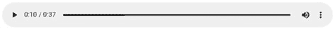

插入音频文件只需一行代码即可完成，示例如下：

```python
st.audio('snoring.mp3', start_time=10)
```

### 显示视频

通过命令 `st.video(data, format='video/mp4', start_time)` 可以向网页中添加视频。

**表 A-41.** `st.video` 参数

| 参数 | 说明 |
| --- | --- |
| `data(str, bytes, BytesIO, numpy.ndarray, 或通过` | 使用标准的 `io.open()` 函数，接受原始视频数据、文件名或 YouTube 视频文件的 URL。原始数据格式和 numpy 数组必须包含其类型所需的最小结构及数值。 |
| `format(str)` | 视频文件的 MIME 类型，默认为 `audio/mp4`。更多信息请参阅 [`tools.ietf.org/html/rfc4281`](https://tools.ietf.org/html/rfc4281)。 |
| `start_time(int)` | 用于设置微件滑块默认开始播放的时间（以秒为单位）。 |

以下是一个简单的视频插入示例：

```python
st.video('https://www.youtube.com/watch?v=m0h7ESBEf3U')
```

``

## A.1.6 页面结构

使用 Streamlit，您可以通过四种方式组织网页，即：侧边栏、多列布局、可折叠面板和容器，或将它们组合使用以自定义用户体验。此外，您还可以使用占位符有效预留网页空间，以便在需要时按需使用。

### 侧边栏

Streamlit 通过 `st.sidebar` 命令提供一个侧边栏，该侧边栏可根据页面大小展开、收缩或自动部署。您可以通过追加函数的方式向其添加任何其他微件或元素（`st.echo` 和 `st.spinner` 除外）。

以下示例展示了如何配合另一个 Streamlit 元素使用侧边栏：

```python
st.sidebar.title('Hello world')
```

``

### 多列布局

使用多列布局时，您可以通过命令 `st.columns(spec)` ➤ `list` 将网页垂直划分为指定宽度的列。该命令返回一个列列表，随后可使用 `with` 语句调用。

**表 A-42.** `st.columns` 参数

| 参数 | 说明 |
| --- | --- |
| `spec(int 或数字列表)` | 若为整数，则指定创建相同宽度的列数。若使用数字列表，则会为每个数字创建一列，其宽度与该数字成比例。 |

``

以下示例展示了如何在 Streamlit 应用程序中使用多列布局：

```python
col1, col2 = st.columns([1,2])

with col1:
    st.text_input('Hello')

with col2:
    st.text_input('World')
```

### 可折叠面板

Streamlit 通过 `st.expander(label,` 命令提供可折叠面板。

#### `st.expander`

`st.expander()` 是一个可展开或收缩的命令，它可以通过`with`语句来容纳所有其他小部件或元素。

**表 A-43.** `st.expander` 参数

| 参数 | 描述 |
|------|------|
| `label` (`str`) | 展开器小部件的显示名称。 |
| `expanded` (`boolean`) | 将此参数设置为 `True` 将使小部件在启动时处于展开状态。 |

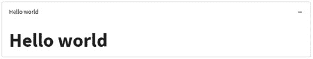

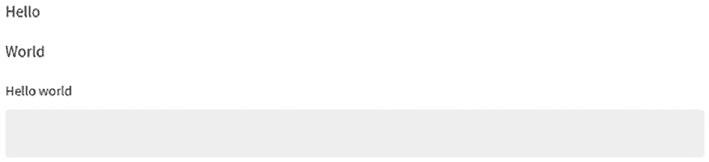

以下示例展示了如何将展开器与另一个 Streamlit 元素一起使用：

```python
with st.expander('Hello world'):
    st.title('Hello world')
```

### `st.container`

使用 Streamlit 的`st.container()`命令，您可以将多个元素组合到一个不可见的容器中。可以使用`with`语句或将 Streamlit 元素附加到容器名称后面来将元素添加到容器中。元素可以按需且不按顺序添加到容器中。

以下示例展示了如何在 Streamlit 应用程序中使用容器：

```python
container_1 = st.container()
container_1.write('Hello')
st.text_input('Hello world')
container_1.write('World')
```

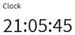

### `st.empty` (占位符)

Streamlit 允许您通过使用占位符（可通过`st.empty()`命令调用）在网页中预留位置。您可以使用`with`语句或简单地将元素附加到占位符名称后面，将任何单个元素（或容器中的一组元素）添加到占位符中。您可以随时更新元素或用另一个元素替换它，完成后，您可以通过附加`empty()`来清空占位符。占位符对于生成需要定期更新的动态或动画内容特别有用。

```python
import datetime

clock = st.empty()
while datetime.datetime.now() < datetime.datetime(2022, 1, 12):
    clock.metric(label='Clock', value=datetime.datetime.now().strftime('%H:%M:%S'))
clock.empty()
```

## A.1.7 显示状态和进度

根据您的应用程序，您可能需要向用户显示某个活动的状态和/或进度。使用 Streamlit，我们有多种原生方法可以向用户传达操作所处的确切阶段。


### `st.progress` (进度条)

使用 Streamlit 的`st.progress(value)`命令，您可以实时显示任何活动的进度。

**表 A-44.** `st.progress` 参数

| 参数 | 描述 |
|------|------|
| `value` (`int` 或 `float`) | 进度条渲染时的值。`int` 类型的值范围为 0 到 100，`float` 类型的值范围为 0.0 到 1.0。 |

```python
import time

timer = st.progress(0)
for i in range(0,100):
    timer.progress(i)
    time.sleep(1)
```

### `st.spinner` (旋转加载器)

使用 Streamlit 的`st.spinner(text)`命令，您可以在可执行代码块中显示临时消息。

**表 A-45.** `st.spinner` 参数

| 参数 | 描述 |
|------|------|
| `text` (`str`) | 在执行代码块期间临时渲染的消息。 |

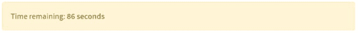


```python
import time

for i in range(0,100):
    with st.spinner('剩余时间：**%s 秒**' % (100-i)):
        time.sleep(1)
```

### `st.success`, `st.info`, `st.warning`, `st.error` (消息)

使用命令`st.success(body)`、`st.info(body)`、`st.warning(body)`和`st.error(body)`，您可以分别显示带有绿色、蓝色、黄色和红色封装框的消息。

**表 A-46.** `st.success`、`st.info`、`st.warning` 和 `st.error` 参数

| 参数 | 描述 |
|------|------|
| `body` (`str`) | 要渲染的消息。 |

```python
col1, col2, col3, col4 = st.columns(4)

with col1:
    st.success('Hello world')
with col2:
    st.info('Hello world')
with col3:
    st.warning('Hello world')
with col4:
    st.error('Hello world')
```

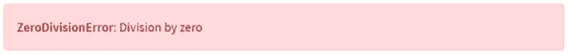

### `st.exception` (异常)

使用 Streamlit 的`st.exception(exception)`命令，您可以显示异常类型和相应的消息。

**表 A-47.** `st.exception` 参数

| 参数 | 描述 |
|------|------|
| `exception( *Exception*)` | 要渲染的异常类型。 |

```python
a = 1
b = 0
try:
    a / b
except:
    st.exception(ZeroDivisionError('Division by zero'))
```

### `Balloons`

`st.balloons()` 命令允许您在绝对必要时渲染漂浮的气球：

```python
st.balloons()
```


### `Snow`

最后，`st.snow()` 命令允许您渲染漂浮的雪花，以纪念 Streamlit 被 Snowflake 收购：

```python
st.snow()
```

## A.1.8 实用工具

Streamlit 还提供了许多其他函数和附加实用工具，例如通过编程方式配置网页、渲染代码片段以及在需要时提供对象文档。

### 页面配置

# A.1.9 会话状态管理

实现有状态架构对于许多 Web 应用程序来说至关重要。从存储用户凭证等会话特定数据到其他变量，缺乏这种能力对许多开发者来说可能是一个决定性因素。请想象一下，在您的应用程序中尝试实现逻辑流程，在一个页面上的用户输入用于在另一个页面上生成可视化。如果不将输入存储为会话变量，一旦您导航到另一个页面或简单地重新运行脚本，它就会被重置，导致您无法获得可视化。幸运的是，Streamlit 提供了一种原生且高度直观的方式来无缝管理会话状态，使开发者能够提供增强的用户体验。

## 初始化会话状态变量

您可以使用 `st.set_page_config(page_title, page_icon, layout, initial_sidebar_state, menu_items)` 命令配置 Streamlit 应用程序的标题、图标、布局、侧边栏状态和菜单选项。

### 表格 A-48. `st.set_page_config` 参数

| 参数 | 描述 |
|------|------|
| `page_title(str or None)` | 将出现在浏览器标签页上的标题；如果未调用，将使用脚本名称作为页面标题。 |
| `page_icon(image, icon, str, or None)` | 将显示在浏览器标签页上的网站图标；也可以使用短代码作为图像的替代。 |
| `layout('centered' or 'wide')` | 页面的布局；如果未调用，页面将默认居中。 |
| `initial_sidebar_state('auto', 'expanded', or 'collapsed')` | 页面启动时侧边栏的状态；如果未调用，将默认为`auto`。 |
| `menu_items(dict)` | 汉堡菜单中“获取帮助”、“报告错误”或“关于”页面的配置。有关更多信息，请参阅第 3.1 节。 |

```python
st.set_page_config(
    page_title='Hello world',
    page_icon=icon,
    layout='centered',
    initial_sidebar_state='auto',
    menu_items={
        'Get Help': 'https://streamlit.io/',
        'Report a bug': 'https://github.com',
        'About': 'About your application: **Hello world**'
    }
)
```

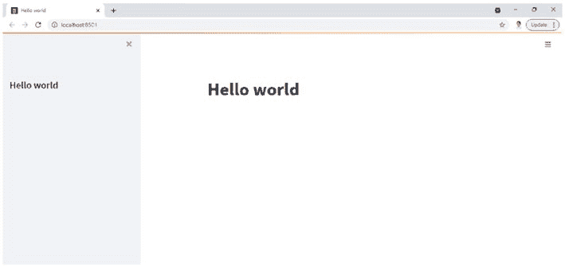

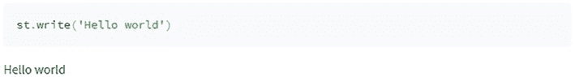

## 代码回声

您可以使用 `st.echo(code_location)` 命令同时渲染和执行代码。

### 表格 A-49. `st.echo` 参数

| 参数 | 描述 |
|------|------|
| `code_location('above' or 'below')` | 决定代码是在其执行位置的上方还是下方渲染。 |

```python
with st.echo():
    st.write('Hello world')
```

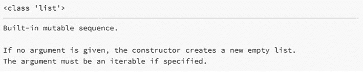


## 文档

您可以使用 `st.help(obj)` 命令显示与某个对象关联的帮助文档。

### 表格 A-50. `st.help` 参数

| 参数 | 描述 |
|------|------|
| `obj(Object)` | 应显示其帮助文档的对象。 |

```python
lst = [1, 2, 3]
st.help(lst)
```

## 停止执行

要停止 Streamlit 应用程序在脚本中特定点的执行，您可以使用 `st.stop()` 命令来防止其余代码被执行：

```python
st.write('Hello world')
st.stop()
st.write('Bye world')
```

# Streamlit 会话状态

Streamlit 的会话状态字典由键值对组成，其中每个键必须先初始化才能调用，每个值可以是字符串、整数、列表、字典、数据框、对象或其他变量。要将变量初始化到会话状态中，请按如下步骤操作：

```python
if 'state_1' not in st.session_state:
    st.session_state['state_1'] = None
```

## 访问会话状态变量

随后，要访问在同一会话中初始化的变量，只需按如下方式调用：

```python
state_1 = st.session_state['state_1']
```

要访问所有会话状态变量，请使用以下命令：

```python
st.write(st.session_state)
```

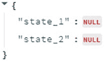

## 附录 A Streamlit 应用程序编程接口

这将返回包含所有已存储键值对的会话状态字典，具体示例如下：

## 更新会话状态变量

要更新会话状态变量的值，请按如下步骤操作：

```python
st.session_state['state_1'] = 'Hello world'
```

## 删除会话状态变量

要删除特定的会话状态变量，请使用以下方法：

```python
del st.session_state['state_1']
```

要一次性删除所有会话状态变量，可以使用以下方法：

```python
for variable in st.session_state:
    del st.session_state[variable]
```

## 组件会话状态

Streamlit 中的每个组件都会自动关联其自身的会话状态变量，其中键与作为参数传递给组件的键相同，如下所示：

```python
st.button('随机按钮', key='random_button_1')
st.text_input('Hello world', key='hello_world_input')
st.write(st.session_state)
```

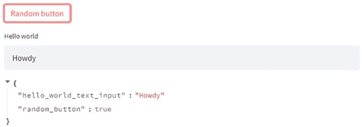

请注意，在组件实例化后修改其会话状态的值是不允许的，如果尝试这样做，将会抛出 `StreamlitAPIException` 错误。但是，允许在组件实例化之前设置其状态，不过如果组件的默认值已作为参数设置，将会显示一次性警告信息。

此外，对于包含按钮的组件（如 `st.button`、`st.download_button` 和 `st.file_uploader`），其会话状态值不可修改；默认情况下，它们被设置为 `False`，点击时会切换为 `True`。

## A.1.10 数据管理

对于 Web 服务器而言，管理数据以实现计算资源的最优使用至关重要。考虑到我们面对的数据规模庞大，通常需要缓存数据、函数和其他对象，以便在需要时及时复用。为此，Streamlit 提供了一种内置功能，可以在应用程序中缓存和重用数据，并产生显著积极的效果。此外，Streamlit 还提供了在需要时无需任何第三方库即可原生修改数据的能力。

### 缓存数据

Streamlit 允许您使用 `st.cache(func, persist, allow_output_mutation, show_spinner, suppress_st_warning, hash_funcs, max_entries, ttl)` 命令持久缓存函数的结果和数据以供后续使用。如果您处理的是需要长时间下载或处理的大型数据集，此功能尤其有用。启用此功能后，您可以通过调用写在 `st.cache` 装饰器下方的函数将数据存入缓存，然后在需要时按需重新调用，而无需重新执行该函数，即使在脚本重新运行后也不例外。

**表 A-51.** `st.cache` 参数

| 参数 | 描述 |
| :--- | :--- |
| `func`（可调用对象） | 要缓存的函数。 |
| `persist`（布尔值） | 该参数指定是否持久保留缓存的数据。 |
| `allow_output_mutation`（布尔值） | 将该参数设置为 `True` 将允许您覆盖缓存的数据，而不会收到 Streamlit 的警告。 |
| `show_spinner`（布尔值） | 如果设置为 `True`，则在缓存未命中时会显示一个加载动画。 |
| `suppress_st_warning`（布尔值） | 将该参数设置为 `True` 将抑制任何 |

# 附录 A Streamlit 应用程序接口

## 使用 `st.cache` 进行缓存

`warning` (`boolean`) — 关于在缓存函数内调用内嵌函数的警告。

`hash_funcs` (`dict` 或 `None`) — 通过此参数，您可以覆盖 Streamlit 对缓存中对象的处理方式；当哈希函数在字典中遇到指定对象时，它将使用关联函数进行响应。

`max_entries` (`int` 或 `None`) — 此参数指定要缓存的最大条目数，每当有新条目添加到列表中时，最旧的条目将被相应移除。

`ttl` (`float` 或 `None`) — 此参数决定条目在缓存中的保留时间（秒）；若未设置，缓存将不会被清除。

```python
@st.cache
def dataframe(rows):
    df = pd.DataFrame(
        np.random.randn(rows, 5),
        columns=('col %d' % i for i in range(5)))
    return df

# 首次调用以缓存数据框
df = dataframe(100000)

# 后续调用将访问缓存的数据框，无需重新执行函数
df = dataframe(100000)

# 由于输入参数已修改，将重新执行函数并缓存新的数据框
df = dataframe(200000)
```

## 缓存函数

Streamlit 还允许您通过 `st.experimental_memo(func, persist, show_spinner, suppress_st_warning, max_entries, ttl)` 命令持久地缓存函数执行结果。此功能与 `st.cache` 命令非常相似。当您不再需要缓存时，可以使用 `st.experimental_memo.clear()` 命令将其移除。请注意，以 `experimental` 开头的命令在功能成熟后，将在未来版本中移除此前缀。

**表 A-52.** `st.experimental_memo` 参数

| 参数 | 描述 |
|---|---|
| `func` (`callable`) | 需要缓存的函数。 |
| `persist` (`boolean`) | 此参数指定是否持久保留缓存数据。 |
| `show_spinner` (`boolean`) | 如果设置为 `True`，则在缓存未命中时将显示加载动画。 |
| `suppress_st_warning` (`boolean`) | 将此参数设置为 `True` 将抑制关于在缓存函数内调用内嵌函数的任何警告。 |
| `max_entries` (`int` 或 `None`) | 此参数指定要缓存的最大条目数，每当有新条目添加到列表中时，最旧的条目将被相应移除。 |
| `ttl` (`float` 或 `None`) | 此参数决定条目在缓存中的保留时间（秒）；若未设置，缓存将不会被清除。 |

```python
@st.experimental_memo
def dataframe(rows):
    df = pd.DataFrame(
        np.random.randn(rows, 5),
        columns=('col %d' % i for i in range(5)))
    return df

# 首次调用以缓存函数执行结果
df = dataframe(100000)

# 后续调用将访问缓存的执行结果，无需重新执行函数
df = dataframe(100000)

# 由于输入参数已修改，将重新执行函数并缓存新的执行结果
df = dataframe(200000)
```

## 缓存对象

与 `st.cache` 类似，Streamlit 允许您通过 `st.experimental_singleton(func, show_spinner, suppress_st_warning)` 命令持久地缓存对象。当您不再需要缓存时，可以使用 `st.experimental_singleton.clear()` 命令将其移除。需要特别强调的是，单例对象必须是线程安全的，因为它们将被应用程序的所有用户共享。`st.experimental_singleton` 的典型用例包括数据库连接和语料库。然而，对于 `st.memo` 则不是这种情况，因为每个调用者将收到缓存数据的独立副本。

**表 A-53.** `st.experimental_singleton` 参数

| 参数 | 描述 |
|---|---|
| `func` (`callable`) | 需要缓存的函数。 |
| `show_spinner` (`boolean`) | 如果设置为 `True`，则在缓存未命中时将显示加载动画。 |
| `suppress_st_warning` (`boolean`) | 将此参数设置为 `True` 将抑制关于在缓存函数内调用内嵌函数的任何警告。 |

# 附录 A Streamlit 应用程序编程接口

## 使用 `st.experimental_singleton` 进行缓存

```python
@st.experimental_singleton
def load_nlp(lang):
    nlp = spacy.load('%s_core_news_sm' % (lang))
    return nlp
```

```python
##### 首次调用以缓存对象
nlp = load_nlp('es')
##### 后续调用将访问已缓存的对象，无需重新执行函数
nlp = load_nlp('es')
##### 由于输入参数修改，将重新执行函数并缓存新对象
nlp = load_nlp('de')
```

## 数据修改

Streamlit 允许您通过使用 `st.add_rows(data, **kwargs)` 命令将数据帧添加到表格末尾，从而实时修改数据和图表。

**表 A-54.** `st.add_rows` 参数

| 参数 | 描述 |
|-----------|-------------|
| `data`（Pandas 数据帧或样式器、PyArrow 表、Numpy 数组、字典、None 或可迭代对象） | 要追加到现有表格的数据帧。如果使用 PyArrow 表，必须在配置文件中设置 `dataFrameSerialization = 'arrow'`；更多信息请参见第 3.1 节。 |
| `**kwargs`（Pandas 数据帧、Numpy 数组、字典、None 或可迭代对象） | 如有需要，您可以将要追加的数据帧作为命名对象传递，例如 `'dataset' = df`。 |

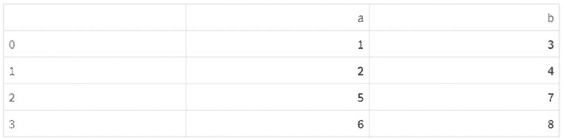

### 使用 `st.add_rows` 修改表格

```python
table = st.table(pd.DataFrame(data={'a':[1,2], 'b':[3,4]}))
df = pd.DataFrame(data={'a':[5,6], 'b':[7,8]})
table.add_rows(df)
```

## A.1.11 汉堡菜单

Streamlit 默认在网页右上角配备了一个汉堡菜单。该菜单提供了一系列可能对用户和开发者都有用的附加功能。表 A-55 总结了可用的功能。

**表 A-55.** 汉堡菜单功能

| 功能 | 描述 |
|---------|-------------|
| 重新运行 | 点击后，Streamlit 将从头到尾重新运行脚本。 |
| 设置 | 打开一个窗口，用户可在其中自定义主题的外观、颜色、字体及其他相关设置。更多信息请参见第 3.1 节。 |
| 录制屏幕录像 | 顾名思义，此功能允许您录制浏览器窗口中的视频和音频流，并以 `webm` 格式保存。 |
| 报告错误 | 此选项会打开一个 GitHub 页面链接，您可以在其中报告错误。或者，您也可以选择将此选项链接到第 3.1 节所示的任何其他所需 URL。 |
| 获取帮助 | 同样，此选项会将您带到 Streamlit 讨论页面，您可以在其中提出问题和疑虑。如果需要，可将其链接到第 3.1 节所示的另一个 URL。 |
| 关于 | 此选项会显示一个模态窗口，其中包含您正在使用的 Streamlit 版本。如有需要，您可以按照第 3.1 节所示自定义显示的文本。 |
| 清除缓存 | 此功能将清除由 `st.cache` 命令存储的所有数据。更多信息请参见第 4.1 节。 |
| 部署此应用 | Streamlit 允许您通过此选项直接将应用程序部署到其名为 Streamlit Cloud 的服务器。 |
| Streamlit Cloud | 此链接将带您进入 Streamlit Cloud 的主页，该页面提供有关其托管服务的更多信息。 |
| 报告 Streamlit 错误 | 与“报告错误”功能相同，此选项将带您进入 GitHub 页面，您可以在其中报告错误和问题。 |
| 访问 Streamlit 文档 | 此链接将直接带您进入 Streamlit 的 API。 |
| 访问 Streamlit 论坛 | 同样，此链接将带您进入 Streamlit 的论坛。 |
